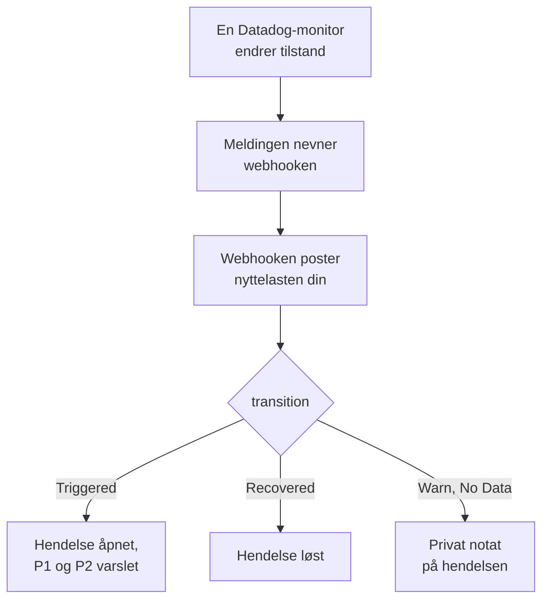

# Datadog

Send varsler fra [Datadog](https://www.datadoghq.com)-monitorer til OneUptime, slik at hvert varsel blir en hendelse eller et varsel i OneUptime, varsler vaktteamet ditt når det haster, og løses når Datadog-monitoren er gjenopprettet. Datadog sender varslene sine gjennom sin [Webhooks-integrasjon](https://docs.datadoghq.com/integrations/webhooks/), så det er ingenting å installere på noen av sidene.

:::cards
- [Velg hvordan OneUptime mottar varsler](#velg-hvordan-oneuptime-mottar-varsler): En arbeidsflytmal eller en Incoming Request-monitor.
- [Start med malen](#start-med-malen): Velg hvem som skal varsles, kopier URL-en, og se hva hvert varsel gjør.
- [Motta varsler med en monitor](#motta-varsler-med-en-monitor): Én hendelse per varsel, løst ved gjenoppretting.
- [Konfigurer Datadog](#konfigurer-datadog): En webhook og monitorene som varsler den.
- [Feilsøking](#feilsøking): Når varsler ikke kommer frem, eller hendelser blir stående åpne.
:::

## Slik fungerer det



En Datadog-monitor varsler webhookene som meldingen nevner, når den endrer tilstand: når den utløses, advarer, gjenopprettes eller mangler data. JSON-innholdet i webhooken skriver du selv, ut fra Datadogs [malvariabler](https://docs.datadoghq.com/integrations/webhooks/#usage), så denne veiledningen gir deg et som navngir hvert varsel og sier hva som skjedde med det.

## Før du begynner

- En Datadog-konto der du kan konfigurere integrasjoner og redigere monitorer.
- I OneUptime tilgang til å opprette arbeidsflyter, eller monitorer hvis du velger den veien. I OneUptime Cloud krever arbeidsflyter planen **Growth** eller høyere.

## Velg hvordan OneUptime mottar varsler

Sett opp OneUptime først: det gir deg URL-en som Datadog sender til.

| Vei | Bruk den når |
| --- | --- |
| Arbeidsflytmalen (anbefalt) | Du vil ha hvert varsel som en hendelse eller et varsel med en alvorlighetsgrad ut fra monitorens prioritet, varslet til vakten for P1 og P2, med advarsler notert på den, og løst ved gjenoppretting. Det er ingenting å bygge. |
| En Incoming Request-monitor | Du vil ha hendelser uten en arbeidsflyt, på hvilken som helst plan, og en monitor hvis status følger Datadog. |

Begge får den samme JSON-en fra den samme webhooken, så du kan begynne med den ene og bytte senere ved å endre én URL i Datadog.

## Start med malen

Dialogen **Opprett en arbeidsflyt** har to Datadog-maler, under **Datadog** i kategorilisten: **Declare an incident when a Datadog monitor triggers**, og **Create an alert when a Datadog monitor triggers** for varsler. Begge gjør det samme, hver med sin egen type post.

:::steps
1. Gå til **Arbeidsflyter**, og klikk på **Opprett arbeidsflyt**. Under **Eller start fra en mal** velger du **Datadog** i kategorilisten, klikker på **Declare an incident when a Datadog monitor triggers**, eller **Create an alert when a Datadog monitor triggers**, og klikker på **Bruk denne malen**.
2. Under **Who to page for P1 and P2 monitors** velger du vaktpolicyene som skal tilkalles, eller ingen for ikke å tilkalle noen, og klikker på **Opprett arbeidsflyt**. Arbeidsflyten åpnes i **Bygger**, slått av.
3. Klikk på triggeren **Webhook**, deretter på **Kopier URL**, og ta vare på URL-en til Datadog.
4. Slå på **Aktivert** øverst i **Bygger**. En arbeidsflyt som er slått av, svarer Datadog med `400`.
:::

Deretter [konfigurerer du Datadog](#konfigurer-datadog) til å sende varslene sine til den URL-en. Arbeidsflytens steg `read-event-1` åpnes med det samme oppsettet, for når du kommer tilbake til det i **Bygger**.

### Hva arbeidsflyten gjør

Etter triggeren **Webhook** leser steget **Check With JavaScript** `read-event-1` den `transition` Datadog sender, og **Incident From Another Tool**, eller **Alert From Another Tool** i varselmalen, gjør det den betyr, ut fra varselets syklusnøkkel. Datadog beholder nøkkelen fra et varsel utløses til det gjenopprettes, og neste gang det utløses, er nøkkelen ny, så hver gang får en egen hendelse. Hendelsen tar vare på nøkkelen i det egendefinerte feltet `datadogAlertCycleKey`.

| Transition | Hva arbeidsflyten gjør |
| --- | --- |
| `Triggered`, `Re-Triggered` | Erklærer en hendelse med tittelen `Datadog: <monitor>`, med alvorlighetsgraden monitorens prioritet tilsvarer, holdt unna statussidene dine. Beskrivelsen lenker til varselet i Datadog, og viser prioriteten, verten, omfanget og monitorens melding. En varsling for et varsel som har sin hendelse, åpner ingen ny, og varsler ingen på nytt. |
| `Recovered` | Løser varselets hendelse, med mindre den allerede er løst. Hvorfor står på tidslinjen. |
| `Warn`, `Re-Warn`, `No Data`, `Re-No Data` | Legger til et privat notat på varselets hendelse, som sier hva monitorens tilstand er nå. |
| `Renotify` | Ingenting: varselet er fortsatt åpent. |

En advarsel eller en gjenoppretting for et varsel uten hendelse endrer ingenting. Alt annet, for eksempel en forespørsel fra et annet verktøy, blir stående: `read-event-1` tar **No**, og kjøringens **Trinn** sier hvorfor. Ingenting går tilbake til Datadog: det løser sine egne varsler når signalet er gjenopprettet, og det er det som løser hendelsen.

### Prioriteter og varsling

En ny hendelse varsler vaktretningslinjene du valgte når monitoren er P1 eller P2, eller ikke har noen prioritet. P3, P4 og P5 åpner en hendelse og varsler ingen. I et nytt prosjekt knytter prioritetene seg til disse alvorlighetsgradene for hendelser og varsler:

| Datadog-prioritet | Hendelse | Varsel | Vakt |
| --- | --- | --- | --- |
| P1 | Critical Incident | High | Varslet |
| P2 | Critical Incident | High | Varslet |
| Ingen prioritet | Critical Incident | High | Varslet |
| P3 | Major Incident | Low | Ikke varslet |
| P4 | Minor Incident | Low | Ikke varslet |
| P5 | Minor Incident | Low | Ikke varslet |

Med egne alvorlighetsgrader går P1, P2 og ingen prioritet til den mest alvorlige, P3 til den midterste, og P4 og P5 til den minst alvorlige.

- For å knytte en prioritet til en av dine etter navn, rediger `SEVERITY_BY_NAME` i steget `read-event-1`, for eksempel `{ P3: 'Minor Incident' }`.
- For å varsle også for P3, sett **Compare with** i steget `if-page-1` **If / Else** til `3`.

## Motta varsler med en monitor

En [Incoming Request-monitor](/docs/monitor/incoming-request-monitor) gir deg en URL, og kriteriene dens avgjør hva hvert varsel gjør.

:::steps
### Opprett monitoren

Gå til **Monitorer**, og klikk på **Opprett monitor**. Velg **Incoming Request** under **Monitortype**, gi den navnet `Datadog`, og klikk på **Neste**.

### Erklær en hendelse for hvert varsel

Åpne det første kriteriet i trinnet **Kriterier**, det som markerer monitoren som frakoblet. Sett filteret til **Forespørselstekst**, **Inneholder**, `"transition":"Triggered"`. Dette kriteriet erklærer allerede en hendelse når filteret samsvarer. Fyll ut hendelsen:

- **Hendelsestittel**: `{{requestBody.title}}`.
- **Hendelsesbeskrivelse**, under **Beskrivelse**: `{{requestBody.body}}`, deretter `Datadog: {{requestBody.link}}` på en egen linje.
- **Alvorlighetsgrad**: hendelsesalvorlighetsgraden disse varslene skal ha.
- **Vaktretningslinjer**, under **Vakt**: retningslinjene som skal varsles.
- **Løs hendelse automatisk**, under **Flere felt**: la den være slått på, slik den starter. Uten den ignoreres gjenopprettinger, og hendelser blir stående åpne.

### Åpne én hendelse per varsel

Åpne **Innstillinger** i det samme kriteriet, og slå på **Group incidents and alerts by a payload field**. Fyll den ut som nedenfor, slik at hvert varsel får sin egen hendelse, og gjenopprettingen løser den:

| Felt | Verdi |
| --- | --- |
| **Open a separate incident for each…** | `requestBody.alert_key` |
| **Field that signals recovery** | `requestBody.transition` |
| **Value that means recovered** | `Recovered` |

### Få monitoren tilkoblet igjen

Åpne det andre kriteriet, det som markerer monitoren som tilkoblet, og sett filteret til **Forespørselstekst**, **Inneholder**, `"transition":"Recovered"`.

### Kopier URL-en

Klikk på **Opprett monitor**. Monitorens side **Oversikt** viser **Heartbeat URL**. Kopier den til Datadog:

```text
https://oneuptime.com/heartbeat/<secret key>
```

En selvdriftet installasjon har sin egen vert i stedet for `oneuptime.com`.
:::

Nyttelasten nedenfor setter `alert_key` til Datadog-monitorens ID og taggene til gruppen som varslet, slik at hver gruppe i en multi-alert-monitor får sin egen hendelse, og gjenopprettingen til den gruppen løser den. En monitor som utløses på nytt eller varsler på nytt mens hendelsen er åpen, åpner ikke en hendelse til. Se [Motta varsler fra et annet system](/docs/monitor/incoming-request-monitor#motta-varsler-fra-et-annet-system) for hva hver innstilling gjør.

> [!NOTE]
> En varsling **Warn** eller **No Data** åpner ingen hendelse med disse filtrene. For også å bli varslet ved advarsler klikker du på **Legg til kriterier**, gir det nye kriteriet filteret **Forespørselstekst**, **Inneholder**, `"transition":"Warn"`, en hendelse med sin egen **Alvorlighetsgrad** og de samme grupperingsinnstillingene, og drar det deretter over det første kriteriet. Kriterier kontrolleres ovenfra, og det første som samsvarer, bestemmer.

## Konfigurer Datadog

:::steps
### Legg til webhooken

Åpne [flisen for Webhooks-integrasjonen](https://app.datadoghq.com/integrations/webhooks) i Datadog, og installer den hvis den ikke er installert ennå. Legg til en webhook med disse innstillingene, og lagre den deretter:

- **Name**: `oneuptime`. Monitorer nevner webhooken med dette navnet, som `@webhook-oneuptime`.
- **URL**: URL-en du kopierte fra OneUptime.
- **Payload**:

  ```json
  {
    "alert_key": "$ALERT_ID $ALERT_SCOPE",
    "alert_cycle_key": "$ALERT_CYCLE_KEY",
    "transition": "$ALERT_TRANSITION",
    "alert_priority": "$ALERT_PRIORITY",
    "title": "$EVENT_TITLE",
    "body": "$TEXT_ONLY_MSG",
    "host": "$HOSTNAME",
    "scope": "$ALERT_SCOPE",
    "priority": "$PRIORITY",
    "link": "$LINK"
  }
  ```

### Nevn webhooken i monitorene dine

Legg til `@webhook-oneuptime` i monitorens varslingsmelding i hver Datadog-monitor som skal varsle gjennom OneUptime, og lagre monitoren. Datadog sender da varslene og gjenopprettingene fra den monitoren til OneUptime.
:::

| Variabel | Hva Datadog setter i den |
| --- | --- |
| `$ALERT_ID` | ID-en til Datadog-monitoren som varslet. |
| `$ALERT_SCOPE` | Taggene til gruppen som varslet, som `host:web-1`. |
| `$ALERT_CYCLE_KEY` | En ID som forblir den samme fra et varsel utløses til det gjenopprettes. |
| `$ALERT_TRANSITION` | Hva som skjedde: `Triggered`, `Re-Triggered`, `Warn`, `Recovered`, `No Data` eller `Renotify`, blant andre. |
| `$ALERT_PRIORITY` | Prioriteten til Datadog-monitoren, `P1` til `P5`, eller ingenting for en monitor uten. |
| `$EVENT_TITLE` | Tittelen på hendelsen, som `[Triggered] High CPU`. |
| `$TEXT_ONLY_MSG` | Monitorens melding, uten Markdown. |
| `$LINK` | En lenke til hendelsen i Datadog. |

Én nyttelast dekker begge veier: malen går etter `alert_cycle_key` og `alert_priority`, og monitoren etter `alert_key`. Behold dem alle, så kan du bytte senere ved å endre bare URL-en.

## Test det

Send et varsel til URL-en du kopierte, slik Datadog ville gjort:

```bash
curl -X POST "<url>" \
  -H "Content-Type: application/json" \
  -d '{
    "alert_key": "1234 host:web-1",
    "alert_cycle_key": "7151157925468446720",
    "transition": "Triggered",
    "alert_priority": "P1",
    "title": "[Triggered] High CPU",
    "body": "CPU is above 90% on web-1.",
    "host": "web-1",
    "scope": "host:web-1",
    "priority": "normal",
    "link": "https://app.datadoghq.com/event/event?id=1"
  }'
```

Med malen åpnes en hendelse med tittelen `Datadog: High CPU`, og vaktpolicyene du valgte, varsles. Med monitoren åpnes en hendelse med tittelen `[Triggered] High CPU`. Send den samme forespørselen med `transition` satt til `Recovered`, og hendelsen løses.

Test deretter fra Datadog: åpne en monitor som nevner webhooken, klikk på **Test Notifications**, og send varslingen **Alert**. For å se at den kom frem åpner du arbeidsflytens **Logger → Kjøringer**, eller tidslinjen til OneUptime-monitoren.

## Feilsøking

:::details Ingenting kommer frem til OneUptime
- Kontroller at meldingen til Datadog-monitoren nevner `@webhook-oneuptime`, stavet slik webhooken heter.
- Monitoren svarer `200` med en gang, før den kontrollerer noe, også ved en feil hemmelig nøkkel. Sjekk monitorens tidslinje for å se om varsler kommer frem.
- En arbeidsflyt som er slått av, svarer `400`. Slå på **Aktivert** øverst i **Bygger** for den.
:::

:::details Arbeidsflyten kjører, men åpner ingenting
Åpne kjøringen i **Logger → Kjøringer**. Oppføringen `read-event-1` under **Trinn** sier hvorfor den tok **No**.

- `Datadog named no alert cycle key`: legg til `"alert_cycle_key": "$ALERT_CYCLE_KEY"` i webhookens nyttelast i Datadog.
- `Datadog named no transition`: legg til `"transition": "$ALERT_TRANSITION"` i webhookens nyttelast i Datadog.
:::

:::details Vakten blir ikke varslet
- Bare P1- og P2-monitorer og monitorer uten prioritet varsler. Se [Prioriteter og varsling](#prioriteter-og-varsling).
- En varsling for et varsel som har sin hendelse, varsler ingen på nytt.
- Hvis ingen ble valgt i dialogen **Opprett en arbeidsflyt**, har arbeidsflyten ikke noe steg som varsler.
:::

:::details Hendelser opprettes, men løses aldri
- Datadog-monitoren må også varsle webhooken om gjenopprettingene sine. En melding som nevner webhooken bare for varsler, inne i en betingelse, sender ingen gjenoppretting.
- Med malen åpner du kjøringen til gjenopprettingen i **Logger → Kjøringer**: det siste steget sier hvorfor. Gjenopprettingens `alert_cycle_key` må være varselets, så behold `$ALERT_CYCLE_KEY` slik det står i nyttelasten.
- Med monitoren trenger hendelsen i kriteriet **Løs hendelse automatisk**, under **Flere felt**.
- **Value that means recovered** må være nøyaktig `Recovered`. Sammenligningen skiller mellom store og små bokstaver.
- `alert_key` i gjenopprettingen må være varselets: behold `$ALERT_ID $ALERT_SCOPE` slik det står i nyttelasten.
:::

:::details Et felt viser navnet på en variabel, eller ingenting
Datadog fyller bare ut variablene som gjelder for hendelsen. Send en testvarsling, og se deretter hva som kom frem: i monitorens tidslinje, eller for en arbeidsflyt i **Logger → Kjøringer**.
:::

:::details Alle varslene fra en monitor slås sammen til én hendelse
Med monitoren trenger hver gruppe sin egen `alert_key`. Kontroller at nyttelasten setter den fra både `$ALERT_ID` og `$ALERT_SCOPE`, og at grupperingsbanen er `requestBody.alert_key`.
:::

## Sikkerhet

- **Behandle URL-en som et passord.** Alle som har den, kan åpne hendelser. Hvis den lekker, tilbakestiller du den: **Tilbakestill URL** i arbeidsflytens **Webhook**-trigger, eller **Tilbakestill hemmelig nøkkel for innkommende forespørsel** på monitorens side **Innstillinger**. Oppdater deretter webhookens **URL** i Datadog.
- **Lenker går til Datadog.** Malen lenker et varsel bare på et Datadog-nettsted, uansett hva en forespørsel sier, og skriver det Datadog sendte, som tekst.
- **Selvdriftet?** Datadog sender webhooks fra internett, så OneUptime-instansen din må kunne nås derfra over HTTPS.

## Neste trinn

:::cards
- [Arbeidsflytmaler](/docs/workflows/authoring): Opprett en arbeidsflyt fra en mal, og endre den i Bygger.
- [Innkommende forespørsel-overvåking](/docs/monitor/incoming-request-monitor): Hver innstilling for monitoren som mottar varslene dine.
- [New Relic](/docs/integrations/new-relic): Den samme malen, for New Relic-saker.
- [Eskaleringsregler](/docs/on-call/escalation-rules): Bestem hvem en vaktretningslinje varsler, og når.
- [Oversikt over integrasjoner](/docs/integrations/index): De andre verktøyene du kan koble til.
:::
