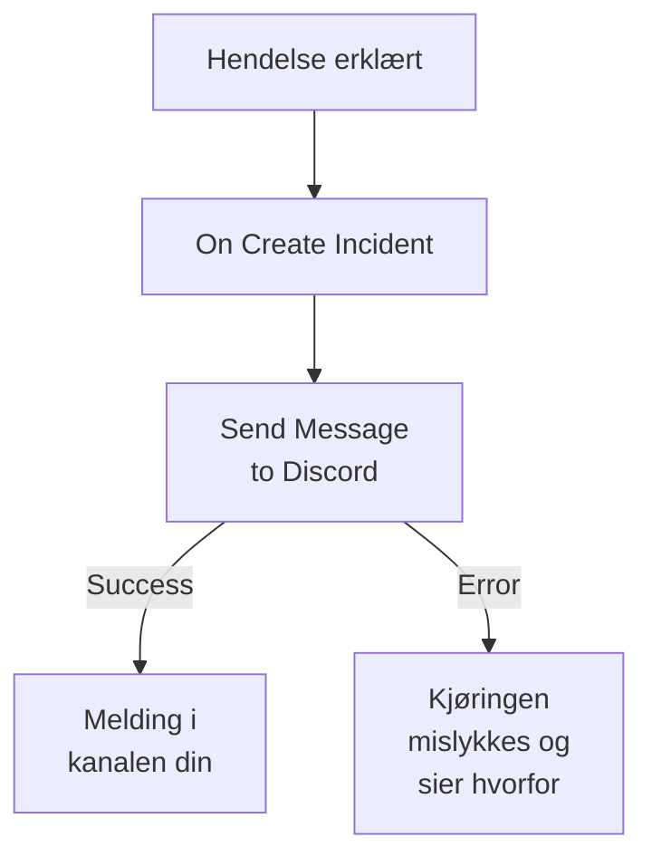

# Discord

Post en melding i en [Discord](https://discord.com)-kanal når en hendelse åpnes, slik at de som følger kanalen, får vite det med en gang. OneUptimes arbeidsflyttrinn **Send Message to Discord** poster via webhooken til kanalen, og en ferdig mal bygger hele arbeidsflyten for deg. Denne integrasjonen er **utgående**: OneUptime poster i kanalen og leser ikke det som blir sagt der.

:::cards
- [Slik fungerer det](#slik-fungerer-det): Hva arbeidsflyten gjør når en hendelse åpnes.
- [Oppsett](#sett-opp-integrasjonen): En webhook i Discord og så arbeidsflyten: fra malen eller fra bunnen.
- [Tips](#tips): Formatering, lange meldinger og flere hendelser.
- [Feilsøking](#feilsøking): Hva feilene fra trinnet betyr, og hva du bør endre.
:::

## Slik fungerer det



Trinnet poster **Message Text** til webhooken til kanalen. Det tar utgangen **Success** når Discord tar imot meldingen, og utgangen **Error**, med Discords begrunnelse, når Discord avviser den. Er ingenting koblet til **Error**, som i malen, mislykkes en kjøring som ikke kunne poste, og dens **Trinn** sier hvorfor.

## Før du begynner

- I Discord tillatelsen **Manage Webhooks** på kanalen.
- I OneUptime retten til å opprette arbeidsflyter og variabler. På OneUptime Cloud krever arbeidsflyter planen **Growth** eller høyere.

## Sett opp integrasjonen

:::steps
### Opprett en webhook i Discord

1. Åpne innstillingene for kanalen i Discord med **Edit Channel**, deretter **Integrations → Webhooks**, og velg **New Webhook**.
2. Gi den et navn, for eksempel `OneUptime`, og kontroller at den poster i riktig kanal.
3. Velg **Copy Webhook URL**.

Alle som har URL-en, kan poste i kanalen, så ta like godt vare på den som på et passord.

### Bygg arbeidsflyten

Start fra malen, som bygger hele arbeidsflyten for deg, eller fra bunnen.

:::tabs
@tab Fra malen
1. Åpne **Arbeidsflyter**, og klikk på **Opprett arbeidsflyt**.
2. Skriv `Discord` i **Søk i maler…**, klikk på **Tell Discord when an incident opens**, og klikk deretter på **Bruk denne malen**.
3. Behold navnet **Notify Discord on new incident**, eller endre det, og klikk på **Neste**.
4. Lim inn URL-en i **Discord Webhook URL**, og klikk på **Opprett arbeidsflyt**.

Arbeidsflyten åpnes i **Bygger** med to trinn: **On Create Incident** og **Send Message to Discord**, som poster nummeret, tittelen, alvorlighetsgraden og tilstanden til hendelsen. URL-en lagres som arbeidsflytens hemmelige variabel `discordWebhookUrl`.
@tab Fra bunnen
1. Lagre URL-en som en hemmelig global variabel: gå til **Arbeidsflyter → Globale variabler**, klikk på **Opprett Workflow Variabel**, gi den navnet `DISCORD_WEBHOOK_URL`, og klikk på **Neste**. Lim inn URL-en i **Innhold**, slå på **Hemmelighet**, og klikk på **Opprett Workflow Variabel**.
2. Gå til **Arbeidsflyter**, klikk på **Opprett arbeidsflyt**, velg **Start fra bunnen**, gi arbeidsflyten et navn, og klikk på **Opprett arbeidsflyt**.
3. Klikk på **Velg hva som starter denne arbeidsflyten** i **Bygger**, og velg **On Create Incident** under **Populære**. Klikk på utløseren: **Fields to pass on** starter med **Tittel**, så klikk på **Legg til felt**, og velg de andre feltene meldingen din viser, for eksempel **Incident Number With Prefix**.
4. Klikk på **Legg til komponent**, søk etter `discord`, og klikk på **Send Message to Discord**. Koble utgangen **Success** fra utløseren til den.
5. Klikk på det nye trinnet. Klikk på **{ }** i **Discord Incoming Webhook URL**, og velg `DISCORD_WEBHOOK_URL` under **Global variables**. Skriv meldingen i **Message Text**, og sett inn feltene til hendelsen med **{ }**.
:::

En melding bygget fra bunnen leser feltene til hendelsen med referanser som disse:

```text
🚨 **Incident {{local.components.incident-on-create-1.returnValues.model.incidentNumberWithPrefix}} declared**
**Title:** {{local.components.incident-on-create-1.returnValues.model.title}}
```

### Slå den på og test den

Slå på **Aktivert** øverst i **Bygger**. Fra nå av postes hver nye hendelse i kanalen.

For å teste uten å åpne en hendelse klikker du på **Kjør arbeidsflyt** og velger en hendelse du allerede har, under **Hendelse**: de nyeste er listet opp, og når du skriver inn nummeret eller en del av tittelen, finner du en annen. Klikk på **Kjør arbeidsflyten manuelt**, og bekreft med **Kjør**. Panelet **Arbeidsflytkjøring** følger kjøringen, og meldingen dukker opp i kanalen. Tar trinnet **Error** i stedet, mislykkes kjøringen, og trinnets oppføring under **Trinn** sier hvorfor: se [Feilsøking](#feilsøking).
:::

## Tips

- **Formater med Discords Markdown.** Teksten sendes slik den er skrevet, så Discords Markdown fungerer i den: stjerner rundt et ord gjør det fett, og en URL vises som en lenke.
- **Følg med på grensen på 2 000 tegn.** Discord tar imot meldinger på opptil 2 000 tegn. En lengre blir kuttet og slutter med "… (truncated — see OneUptime for the full text)" i stedet for å bli avvist.
- **Post mer enn nye hendelser.** Bygg en annen arbeidsflyt på **On Update Incident** for tilstandsendringer, eller på **On Create Alert** for varsler, med det samme trinnet. For å poste bare noen hendelser setter du en blokk **If / Else** foran trinnet.
- **Bare Discords egne adresser.** Trinnet poster til en `https`-URL på `discord.com` eller `discordapp.com`, og følger ikke omdirigeringer, så en URL som peker et annet sted, stopper kjøringen.

## Feilsøking

Når trinnet tar **Error**, mislykkes kjøringen, og trinnets oppføring under kjøringens **Trinn** gir Discords begrunnelse.

:::details Discord svarer "Unknown Webhook" eller "Invalid Webhook Token"
Webhooken er slettet, eller URL-en er kopiert feil. Opprett en ny webhook, og erstatt URL-en: i malens arbeidsflyt variabelen `discordWebhookUrl`, i din egen arbeidsflyt innholdet i `DISCORD_WEBHOOK_URL`.
:::

:::details Discord svarer "You are being rate limited"
Discord begrenser hvor ofte én webhook kan poste. En byge av hendelser kan treffe grensen: post færre meldinger, for eksempel bare for noen alvorlighetsgrader.
:::

:::details Kjøringen stopper med "Discord Webhook URL must be an https URL on discord.com or discordapp.com"
**Discord Incoming Webhook URL** inneholder noe annet enn en Discord-webhook, eller variabelen den leser, er tom. Lim inn URL-en fra **Copy Webhook URL** på nytt.
:::

## Neste trinn

:::cards
- [Arbeidsflyt-komponenter](/docs/workflows/components#discord): Hver innstilling i trinnet, og hva utgangene betyr.
- [Telegram](/docs/integrations/telegram): Den samme ideen, i en Telegram-chat.
- [Arbeidsflyt-kjøringer](/docs/workflows/runs-and-logs): Les hva hver kjøring av arbeidsflyten gjorde.
- [Oversikt over integrasjoner](/docs/integrations/index): Det utgående mønsteret og de andre verktøyene du kan koble til.
:::
