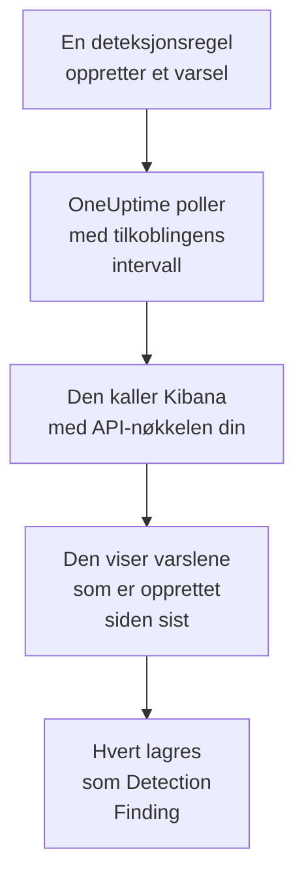

# Elastic Security

Importer deteksjonsvarslene som reglene dine i [Elastic Security](https://www.elastic.co/security) utløser, til sikkerhetshendelsene i OneUptime. Der søker du i dem ved siden av logger, sporinger og metrikker, korrelerer dem med alle andre kilder og varsler vakten om dem som betyr noe. OneUptime leser dem via deteksjonsmotor-API-et i Kibana med en API-nøkkel du selv oppretter, og endrer ingenting i Elastic.

:::cards
- [Sett opp tilkoblingen](#sett-opp-tilkoblingen): En API-nøkkel, rettighetene den trenger og skjemaet for tilkoblingen.
- [Hva som importeres](#hva-som-importeres): Hvordan hvert deteksjonsvarsel blir en sikkerhetshendelse.
- [Slik fungerer polling](#slik-fungerer-polling): Vinduet hver poll leser, og hva et travelt space gjør med det.
- [Feilsøking](#feilsøking): Hva hver feil betyr, og hva du skal endre.
:::

## Slik fungerer det



Hvert minutt poller OneUptime hver aktiverte tilkobling der pollintervallet er gått. En poll ber Kibana om deteksjonsvarslene som er opprettet i spacet ditt siden forrige poll, 1 000 om gangen, og lagrer hvert som en [OCSF](https://schema.ocsf.io/) Detection Finding-hendelse (klasse `2004`). Alle regeltyper teller: egendefinert spørring, terskel, EQL, indikatortreff, maskinlæring og nye termer. Deteksjonsregler, monitorer og dashbord behandler deretter varslene som sikkerhetshendelser fra en hvilken som helst annen kilde.

## Før du begynner

- I OneUptime rollen Project Owner, Project Admin eller Security Admin. Security Member og Security Viewer kan se tilkoblinger og kjøringshistorikken deres, men ikke endre dem.
- Elastic Security 8.x eller nyere, på Elastic Cloud eller din egen Elastic-stakk, med deteksjonsregler som kjører i et Kibana-space.
- Kibana-tilgang som kan se deteksjonsvarslene i det spacet: indeksrettighetene `read` og `view_index_metadata` på `.alerts-security.alerts-<space-id>`, og en Kibana-funksjonsrettighet for Security som lar den lese varsler der.
- En Kibana som OneUptime kan nå over HTTPS. OneUptime Cloud kobler til fra internett, så Kibana trenger en offentlig adresse, slik Elastic Cloud-distribusjoner har: private adresser avvises. En selvdriftet OneUptime kobler til fra app- og workercontainerne sine og kan nå en Kibana på det private nettverket ditt, med mindre `DATA_SOURCE_BLOCK_PRIVATE_ADDRESSES` er `true`.

## Sett opp tilkoblingen

:::steps
### Opprett en API-nøkkel

1. Åpne **Stack Management → API keys** i Kibana, og velg **Create API key**.
2. Gi den et navn, for eksempel `oneuptime-security-events`. En nøkkel har rettighetene til brukeren som oppretter den, med mindre du gir den færre: den trenger bare dem ovenfor.
3. Velg når den utløper, eller aldri. En nøkkel som utløper, stopper tilkoblingen til du erstatter den.
4. Opprett nøkkelen, og kopier **Base64**-verdien, som Kibana bare viser én gang. Ikke nøkkelens ID, og ikke paret `id:api_key`.

### Finn ID-en til spacet ditt

Varsler lagres per space. Åpne spacet der reglene dine kjører: ID-en er den delen av Kibana-adressen som kommer etter `/s/`, for eksempel `security` i `https://kibana.example.com/s/security/app/security`. Standardspacet har ingen `/s/`-del og trenger ingen ID.

### Legg til tilkoblingen i OneUptime

Åpne **Produkter → Security Events → Tilkoblinger** (`/dashboard/{projectId}/security-events/connections`), klikk på **Legg til tilkobling**, velg **Elastic Security**, og klikk på **Neste**. Fyll inn innstillingene i tabellen nedenfor, klikk på **Neste**, og lim inn nøkkelen i **API-nøkkel**.

### Test den før du lagrer

Klikk på **Test disse innstillingene** under **Test før du lagrer**. Testen autentiserer og leser varsler med verdiene i skjemaet og lagrer ingenting, så et feil space eller en manglende rettighet viser seg før tilkoblingen finnes. Klikk deretter på **Neste**, gi tilkoblingen et **Navn**, og opprett den.
:::

| Innstilling | Hva du skal skrive inn |
| --- | --- |
| **Kibana URL** | Adressen Kibana tilbys fra, for eksempel `https://kibana.example.com` eller `https://<deployment>.kb.<region>.cloud.es.io`. Uten bane: ingen `/app/security`, ingen `/api` og ingen `/s/<space>`-del. |
| **Kibana space** | ID-en til spacet, ikke navnet: bokstaver, sifre, bindestreker og understreker. La det stå tomt for standardspacet. |
| **API-nøkkel** | **Base64**-verdien til nøkkelen, alene: OneUptime legger selv til skjemaet `ApiKey`. Den krypteres, returneres aldri av API-et og vises aldri igjen. Erstatt den med **Oppdater påloggingsinformasjon** på tilkoblingen. |

Trinnet **Henting** har også en valgfri **Beskrivelse**, **Henteintervall (minutter)**, et heltall fra `1` til `1440` som starter på `5`, og **Aktivert**, som starter slått på.

## Hva som importeres

Hvert deteksjonsvarsel blir en Detection Finding-hendelse (OCSF-klasse `2004`) med leverandøren `Elastic` og produktet `Elastic Security`:

| Varselfelt | OneUptime-kolonne |
| --- | --- |
| `_id`, varselets ID | Hendelses-UID, som også duplikater fjernes etter |
| `kibana.alert.original_time`, ellers `kibana.alert.start`, ellers `@timestamp` | Tidspunktet for hendelsen |
| `kibana.alert.rule.name` | Regelnavn |
| `kibana.alert.rule.uuid`, ellers `kibana.alert.rule.rule_id` | Regel-ID |
| `kibana.alert.reason`, ellers regelnavnet, ellers `kibana.alert.rule.description` | Melding |
| `kibana.alert.severity`, ellers et bånd av `kibana.alert.risk_score` | Alvorlighetsgrad |
| `kibana.alert.workflow_status`: `open`, `acknowledged` eller `closed` | Status |
| `kibana.alert.rule.threat`, inkludert underteknikker | MITRE ATT&CK-taktikker og -teknikker |
| `user.name`, `host.name`, `source.ip` eller `host.ip`, `process.name` eller `process.executable` | Aktørens bruker, vert, IP og prosess |
| `user.target.name`, `destination.domain`, `destination.ip`, `destination.port`, `file.path` | Målets bruker, vert, IP, port og ressurs |
| Disse, pluss `related.*`, `dns.question.name`, `url.domain` og filhasher | Observables |
| Hele varselet, flatet ut til nøkler med punktum, med `_index` og `_id` | `attributes` |

Tidspunktet for et varsel er med vilje tidspunktet for aktiviteten det handler om. `@timestamp`, når regelen opprettet det, er det pollingen leser, så et varsel som er opprettet i dag om gårsdagens aktivitet, vises under i går i utforskeren for sikkerhetshendelser. Når et varsel ikke har noen alvorlighetsgrad, avgjør risikoscoren: fra `74` Critical, fra `48` High, fra `22` Medium, og under det Low.

## Slik fungerer polling

Hver poll viser varslene som er opprettet i vinduet, de eldste først, 1 000 per side. I et annet space enn standardspacet starter banen med `/s/{Kibana space}`:

```text
POST {Kibana URL}/api/detection_engine/signals/search
    {"query": {"range": {"@timestamp": {"gte": "{window start}", "lt": "{window end}"}}},
     "size": 1000, "sort": [{"@timestamp": "asc"}]}
```

- **Opprettelsestidspunktet er markøren.** Varsler vises etter sin egen `@timestamp`, når regelkjøringen opprettet dem, aldri etter tidspunktet for aktiviteten de handler om. En regel som kjører hver time, oppretter varsler om aktivitet som er opptil en time gammel, og en markør på aktivitetstidspunktet ville hoppet over alle sammen.
- **Den første pollen ser 24 timer tilbake**, slik at en ny tilkobling viser de nylige varslene sine med en gang.
- **Hver senere poll starter 1 minutt før den lagrede markøren**, slik at et varsel som er opprettet på grensen mellom to vinduer, aldri går tapt.
- **En poll leser høyst 24 timer forbi markøren.** En tilkobling der markøren har kommet på etterskudd, tar igjen i en rekke vinduer på 24 timer, og **Helse** viser **Catching up**.
- **Duplikater fjernes etter varselets `_id`** i prosjektet, slik at overlappingen, et gjentatt vindu og en import aldri lagrer et varsel to ganger.

Varselsøket i Kibana tar en størrelse og en sortering, men ikke noe sidetoken. Derfor paginerer OneUptime ved å flytte starten av tidsrommet til det siste varselet på hver side, og utelater, etter `_id`, varslene den allerede har lest i det øyeblikket. Én regelkjøring stempler ofte mange varsler med samme tidspunkt, og en slik gruppe leses side for side, ingen to ganger og ingen hoppet over.

### Når et vindu inneholder mer enn én poll kan lese

En poll leser høyst 10 000 varsler, i høyst 20 forespørsler. Når et vindu inneholder flere, er kjøringen **Delvis**, med en advarsel som:

```text
Stopped after collecting 10000 alerts; the window holds more.
```

Varsler leses de eldste først, så OneUptime flytter markøren til opprettelsestidspunktet for det sist leste varselet, og den neste pollen starter der med samme vinduslengde. Et travelt space tar igjen 10 000 varsler per poll i stedet for å lese de samme på nytt. Varslene som er opprettet i nøyaktig samme øyeblikk, leses to ganger, og duplikatkontrollen fjerner den andre kopien.

ID-ene som utelates, sendes med i hver forespørsel, og Kibana begrenser størrelsen på en forespørsel. Når flere varsler deler ett øyeblikk enn én forespørsel kan utelate, rundt 7 800, stopper kjøringen der som **Delvis**, med en advarsel som navngir øyeblikket.

Når en kjøring ikke kommer forbi den lagrede markøren i det hele tatt, gjør OneUptime i stedet vinduet kortere:

1. **Snevre inn.** Den neste pollen leser et vindu som er halvparten så langt, fra det samme startpunktet, og fortsetter å halvere til et vindu leses helt, ned til ett minutt. Kjøringens advarsel sier det: `This window holds more records than one poll can read; the next poll reads a {n} minute window from the same starting point.`
2. **Vokse igjen.** Når et vindu er lest helt, er det neste igjen dobbelt så langt, opptil 24 timer.
3. **Gå forbi ett enkelt minutt.** Hvis selv ett minutt inneholder mer enn en poll kan lese, går pollingen forbi det, slik at nyere varsler fortsetter å komme. Kjøringen forblir **Delvis**, og **Siste feil** lyder `More records were created in the one minute from {cursor} to {end} than one poll can read. Polling moved past this minute so newer records keep arriving; use Import this time range in Diagnostics on this minute to recover what one run can read.` Importer det minuttet med **Import this time range** for å hente det én kjøring kan lese.

En kjøring som mislykkes helt, med en feil fra Kibana, beholder markøren og vinduslengden, og den neste pollen leser det samme vinduet på nytt. Det eneste unntaket er en forespørsel som fikk tidsavbrudd: markøren blir stående, men det neste vinduet er halvparten så langt, fordi et vindu som er for tungt til å bli besvart i tide, ville fått tidsavbrudd ved hvert forsøk. Å endre **Henteintervall (minutter)** endrer ingenting av dette: det avgjør hvor ofte en poll starter, ikke hvor vinduet begynner.

### Kjør, forhåndsvis og importer ved behov

Klikk på **Diagnostikk** på en tilkobling for å se de siste kjøringene og arbeide med den manuelt. Alle som kan endre tilkoblingen, kan starte disse handlingene; alle som kan se den, kan lese historikken.

- **Kjør nå** starter en poll med en gang, med den vanlige markøren, også når tilkoblingen ikke er **Aktivert**.
- **Preview alerts** leser et tidsrom på opptil 7 dager og importerer ingenting.
- **Import this time range** importerer et tidsrom på opptil 7 dager, etter at du har bekreftet, uten å flytte markøren. Varsler som allerede er importert, hoppes over.
- **Copy diagnostics** på en kjøring kopierer rapporten for brukerstøtte. Den inneholder aldri legitimasjon.

## Test tilkoblingen

**Test tilkoblingen** på raden til en tilkobling og **Test disse innstillingene** i skjemaet kjører i API-prosessen, ikke i en bakgrunnsworker, slik at en test også svarer når det er workerne som er problemet. Den kjører disse kontrollene i rekkefølge:

| Kontroll | Hva den kontrollerer |
| --- | --- |
| **Konfigurasjon** | Hver innstilling er til stede og riktig formatert. Ingenting kontaktes når dette mislykkes. |
| **Authenticate with Kibana** | `/api/status` i Kibana svarer fullstendig. Kibana svarer også kallere den ikke har autentisert, med mindre, så et kort svar får denne kontrollen til å mislykkes. |
| **Read detection alerts** | Ett varsel som er opprettet de siste 24 timene, kan leses. Det beviser rettighetene og spacet. |
| **Alerts available to import** | Hvor mange varsler som er opprettet de siste 24 timene og de siste 7 dagene, med `+` der Elasticsearch bare telte en del av dem. Ingen på 7 dager er en advarsel, ikke en feil. |
| **Background workers**, **Poll scheduler**, **Security event storage** | OneUptimes egen side: en prosess tar jobbene fra Worker-køen, poll-jobben kjører hvert minutt, og lageret for sikkerhetshendelser svarer. |
| **Scheduled polling** | For en lagret tilkobling: polling er slått på, ingen kjøring sitter fast og venter på en worker, og poller kjører i tide. |

Hver forespørsel i en test har en frist på 20 sekunder. En test importerer aldri noe og flytter aldri markøren, og hver kontroll som mislykkes, sier hva du skal endre.

## Send sikkerhetshendelser til Elastic Security

OneUptime kan også sende det den finner til Elasticsearch, som Elastic Common Schema (ECS)-dokumenter i en datastrøm, slik at varslene, tidslinjene og deteksjonsreglene i Elastic Security ser OneUptimes deteksjoner ved siden av dine egne. En deteksjon er et dokument med `event.kind` `alert`, og alle andre hendelser har `event.kind` `event`.

:::steps
### Opprett en API-nøkkel som kan skrive

Åpne **Stack Management → API keys** i Kibana, klikk på **Create API key**, gi den rettighetene nedenfor, og kopier **Encoded**-verdien.

### Legg til målet

Åpne **Produkter → Security Events → Tilkoblinger**. Klikk på **Legg til mål** under **Send til SIEM-et ditt**, velg Elastic Security under **SIEM**, og klikk på **Neste**. Fyll inn **Elasticsearch-URL**, Elasticsearch-endepunktet til deploymenten og ikke Kibanas, og lim inn nøkkelen i **API-nøkkel**. **Datastrøm** er valgfri: står den tom, går dokumentene til `logs-oneuptime.security-default`, som Elasticsearch oppretter ved første skriving.

### Send en testhendelse og begynn å sende

Klikk på **Send en testhendelse**: ett dokument kommer fram i datastrømmen. Behold deretter **Bare deteksjoner** under **Hva som skal sendes**, eller velg **Alle sikkerhetshendelser**, og klikk på **Begynn å sende**.
:::

Nøkkelens rettigheter, for standard datastrøm:

```json title="oneuptime-writer-role.json"
{
  "oneuptime-writer": {
    "indices": [
      {
        "names": [
          "logs-oneuptime.security-*"
        ],
        "privileges": [
          "create_doc",
          "auto_configure"
        ]
      }
    ]
  }
}
```

- Dokumenter sendes i bunter på opptil 500, hvert med sin hendelses egen id, så en hendelse som sendes to ganger, lagres én gang.
- Et dokument Elasticsearch ikke kan mappe, utelates og nevnes i **Vis feil**, og et den ikke kan ta imot akkurat nå (`429`), sendes på nytt.
- Varsler OneUptime har importert fra Elastic Security, sendes aldri tilbake dit.

## Feilsøking

**Siste feil** for tilkoblingen lagrer hele feilmeldingen, med legitimasjon maskert, bak et prefiks som navngir trinnet som mislyktes. Når en tilkobling har en feil, velger du **Vis feil** i kolonnen **Handlinger** for å lese den, og **Kopier feil** i dialogboksen for å kopiere den. Les prefikset først.

:::details Last Error starter med `Elastic Security status request`
- `Elastic Security status request failed (HTTP ...)`: Kibana avviste statusforespørselen.
  - `HTTP 401`: Kibana godtok ikke API-nøkkelen. Det er ikke **Base64**-verdien, eller den er utløpt eller ugyldiggjort. Opprett en ny nøkkel, og lagre den med **Oppdater påloggingsinformasjon**.
  - `HTTP 404`: **Kibana URL** har en bane, eller er ikke Kibana.
  - `HTTP 503`: Kibana melder seg selv utilgjengelig, vanligvis fordi den ikke når Elasticsearch.
  - `HTTP 3xx`: Kibana omdirigerte forespørselen, og omdirigeringer avvises. Bruk adressen Kibana tilbys fra.
- `Elastic Security status request returned ...`: noe annet enn Kibana svarte, for eksempel en påloggingsside eller en proxy.
- Når bare testen mislykkes og sier at Kibana `answered without authenticating the request`, nådde ikke nøkkelen frem til Kibana. Kontroller at det er **Base64**-verdien, og at ingen proxy foran Kibana fjerner headeren `Authorization`.
:::

:::details Last Error starter med `Elastic Security alerts search`
- `Elastic Security alerts search failed (HTTP ...)`: Kibana avviste varselsøket.
  - `HTTP 403`: nøkkelen logger på, men kan ikke lese varslene i spacet. Gi den rettighetene under [Før du begynner](#før-du-begynner).
  - `HTTP 404`: ingen space har den ID-en i **Kibana space**, eller Elastic Security er ikke aktivert i det.
  - `HTTP 429` eller `HTTP 5xx`: Kibana eller Elasticsearch begrenser forespørsler eller feiler. Den neste pollen prøver igjen.
- `Elastic Security alerts search returned ...`: Kibana svarte `200`, men uten en lesbar side med varsler, for eksempel med en egen feil. Meldingen siterer den. Det rapporteres i stedet for å bli tatt som et tomt vindu, slik at markøren aldri flytter seg forbi varsler som ingen har lest.
:::

:::details Last Error slutter med `did not complete`
`Elastic Security alerts search did not complete`, og det samme for statusforespørselen, betyr at forespørselen ikke fikk noe svar: et tidsavbrudd, et navn som ikke kan slås opp, en avvist tilkobling eller en avvist privat adresse. Kontroller at OneUptime-appen og workerne kan nå Kibana, med riktig skjema og port. Etter et tidsavbrudd leser den neste pollen et vindu som er halvparten så langt.
:::

:::details Last Polled er Never og Last Error er tom
Ingen poll er fullført for denne tilkoblingen. Kjør **Test tilkoblingen**: kontrollene **Background workers** og **Poll scheduler** navngir årsaken. På en selvdriftet installasjon er den vanlige årsaken `DISABLE_QUEUE_WORKERS=true` på appen, uten en separat worker-utrulling som tar jobbene: sett den til `false`, eller kjør worker-utrullingen (Helm: `worker.enabled: true`).
:::

:::details En kjøring er Partial
- `Stopped after collecting 10000 alerts; the window holds more`: vinduet inneholdt mer enn de 10 000 varslene én kjøring leser. Ingenting går tapt: den neste pollen starter etter det sist leste varselet. En tilkobling som forblir **Delvis** poll etter poll, er i ferd med å ta igjen et etterslep, og **Sist hentet** og **Siste importerte hendelse** fortsetter å gå fremover. Hvis den aldri tar igjen, oppretter spacet mer enn 10 000 varsler per pollintervall: gjør **Henteintervall (minutter)** kortere.
- `More records were created in the one minute from ... than one poll can read`: pollingen gikk forbi det minuttet. Importer det med **Import this time range** i **Diagnostikk**. En import leser like mye som en poll.
:::

:::details Testen lykkes, men ingenting importeres
Les **Alerts available to import** i rapporten fra testen. `0` de siste 7 dagene betyr at ingen regel har opprettet et varsel i det spacet: kontroller at det er aktiverte regler der, og at **Kibana space** er spacet de kjører i. Hvis det finnes varsler, utvider du tidsrommet i utforskeren for sikkerhetshendelser: varsler vises under tidspunktet for aktiviteten sin, som kan ligge godt før de ble opprettet.
:::

## Hva du får

- **Søk.** Filtrer varsler etter alvorlighetsgrad, status, regel, MITRE ATT&CK-teknikk, bruker, vert eller en hvilken som helst observable i utforskeren for sikkerhetshendelser, ved siden av alle andre kilder.
- **Korrelasjon.** Brukerne, vertene, IP-ene, domenene og hashene i hvert varsel indekseres som observables, så ett søk finner alt som nevner dem.
- **Deteksjonsregler.** Sigma-regler som kjører etter en tidsplan over sikkerhetshendelsene dine, og åpner varsler som varsler vakten.
- **Monitorer.** Monitorer for sikkerhetshendelser teller samsvarende hendelser, for eksempel nye kritiske varsler, og åpner hendelser eller varsler over en terskel.

Sikkerhetshendelser faktureres som resten av telemetrien din, per innhentet GB. Se [Priser](https://oneuptime.com/pricing).

## Neste trinn

:::cards
- [Sikkerhetshendelser](/docs/telemetry/security-events): Søk, korreler og varsle på det du importerer.
- [Splunk Enterprise Security](/docs/integrations/splunk): Importer også notable events fra en Splunk-search head.
- [Roller](/docs/permissions/reference#roller): Hva Security-rollene kan se og endre.
- [Oversikt over integrasjoner](/docs/integrations/index): De andre verktøyene du kan koble til.
:::
