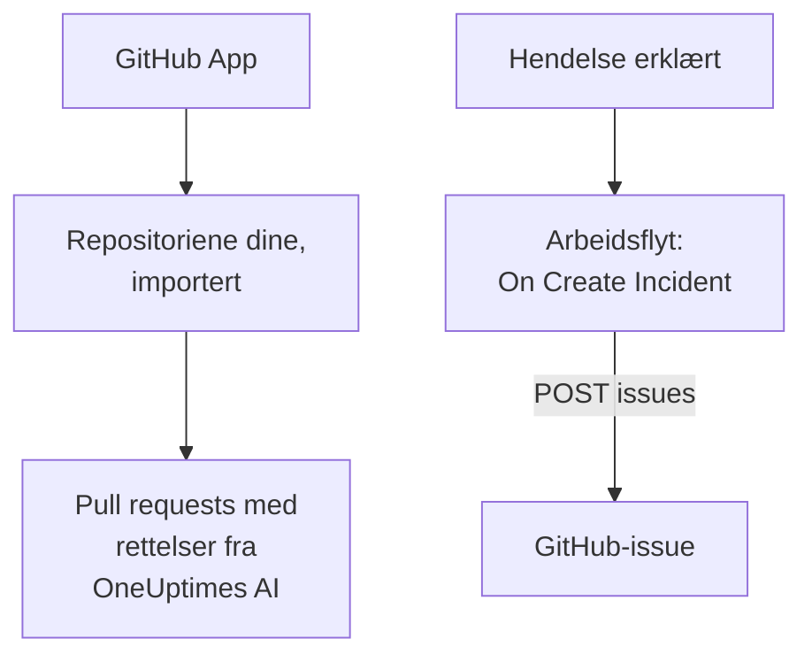

# GitHub

OneUptime jobber med [GitHub](https://github.com) på to måter. Koble til repositoriene dine via OneUptimes GitHub App, så åpner OneUptimes AI pull requests som retter det den finner, og svarer når du nevner den i et issue eller en pull request. Eller bygg en arbeidsflyt som åpner et GitHub-issue for hver hendelse, slik at oppfølgingsarbeidet spores i repositoriet som eier tjenesten.

:::cards
- [Velg hvordan du kobler til](#velg-hvordan-du-kobler-til): GitHub App eller en arbeidsflyt, og hva hver av dem gjør.
- [Koble til repositoriene dine](#koble-til-repositoriene-dine): GitHub App, for pull requests med rettelser.
- [Åpne et issue for hver hendelse](#åpne-et-github-issue-for-hver-hendelse): Én arbeidsflyt, to blokker.
- [Feilsøking](#feilsøking): Når GitHub avviser en forespørsel.
:::

## Slik fungerer det



De to er atskilt, og du kan bruke den ene eller begge. GitHub App jobber i repositoriene du installerer den på. Arbeidsflyten trenger bare et token, og kaller [REST API](https://docs.github.com/en/rest/issues/issues#create-an-issue)-et til GitHub som et hvilket som helst annet API.

## Velg hvordan du kobler til

| Måte | Hva den gjør | Hva den trenger |
| --- | --- | --- |
| GitHub App | Importerer repositoriene dine. OneUptimes AI åpner pull requests i dem som retter unntak, trege sporinger og årsakene undersøkelsene finner, og svarer på omtaler i issues og pull requests. | En organisasjon eller konto å installere appen på. På OneUptime Cloud planen **Growth**. |
| En arbeidsflyt | Åpner et GitHub-issue for hver hendelse, i repositoriet du velger. | Et GitHub-token som kan opprette issues, og en arbeidsflyt med to blokker. |

## Koble til repositoriene dine

Åpne **Produkter → Kode**, og klikk på **Koble til GitHub**. GitHub spør hvor appen skal installeres, og hvilke repositorier den kan bruke. Hvert repositorium i installasjonen importeres og holdes oppdatert når du legger til repositorier i installasjonen eller fjerner dem.

Hvis appen allerede er installert på kontoen, for et annet prosjekt eller rett fra GitHub, klikker du på **Koble til en eksisterende installasjon** under **Koble til GitHub** i stedet for å installere den på nytt. Det krever en GitHub-konto som administrerer installasjonen: eieren av en personlig konto, eller noen med admin-tilgang til hvert repositorium installasjonen har tilgang til, slik en eier av organisasjonen har.

En selvdriftet instans trenger først sin egen GitHub App: [GitHub-integrasjon](/docs/self-hosted/github-integration) viser hvordan du oppretter den. Deretter åpner AI pull requests i repositoriene dine fra [Kode](/docs/ai/ai-agent), og siden [GitHub App](/docs/ai/github-app) viser hva appen gjør når du nevner den i et issue eller en pull request.

## Før du begynner

Resten av denne siden bygger arbeidsflyten. Den trenger:

- Et GitHub-token som kan opprette issues i repositoriet: et fine-grained personal access token for det repositoriet, med tillatelsen **Issues** satt til **Read and write**, eller et klassisk token med omfanget `repo`. Opprett et i [tokeninnstillingene](https://github.com/settings/tokens) til GitHub.
- I OneUptime tilgang til å opprette arbeidsflyter og globale variabler. På OneUptime Cloud krever arbeidsflyter **Growth**-abonnementet eller høyere.

## Lagre tokenet

:::steps
1. Gå til **Arbeidsflyter → Globale variabler**, og klikk på **Opprett Workflow Variabel**.
2. Gi den navnet `GITHUB_TOKEN`, og klikk på **Neste**.
3. Lim inn tokenet i **Innhold**, slå på **Hemmelighet**, og klikk på **Opprett Workflow Variabel**.
:::

En hemmelig variabel erstattes med `[REDACTED]` i kjøringslogger, så tokenet vises aldri i en kjøring.

## Åpne et GitHub-issue for hver hendelse

:::steps
### Opprett arbeidsflyten

Gå til **Arbeidsflyter**, klikk på **Opprett arbeidsflyt** og deretter på **Start fra bunnen**. Gi den navnet `Incidents to GitHub`, og klikk på **Opprett arbeidsflyt**.

### Legg til triggeren

Klikk på den stiplede blokken **Velg hva som starter denne arbeidsflyten**, og velg **On Create Incident**. Klikk på utløseren: **Fields to pass on** starter med **Tittel**, så klikk på **Legg til felt**, og velg **Beskrivelse** og **Incident Number With Prefix**.

### Åpne issuet

Klikk på **Legg til komponent**, legg til en blokk **API Post (JSON)**, og koble utløserens punkt **Success** til den. Sett **URL** til `https://api.github.com/repos/your-org/your-repo/issues`, med eieren og navnet på repositoriet ditt. Sett **Request Headers** under **Flere felt** til:

```json
{
  "Authorization": "Bearer {{global.variables.GITHUB_TOKEN}}",
  "Accept": "application/vnd.github+json",
  "X-GitHub-Api-Version": "2022-11-28"
}
```

Og **Request Body** til:

```json
{
  "title": "{{local.components.incident-on-create-1.returnValues.model.title}}",
  "body": "{{local.components.incident-on-create-1.returnValues.model.description}}\n\nOpened by OneUptime for incident {{local.components.incident-on-create-1.returnValues.model.incidentNumberWithPrefix}}.",
  "labels": ["incident"]
}
```

### Test den, og slå den deretter på

Klikk på **Kjør arbeidsflyt**, velg en testhendelse under **Hendelse**, og kjør den. Trinnet **API Post (JSON)** viser et `201`-svar med det nye issuet, med `number` og `html_url`. Slå deretter på **Aktivert** øverst i **Bygger**.
:::

Issuet forblir åpent når hendelsen er løst, siden oppfølgingsarbeidet vanligvis varer lenger enn hendelsen. For saker som holdes i takt med hendelsen begge veier, se [Jira](/docs/integrations/jira).

## Tips

- **GitHub Enterprise Server.** Send forespørselen til serveren din i stedet: `https://your-github-host/api/v3/repos/your-org/your-repo/issues`. En server på en privat nettverksadresse krever en selvdriftet OneUptime der administratoren tillater det: se [Utgående nettverkstilgang](/docs/workflows/configuration#utgående-nettverkstilgang).
- **Tildel det.** Legg til `"assignees": ["octocat"]` eller `"milestone": 3` i bodyen. GitHub dropper etiketter, tildelte og milepæler uten et ord når tokenet ikke kan pushe til repositoriet.
- **Bare noen hendelser.** Sett en blokk **If / Else** mellom utløseren og API-blokken, og åpne issues bare på **Yes**-siden, for eksempel for én alvorlighetsgrad.

## Feilsøking

Trinnet **API Post (JSON)** tar **Error** når GitHub avviser forespørselen. **Response Status** og **Response Body** i kjøringen sier hvorfor.

:::details GitHub svarer 401
Tokenet er feil, utløpt eller tilbakekalt. Opprett et nytt, og erstatt innholdet i `GITHUB_TOKEN`.
:::

:::details GitHub svarer 403
Tokenet kan ikke opprette issues der: et fine-grained token uten **Issues** satt til **Read and write** på dette repositoriet, et token organisasjonen din ikke har godkjent, eller et klassisk token som ikke er autorisert for organisasjonens single sign-on. En 403 der bodyen snakker om en hastighetsgrense, betyr at tokenet sendte for mange forespørsler: vent, eller åpne issues for færre hendelser.
:::

:::details GitHub svarer 404
Eieren eller repositoriet i **URL** er feil, eller tokenet kan ikke se repositoriet. GitHub svarer 404, ikke 403, for et privat repositorium et token ikke kan se.
:::

:::details GitHub svarer 410 eller 422
- `410`: issues er slått av i innstillingene til repositoriet.
- `422`: GitHub kan ikke lese bodyen. Kontroller at den er gyldig JSON, at `title` er satt, og at `labels` og `assignees` er lister.
:::

## Neste trinn

:::cards
- [GitHub App](/docs/ai/github-app): Be OneUptimes AI om en endring, en revisjon eller en gjennomgang direkte fra GitHub.
- [GitLab](/docs/integrations/gitlab): Den samme arbeidsflyten, for GitLab-issues.
- [Arbeidsflyt-komponenter](/docs/workflows/components#api): Alle innstillingene for API-blokkene.
- [Oversikt over integrasjoner](/docs/integrations/index): Mønstrene bak hver integrasjon.
:::
