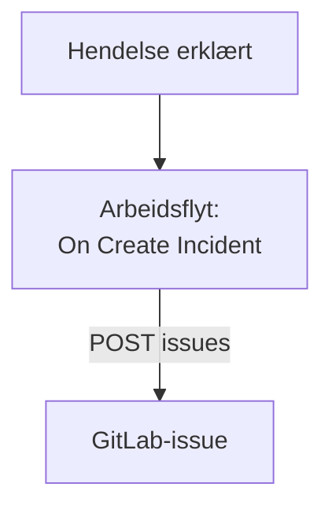

# GitLab

Åpne et [GitLab](https://gitlab.com)-issue for hver OneUptime-hendelse, slik at oppfølgingsarbeidet spores i prosjektet som eier tjenesten. En arbeidsflyt kaller [Issues API](https://docs.gitlab.com/api/issues/#new-issue)-et til GitLab, på GitLab.com eller på din egen GitLab.

:::cards
- [Lagre tokenet](#lagre-tokenet): Hold tokenet til GitLab utenfor arbeidsflytene dine.
- [Åpne et issue for hver hendelse](#åpne-et-gitlab-issue-for-hver-hendelse): Én arbeidsflyt, to blokker.
- [Tips](#tips): Din egen GitLab, prosjektbaner og tildelte.
- [Feilsøking](#feilsøking): Når GitLab avviser en forespørsel.
:::

> [!NOTE]
> OneUptimes AI arbeider også i GitLab-repositorier: koble dem til i Kode med et tilgangstoken, så åpner den en merge request for hver rettelse. Se [Koble til et repositorium](/docs/ai/ai-agent#koble-til-et-repositorium).

## Slik fungerer det



Arbeidsflyten kjører én gang for hver ny hendelse. Blokken **API Post (JSON)** sender tittelen og beskrivelsen av hendelsen til issuene i prosjektet, signert med et tilgangstoken.

## Før du begynner

- ID-en til GitLab-prosjektet. Velg handlingsmenyen, de loddrette prikkene, på oversiktssiden til prosjektet, og deretter **Copy project ID**.
- Et GitLab-tilgangstoken med omfanget `api`, for en bruker eller bot med en rolle i prosjektet som kan opprette issues: et prosjekt-, gruppe- eller personlig tilgangstoken. Opprett det under **Settings → Access tokens** i prosjektet, gruppen eller brukerinnstillingene dine.
- I OneUptime tilgang til å opprette arbeidsflyter og globale variabler. På OneUptime Cloud krever arbeidsflyter **Growth**-abonnementet eller høyere.

## Lagre tokenet

:::steps
1. Gå til **Arbeidsflyter → Globale variabler**, og klikk på **Opprett Workflow Variabel**.
2. Gi den navnet `GITLAB_TOKEN`, og klikk på **Neste**.
3. Lim inn tokenet i **Innhold**, slå på **Hemmelighet**, og klikk på **Opprett Workflow Variabel**.
:::

En hemmelig variabel erstattes med `[REDACTED]` i kjøringslogger, så tokenet vises aldri i en kjøring.

## Åpne et GitLab-issue for hver hendelse

:::steps
### Opprett arbeidsflyten

Gå til **Arbeidsflyter**, klikk på **Opprett arbeidsflyt** og deretter på **Start fra bunnen**. Gi den navnet `Incidents to GitLab`, og klikk på **Opprett arbeidsflyt**.

### Legg til triggeren

Klikk på den stiplede blokken **Velg hva som starter denne arbeidsflyten**, og velg **On Create Incident**. Klikk på utløseren: **Fields to pass on** starter med **Tittel**, så klikk på **Legg til felt**, og velg **Beskrivelse** og **Incident Number With Prefix**.

### Åpne issuet

Klikk på **Legg til komponent**, legg til en blokk **API Post (JSON)**, og koble utløserens punkt **Success** til den. Sett **URL** til `https://gitlab.com/api/v4/projects/12345678/issues`, med ID-en til prosjektet ditt i stedet for `12345678`. Sett **Request Headers** under **Flere felt** til:

```json
{
  "PRIVATE-TOKEN": "{{global.variables.GITLAB_TOKEN}}"
}
```

Og **Request Body** til:

```json
{
  "title": "{{local.components.incident-on-create-1.returnValues.model.title}}",
  "description": "{{local.components.incident-on-create-1.returnValues.model.description}}\n\nOpened by OneUptime for incident {{local.components.incident-on-create-1.returnValues.model.incidentNumberWithPrefix}}.",
  "labels": "incident,oneuptime"
}
```

### Test den, og slå den deretter på

Klikk på **Kjør arbeidsflyt**, velg en testhendelse under **Hendelse**, og kjør den. Trinnet **API Post (JSON)** viser et `201`-svar med det nye issuet, med `iid` og `web_url`. Slå deretter på **Aktivert** øverst i **Bygger**.
:::

Blokken sender JSON, så den trenger ingen `Content-Type`-header. GitLab oppretter etiketter den ikke har sett før, så `incident` og `oneuptime` trenger ikke settes opp. Issuet forblir åpent når hendelsen er løst, siden oppfølgingsarbeidet vanligvis varer lenger enn hendelsen.

## Tips

- **Din egen GitLab.** Send forespørselen til serveren din i stedet: `https://gitlab.example.com/api/v4/projects/12345678/issues`. En server på en privat nettverksadresse krever en selvdriftet OneUptime der administratoren tillater det: se [Utgående nettverkstilgang](/docs/workflows/configuration#utgående-nettverkstilgang).
- **Prosjektbanen i stedet for ID-en.** Banen fungerer i stedet for ID-en, med `/` skrevet som `%2F`: `projects/your-group%2Fyour-project/issues`. URL-en sendes nøyaktig slik den er skrevet, så kod den selv.
- **Tildel det.** Legg til `"assignee_ids": [42]` eller `"due_date": "2026-12-31"` i bodyen, eller `"confidential": true` for å vise det bare til prosjektmedlemmer.
- **Bare noen hendelser.** Sett en blokk **If / Else** mellom utløseren og API-blokken, og åpne issues bare på **Yes**-siden, for eksempel for én alvorlighetsgrad.

## Feilsøking

Trinnet **API Post (JSON)** tar **Error** når GitLab avviser forespørselen. **Response Status** og **Response Body** i kjøringen sier hvorfor.

:::details GitLab svarer 401
Tokenet er feil, utløpt eller tilbakekalt. Opprett et nytt, og erstatt innholdet i `GITLAB_TOKEN`.
:::

:::details GitLab svarer 403
Tokenet har ikke omfanget `api`, eller rollen til brukeren i prosjektet kan ikke opprette issues. Bodyen nevner `insufficient_scope` når det er omfanget.
:::

:::details GitLab svarer 404
ID-en til prosjektet i **URL** er feil, eller tokenet kan ikke se prosjektet. GitLab svarer 404, ikke 403, for et privat prosjekt et token ikke kan se.
:::

:::details GitLab svarer 400
GitLab kan ikke lese bodyen: `title` mangler, eller et felt har feil type. Bodyen nevner feltet.
:::

## Neste trinn

:::cards
- [GitHub](/docs/integrations/github): Den samme arbeidsflyten for GitHub, og GitHub App.
- [Arbeidsflyt-komponenter](/docs/workflows/components#api): Alle innstillingene for API-blokkene.
- [Arbeidsflyt-kjøringer](/docs/workflows/runs-and-logs): Les hva hver forespørsel sendte og fikk tilbake.
- [Oversikt over integrasjoner](/docs/integrations/index): Mønstrene bak hver integrasjon.
:::
