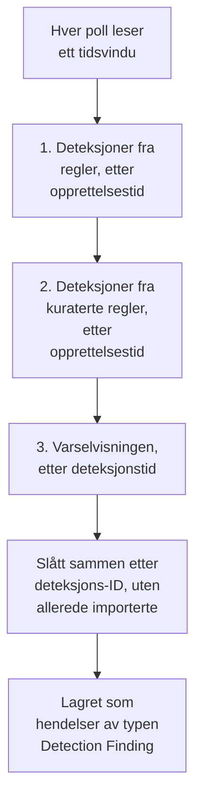

# Google SecOps

Hent varsler og deteksjoner fra [Google SecOps](https://cloud.google.com/security/products/security-operations) (tidligere Chronicle) inn i sikkerhetshendelsene i OneUptime. Der søker du i dem ved siden av logger, sporinger og metrikker, korrelerer dem med alle andre kilder og varsler vakten om dem som betyr noe.

:::cards
- [Velg hvordan du kobler til](#velg-hvordan-du-kobler-til): En webhook fra en SOAR-playbook, den administrerte koblingen eller UDM-videresending.
- [Sett opp den administrerte koblingen](#sett-opp-den-administrerte-koblingen): En nøkkel for en tjenestekonto og skjemaet for tilkoblingen.
- [Slik poller koblingen](#slik-poller-koblingen): Tre lesinger av hvert vindu, og budsjettene deres.
- [Feilsøking](#feilsøking): Hva Last Error sier, og hva du skal gjøre.
- [Send sikkerhetshendelser til Google SecOps](#send-sikkerhetshendelser-til-google-secops): Deteksjonene til OneUptime, i Google SecOps.
:::

## Velg hvordan du kobler til

| Vei | Hva som kommer inn | Bruk den når |
| --- | --- | --- |
| En webhook fra en SOAR-playbook | Hvert varsel en playbook poster, i løpet av sekunder | Du kjører SOAR-playbooks og vil ha varslene deres i OneUptime uten polling. |
| Den administrerte koblingen | Varsler, og deteksjoner fra regler hvis du velger det, pollet etter et intervall | Du vil at OneUptime skal hente dem for deg, uten noe å konfigurere i SecOps. |
| Videresending av UDM-hendelser | Rå UDM-hendelser, for fullt søk og full korrelasjon | Du eksporterer allerede UDM-hendelser og vil ha alle. |

Hver vei normaliserer det som kommer inn, til [OCSF](https://schema.ocsf.io/), Open Cybersecurity Schema Framework som OneUptime lagrer hver sikkerhetshendelse i, slik at deteksjonsregler og dashbord fungerer på samme måte uansett kilde.

## Før du begynner

- For den administrerte koblingen, i OneUptime, rollen Project Owner, Project Admin eller Security Admin. Security Member og Security Viewer kan lese tilkoblinger, men ikke opprette dem.
- For webhooken og UDM-videresendingen en inntaksnøkkel: åpne **Prosjektinnstillinger → Telemetri og APM → Inntaksnøkler**, og klikk på **Opprett ingestion-nøkkel**.
- For den administrerte koblingen retten til å opprette en Google Cloud-tjenestekonto i prosjektet som SecOps-instansen din er knyttet til.

## Send varsler fra en SOAR-playbook

SOAR-playbooks i Google SecOps kan poste varsler til et hvilket som helst HTTP-endepunkt. Pek én mot inntaket av sikkerhetshendelser i OneUptime.

:::steps
### Legg til en handling HTTP request

Legg til en handling **HTTP request** i SOAR-playbooken din i SecOps, som kjører på nye varsler.

### Pek den mot OneUptime

Sett **Method** til `POST` og **URL** til `https://oneuptime.com/security-events/v1/ingest`, eller `https://<your-host>/security-events/v1/ingest` på en selvdriftet installasjon. Legg til disse hodene:

```text
Content-Type: application/json
x-oneuptime-token: <your telemetry ingestion key>
```

Send varselets JSON som **Body**. En deteksjon, regelopplysninger med de samsvarende UDM-hendelsene under `collectionElements`, gjenkjennes av seg selv, lagres som en hendelse av typen Detection Finding, og brukerne, vertene og IP-ene i de samsvarende hendelsene beholdes som observables.

### Kontroller at varsler kommer frem

Kjør playbooken. Varslene vises i **Produkter → Security Events** i løpet av sekunder.
:::

## Videresend UDM-hendelser

For fullt søk og full korrelasjon videresender du selve UDM-hendelsene, for eksempel fra en eksportpipeline i BigQuery, en Cloud Function eller en hvilken som helst videresender du allerede kjører:

```bash
curl -X POST "https://oneuptime.com/security-events/v1/ingest?format=udm" \
  -H "Content-Type: application/json" \
  -H "x-oneuptime-token: <your telemetry ingestion key>" \
  -d '{
    "events": [
      {
        "metadata": {
          "event_type": "USER_LOGIN",
          "event_timestamp": "2026-08-21T10:00:00Z",
          "vendor_name": "Google",
          "product_name": "Google SecOps"
        },
        "principal": { "user": { "userid": "alice" }, "ip": ["203.0.113.7"] },
        "target": { "hostname": "vpn-gw-01" },
        "security_result": [{ "severity": "HIGH", "action": ["BLOCK"] }]
      }
    ]
  }'
```

- `format` kan være `udm`, `ocsf`, `google-secops-alert` eller `generic`. Hvis du utelater det, oppdages formatet hendelse for hendelse.
- Innholdet kan være én hendelse, en liste med hendelser eller `{ "events": [...] }`.
- `x-oneuptime-service-name` navngir telemetritjenesten hendelsene hører til. Uten den hører de til tjenesten som er oppkalt etter produktet i nyttelasten.

## Sett opp den administrerte koblingen

OneUptime poller deteksjonene og varslene til leieren din etter et intervall, uten SOAR-konfigurasjon. Google SecOps er en leverandør av Security Event Connections, så den opprettes, testes, polles og diagnostiseres på den samme siden og på samme måte som alle andre administrerte koblinger.

:::steps
### Opprett en nøkkel for en tjenestekonto

Opprett en tjenestekonto i Google Cloud i prosjektet som SecOps-instansen din er knyttet til, og gi den rollen **Chronicle API Viewer** (`roles/chronicle.viewer`). Den rollen inkluderer tillatelsene `legacySearchDetections`, `legacySearchCuratedDetections`, `countAllCuratedRuleSetDetections` og `legacyFetchAlertsView` som koblingen leser med.

Legg til en nøkkel av typen **JSON** på tjenestekontoens fane **Keys**, og last den ned. Du limer inn hele filen i tilkoblingen. `token_uri` i den må være en `https`-URL på en Google-vert, noe en nøkkel som er lastet ned fra Google Cloud, allerede er.

### Finn regionen og ressursnavnet til instansen

Åpne **SIEM Settings → Profile** i Google SecOps. Ressursnavnet til instansen har formen `projects/{project}/locations/{location}/instances/{instance}`, der instansdelen er ID-en til SecOps-instansen; et visningsnavn for en tilkobling eller navnet på en tjenestekonto kan ikke brukes i stedet. Regionen er det regionale endepunktet som betjener den plasseringen, og den må samsvare med locations-segmentet i ressursnavnet til instansen, ellers avvises tilkoblingen når du lagrer den.

### Legg til tilkoblingen

Åpne **Produkter → Security Events → Tilkoblinger** (`/dashboard/{projectId}/security-events/connections`), velg **Legg til tilkobling**, velg **Google SecOps**, og fyll ut skjemaet med innstillingene i tabellen nedenfor.

### Test før du lagrer

Velg **Test disse innstillingene** under **Test før du lagrer** før du lagrer. Testen kjører med verdiene i skjemaet uten å lagre noe, så en feilformatert nøkkel, en manglende rolle eller feil instans oppdages før tilkoblingen finnes. I redigeringsskjemaet tester den samme knappen **Region**, **Ressursnavnet til instansen** og **Data to import** som vises på skjermen, med den lagrede nøkkelen; et legitimasjonsfelt som står tomt, beholder den lagrede nøkkelen. Når noe av det som testes, avviker fra det tilkoblingen har lagret, også en nylig innskrevet nøkkel, registreres ingen rad i kjøringshistorikken, fordi tilkoblingen ennå ikke har de innstillingene.
:::

| Innstilling | Hvor du finner den | Påkrevd |
| --- | --- | --- |
| **Region** | Det regionale endepunktet for Google SecOps (`us`, `europe`, `asia-southeast1`, ...) som samsvarer med plasseringen i ressursnavnet til instansen din. Det finnes ingen standard, slik at en leier utenfor USA ikke ved et uhell kan lagre feil endepunkt. | Ja |
| **Ressursnavnet til instansen** | Google SecOps **SIEM Settings → Profile**: `projects/{project}/locations/{location}/instances/{instance}`. | Ja |
| **Lukk varsler når saken deres lukkes** | På skjemaets siste steg, av til du slår det på. På lukker en lukket sak Google SecOps-varslene dens: se [Lukk varsler når saken deres lukkes](#lukk-varsler-når-saken-deres-lukkes). | Nei |
| **JSON for tjenestekontoen** | Google Cloud, tjenestekontoens fane **Keys**. Lim inn hele JSON-nøkkelfilen. Bare skriving: kryptert i hvile, aldri returnert av API-et, aldri vist på siden igjen. Bruk **Oppdater påloggingsinformasjon** på tilkoblingen for å bytte den. | Ja |
| **Data to import** | **Varsler** importeres alltid, fordi varsel-API-et til Google alltid returnerer dem. Velg **Deteksjoner** for også å importere regeltreff som ikke ga et varsel. Dette videresender ikke rå UDM-hendelser: dem videresender du selv, som ovenfor. | Varsler alltid |

Pollingtrinnet i skjemaet ber om et **Navn**, en valgfri **Beskrivelse**, tilkoblingens innstilling **Aktivert** og **Henteintervall (minutter)**: et heltall fra `1` til `1440`, standard `5`. Alt utenfor det området avvises når du lagrer.

Nye deteksjoner importeres som hendelser av typen Detection Finding som tilskrives en telemetritjeneste `Google SecOps`.

## Les tilstanden til tilkoblingen

Listen over tilkoblinger viser **Navn**, **Leverandør** (med tilkoblingens valg av Data to import under), **Status** (Enabled eller Disabled), **Helse**, **Intervall (minutter)**, **Sist hentet**, **Siste vellykkede henting** og **Siste importerte hendelse**. Når en tilkobling har en feil, vises **Vis feil** i kolonnen **Handlinger**, ved siden av **Test tilkoblingen**, **Kjør nå**, **Diagnostikk**, **Rediger** og **Oppdater påloggingsinformasjon**. Enabled betyr at automatisk polling er satt opp. Last Polled registrerer et forsøk; et vellykket tomt vindu beviser ikke at en bestemt deteksjon er importert.

**Helse** viser **Last poll succeeded** først når en hendelse er importert. Frem til da viser en tilkobling som lykkes, **Polling, no events imported yet**, og det er tilstanden du skal undersøke med Test tilkoblingen. De andre tilstandene er **No records returned**, **Partial import**, **Catching up**, **Last poll failed**, **Poll overdue**, **Schedule paused** og **Venter på første henting**; hold musepekeren over en tilstand for å se hva den betyr.

> [!NOTE]
> Koblingen bruker Chronicles eldre API-er for deteksjoner og varsler `v1alpha`, som Google leverer som pre-GA. Når en poll mislykkes, lagrer feltet **Siste feil** for tilkoblingen hele feilmeldingen, med legitimasjon maskert, bak et prefiks som navngir trinnet som mislyktes, også når Chronicle svarer `200` og legger avvisningen i innholdet. Velg **Vis feil** i tilkoblingens kolonne **Handlinger** for å lese meldingen, og deretter **Kopier feil** i dialogboksen for å kopiere den til brukerstøtte.

## Slik poller koblingen



Én gang i minuttet setter en bakgrunnsworker en poll i kø for hver aktiverte tilkobling der intervallet har gått siden forrige poll. Hver poll er en kjøring i tilkoblingens historikk, utført av en worker. Den leser ett tidsvindu på tre måter og slår sammen resultatene etter deteksjons-ID, slik at en post som returneres av mer enn én gjennomgang, lagres én gang:

1. **Deteksjoner fra regler etter opprettelsestid.** `legacy:legacySearchDetections` med `ruleId=-` (hver revisjon av hver regel) og `listBasis=CREATED_TIME`, der `nextPageToken` følges til siden er den siste.
2. **Deteksjoner fra kuraterte regler etter opprettelsestid.** `legacy:legacySearchCuratedDetections` på samme måte, én gang per kuratert (Google-skrevet) regel. Det endepunktet tar én ID for en kuratert regel (`ur_...`) og har ikke noe jokertegn for «alle regler», så gjennomgangen kaller først `:countAllCuratedRuleSetDetections` for uken før vinduet til slutten av det, og søker i hver kuraterte regel som ga deteksjoner. En kuratert regel som ikke er utløst den uken, har ingenting å importere. En leier uten tilgang til kuraterte regler svarer denne gjennomgangen med `400`, `403` eller `404`; det registreres som en advarsel på kjøringen, ikke som en feil.
3. **Varselvisningen etter deteksjonstid.** `legacy:legacyFetchAlertsView`, som dekker telemetrivarsler, SOAR-varsler og varsler fra maskinintelligens i tillegg til regelvarsler. Endepunktet har ingen sideinndeling, så et svar som Google begrenser, deles opp i mindre vinduer og leses på nytt.

Varselvisningen kan bare filtrere etter deteksjonstid, og Google gjør ofte et varsel lesbart lenge etter deteksjonstiden (forsinkelse i inntaket, planlagte regler, nye kjøringer over sene data). En planlagt poll **gjennomsøker derfor også varselvisningen over de 24 timene før vinduet sitt**, bare varsler, registrert som kontrollen **Read late alerts by detection time**. Poster som allerede er importert, hoppes over, så gjentakelsene i gjennomsøkingen vises under **Already imported**. Gjennomsøkingen gjøres etter beste evne: når Google begrenser den, budsjettet går tomt eller den mislykkes, får kjøringen en advarsel, men pollen blir ikke Partial eller Mislyktes, og markøren flytter seg likevel fremover, fordi dagen den ser tilbake på, allerede er lest av tidligere poller.

Polling etter **opprettelsestid** er hele designet. En regel i Google SecOps kjører etter en tidsplan (hvert 10. minutt, hver time, hver dag), og deteksjonen den oppretter, har en `detectionTime` som er slutten av regelens tidsvindu eller tidspunktet for den samsvarende hendelsen, mens `createdTime` er når deteksjonsmotoren faktisk opprettet den. En deteksjon som er opprettet kl. 10:05 for et vindu som slutter kl. 09:00, har en deteksjonstid som allerede ligger bak en markør som gikk forbi 09:00 for flere poller siden, så en kobling som poller etter deteksjonstid, ser den aldri, og heller ingen hendelse som kommer sent. Å lese etter opprettelsestid får hver poll til å spørre «hva har Google opprettet siden jeg sist så etter», og det er spørsmålet som har et svar. Hver kjøring registrerer opprettelsesforsinkelsen sin, hvor mange hentede poster som ble opprettet mer enn ett pollintervall (pluss ett minutt) etter deteksjonstiden, og den største forskjellen, slik at effekten er synlig i Diagnostics.

Den første pollen for en ny tilkobling ser **24 timer** tilbake etter opprettelsestid. Hver poll etter det fortsetter fra tilkoblingens lagrede markør med en overlapping på **1 minutt**; en post som er opprettet på en vindusgrense, leses av begge pollene og lagres én gang, fordi poller hopper over hendelser som allerede er lagret med samme kilde-ID. Hver planlagte poll leser høyst **24 timer** forbi markøren, så en tilkobling med en eldre lagret markør tar igjen i påfølgende vinduer på 24 timer (Health viser **Catching up**) i stedet for å forkaste deteksjonene imellom. Bruk **Import this time range** i Diagnostics for poster som er opprettet før det første vinduet på 24 timer.

### Når et vindu inneholder mer enn én poll kan lese

Koblingen gir hver poll faste budsjetter: gjennomgangen av deteksjoner fra regler har **20** søkesider, den kuraterte gjennomgangen opptil **200** forespørsler (tellingen pluss minst én side per kuratert regel som ble utløst den siste uken, de travleste reglene først), varselvisningen og gjennomsøkingen etter sene varsler deler **16** forespørsler, og hele lesingen stopper etter **4 minutter**. Den kuraterte gjennomgangen starter ikke flere kuraterte regler når 60 % av den tiden er brukt, slik at varselvisningen likevel kjører. Når en poll ikke kan søke i alle aktive kuraterte regler, registrerer den en advarsel som sier hvor mange som ikke ble søkt i, i stedet for å holde markøren igjen, fordi et kortere vindu fortsatt ville hatt alle de reglene å søke i. En gjennomgang som et budsjett stoppet halvveis, registreres som en advarselskontroll som navngir budsjettet (for eksempel `Read rule detections by created time was stopped by the request budget after 20 requests.`), og en gjennomgang som budsjettet aldri lot starte, er en hoppet-over kontroll med samme årsak i kjøringens advarsler, aldri en suksess. Et vindu med flere deteksjoner enn det kan ikke leses i én poll, og pollingen leser aldri det samme vinduet på nytt i det uendelige:

1. **Snevre inn.** Søkeendepunktene til Google returnerer de nyeste deteksjonene først, så en poll som stopper tidlig, har ikke noe punkt å fortsette fra. Pollen registreres som **Delvis**, markøren blir der den var, og den neste pollen leser et vindu som er halvparten så langt, fra det samme startpunktet, med advarselen `This window holds more records than one poll can read; the next poll reads a {n} minute window from the same starting point.` Halveringen fortsetter ned til ett minutt, til et vindu passer.
2. **Vokse igjen.** Hver fullførte poll dobler det neste vinduet, opptil maksimum på 24 timer, slik at et utbrudd koster noen få korte poller i stedet for en permanent treg tilkobling.
3. **Gå forbi ett enkelt minutt.** Hvis selv ett minutt inneholder flere deteksjoner enn en poll kan lese, flytter pollingen markøren forbi det minuttet, slik at nyere deteksjoner fortsetter å komme. Kjøringen er **Delvis**, og den samme teksten står først i **Siste feil**: `More records were created in the one minute from {start} to {end} than one poll can read. Polling moved past this minute so newer records keep arriving; use Import this time range in Diagnostics on this minute to recover what one run can read.` For å hente det én kjøring kan lese, åpner du **Diagnostikk**, velger et egendefinert tidsrom som dekker det minuttet (tidsromfeltene bruker lokal tid; meldingen er i UTC) og kjører **Import this time range**; en import har de samme grensene per kjøring som en poll. Deteksjoner som allerede er importert, hoppes over.

En poll som er Partial, lagrer også advarslene sine i **Siste feil**, der de blir til en fullført poll fjerner dem. En poll som mislykkes helt (en feil, ikke for mange poster), beholder markøren og vinduslengden og prøves på nytt ved neste tikk. Det eneste unntaket er en forespørsel som fikk tidsavbrudd: den neste pollen leser et vindu som er halvparten så langt, fra det samme startpunktet (`The source did not answer in time for this window; the next poll reads a {n} minute window from the same starting point.`), fordi et vindu som er for tungt til å bli besvart i tide, ellers ville fått tidsavbrudd ved hvert nytt forsøk. Et kortere pollintervall endrer ingenting av dette: vinduet avgjøres av markøren og resultatet av den siste pollen, ikke av hvor ofte poller kjører.

## Test tilkoblingen

**Test tilkoblingen**, på raden til tilkoblingen eller i **Diagnostikk**, kjører synkront i API-prosessen. Den trenger ingen bakgrunnsworker, og nettopp derfor kan den fortelle deg når ingen worker kjører. Sjekklisten:

1. **Konfigurasjon**: hvert felt er til stede og riktig formatert: en støttet **Region** som samsvarer med plasseringen til instansen, et **Ressursnavnet til instansen** med riktig form og en nøkkel **JSON for tjenestekontoen** med `client_email`, en lesbar `private_key` og en `token_uri` fra Google. Ingenting kontaktes hvis dette mislykkes.
2. **Authenticate with Google**: nøkkelen byttes mot et tilgangstoken hos OAuth-endepunktet til Google, før Chronicle kontaktes.
3. **Read rule detections**, **Read curated rule detections** og **Read the alerts view**: en prøve med én post for hver gjennomgang over de siste 24 timene. Den kuraterte kontrollen leser tellingene av kuraterte regler for de siste 7 dagene og prøver den kuraterte regelen med flest deteksjoner; hvis ingen kuratert regel ble utløst den uken, lykkes den uten noe å prøve. En kuratert lesing som besvares med `400`, `403` eller `404`, er en advarsel, fordi leieren kanskje rett og slett ikke har tilgang til kuraterte regler.
4. **Detections available to import**: hva Google har med det lagrede valget **Data to import** og med det andre (bare Varsler, eller Varsler og **Deteksjoner**) over de siste 24 timene og de siste 7 dagene: antallet treff i varselvisningen og én søkeside etter opprettelsestid per tidsrom, oppgitt som et tall eller som `1000+`. Når det lagrede valget ikke har noe, men det andre har det, advarer kontrollen: reglene dine oppretter deteksjoner, men varsling er ikke slått på for dem. Rediger tilkoblingen, og velg **Deteksjoner** under **Data to import**, eller slå på varsling for reglene i Google SecOps.
5. **Background workers**, **Poll scheduler** og **Security event storage**: om en prosess forbruker Worker-køen i OneUptime, om poll-jobben med ett minutts takt er registrert, og om lageret for sikkerhetshendelser svarer på det samme duplikatoppslaget som polling kjører før hver innsetting, slik at en ødelagt analysedatabase feiler her med et navn i stedet for en time senere som en pollfeil.
6. **Scheduled polling** (bare lagrede tilkoblinger): om polling er slått på, om en kjøring i kø sitter fast og venter på en worker, og om tilkoblingen polles etter tidsplanen.

Hver forespørsel i en test har en frist på 20 sekunder. Tester rører verken pollmarkøren eller hendelseslageret. En lagret tilkobling som testes med de lagrede innstillingene sine, får en rad i kjøringshistorikken av typen test, og detaljene for raden viser den samme sjekklisten.

## Forhåndsvis, kjør og importer ved behov

Åpne **Diagnostikk** på en tilkobling for å se de siste kjøringene og betjene koblingen. Prosjekteiere, prosjektadministratorer og sikkerhetsadministratorer kan starte operasjoner. Sikkerhetsmedlemmer og -lesere kan lese historikken.

- **Kjør nå** setter en poll i kø med en gang, med den vanlige markøren og inntaksveien, også når planlagt polling er slått av. Tilstandene i kø og kjører forblir synlige mens workeren utfører forespørselen. Hvis en kjøring blir stående i kø, sjekker du at workers behandler Worker-køen; kontrollen **Background workers** i Test tilkoblingen sier om noen prosess gjør det.
- **Preview detections** leser et valgt tidsrom uten å importere eller endre markøren. Bruk den siste timen, 24 timer, 7 dager eller et egendefinert tidsrom på opptil 7 dager. Tidsrommet samsvarer med varselvisningen i SecOps, som leser etter deteksjonstid, og de to søkegjennomgangene leser både deteksjoner som er opprettet i det, og deteksjoner der deteksjonstiden faller i det, så en forhåndsvisning av i går viser også deteksjoner som ble opprettet i går om eldre hendelser. Forhåndsvisningen viser deteksjonstid og opprettelsestid hver for seg. Resultatene følger tilkoblingens lagrede valg **Data to import**.
- **Import this time range** importerer det valgte tidsrommet, etter at du har bekreftet, uten å flytte pollmarkøren. Det er også slik du henter et minutt som pollingen gikk forbi, som beskrevet ovenfor. Forhåndsvis tidsrommet først. Gjentatte poller og importer hopper over hendelser som allerede er lagret med samme kilde-ID i prosjektet. Importer kan utløse konfigurerte deteksjonsregler og monitorer, akkurat som planlagt polling.

Detaljene for hver kjøring viser **Requested window (UTC)**, tilkoblingens valg **Data to import** og fem tall:

| Tall | Hva det teller |
| --- | --- |
| **Returned by Google SecOps** | Poster som Google returnerte på tvers av de tre gjennomgangene, etter sammenslåing etter ID. |
| **Imported into OneUptime** | Rader som er skrevet til hendelseslageret. |
| **Already imported** | Poster som er hoppet over fordi den samme kilde-ID-en allerede er lagret i dette prosjektet; overlappingen på 1 minutt og nye kjøringer gjør dette normalt. |
| **Avvist** | Returnerte objekter som ikke er deteksjoner fra Google SecOps. De telles og varsles om, prøves aldri på nytt og holder ikke markøren igjen. |
| **Mislyktes** | Poster som ikke kunne normaliseres. En poll prøver dem på nytt i et kortere vindu. |

**Provider details** legger til **Time basis read**, postene **Returned by each pass** (deteksjoner fra regler, deteksjoner fra kuraterte regler og varselvisningen) og **Creation lag**. Deretter følger kontrollene, én per gjennomgang, advarslene og eksempler på deteksjoner. Detaljene for en planlagt poll viser også **Window read by this poll** og hva **Next scheduled poll reads**, og en poll som er Partial, sier om den beholdt startpunktet og snevret inn det neste vinduet, eller gikk forbi ett enkelt minutt som den navngir. **Suksess**, **No records returned**, **Delvis** og **Mislyktes** er forskjellige utfall.

Bruk **View events in this time range** på en kjøring for å åpne hendelsestidsrommet for deteksjonene den returnerte. En deteksjon som er opprettet i dag med gårsdagens deteksjonstid, kan ellers skjules av et filter på nylige hendelser. Kjøringshistorikken bevarer feil etter at en senere fullført poll har fjernet Last Error. Bruk **Copy diagnostics** når du kontakter brukerstøtte; legitimasjon og tokener for tjenestekontoen tas aldri med.

## Hvorfor ser jeg ingen hendelser?

Gå gjennom disse punktene i rekkefølge. Hvert kan skilles fra det neste i **Diagnostikk** eller med **Test tilkoblingen**.

1. **Data to import.** Som standard importeres bare **Varsler**, og en deteksjon fra en regel er bare et varsel når varsling er slått på for regelen i Google SecOps. En leier der reglene oppretter deteksjoner uten varsling, poller ærlig tomt for alltid. Kjør **Test tilkoblingen**: kontrollen **Detections available to import** teller med og uten **Deteksjoner** og sier fra når et valg av dem ville lagt til poster. Rediger tilkoblingen, og velg **Deteksjoner** under **Data to import**, eller slå på varsling for reglene.
2. **Hvor ofte reglene kjører, og deteksjonsforsinkelse.** Deteksjoner opprettes når regelen kjører, og det kan være opptil en time eller en dag etter hendelsene de beskriver. Koblingen poller etter opprettelsestid, så de kommer med den første pollen etter at Google har opprettet dem, ikke på deteksjonstiden. En regel du nettopp har aktivert, har ikke opprettet noe ennå, og en stille leier har ingenting å opprette. Tilgjengelighetskontrollen rapporterer hvor mange deteksjoner som ble opprettet de siste 24 timene og 7 dagene; null med og uten **Deteksjoner** betyr at Google ennå ikke har noe OneUptime kan importere.
3. **Les tallene fra den siste kjøringen.** I Diagnostics er **Returned by Google SecOps** med null i **Imported into OneUptime** og et tilsvarende tall i **Already imported** koblingen som virker som tenkt: de deteksjonene ble importert av en tidligere poll. **Avvist**-poster er objekter som Google returnerte, og som ikke er deteksjoner i det hele tatt.
4. **Poller noe i det hele tatt?** Last Polled med `Never` og en tom Last Error betyr at ingen poll er fullført for denne tilkoblingen. Test tilkoblingen rapporterer **Background workers** (prosesser som forbruker Worker-køen), **Poll scheduler** (registreringen av planleggeren med ett minutts takt) og **Scheduled polling** (denne tilkoblingens egen tidsplan, inkludert en forsinket poll eller en kjøring som sitter fast i kø). Se punktet om feilsøking nedenfor for utrullingsinnstillingene som forårsaker det.
5. **Se på riktig sted.** Hendelser lagres under deteksjonstiden, som kan ligge timer eller dager før tidspunktet de ble opprettet og importert, så et filter på «siste time» i Security Events skjuler en deteksjon om i går som ble importert for et minutt siden. Bruk **View events in this time range** på en kjøring i Diagnostics: den åpner hendelsestidsrommet for deteksjonene den kjøringen returnerte.

## Slik settes alvorlighetsgraden

Google SecOps lagrer alvorlighetsgraden til en deteksjon på ulike steder avhengig av hvem som skrev regelen, og OneUptime leser dem i denne rekkefølgen og bruker den første som navngir en alvorlighetsgrad:

1. **Googles egen alvorlighetsgrad** (`detection[].severity`). Google setter den på kuraterte regler, for eksempel Applied Threat Intelligence og de kuraterte regelsettene.
2. **Varselets alvorlighetsgrad** (`severity` i Collection), for SOAR-varsler og innhold fra webhooks.
3. **Regelens `meta`-alvorlighetsgrad.** For en egendefinert YARA-L-regel lar Google `detection[].severity` stå tom og returnerer regelens seksjon `meta` som `ruleLabels`. OneUptime leser etiketten `severity`, som er verdien regeldashbordet i Google SecOps viser. Info, Informational, Low, Medium, High og Critical gjenkjennes, uansett store og små bokstaver.
4. **Regelens utfall `$risk_score`**, hvis regelen ikke setter noen alvorlighetsgrad, inndelt etter [Googles anbefalte områder](https://docs.cloud.google.com/chronicle/docs/yara-l/outcome-syntax): 90–100 Critical, 80–89 High, 50–79 Medium, 20–49 Low, 1–19 Informational. OneUptime bruker bare en poengsum som regelen selv setter. Den ignorerer `riskScore` som Google fyller ut for regler uten en (40 for varslende regler, ellers 15), fordi den standarden ikke sier noe om hvor alvorlig deteksjonen er.

En deteksjon som ingen av disse deler inn, vises som Unknown. For å dele inn en egendefinert regel legger du til en alvorlighetsgrad i seksjonen `meta` i Google SecOps, for eksempel `severity = "High"`, eller setter `$risk_score` i seksjonen `outcome`. Deteksjoner som regelen oppretter etter det, importeres med den alvorlighetsgraden.

## Lukk varsler når saken deres lukkes

Med **Lukk varsler når saken deres lukkes** på lukker en lukket [sikkerhetssak](/docs/telemetry/security-cases#lukk-en-sak) Google SecOps-varslene den kom fra. Hvert varsel merkes som lukket med sakens konklusjon, en True Positive som ondsinnet og en False Positive eller Benign Positive som ikke ondsinnet, sammen med sakens avslutningsnotat og en lenke tilbake til saken. Sakens tidslinje forteller hvor mange varsler som ble lukket.

- Tjenestekontoen trenger `chronicle.legacies.legacyUpdateAlert`, som rollen `roles/chronicle.editor` har. Rollen `roles/chronicle.viewer` leser varsler, men kan ikke lukke dem, og en `403` står da på saken.
- Et varsel Google SecOps ikke lenger har, hoppes over. Når Google SecOps ikke kan nås, prøver OneUptime igjen i omtrent en time og skriver så på saken hva den ikke kunne lukke.

## Følg med på de andre hendelsene dine etter indikatorene

En [threat intel-feed](/docs/telemetry/threat-intelligence#slik-leses-google-secops) med **Google SecOps** som **Kilde** leser gjennom denne tilkoblingen indikatorene som trusseletterretningen i Google SecOps fant i hendelsene der, og følger med på resten av prosjektets hendelser etter dem: påloggingene, nettverksflytene og endepunkthendelsene som Google SecOps aldri så.

## Send sikkerhetshendelser til Google SecOps

OneUptime kan også sende det det finner til Google SecOps, slik at SIEM-et teamet ditt jobber i, ser deteksjonene til OneUptime ved siden av sine egne. Hver sikkerhetshendelse importeres som en UDM-hendelse, med alvorlighetsgrad, MITRE ATT&CK-tagger og regelen som fant den:

| Sikkerhetshendelse | UDM-hendelsestype |
| --- | --- |
| En pålogging | `USER_LOGIN` |
| En prosess som startes, åpnes, injiseres i eller avsluttes | `PROCESS_LAUNCH`, `PROCESS_OPEN`, `PROCESS_INJECTION`, `PROCESS_TERMINATION` |
| En prosess som hevet rettighetene sine | `PROCESS_PRIVILEGE_ESCALATION` |
| All annen prosessaktivitet | `PROCESS_UNCATEGORIZED` |
| En nettverkstilkobling | `NETWORK_CONNECTION` |
| Alt annet, eller en hendelse uten feltene typen dens trenger | `GENERIC_EVENT` |

I en prosesshendelse er `principal` prosessen som handlet, og `target` prosessen den handlet på: ved en oppstart den overordnede prosessen og prosessen den startet.

:::steps
### Opprett en nøkkel som kan importere hendelser

Opprett en tjenestekonto i Google Cloud i prosjektet SecOps-instansen din er knyttet til, og gi den en rolle med tillatelsen `chronicle.events.import`, for eksempel **Chronicle API Editor** (`roles/chronicle.editor`). Legg til en nøkkel av typen **JSON** på fanen **Keys**, og last den ned.

### Legg til målet

Åpne **Produkter → Security Events → Tilkoblinger**. Klikk på **Legg til mål** under **Send til SIEM-et ditt**, velg Google SecOps under **SIEM**, og klikk på **Neste**. Velg **Region**, fyll inn **Ressursnavnet til instansen** som for koblingen over, og lim inn nøkkelen i **JSON for tjenestekontoen**.

### Send en testhendelse

Klikk på **Send en testhendelse**. Én `GENERIC_EVENT` fra produktet `OneUptime Security Events` sendes til Google SecOps med innstillingene fra skjemaet, og ingenting lagres. Den vises i Google SecOps innen noen få minutter.

### Velg hva som sendes

Behold **Bare deteksjoner** under **Hva som skal sendes**, altså det reglene og trusseletterretningen din fant og varslene de tilkoblede produktene dine utløste, eller velg **Alle sikkerhetshendelser**. Klikk på **Begynn å sende**.
:::

- Et mål sender hendelsene som kommer inn fra det øyeblikket det lagres, aldri prosjektets historikk, og sender nye hvert minutt.
- Varsler som OneUptime har importert fra Google SecOps, sendes aldri tilbake dit.
- Når Google SecOps ikke svarer eller avviser en bunt, beholder målet plassen sin og prøver igjen ved neste kjøring. **Status** viser da **Feiler**, og **Vis feil** viser hva Google SecOps svarte.

## Feilsøking

:::details Deteksjoner fra egendefinerte regler viser alvorlighetsgraden Unknown, mens kuraterte er inndelt
Regelen setter ingen alvorlighetsgrad. Legg til `severity = "Low"`, `"Medium"`, `"High"` eller `"Critical"` i regelens seksjon `meta`, eller sett `$risk_score` i seksjonen `outcome` (se [Slik settes alvorlighetsgraden](#slik-settes-alvorlighetsgraden)). Versjoner før denne endringen ignorerte også `meta`-alvorlighetsgraden til en egendefinert regel; en oppgradering deler inn deteksjonene som de versjonene importerte, på nytt, ut fra regeletikettene som er lagret med hver deteksjon.
:::

:::details Varsler vises i Google SecOps, men aldri i OneUptime
Oppgrader til en versjon som leser deteksjoner fra kuraterte regler én kuratert regel om gangen og gjennomsøker varselvisningen etter sene varsler. Tidligere versjoner sendte `ruleId=-` til `legacySearchCuratedDetections`, som ikke har noe jokertegn, så Google svarte hvert kuraterte søk med en tom suksess; og de leste bare varselvisningen over pollens egne få minutter med deteksjonstid, så et varsel som Google gjorde lesbart senere, ble aldri sett. Begge så ut som en sunn, stille tilkobling. Bruk **Import this time range** i Diagnostics etter oppgraderingen for å importere de siste 7 dagene.
:::

:::details Google returnerer null poster
Sjekk det nøyaktige tidsvinduet, tidsgrunnlaget og det lagrede valget **Data to import** i Diagnostics, og kjør Test tilkoblingen for å lese tilgjengelighetstallene med og uten **Deteksjoner**. Et regeltreff uten varsel krever avmerkingsboksen **Deteksjoner**. Forhåndsvis en periode som dekker både deteksjonstiden og opprettelsestiden. Den første planlagte pollen ser 24 timer tilbake etter opprettelsestid; bruk **Import this time range** for eldre poster.
:::

:::details Health er Partial import
Åpne den siste kjøringen i **Diagnostikk**, og les advarslene; de samme advarslene står i Last Error. `This window holds more records than one poll can read; ...` betyr at pollingen snevrer inn vinduet fra det samme startpunktet og ikke trenger noen handling: det vokser igjen når poller fullføres. `More records were created in the one minute from ...` betyr at pollingen gikk forbi det minuttet; importer det med **Import this time range** for å hente deteksjonene den hoppet over. En advarsel som sier at en gjennomgang ble stoppet av, eller ikke kjørt på grunn av, forespørselsbudsjettet eller tidsbudsjettet for pollen, navngir gjennomgangen som ble avkortet. Et kortere pollintervall endrer ikke vinduet. En tom Last Error alene beviser ikke full dekning.
:::

:::details Health er Poll overdue
Planlagte poller kjører ikke i tide. Sjekk worker-køen, og kjør Test tilkoblingen for kontrollene **Background workers** og **Scheduled polling**.
:::

:::details Status er Disabled
Planlagt polling hopper over tilkoblingen. Autoriserte brukere kan fortsatt teste, forhåndsvise, kjøre en poll med **Kjør nå** eller importere fra Diagnostics.
:::

:::details Last Polled er `Never` og Last Error er tom
Ingen poll er fullført for denne tilkoblingen. Åpne **Diagnostikk**: når kjøringshistorikken ikke inneholder noen poll, eller bare én som sitter fast i kø, har bakgrunnsworkeren ikke utført poll-jobben i det hele tatt, så ingenting har noen gang nådd Chronicle. På selvdriftede utrullinger er den vanlige årsaken `DISABLE_QUEUE_WORKERS=true` på app-containeren uten en separat worker-utrulling som tømmer køene. Sett enten `DISABLE_QUEUE_WORKERS=false` (standarden i `config.example.env` som Docker Compose leveres med), eller kjør den dedikerte worker-utrullingen (Helm: `worker.enabled: true`, som er `false` som standard). Test tilkoblingen rapporterer dette som en kontroll **Background workers**, **Poll scheduler** eller **Scheduled polling** som har mislyktes. En poll som kjørte, men stoppet før den nådde tilkoblingen, er i stedet en mislykket kjøring i den historikken: `Another poll or import for this source is still running in this project` betyr at en annen poll eller import fra Google SecOps i dette prosjektet holdt kildelåsen, og tilkoblingen settes i kø igjen ved neste tikk. En planlegger som ikke engang kunne sette en poll i kø, skriver `Scheduler could not queue a poll:` og årsaken i Last Error.
:::

:::details Last Error er fylt ut
En poll ble forsøkt og noe i den mislyktes, en poll kunne ikke lese hele vinduet sitt, eller planleggeren kunne ikke sette en poll i kø. For en mislykket poll lagrer feltet hele feilmeldingen med legitimasjon maskert. Når en tilkobling har en feil, velger du **Vis feil** i kolonnen **Handlinger** for å åpne hele meldingen, og deretter **Kopier feil** i dialogboksen for å kopiere den til brukerstøtte. Feltet tømmes ved neste fullførte poll, som også fjerner handlingen **Vis feil**; kjøringshistorikken beholder den. Les prefikset først. En melding som begynner med `More records were created in the one minute from`, er det minuttet som ble hoppet over, og ikke en feil; se **Health er Partial import** ovenfor. Bare fire prefikser har en HTTP-status, så en melding uten status er ikke bevis på en feil på OneUptimes side:

- `Google token exchange failed (HTTP ...)`: legitimasjonen for tjenestekontoen ble avvist hos OAuth-endepunktet til Google, før Chronicle i det hele tatt ble kontaktet. Vanligvis en feilformatert eller tilbakekalt nøkkel, eller en nøkkel fra feil prosjekt.
- `Google token exchange returned ...`: det samme OAuth-endepunktet svarte, men med noe ubrukelig: ingen `access_token`, eller et innhold som ikke er JSON. Fortsatt før Chronicle, og vanligvis en proxy eller gateway imellom heller enn selve nøkkelen.
- `Google SecOps detections search failed (HTTP ...)`: Chronicle selv avviste søket etter opprettelsestid (`legacySearchDetections` eller `legacySearchCuratedDetections`). En `403` betyr vanligvis at tjenestekontoen mangler rollen **Chronicle API Viewer** på prosjektet instansen er knyttet til; på den kuraterte gjennomgangen nedgraderes en `400`, `403` eller `404` til en advarsel, fordi leieren kanskje rett og slett ikke har tilgang til kuraterte regler.
- `Google SecOps detections search returned ...`: Chronicle svarte `200` på søket, men innholdet var ikke en lesbar side med deteksjoner: tomt, ikke JSON eller en form parseren ikke kjenner igjen. Rapportert i stedet for å bli telt som et stille vindu, slik at markøren ikke kan flytte seg forbi det som ble gått glipp av.
- `Google SecOps curated rule detection counts failed (HTTP ...)`: Chronicle avviste `countAllCuratedRuleSetDetections`, kallet som navngir de kuraterte reglene som den kuraterte gjennomgangen søker i. En `400`, `403` eller `404` nedgraderes til en advarsel av samme grunn som det kuraterte søket; alt annet får pollen til å mislykkes.
- `Google SecOps curated rule detection counts returned ...`: Chronicle svarte `200` på tellingene av kuraterte regler, men innholdet var tomt, ikke JSON eller en form parseren ikke kjenner igjen. Rapportert i stedet for å bli lest som «ingen kuratert regel ble utløst», slik at kuraterte deteksjoner ikke hoppes over i stillhet.
- `Google SecOps alerts fetch failed (HTTP ...)`: Chronicle selv avviste forespørselen til varselvisningen. En `403` betyr vanligvis at tjenestekontoen mangler rollen **Chronicle API Viewer** på prosjektet instansen er knyttet til; en `404` betyr vanligvis at ressursnavnet til instansen peker på en annen instans, eller at regionprefikset ikke er et Chronicle betjener.
- `Google SecOps alerts fetch returned ...`: Chronicle svarte `200`, men innholdet var ikke en lesbar strøm av deteksjonsvarsler: tomt, ikke JSON eller en form parseren ikke kjenner igjen. Det rapporteres med vilje i stedet for å bli telt som et tomt vindu: å behandle et innhold den ikke kunne lese, som «ingen varsler», ville flyttet markøren forbi alt som ble gått glipp av.
- `Google SecOps alerts query was rejected by Chronicle on an HTTP 200`: Chronicle godtok forespørselen, kjørte den og avviste spørringen inne i innholdet den returnerte (`validSnapshotQuery` eller `validBaselineQuery` false, eller `queryValidationErrors`). Dette er Googles avvisning, og det finnes ingen HTTP-status noe sted i den.
- `timed out after 60 seconds with no response`: verken OAuth-endepunktet til Google eller Chronicle svarte før klienten ga opp (en tilkoblingstest bruker en frist på 20 sekunder per forespørsel og rapporterer den samme formuleringen med det tallet). Ingenting kom tilbake, så meldingen peker ikke på noen side; sjekk utgående trafikk fra OneUptime-workeren og også leieren.
- En melding som ikke passer med noe ovenfor, kom ikke fra Google. En som begynner med et feltnavn, `Region`, `Instance resource name` eller `Service account JSON`, betyr at de lagrede innstillingene ikke består valideringen: rediger tilkoblingen, eller erstatt nøkkelen med **Oppdater påloggingsinformasjon**. En tilkobling som er overført fra den tidligere Google SecOps-koblingen, og der de lagrede innstillingene ikke lenger består dagens regler, havner her til den redigeres. Ellers lå feilen på OneUptimes side: vanligvis kom deteksjonene frem, og det var skrivingen av dem til telemetrilageret som mislyktes.
:::

:::details Last Error siterer `Unknown name "pageSize": Cannot bind query parameter`
Meldingen lyder `Google SecOps alerts fetch failed (HTTP 400)` og peker på en forespørselsparameter som ikke støttes, på varselvisningen. Upstream **13.0.0** har allerede erstattet `pageSize` med `alertListOptions.maxReturnedAlerts` på det endepunktet. Undersøk de faktiske app- og worker-imagene, også egne bygg og separat utrullede workers, hvis denne feilen fortsatt vises. Å bytte nøkkelen for tjenestekontoen retter ikke en spørringsparameter som ikke støttes. Et vellykket bytte av OAuth-token bekrefter at legitimasjonen ble godtatt; avvisningen av parameteren alene beviser verken autentisering eller autorisasjon.
:::

### En varselforespørsel returnerer fortsatt `400 INVALID_ARGUMENT`

Et vellykket bytte av OAuth-token bekrefter at Google godtok legitimasjonen for tjenestekontoen. Det bekrefter ikke ressursnavnet til SecOps-instansen eller tillatelsen til å lese den instansen. Et generelt svar `Request contains an invalid argument` sier ikke hvilket argument som mislyktes.

Upstream-versjonen **13.0.0** bruker allerede `alertListOptions.maxReturnedAlerts` på varselvisningen. Hvis en utrulling som rapporterer den versjonen, fortsatt sender `pageSize` dit, sjekker du de faktiske imagene som hver worker som poller, bruker, også separat utrullede workers og egne bygg.

1. Sjekk **versjonene av de kjørende app- og worker-imagene**. Å oppdatere en lokal kildefil for koblingen eller å laste opp JSON-en for tjenestekontoen på nytt oppdaterer ikke en utrullet container. Rull ut et image som inneholder rettingen av koblingen, på hver app eller dedikerte worker som kjører poll-jobben. Hvis du bygger ditt eget image, bygger du det på nytt med den rettede kilden og ruller ut en ny, uforanderlig tagg; å starte en pod på nytt med det gamle imaget er ikke nok.
2. Kontroller forespørselen til varselvisningen mot [Googles API-referanse](https://docs.cloud.google.com/chronicle/docs/reference/rest/v1alpha/projects.locations.instances.legacy/legacyFetchAlertsView). Den bruker `timeRange.startTime`, `timeRange.endTime`, `snapshotQuery=` (en tom verdi tar med alle varselstatuser), `alertListOptions.maxReturnedAlerts` og `includeNonAlertingDetections`, satt eksplisitt ut fra det lagrede valget **Data to import**. Den må ikke sende `pageSize` eller `pageToken` til det endepunktet. De to gjennomgangene etter opprettelsestid bruker [`legacySearchDetections`](https://docs.cloud.google.com/chronicle/docs/reference/rest/v1alpha/projects.locations.instances.legacy/legacySearchDetections) og `legacySearchCuratedDetections`, der `ruleId`, `listBasis`, `alertState`, `pageSize` og `pageToken` er de dokumenterte parameterne, og feilene deres har i stedet prefikset for deteksjonssøket. `legacySearchCuratedDetections` får alltid én ID for en kuratert regel, aldri `-`. Ikke erstatt det med et filter som utelukker lukkede varsler, for da går deteksjoner tapt.
3. Sammenlign hele ressursen `projects/{project}/locations/{location}/instances/{instance}` med verdiene i leierinnstillingene for Google SecOps. Instansdelen må være ID-en til SecOps-instansen; et visningsnavn for en tilkobling eller navnet på en tjenestekonto kan ikke brukes i stedet. Bekreft at det regionale endepunktet samsvarer med plasseringen til instansen.
4. Vent på det neste konfigurerte pollintervallet etter at utrullingen er ferdig. **Sist hentet** bør flytte seg fremover, og **Siste feil** bør tømmes ved en fullført poll. Hvis vinduet inneholder deteksjoner, bør de vises under **Produkter → Security Events**; et stille vindu kan med rette hente inn null hendelser.

Hvis den samme feilen vedvarer, åpner du **Vis feil** fra tilkoblingens kolonne **Handlinger**, bruker **Kopier feil** i dialogboksen og gir brukerstøtte den meldingen, image-taggen eller -digesten, regionen og ressursnavnet til instansen. Legitimasjon i den registrerte meldingen er maskert; ikke send den private nøkkelen til tjenestekontoen, JWT-assertionen eller tilgangstokenet separat. Feil som ble registrert før oppgraderingen, kan allerede være avkortet; en senere mislykket poll registrerer hele meldingen. En mislykket poll beholder vinduet sitt for et nytt forsøk, og en poll som er Partial, snevrer inn det neste vinduet eller går forbi ett enkelt minutt som den navngir i Last Error. Planlagt innhenting behandler opptil 24 timer per kjøring.

## Oppgradering fra den tidligere Google SecOps-koblingen

Google SecOps hadde tidligere sitt eget tilkoblingskort, sitt eget API og sin egen poller. Den er nå en leverandør av Security Event Connections, og en oppgradering flytter eksisterende tilkoblinger for deg.

- **Tilkoblinger flyttes automatisk.** Når den oppgraderte versjonen kjører datamigreringene sine, kopieres hver Google SecOps-tilkobling til Security Event Connections med leverandøren `google-secops`. Den beholder ID-en, navnet, **Region**, **Ressursnavnet til instansen**, nøkkelen for tjenestekontoen, tilstanden **Aktivert**, pollintervallet, valget **Data to import**, pollmarkøren, Last Polled, Last Successful Poll, Last Event Imported og Last Error, slik at pollingen fortsetter der den stoppet. Koblingen beholder identiteten `Google` / `Google SecOps` som den tidligere importerte under, så deteksjoner som allerede er importert, teller som **Already imported** i stedet for å bli lagret to ganger.
- **Den siste kjøringshistorikken blir med.** De 500 siste kjøringene for hver tilkobling kopieres til kjøringshistorikken i **Diagnostikk**. En kjøring som fortsatt sto i kø eller kjørte, kopieres som mislykket med `This operation was still in progress when Google SecOps moved to Security Event Connections, so its outcome was not recorded here. Check the imported security events before running it again.`
- **De tidligere radene deaktiveres, de slettes ikke.** En gammel worker som fortsatt kjører under en rullerende utrulling, kan dermed ikke polle den samme instansen en gang til. Å rulle tilbake til en versjon med den tidligere koblingen krever at du aktiverer de radene igjen.
- **En tilkobling som ikke kan flyttes, blir der den var.** En uten lagret nøkkel, eller der nøkkelen ikke kan dekrypteres med `ENCRYPTION_SECRET` på denne serveren, hoppes over og navngis i worker-loggen; legg den til på nytt under **Produkter → Security Events → Tilkoblinger**. En der de lagrede innstillingene ikke lenger består dagens validering, flyttes likevel, og pollene mislykkes med en melding som navngir feltet til du redigerer den. En som en midlertidig databasefeil avbrøt, flyttes når migreringen kjører igjen ved neste oppstart av en worker, og pollingen fortsetter fra den kopierte markøren.
- **API-rutene er endret.** Rutene `/google-secops-connection` og `/google-secops-connection-run`, inkludert `/google-secops-connection/test` og `/google-secops-connection/:connectionId/run`, erstattes av `/security-event-connection` og `/security-event-connection-run` med leverandøren `google-secops`; operasjonene er `/security-event-connection/test` og `/security-event-connection/:connectionId/run`. De tidligere feltene på øverste nivå flyttes inn i `config` og `secrets`:

  ```json
  {
    "data": {
      "name": "Google SecOps production",
      "provider": "google-secops",
      "config": {
        "region": "us",
        "instanceResourceName": "projects/{project}/locations/{location}/instances/{instance}"
      },
      "secrets": {
        "serviceAccountJson": "<the service account key file, as a JSON string>"
      },
      "alertingOnly": true,
      "pollIntervalInMinutes": 5,
      "isEnabled": true
    }
  }
  ```

  `alertingOnly` er det motsatte av den tidligere `includeNonAlertingDetections`: sett den til `false` for også å importere **Deteksjoner**. `secrets` er bare for skriving, slik `serviceAccountJson` var.

- **Hendelser har et nytt tilkoblingsattributt.** Deteksjoner som ble importert før flyttingen, beholder attributtet `oneuptime.google_secops.connection_id`. Deteksjoner som importeres etter den, har `oneuptime.security_connection.id` (med `oneuptime.security_connection.provider` satt til `google-secops`), som hver administrerte kobling. Begge inneholder den samme tilkoblings-ID-en, så filtrer på begge for å søke på tvers av oppgraderingen. **View events in this time range** på en overført kjøring bruker attributtet hendelsene ble skrevet med.

## Hva du får

- **Søk.** Filtrer hendelser etter alvorlighetsgrad, OCSF-klasse, aktør, mål eller en hvilken som helst observable i utforskeren for sikkerhetshendelser.
- **Korrelasjon.** Brukerne, vertene, IP-ene og domenene i hver hendelse indekseres som observables, så ett søk finner alt som nevner en vert, ved siden av loggene og metrikkene for den verten.
- **Deteksjonsregler.** Sigma-regler som kjører etter en tidsplan over sikkerhetshendelsene dine, åpner varsler som varsler vakten, og skriver hendelser av typen Detection Finding.
- **Monitorer.** Monitorer for sikkerhetshendelser teller samsvarende hendelser, og åpner hendelser eller varsler over en terskel.
- **Dashbord og KI.** Widgeter for sikkerhetshendelser på dashbord, blant dem en Sankey-flytvisning, og KI-verktøyene `search_security_events` og `security_event_summary` for spørsmål på vanlig språk.

Sikkerhetshendelser faktureres som resten av telemetrien din, per innhentet GB. Se [Priser](https://oneuptime.com/pricing).

## Neste trinn

:::cards
- [Sikkerhetshendelser](/docs/telemetry/security-events): Søk, korreler og varsle på det du importerer.
- [Microsoft Sentinel](/docs/integrations/microsoft-sentinel): Importer også hendelsene fra et Sentinel-arbeidsområde.
- [Roller](/docs/permissions/reference#roller): Hva Security-rollene kan se og endre.
- [Oversikt over integrasjoner](/docs/integrations/index): De andre verktøyene du kan koble til.
:::
