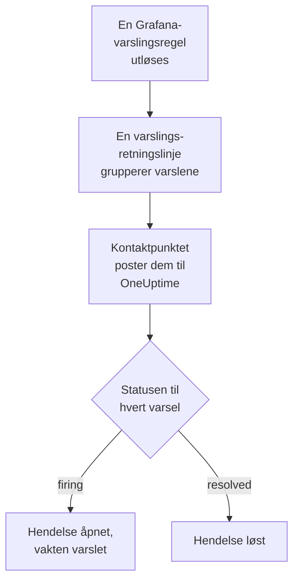

# Grafana

Send varsler fra [Grafana](https://grafana.com) til OneUptime, slik at hvert varsel som utløses, blir en hendelse som varsler vaktteamet ditt og løses når varselet er gjenopprettet. Grafana sender varslene sine gjennom et webhook-kontaktpunkt, så det er ingenting å installere på noen av sidene.

:::cards
- [Velg hvordan OneUptime mottar varsler](#velg-hvordan-oneuptime-mottar-varsler): En Incoming Request-monitor eller en egen arbeidsflyt.
- [Motta varsler med en monitor](#motta-varsler-med-en-monitor): Én hendelse per varsel, løst ved gjenoppretting.
- [Konfigurer Grafana](#konfigurer-grafana): Et webhook-kontaktpunkt og retningslinjen som bruker det.
- [Feilsøking](#feilsøking): Når varsler ikke kommer frem, eller hendelser blir stående åpne.
:::

## Slik fungerer det



Grafanas varslingsretningslinjer grupperer varslene som utløses, og et webhook-kontaktpunkt poster hver gruppe som én JSON-varsling. Den har samme form som en varsling fra [Prometheus Alertmanager](/docs/integrations/prometheus-alertmanager): en `status`, en liste `alerts` der hvert varsel har sin egen `status` og sitt eget `fingerprint`, og `commonLabels` og `commonAnnotations` som varslene deler. Grafana legger til en `title` og en `message` som er skrevet for mennesker.

## Før du begynner

- Grafana 9 eller nyere, med Grafana Alerting, standarden siden Grafana 9. Den må kunne nå OneUptime-instansen din over HTTPS.
- I OneUptime retten til å opprette monitorer, eller arbeidsflyter hvis du velger den veien.

## Velg hvordan OneUptime mottar varsler

Sett opp OneUptime først: det gir deg URL-en som Grafana sender til.

| Vei | Bruk den når |
| --- | --- |
| En Incoming Request-monitor (anbefalt) | Du vil at hvert varsel skal bli en hendelse som varsler vakten og løses når varselet er gjenopprettet. Det er ingenting å bygge. |
| En arbeidsflyt med en Webhook-trigger | Du trenger din egen logikk: filtrere varsler, omforme dem eller kalle andre systemer først. En arbeidsflyt åpner én hendelse per varsling, ikke per varsel, og løser den ikke ved gjenoppretting. |

Begge får den samme JSON-en fra det samme kontaktpunktet, så du kan begynne med den ene og bytte senere ved å endre én URL i Grafana.

## Motta varsler med en monitor

En [Incoming Request-monitor](/docs/monitor/incoming-request-monitor) gir deg en URL, og kriteriene dens avgjør hva hver varsling gjør.

:::steps
### Opprett monitoren

Gå til **Monitorer**, og klikk på **Opprett monitor**. Velg **Incoming Request** under **Monitortype**, gi den navnet `Grafana`, og klikk på **Neste**.

### Erklær en hendelse for hvert utløst varsel

Åpne det første kriteriet i trinnet **Kriterier**, det som markerer monitoren som frakoblet. Sett filteret til **Forespørselstekst**, **Inneholder**, `"status":"firing"`. Dette kriteriet erklærer allerede en hendelse når filteret samsvarer. Fyll ut hendelsen:

- **Hendelsestittel**: `{{requestBody.commonLabels.alertname}}`.
- **Hendelsesbeskrivelse**, under **Beskrivelse**: `{{requestBody.message}}`, teksten Grafana skriver for varslingen.
- **Alvorlighetsgrad**: hendelsesalvorlighetsgraden disse varslene skal ha.
- **Vaktretningslinjer**, under **Vakt**: retningslinjene som skal varsles.
- **Løs hendelse automatisk**, under **Flere felt**: la den være slått på, slik den starter. Uten den ignoreres gjenopprettinger, og hendelser blir stående åpne.

### Åpne én hendelse per varsel

Åpne **Innstillinger** i det samme kriteriet, og slå på **Group incidents and alerts by a payload field**. Fyll den ut som nedenfor, slik at hvert varsel får sin egen hendelse, og gjenopprettingen løser den:

| Felt | Verdi |
| --- | --- |
| **Open a separate incident for each…** | `requestBody.alerts[*].fingerprint` |
| **Field that signals recovery** | `requestBody.alerts[*].status` |
| **Value that means recovered** | `resolved` |

### Få monitoren tilkoblet igjen

Åpne det andre kriteriet, det som markerer monitoren som tilkoblet, og sett filteret til **Forespørselstekst**, **Inneholder**, `"status":"resolved"`.

### Kopier URL-en

Klikk på **Opprett monitor**. Monitorens side **Oversikt** viser **Heartbeat URL**. Kopier den til Grafana:

```text
https://oneuptime.com/heartbeat/<secret key>
```

En selvdriftet installasjon har sin egen vert i stedet for `oneuptime.com`.
:::

Hvert varsel i en varsling åpner sin egen hendelse, opptil **Max incidents per request** (`100` med mindre du endrer det), og hvert varsels egen `status` avgjør når hendelsen løses. Grafanas `fingerprint` identifiserer et varsel ut fra etikettene, så det er verdien du skal gruppere etter. Se [Motta varsler fra et annet system](/docs/monitor/incoming-request-monitor#motta-varsler-fra-et-annet-system) for hva hver innstilling gjør.

> [!WARNING]
> Ikke grupper etter en etikett som alle varslene i en varsling deler. Grafanas standard varslingsretningslinje grupperer varsler etter `grafana_folder` og `alertname`, så alle varslene i én varsling har samme `alertname`: gruppering etter `requestBody.alerts[*].labels.alertname` slår sammen hele varslingen til én hendelse.

`{{requestBody.commonLabels.alertname}}` og `{{requestBody.message}}` beskriver hele varslingen, som under standardretningslinjen er én varslingsregel. Grupperingsnøkkelen er også en variabel, `{{fingerprint}}`, men den er en hash som ikke forteller en responder noe. Se [Hendelse- og varslingsmaler](/docs/monitor/incident-alert-templating) for alle variablene du kan bruke.

## Konfigurer Grafana

:::steps
### Legg til et webhook-kontaktpunkt

Gå til **Alerting → Contact points** i Grafana, og klikk på **+ Add contact point**. I Grafana 11 og nyere ligger **Alerting** under **Alerts & IRM**, og **Contact points** er en fane i **Notification configuration**.

Gi kontaktpunktet navnet `OneUptime`, velg **Webhook** under **Integration**, og lim inn URL-en du kopierte, i **URL**. La **HTTP Method** stå på `POST`, og klikk på **Save contact point**.

### Send varsler dit

Gå til **Alerting → Notification policies**. Sett kontaktpunktet for standardretningslinjen til `OneUptime`, eller legg til en underordnet retningslinje som samsvarer med varslene OneUptime skal få, med `OneUptime` som kontaktpunkt.
:::

Grafana sender `Content-Type: application/json`, som monitoren trenger for å lese feltene i en varsling. Innstillingen **Max Alerts** for kontaktpunktet begrenser varslene i én varsling: hold den på `0`, ingen grense, eller høyst på monitorens **Max incidents per request**.

## Test det

1. Åpne kontaktpunktet `OneUptime` i Grafana, og klikk på **Test**. Grafana sender et utløst testvarsel, og en hendelse åpnes i OneUptime. Et testvarsel blir aldri gjenopprettet, så løs den hendelsen manuelt.
2. La en ekte varslingsregel utløses, for eksempel ved å senke terskelen et øyeblikk, og se hendelsen åpnes og deretter løses når du setter terskelen tilbake.

## Motta varsler med en arbeidsflyt

Bruk en [arbeidsflyt](/docs/workflows/index) når du trenger egne trinn mellom Grafana og hendelsen.

:::steps
### Opprett arbeidsflyten

Gå til **Arbeidsflyter**, klikk på **Opprett arbeidsflyt** og deretter på **Start fra bunnen**. Gi den navnet `Grafana alerts`, og klikk på **Opprett arbeidsflyt**.

### Legg til Webhook-triggeren

Klikk på den stiplede blokken **Velg hva som starter denne arbeidsflyten**, og velg **Webhook**. Klikk på triggeren, deretter på **Kopier URL**, og bruk den URL-en i kontaktpunktet i Grafana.

### Kontroller at varslingen er utløst

Klikk på **Legg til komponent**, legg til en blokk **If / Else**, og koble triggerens punkt **Out** til den. Sett **Value to check** til `{{local.components.webhook-1.returnValues.request-body.status}}`, **Comparison** til **is equal to** og **Compare with** til `firing`.

### Erklær hendelsen

Legg til en blokk **Create One Incident**, og koble siden **Yes** av blokken **If / Else** til den. Velg en mal under **Incident Template** som setter alvorlighetsgraden og vaktretningslinjene som skal varsles (se [Hendelsesmaler](/docs/incidents/settings#hendelsesmaler)). Angi under **JSON Object** hva som kommer fra Grafana:

```json
{
  "title": "{{local.components.webhook-1.returnValues.request-body.title}}",
  "description": "{{local.components.webhook-1.returnValues.request-body.message}}"
}
```

Uten en mal må **JSON Object** også inneholde `incidentSeverityId`, ID-en til en av prosjektets hendelsesalvorlighetsgrader.

### Slå på arbeidsflyten

Slå på **Aktivert** øverst i **Bygger**. En arbeidsflyt som er slått av, svarer Grafana med `400`.
:::

En kjøring håndterer én varsling, så den erklærer én hendelse uansett hvor mange varsler varslingen inneholder. En varsling som er `resolved`, tar siden **No** av blokken **If / Else**, der ingenting er koblet til, så kjøringen slutter der. Bruk monitoren for én hendelse per varsel som løses ved gjenoppretting.

## Feilsøking

:::details Ingenting kommer frem til OneUptime
- Klikk på **Test** på kontaktpunktet: Grafana viser en feil når den ikke kan nå URL-en. Grafanas serverlogg har detaljene.
- Monitoren svarer `200` med en gang, før den kontrollerer noe, også ved en feil hemmelig nøkkel. Sjekk monitorens tidslinje for å se om varslinger kommer frem.
- En arbeidsflyt som er slått av, svarer `400`. Slå på **Aktivert** øverst i **Bygger** for den.
:::

:::details Hendelser opprettes, men løses aldri
- Hendelsen i kriteriet trenger **Løs hendelse automatisk**, under **Flere felt**.
- **Field that signals recovery** må være `requestBody.alerts[*].status`, og **Value that means recovered** nøyaktig `resolved`. Sammenligningen skiller mellom store og små bokstaver.
- Grupperingsbanene må begynne med `requestBody.`, og bare den første `[*]` i en bane leser en liste. En bane som bryter en av reglene, samsvarer med ingenting, uten noen feil.
:::

:::details Én hendelse for en varsling full av varsler
Du har gruppert etter en etikett som er lik for hvert varsel i en varsling, som `alertname` under standardretningslinjen. Grupper i stedet etter `requestBody.alerts[*].fingerprint`.
:::

:::details Hendelsen viser en referanse i stedet for en verdi
En referanse til et felt som varslingen ikke har, blir stående slik den er skrevet, med klammeparenteser og alt. Sammenlign navnet på feltet med det Grafana sendte: for en arbeidsflyt åpner du kjøringen i **Logger → Kjøringer** og sammenligner med det triggeren mottok.
:::

Veiledningen for [Prometheus Alertmanager](/docs/integrations/prometheus-alertmanager#feilsøking) dekker flere tilfeller, og de gjelder også for Grafanas varslinger.

## Sikkerhet

- **Behandle URL-en som et passord.** Alle som har den, kan åpne hendelser. Hvis den lekker, tilbakestiller du den: **Tilbakestill hemmelig nøkkel for innkommende forespørsel** på monitorens side **Innstillinger**, eller **Tilbakestill URL** i arbeidsflytens **Webhook**-trigger. Oppdater deretter kontaktpunktets **URL** i Grafana.
- **Selvdriftet?** La Grafana nå OneUptime-instansen din over HTTPS gjennom brannmuren din.

## Neste trinn

:::cards
- [Innkommende forespørsel-overvåking](/docs/monitor/incoming-request-monitor): Hver innstilling for monitoren som mottar varslene dine.
- [Prometheus Alertmanager](/docs/integrations/prometheus-alertmanager): Det samme oppsettet, med en dødmannsbryter for varslingen din.
- [Metrikk-overvåking](/docs/monitor/metrics-monitor): Varsle på de samme metrikkene i selve OneUptime.
- [Oversikt over integrasjoner](/docs/integrations/index): De andre verktøyene du kan koble til.
:::
