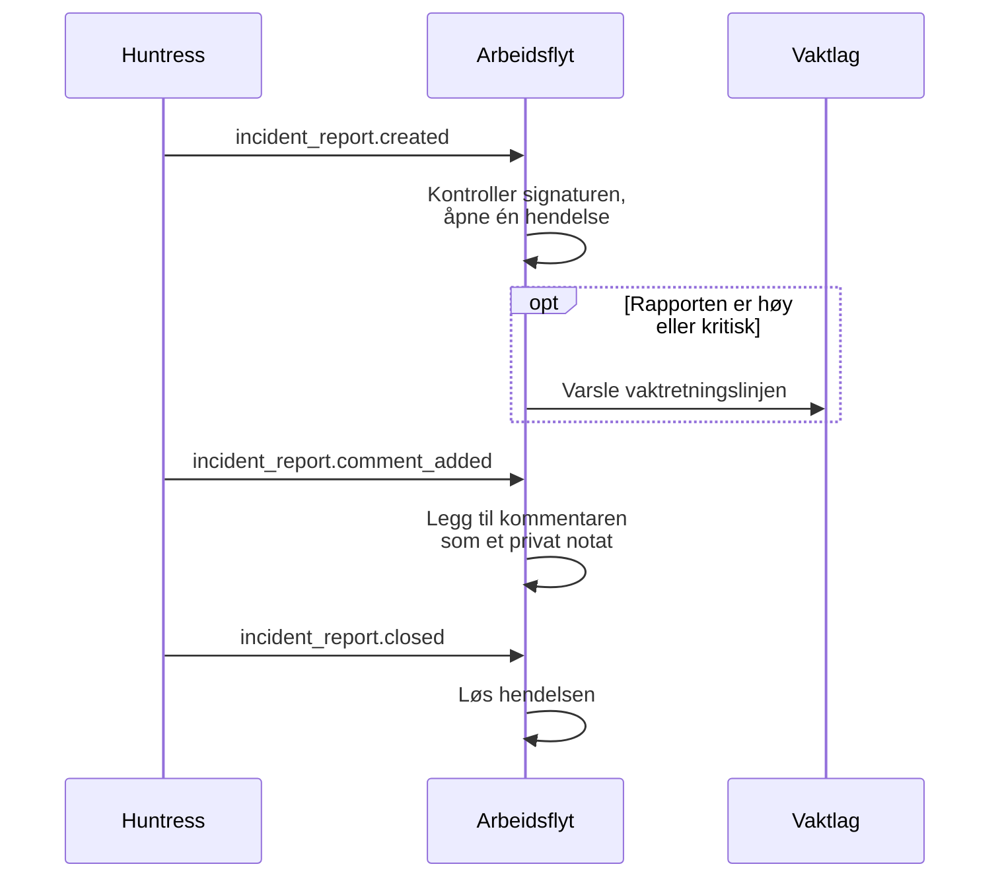

# Huntress-integrasjon

Varsle vaktlaget ditt for Huntress-hendelsesrapporter, med en arbeidsflyt. Når Huntress' SOC sender en hendelsesrapport om et endepunkt eller en identitet, åpner arbeidsflyten én hendelse for den, varsler vaktretningslinjen du velger, legger til kommentarer fra Huntress som private notater og løser hendelsen når rapporten lukkes i Huntress.

Denne integrasjonen er **innkommende**: Huntress sender hver begivenhet om en hendelsesrapport til arbeidsflytens egen URL, signert med endepunktets signeringshemmelighet. OneUptime kaller aldri Huntress og trenger derfor ingen Huntress-API-nøkkel.

:::cards
- [Slik fungerer det](#slik-fungerer-det): Hva arbeidsflyten gjør med hver begivenhet om en rapport.
- [Oppsett](#sett-opp-integrasjonen): Opprett arbeidsflyten, legg til endepunktet i Huntress, lagre signeringshemmeligheten, send en test.
- [Triggeren](#triggeren-huntress-incident-report): Verdiene en rapport gir arbeidsflyten, og triggerens innstillinger.
- [Feilsøking](#feilsøking): Hva feilene i triggeren betyr, og hva du bør endre.
:::

## Slik fungerer det

Huntress sender en begivenhet om en hendelsesrapport når rapporten sendes, når noen kommenterer den og når den lukkes. Triggeren **Huntress Incident Report** starter arbeidsflyten én gang for hver begivenhet, og dens **Event** sier hvilken det var: `created`, `comment-added` eller `closed`.

1. **Kontroller.** En forespørsel må være signert med endepunktets signeringshemmelighet, høyst fem minutter før den kommer. Alt annet avvises, og triggerens innstillinger forteller hvorfor.
2. **Start arbeidsflyten.** Hver begivenhet starter én kjøring, med rapportens felt som triggerens verdier. En begivenhet Huntress sender på nytt, starter ingenting mer.
3. **Åpne én hendelse.** Ved `created` åpner arbeidsflyten en hendelse oppkalt etter rapporten, for eksempel `Huntress: Incident on DESKTOP-01 (Acme Corp)`. Beskrivelsen inneholder rapportens sammendrag, alvorlighetsgraden i Huntress, organisasjonen, den berørte verten eller identiteten, indikatorene Huntress fant og en lenke til rapporten i Huntress. Hendelsen får en etikett med rapportens organisasjon, og varsler vaktretningslinjen du velger når rapporten er høy eller kritisk.
4. **Følg rapporten.** Ved `comment-added` blir kommentaren et privat notat på hendelsen. Ved `closed` løses hendelsen, med årsaken på tidslinjen.

Hendelsen lagrer rapportens nummer i de egendefinerte feltene sine, som `huntressReportId`: Slik finner arbeidsflyten den igjen når Huntress kommenterer eller lukker rapporten. Hendelser som åpnes slik, vises aldri på en statusside, og hendelsesreglene dine (vakt-, eier-, etikett- og personvernregler) gjelder for dem som for alle andre hendelser.

## Før du begynner

- I OneUptime en rolle som kan opprette og redigere arbeidsflyter, for eksempel **Prosjekteier**, **Prosjektadministrator** eller **Arbeidsflytadministrator**.
- I Huntress rollen **Account Admin**: Bare kontoadministratorer kan legge til webhooks.
- En vaktretningslinje å varsle.
- På OneUptime Cloud et abonnement med arbeidsflyter: Growth eller høyere. Hver begivenhet Huntress sender, er én kjøring av arbeidsflyten.
- På en selvdriftet installasjon en OneUptime som Huntress når fra internett over HTTPS: Huntress sender bare webhooks til `https://`-URL-er.

## Sett opp integrasjonen

:::steps
### Opprett arbeidsflyten

Åpne **Arbeidsflyter** og klikk **Opprett arbeidsflyt**. Under **Eller start fra en mal** velger du kategorien **Huntress**, velger **Open an incident for each Huntress incident report**, klikker **Bruk denne malen** og oppretter arbeidsflyten. Den åpnes i **Bygger**, slått av.

### Velg hvem som varsles

Klikk trinnet **Page an On-Call Policy**, velg **Vaktretningslinjer** som skal varsles, og lagre trinnet.

### Legg til et webhook-endepunkt i Huntress

Klikk triggeren **Huntress Incident Report**, og klikk **Kopier URL** under **Legg til et webhook-endepunkt i Huntress**. URL-en ser ut som `https://oneuptime.com/workflow/huntress/<key>`; på en selvdriftet installasjon begynner den med din egen vert.

Åpne menyen øverst til høyre i Huntress og velg **Integrations**. Klikk **Add an Integration**, velg **Webhooks** og klikk **Add Endpoint**. Lim inn URL-en, slå på **Incident Reports** og lagre. La **Escalations**, **Platform Actions** og **Account Notices** være av: Triggeren tar imot de begivenhetene og starter ingenting for dem.

### Lagre endepunktets signeringshemmelighet

Åpne endepunktets meny (⋯) i Huntress og velg **View Signing Secret**. Kopier hele: Den starter med `whsec_`. Klikk **Lagre signeringshemmelighet** i triggeren, lim den inn og klikk **Lagre signeringshemmelighet**. Hemmeligheten krypteres og vises aldri igjen.

Til hemmeligheten er lagret, avviser triggeren alle forespørsler. Huntress sender en avvist begivenhet på nytt senere, så en begivenhet som avvises nå, kommer likevel frem.

### Slå på arbeidsflyten og send en test

Slå på **Aktivert** øverst i **Bygger**. Åpne endepunktets meny (⋯) i Huntress og velg **Send Test**. I løpet av noen sekunder viser triggeren **Mottar rapporter**.

> [!NOTE]
> Uansett hva testen inneholder, viser triggeren at den kom frem. En test med en hendelsesrapport starter arbeidsflyten som enhver annen rapport.
:::

## Hva arbeidsflyten gjør

Malen følger én vei for hver **Event**, med en **Switch / Case** etter triggeren:

| Event | Hva arbeidsflyten gjør |
| --- | --- |
| `created` | Åpner en hendelse med triggerens **Incident Severity ID**, med etiketten fra dens **Organization Label ID**. For en høy eller kritisk rapport varsler **Page an On-Call Policy** retningslinjen din; en lav rapport varsler ingen. En rapport som allerede har en hendelse, åpner ingen ny. |
| `comment-added` | Finner rapportens hendelse og legger til kommentaren som et privat notat på den. |
| `closed` | Finner rapportens hendelse og løser den, med mindre den allerede er løst. Årsaken står på tidslinjen: Huntress lukket rapporten. |

Det er en arbeidsflyt som alle andre, så du kan endre hva den gjør: varsle bare for kritiske rapporter ved å endre hva **If / Else** etter **Create One Incident** sammenligner, poste hver rapport i en chattekanal med et Slack- eller Microsoft Teams-trinn, eller sende hver organisasjon til sin egen vaktretningslinje med en **Switch / Case** på **Organization**. Hver kjøring står blant arbeidsflytens kjøringer, med hva hvert trinn gjorde.

### Alvorlighetsgrader

Huntress gir hver hendelsesrapport én av tre alvorlighetsgrader. Triggerens **Incident Severity ID** er hendelsesalvorlighetsgraden rapporten åpnes med: den innstillingen velger, eller ellers rekkefølgen på hendelsesalvorlighetsgradene dine, slik **Hendelser → Innstillinger → Hendelsesalvor** viser dem:

| Alvorlighetsgrad i Huntress | Hva Huntress mener med den | Innstilling | Hendelsesalvorlighetsgrad når innstillingen er tom |
| --- | --- | --- | --- |
| Critical | Angripere ved tastaturet, farlig skadevare eller aktiv kompromittering, som må begrenses umiddelbart. | **Alvorlighetsgrad for kritiske rapporter** | Den høyeste |
| High | Bekreftet skadevare som krever rask utbedring, eller kompromittering av en identitet som må håndteres. | **Alvorlighetsgrad for høye rapporter** | Den andre |
| Low | Potensielt uønskede programmer, rester av skadevare og eldre funn om identiteter. | **Alvorlighetsgrad for lave rapporter** | Den tredje |

Et prosjekt med færre alvorlighetsgrader bruker den laveste for resten. En rapport uten alvorlighetsgrad behandles som høy. Hvis en alvorlighetsgrad du har valgt, slettes, avgjør rekkefølgen igjen.

### Organisasjoner

Triggerens **Organization Label ID** er en etikett oppkalt etter rapportens Huntress-organisasjon, for eksempel _Acme Corp_, som den oppretter første gang en rapport fra den organisasjonen kommer. Én arbeidsflyt mottar rapportene fra alle organisasjoner i Huntress-kontoen din, og triggerens **Bare disse organisasjonene** snevrer det inn: ett organisasjonsnavn eller én ID per linje, der navn ikke skiller mellom store og små bokstaver.

> [!TIP]
> For å varsle hver kundes eget team legger du til en vaktregel for hendelser per organisasjon, for eksempel «Hvis **Hendelsesetiketter** har en av _Acme Corp_», som utfører kundens retningslinje. Se [Vaktregler for hendelser](/docs/incidents/settings#vaktregler-for-hendelser).

## Triggeren Huntress Incident Report

Triggeren åpnes på Huntress: URL-en, en hake ved hvert oppsettstrinn som er gjort, og hva Huntress sendte sist. Innstillingene, som alle er valgfrie, er samlet under **Flere felt**: **Bare disse organisasjonene**, **Alvorlighetsgrad for kritiske rapporter**, **Alvorlighetsgrad for høye rapporter** og **Alvorlighetsgrad for lave rapporter**.

| Verdi | Hva den inneholder |
| --- | --- |
| **Event** | `created`, `comment-added` eller `closed`. En rapport som allerede er lukket eller avvist, er `closed`, uansett hvilken begivenhet som brakte den. |
| **Report ID** | Rapportens nummer i Huntress. |
| **Severity** | `critical`, `high` eller `low`. |
| **Status** | Rapportens status i Huntress, for eksempel `sent`, `closed` eller `dismissed`. |
| **Subject** | Rapportens emne, slik Huntress skriver det. |
| **Summary** | Det SOC-analytikeren skrev. |
| **Organization**, **Organization ID** | Huntress-organisasjonen rapporten gjelder. |
| **Affected** | Verten eller identiteten rapporten gjelder. |
| **Platform**, **Indicators** | Hvor Huntress fant det, og hva den fant. |
| **Comment** | Kommentaren noen la til, ved `comment-added`. |
| **Report URL** | Hvor rapporten åpnes i Huntress. |
| **Incident Title**, **Incident Description** | En tittel og en Markdown-beskrivelse for en hendelse om rapporten. |
| **Note** | Markdown for et notat om begivenheten: kommentaren, eller at Huntress lukket rapporten. |
| **Incident Severity ID**, **Organization Label ID** | Hendelsesalvorlighetsgraden og etiketten, som ovenfor. |
| **Received At** | Når OneUptime mottok begivenheten. |

**Summary** og **Comment** er tekst som Huntress' analytikere har skrevet. Bruk **Incident Description** og **Note** for å sette dem i en hendelse eller et notat: De beholder formateringen, og ingenting i dem henter et bilde eller nevner noen.

For å prøve arbeidsflyten uten Huntress klikker du **Kjør arbeidsflyt** i **Bygger** og skriver inn en **Event**, en **Report ID** og feltene du trenger. Bruk samme **Report ID** for å følge én rapport fra `created` til `closed`.

## Huntress-tilkoblinger opprettet tidligere

Huntress ble tidligere satt opp under **Hendelser → Integrasjoner → Huntress**. Hver Huntress-tilkobling ble en arbeidsflyt med samme navn, slått på, som gjør det tilkoblingen gjorde: Den varsler de samme vaktretningslinjene for de samme rapportene, legger til de samme etikettene og løser (eller bare noterer) på samme måte. URL-en er fortsatt tilkoblingens, `https://oneuptime.com/api/huntress/webhook/<connection-id>`, og signeringshemmeligheten er den samme, så det er ingenting å endre i Huntress. Hendelsene tilkoblingen åpnet, beholder rapportnummeret sitt, så arbeidsflyten finner dem når Huntress kommenterer eller lukker de rapportene.

## Sikkerhet

- **Bare signerte forespørsler.** Triggeren kontrollerer hodene `svix-id`, `svix-timestamp` og `svix-signature` som Huntress sender, mot forespørselens innhold akkurat slik det kom. En forespørsel som ikke er signert med den lagrede hemmeligheten, eller som ble signert mer enn fem minutter før eller etter, avvises.
- **Hemmeligheten forblir hemmelig.** Den lagres kryptert, returneres aldri av API-et og vises aldri igjen. **Erstatt signeringshemmelighet** i triggeren lagrer en annen, for eksempel hemmeligheten til et nytt endepunkt.
- **URL-en er en adresse, ikke et passord.** Den slutter med arbeidsflytens nøkkel; bare en forespørsel signert med endepunktets hemmelighet starter arbeidsflyten.
- **Ett endepunkt per arbeidsflyt.** Hver arbeidsflyt har sin egen URL og hemmelighet. For å motta rapportene fra en annen Huntress-konto oppretter du en ny arbeidsflyt.

## Bruk e-post i stedet

Huntress sender også hendelsesrapporter på e-post, og en [overvåker for innkommende e-post](/docs/monitor/incoming-email-monitor) kan åpne hendelser fra de e-postene, for eksempel når emnet inneholder `Critical Incident Report`. Den behandler likevel e-postene som én overvåkers status: Mens hendelsen er åpen, åpner neste rapport ingen, og hendelsen løses av overvåkerens kriterier i stedet for når Huntress lukker rapporten. Arbeidsflyten åpner én hendelse per rapport og løser hver av dem med rapporten sin, så velg den. Så snart arbeidsflyten mottar rapporter, slutter du å sende e-postene til overvåkeren, ellers varsler hver rapport to ganger.

## Feilsøking

Når triggeren avviser en forespørsel, viser innstillingene årsaken under **Den siste forespørselen ble avvist**. I Huntress viser **View Delivery Attempts** i endepunktets meny (⋯) hver leveranse med svaret fra OneUptime.

:::details "A request arrived but was refused, because no signing secret is saved for this workflow yet"
Lagre endepunktets signeringshemmelighet: se [Sett opp integrasjonen](#sett-opp-integrasjonen). Huntress sender den avviste forespørselen på nytt.
:::

:::details "The request's signature does not match the signing secret"
Den lagrede hemmeligheten tilhører ikke dette endepunktet. Hvert endepunkt har sin egen: Åpne endepunktets meny (⋯) i Huntress, velg **View Signing Secret**, kopier hele og lagre den med **Erstatt signeringshemmelighet**.
:::

:::details "The request was signed more than five minutes from now"
Klokkene hos Huntress og på OneUptime-serveren din går mer enn fem minutter fra hverandre, eller forespørselen er en gjentakelse. På en selvdriftet installasjon bør du kontrollere at serverens klokke går riktig.
:::

:::details "A request arrived while this workflow is off"
Slå på **Aktivert** øverst i **Bygger**. Huntress sender den avviste forespørselen på nytt, og da starter den arbeidsflyten.
:::

:::details "No Huntress workflow has this address."
Arbeidsflyten er slettet eller arkivert, triggeren er ikke lenger **Huntress Incident Report**, eller endepunktets URL i Huntress er ikke arbeidsflytens. Kopier URL-en fra triggeren og lim den inn i endepunktet i Huntress på nytt.
:::

:::details Ingen hendelse ble åpnet
Åpne arbeidsflytens kjøringer og kjøringen for rapporten. Hvis **Create One Incident** mislyktes fordi hendelsesalvorlighetsgraden er tom, har prosjektet ingen hendelsesalvorlighetsgrader: Legg til en under **Hendelser → Innstillinger → Hendelsesalvor**.
:::

:::details Ingen ble varslet
En lav rapport åpner en hendelse uten å varsle noen. Ellers forteller kjøringen for rapporten hva **Page an On-Call Policy** gjorde, og hendelsens side **Vaktutførelser** viser hva hver retningslinje gjorde.
:::

## Neste steg

:::cards
- [Arbeidsflyt-triggere](/docs/workflows/triggers): De andre måtene å starte en arbeidsflyt på.
- [Vaktregler for hendelser](/docs/incidents/settings#vaktregler-for-hendelser): Varsle hver organisasjons eget team via etiketten.
- [Hendelsestilstander og alvorlighetsgrader](/docs/incidents/states-and-severities): Ordne alvorlighetsgradene Huntress-rapporter åpnes med.
- [Oversikt over integrasjoner](/docs/integrations/index): De andre verktøyene du kan koble til.
:::
