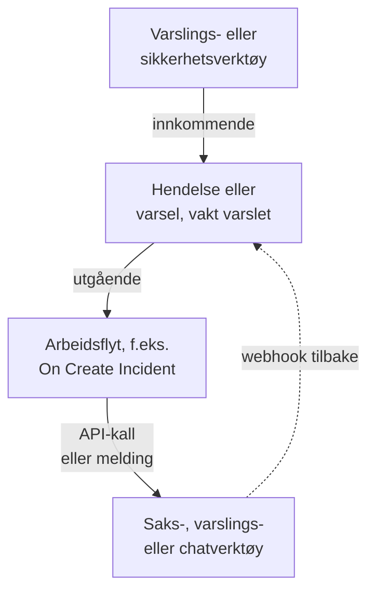

# Oversikt over integrasjoner

OneUptime fungerer med verktøyene teamet ditt allerede bruker. Varslingsverktøy oppretter hendelser i OneUptime, og OneUptime oppretter saker, vaktvarsler og chatmeldinger i andre verktøy. Noen verktøy kobles til fra et skjema, andre fra en ferdig arbeidsflytmal. Alle andre verktøy med en webhook eller et API kobles til via en arbeidsflyt du bygger selv.

:::cards
- [Velg hvordan du kobler til](#velg-hvordan-du-kobler-til): De fire måtene å koble til på, og når du bruker hver av dem.
- [Katalog](#katalog): Alle verktøy med en veiledning, gruppert etter hva de gjør.
- [Bygg din egen integrasjon](#bygg-din-egen-integrasjon): Mønstrene for innkommende og utgående data, for alle andre verktøy.
- [Hold påloggingsinformasjon trygg](#hold-påloggingsinformasjon-trygg): Hemmelige variabler og overskriftene hvert verktøy forventer.
:::

## Slik fungerer integrasjoner

Hver integrasjon flytter data i én retning eller begge. **Innkommende**: et annet verktøy forteller OneUptime at noe er galt, og OneUptime oppretter en hendelse eller et varsel og varsler vaktteamet. **Utgående**: noe skjer i OneUptime, og en arbeidsflyt forteller det til et annet verktøy: den oppretter en sak, varsler noen eller legger ut en melding.



En toveisintegrasjon, som Jira eller Dynamics 365, bruker begge retningene: én arbeidsflyt sender hendelsen ut, og en annen, startet av det andre verktøyets webhook, henter endringer tilbake.

## Velg hvordan du kobler til

| Måte | Best for | Eksempler |
| --- | --- | --- |
| En innebygd tilkobling | Verktøy OneUptime kobler seg til selv. Du fyller ut et skjema, og det er ingenting å bygge. | [Slack](/docs/workspace-connections/slack), [Microsoft Teams](/docs/workspace-connections/microsoft-teams), tilkoblingene for [Sikkerhetshendelser](/docs/telemetry/security-events) |
| En arbeidsflytmal | Saksverktøy, holdt i takt begge veier, overvåkingsproblemer, sikkerhetshendelsesrapporter og chatmeldinger. Du velger en mal og fyller ut noen få innstillinger. | [Jira](/docs/integrations/jira), [Microsoft Dynamics 365](/docs/integrations/microsoft-dynamics-365), [Huntress](/docs/integrations/huntress), [Zabbix](/docs/integrations/zabbix) |
| En Incoming Request-monitor | Varslingsverktøy som sender en webhook. Du får én hendelse per varsel, sendt til vakten og løst når varselet er over, uten arbeidsflyt. | [Zabbix](/docs/integrations/zabbix), [Prometheus Alertmanager](/docs/integrations/prometheus-alertmanager), [Grafana](/docs/integrations/grafana) |
| En arbeidsflyt du bygger selv | Alle verktøy med en webhook eller et REST API, og all logikk du trenger selv. | [PagerDuty](/docs/integrations/pagerduty), [Opsgenie](/docs/integrations/opsgenie), [ServiceNow](/docs/integrations/servicenow) |

Start fra toppen av tabellen: jo høyere en måte står, jo mindre er det å vedlikeholde.

## Katalog

### Overvåkings- og varslingsverktøy

| Verktøy | Retning | Hva det gjør |
| --- | --- | --- |
| [Zabbix](/docs/integrations/zabbix) | Begge | Gjør Zabbix-problemer om til hendelser eller varsler, løser dem når de er gjenopprettet, og kvitterer for eller lukker problemene fra OneUptime. |
| [Prometheus Alertmanager](/docs/integrations/prometheus-alertmanager) | Innkommende | Gjør varsler fra Alertmanager om til hendelser. |
| [Grafana](/docs/integrations/grafana) | Innkommende | Gjør Grafana-varsler om til hendelser. |
| [Datadog](/docs/integrations/datadog) | Innkommende | Gjør varsler fra Datadog-monitorer om til hendelser. |

### Sikkerhetsverktøy

| Verktøy | Retning | Hva det gjør |
| --- | --- | --- |
| [Huntress](/docs/integrations/huntress) | Innkommende | Varsler vakten om hendelsesrapporter fra Huntress og løser hendelsen når rapporten lukkes. |
| [Google SecOps](/docs/integrations/google-secops) | Begge | Henter deteksjoner og indikatorer fra Google SecOps inn i Sikkerhetshendelser, og sender dit det OneUptime finner. |
| [Microsoft Sentinel](/docs/integrations/microsoft-sentinel) | Begge | Henter hendelser fra Microsoft Sentinel inn i Sikkerhetshendelser, og sender dit det OneUptime finner. |
| [Microsoft Defender XDR](/docs/integrations/microsoft-defender-xdr) | Innkommende | Henter varsler fra Microsoft Defender XDR inn i Sikkerhetshendelser. |
| [CrowdStrike Falcon](/docs/integrations/crowdstrike-falcon) | Innkommende | Henter varsler fra CrowdStrike Falcon inn i Sikkerhetshendelser. |
| [Splunk Enterprise Security](/docs/integrations/splunk) | Begge | Henter notable events fra Splunk inn i Sikkerhetshendelser, og sender dit det OneUptime finner. |
| [Elastic Security](/docs/integrations/elastic-security) | Begge | Henter deteksjonsvarsler fra Elastic Security inn i Sikkerhetshendelser, og sender dit det OneUptime finner. |
| [AWS Security Hub](/docs/integrations/aws-security-hub) | Innkommende | Henter funn fra AWS Security Hub inn i Sikkerhetshendelser. |
| [Okta System Log](/docs/integrations/okta) | Innkommende | Henter pålogginger, kontoendringer og trusseldeteksjoner fra Okta inn i Sikkerhetshendelser. |

### Saksbehandling og IT-tjenestestyring

| Verktøy | Retning | Hva det gjør |
| --- | --- | --- |
| [Jira](/docs/integrations/jira) | Begge | Oppretter en Jira-sak for hver hendelse eller hvert varsel, og henter statusendringer og kommentarer tilbake. |
| [Microsoft Dynamics 365](/docs/integrations/microsoft-dynamics-365) | Begge | Oppretter en Dynamics 365-sak for hver hendelse eller hvert varsel, og henter statusendringer og notater tilbake. |
| [ServiceNow](/docs/integrations/servicenow) | Utgående | Oppretter en hendelse i ServiceNow for hver OneUptime-hendelse og løser den sammen med hendelsen. |
| [GitHub](/docs/integrations/github) | Utgående | Oppretter en GitHub-issue for en hendelse. |
| [GitLab](/docs/integrations/gitlab) | Utgående | Oppretter en GitLab-issue for en hendelse. |

### Varslingsverktøy for vakt

| Verktøy | Retning | Hva det gjør |
| --- | --- | --- |
| [PagerDuty](/docs/integrations/pagerduty) | Utgående | Utløser en hendelse i PagerDuty for hver OneUptime-hendelse og løser den sammen med hendelsen. |
| [Opsgenie](/docs/integrations/opsgenie) | Utgående | Oppretter et Opsgenie-varsel for hver OneUptime-hendelse og lukker det sammen med hendelsen. |

### Chatverktøy

| Verktøy | Retning | Hva det gjør |
| --- | --- | --- |
| [Slack](/docs/workspace-connections/slack) | Begge | En innebygd tilkobling: hendelseskanaler, handlinger fra Slack og vakter. |
| [Microsoft Teams](/docs/workspace-connections/microsoft-teams) | Begge | En innebygd tilkobling: hendelseskanaler, handlinger fra Teams og vakter. |
| [Mattermost](/docs/workflows/components#mattermost) | Utgående | Legger ut oppdateringer om hendelser i en Mattermost-kanal. |
| [Discord](/docs/integrations/discord) | Utgående | Legger ut oppdateringer om hendelser i en Discord-kanal. |
| [Telegram](/docs/integrations/telegram) | Utgående | Sender en melding til en Telegram-chat når et varsel utløses. |
| [IRC](/docs/integrations/irc) | Utgående | Legger ut oppdateringer om hendelser i en IRC-kanal. |

> [!TIP]
> Slack og Microsoft Teams har også arbeidsflyttrinn. Bruk den innebygde tilkoblingen for hendelseskanaler og vakter, og et arbeidsflyttrinn når du bare trenger en melding i en kanal.

### Hostingplattformer

| Verktøy | Retning | Hva det gjør |
| --- | --- | --- |
| [Vercel](/docs/integrations/vercel) | Innkommende | Legg til OneUptime fra Vercel Marketplace: traces, logger, oppetidsmonitorer og en statusside for Vercel-prosjektene dine. |

## Bytt fra et annet verktøy

For å forlate et annet verktøy for vakter, oppetid eller statussider henter du teamet ditt over i stedet for å koble de to sammen. **Prosjektinnstillinger → Avansert → Importer fra et annet verktøy** leser kontoen din med en API-nøkkel, viser deg hva det fant, og oppretter det du krysser av for. Hvert verktøy har en veiledning:

- Verktøy for vakter og hendelser: [Opsgenie](/docs/moving-to-oneuptime/opsgenie), [PagerDuty](/docs/moving-to-oneuptime/pagerduty), [incident.io](/docs/moving-to-oneuptime/incident-io), [Splunk On-Call](/docs/moving-to-oneuptime/splunk-on-call) og [Grafana OnCall](/docs/moving-to-oneuptime/grafana-oncall).
- Verktøy for oppetid og statussider: [UptimeRobot](/docs/moving-to-oneuptime/uptimerobot), [Atlassian Statuspage](/docs/moving-to-oneuptime/atlassian-statuspage), [Better Stack](/docs/moving-to-oneuptime/better-stack), [Pingdom](/docs/moving-to-oneuptime/pingdom), [StatusCake](/docs/moving-to-oneuptime/statuscake) og [Uptime Kuma](/docs/moving-to-oneuptime/uptime-kuma).

## Bygg din egen integrasjon

Et verktøy uten veiledning passer likevel inn i ett av to mønstre. Kan det sende en webhook, bruker du det innkommende mønsteret. Har det et REST API, bruker du det utgående mønsteret. Begge er arbeidsflyter: se [Oversikt over arbeidsflyter](/docs/workflows/index) for å komme i gang.

### Innkommende: et annet verktøy sender data til OneUptime

For et varslingsverktøy starter du med en [Incoming Request-monitor](/docs/monitor/incoming-request-monitor#motta-varsler-fra-et-annet-system): den oppretter én hendelse per varsel og løser den ved gjenoppretting, uten at du må bygge noe. Bygg en arbeidsflyt når du trenger din egen logikk:

:::steps
1. Åpne **Arbeidsflyter**, klikk på **Opprett arbeidsflyt** og deretter på **Start fra bunnen**. Gi arbeidsflyten et navn, og klikk på **Opprett arbeidsflyt**.
2. Klikk på den stiplede blokken **Velg hva som starter denne arbeidsflyten**, og velg **Webhook**. Klikk på triggeren og deretter på **Kopier URL**.
3. Send det andre verktøyets webhook til den URL-en som en `POST` med `Content-Type: application/json`.
4. Legg til blokkene som handler på den. De leser forespørselen med referanser som `{{local.components.webhook-1.returnValues.request-body.status}}`: en **If / Else**-blokk for å sjekke et felt, og deretter **Create One Incident** for å erklære en hendelse.
5. Slå på **Aktivert** øverst i **Bygger**, send en test fra det andre verktøyet, og åpne **Logger → Kjøringer** for å se hva som kom inn.
:::

URL-en er den eneste påloggingsinformasjonen, så behandle den som et passord. Se [Webhook](/docs/workflows/triggers#webhook).

### Utgående: OneUptime sender data til et annet verktøy

:::steps
1. Lagre verktøyets API-nøkkel som en hemmelig global variabel, som vist [nedenfor](#hold-påloggingsinformasjon-trygg).
2. Opprett en arbeidsflyt, klikk på den stiplede blokken, og velg en hendelsestrigger, f.eks. **On Create Incident**. Klikk på triggeren: **Fields to pass on** starter med **Tittel**, så klikk på **Legg til felt**, og velg de andre feltene som skal sendes, f.eks. **Beskrivelse**.
3. Klikk på **Legg til komponent**, og legg til en **API Post (JSON)**-blokk. Koble triggerens **Success**-punkt til den.
4. Fyll ut **URL**, **Request Headers** med `Authorization`-overskriften og **Request Body** med hendelsens felt, f.eks. `{{local.components.incident-on-create-1.returnValues.model.title}}`.
5. Klikk på **Kjør arbeidsflyt**, velg en hendelse under **Hendelse**, og kjør den. En testkjøring sender forespørselen på ordentlig. Slå deretter på **Aktivert**.
:::

Når verktøyet trenger dataene i en annen form, legger du til en [Run Custom JavaScript](/docs/workflows/components#custom-code)-blokk mellom de to. Oppskriften er den samme for Zendesk, New Relic, AWS (via SNS), StatusCake og alle de andre: bare URL-en og innholdet endres.

## Hold påloggingsinformasjon trygg

Lim aldri inn en API-nøkkel eller et token i en blokk. Lagre den én gang som en hemmelig global variabel:

:::steps
1. Gå til **Arbeidsflyter → Globale variabler**, og klikk på **Opprett Workflow Variabel**.
2. Gi den et navn, f.eks. `JIRA_AUTH`, og klikk på **Neste**.
3. Lim inn nøkkelen i **Innhold**, slå på **Hemmelighet**, og klikk på **Opprett Workflow Variabel**.
:::

Alle blokker leser den som `{{global.variables.JIRA_AUTH}}`. Innholdet i en variabel kan ikke leses igjen etter at det er lagret, og innholdet i en hemmelig variabel erstattes med `[REDACTED]` i kjøringslogger. For tokener som utløper, som de fra Microsoft Entra ID, henter en [OAuth 2.0-variabel](/docs/workflows/variables#oauth-20-variabler-tokener-som-fornyer-seg-selv) et nytt selv. Se [Arbeidsflyt-variabler](/docs/workflows/variables#globale-variabler).

### Jukselapp for autentisering

De fleste utgående integrasjoner legger nøkkelen i en overskrift i forespørselen. De vanlige formene:

| Skjema | Hva du sender | Brukes av |
| --- | --- | --- |
| Bearer-token | `Authorization: Bearer {{global.variables.TOKEN}}` | GitHub og de fleste moderne API-er |
| Basic-autentisering | `Authorization: Basic {{global.variables.BASE64_USER_PASS}}` | Jira Cloud, ServiceNow |
| Overskrift med API-nøkkel | `Authorization: GenieKey {{global.variables.OPSGENIE_KEY}}` | Opsgenie |
| Overskrift med privat token | `PRIVATE-TOKEN: {{global.variables.GITLAB_TOKEN}}` | GitLab |
| Nøkkel i innholdet | `routing_key` i JSON-innholdet | PagerDuty Events API |
| OAuth 2.0-klientlegitimasjon | `Authorization: Bearer {{local.variables.dynamicsAccessToken}}`, fra en OAuth 2.0-variabel | Microsoft Dynamics 365 |

For Basic-autentisering koder du `username:password`, eller `email:api_token`, én gang og lagrer resultatet som hemmeligheten. På macOS eller Linux:

```bash
printf '%s' 'you@example.com:your_api_token' | base64 | tr -d '\n'
```

Bruk `printf`, ikke `echo`: `echo` legger til et linjeskift, som kodes sammen med resten og ødelegger påloggingsinformasjonen. `tr` holder et langt resultat på én linje.

## Selvhostede installasjoner

En selvhostet OneUptime kaller andre verktøy fra nettverket ditt, og andre verktøy kaller den fra sine:

- **Utgående:** arbeidsflytforespørsler til private nettverksadresser avvises med mindre en administrator tillater dem. Se [Utgående nettverkstilgang](/docs/workflows/configuration#utgående-nettverkstilgang).
- **Innkommende:** webhooker fra et verktøy må nå OneUptime-installasjonen din via HTTPS, så et verktøy i skyen trenger en offentlig adresse å kalle.
- **Innebygde integrasjoner** har hver sin oppsettveiledning: [Slack](/docs/self-hosted/slack-integration), [Microsoft Teams](/docs/self-hosted/microsoft-teams-integration), [GitHub](/docs/self-hosted/github-integration), [Twilio](/docs/self-hosted/twilio-integration), [SendGrid Inbound Email](/docs/self-hosted/sendgrid-inbound-email) og [Push Notifications](/docs/self-hosted/push-notifications).

## Neste trinn

:::cards
- [Oversikt over arbeidsflyter](/docs/workflows/index): Hvordan arbeidsflyter kjører, og hvordan du bygger din første.
- [Innkommende forespørsel-overvåking](/docs/monitor/incoming-request-monitor): Motta varsler fra alle verktøy uten arbeidsflyt.
- [Jira](/docs/integrations/jira): En komplett toveisintegrasjon, ut fra maler.
- [Arbeidsflyt-variabler](/docs/workflows/variables): Send data mellom blokker, og hold hemmeligheter unna dem.
:::
