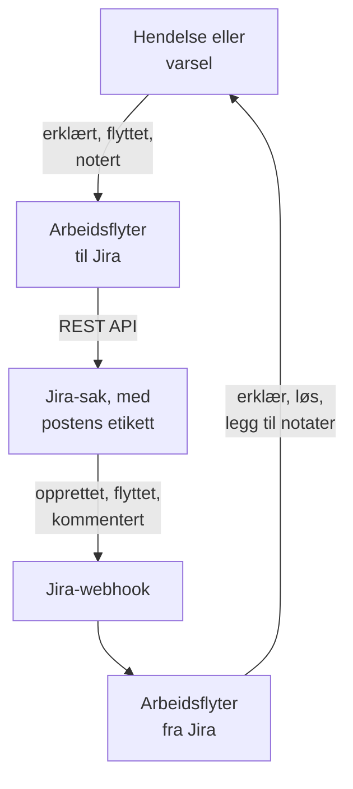

# Jira

Hold [Jira](https://www.atlassian.com/software/jira)-saker i takt med OneUptime-hendelsene og -varslene dine, begge veier. Ferdige arbeidsflytmaler oppretter en sak for hver hendelse eller hvert varsel, flytter den etter hvert som posten beveger seg, og kopierer notater inn i den som kommentarer. Andre erklærer hendelser fra nye saker og henter statusendringer, kommentarer og redigeringer tilbake. Det finnes ingen plugin: arbeidsflytene kaller Jiras REST API, og Jira kaller webhook-URL-ene deres.

:::cards
- [Start fra en mal](#start-fra-en-mal): De 17 malene, hva de ber om, og hvordan du setter dem opp.
- [Slik fungerer malene](#slik-fungerer-malene): Hvordan saker og poster forblir koblet, uten løkker.
- [Bygg det selv](#bygg-det-selv): Hver retning for hånd, for når en mal ikke passer.
- [Feilsøking](#feilsøking): Hva svarene fra Jira betyr.
:::

> [!NOTE]
> Atlassian gir ting nye navn i Jira Cloud: et **prosjekt** heter nå et **område** i store deler av grensesnittet, og en **sak** heter et **arbeidselement**. Nettsteder bruker begge ordene, så der ordbruken betyr noe, finner du begge her.

## Slik fungerer det



Hver mal er en liten arbeidsflyt, så du tar bare de retningene du vil ha, for hendelser, varsler eller begge. Malene OneUptime → Jira starter fra en hendelse i OneUptime og kaller Jiras REST API. Malene Jira → OneUptime starter fra en Jira-webhook. Alle finner hverandres poster via to etiketter på saken.

Alt på denne siden er skrevet for **Jira Cloud**. [Jira Data Center](#jira-data-center) viser hva som endres på en selvadministrert Jira.

## Før du begynner

- Et Jira Cloud-nettsted, f.eks. `https://your-domain.atlassian.net`, og et prosjekt å opprette saker i.
- En Jira-bruker for integrasjonen og et API-token for den. Gi brukeren **Browse Projects**, **Create Issues**, **Edit Issues**, **Add Comments** og **Transition Issues** i prosjektet.
- En Jira-administrator, for å registrere webhookene som malene Jira → OneUptime trenger.
- I OneUptime tilgang til å opprette arbeidsflyter. På OneUptime Cloud krever arbeidsflyter **Growth**-abonnementet eller høyere.

## Start fra en mal

Dialogboksen **Opprett en arbeidsflyt** har 17 Jira-maler under **Jira** i kategorilisten: ni for hendelser og deretter åtte for varsler, hver gruppe under sin egen overskrift. De deler én konvensjon, etiketter på Jira-saken, så enhver kombinasjon av dem fungerer sammen.

### Maler for hendelser

| Mal | Hva den gjør | Hva den ber om |
| --- | --- | --- |
| **OneUptime → Jira** | | |
| Create a Jira issue when an incident is declared | Oppretter en sak for hver ny hendelse og legger til hendelsens ID som etikett. Hendelser erklært fra Jira, og private hendelser, hoppes over. | API URL, API token, project key, issue type, OneUptime URL |
| Move the Jira issue when the incident is acknowledged or resolved | Flytter den koblede saken fremover: til en In Progress-status når hendelsen kvitteres, og til en Done-status når den løses. Flytter den aldri tilbake. | API URL, API token |
| Copy incident private notes to the Jira issue | Legger ut hvert nytt privat notat som en kommentar på den koblede saken, som en intern kommentar i Jira Service Management. | API URL, API token |
| Copy incident public notes to the Jira issue | Legger ut hvert nytt offentlig notat som en kommentar på den koblede saken. | API URL, API token |
| Comment on the Jira issue when the incident is edited | Når hendelsens tittel, alvorlighetsgrad, beskrivelse, grunnårsak eller utbedringsnotater endres, legger den ut hvordan hendelsen ser ut nå, som en intern kommentar i Jira Service Management. | API URL, API token |
| **Jira → OneUptime** | | |
| Declare an incident when a Jira issue is created | Erklærer en hendelse for hver ny sak, holdt unna statussidene dine, med en alvorlighetsgrad valgt ut fra sakens prioritet, og setter deretter etikett på saken for å koble de to. | Site URL, API URL, API token og en Jira-webhook for **Issue created** |
| Acknowledge or resolve the incident when its Jira issue moves | Kvitterer hendelsen når den koblede saken flyttes til en In Progress-status, og løser den når saken flyttes til en Done-status. | En Jira-webhook for **Issue updated** |
| Add Jira comments to the incident as private notes | Kopierer hver kommentar fra en koblet sak over på hendelsen som et privat notat. | Site URL, API URL, API token og en Jira-webhook for **Comment created** |
| Add Jira issue changes to the incident as private notes | Noterer hver redigering av en koblet sak, f.eks. prioriteten, den ansvarlige eller sammendraget, på hendelsen som et privat notat. Statusendringer overlates til malen ovenfor. | Site URL og en Jira-webhook for **Issue updated** |

### Maler for varsler

Malene for varsler gjør den samme jobben for varsler. Det er én færre, fordi varsler ikke har offentlige notater. [Hva som er annerledes for varsler](#hva-som-er-annerledes-for-varsler) viser resten.

| Mal | Hva den gjør | Hva den ber om |
| --- | --- | --- |
| **OneUptime → Jira** | | |
| Create a Jira issue when an alert is created | Oppretter en sak for hvert nytt varsel, også hvert varsel en monitor utløser, og legger til varselets ID som etikett. Varsler opprettet fra Jira, og private varsler, hoppes over. | API URL, API token, project key, issue type, OneUptime URL |
| Move the Jira issue when the alert is acknowledged or resolved | Flytter den koblede saken fremover: til en In Progress-status når varselet kvitteres, og til en Done-status når det løses. Flytter den aldri tilbake. | API URL, API token |
| Copy alert private notes to the Jira issue | Legger ut hvert nytt privat notat som en kommentar på den koblede saken, som en intern kommentar i Jira Service Management. | API URL, API token |
| Comment on the Jira issue when the alert is edited | Når varselets tittel, alvorlighetsgrad, beskrivelse, grunnårsak eller utbedringsnotater endres, legger den ut hvordan varselet ser ut nå, som en intern kommentar i Jira Service Management. | API URL, API token |
| **Jira → OneUptime** | | |
| Create an alert when a Jira issue is created | Oppretter et varsel for hver ny sak, med en alvorlighetsgrad valgt ut fra sakens prioritet, og setter deretter etikett på saken for å koble de to. | Site URL, API URL, API token og en Jira-webhook for **Issue created** |
| Acknowledge or resolve the alert when its Jira issue moves | Kvitterer varselet når den koblede saken flyttes til en In Progress-status, og løser det når saken flyttes til en Done-status. | En Jira-webhook for **Issue updated** |
| Add Jira comments to the alert as private notes | Kopierer hver kommentar fra en koblet sak over på varselet som et privat notat. | Site URL, API URL, API token og en Jira-webhook for **Comment created** |
| Add Jira issue changes to the alert as private notes | Noterer hver redigering av en koblet sak, f.eks. prioriteten, den ansvarlige eller sammendraget, på varselet som et privat notat. Statusendringer overlates til malen ovenfor. | Site URL og en Jira-webhook for **Issue updated** |

Ingen av malene OneUptime → Jira sender en hendelse merket som [**Privat hendelse**](/docs/incidents/declaring-incidents#trinn-1-hendelsesdetaljer), eller et varsel merket som **Privat varsel**, til Jira: verken posten, tilstanden, notatene eller redigeringene, med mindre du slår det på. Se [Begrensninger](#begrensninger).

### Hva som er annerledes for varsler

Hver mal for varsler er bygget som tvillingen sin for hendelser, trinn for trinn. Der varsler skiller seg fra hendelser, gjør malene det også:

- **Ingen offentlige notater.** Varsler har bare private notater, så hver kommentar malene for varsler legger ut, er en intern kommentar i Jira Service Management.
- **Ingen statusside.** Et varsel når aldri en statusside, så **Create an alert when a Jira issue is created** skriver alvorlighetsgraden, tittelen, beskrivelsen og `customFields.jiraIssueKey`, og ingenting annet.
- **To alvorlighetsgrader, så Medium blir Low.** Et nytt prosjekt har to alvorlighetsgrader for varsler, High og Low, mens det har tre for hendelser. Opprettelsesmalen fordeler Jiras prioriteter over alvorlighetsgradene prosjektet har. Med de to standardgradene blir Highest, High, Critical og Blocker til High, og alle andre prioriteter blir Low, også Medium og Major. For å sende Medium til High endrer du `medium: 1` til `medium: 0` i `PRIORITY_RANK` i skriptet `prepare-alert-1`.
- **Lenker og etiketter for varsler.** Saken lenker til `/dashboard/<project id>/alerts/<alert id>` og får etiketten `oneuptime-alert-<alert id>`.
- **Numre sier hva de nummererer.** Med standardprefikset `#` kan et varsel og en hendelse begge være `#12`, så malene skriver `Alert #12` eller `Incident #12`. Et nummer med eget prefiks, f.eks. `ALT-12`, skrives som det er.
- **Private varsler.** Et varsel merket som **Privat varsel**, for hånd eller av en personvernregel for varsler, holdes utenfor Jira med mindre du setter `SYNC_PRIVATE_ALERTS` til `true`.

**Monitorer utløser varsler av seg selv, og det kan bli mange.** **Create a Jira issue when an alert is created** oppretter en sak for hvert eneste ett. Med mindre hvert varsel fortjener en sak, setter du en betingelse foran Jira-trinnet. For bare å opprette saker for varsler med High:

1. Åpne arbeidsflytens **Bygger**, og legg til en **If / Else**-blokk.
2. Sett **Value to check** til `{{local.components.alert-on-create-1.returnValues.model.alertSeverity.name}}`, **Comparison** til **is equal to** og **Compare with** til `High`.
3. Fjern linjen fra `alert-on-create-1` til `prepare-issue-1` ved å dra enden av den bort fra punktet (se [Rydde opp](/docs/workflows/authoring#rydd-opp)). Koble triggerens **Success** til **If / Else**-blokken, og dens **Yes** til `prepare-issue-1`.

Et varsel som tar **No**-siden, avslutter kjøringen der, og det opprettes ingen sak for det.

### Hva malene ber om

Trinnet **Konfigurer** i opprettelsesveiviseren ber om opptil fem verdier. Tabellene ovenfor viser hvilke hver mal trenger.

- **Jira Site URL** — adressen du åpner Jira på, f.eks. `https://your-domain.atlassian.net`. På Jira Data Center basis-URL-en, f.eks. `https://jira.example.com:8443` eller `https://example.com/jira`. Malene som henter Jira inn i OneUptime, lenker til saken i beskrivelsen eller notatet de skriver, og den lenken går alltid til dette nettstedet, uansett hva hendelsen sier. Derfor godtar feltet adressen til et nettsted og ingenting annet: et skjema, en vert, en port hvis det finnes en, og på Data Center stien Jira kjører under. Det avviser adressen til en side på nettstedet, en spørring eller et brukernavn, og sier hva du skal skrive i stedet. En skråstrek på slutten går fint. Hvis variabelen senere tømmes, nevnes saken uten lenke.
- **Jira API URL** — hvor arbeidsflyten sender Jira-forespørslene sine: nettstedet ditt, f.eks. `https://your-domain.atlassian.net`, uten skråstrek på slutten. Med et API-token med scopes, noe som omfatter alle tokener for tjenestekontoer, bruker du `https://api.atlassian.com/ex/jira/<cloudId>` i stedet. `cloudId` står i JSON-en på `https://your-domain.atlassian.net/_edge/tenant_info`. Med et klassisk token er dette den samme adressen som **Jira Site URL**, så i malene som ber om begge, fyller veiviseren den ut fra **Jira Site URL** til du skriver i den selv.
- **Jira API Token (base64 of email:token)** — ikke tokenet alene, men kontoens e-postadresse og tokenet kodet sammen, som er slik Jira Cloud godtar Basic-autentisering. [Opprett API-tokenet](#opprett-api-tokenet) viser hvordan. Tokener utløper, som standard ett år etter at de ble opprettet, så noter datoen et sted.
- **Jira Project Key** — prosjektet (området) nye saker opprettes i: `OPS` i `OPS-123`.
- **Jira Issue Type** — sakstypen som skal opprettes, stavet nøyaktig som i det prosjektet, f.eks. `Task`, `Bug` eller `Incident`.
- **OneUptime URL** — adressen du åpner OneUptime på: `https://oneuptime.com`, eller din egen vert. Sakens beskrivelse lenker med den tilbake til hendelsen eller varselet.

### Opprett API-tokenet

:::steps
1. Opprett et token for en egen Jira-bruker, en vanlig Atlassian-konto som bare integrasjonen bruker, i stedet for for en person: saker og kommentarer tilskrives eieren av tokenet. Logg på som den brukeren, og opprett tokenet på [id.atlassian.com/manage-profile/security/api-tokens](https://id.atlassian.com/manage-profile/security/api-tokens). Et klassisk token (**Create API token**) fungerer med nettstedets URL. Et token med scopes (**Create API token with scopes**) fungerer bare med `api.atlassian.com`-adressen ovenfor. De klassiske scopene `read:jira-work` og `write:jira-work` dekker alle kallene malene gjør.
2. Kod kontoens e-postadresse og tokenet:

   ```bash
   printf '%s' 'jira-bot@example.com:your_api_token' | base64 | tr -d '\n'
   ```

   Bruk `printf`, ikke `echo`: `echo` legger til et linjeskift, som kodes sammen med resten, og da godtar ikke Jira påloggingsinformasjonen lenger. På nettstedets URL viser det seg sjelden som en `401` (se [Begrensninger](#begrensninger)). `tr` holder utdataene på én linje: GNU `base64` på Linux bryter linjen for hvert 76. tegn, og et dagens token er langt nok til å bli brutt.

3. Lim inn utdataene i **Jira API Token (base64 of email:token)**.
:::

En Atlassian-**tjenestekonto** fungerer også. En organisasjonsadministrator oppretter den og tokenet i [admin.atlassian.com](https://admin.atlassian.com) under **Directory → Service accounts**. Det tokenet har alltid scopes, så **Jira API URL** må være adressen `https://api.atlassian.com/ex/jira/<cloudId>` (**Jira Site URL** forblir nettstedet ditt), og e-postadressen du koder, er tjenestekontoens egen. Gi tjenestekontoen prosjekttillatelsene som er nevnt ovenfor, slik du ville gitt dem til enhver annen bruker.

### Opprett arbeidsflytene

:::steps
1. Åpne **Arbeidsflyter → Opprett arbeidsflyt**. Velg **Jira** i kategorilisten under **Eller start fra en mal**, eller skriv `Jira` i **Søk i maler…**, og klikk på malen du vil ha. Den åpnes og viser hva den gjør, og hvilke innstillinger den vil be om. Klikk på **Bruk denne malen**.
2. **Navn** fylles ut fra malen. Endre det hvis du vil.
3. **Konfigurer** ber om verdiene ovenfor. De lagres som arbeidsflytens egne variabler under **Arbeidsflytvariabler** i menyen. API-tokenet lagres som en hemmelighet: det skjules i **Logger → Kjøringer** og brukes bare i `Authorization`-overskriften i Jira-kallene.
4. Klikk på **Opprett arbeidsflyt**. Hver arbeidsflyt opprettes avslått: slå på **Aktivert** øverst i dens **Bygger**.
:::

Start med **Create a Jira issue when an incident is declared**, eller **Create a Jira issue when an alert is created** for varsler: alle andre maler OneUptime → Jira av samme slag finner saken via etiketten denne legger til. Slå den på, erklær en testhendelse eller opprett et testvarsel, og åpne arbeidsflytens **Logger → Kjøringer**. Kjøringen skal slutte som **Utført**, og **Response Body** i det siste trinnet, `create-issue-1`, nevner den nye saken.

Hver arbeidsflyt har sin egen kopi av disse verdiene. Når du bytter ut tokenet, oppdaterer du `jiraBasicAuthToken` under **Arbeidsflytvariabler** i hver Jira-arbeidsflyt som ba om det. Hvis Jira flytter til en annen adresse, oppdaterer du `jiraSiteUrl` og `jiraBaseUrl` på samme måte.

### Koble til webhook-malene

Malene Jira → OneUptime, fire for hendelser og fire for varsler, starter fra en [Webhook-trigger](/docs/workflows/triggers#webhook), så Jira må få vite hvor hendelsene skal sendes. Gjør det i denne rekkefølgen:

1. Opprett arbeidsflyten, og **slå den på først**. En arbeidsflyt som er slått av, svarer Jira med `400`, og Jira prøver ikke på nytt en levering som ble avvist med en `4xx`. Hendelser som sendes før du slår den på, går tapt og legges ikke i kø.
2. Åpne arbeidsflytens **Bygger**, klikk på triggerblokken **Webhook** (`webhook-1`), og klikk på **Kopier URL** øverst i innstillingene. URL-en ser slik ut:

   ```text
   https://<your OneUptime host>/workflow/trigger/<webhook secret key>
   ```

3. Gå i Jira til **Settings → System → WebHooks** (under **Advanced**), og klikk på **Create a WebHook**. Lim inn URL-en, kryss av for hendelsen fra tabellen nedenfor under **Issue related events**, og skriv inn et JQL-filter slik at bare sakene i prosjektet ditt utløser den. La **Exclude body** være uten avkryssing: arbeidsflyten leser alt fra innholdet.

| Mal | Jira-hendelse | JQL-filter |
| --- | --- | --- |
| **Hendelser** | | |
| Declare an incident when a Jira issue is created | **Issue created** | `project = OPS AND (labels is EMPTY OR labels != oneuptime)` |
| Acknowledge or resolve the incident when its Jira issue moves | **Issue updated** | `project = OPS` |
| Add Jira comments to the incident as private notes | **Comment created** | `project = OPS` |
| Add Jira issue changes to the incident as private notes | **Issue updated** | `project = OPS` |
| **Varsler** | | |
| Create an alert when a Jira issue is created | **Issue created** | `project = OPS AND (labels is EMPTY OR labels != oneuptime)` |
| Acknowledge or resolve the alert when its Jira issue moves | **Issue updated** | `project = OPS` |
| Add Jira comments to the alert as private notes | **Comment created** | `project = OPS` |
| Add Jira issue changes to the alert as private notes | **Issue updated** | `project = OPS` |

Erstatt `OPS` med prosjektnøkkelen din. Filteret på de to malene som oppretter en post, holder sakene OneUptime opprettet, helt unna dem: de ville hoppet over dem uansett, men en hendelse som aldri kommer frem, koster ingen kjøring. `labels != oneuptime` alene ville også utelatt alle saker uten etiketter, og det er derfor `labels is EMPTY` er med. De andre malene handler bare på koblede saker, så `project = OPS AND labels = oneuptime` er et strammere filter for dem.

Hver arbeidsflyt har sin egen URL, så hver trenger sin egen Jira-webhook. To maler på **Issue updated** betyr to webhooker, og fire hvis du også bruker versjonene for varsler.

**Bruker du begge malene som oppretter en post?** **Declare an incident when a Jira issue is created** og **Create an alert when a Jira issue is created** lytter begge på **Issue created**. Hver av dem sjekker sakens etiketter hos Jira før den oppretter noe, men de to leveringene kommer samtidig, så en ny sak kan få både en hendelse og et varsel. Registrer de to for forskjellige saker, etter prosjekt eller etter sakstype:

```text
project = OPS AND issuetype = Incident AND (labels is EMPTY OR labels != oneuptime)
project = OPS AND issuetype = Alert AND (labels is EMPTY OR labels != oneuptime)
```

Bruk sakstyper som finnes i prosjektet ditt, stavet slik Jira staver dem.

Før du stoler på det:

- **Jira kaller bare via HTTPS, på de tillatte portene.** OneUptime Cloud er i orden. En selvhostet installasjon må kunne nås fra internett via HTTPS på en port fra Jiras liste.
- **Alle som har URL-en, kan utløse arbeidsflyten.** Jiras webhooker inneholder ingenting en arbeidsflyt kan verifisere, så URL-en er den eneste hemmeligheten. Den som har den, kan erklære hendelser eller opprette varsler (malene som oppretter en post, spør Jira om saken de nevner, finnes og ikke er koblet ennå, men tar tittelen, beskrivelsen og prioriteten fra forespørselen) og kan flytte eller legge notater til hendelser og varsler de kjenner ID-en eller Jira-saksnøkkelen til. Det en slik forespørsel sier, skrives som tekst (se [Begrensninger](#begrensninger)), og lenken til saken går til nettstedet som **Jira Site URL** angir, uansett hva forespørselen sier. Ha bare URL-en i Jira. Hvis den lekker, klikker du på **Webhook**-triggeren i arbeidsflytens **Bygger**, klikker på **Tilbakestill URL** og limer inn den nye URL-en i Jira-webhooken. Den gamle URL-en slutter å virke med en gang.
- **Hver hendelse er en kjøring.** På OneUptime Cloud teller hver levering med i abonnementets arbeidsflytkjøringer, også de en mal hopper over. JQL-filteret holder det tallet nede. Se [Abonnementsgrenser](/docs/workflows/configuration#plangrenser).

### Sjekk at det fungerer

Hver kjørings **Trinn** sier hva malen gjorde, så åpne kjøringen i **Logger → Kjøringer** og se hvordan den endte:

- **Utført**: den gjorde jobben sin, og det siste trinnet nevner saken, hendelsen eller varselet.
- **Utført**, med trinnet **Check With JavaScript** på **No**: den hoppet over hendelsen med vilje, og trinnet sier hvorfor: saken er ikke koblet til en post av dette slaget, notatet kom fra Jira, posten er privat, eller den nye tilstanden har ingen Jira-status knyttet til seg.
- **Feil**: et trinn mislyktes, og oppføringen under **Trinn** sier hvorfor. Ved et Jira-kall inneholder den Jiras svar.
- **Feil** ved `link-issue-1`: en mal som oppretter en post fra en Jira-sak, opprettet den, men Jira tok ikke imot koblingsetikettene, så de andre malene finner den ikke ennå. Legg til etikettene for hånd.

Det er normalt å hoppe over: de fleste Jira-hendelser er ikke noen en gitt mal handler på. Se [Arbeidsflyt-kjøringer](/docs/workflows/runs-and-logs).

## Slik fungerer malene

### Slik forblir de to sidene koblet

Jira holder koblingen. En sak som hører til en hendelse eller et varsel, har to etiketter:

- `oneuptime`, som markerer saken som koblet.
- `oneuptime-incident-<incident id>` for en hendelse, eller `oneuptime-alert-<alert id>` for et varsel, som nevner posten. ID-en er den siste delen av postens adresse i dashbordet: `/dashboard/<project id>/incidents/<incident id>`.

De to malene som oppretter en sak, legger til begge etikettene når de oppretter saken, og de to malene som oppretter en post fra en Jira-sak, legger dem til så snart posten finnes. Alle andre maler krysser over via dem: de fra OneUptime → Jira søker i Jira etter postens etikett, og de fra Jira → OneUptime leser postens ID fra sakens etiketter. Så ikke gi dem nye navn eller fjern dem. For å koble en sak som er opprettet for hånd, legger du til de to etikettene selv, men bare når posten ikke har en sak ennå.

**En sak er koblet til en hendelse eller et varsel, aldri begge.** Malene som oppretter en post, hopper over enhver sak som har `oneuptime`, eller en etikett som begynner med `oneuptime-incident-` eller `oneuptime-alert-`, og malene av det ene slaget ignorerer saker som er koblet til det andre. Når du kobler en sak for hånd, gir du den én postetikett, ikke én av hver.

**En post har én sak.** Malene som legger ut på en sak eller flytter den, handler bare når nøyaktig én sak har postens etikett. Når du kloner en sak i Jira, kopieres etikettene, så en klon av en koblet sak gjør krav på den samme posten. Fra da av stopper de malene, og hver kjøring slutter med en overhopping som nevner begge sakene:

```text
More than one Jira issue is labelled oneuptime-incident-<id> (OPS-17, OPS-30). A cloned issue copies the label: remove it from every issue except the one filed for the incident.
```

Den andre retningen har ikke den sjekken: statusendringer, kommentarer og redigeringer på klonen når posten som om de var gjort på originalen. Så når du kloner en koblet sak, fjerner du begge etikettene fra klonen.

Hendelser og varsler opprettet fra Jira lagrer også saksnøkkelen i `customFields.jiraIssueKey`, skrevet når de opprettes. Det er slik malene som oppretter en sak, vet at posten allerede har en.

### Slik unngår malene løkker

Hver skriving i én retning er en hendelse i den andre: en kommentar som legges ut i Jira, kommer tilbake som en **Comment created**-webhook, og et notat som legges til i OneUptime, utløser notattriggeren. Tre ting stopper ekkoet:

- **Markører i teksten.** Hver kommentar malene legger ut i Jira, begynner med `Synced from OneUptime`. Hvert notat skrevet fra Jira, og grunnårsaken til hver tilstandsendring gjort fra Jira, begynner med `Synced from Jira`. Hver retning hopper over tekst som har den andre sidens markør, selv i en kommentar noen skrev som siterer en.
- **Etiketter på nye saker.** Saker OneUptime opprettet, har etiketten `oneuptime`, og malene som oppretter en post, hopper over dem. De spør Jira om sakens etiketter før de oppretter noe, i stedet for å stole på hendelsen. Poster opprettet fra Jira har `customFields.jiraIssueKey`, og malene som oppretter en sak, hopper over dem.
- **Tilstander går bare fremover, på begge sider.** Statusmalene skriver en ny rad i postens tilstandstidslinje, slik knappen **Løs** gjør, og alltid til en senere tilstand. Overgangsmalene flytter heller aldri en sak tilbake. Så når den ene siden løser, er den andre allerede ferdig og endrer ingenting.

Behold markørene når du redigerer malene. De er konstantene `FROM_ONEUPTIME` og `FROM_JIRA` i hjelpeblokken øverst i hvert skript. En kommentar eller et notat som skrives uten markøren, kopieres rett tilbake.

### Slik velger overgangsmalen en status

Jira har ikke noe kall som heter "flytt til Done". En sak flyttes via en overgang, og hvilke overganger den har, avhenger av arbeidsflyten og statusen. Så **Move the Jira issue when the incident is acknowledged or resolved**, og tvillingen for varsler, leser overgangene som er åpne for saken, og velger én ut fra statusen den fører til:

- **Bare fremover.** Jira deler statuser inn i tre kategorier, To Do, In Progress og Done, og malen velger aldri en overgang til en tidligere kategori enn sakens, heller ikke for en status som er nevnt i `STATE_TO_JIRA_STATUS`. Å kvittere en hendelse der saken allerede er Done, ender med `Jira issue OPS-17 is already Done, so it was not moved back to an In Progress status.`
- **De vanlige navnene først.** For en løst post vinner en status som heter Done, Resolved, Closed, Complete, Completed eller Fixed. For en kvittert vinner In Progress eller Work in Progress. En status med et annet navn i riktig kategori brukes når den er den eneste som passer.
- **Aldri en gjetning som dropper arbeidet.** En status med et navn som ligner Canceled, Declined, Rejected, Won't Do, Duplicate, Obsolete, Waiting, Pending, Escalated, On Hold eller Blocked velges aldri, med mindre `STATE_TO_JIRA_STATUS` nevner den. Så en Jira Service Management-forespørsel som kan gå til Resolved eller til Canceled, går til Resolved.
- **To veier til samme status.** Når to overganger fører til samme status, tar den den uten skjermbilde.

Når den fortsatt er usikker, flytter den ingenting og sier hvorfor: to statuser passer like godt, eller ingen av overgangene er en den får velge på egen hånd.

```text
Jira issue OPS-17 could move to Released or Deployed for a Done status. Name the one to use in STATE_TO_JIRA_STATUS.
Jira issue OPS-17 has no transition from In Review to a Done status that can be chosen without naming it in STATE_TO_JIRA_STATUS.
```

Nevn da statusen i `STATE_TO_JIRA_STATUS`, øverst i skriptet `plan-transition-1`, ut fra navnene på OneUptime-tilstandene dine. En tilstand som står der, flytter saken til den statusen etter navn, uansett kategori, så lenge det ikke er bakover:

```javascript
const STATE_TO_JIRA_STATUS = {
  Resolved: "Resolved",
  Acknowledged: "In Progress",
};
```

### Endre hva en mal gjør

Åpne arbeidsflytens **Bygger**, og klikk på blokken du vil endre. Innstillingene du mest sannsynlig vil endre, er konstanter øverst i et skript, **JavaScript Code** i en **Check With JavaScript**-blokk, rett under den delte hjelpeblokken. Versjonene for hendelser og for varsler av en mal har de samme konstantene i de samme blokkene:

| Konstant | Mal og blokk | Hva den styrer |
| --- | --- | --- |
| `STATE_TO_JIRA_STATUS` | Move the Jira issue when the incident (or alert) is acknowledged or resolved — `plan-transition-1` | Knytter et OneUptime-tilstandsnavn til et Jira-statusnavn, f.eks. `{ Resolved: 'Resolved', Acknowledged: 'In Progress' }`. Tilstander som ikke står her, går etter betydning: kvittert flytter saken til en In Progress-status, løst til en Done-status, og alle andre tilstander hoppes over. Nevn en status her når kjøringsloggen ber deg om det — se [Slik velger overgangsmalen en status](#slik-velger-overgangsmalen-en-status). |
| `PREFERRED_STATUS`, `NEVER_GUESS` | Move the Jira issue when the incident (or alert) is acknowledged or resolved — `plan-transition-1` | Statusnavnene malen foretrekker når den går etter betydning, og dem den aldri velger med mindre `STATE_TO_JIRA_STATUS` nevner dem. Begge er regulære uttrykk som sammenlignes med statusnavnet uten å skille mellom store og små bokstaver. |
| `SYNC_PRIVATE_INCIDENTS` | Hver mal for hendelser OneUptime → Jira — `prepare-issue-1`, `plan-transition-1` eller `build-comment-1` | `false` holder hendelser merket som **Privat hendelse** utenfor Jira: det opprettes ingen sak for dem, saken deres flyttes ikke, og verken notatene eller redigeringene deres legges ut. Sett den til `true` for å sende dem likevel. Hver mal har sin egen kopi, så sett den i hver mal som skal sende dem. |
| `SYNC_PRIVATE_ALERTS` | Hver mal for varsler OneUptime → Jira — `prepare-issue-1`, `plan-transition-1` eller `build-comment-1` | Det samme for varsler merket som **Privat varsel**: `false` holder dem utenfor Jira på samme måter, og `true` sender dem likevel. Sett den i hver mal for varsler som skal sende dem. |
| `JIRA_STATUS_TO_STATE` | Acknowledge or resolve the incident (or alert) when its Jira issue moves — `read-event-1` | Knytter et Jira-statusnavn til et OneUptime-tilstandsnavn, f.eks. `{ 'In Review': 'Monitoring' }`. Statuser som ikke står her, går etter Jiras statuskategori: In Progress kvitterer hendelsen eller varselet, Done løser det, og To Do svarer ikke til noe. |
| `PRIORITY_RANK` | Declare an incident when a Jira issue is created — `prepare-incident-1`; Create an alert when a Jira issue is created — `prepare-alert-1` | Knytter en Jira-prioritet, skrevet med små bokstaver, til `0` (din høyeste alvorlighetsgrad), `1` eller `2` (den laveste), med gradene imellom fordelt over intervallet. Prioriteter som ikke står her, havner i midten. Med de to alvorlighetsgradene for varsler et nytt prosjekt har, er `0` High og både `1` og `2` Low, så Medium blir Low med mindre du endrer det til `medium: 0`. |
| `EVENTS` | Add Jira comments to the incident (or alert) as private notes — `read-comment-1` | Kommentarhendelsene som blir notater. Legg til `'comment_updated'` for også å kopiere redigeringer — hver redigering blir et nytt notat — og kryss også av for **Comment updated** på Jira-webhooken. |
| `IGNORED_FIELDS` | Add Jira issue changes to the incident (or alert) as private notes — `read-changes-1` | Jira-feltene, med små bokstaver, der endringer ikke er verdt et notat. En endring utelates når enten felt-ID-en eller navnet står på listen, og det er slik `'rank'` fanger Rank, et egendefinert felt som kommer med en ID som `customfield_10019`. Status står på listen fordi statusmalen håndterer den. |

Tilstands- og statusnavn som brukes som nøkler, må staves nøyaktig slik de heter, store bokstaver inkludert. Hold `{{` unna koden: et skript fylles ut som enhver annen innstilling før det kjører, så to åpne krøllparenteser etter hverandre ville blitt lest som en referanse.

For å sende flere felt på nye saker redigerer du **Request Body** i blokken `create-issue-1` i malene som oppretter en sak. Den inneholder sakens prosjekt, type, sammendrag, etiketter og beskrivelse, og du kan legge til en prioritet, komponenter, en ansvarlig eller egendefinerte felt inne i `fields`, i formene som [Fyll ut flere felt](#fyll-ut-flere-felt) beskriver. Behold begge etikettene. Ordlyden i sammendraget og beskrivelsen står i skriptet `prepare-issue-1`. Beskrivelsen gir postens alvorlighetsgrad, tilstand og beskrivelse, og deretter grunnårsaken og utbedringsnotatene når den har dem: en monitor fyller dem ut når den utløser en hendelse eller et varsel, og de forklarer det ofte.

Private notater og redigeringskommentarer merkes som interne av `properties`-oppføringen, `sd.public.comment`, i **Request Body** i `post-comment-1`-blokken deres. Bare Jira Service Management leser den. Slett den bare hvis kundene skal se de kommentarene.

### Begrensninger

- **Bare Jira Cloud.** Malene kaller Jira Clouds REST API v3 med Basic-autentisering. Data Center har ingen v3 og tar et personlig tilgangstoken som `Bearer`, så hver API-blokk trenger endringene i [Jira Data Center](#jira-data-center): stier som `/rest/api/2/...`, vanlige strenger i stedet for innhold i Atlassian Document Format, og overskriften. Blokkene `find-issue-1` endres mest: Data Center har ingen `/search/jql`, så de må gjøre en `POST` til `/rest/api/2/search` i stedet.
- **Hendelser erklært fra Jira er stille.** De opprettes skjult fra statussidene dine, uten å varsle abonnentene på statussidene, fordi teksten i en sak ikke ble skrevet for kunder. For å vise en slår du på **Synlig på statussiden** på hendelsens side **Innstillinger** (se [Holde en hendelse unna statussiden](/docs/incidents/states-and-severities#hold-en-hendelse-borte-fra-statussiden)), eller slår på **Show On Status Pages** under **Flere felt** i malens `incident-from-another-tool-1`-blokk.
- **Private hendelser og varsler blir i OneUptime.** Malene OneUptime → Jira hopper over dem, og hver overhopping står i **Logger → Kjøringer**. For å sende dem likevel setter du `SYNC_PRIVATE_INCIDENTS` eller `SYNC_PRIVATE_ALERTS` til `true`. Å gjøre en post privat senere stopper synkroniseringen fra da av, men tar ikke tilbake det Jira allerede har. Malene Jira → OneUptime sjekker ikke dette, så kommentarer, redigeringer og statusendringer på en koblet sak når fortsatt en privat post.
- **Ingenting går bakover.** Å gjenåpne en Jira-sak endrer ingenting i OneUptime, og en status i kategorien To Do svarer ikke til noen tilstand. Se [Rekkefølgen er en reell begrensning](/docs/incidents/states-and-severities#rekkefølgen-er-en-reell-begrensning-ikke-en-visningspreferanse). Overgangsmalene flytter heller aldri en sak til en tidligere statuskategori.
- **Hvert varsel får en sak.** Bortsett fra private varsler oppretter malen for varsler som oppretter saker, en sak for hvert varsel, også hvert varsel en monitor utløser. [Hva som er annerledes for varsler](#hva-som-er-annerledes-for-varsler) viser hvordan du legger til en betingelse.
- **De første sekundene kan bomme på saken.** Jiras søk henger litt etter når en sak endres, så et notat, en tilstandsendring eller en redigering i de første sekundene etter at en post er opprettet, kan bomme på den nye saken og ende med overhoppingen `No Jira issue is labelled …`. Den kjøringen prøves ikke på nytt. Det samme gjelder rett etter at en post er opprettet fra Jira, til etikettene er lagt til.
- **Privat og offentlig betyr forskjellige ting i Jira.** I et Jira Service Management-prosjekt blir private notater og redigeringskommentarer, som inneholder grunnårsaken og utbedringen, til interne kommentarer, mens en hendelses offentlige notater blir kommentarer kunden kan se. I alle andre typer prosjekter er de alle vanlige kommentarer som alle som kan se saken, kan lese.
- **Redigeringskommentarer følger lagringer, ikke endringer.** Detaljskjemaene for hendelser og varsler sender tittelen og alvorlighetsgraden hver gang de lagres, så hvis du lagrer et etter bare å ha endret etikettene eller innstillingen for privat, legges det også ut en kommentar med de samme verdiene som forrige gang. Triggeren gir arbeidsflyten posten slik den er nå, ikke hva som endret seg.
- **Formatering blir ikke med over.** Notater legges ut i Jira som ren tekst, så Markdown kommer frem som rå tegn. Jiras formaterte tekst kommer inn i OneUptime som wikimarkeringen Jiras webhooker sender, f.eks. `*bold*`, og leses nøyaktig slik den ble skrevet: et bilde, en lenke, HTML, et diagram eller en chatomtale som `<!channel>` skrevet i en sak, en kommentar, en status eller et navn vises som tegnene sine og gjør ingenting, fordi en usynlig word joiner settes etter tegnet som ville startet det. En kopi av teksten beholder word joineren. Lenken til saken går til nettstedet arbeidsflytens **Jira Site URL** angir. En arbeidsflyt beholder skriptene den ble opprettet med, så en arbeidsflyt opprettet fra en eldre versjon av en mal skriver tekst slik den versjonen gjorde: opprett den på nytt fra malen for å få dette.
- **Arbeidsflyter opprettet før Jira Site URL lenker til saken på nettstedet hendelsen angir.** En arbeidsflyt beholder skriptene og innstillingene den ble opprettet med, så en arbeidsflyt for opprettelse fra sak, kommentarer eller saksendringer laget før malen ba om **Jira Site URL**, tar fortsatt nettstedet for sakslenken fra sakens adresse i hendelsen. For å lenke til ditt eget nettsted oppretter du arbeidsflyten på nytt fra malen, som ber om **Jira Site URL**. Slå på den nye arbeidsflyten, lim inn webhook-URL-en dens i Jira-webhooken i stedet for den gamle (hver arbeidsflyt har sin egen URL), og slett deretter den gamle arbeidsflyten.
- **Et feil eller utløpt token sier sjelden fra.** På nettstedets URL svarer Jira på et kall den ikke kan autentisere slik den ville svart en anonym besøkende, ikke med en `401`. Så et feil eller utløpt token viser seg som opprettelsesmalens `The target project doesn't exist or you don't have permission to create issues in it` (en `400`), som `Issue does not exist or you do not have permission to see it` (en `404`), eller som overhoppingen `No Jira issue is labelled oneuptime-incident-<id>, or the Jira credentials cannot see it.` En ren `401` er stort sett det adressen `api.atlassian.com` svarer. For å teste verdien sender du den til `/rest/api/3/myself`: den svarer med kontoens navn og e-postadresse når verdien fungerer, og `401` når den ikke gjør det.

  ```bash
  curl -H 'Authorization: Basic <the encoded value>' https://your-domain.atlassian.net/rest/api/3/myself
  ```

- **Den samme hendelsen kan komme to ganger.** Jira prøver på nytt en levering som mislyktes med en serverfeil eller fikk tidsavbrudd. Hvis OneUptime allerede hadde startet kjøringen, legger malene for kommentarer og saksendringer til et ekstra notat. Malene som oppretter en post, oppretter ikke en til: de spør først Jira om sakens etiketter, og når et nytt forsøk kommer, har den første kjøringen allerede satt etikett på saken. Det hjelper ikke når den første kjøringen opprettet posten, men Jira avviste etikettene: kjøringen mislykkes ved `link-issue-1`, og du må legge til etikettene for hånd.

## Bygg det selv

Malene dekker de vanlige tilfellene. For å bygge en retning selv, eller endre den utover konstantene, bygger denne delen begge retningene for hånd, for hendelser. [Gjør det samme for varsler](#gjør-det-samme-for-varsler) overfører det til varsler.

### Lagre Jira-påloggingsinformasjonen

Jira Cloud godtar Basic-autentisering bygget fra kontoens e-postadresse og et API-token, kodet sammen, som i [Hva malene ber om](#hva-malene-ber-om).

1. Gå til **Arbeidsflyter → Globale variabler**, og klikk på **Opprett Workflow Variabel**. Gi den navnet `JIRA_AUTH`, lim inn den kodede verdien i **Innhold**, slå på **Hemmelighet**, og opprett den.
2. Opprett en ny variabel, `JIRA_URL`, med `https://your-domain.atlassian.net` uten skråstrek på slutten, og la **Hemmelighet** være av.

Enhver blokk kan da sende `Basic {{global.variables.JIRA_AUTH}}` som `Authorization`-overskrift, og tokenet vises aldri i arbeidsflyten eller kjøringene. Med et token med scopes er `JIRA_URL` i stedet `https://api.atlassian.com/ex/jira/<cloudId>`, og hver sti nedenfor henger uendret på den.

Tokener utløper som standard etter ett år og fornyes ikke. For å slippe å bytte ut et for hånd kan en organisasjon med Atlassians sentrale brukeradministrasjon gi en tjenestekonto en [OAuth 2.0-legitimasjon](https://support.atlassian.com/user-management/docs/create-oauth-2-0-credential-for-service-accounts/): en klient-ID og en hemmelighet som en arbeidsflyt bytter mot et kortvarig token, slik siden [Microsoft Dynamics 365](/docs/integrations/microsoft-dynamics-365) gjør.

### Opprett en Jira-sak for hver hendelse

:::steps
1. Opprett en arbeidsflyt fra bunnen som heter `Incidents to Jira`. Klikk på den stiplede blokken, og legg til triggeren **On Create Incident**. **Fields to pass on** starter med **Tittel**: klikk på **Legg til felt**, og velg **Beskrivelse** og **Hendelsesnummer**. ID-en sendes alltid videre. La **Identifier** stå som `incident-on-create-1`.
2. Klikk på **Legg til komponent**, legg til en **API Post (JSON)**-blokk, og koble triggerens **Success**-punkt til den. Sett **Identifier** til `create-issue`, **URL** til `{{global.variables.JIRA_URL}}/rest/api/3/issue` og, under **Flere felt**, **Request Headers** til `{"Authorization": "Basic {{global.variables.JIRA_AUTH}}", "Accept": "application/json"}`.
3. Sett **Request Body** til saken, og erstatt `OPS` og `Bug` med prosjektnøkkelen din og en sakstype i det prosjektet:

   ```json
   {
     "fields": {
       "project": { "key": "OPS" },
       "issuetype": { "name": "Bug" },
       "summary": "OneUptime #{{local.components.incident-on-create-1.returnValues.model.incidentNumber}}: {{local.components.incident-on-create-1.returnValues.model.title}}",
       "labels": ["oneuptime"],
       "description": {
         "type": "doc",
         "version": 1,
         "content": [
           {
             "type": "paragraph",
             "content": [
               {
                 "type": "text",
                 "text": "{{local.components.incident-on-create-1.returnValues.model.description}}"
               }
             ]
           }
         ]
       }
     }
   }
   ```

4. Slå på **Aktivert**, erklær en testhendelse, og åpne **Logger → Kjøringer**. Trinnet `create-issue` viser en `201` og et innhold med den nye sakens `id`, `key` og `self`.
:::

Beskrivelsen ser tung ut fordi Jira Clouds v3-API tar formatert tekst som **Atlassian Document Format**, et dokumenttre i stedet for en streng. Innholdet ovenfor inneholder det minste gyldige dokumentet: ett avsnitt med én tekstnode. Det samme gjelder `environment` og egendefinerte tekstfelt med flere linjer. En senere blokk leser den nye nøkkelen som `{{local.components.create-issue.returnValues.response-body.key}}`.

### Fyll ut flere felt

Inne i `fields` kan du legge til:

- **Prioritet**: `"priority": { "id": "20000" }`, med en prioritets-ID fra nettstedet ditt.
- **Ansvarlig**: `"assignee": { "id": "<accountId>" }`. Jira Cloud angir personer med Atlassian-konto-ID-en deres.
- **Etiketter**: `"labels": ["oneuptime", "sev1"]`, en liste med strenger uten mellomrom.
- **Komponenter**: `"components": [{ "id": "10000" }]`.
- **Egendefinerte felt**: `"customfield_10034": "..."`, etter feltets egen ID. Et felt med enkeltvalg tar `{"value": "red"}`, et tekstfelt med flere linjer et dokument som beskrivelsen.

Spør Jira hva et prosjekt trenger i stedet for å gjette. Det første kallet viser et prosjekts sakstyper, og det andre feltene i en av dem, hvilke som er obligatoriske, og `customfield_NNNNN`-ID-ene deres:

```bash
curl -u 'you@example.com:your_api_token' \
  'https://your-domain.atlassian.net/rest/api/3/issue/createmeta/OPS/issuetypes'

curl -u 'you@example.com:your_api_token' \
  'https://your-domain.atlassian.net/rest/api/3/issue/createmeta/OPS/issuetypes/10001'
```

### Ta med hendelsens ID til Jira

Hver halvdel av en toveissynkronisering trenger at ett system tar vare på det andres ID. Ta vare på hendelsens ID på saken: Jira sender den da tilbake med hver hendelse, og den innkommende arbeidsflyten leser den fra forespørselen. Legg den i en etikett, den samme som [malene](#slik-forblir-de-to-sidene-koblet) bruker, slik at arbeidsflytene dine og malene finner hverandres saker:

```json
"labels": ["oneuptime", "oneuptime-incident-{{local.components.incident-on-create-1.returnValues.model._id}}"]
```

En Jira-administrator kan i stedet legge til et kort egendefinert tekstfelt, for eksempel med navnet OneUptime Incident ID, som du setter som `"customfield_10050": "{{local.components.incident-on-create-1.returnValues.model._id}}"`. Det er enklere å lese tilbake enn en etikett.

For å gi alle i Jira en vei tilbake legger du til en **API Post (JSON)**-blokk etter `create-issue` som legger ut en ekstern lenke på `{{global.variables.JIRA_URL}}/rest/api/3/issue/{{local.components.create-issue.returnValues.response-body.key}}/remotelink`:

```json
{
  "globalId": "system=https://oneuptime.com&id={{local.components.incident-on-create-1.returnValues.model._id}}",
  "object": {
    "url": "https://oneuptime.com/dashboard/{{local.components.incident-on-create-1.returnValues.model.projectId.value}}/incidents/{{local.components.incident-on-create-1.returnValues.model._id}}",
    "title": "OneUptime incident #{{local.components.incident-on-create-1.returnValues.model.incidentNumber}}"
  }
}
```

Klikk for dette på **Legg til felt** i triggerens **Fields to pass on**, velg **Prosjekt-ID**, og behold `.value`: en kolonne som inneholder en annen posts ID, kommer frem som `{"_type": "ObjectID", "value": "..."}`. `globalId` gjør kallet trygt å gjenta: Jira oppdaterer lenken som har den, i stedet for å legge til en ny.

### Kommenter og gjør overganger etter hvert som hendelsen går fremover

Bygg dette som en egen arbeidsflyt, slik at en feil her aldri hindrer at saker opprettes.

:::steps
1. Opprett en arbeidsflyt som heter `Incident updates to Jira`, med triggeren **On Update Incident**. Klikk på **Legg til felt** i **Fields to watch**, og velg **Current Incident State**. Klikk på **Legg til felt** i **Fields to pass on**, åpne **Current Incident State**, og velg **Navn**.
2. Legg til en **If / Else**-blokk: **Value to check** `{{local.components.incident-on-update-1.returnValues.model.currentIncidentState.name}}`, **Comparison** **is equal to**, **Compare with** `Resolved`, eller navnet på den løste tilstanden din.
3. Finn saken etter **Yes**-siden med en **API Post (JSON)**-blokk der **Identifier** er `find-issue`, som sender til `{{global.variables.JIRA_URL}}/rest/api/3/search/jql`:

   ```json
   {
     "jql": "project = OPS AND labels = \"oneuptime-incident-{{local.components.incident-on-update-1.returnValues.model._id}}\"",
     "fields": ["key"],
     "maxResults": 1
   }
   ```

4. Les sakens ID som `{{local.components.find-issue.returnValues.response-body.issues[0].id}}`, og bruk den i kallene nedenfor.
:::

Send JQL-en i innholdet i stedet for å legge den i URL-en: en URL sendes nøyaktig slik den er skrevet, uten å bli kodet for deg, og JQL er full av mellomrom, anførselstegn og `=`-tegn. En spørring må være avgrenset, og det er derfor `project =`-delen er med. På Cloud er endepunktet `/rest/api/3/search/jql`; det eldre `/rest/api/3/search` finnes ikke lenger.

- **Kommentar**: en **API Post (JSON)**-blokk til `{{global.variables.JIRA_URL}}/rest/api/3/issue/<id>/comment`, med et dokument som `body`: `{"body": {"type": "doc", "version": 1, "content": [{"type": "paragraph", "content": [{"type": "text", "text": "Resolved in OneUptime."}]}]}}`.
- **Overgang**: en **API Get (JSON)**-blokk på `{{global.variables.JIRA_URL}}/rest/api/3/issue/<id>/transitions` viser overgangene som er åpne fra sakens status, hver med en `id`, et `name` og statusen den fører til, `to`. En **API Post (JSON)**-blokk til samme URL med `{"transition": {"id": "31"}}` utfører en og svarer `204`.

En overgangs-ID hører til sakens Jira-arbeidsflyt, så en Jira-administrator som redigerer den arbeidsflyten, kan ødelegge en ID som er skrevet inn fast. Å lese listen når arbeidsflyten kjører, slik malene gjør, unngår det.

### Motta endringer fra Jira

Bygg først den mottakende arbeidsflyten:

1. Opprett en arbeidsflyt som heter `Jira to OneUptime`, med triggeren **Webhook**.
2. Åpne arbeidsflytens **Bygger**, klikk på **Webhook**-triggeren, og klikk på **Kopier URL** øverst i innstillingene. URL-en ser slik ut:

   ```text
   https://oneuptime.com/workflow/trigger/<webhook secret key>
   ```

   En selvhostet installasjon bruker sin egen vert. Behandle URL-en som et passord: alle som har den, kan starte arbeidsflyten. Hvis den lekker, klikker du på **Tilbakestill URL** på samme sted, og den gamle URL-en slutter å virke med en gang.

3. Legg til en **Update One Incident**-blokk fra triggeren. Sett **Query** til `{"_id": "{{local.components.webhook-1.returnValues.request-body.oneuptimeIncidentId}}"}`, og **Data (JSON Object)** til endringen, f.eks. en ny `currentIncidentStateId`. En **Find One Incident State**-blokk med spørringen `{"name": "Resolved"}` gir deg den ID-en som `{{local.components.incident-state-find-one-1.returnValues.model._id}}`.

Slå den på, og få deretter Jira til å kalle den, fra en automatiseringsregel eller fra en webhook:

:::tabs
@tab Automation rule
1. Åpne prosjektets automatisering i Jira: **Space settings → Automation**, eller **Project settings → Automation** på eldre nettsteder. For flere prosjekter bruker du **Settings → System → Global automation**.
2. Opprett en regel med triggeren **Work item transitioned** (**Issue transitioned** på eldre nettsteder), satt til å kjøre når statusen flyttes til **Done**. Triggeren **Work item updated** utelater statusendringer.
3. Legg til handlingen **Send web request**: **Web request URL** arbeidsflytens URL, **HTTP method** `POST`, en `Content-Type: application/json`-overskrift og et **Custom data**-innhold:

   ```json
   {
     "oneuptimeIncidentId": "{{issue.customfield_10050}}",
     "issueKey": "{{issue.key}}",
     "status": "{{issue.status.name}}"
   }
   ```

   Med en etikett i stedet for et egendefinert felt sender du `"labels": "{{issue.labels}}"` og henter ut ID-en med en **Run Custom JavaScript**-blokk.

4. Slå på regelen, og flytt en testsak til Done. Sjekk regelens revisjonslogg i Jira, og **Logger → Kjøringer** i OneUptime.

For å være sikker på at en forespørsel kommer fra regelen din, legger du til en ekstra overskrift, `X-OneUptime-Secret`, med en verdi du finner på selv, og bruker handlingens alternativ **Hide** på den. Sett en **If / Else**-blokk før oppdateringen i arbeidsflyten: **Value to check** `{{local.components.webhook-1.returnValues.request-headers.x-oneuptime-secret}}`, **Comparison** **is equal to** og **Compare with** den samme verdien, lagret i en hemmelig global variabel.

Send web request kaller bare portene 80, 8080, 443, 6017, 8443, 8444, 7990, 8090, 8085, 8060, 8900 og 9900. Jira Cloud trekker regelkjøringer fra en månedlig kvote som avhenger av abonnementet ditt, så en regel på hver overgang i et travelt prosjekt blir fort mye.
@tab Jira webhook
1. Gå som Jira-administrator til **Settings → System → WebHooks** (under **Advanced**), og klikk på **Create a WebHook**.
2. Lim inn arbeidsflytens URL, kryss av for **Issue updated**, og skriv inn et JQL-filter, f.eks. `project = OPS AND labels = oneuptime`.
3. Les Jiras egen payload i arbeidsflyten: `issue` inneholder saken, og `changelog.items` inneholder hvert endret felt, før og etter. For en statusendring tar du elementet der `field` er `status`. En **Run Custom JavaScript**-blokk er den enkleste måten å lese det på.

En webhook kan ha en hemmelighet, og da signerer Jira innholdet i en `X-Hub-Signature`-overskrift. En arbeidsflyt kan ikke sjekke den, fordi Webhook-triggeren sender videre et innhold som allerede er lest som JSON. Jira prøver en mislykket levering på nytt opptil fem ganger, så arbeidsflyten må tåle å få den samme hendelsen to ganger.
:::

Uansett er arbeidsflytens URL påloggingsinformasjon: ha den i Jira, og tilbakestill den hvis den lekker.

### Gjør det samme for varsler

Start med malene for varsler i [Start fra en mal](#start-fra-en-mal). For å bygge en arbeidsflyt for varsler for hånd følger du trinnene ovenfor med varselversjonen av hver blokk og hvert felt:

| Hendelse | Varsel |
| --- | --- |
| **On Create Incident** (`incident-on-create-1`) | **On Create Alert** (`alert-on-create-1`) |
| **On Update Incident** (`incident-on-update-1`) | **On Update Alert** (`alert-on-update-1`) |
| **On Create Incident Internal Note** | **On Create Alert Internal Note** |
| **On Create Incident Public Note** | Ingen: varsler har ingen offentlige notater |
| `incidentNumber`, `currentIncidentState`, `incidentSeverity` | `alertNumber`, `currentAlertState`, `alertSeverity` |
| **Find One Incident State** | **Find One Alert State** |
| **Update One Incident** | **Update One Alert** |
| Etikett `oneuptime-incident-<incident id>` | Etikett `oneuptime-alert-<alert id>` |
| `/dashboard/<project id>/incidents/<incident id>` | `/dashboard/<project id>/alerts/<alert id>` |

En arbeidsflyt har nøyaktig én trigger, så hendelser og varsler trenger én arbeidsflyt hver. For å gjøre det samme Jira-arbeidet for begge bygger du det én gang i en arbeidsflyt med en **Manual**-trigger og starter den fra begge med en **Execute Workflow**-blokk.

## Jira Data Center

Selvadministrert Jira fungerer på samme måte med en håndfull bytter. Jira Server nådde slutten av støtten i februar 2024, så Data Center er det selvadministrerte målet.

| Cloud | Data Center |
| --- | --- |
| `/rest/api/3/...` | `/rest/api/2/...`: det finnes ingen v3 på Data Center |
| `POST /rest/api/3/search/jql` for å søke med JQL | `POST /rest/api/2/search`: det finnes ingen `/search/jql` på Data Center. Innholdet beholder `jql`, `fields` og `maxResults`; send `expand` som en liste, `["transitions"]` |
| `description` som et Atlassian Document Format-dokument | `description` som en vanlig streng i wikimarkering |
| `Authorization: Basic base64(email:api_token)` | `Authorization: Bearer <personal access token>` |
| API-token fra id.atlassian.com | **Profile → Personal access tokens → Create token** på din egen Jira-konto |
| Automatiseringshandlingen **Send web request** | Automatiseringshandlingen **Send outgoing web request** |

Så blokken som oppretter saken, blir en `POST` til `/rest/api/2/issue`, med en vanlig beskrivelse:

```json
{
  "fields": {
    "project": { "key": "OPS" },
    "issuetype": { "name": "Bug" },
    "summary": "OneUptime #123: Checkout is down",
    "description": "Plain text goes straight in here."
  }
}
```

Andre forskjeller å planlegge for:

- **Jira Site URL er basis-URL-en din**, slik **Administration → System → General configuration** viser den, med porten og stien Jira kjører under: `https://jira.example.com:8443` eller `https://example.com/jira`. Malene lenker til en sak på `<base URL>/browse/<key>`. Feltet godtar en sti med ett segment, f.eks. `/jira`, og avviser en lengre, som er adressen til en side i Jira og ikke basis-URL-en.
- **Personlige tilgangstokener** finnes fra Jira Core og Jira Software 8.14 og Jira Service Management 4.15. De utløper, som standard etter 365 dager. Basic-autentisering med passord fungerer fortsatt, men noen få mislykkede pålogginger utløser en CAPTCHA som stenger kontoen ute fra REST API-et til noen løser den i en nettleser. Foretrekk et token.
- **Automatisering er innebygd** fra Jira Data Center 10.0. Før det var det appen Automation for Jira, som ble installert separat.
- **Levering av webhooker er asynkron** fra Data Center 10.0, så hendelser kan komme i feil rekkefølge. Sørg for at den mottakende arbeidsflyten tåler det.

## Feilsøking

Åpne det mislykkede trinnet i **Logger → Kjøringer** først. Jira svarer med et JSON-innhold som nevner hva den avviste, og API-blokken lagrer det i `response-body`.

:::details 401 Unauthorized
Kod `email:api_token` på nytt med `printf`, ikke `echo`, og oppdater tokenet: et linjeskift på slutten er den vanlige årsaken. Sjekk deretter at tokenets konto kan opprette saker i prosjektet. På Data Center sjekker du at du sender `Bearer`, ikke `Basic`. På et Cloud-nettsteds URL ligner feil påloggingsinformasjon oftere det neste punktet.
:::

:::details Jira sier at et prosjekt eller en sak som finnes, ikke finnes, eller et søk finner ingenting
På et Cloud-nettsteds URL skyldes dette som regel påloggingsinformasjonen, ikke dataene: Jira svarer på et kall den ikke kan autentisere slik den ville svart en anonym besøkende. Send den kodede verdien til `/rest/api/3/myself`, som [Begrensninger](#begrensninger) viser. Svarer den `401`, koder du den på nytt eller bytter ut tokenet. Svarer den med riktig konto, mangler kontoen en tillatelse i prosjektet: **Browse Projects** for å se sakene, **Create Issues** for å opprette en.
:::

:::details 400 Bad Request som nevner et felt
Sakstypen finnes ikke i prosjektet, eller prosjektet har et obligatorisk felt som du ikke sender. Kjør `createmeta`-kallene i [Fyll ut flere felt](#fyll-ut-flere-felt) mot det prosjektet og den sakstypen, og sammenlign. En `400` om `description` betyr at Clouds v3-API fikk en streng i stedet for et Atlassian Document Format-dokument.
:::

:::details 404 Not Found
Sjekk basis-URL-en og API-versjonen: `/rest/api/3/...` på Cloud, `/rest/api/2/...` på Data Center.
:::

:::details 429 Too Many Requests
Jira begrenser hvor fort du kaller den. Svaret inneholder `Retry-After`, i sekunder. Skrivinger til én sak er strengt begrenset, så en arbeidsflyt som kommenterer og gjør en overgang rett etter hverandre, kan treffe grensen. Sett en **Sleep**-blokk mellom kallene, eller flytt massearbeid til en planlagt arbeidsflyt.
:::

:::details Overgangskallet svarer 400
Overgangs-ID-en er ikke åpen fra sakens nåværende status. Hent `/transitions` for den saken, og bruk en ID fra svaret.
:::

:::details Jira viser at regelen eller webhooken kjørte, men ingenting når OneUptime
Sjekk porten først: Jira kaller bare de tillatte portene. Send deretter en forespørsel selv til arbeidsflytens URL med `curl`, og finn den i **Logger → Kjøringer**. Hvis din kommer frem og Jiras ikke gjør det, ligger problemet på Jiras side. Hvis kjøringen er der, men ble avvist, sjekker du at arbeidsflyten er slått på.
:::

:::details Arbeidsflyten kjører, men hendelsen endres ikke
En **Update One Incident**-blokk rapporterer `Items Updated: 0` når spørringen ikke samsvarte med noe, og det er en suksess, ikke en feil. Sjekk at ID-en i forespørselen virkelig er OneUptime-hendelsens, og at du spør på `_id`.
:::

:::details En referanse vises slik den er skrevet i en Jira-sak
En referanse som ikke kan løses opp, sendes slik den er skrevet, krøllparenteser og alt, i stedet for å bli tømt. På kjøringens fane **Trinn** er innstillingen den sto i, merket med **Did not resolve**: som regel en feilskrevet blokk-identifier eller en variabel som har fått nytt navn.
:::

## Neste trinn

:::cards
- [Microsoft Dynamics 365](/docs/integrations/microsoft-dynamics-365): Den samme toveissynkroniseringen for Dynamics 365-saker.
- [Arbeidsflyt-variabler](/docs/workflows/variables): Hemmeligheter, og hvordan du leser verdiene fra én blokk i den neste.
- [Arbeidsflyt-konfigurasjon & sikkerhet](/docs/workflows/configuration): Webhooksikkerhet, utgående nettverkstilgang og abonnementsgrenser.
- [Oversikt over integrasjoner](/docs/integrations/index): De andre verktøyene du kan koble til.
:::
