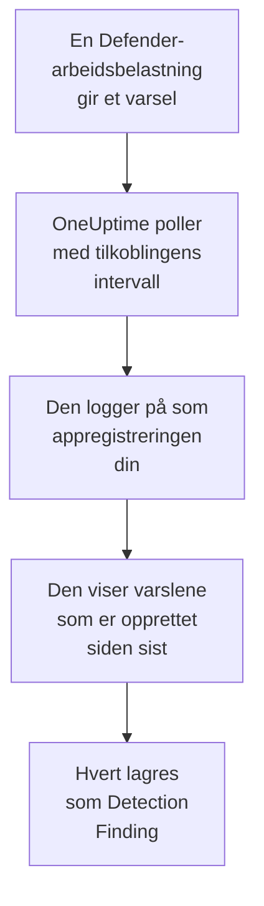

# Microsoft Defender XDR

Importer varslene fra hver [Microsoft Defender XDR](https://learn.microsoft.com/en-us/defender-xdr/)-arbeidsbelastning, fra endepunkter, identiteter, e-post og skyapper, til sikkerhetshendelsene i OneUptime. Der søker du i dem ved siden av logger, sporinger og metrikker, korrelerer dem med alle andre kilder og varsler vakten om dem som betyr noe. OneUptime leser dem gjennom sikkerhets-API-et i Microsoft Graph med en appregistrering som du oppretter: ingen agent, playbook eller Sentinel-arbeidsområde trengs.

:::cards
- [Sett opp tilkoblingen](#sett-opp-tilkoblingen): En appregistrering, én tillatelse og skjemaet for tilkoblingen.
- [Hva som importeres](#hva-som-importeres): Hvordan hvert Defender-varsel blir en sikkerhetshendelse.
- [Slik fungerer polling](#slik-fungerer-polling): Vinduet hver poll leser, og hva en travel leier gjør med det.
- [Feilsøking](#feilsøking): Hva hver feil betyr, og hva du skal endre.
:::

## Slik fungerer det



Hvert minutt poller OneUptime hver aktiverte tilkobling der pollintervallet har gått. En poll logger på Microsoft Entra ID som appregistreringen din, ber Microsoft Graph om varslene som er opprettet siden forrige poll ([List alerts_v2](https://learn.microsoft.com/en-us/graph/api/security-list-alerts_v2)), og lagrer hvert som en [OCSF](https://schema.ocsf.io/)-hendelse av typen Detection Finding (klasse `2004`). Deteksjonsregler, monitorer og dashbord behandler den deretter som en sikkerhetshendelse fra en hvilken som helst annen kilde.

## Før du begynner

- I OneUptime rollen Project Owner, Project Admin eller Security Admin. Security Member og Security Viewer kan se tilkoblinger og kjøringshistorikken deres, men ikke endre dem.
- En Microsoft Entra-leier med en lisens for Microsoft Defender XDR: en hvilken som helst Defender-arbeidsbelastning som er koblet til Microsoft Defender-portalen, for eksempel Defender for Endpoint, for Identity, for Office 365 eller for Cloud Apps.
- En Entra-rolle som kan registrere programmer, for eksempel Programadministrator, og en Global administrator eller Administrator for privilegerte roller for å gi administratorsamtykke.
- Utgående HTTPS fra OneUptime-appen og -workerne til `login.microsoftonline.com` og `graph.microsoft.com`, eller til `login.microsoftonline.us` og `graph.microsoft.us` for Azure Government.

## Sett opp tilkoblingen

Tilkoblingen logger på med [OAuth 2.0-flyten for klientlegitimasjon](https://learn.microsoft.com/en-us/entra/identity-platform/v2-oauth2-client-creds-grant-flow): som et program, aldri som en person, med én programtillatelse.

:::steps
### Registrer et program

1. Logg på [Azure-portalen](https://portal.azure.com), og åpne **Microsoft Entra ID**.
2. Gå til **App registrations → New registration**. Gi den navnet `OneUptime Security Events`, la **Supported account types** stå på **Accounts in this organizational directory only**, la omdirigerings-URI-en være tom, og velg **Register**.
3. Kopier **Program-ID (klient)** og **Katalog-ID (tenant)** fra appens side **Overview**.

### La den lese varsler

1. Gå til **API permissions → Add a permission → Microsoft Graph → Application permissions**, velg `SecurityAlert.Read.All`, og velg **Add permissions**. Det er tillatelsen med færrest rettigheter som kallet [List alerts_v2](https://learn.microsoft.com/en-us/graph/api/security-list-alerts_v2#permissions) godtar for et program: ikke legg til `SecurityAlert.ReadWrite.All`.
2. Velg **Grant admin consent for** leieren din, og bekreft. Statusen til tillatelsen må være **Granted**: uten samtykke avvises hver lesing med `403`.

### Opprett en klienthemmelighet

Gå til **Certificates & secrets → Client secrets → New client secret**, velg når den utløper, og velg **Add**. Kopier hemmelighetens **Value**, ikke **Secret ID**, før du forlater siden: den vises aldri igjen.

Noter når hemmeligheten utløper. Den dagen stopper pollingen med `Microsoft Defender XDR token request failed (HTTP 401)` til du erstatter den med **Update credentials**.

### Legg til tilkoblingen i OneUptime

Åpne **Produkter → Security Events → Connections** (`/dashboard/{projectId}/security-events/connections`), klikk på **Legg til tilkobling**, velg **Microsoft Defender XDR** under **EDR / XDR**, og klikk på **Neste**. Fyll ut innstillingene i tabellen nedenfor, klikk på **Neste**, og lim inn verdien av hemmeligheten i **Client secret**.

### Test den før du lagrer

Klikk på **Test these settings** under **Test før du lagrer**. Testen logger på og leser varsler med verdiene i skjemaet, og lagrer ingenting, så en feil hemmelighet eller et manglende samtykke viser seg før tilkoblingen finnes. Klikk deretter på **Neste**, gi tilkoblingen et **Navn**, og opprett den.
:::

| Innstilling | Hvor du finner den |
| --- | --- |
| **Katalog-ID (tenant)** | Appens side **Overview**. GUID-en til leieren, eller et verifisert domene som `contoso.onmicrosoft.com`. |
| **Program-ID (klient)** | Appens side **Overview**. GUID-en til appen som har `SecurityAlert.Read.All`. |
| **Sky** | **Offentlig Azure-sky**, som også betjener Microsoft 365 GCC, eller **Azure Government (USA)** for GCC High (`login.microsoftonline.us` og `graph.microsoft.us`). Microsoft 365 DoD og 21Vianet-skyen i Kina støttes ikke. |
| **Client secret** | Hemmelighetens **Value**. Den krypteres, returneres aldri av API-et og vises aldri igjen. Erstatt den med **Update credentials** på tilkoblingen. |

Trinnet **Polling** har også en valgfri **Beskrivelse**, **Poll Interval (Minutes)**, et heltall fra `1` til `1440` som starter på `5`, og **Aktivert**, som starter slått på.

## Hva som importeres

Hvert [varsel](https://learn.microsoft.com/en-us/graph/api/resources/security-alert) fra Defender XDR blir én hendelse av typen Detection Finding (OCSF-klasse `2004`), med leverandøren `Microsoft` og produktet `Microsoft Defender XDR`, tilskrevet telemetritjenesten `Microsoft Defender XDR`:

| OCSF-kolonne | Felt i varselet |
| --- | --- |
| `eventUid` | `id`, ID-en til Graph-varselet, som også duplikater fjernes etter |
| `time` | `firstActivityDateTime`, eller `createdDateTime` hvis den mangler |
| `message`, `ruleName` | `title` |
| `ruleId` | `detectorId`, eller `alertPolicyId` hvis den mangler |
| `severityName` | `severity`: `informational`, `low`, `medium` eller `high`, og `unknown` forblir Unknown |
| `statusName` | `status`: `new` blir New, `inProgress` In Progress, `resolved` Resolved |
| `mitreTechniques` | `mitreTechniques` |
| `mitreTactics` | `categories` eller `category`, når det er en ATT&CK-taktikk: `CredentialAccess` blir `TA0006`. Andre kategorier blir i `attributes`. |
| `principalHost`, `principalUser`, `principalIp`, `principalProcess` | `evidence` med rollen `source`, `attacker` eller `compromised`, ellers den første av hver type |
| `processName`, `processPath`, `processCommandLine`, `parentProcessName`, `parentProcessPath` | Prosessbeviset `principalProcess` kommer fra: dets `imageFile`, `processCommandLine` og `parentProcessImageFile`. Graph gir ingen kommandolinje for den overordnede prosessen. |
| `targetHost`, `targetUser`, `targetIp`, `targetResource` | `evidence` med en målrolle, for eksempel `destination` eller `attacked`. URL-er, postbokser og skyressurser fyller `targetResource`. |
| `observables` | Hvert vertsnavn, IP, bruker, filnavn, SHA-1 og SHA-256, URL, domene, postboks og ressurs-ID i `evidence` |
| `attributes` | Hele varselet, flatet ut til nøkler med punktum som `evidence.0.hostName`, `serviceSource` og `incidentId` |

Varsler fra hver `serviceSource` importeres, også varslene fra Microsoft Sentinel når Sentinel er koblet til Defender-portalen. Hendelser (incidents) importeres ikke, men hvert varsel beholder `incidentId` og `incidentWebUrl` i `attributes`.

## Slik fungerer polling

Hver poll viser varslene som er opprettet i vinduet, 100 per side, og følger Graphs `@odata.nextLink` til den har lest hele vinduet:

```text
GET https://graph.microsoft.com/v1.0/security/alerts_v2?$filter=createdDateTime ge {start} and createdDateTime lt {end}&$top=100
```

- **Opprettelsestidspunktet er markøren.** Defender oppretter ofte et varsel timer etter `firstActivityDateTime`, og en markør på aktivitetstidspunktet ville hoppet over hvert slikt varsel.
- **Den første pollen ser 24 timer tilbake**, slik at en ny tilkobling viser de nylige varslene sine med en gang.
- **Hver senere poll starter 1 minutt før den lagrede markøren**, slik at et varsel som er opprettet på grensen mellom to vinduer, leses to ganger og importeres én gang.
- **En poll leser høyst 24 timer forbi markøren.** En tilkobling der markøren har kommet på etterskudd, mens workerne var nede eller leieren ble begrenset, tar igjen i en rekke vinduer på 24 timer.
- **Duplikater fjernes etter varselets `id`** blant prosjektets hendelser fra `Microsoft` / `Microsoft Defender XDR`, slik at overlappingen, et gjentatt vindu og en import aldri lagrer et varsel to ganger.
- **En mislykket kjøring endrer ingenting.** Etter en nettverksfeil, eller en feilstatus fra Graph, forblir markøren og vinduslengden som de var, og den neste pollen leser det samme vinduet på nytt. Det eneste unntaket er en forespørsel som fikk tidsavbrudd: markøren blir, men det neste vinduet er halvparten så langt, fordi et vindu som er for tungt til å bli besvart i tide, ville fått tidsavbrudd ved hvert forsøk.

### Når et vindu inneholder mer enn én poll kan lese

En poll leser høyst 20 sider med 100 varsler: 2 000 varsler. Når den grensen stopper den før slutten av vinduet, er kjøringen **Partial**, med denne advarselen:

```text
Stopped after 20 alerts requests (the per-run request limit) before reading the whole window. Microsoft Graph lists alerts newest first and documents no way to sort them oldest first, so this run cannot name a point to resume from.
```

[List alerts_v2](https://learn.microsoft.com/en-us/graph/api/security-list-alerts_v2) dokumenterer `$filter`, `$top`, `$skip` og `$count`, men ikke `$orderby`, og returnerer de nyeste varslene først. De 2 000 varslene en stoppet kjøring leste, er de nyeste i vinduet, så å flytte markøren forbi dem ville hoppet over de eldre den aldri nådde. OneUptime gjør i stedet vinduet kortere:

1. **Snevre inn.** Den neste pollen leser et vindu som er halvparten så langt, fra det samme startpunktet, og fortsetter å halvere til et vindu leses helt, ned til ett minutt. Kjøringens advarsel sier det: `This window holds more records than one poll can read; the next poll reads a {n} minute window from the same starting point.` Varsler som allerede er importert fra det lengre vinduet, hoppes over som duplikater.
2. **Vokse igjen.** Når et vindu er lest helt, flyttes markøren til slutten av det, og det neste vinduet er igjen dobbelt så langt, opptil 24 timer.
3. **Gå forbi ett enkelt minutt.** Hvis selv ett minutt inneholder mer enn 2 000 varsler, går pollingen forbi det, slik at nyere varsler fortsetter å komme. Kjøringen forblir **Partial**, og **Siste feil** lyder `More records were created in the one minute from {cursor} to {end} than one poll can read. Polling moved past this minute so newer records keep arriving; use Import this time range in Diagnostics on this minute to recover what one run can read.` Importer det minuttet med **Import this time range** for å hente det én kjøring kan lese.

En kjøring som er **Partial** av en annen grunn, for eksempel et varsel som ikke kunne leses som en sikkerhetshendelse, prøves på nytt på samme måte, fra det samme startpunktet. Å endre **Poll Interval (Minutes)** endrer ingenting av dette: det avgjør hvor ofte en poll starter, ikke hvor vinduet begynner.

### Kjør, forhåndsvis og importer ved behov

Klikk på **Diagnostics** på en tilkobling for å se de siste kjøringene og arbeide med den manuelt. Alle som kan endre tilkoblingen, kan starte disse handlingene; alle som kan se den, kan lese historikken.

- **Run now** starter en poll med en gang, med den vanlige markøren, også når tilkoblingen ikke er **Aktivert**.
- **Preview alerts** leser et tidsrom på opptil 7 dager og importerer ingenting.
- **Import this time range** importerer et tidsrom på opptil 7 dager, etter at du har bekreftet, uten å flytte markøren. Varsler som allerede er importert, hoppes over.
- **Copy diagnostics** på en kjøring kopierer rapporten for brukerstøtte. Den inneholder aldri legitimasjon.

## Test tilkoblingen

**Test tilkoblingen** på raden til en tilkobling og **Test these settings** i skjemaet kjører i API-prosessen, ikke i en bakgrunnsworker, slik at en test også svarer når det er workerne som er problemet. Den kjører disse kontrollene i rekkefølge:

| Kontroll | Hva den kontrollerer |
| --- | --- |
| **Konfigurasjon** | De fire innstillingene er til stede og riktig formatert. Ingenting kontaktes når dette mislykkes. |
| **Authenticate with Microsoft Entra** | Microsoft Entra ID utsteder et token for Microsoft Graph i skyen du valgte. Det mislykkes ved en feil eller utløpt hemmelighet, en feil leier- eller klient-ID eller feil sky. |
| **Read alerts from Microsoft Graph** | Ett varsel som er opprettet de siste 24 timene, kan leses (`$top=1`). En `403` her er den manglende tillatelsen `SecurityAlert.Read.All`, det manglende administratorsamtykket eller en leier uten Defender XDR. |
| **Alerts available to import** | Hvor mange varsler som er opprettet de siste 24 timene og de siste 7 dagene, én side med 100 for hver, så `100+` betyr flere. Ingen på 7 dager er en advarsel, ikke en feil. |
| **Background workers**, **Poll scheduler**, **Security event storage** | OneUptimes egen side: en prosess tar jobbene fra Worker-køen, poll-jobben kjører hvert minutt, og lageret for sikkerhetshendelser svarer. |
| **Scheduled polling** | For en lagret tilkobling: polling er slått på, ingen kjøring sitter fast og venter på en worker, og poller kjører i tide. |

Hver forespørsel i en test har en frist på 20 sekunder. En test importerer aldri noe og flytter aldri markøren, og hver kontroll som mislykkes, sier hva du skal endre.

## Feilsøking

**Siste feil** for tilkoblingen lagrer hele feilmeldingen, med legitimasjon maskert, bak et prefiks som navngir trinnet som mislyktes. Når en tilkobling har en feil, velger du **Vis feil** i kolonnen **Handlinger** for å lese den, og **Kopier feil** i dialogboksen for å kopiere den. Les prefikset først.

:::details Last Error starter med `Microsoft Defender XDR token request`
- `Microsoft Defender XDR token request failed (HTTP ...)`: Microsoft Entra ID nektet å utstede et token, så Graph ble aldri kontaktet. Meldingen slutter med et hint ut fra `error`-koden fra Entra:
  - `invalid_client` (`AADSTS7000215`): hemmeligheten er feil, utløpt eller tilhører en annen app. Opprett en ny under **Certificates & secrets**, og lagre den med **Update credentials**.
  - `unauthorized_client` (`AADSTS700016`): **Program-ID (klient)** finnes ikke i den **Katalog-ID (tenant)**, eller **Sky** er feil.
  - `AADSTS90002`: den leieren finnes ikke.
  - `invalid_scope`: Graph-omfanget finnes ikke i skyen du valgte. Sjekk **Sky**.
- `Microsoft Defender XDR token request returned ...`: Microsoft Entra ID svarte med noe ubrukelig, et innhold som ikke er JSON, eller uten `access_token`. Det er vanligvis en proxy eller gateway imellom, ikke legitimasjonen.
- `Microsoft Defender XDR token request did not complete: ...`: token-endepunktet kunne ikke nås, eller svarte ikke i tide. Sjekk utgående HTTPS fra OneUptime-appen og -workerne til `login.microsoftonline.com` eller `login.microsoftonline.us`.
:::

:::details Last Error starter med `Microsoft Defender XDR alerts request`
- `Microsoft Defender XDR alerts request failed (HTTP ...)`: Graph nektet å vise varslene. Meldingen navngir feilkoden fra Graph og et hint:
  - `403` (`Authorization_RequestDenied`): `SecurityAlert.Read.All` eller administratorsamtykket for den mangler, eller leieren har ingen lisens for Defender XDR. Samtykke bruker noen minutter på å tre i kraft.
  - `401` (`InvalidAuthenticationToken`) etter at et token er utstedt: **Sky** passer vanligvis ikke til leieren.
  - `429` (`TooManyRequests`): Graph begrenser appen, og den neste pollen leser det samme vinduet på nytt. Meldingen kan ikke sitere Graphs `Retry-After`, fordi HTTP-klienten i OneUptime ikke beholder svarhoder ved en feil. Hvis det fortsetter, øker du **Poll Interval (Minutes)**.
  - `5xx`: et problem på Graphs side. Den neste pollen prøver igjen.
  - `400`: Graph ville ikke kjøre spørringen, som OneUptime bygger, ikke innstillingene dine. Kopier meldingen til OneUptimes brukerstøtte.
- `Microsoft Defender XDR alerts request returned ...`: Graph svarte `200`, men med noe koblingen ikke kunne bruke: et innhold som ikke er JSON, ingen liste `value` eller en `@odata.nextLink` som ikke er en `https://`-lenke på Graph-verten for skyen din. En slik lenke avvises, slik at tokenet aldri sendes noe annet sted. Det rapporteres i stedet for å bli tatt som et tomt vindu, slik at markøren aldri går forbi varsler som ingen har lest.
- `Microsoft Defender XDR alerts request did not complete: ...`: Graph kunne ikke nås, eller svarte ikke i tide: 60 sekunder for en poll, 20 for en test. Sjekk utgående HTTPS til `graph.microsoft.com` eller `graph.microsoft.us`.
:::

:::details Testen lykkes, men Last Polled er Never
Poll-jobben har aldri kjørt. Les kontrollene **Background workers** og **Poll scheduler**. På en selvdriftet installasjon er den vanlige årsaken `DISABLE_QUEUE_WORKERS=true` på appen, uten en separat worker-utrulling som tar jobbene: sett den til `false`, eller kjør worker-utrullingen (Helm: `worker.enabled: true`, som er `false` som standard).
:::

:::details Poller lykkes, men et varsel du kjenner til, mangler
Sammenlign varselets `createdDateTime` i Defender-portalen med kjøringens vindu i **Diagnostics**: vinduer går etter opprettelsestidspunkt, ikke aktivitetstidspunkt.

- Et varsel som ble opprettet før tilkoblingen fantes, er eldre enn det første tilbakeblikket på 24 timer. Importer det med **Import this time range**.
- En kjøring som er **Partial**, ble stoppet av grensen på 2 000 varsler. Den neste pollen leser et kortere vindu fra den samme starten, så varselet importeres så snart et vindu som inneholder det, er lest helt.
- Hvis **Siste feil** navngir et minutt pollingen gikk forbi, importerer du det minuttet med **Import this time range**.
:::

:::details Det samme varselet vises to ganger
Overlappingen på 1 minutt er ikke årsaken: den andre lesingen telles som et duplikat og lagres ikke. To hendelser med samme `eventUid` ble importert under forskjellige produkter, for eksempel det samme varselet som også kommer gjennom en Microsoft Sentinel-tilkobling. Duplikater fjernes per leverandør og produkt.
:::

## Hva du får

- **Søk.** Filtrer Defender-varsler etter alvorlighetsgrad, status, MITRE-teknikk, vert, bruker, IP eller en hvilken som helst observable i utforskeren for sikkerhetshendelser, ved siden av loggene og metrikkene for den verten.
- **Korrelasjon.** Bevisene i hvert varsel, enhetene, brukerne, IP-ene, filene og URL-ene, indekseres som observables, så ett søk finner alt som nevner en vert, på tvers av alle kilder.
- **Deteksjonsregler.** Sigma-regler som kjører etter en tidsplan over sikkerhetshendelsene dine, og åpner varsler som varsler vakten.
- **Monitorer.** Monitorer for sikkerhetshendelser teller samsvarende hendelser, og åpner hendelser eller varsler over en terskel.

Sikkerhetshendelser faktureres som resten av telemetrien din, per innhentet GB. Se [Priser](https://oneuptime.com/pricing).

## Neste trinn

:::cards
- [Sikkerhetshendelser](/docs/telemetry/security-events): Søk, korreler og varsle på det du importerer.
- [Microsoft Sentinel](/docs/integrations/microsoft-sentinel): Importer også hendelsene fra et Sentinel-arbeidsområde.
- [Roller](/docs/permissions/reference#roller): Hva Security-rollene kan se og endre.
- [Oversikt over integrasjoner](/docs/integrations/index): De andre verktøyene du kan koble til.
:::
