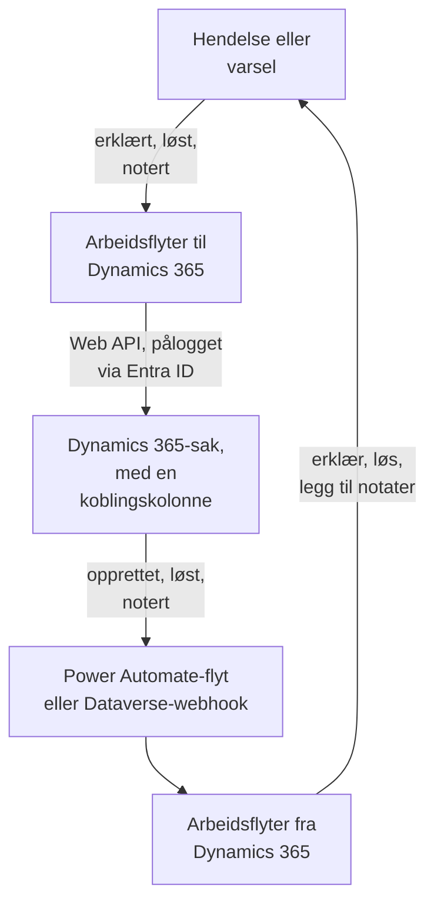

# Microsoft Dynamics 365

Hold [Microsoft Dynamics 365](https://www.microsoft.com/dynamics-365)-saker i takt med OneUptime-hendelsene og -varslene dine, begge veier. Ferdige arbeidsflytmaler oppretter en sak for hver hendelse eller hvert varsel, lukker den når posten er løst, og kopierer notater inn i den. Andre erklærer hendelser fra nye saker og henter løsninger og notater tilbake. Det finnes ingen plugin: arbeidsflytene kaller Dataverse Web API, og Dynamics 365 kaller webhook-URL-ene deres.

:::cards
- [Forbered Dynamics 365](#forbered-dynamics-365): En appregistrering, en programbruker og en koblingskolonne.
- [Start fra en mal](#start-fra-en-mal): De 13 malene, hva de ber om, og hvordan du setter dem opp.
- [Slik fungerer malene](#slik-fungerer-malene): Hvordan saker og poster forblir koblet, uten løkker.
- [Bygg det selv](#bygg-det-selv): Hver retning for hånd, for når en mal ikke passer.
:::

## Slik fungerer det



Hver mal er en liten arbeidsflyt, så du tar bare de retningene du vil ha, for hendelser, varsler eller begge. Malene OneUptime → Dynamics 365 kaller Dataverse Web API, pålogget som et program via Microsoft Entra ID. Malene Dynamics 365 → OneUptime starter når en Power Automate-flyt eller en Dataverse-webhook kaller dem. En tekstkolonne du legger til i tabellen Case, kobler hver sak til posten sin.

## Før du begynner

- Et Dynamics 365-miljø med tabellen **Case**. Saker kommer fra Dynamics 365 Customer Service: et Dataverse-miljø uten det har ingen `incident`-tabell å skrive til.
- Rettigheter til å registrere et program i **Microsoft Entra ID**, og til å opprette en programbruker i miljøet. Det er ofte to forskjellige administratorer.
- I OneUptime tilgang til å opprette arbeidsflyter. På OneUptime Cloud krever arbeidsflyter **Growth**-abonnementet eller høyere.

> [!NOTE]
> Denne siden bruker Dataverses navn, ikke etikettene på Dynamics-skjemaene. En sak er tabellen `incident`, samlingen i en URL er `incidents`, nøkkelen er `incidentid`, og tittelkolonnen er `title`. Saksnummeret du ser, er `ticketnumber`.

## Forbered Dynamics 365

Både malene og en arbeidsflyt du bygger selv, trenger dette. OneUptime logger på som et program, ikke som en person, med OAuth 2.0-flyten for klientlegitimasjon.

:::steps
### Registrer et program i Microsoft Entra ID

1. Logg på [Azure-portalen](https://portal.azure.com) som administrator for leieren til Dynamics-miljøet ditt, og åpne **Microsoft Entra ID**.
2. Gå til **App registrations → New registration**. Gi den navnet `OneUptime Integration`, la **Supported account types** stå på **Accounts in this organizational directory only**, og velg **Register**.
3. Kopier **Application (client) ID** og **Directory (tenant) ID** fra appens side **Overview**.
4. Gå til **Certificates & secrets → Client secrets → New client secret**, og kopier hemmelighetens **Value**, ikke ID-en, før du forlater siden: den vises aldri igjen. En klienthemmelighet varer høyst 24 måneder, så noter når den utløper.

Ikke legg til API-tillatelser, og ikke gi administratorsamtykke: uten en pålogget bruker gjør de ingenting. Dynamics 365 bestemmer hva programmet kan gjøre, via programbrukeren.

### Opprett programbrukeren

1. Velg **Manage → Environments** i [administrasjonssenteret for Power Platform](https://admin.powerplatform.microsoft.com/), og deretter miljøet ditt.
2. Velg **Settings → Users + permissions → Application users**, deretter **+ New app user** og **+ Add an app**. Velg registreringen, og velg **Add**.
3. Velg en **Business unit**, og gi den deretter en egendefinert sikkerhetsrolle med redigeringsikonet ved siden av **Security roles**. På nivået Organization trenger rollen:
   - **Case**: Create, Read, Write, Append og Append To.
   - **Note**: Create, Read og Append, for notatmalene.
   - **Activity**: Create, Read og Append, fordi lukking av en sak registrerer en Case Resolution, som er en aktivitet.
   - **Account**, og **Contact** hvis saker opprettes i en kontaktpersons navn: Read og Append To.
4. Velg **Save** og deretter **Create**.

En programbruker kan bare ha en egendefinert rolle: kopier en eksisterende, og skjær den ned. Uten denne brukeren utsteder Microsoft Entra ID fortsatt tokener, men hvert kall til Dynamics 365 mislykkes med `403` og `0x80072560`, "The user isn't a member of the organization."

### Legg til en koblingskolonne i tabellen Case

Dataverse har ingenting som ligner Jiras etiketter, så en sak og en OneUptime-post finner hverandre via en kolonne du legger til.

1. Velg miljøet ditt i [make.powerapps.com](https://make.powerapps.com), åpne **Tables → Case → Columns**, og velg **New column**.
2. Gi den navnet `OneUptime Link`, behold **Data type** som **Single line of text**, og lagre. Standard maksimumslengde på 100 er mer enn nok: malene skriver høyst 55 tegn.
3. Åpne den nye kolonnen, og kopier **Logical name**, f.eks. `new_oneuptimelink`. Prefikset kommer fra løsningens utgiver, så ditt kan være annerledes, f.eks. `cr4f2_oneuptimelink`.

Legg kolonnen til i skjemaet Case hvis agentene skal se koblingen.
:::

## Start fra en mal

Dialogboksen **Opprett en arbeidsflyt** har 13 Dynamics 365-maler under **Dynamics 365** i kategorilisten: sju for hendelser og deretter seks for varsler, hver gruppe under sin egen overskrift. De deler koblingskolonnen, så enhver kombinasjon av dem fungerer sammen.

### Maler for hendelser

| Mal | Hva den gjør | Hva den ber om |
| --- | --- | --- |
| **OneUptime → Dynamics 365** | | |
| Create a Dynamics 365 case when an incident is declared | Oppretter en sak for hver ny hendelse, med en prioritet valgt ut fra alvorlighetsgraden og hendelsens ID i koblingskolonnen. Hendelser erklært fra Dynamics 365, og private hendelser, hoppes over. | De fem Dynamics 365-innstillingene, kunden for nye saker og OneUptime-URL-en |
| Resolve the Dynamics 365 case when the incident is resolved | Lukker den koblede saken som **Problem Solved** når hendelsen er løst, og registrerer en Case Resolution slik løsning for hånd gjør. Gjenåpner aldri en sak. | De fem Dynamics 365-innstillingene |
| Copy incident private notes to the Dynamics 365 case | Legger hvert nye private notat til den koblede saken som et notat. | De fem Dynamics 365-innstillingene |
| Copy incident public notes to the Dynamics 365 case | Legger hvert nye offentlige notat til den koblede saken som et notat, slik at agentene kan fortelle kundene hva statussiden sier. | De fem Dynamics 365-innstillingene |
| **Dynamics 365 → OneUptime** | | |
| Declare an incident when a Dynamics 365 case is created | Erklærer en hendelse for hver ny sak, holdt unna statussidene dine, med en alvorlighetsgrad valgt ut fra sakens prioritet, og skriver deretter hendelsens ID i sakens koblingskolonne. | De fem Dynamics 365-innstillingene, og en flyt eller webhook for nye saker |
| Resolve the incident when its Dynamics 365 case is resolved | Løser hendelsen når den koblede saken er løst. | De fem Dynamics 365-innstillingene, og en flyt eller webhook for statusendringer på saker |
| Add Dynamics 365 case notes to the incident as private notes | Kopierer hvert notat en agent legger til på en koblet sak, over på hendelsen som et privat notat. | De fem Dynamics 365-innstillingene, og en flyt eller webhook for nye notater |

### Maler for varsler

Malene for varsler gjør den samme jobben for varsler. Det er én færre, fordi varsler ikke har offentlige notater, og **Create an alert when a Dynamics 365 case is created** skriver ingen statussideinnstillinger, fordi et varsel aldri når en statusside.

| Mal | Hva den gjør | Hva den ber om |
| --- | --- | --- |
| **OneUptime → Dynamics 365** | | |
| Create a Dynamics 365 case when an alert is created | Oppretter en sak for hvert nytt varsel, også hvert varsel en monitor utløser. Varsler opprettet fra Dynamics 365, og private varsler, hoppes over. | De fem Dynamics 365-innstillingene, kunden for nye saker og OneUptime-URL-en |
| Resolve the Dynamics 365 case when the alert is resolved | Lukker den koblede saken som **Problem Solved** når varselet er løst. | De fem Dynamics 365-innstillingene |
| Copy alert private notes to the Dynamics 365 case | Legger hvert nye private notat til den koblede saken som et notat. | De fem Dynamics 365-innstillingene |
| **Dynamics 365 → OneUptime** | | |
| Create an alert when a Dynamics 365 case is created | Oppretter et varsel for hver ny sak, med en alvorlighetsgrad valgt ut fra sakens prioritet, og skriver deretter varselets ID i sakens koblingskolonne. | De fem Dynamics 365-innstillingene, og en flyt eller webhook for nye saker |
| Resolve the alert when its Dynamics 365 case is resolved | Løser varselet når den koblede saken er løst. | De fem Dynamics 365-innstillingene, og en flyt eller webhook for statusendringer på saker |
| Add Dynamics 365 case notes to the alert as private notes | Kopierer hvert notat en agent legger til på en koblet sak, over på varselet som et privat notat. | De fem Dynamics 365-innstillingene, og en flyt eller webhook for nye notater |

Ingen av malene OneUptime → Dynamics 365 sender en hendelse merket som **Privat hendelse**, eller et varsel merket som **Privat varsel**, til Dynamics 365: verken posten, tilstanden eller notatene, med mindre du slår det på. Se [Endre hva en mal gjør](#endre-hva-en-mal-gjør).

**Monitorer utløser varsler av seg selv, og det kan bli mange.** **Create a Dynamics 365 case when an alert is created** oppretter en sak for hvert eneste ett. Med mindre hvert varsel fortjener en sak, setter du en **If / Else**-blokk mellom triggeren og resten av arbeidsflyten, for eksempel på `{{local.components.alert-on-create-1.returnValues.model.alertSeverity.name}}`, og kobler bare **Yes**-siden videre.

### Hva malene ber om

Trinnet **Konfigurer** i opprettelsesveiviseren ber om opptil sju verdier: hver mal ber om de første fem, Dynamics 365-innstillingene, og de to malene som oppretter en sak, ber også om de to siste. Trinnet sjekker formen på hver Dynamics 365-innstilling før noe opprettes, og sier hva du skal skrive i stedet, fordi en verdi med feil form ikke gir feil noe sted før en kjøring.

- **Dynamics 365 Environment URL** — miljøets adresse, f.eks. `https://yourorg.crm.dynamics.com`, fra [administrasjonssenteret for Power Platform](https://admin.powerplatform.microsoft.com/) under **Environments**, miljøet ditt, **Environment URL**. Bare adressen: ikke Web API-endepunktet, som slutter på `/api/data/v9.2`, og ingen skråstrek på slutten.
- **Directory (Tenant) ID** — fra appregistreringens side **Overview**.
- **Application (Client) ID** — fra samme side.
- **Client Secret Value** — klienthemmelighetens **Value** fra **Certificates & secrets**. Ikke **Secret ID**, som er en GUID: veiviseren avviser en GUID her.
- **Case Link Column** — koblingskolonnens logiske navn, f.eks. `new_oneuptimelink`.
- **Customer for New Cases** — bare de to malene som oppretter en sak, ber om den. Hver sak trenger en kunde, og en OneUptime-hendelse har ingen, så alle nye saker opprettes i én kundes navn: lim inn ID-en til en konto, eller `contacts(<id>)` for en kontaktperson. Åpne posten i Dynamics 365: ID-en er delen etter `id=` i adressen.
- **OneUptime URL** — bare de to malene som oppretter en sak, ber om den: adressen du åpner OneUptime på, f.eks. `https://oneuptime.com`. Sakens beskrivelse lenker med den tilbake til hendelsen eller varselet.

**Slik logger malene på.** Veiviseren lagrer leieren, klient-ID-en og hemmeligheten i én [OAuth 2.0-variabel](/docs/workflows/variables#oauth-20-variabler-tokener-som-fornyer-seg-selv), `dynamicsAccessToken`, under arbeidsflytens **Arbeidsflytvariabler**: Client Credentials, token-URL-en `https://login.microsoftonline.com/<tenant>/oauth2/v2.0/token`, scopet `<environment URL>/.default` og klienthemmeligheten, sendt i forespørselens innhold og lagret kryptert. Hvert kall til Dynamics 365 sender `Authorization: Bearer {{local.variables.dynamicsAccessToken}}`. OneUptime henter tokenet første gang et trinn trenger det, henter et nytt før det utløper, og erstatter det med `[REDACTED]` i kjøringslogger og trinnspor.

For å sjekke påloggingen før noe kjører, åpner du **Arbeidsflytvariabler**, klikker på **Vis** ved `dynamicsAccessToken` og klikker på **Oppdater nå**. **Access Token Fetched** betyr at appregistreringen er riktig. Ellers sier feilen fra Microsoft Entra ID hva som er galt, f.eks. `AADSTS7000215: Invalid client secret provided`.

Hver arbeidsflyt har sin egen kopi. Når du bytter ut klienthemmeligheten, åpner du `dynamicsAccessToken` i hver Dynamics 365-arbeidsflyt og bruker **Oppdater påloggingsinformasjon**.

### Opprett arbeidsflytene

:::steps
1. Åpne **Arbeidsflyter → Opprett arbeidsflyt**. Velg **Dynamics 365** i kategorilisten under **Eller start fra en mal**, eller skriv `Dynamics` i **Søk i maler…**, og klikk på malen du vil ha. Den åpnes og viser hva den gjør, og hvilke innstillinger den vil be om. Klikk på **Bruk denne malen**.
2. **Navn** fylles ut fra malen. Endre det hvis du vil.
3. **Konfigurer** ber om verdiene ovenfor.
4. Klikk på **Opprett arbeidsflyt**. Hver arbeidsflyt opprettes avslått: slå på **Aktivert** øverst i dens **Bygger**.
:::

Start med **Create a Dynamics 365 case when an incident is declared**, eller **Create a Dynamics 365 case when an alert is created** for varsler: alle andre maler OneUptime → Dynamics 365 av samme slag finner saken via koblingen denne skriver. Slå den på, erklær en testhendelse eller opprett et testvarsel, og åpne arbeidsflytens **Logger → Kjøringer**. Kjøringen skal slutte som **Utført**, og **Response Body** i det siste trinnet, `create-case-1`, inneholder den nye sakens `ticketnumber`, for eksempel `CAS-01001-X1Y2Z3`.

### Koble til malene Dynamics 365 → OneUptime

Malene Dynamics 365 → OneUptime, tre for hendelser og tre for varsler, starter fra en [Webhook-trigger](/docs/workflows/triggers#webhook), så Dynamics 365 må få vite hvor hendelsene skal sendes. Gjør det i denne rekkefølgen:

1. Opprett arbeidsflyten, og **slå den på først**. En arbeidsflyt som er slått av, avviser leveringer, og de legges ikke i kø.
2. Åpne arbeidsflytens **Bygger**, klikk på triggerblokken **Webhook** (`webhook-1`), og klikk på **Kopier URL** øverst i innstillingene. URL-en ser slik ut:

   ```text
   https://<your OneUptime host>/workflow/trigger/<webhook secret key>
   ```

3. Få Dynamics 365 til å sende til den, fra en Power Automate-flyt eller fra en Dataverse-webhook.

Hver mal trenger bare å vite hvilken rad som ble endret. Den leser raden på nytt fra Dynamics 365 før den gjør noe, så den tar aldri en sakens tittel, status eller kobling fra forespørselen, og det spiller ingen rolle hvilken av de to som sender den.

:::tabs
@tab Power Automate flow
Opprett i [Power Automate](https://make.powerautomate.com) en **Automated cloud flow** med **Microsoft Dataverse**-triggeren **When a row is added, modified or deleted**, satt opp som nedenfor, med **Scope** satt til **Organization**. Legg til den innebygde handlingen **HTTP**: **Method** `POST`, **URI** arbeidsflytens URL, en `Content-Type: application/json`-overskrift og innholdet nedenfor, med radens ID valgt fra triggerens dynamiske innhold.

| Mal | Change type | Table name | Select columns | Body |
| --- | --- | --- | --- | --- |
| Erklær en hendelse / opprett et varsel når en sak opprettes | Added | Cases | | `{"PrimaryEntityId": "<Case>"}` |
| Løs hendelsen / varselet når saken løses | Modified | Cases | `statecode,statuscode` | `{"PrimaryEntityId": "<Case>"}` |
| Legg til saksnotater på hendelsen / varselet som private notater | Added | Notes | | `{"PrimaryEntityId": "<Note>"}` |

For bare å sende noen saker bruker du triggerens **Filter rows**, f.eks. `prioritycode eq 1` for saker med høy prioritet. Brødteksten navngir raden som `PrimaryEntityId`, slik en Dataverse-webhook gjør: malene leser selve raden tilbake fra Dynamics 365.
@tab Dataverse webhook
Registrer URL-en med [Plug-in Registration Tool](https://learn.microsoft.com/en-us/power-apps/developer/data-platform/register-web-hook): **Register New WebHook**, med **HttpHeader**-autentisering og en egen overskrift; selve URL-en er hemmeligheten. Registrer deretter et trinn på den for hver hendelse nedenfor, med **Event Pipeline Stage of Execution** satt til **PostOperation** og **Execution Mode** til **Asynchronous**.

| Mal | Message | Primary Entity | Filtering Attributes |
| --- | --- | --- | --- |
| Erklær en hendelse / opprett et varsel når en sak opprettes | `Create` | `incident` | |
| Løs hendelsen / varselet når saken løses | `Close`, og `Update` for statusendringer gjort av andre | `incident` | `statecode, statuscode` (Update) |
| Legg til saksnotater på hendelsen / varselet som private notater | `Create` | `annotation` | |

Når en sak løses, utløses meldingen **Close**, ikke **Update**, og det er derfor den malen trenger begge. En webhook sender plugin-ens kjøringskontekst, som angir raden i `PrimaryEntityId`, eller for **Close** i `IncidentResolution`, og malene leser den derfra. En Dataverse-webhook kaller bare portene 80 og 443, og har ikke noe eget radfilter: hver ny sak når opprettelsesmalen, med mindre du avgrenser den med `ONLY_PRIORITIES`.
:::

Før du stoler på noen av dem:

- **Alle som har URL-en, kan utløse arbeidsflyten.** Fordi malene leser hver rad på nytt fra Dynamics 365, kan en forespørsel bare få dem til å se på en ekte sak eller et ekte notat. Den kan likevel få opprettelsesmalene til å handle på en sak som ikke er koblet ennå. Ha bare URL-en i flyten eller webhooken. Hvis den lekker, klikker du på **Webhook**-triggeren i arbeidsflytens **Bygger**, klikker på **Tilbakestill URL** og limer inn den nye URL-en i flyten eller webhooken. Den gamle URL-en slutter å virke med en gang.
- **Hver hendelse er en kjøring**, også de en mal hopper over. På OneUptime Cloud teller hver av dem med i abonnementets arbeidsflytkjøringer, og filtrering i flyten holder tallet nede. Se [Abonnementsgrenser](/docs/workflows/configuration#plangrenser).
- **Bruker du begge malene som oppretter en post fra en sak?** **Declare an incident when a Dynamics 365 case is created** og **Create an alert when a Dynamics 365 case is created** handler begge på hver sak de får. Hver av dem sjekker koblingskolonnen først, men to leveringer for én ny sak kommer samtidig, så saken kan ende med både en hendelse og et varsel. Send de to forskjellige saker, for eksempel etter sakstype.

### Sjekk at det fungerer

Hver kjørings **Trinn** sier hva malen gjorde, så åpne kjøringen i **Logger → Kjøringer** og se hvordan den endte:

- **Utført**: den gjorde jobben sin, og det siste trinnet nevner saken, hendelsen eller varselet.
- **Utført**, med trinnet **Check With JavaScript** på **No**: den hoppet over hendelsen med vilje, og trinnet sier hvorfor: saken er ikke koblet til en post av dette slaget, notatet kom fra den andre siden, posten er privat, eller den nye tilstanden lukker ikke saken.
- **Feil**: et trinn mislyktes, og oppføringen under **Trinn** sier hvorfor. Ved et Dynamics 365-kall inneholder den svaret fra Dynamics 365.
- **Feil** ved `link-case-1`: en mal som oppretter en post fra en sak, opprettet den, men Dynamics 365 godtok ikke koblingen, så de andre malene kan ikke finne den ennå. Skriv koblingen inn i sakens kolonne for hånd.

Hvis en kjøring stopper ved det første Dynamics 365-trinnet med `Could not get an OAuth 2.0 access token for {{local.variables.dynamicsAccessToken}}`, er påloggingsinnstillingene feil, og meldingen siterer svaret fra Microsoft Entra ID. Se [Hva malene ber om](#hva-malene-ber-om).

## Slik fungerer malene

### Slik forblir de to sidene koblet

Saken holder koblingen. En sak som hører til en hendelse, har `oneuptime-incident-<incident id>` i koblingskolonnen, og en som hører til et varsel, har `oneuptime-alert-<alert id>`. ID-en er den siste delen av postens adresse i dashbordet.

Malene som oppretter en sak, skriver den når de oppretter saken, og malene som oppretter en post fra en sak, skriver den så snart posten finnes. Alle andre maler krysser over via den: de fra OneUptime → Dynamics 365 slår opp saken via koblingen, og de fra Dynamics 365 → OneUptime leser postens ID fra saken. For å koble en sak som er opprettet for hånd, skriver du verdien inn i koblingskolonnen selv, men bare når posten ikke har en sak ennå.

**En sak er koblet til en hendelse eller et varsel, aldri begge.** Én kolonne brukes til begge slag. Malene for hendelser ignorerer en sak som er koblet til et varsel, og omvendt, og malene som oppretter en post fra en sak, lar enhver sak med noe som helst i koblingskolonnen være i fred.

**En post har én sak.** Malene som skriver til en sak, handler bare når nøyaktig én sak har postens kobling. Hvis koblingen kopieres til en annen sak, stopper de, og hver kjøring slutter med en overhopping som nevner begge:

```text
More than one Dynamics 365 case holds the link oneuptime-incident-<id> (CAS-01001-X1Y2Z3, CAS-01002-K4L5M6). Clear it on every case except the one opened for the incident.
```

Hendelser og varsler opprettet fra en sak lagrer også sakens ID og nummer i `customFields.dynamicsCaseId` og `customFields.dynamicsCaseNumber`, skrevet når de opprettes. Det er slik malene som oppretter en sak, vet at posten allerede har en.

### Slik unngår malene løkker

Hver skriving i én retning er en hendelse i den andre: et notat som legges til en sak, kommer tilbake som et nytt notat, og et privat notat som legges til i OneUptime, utløser notattriggeren. Fire ting stopper ekkoet:

- **Markører i teksten.** Hvert notat malene legger til en sak, har tittelen `Synced from OneUptime: …`, og det samme har emnet på hver Case Resolution de registrerer. Hvert notat skrevet fra Dynamics 365, og grunnårsaken til hver tilstandsendring gjort derfra, begynner med `Synced from Dynamics 365`. Hver retning hopper over tekst som har den andre sidens markør, selv i et notat noen skrev som siterer en.
- **Koblingen fra første lagring.** En sak OneUptime oppretter, har koblingen fra det øyeblikket den finnes, så når dens **Create** kommer tilbake, finner malen som oppretter en post fra en sak, den koblet og gjør ingenting.
- **`customFields.dynamicsCaseId`.** En post opprettet fra en sak har dette feltet, og malene som oppretter en sak, hopper over slike poster.
- **Tilstander går bare fremover, på begge sider.** Når posten løses, lukkes saken, og sakens **Close** finner da posten allerede løst. Når saken løses først, løses posten, og oppdateringen av den finner saken allerede lukket. En sak som allerede er løst eller kansellert, gjenåpnes aldri.

Behold markørene når du redigerer malene. De er konstantene `FROM_ONEUPTIME` og `FROM_DYNAMICS` i hjelpeblokken øverst i hvert skript.

### Endre hva en mal gjør

Åpne arbeidsflytens **Bygger**, og klikk på blokken du vil endre. Innstillingene du mest sannsynlig vil endre, er konstanter øverst i et skript, **JavaScript Code** i en **Check With JavaScript**-blokk, rett under den delte hjelpeblokken. Versjonene for hendelser og for varsler har de samme konstantene i de samme blokkene.

| Konstant | Mal og blokk | Hva den styrer |
| --- | --- | --- |
| `SYNC_PRIVATE_INCIDENTS`, `SYNC_PRIVATE_ALERTS` | Hver mal OneUptime → Dynamics 365 — `prepare-case-1`, `plan-case-1`, `build-note-1` | `false` holder private poster utenfor Dynamics 365: det opprettes ingen sak for dem, saken deres endres ikke, og notatene deres legges ikke til. Sett den til `true` i hver mal som skal sende dem. |
| `SEVERITY_TO_PRIORITY`, `DEFAULT_PRIORITY` | Opprett en Dynamics 365-sak — `prepare-case-1` | Prosjektets alvorlighetsgrader fordeles over saksprioritetene etter rekkefølge: den høyeste oppretter en High-sak (`1`), den laveste en Low-sak (`3`), og de imellom Normal-saker (`2`). Angi en alvorlighetsgrad etter navn, med små bokstaver, for å velge prioriteten selv, f.eks. `{ 'major incident': 1 }`. `DEFAULT_PRIORITY` (`2`) gjelder for en alvorlighetsgrad prosjektets liste ikke har, eller et prosjekt med bare én. |
| `CASE_ORIGIN`, `CASE_TYPE` | Opprett en Dynamics 365-sak — `prepare-case-1` | Den nye sakens `caseorigincode` (`3`, Web) og `casetypecode` (`2`, Problem). For å sette en annen kolonne legger du den til i `CASE` i samme skript, under det logiske navnet. |
| `MAX_TITLE_LENGTH`, `MAX_DESCRIPTION_LENGTH` | Opprett en Dynamics 365-sak — `prepare-case-1` | Tabellen Cases egne grenser, 200 og 2000 tegn. Beskrivelsen beholder lenken tilbake til OneUptime uansett hvor mye som kuttes. Øk dem hvis tabellen Case tillater mer. |
| `RESOLVED_CASE_STATUS` | Løs Dynamics 365-saken — `plan-case-1` | Statusen en løst post lukker saken sin med: `5` er Problem Solved, `1000` Information Provided. |
| `STATE_TO_CASE_STATUS` | Løs Dynamics 365-saken — `plan-case-1` | Lukker saken med en annen løst status ved en løst tilstand du har laget selv, etter tilstandens navn: `{ Closed: 1000 }` lukker den som Information Provided. Bare når posten løses, endres saken: en aktiv status som Researching settes aldri. |
| `PRIORITY_RANK` | Opprett fra en Dynamics 365-sak — `prepare-incident-1`, `prepare-alert-1` | Knytter en saksprioritet (`1` High, `2` Normal, `3` Low) til `0` (din høyeste alvorlighetsgrad), `1` eller `2` (den laveste). Prioriteter som ikke står her, havner i midten. Med de to alvorlighetsgradene for varsler et nytt prosjekt har, blir Normal til Low med mindre du endrer `2: 1` til `2: 0`. |
| `ONLY_PRIORITIES` | Opprett fra en Dynamics 365-sak — `prepare-incident-1`, `prepare-alert-1` | Tom tar den hver sak flyten eller webhooken sender. `[1]` oppretter bare poster for saker med høy prioritet. |
| `CASE_STATUS_TO_STATE`, `CASE_STATE_TO_STATE_FLAG` | Løs når Dynamics 365-saken er løst — `decide-state-1` | En saksstatus, etter navn, til en OneUptime-tilstand, f.eks. `{ Researching: 'Acknowledged' }`. Ellers avgjør sakens tilstand: Resolved løser posten. Legg til `2: 'isResolvedState'` for også å løse den når saken kanselleres. |
| `MESSAGES` | Hver mal Dynamics 365 → OneUptime — `read-event-1`, eller `prepare-incident-1` og `prepare-alert-1` | Hendelsene malen handler på. Legg til `'Update'` i notatmalens liste for også å kopiere redigerte notater: hver redigering blir et nytt notat. |
| `MAX_NOTE_LENGTH` | Notatmalene — `build-note-1`, `read-note-1` | Det lengste notatet hver av dem skriver: 100 000 tegn til Dynamics 365, som er et notats egen grense, og 30 000 til OneUptime. |

Tilstands- og statusnavn som brukes som nøkler, må staves nøyaktig slik de heter, store bokstaver inkludert. Hold `{{` unna koden: et skript fylles ut som enhver annen innstilling før det kjører, så to åpne krøllparenteser etter hverandre ville blitt lest som en referanse.

### Begrensninger

- **Microsofts kommersielle sky.** Token-URL-en er `login.microsoftonline.com`. For skyene US Government (GCC High, DoD) eller Kina åpner du `dynamicsAccessToken`, bruker **Rediger innstillinger** og endrer token-URL-en til påloggingsverten for skyen din, f.eks. `login.microsoftonline.us`.
- **Dynamics 365 kan nekte å løse en sak.** Customer Service-innstillingene dine kan hindre at en sak løses mens den har åpne aktiviteter eller åpne undersaker, og en forretningsregel eller en plugin kan også avvise det. Kjøringen mislykkes ved `close-case-1`, med begrunnelsen fra Dynamics 365, og saken forblir som den var.
- **Poster og saker går aldri bakover.** Å gjenåpne en sak endrer ingenting i OneUptime, og en løst post gjenåpnes aldri. En sak som allerede er løst eller kansellert, gjenåpnes aldri for å bli lukket igjen.
- **Notater og beskrivelser er ren tekst.** Et notat skrevet i Dynamics 365s redigeringsprogram for formatert tekst kommer inn i OneUptime som teksten det viser, og det samme gjør en saksbeskrivelse som er skrevet i redigeringsprogrammet eller hentet fra en e-post: avsnitt og linjeskift beholdes, mens formatering, bilder og e-postens egne stiler forsvinner. Et OneUptime-notat kommer frem i Dynamics 365 som rå tegn, Markdown og alt. Tekst fra Dynamics 365 — en sakens tittel og beskrivelse, et notat, navnene på statuser, prioriteter, kunder og personer — leses nøyaktig slik den ble skrevet: et bilde, en lenke, HTML, et diagram eller en chatomtale som `<!channel>` skrevet i den, vises som tegnene sine og gjør ingenting, fordi en usynlig word joiner settes etter tegnet som ville startet det. En kopi av teksten beholder word joineren. En arbeidsflyt beholder skriptene den ble opprettet med, så en arbeidsflyt opprettet fra en eldre versjon av en mal skriver tekst slik den versjonen gjorde: opprett den på nytt fra malen for å få dette. Vedlegg blir i Dynamics 365; notatet i OneUptime nevner filen.
- **Redigerte notater kopieres ikke**, bare nye, med mindre du legger til `'Update'` i `MESSAGES`.
- **Private hendelser og varsler blir i OneUptime**, men malene Dynamics 365 → OneUptime sjekker ikke dette: notater og statusendringer på en koblet sak når fortsatt en privat post.
- **Hver sak får en post.** Med mindre du filtrerer flyten eller setter `ONLY_PRIORITIES`, oppretter malene som oppretter en post fra en sak, en hendelse eller et varsel for hver ny sak de får. I et travelt kundeservicemiljø blir det mange.
- **Den samme hendelsen kan komme to ganger.** En Dataverse-webhook prøver på nytt én gang når OneUptime svarer `502`, `503` eller `504`. En gjentatt **Create** som kommer etter at den første kjøringen har koblet saken, blir latt være. En som kommer mens den første kjøringen fortsatt pågår, kan opprette en ekstra post.

## Bygg det selv

Malene dekker de vanlige tilfellene. For å bygge en retning selv bygger denne delen begge for hånd, for hendelser, etter [Forbered Dynamics 365](#forbered-dynamics-365). [Gjør det samme for varsler](#gjør-det-samme-for-varsler) overfører det til varsler.

### Logg på med en OAuth 2.0-variabel

Opprett tokenet én gang, for alle arbeidsflyter, som en [OAuth 2.0-variabel](/docs/workflows/variables#oauth-20-variabler-tokener-som-fornyer-seg-selv):

1. Gå til **Arbeidsflyter → Globale variabler**, åpne menyen **Mer** (**⋯**) ved siden av **Opprett Workflow Variabel**, og velg **Create OAuth 2.0 Variable**. Gi den navnet `DYNAMICS_TOKEN`.
2. Velg **Microsoft Entra ID** under **Leverandør**, erstatt `{tenant-id}` i **Token-URL** med Directory (tenant) ID-en din, og velg **Client Credentials**.
3. Skriv inn **Klient-ID** og **Klienthemmelighet** under **Påloggingsinformasjon**. Sett scopet til `https://yourorg.crm.dynamics.com/.default` under **Avansert**, og opprett deretter variabelen.

Enhver blokk sender da `Bearer {{global.variables.DYNAMICS_TOKEN}}` i `Authorization`-overskriften. OneUptime henter tokenet, henter et nytt før det utløper, og holder det unna kjøringsloggene.

Scopet må være miljø-URL-en din etterfulgt av `/.default`. En feil miljø-URL er den vanlige årsaken til `AADSTS70011: The provided value for the input parameter 'scope' is not valid`.

### Opprett en sak for hver hendelse

:::steps
1. Opprett en arbeidsflyt fra bunnen som heter `Incidents to Dynamics 365`. Klikk på den stiplede blokken, og legg til triggeren **On Create Incident**. **Fields to pass on** starter med **Tittel**: klikk på **Legg til felt**, og velg **Beskrivelse** og **Hendelsesnummer**. ID-en sendes alltid videre.
2. Klikk på **Legg til komponent**, legg til en **API Post (JSON)**-blokk, og koble triggerens **Success**-punkt til den. Sett **Identifier** til `create-case` og **URL** til `https://yourorg.crm.dynamics.com/api/data/v9.2/incidents?$select=incidentid,ticketnumber`.
3. Sett **Request Headers** under **Flere felt** til:

   ```json
   {
     "Authorization": "Bearer {{global.variables.DYNAMICS_TOKEN}}",
     "OData-MaxVersion": "4.0",
     "OData-Version": "4.0",
     "Accept": "application/json",
     "If-None-Match": "null",
     "Prefer": "return=representation"
   }
   ```

4. Sett **Request Body** til saken, med GUID-en til kontoen sakene dine hører til:

   ```json
   {
     "title": "OneUptime #{{local.components.incident-on-create-1.returnValues.model.incidentNumber}}: {{local.components.incident-on-create-1.returnValues.model.title}}",
     "description": "{{local.components.incident-on-create-1.returnValues.model.description}}",
     "caseorigincode": 3,
     "prioritycode": 1,
     "new_oneuptimelink": "oneuptime-incident-{{local.components.incident-on-create-1.returnValues.model._id}}",
     "customerid_account@odata.bind": "/accounts(00000000-0000-0000-0000-000000000000)"
   }
   ```

5. Slå på **Aktivert**, erklær en testhendelse, og åpne **Logger → Kjøringer**. Trinnet `create-case` viser en `201` og et innhold med den nye `incidentid` og `ticketnumber`.
:::

Hver sak trenger en kunde, så `customerid` er obligatorisk. Den kan peke på en konto eller en kontaktperson, og derfor skriver du `customerid_account@odata.bind` eller `customerid_contact@odata.bind`, stavet nøyaktig. `Prefer: return=representation` gjør svaret til `201` med selve saken, slik at neste blokk kan lese `{{local.components.create-case.returnValues.response-body.incidentid}}`. Uten den svarer Dynamics 365 `204` uten innhold.

`new_oneuptimelink` er koblingskolonnen fra [Forbered Dynamics 365](#forbered-dynamics-365), med den samme verdien som malene skriver, slik at arbeidsflytene dine og malene finner hverandres saker. Bruk det logiske navnet på kolonnen din.

### Knytt prioritet og status

Dynamics 365 leveres med `severitycode` med ett enkelt alternativ, så sett `prioritycode` i stedet, og forgren på hendelsens alvorlighetsgrad med en **If / Else**-blokk for én prioritet per alvorlighetsgrad. Send disse kolonnene som tall:

| Kolonne | Verdier |
| --- | --- |
| `prioritycode` | `1` High, `2` Normal, `3` Low |
| `caseorigincode` | `1` Phone, `2` Email, `3` Web, `2483` Facebook, `3986` Twitter, `700610000` IoT |
| `casetypecode` | `1` Question, `2` Problem, `3` Request |
| `statecode` | `0` Active, `1` Resolved, `2` Cancelled |
| `statuscode` | `1` In Progress, `2` On Hold, `3` Waiting for Details, `4` Researching, `5` Problem Solved, `6` Cancelled, `1000` Information Provided, `2000` Merged |

`statuscode` kan tilpasses, så miljøet ditt kan ha egne verdier.

### Løs saken når hendelsen løses

Bygg dette som en egen arbeidsflyt, slik at en feil her aldri hindrer at saker opprettes.

:::steps
1. Opprett en arbeidsflyt som heter `Close Dynamics 365 cases`, med triggeren **On Update Incident**. Klikk på **Legg til felt** i **Fields to watch**, og velg **Current Incident State**. Klikk på **Legg til felt** i **Fields to pass on**, åpne **Current Incident State**, og velg **Is Resolved State**.
2. Legg til en **If / Else**-blokk: **Value to check** `{{local.components.incident-on-update-1.returnValues.model.currentIncidentState.isResolvedState}}`, **Comparison** **is true**.
3. Legg etter **Yes**-siden til en **API Get (JSON)**-blokk med **Identifier** `find-case`, de samme overskriftene uten `Prefer` og denne **URL**:

   ```text
   https://yourorg.crm.dynamics.com/api/data/v9.2/incidents?$select=incidentid&$filter=new_oneuptimelink%20eq%20'oneuptime-incident-{{local.components.incident-on-update-1.returnValues.model._id}}'
   ```

4. Legg etter den til en **API Post (JSON)**-blokk til `https://yourorg.crm.dynamics.com/api/data/v9.2/CloseIncident`, med de samme overskriftene og dette innholdet:

   ```json
   {
     "IncidentResolution": {
       "@odata.type": "Microsoft.Dynamics.CRM.incidentresolution",
       "subject": "Resolved in OneUptime",
       "incidentid@odata.bind": "/incidents({{local.components.find-case.returnValues.response-body.value[0].incidentid}})"
     },
     "Status": 5
   }
   ```
:::

URL-en sendes nøyaktig slik den er skrevet, så mellomrommene i `$filter` skrives som `%20`. En spørring svarer med en `value`-liste, og `value[0]` er den første saken i den. `Status` er en `statuscode` for tilstanden Resolved: `5` er Problem Solved.

Bruk `CloseIncident` for å løse, i stedet for en `PATCH` av `statecode`: den registrerer den Case Resolution en løst sak forventes å ha, og en `PATCH` avvises der en administrator har satt opp statusoverganger. For alt annet, som en prioritet eller en tittel, sender du en **API Patch (JSON)**-blokk til `https://yourorg.crm.dynamics.com/api/data/v9.2/incidents(<the case id>)` med en `If-Match: *`-overskrift, som hindrer at den oppretter en ny sak, og bare kolonnene du endrer.

### Motta endringer fra Dynamics 365

Bygg først den mottakende arbeidsflyten:

1. Opprett en arbeidsflyt som heter `Dynamics 365 to OneUptime`, med triggeren **Webhook**.
2. Åpne arbeidsflytens **Bygger**, klikk på **Webhook**-triggeren, og klikk på **Kopier URL** øverst i innstillingene. URL-en ser slik ut:

   ```text
   https://oneuptime.com/workflow/trigger/<webhook secret key>
   ```

   På en selvhostet installasjon har URL-en din egen vert. Behandle URL-en som et passord: alle som har den, kan starte arbeidsflyten. Hvis den lekker, klikker du på **Tilbakestill URL** på samme sted, og den gamle URL-en slutter å virke med en gang.

3. Legg til en **If / Else**-blokk som sjekker en delt hemmelighet før alt annet: **Value to check** `{{local.components.webhook-1.returnValues.request-headers.x-oneuptime-secret}}`, **Comparison** **is equal to**, **Compare with** en verdi du finner på selv, lagret i en hemmelig global variabel.
4. Legg etter **Yes**-siden til en **Update One Incident**-blokk. Sett **Query** til `{"_id": "{{local.components.webhook-1.returnValues.request-body.oneuptimeIncidentId}}"}`, og **Data (JSON Object)** til endringen, f.eks. en ny `currentIncidentStateId`. En **Find One Incident State**-blokk med spørringen `{"name": "Resolved"}` gir deg den ID-en som `{{local.components.incident-state-find-one-1.returnValues.model._id}}`.

Slå den på, og få deretter Dynamics 365 til å kalle den:

:::tabs
@tab Power Automate flow
1. Opprett i [Power Automate](https://make.powerautomate.com) en **Automated cloud flow** med **Microsoft Dataverse**-triggeren **When a row is added, modified or deleted**: **Change type** `Modified`, **Table name** `Cases`, **Scope** `Organization` og **Select columns** `statecode,statuscode`, slik at den bare utløses ved statusendringer.
2. Legg til **Get a row by ID** på `Cases`, med radens ID fra triggeren: en oppdatering inneholder bare kolonnene som ble endret.
3. Legg til den innebygde handlingen **HTTP**: **Method** `POST`, **URI** arbeidsflytens URL, overskriftene `Content-Type: application/json` og `X-OneUptime-Secret: <your secret>`, og et innhold bygget fra raden: `oneuptimeIncidentId` er koblingskolonnen uten `oneuptime-incident-`, f.eks. `replace(<link column>, 'oneuptime-incident-', '')`, ved siden av `ticketnumber` og `statecode`.
4. Lagre flyten, og slå den på.

Microsoft Dataverse-koblingen er premium: eieren av flyten trenger lisensen, og flyten stopper hvis den utløper. Levering tar vanligvis noen sekunder.
@tab Dataverse webhook
1. Registrer arbeidsflytens URL med [Plug-in Registration Tool](https://learn.microsoft.com/en-us/power-apps/developer/data-platform/register-web-hook): **Register New WebHook**, med **HttpHeader**-autentisering og overskriften `X-OneUptime-Secret`.
2. Registrer et trinn for meldingen **Update** på `incident`, med **Filtering Attributes** begrenset til kolonnene du trenger, **PostOperation** og **Asynchronous**.
3. Les payloaden i arbeidsflyten: den er plugin-ens kjøringskontekst, der `InputParameters` er en liste med `{key, value}`-par og den endrede raden ligger under `Target`. En **Run Custom JavaScript**-blokk er den enkleste måten å lese den på.

Dataverse kaller bare portene 80 og 443, venter 60 sekunder på et svar og prøver på nytt én gang, bare ved `502`, `503` og `504`. En oppdatering inneholder bare kolonnene som ble endret, så registrer et post-image for de andre.
:::

### Gjør det samme for varsler

Varsler fungerer på samme måte. Bytt posttypen, og ingenting annet endres:

| Hendelse | Varsel |
| --- | --- |
| **On Create Incident** (`incident-on-create-1`) | **On Create Alert** (`alert-on-create-1`) |
| **On Update Incident** (`incident-on-update-1`) | **On Update Alert** (`alert-on-update-1`) |
| `incidentNumber`, `currentIncidentState`, `incidentSeverity` | `alertNumber`, `currentAlertState`, `alertSeverity` |
| **Find One Incident State** | **Find One Alert State** |
| **Update One Incident** | **Update One Alert** |

En arbeidsflyt har nøyaktig én trigger, så hendelser og varsler trenger én arbeidsflyt hver. For å gjøre det samme Dynamics 365-arbeidet for begge bygger du det én gang i en arbeidsflyt med en **Manual**-trigger og starter den fra begge med en **Execute Workflow**-blokk.

## Feilsøking

Åpne det mislykkede trinnet i **Logger → Kjøringer** først. Begge Microsoft-endepunktene svarer med et JSON-innhold som forklarer problemet, og API-blokken lagrer det i `response-body`.

:::details 400 med AADSTS70011, scopet er ikke gyldig
Scopet er ikke miljø-URL-en din etterfulgt av `/.default`. Kopier URL-en fra administrasjonssenteret for Power Platform, og fjern en eventuell skråstrek på slutten og enhver `/api/data/...`-sti.
:::

:::details 401 Unauthorized fra Dynamics 365
`Authorization`-overskriften mangler eller er feil bygget opp. Den må inneholde `Bearer`, ett mellomrom og deretter tokenet.
:::

:::details 403 Forbidden med 0x80072560
"The user isn't a member of the organization": programbrukeren mangler, eller hører til en annen appregistrering. Tokenet er i orden. Opprett brukeren som i [Forbered Dynamics 365](#forbered-dynamics-365).
:::

:::details 403 Forbidden med en rettighetsfeil
Programbrukeren finnes, men sikkerhetsrollen mangler en rettighet kallet trenger, f.eks. Create, Read eller Write på **Case**.
:::

:::details 400 Bad Request om kunden
`customerid` er obligatorisk. Send `customerid_account@odata.bind` eller `customerid_contact@odata.bind`, stavet nøyaktig, med en adresse som `/accounts(<guid>)`.
:::

:::details 404 Not Found på CloseIncident
`CloseIncident` følger med Dynamics 365 Customer Service, ikke med Dataverse alene. Søk etter den i miljøets `$metadata`.
:::

:::details 412 Precondition Failed med DuplicateRecord
En regel for duplikatregistrering ga treff. Stram inn regelen, eller slutt å sende feltet den samsvarer på.
:::

:::details 429 Too Many Requests
Dataverses grenser for tjenestebeskyttelse tillater omtrent 6000 forespørsler, og 20 minutters kjøretid, per bruker i hver periode på fem minutter. Svaret inneholder `Retry-After`, i sekunder. Sett en **Sleep**-blokk i en arbeidsflyt som sender i støt, eller flytt arbeidet til en planlagt arbeidsflyt.
:::

:::details Ingenting når OneUptime
Send en forespørsel selv til webhook-URL-en med `curl`, og finn den i **Logger → Kjøringer**. Hvis din kommer frem og den fra Dynamics 365 ikke gjør det, ser du lenger opp i kjeden: flytens egen kjøringshistorikk, eller de mislykkede System Jobs for en Dataverse-webhook.
:::

:::details Arbeidsflyten kjører, men hendelsen endres ikke
En **Update One Incident**-blokk rapporterer `Items Updated: 0` når spørringen ikke samsvarte med noe, og det er en suksess, ikke en feil. Sjekk at ID-en i forespørselen virkelig er OneUptime-hendelsens, og at du spør på `_id`.
:::

## Neste trinn

:::cards
- [Jira](/docs/integrations/jira): Den samme toveissynkroniseringen for Jira-saker.
- [Arbeidsflyt-variabler](/docs/workflows/variables#oauth-20-variabler-tokener-som-fornyer-seg-selv): OAuth 2.0-variabler og tokenene de holder ferske.
- [Arbeidsflyt-konfigurasjon & sikkerhet](/docs/workflows/configuration): Webhooksikkerhet, utgående nettverkstilgang og abonnementsgrenser.
- [IP-adresser](/docs/configuration/ip-addresses): OneUptimes utgående adresser, hvis Dynamics 365 står bak en tillatelsesliste.
:::
