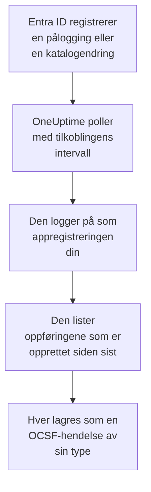

# Microsoft Entra ID

Importer påloggingene og katalogendringene i [Microsoft Entra ID](https://learn.microsoft.com/en-us/entra/identity/) til sikkerhetshendelsene i OneUptime og, hvis du vil, aktiviteten i Exchange, SharePoint, OneDrive og Teams fra [Microsoft 365-revisjonsloggen](https://learn.microsoft.com/en-us/purview/audit-log-activities). Der søker du i dem ved siden av logger, sporinger og metrikker, korrelerer dem med alle andre kilder og varsler vakten om dem som betyr noe. OneUptime leser dem med en appregistrering som du oppretter, og endrer ingenting i leieren din.

:::cards
- [Sett opp tilkoblingen](#sett-opp-tilkoblingen): En appregistrering, tillatelsene dens og skjemaet for tilkoblingen.
- [Hva som importeres](#hva-som-importeres): Hvilke oppføringer, og hvordan hver blir en sikkerhetshendelse.
- [Slik fungerer polling](#slik-fungerer-polling): Vinduet hver poll leser, og hvorfor det overlapper det forrige med 30 minutter.
- [Feilsøking](#feilsøking): Hva hver feil betyr, og hva du skal endre.
:::

## Slik fungerer det

Hvert minutt poller OneUptime hver aktiverte tilkobling der pollintervallet har gått. En poll logger på Microsoft Entra ID som appregistreringen din og leser, i denne rekkefølgen, katalogendringene ([List directoryAudits](https://learn.microsoft.com/en-us/graph/api/directoryaudit-list)) og påloggingene ([List signIns](https://learn.microsoft.com/en-us/graph/api/signin-list)) som er registrert siden forrige poll, og deretter, når alternativet **Microsoft 365-revisjonslogg** er slått på, det nye innholdet i revisjonsloggen ([Office 365 Management Activity API](https://learn.microsoft.com/en-us/office/office-365-management-api/office-365-management-activity-api-reference)). Hver oppføring lagres som en [OCSF](https://schema.ocsf.io/)-hendelse: en pålogging som en hendelse av typen Authentication, en tildelt rolle som en hendelse av typen User Access Management, en phishingdom som et Detection Finding.

## Før du begynner

- I OneUptime rollen Project Owner, Project Admin eller Security Admin. Security Member og Security Viewer kan se tilkoblinger og kjøringshistorikken deres, men ikke endre dem.
- For pålogginger: Microsoft Entra ID P1 eller P2, som Microsoft 365 E3, E5 og Business Premium inkluderer: Microsoft Graph gir pålogginger bare til slike leiere. Katalogendringer leses i alle leiere.
- En Entra-rolle som kan registrere programmer, for eksempel Programadministrator, og en Global administrator eller Administrator for privilegerte roller for å gi administratorsamtykke.
- For Microsoft 365-revisjonsloggen: revisjon slått på for leieren, slik den er som standard: i [Microsoft Purview-portalen](https://purview.microsoft.com) må **Audit** ikke tilby **Start recording user and admin activity**.
- Utgående HTTPS fra OneUptime-appen og -workerne til `login.microsoftonline.com`, `graph.microsoft.com` og `manage.office.com`, eller til `login.microsoftonline.us`, `graph.microsoft.us` og `manage.office365.us` for Azure Government.

## Sett opp tilkoblingen

Tilkoblingen logger på med [OAuth 2.0-flyten for klientlegitimasjon](https://learn.microsoft.com/en-us/entra/identity-platform/v2-oauth2-client-creds-grant-flow): som et program, aldri som en person, med skrivebeskyttede tillatelser.

:::steps
### Registrer et program

1. Logg på [Microsoft Entra-administrasjonssenteret](https://entra.microsoft.com), og åpne **App registrations**.
2. Velg **New registration**. Gi den navnet `OneUptime Security Events`, la **Supported account types** stå på **Accounts in this organizational directory only**, la omdirigerings-URI-en være tom, og velg **Register**.
3. Kopier **Program-ID (klient)** og **Katalog-ID (tenant)** fra appens side **Overview**.

### La den lese loggene

1. Gå til **API permissions → Add a permission → Microsoft Graph → Application permissions**, velg `AuditLog.Read.All`, og velg **Add permissions**. Microsoft dokumenterer at listen over pålogginger også kan kreve `Directory.Read.All`: legg den til hvis pålogginger avvises med `403` etter at samtykket er gitt.
2. For Microsoft 365-revisjonsloggen legger du til en ny tillatelse: **Add a permission → Office 365 Management APIs → Application permissions**, deretter `ActivityFeed.Read`.
3. For å la playbooks deaktivere, aktivere og logge ut brukere (se [Inndemming](/docs/telemetry/security-cases#inndemming)), legger du til `User.Read.All`, `User.EnableDisableAccount.All` og `User.RevokeSessions.All` på samme måte. Microsoft lar bare en app som også har rollen Privileged Authentication Administrator, endre kontoen til en administrator.
4. Velg **Grant admin consent for** leieren din, og bekreft. Statusen til hver tillatelse må være **Granted**: uten samtykke avvises hver lesing med `403`.

### Opprett en klienthemmelighet

Gå til **Certificates & secrets → Client secrets → New client secret**, velg når den utløper, og velg **Add**. Kopier hemmelighetens **Value**, ikke **Secret ID**, før du forlater siden: den vises aldri igjen. Den dagen den utløper, stopper pollingen med `Microsoft Entra ID token request failed (HTTP 401)` til du erstatter den med **Oppdater påloggingsinformasjon**.

### Legg til tilkoblingen i OneUptime

Åpne **Produkter → Security Events → Tilkoblinger** (`/dashboard/{projectId}/security-events/connections`), klikk på **Legg til tilkobling**, velg **Microsoft Entra ID** under **Identitet**, og klikk på **Neste**. Fyll ut innstillingene i tabellen nedenfor, klikk på **Neste**, og lim inn verdien av hemmeligheten i **Klienthemmelighet**. Slå på **Microsoft 365-revisjonslogg** i trinnet **Henting** for å lese den også.

### Test den før du lagrer

Klikk på **Test disse innstillingene** under **Test før du lagrer**. Testen logger på og leser hver logg med verdiene i skjemaet, og lagrer ingenting, så en feil hemmelighet eller et manglende samtykke viser seg før tilkoblingen finnes. Klikk deretter på **Neste**, gi tilkoblingen et **Navn**, og opprett den.
:::

| Innstilling | Hvor du finner den |
| --- | --- |
| **Katalog-ID (tenant)** | Appens side **Overview**. GUID-en til leieren, eller et verifisert domene som `contoso.onmicrosoft.com`. Med **Microsoft 365-revisjonslogg** slått på GUID-en: Management API-et kjenner en leier bare ved den. |
| **Program-ID (klient)** | Appens side **Overview**. GUID-en til appen som har `AuditLog.Read.All`. |
| **Sky** | **Offentlig Azure-sky**, eller **Azure Government (USA)** for GCC High (`login.microsoftonline.us`, `graph.microsoft.us` og `manage.office365.us`). |
| **Microsoft 365-revisjonslogg** | Valgfritt, slått av som standard. Slått på leser hver poll også Microsoft 365-revisjonsloggen. Appen trenger `ActivityFeed.Read`. |
| **Klienthemmelighet** | Hemmelighetens **Value**. Den krypteres, returneres aldri av API-et og vises aldri igjen. Erstatt den med **Oppdater påloggingsinformasjon** på tilkoblingen. |

Trinnet **Henting** har også en valgfri **Beskrivelse**, **Henteintervall (minutter)**, et heltall fra `1` til `1440` som starter på `5`, og **Aktivert**, som starter slått på.

## Hva som importeres

Hver hendelse har leverandøren `Microsoft` og produktet `Microsoft Entra ID`. Attributtet `entra.log` sier hvilken logg en pålogging eller en endring kom fra, og `microsoft365.contentType` på en Microsoft 365-oppføring innholdstypen.

| Oppføring | OCSF-klasse | Alvorlighetsgrad |
| --- | --- | --- |
| En pålogging som lyktes | Authentication (`3002`), status `Success` | Informational |
| En pålogging som venter på et andre trinn, for eksempel MFA (`50074`, `50076`) eller en melding om å bytte passord | Authentication (`3002`), status `Interrupted` | Informational: et trinn, ikke en feil |
| En pålogging som mislyktes, med Entras årsak og feilkode | Authentication (`3002`), status `Failure` | Low |
| En pålogging som Identity Protection vurderte til middels eller høy risiko | Authentication (`3002`) | Medium eller High |
| En bruker, gruppe eller rolle som er endret, etter kategorien | Account Change (`3001`), Group Management (`3006`), User Access Management (`3005`), eller Entity Management (`3004`) for resten | Medium for en privilegert rolle, for eksempel Global Administrator; Low for en endring som mislyktes |

Med **Microsoft 365-revisjonslogg** slått på importeres oppføringene et sikkerhetsteam handler på, fra den, og resten, som en åpnet fil eller en lest e-post, telles bare:

| Microsoft 365-oppføring | OCSF-klasse | Alvorlighetsgrad |
| --- | --- | --- |
| En Exchange-cmdlet, for eksempel `New-InboxRule` eller `Set-Mailbox`, en innboksregel laget i Outlook, eller e-post sendt som en annen person | API Activity (`6003`) | Medium når den videresender e-post, med `microsoft365.forwardsMail` satt til `true` |
| En tildelt postbokstillatelse, for eksempel `Add-MailboxPermission` | User Access Management (`3005`) | Low |
| En fil delt i SharePoint eller OneDrive | File Hosting Activity (`6006`) | Low med en gjest eller en lenke som alle kan åpne, med `microsoft365.sharedOutside` satt til `true` |
| En administrator for en områdesamling lagt til eller fjernet | User Access Management (`3005`) | Low |
| E-post med skadevare eller phishing funnet av Microsoft Defender for Office 365 | Detection Finding (`2004`) | High for skadevare, Medium for phishing |
| Et varsel som Microsoft 365 utløste | Detection Finding (`2004`) | Varselets egen |
| En app, en bot eller en connector lagt til i et team | Application Lifecycle (`6002`) | Low |

Exchanges eget vedlikehold, som kjører som systemkontoen, utelates med mindre det videresender e-post. Hver hendelse beholder hele oppføringen, flatet ut til nøkler med punktum som `status.errorCode` eller `Parameters.ForwardTo`, slik at en regel leser ethvert felt under Microsofts navn på det. Reglene i regelbiblioteket for Entra ID leser dem slik de importeres her.

De samme påloggingene og katalogendringene kan i stedet nå OneUptime som logger, eksportert av en diagnostikkinnstilling i Azure og lest av [Loggene dine](/docs/telemetry/security-events#finn-sikkerhetshendelser-i-loggene-dine). Hver oppføring får samme hendelses-ID begge veier, men en oppføring som leses begge veier, lagres to ganger: les Entra ID én vei.

## Slik fungerer polling

- **Oppføringer leses etter når Entra ID registrerte dem**, `activityDateTime` for en endring og `createdDateTime` for en pålogging.
- **Den første pollen ser 24 timer tilbake**, slik at en ny tilkobling viser de nylige oppføringene sine med en gang.
- **Hver senere poll starter 30 minutter før den lagrede markøren.** Microsoft dokumenterer at begge loggene kommer minutter for sent, så overlappingen leser en forsinket oppføring ved neste poll, og duplikater forkastes etter oppførings-ID i prosjektet.
- **En poll leser høyst 24 timer forbi markøren.** En tilkobling der markøren har kommet på etterskudd, tar igjen i en rekke vinduer på 24 timer.
- **En leier uten Microsoft Entra ID P1 eller P2** importerer katalogendringene sine, og kontrollen **Read sign-ins** i hver kjøring advarer om at påloggingene ikke ble lest.
- **En mislykket kjøring endrer ingenting.** Etter en nettverksfeil, eller en feilstatus fra Graph, forblir markøren og vinduslengden som de var, og den neste pollen leser det samme vinduet på nytt. Det eneste unntaket er en forespørsel som fikk tidsavbrudd: markøren blir, men det neste vinduet er halvparten så langt, fordi et vindu som er for tungt til å bli besvart i tide, ville fått tidsavbrudd ved hvert forsøk.

Microsoft 365-revisjonsloggen leses etter når Microsoft gjorde hver innholdsblob tilgjengelig, én dag om gangen, og ikke lenger tilbake enn de 7 dagene Microsoft beholder den. Den første pollen abonnerer appen på `Audit.Exchange`, `Audit.SharePoint` og `Audit.General`, og Microsoft gjør de første oppføringene i et nytt abonnement tilgjengelige innen 12 timer. Revisjonsloggen stopper aldri loggene fra Entra ID: en manglende tillatelse er en advarsel og vinduet går videre, mens en feil på Microsofts side, for eksempel `HTTP 503`, gjør kjøringen **Delvis** slik at vinduet leses på nytt.

### Når et vindu inneholder mer enn én poll kan lese

Hver logg har sitt eget budsjett: 10 sider med 500 katalogendringer, 20 sider med 500 pålogginger og, for Microsoft 365-revisjonsloggen, 120 forespørsler og 10 000 oppføringer. En poll stopper etter 4 minutter. Når et budsjett stopper en logg før slutten av vinduet, er kjøringen **Delvis**, og advarselen navngir loggen og budsjettet. Microsoft Graph lister de nyeste oppføringene først, så OneUptime forkorter vinduet i stedet for å flytte markøren forbi oppføringer den aldri nådde:

1. **Snevre inn.** Den neste pollen leser et vindu som er halvparten så langt, fra det samme startpunktet, og fortsetter å halvere til et vindu leses helt, ned til ett minutt. Kjøringens advarsel sier det: `This window holds more records than one poll can read; the next poll reads a {n} minute window from the same starting point.` Oppføringer som allerede er importert fra det lengre vinduet, hoppes over som duplikater.
2. **Vokse igjen.** Når et vindu er lest helt, flyttes markøren til slutten av det, og det neste vinduet er igjen dobbelt så langt, opptil 24 timer.
3. **Gå forbi ett enkelt minutt.** Hvis selv ett minutt inneholder mer enn en poll kan lese, går pollingen forbi det, slik at nyere oppføringer fortsetter å komme. Kjøringen forblir **Delvis**, og **Siste feil** lyder `More records were created in the one minute from {cursor} to {end} than one poll can read. Polling moved past this minute so newer records keep arriving; use Import this time range in Diagnostics on this minute to recover what one run can read.` Importer det minuttet med **Import this time range** for å hente det én kjøring kan lese.

Å endre **Henteintervall (minutter)** endrer ingenting av dette: det avgjør hvor ofte en poll starter, ikke hvor vinduet begynner.

### Kjør, forhåndsvis og importer ved behov

Klikk på **Diagnostikk** på en tilkobling for å se de siste kjøringene og arbeide med den manuelt. Alle som kan endre tilkoblingen, kan starte disse handlingene; alle som kan se den, kan lese historikken.

- **Kjør nå** starter en poll med en gang, med den vanlige markøren, også når tilkoblingen ikke er **Aktivert**.
- **Preview records** leser et tidsrom på opptil 7 dager og importerer ingenting.
- **Import this time range** importerer et tidsrom på opptil 7 dager, etter at du har bekreftet, uten å flytte markøren. Oppføringer som allerede er importert, hoppes over. Microsoft Entra ID beholder 30 dager med pålogginger og katalogendringer med P1 eller P2, og 7 dager uten.
- **Copy diagnostics** på en kjøring kopierer rapporten for brukerstøtte. Den inneholder aldri legitimasjon.

## Test tilkoblingen

**Test tilkoblingen** på raden til en tilkobling og **Test disse innstillingene** i skjemaet kjører i API-prosessen, ikke i en bakgrunnsworker, slik at en test også svarer når det er workerne som er problemet. Den kjører disse kontrollene i rekkefølge:

| Kontroll | Hva den kontrollerer |
| --- | --- |
| **Konfigurasjon** | Hver innstilling er til stede og riktig formatert. Ingenting kontaktes når dette mislykkes. |
| **Authenticate with Microsoft Entra** | Entra ID utsteder et token for Microsoft Graph til appen, i skyen du valgte. |
| **Read sign-ins** | Pålogginger fra de siste 24 timene kan leses. En advarsel, ikke en feil, i en leier uten P1 eller P2. |
| **Read directory changes** | Katalogendringer fra de siste 24 timene kan leses. |
| **Read the Microsoft 365 audit log** | Bare med alternativet slått på: Management API-et svarer, og hvilke innholdstyper appen abonnerer på. |
| **Records available to import** | Hvor mange pålogginger og katalogendringer de siste 24 timene inneholder, høyst 500 av hver, så `500+` betyr flere. Ingen er en advarsel. |
| **Background workers**, **Poll scheduler**, **Security event storage** | OneUptimes egen side: en prosess tar jobbene fra Worker-køen, poll-jobben kjører hvert minutt, og lageret for sikkerhetshendelser svarer. |
| **Scheduled polling** | For en lagret tilkobling: polling er slått på, ingen kjøring sitter fast og venter på en worker, og poller kjører i tide. |

Hver forespørsel i en test har en frist på 20 sekunder. En test importerer aldri noe og flytter aldri markøren, og hver kontroll som mislykkes, sier hva du skal endre.

## Feilsøking

**Siste feil** for tilkoblingen lagrer hele feilmeldingen, med legitimasjon maskert. Når en tilkobling har en feil, velger du **Vis feil** i kolonnen **Handlinger** for å lese den, og **Kopier feil** i dialogen for å kopiere den. Hver melding starter med `Microsoft Entra ID`, navngir deretter forespørselen som mislyktes, og siterer Microsofts feilkode når det finnes en.

:::details Siste feil sier `token request failed`
- `HTTP 401` med `invalid_client`: klienthemmeligheten er feil eller utløpt. Opprett en ny, og lagre den med **Oppdater påloggingsinformasjon**.
- `HTTP 400` som navngir program-ID-en (klient) eller leieren: sjekk begge på appens side **Overview**, og at **Sky** er leierens.
:::

:::details Siste feil sier `sign-ins request failed (HTTP 403)` eller `audit logs request failed (HTTP 403)`
- Feilkode `Authorization_RequestDenied`: appen mangler `AuditLog.Read.All`, eller samtykket ble ikke gitt. Gi administratorsamtykke, vent noen minutter, og test på nytt. For pålogginger gir du også `Directory.Read.All`.
- Feilkode `Authentication_RequestFromNonPremiumTenantOrB2CTenant`: leieren har ikke Microsoft Entra ID P1 eller P2. Katalogendringer importeres fortsatt.
:::

:::details Microsoft 365-revisjonsloggen leses ikke
- `subscriptions request failed (HTTP 401)` eller `(HTTP 403)`, med `AF10001`: appen mangler `ActivityFeed.Read` fra Office 365 Management APIs, eller samtykket ble ikke gitt.
- `AF20010` til `AF20013`: Management API-et kjenner ikke **Katalog-ID (tenant)**. Bruk GUID-en til leieren.
- `subscription start failed` med `AF20023`: en administrator har slått av abonnementet. En innholdstype som ikke kan abonneres på, navngis i kjøringens advarsler, og de andre leses fortsatt.
- Ingen oppføringer på flere timer etter den første pollen: Microsoft gjør det første innholdet i et nytt abonnement tilgjengelig innen 12 timer.
:::

:::details Siste feil sier `did not complete`
Forespørselen fikk ikke svar: et tidsavbrudd, et navn som ikke kan slås opp, eller en avvist adresse. Sjekk at OneUptime-appen og -workerne kan nå vertene i [Før du begynner](#før-du-begynner), gjennom enhver proxy du bruker.
:::

:::details Testen lykkes, men Last Polled er Never
Poll-jobben har aldri kjørt. Les kontrollene **Background workers** og **Poll scheduler**. På en selvdriftet installasjon er den vanlige årsaken `DISABLE_QUEUE_WORKERS=true` på appen, uten en separat worker-utrulling som tar jobbene: sett den til `false`, eller kjør worker-utrullingen (Helm: `worker.enabled: true`, som er `false` som standard).
:::

## Neste trinn

:::cards
- [Sikkerhetshendelser](/docs/telemetry/security-events): Søk, korreler og varsle på det du importerer.
- [Okta-systemlogg](/docs/integrations/okta): Importer påloggingene fra en annen identitetsleverandør.
- [Google Workspace](/docs/integrations/google-workspace): Importer påloggingene og administratorendringene i Google.
- [Oversikt over integrasjoner](/docs/integrations/index): De andre verktøyene du kan koble til.
:::
