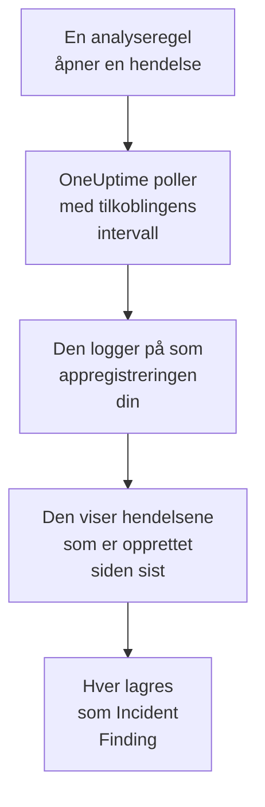

# Microsoft Sentinel

Importer hendelsene som [Microsoft Sentinel](https://learn.microsoft.com/en-us/azure/sentinel/overview)-analysereglene dine åpner, til sikkerhetshendelsene i OneUptime. Der søker du i dem ved siden av logger, sporinger og metrikker, korrelerer dem med alle andre kilder og varsler vakten om dem som betyr noe. OneUptime leser dem med en appregistrering som du oppretter, og endrer ingenting i Azure.

:::cards
- [Sett opp tilkoblingen](#sett-opp-tilkoblingen): En appregistrering, en rolle og skjemaet for tilkoblingen.
- [Hva som importeres](#hva-som-importeres): Hvordan hver Sentinel-hendelse blir en sikkerhetshendelse.
- [Slik fungerer polling](#slik-fungerer-polling): Vinduet hver poll leser, og hva et travelt arbeidsområde gjør med det.
- [Feilsøking](#feilsøking): Hva hver feil betyr, og hva du skal endre.
:::

## Slik fungerer det



Hvert minutt poller OneUptime hver aktiverte tilkobling der pollintervallet har gått. En poll logger på Microsoft Entra ID som appregistreringen din, ber Azure Resource Manager om hendelsene som er opprettet siden forrige poll, og lagrer hver som en [OCSF](https://schema.ocsf.io/)-hendelse av typen Incident Finding (klasse `2005`). Deteksjonsregler, monitorer og dashbord behandler den deretter som en sikkerhetshendelse fra en hvilken som helst annen kilde.

## Før du begynner

- I OneUptime rollen Project Owner, Project Admin eller Security Admin. Security Member og Security Viewer kan se tilkoblinger og kjøringshistorikken deres, men ikke endre dem.
- Et Log Analytics-arbeidsområde med Microsoft Sentinel aktivert, i den offentlige Azure-skyen eller i Azure Government (US).
- I Microsoft Entra ID retten til å opprette en appregistrering og en klienthemmelighet.
- På ressursgruppen som inneholder arbeidsområdet, retten til å tildele roller, for eksempel Eier eller Administrator for brukertilgang.

## Sett opp tilkoblingen

Tilkoblingen logger på med OAuth 2.0-flyten for klientlegitimasjon: som et program, aldri som en person. Tilgangen kommer fra en Azure-rolle, så appregistreringen trenger ingen API-tillatelser.

:::steps
### Registrer et program

1. Logg på [Azure-portalen](https://portal.azure.com), og åpne **Microsoft Entra ID**.
2. Gå til **App registrations → New registration**. Gi den navnet `OneUptime Sentinel connector`, la **Supported account types** stå på **Accounts in this organizational directory only**, la omdirigerings-URI-en være tom, og velg **Register**.
3. Kopier **Program-ID (klient)** og **Katalog-ID (tenant)** fra appens side **Overview**.
4. Gå til **Certificates & secrets → Client secrets → New client secret**, velg når den utløper, og velg **Add**. Kopier hemmelighetens **Value**, ikke **Secret ID**, før du forlater siden: den vises aldri igjen.

### La den lese hendelser

1. Åpne ressursgruppen som inneholder Log Analytics-arbeidsområdet ditt, i Azure-portalen.
2. Velg **Access control (IAM) → Add → Add role assignment**.
3. Velg **Microsoft Sentinel Reader** på fanen **Role**.
4. Velg **User, group, or service principal** på fanen **Members**, klikk på **Select members**, og velg appregistreringen din etter navn.
5. Velg **Review + assign**.

Rollen lar appen lese hendelser (`Microsoft.SecurityInsights/incidents/read`) og ikke skrive noe. Microsoft anbefaler å tildele den på ressursgruppen i stedet for på arbeidsområdet, slik at den også dekker løsningen `SecurityInsights` som hendelsene leveres fra. En ny tildeling kan bruke noen minutter på å tre i kraft.

### Finn opplysningene om arbeidsområdet

Åpne Log Analytics-arbeidsområdet i Azure-portalen. Siden **Overview** viser **Abonnements-ID**, **Resource group** og navnet på arbeidsområdet. Ressurs-ID-en til arbeidsområdet inneholder de samme tre:

```text
/subscriptions/{Subscription ID}/resourceGroups/{Resource group}/providers/Microsoft.OperationalInsights/workspaces/{Workspace name}
```

### Legg til tilkoblingen i OneUptime

Åpne **Produkter → Security Events → Tilkoblinger** (`/dashboard/{projectId}/security-events/connections`), klikk på **Legg til tilkobling**, velg **Microsoft Sentinel**, og klikk på **Neste**. Fyll ut innstillingene i tabellen nedenfor, klikk på **Neste**, og lim inn verdien av hemmeligheten i **Klienthemmelighet**.

### Test den før du lagrer

Klikk på **Test disse innstillingene** under **Test før du lagrer**. Testen logger på og leser hendelser med verdiene i skjemaet, og lagrer ingenting, så en feil hemmelighet eller en manglende rolle viser seg før tilkoblingen finnes. Klikk deretter på **Neste**, gi tilkoblingen et **Navn**, og opprett den.
:::

| Innstilling | Hvor du finner den |
| --- | --- |
| **Katalog-ID (tenant)** | Appens side **Overview**. GUID-en til leieren, eller et verifisert domene som `contoso.onmicrosoft.com`. |
| **Program-ID (klient)** | Appens side **Overview**. En GUID. |
| **Abonnements-ID** | Arbeidsområdets side **Overview**. En GUID. |
| **Resource group** | Arbeidsområdets side **Overview**. 1 til 90 bokstaver, sifre, understreker, bindestreker, punktum eller parenteser, ikke avsluttet med punktum. |
| **Workspace name** | Arbeidsområdets side **Overview**. 3 til 90 bokstaver, sifre eller bindestreker, som starter og slutter med en bokstav eller et siffer. |
| **Sky** | **Offentlig Azure-sky** (`login.microsoftonline.com`, `management.azure.com`) eller **Azure Government (USA)** (`login.microsoftonline.us`, `management.usgovcloudapi.net`). |
| **Klienthemmelighet** | Hemmelighetens **Value**. Den krypteres, returneres aldri av API-et og vises aldri igjen. Erstatt den med **Oppdater påloggingsinformasjon** på tilkoblingen. |

Trinnet **Henting** har også en valgfri **Beskrivelse**, **Henteintervall (minutter)**, et heltall fra `1` til `1440` som starter på `5`, og **Aktivert**, som starter slått på.

## Hva som importeres

Hver Sentinel-hendelse blir én hendelse av typen Incident Finding (OCSF-klasse `2005`, aktivitet `Create`), tilskrevet telemetritjenesten `Microsoft Sentinel`:

| OCSF-kolonne | Felt i Sentinel-hendelsen |
| --- | --- |
| `time` | `properties.createdTimeUtc`, da Sentinel opprettet hendelsen |
| `eventUid` | `name`, GUID-en til hendelsen, som også duplikater fjernes etter |
| `message`, `ruleName` | `properties.title` |
| `ruleId` | Regel-GUID-en på slutten av den første oppføringen i `properties.relatedAnalyticRuleIds` |
| `severityName` | `properties.severity`: `High`, `Medium`, `Low` eller `Informational` |
| `statusName` | `properties.status`: `New`, `Active` eller `Closed` |
| `mitreTactics` | `properties.additionalData.tactics`, som ATT&CK-ID-er: `Persistence` blir `TA0003` |
| `principalUser` | `properties.owner.userPrincipalName` eller `properties.owner.email` |
| `targetResource` | `properties.incidentUrl`, en lenke til hendelsen i Azure-portalen |
| `observables` | Eierens UPN, e-post og objekt-ID, og navnet på hver etikett |
| `attributes` | Hele hendelsen, flatet ut til nøkler med punktum som `properties.classification` og `properties.firstActivityTimeUtc` |

Lukkede hendelser som er opprettet i vinduet til en poll, importeres også. Filtrer på `statusName` i utforskeren for sikkerhetshendelser for å se bare de åpne.

## Slik fungerer polling

Hver poll viser hendelsene som er opprettet i vinduet, de eldste først, 50 per side, og følger API-ets `nextLink` til den har lest hele vinduet:

```text
GET https://management.azure.com/subscriptions/{sub}/resourceGroups/{rg}/providers/Microsoft.OperationalInsights/workspaces/{ws}/providers/Microsoft.SecurityInsights/incidents
    ?api-version=2024-03-01
    &$filter=(properties/createdTimeUtc ge {windowStart}) and (properties/createdTimeUtc lt {windowEnd})
    &$orderby=properties/createdTimeUtc asc
    &$top=50
```

- **Opprettelsestidspunktet er markøren.** En planlagt analyseregel som kjører hver time, åpner hendelsen sin lenge etter aktiviteten den oppdaget, og hendelsens `firstActivityTimeUtc` kan ligge timer eller dager tidligere. En markør på aktivitetstidspunktet ville hoppet over hver slik hendelse. Aktivitetstidspunktene blir i `attributes`, og eksemplene i diagnostikken viser begge.
- **Den første pollen ser 24 timer tilbake**, slik at en ny tilkobling viser de nylige hendelsene sine med en gang.
- **Hver senere poll starter 1 minutt før den lagrede markøren**, slik at en hendelse som er opprettet på grensen mellom to vinduer, aldri hoppes over.
- **En poll leser høyst 24 timer forbi markøren.** En tilkobling der markøren har kommet på etterskudd, tar igjen i en rekke vinduer på 24 timer, og **Helse** viser **Catching up**.
- **Duplikater fjernes etter GUID-en til hendelsen** (`name`) i prosjektet, slik at overlappingen, et gjentatt vindu og en import aldri lagrer en hendelse to ganger.

### Når et vindu inneholder mer enn én poll kan lese

En poll leser høyst 20 sider med 50 hendelser: 1 000 hendelser. Når den grensen stopper den før slutten av vinduet, er kjøringen **Delvis**, med en advarsel som:

```text
Stopped after 20 incidents requests (the per-run request limit) before reading the whole window. Incidents are read oldest first; every incident created before 2026-09-14T08:12:44.000Z was read.
```

Hendelser leses fra eldst til nyest, så OneUptime flytter markøren til opprettelsestidspunktet for den siste hendelsen som ble lest, og den neste pollen starter der med samme vinduslengde. Et travelt arbeidsområde tar dermed igjen omtrent 1 000 hendelser per poll i stedet for å lese de samme på nytt. Hendelser som er opprettet på samme tidspunkt, leses to ganger, og duplikatkontrollen fjerner den andre kopien.

Når en kjøring ikke kommer forbi den lagrede markøren i det hele tatt, gjør OneUptime i stedet vinduet kortere:

1. **Snevre inn.** Den neste pollen leser et vindu som er halvparten så langt, fra det samme startpunktet, og fortsetter å halvere til et vindu leses helt, ned til ett minutt. Kjøringens advarsel sier det: `This window holds more records than one poll can read; the next poll reads a {n} minute window from the same starting point.`
2. **Vokse igjen.** Når et vindu er lest helt, er det neste igjen dobbelt så langt, opptil 24 timer.
3. **Gå forbi ett enkelt minutt.** Hvis selv ett minutt inneholder mer enn en poll kan lese, går pollingen forbi det, slik at nyere hendelser fortsetter å komme. Kjøringen forblir **Delvis**, og **Siste feil** lyder `More records were created in the one minute from {cursor} to {end} than one poll can read. Polling moved past this minute so newer records keep arriving; use Import this time range in Diagnostics on this minute to recover what one run can read.` Importer det minuttet med **Import this time range** for å hente det én kjøring kan lese.

En kjøring som mislykkes helt, med en feil fra Microsoft Entra ID eller Azure Resource Manager, beholder markøren og vinduslengden, og den neste pollen leser det samme vinduet på nytt. Det eneste unntaket er en forespørsel som fikk tidsavbrudd: markøren blir, men det neste vinduet er halvparten så langt, fordi et vindu som er for tungt til å bli besvart i tide, ville fått tidsavbrudd ved hvert forsøk. Å endre **Henteintervall (minutter)** endrer ingenting av dette: det avgjør hvor ofte en poll starter, ikke hvor vinduet begynner.

### Kjør, forhåndsvis og importer ved behov

Klikk på **Diagnostikk** på en tilkobling for å se de siste kjøringene og arbeide med den manuelt. Alle som kan endre tilkoblingen, kan starte disse handlingene; alle som kan se den, kan lese historikken.

- **Kjør nå** starter en poll med en gang, med den vanlige markøren, også når tilkoblingen ikke er **Aktivert**.
- **Preview incidents** leser et tidsrom på opptil 7 dager og importerer ingenting.
- **Import this time range** importerer et tidsrom på opptil 7 dager, etter at du har bekreftet, uten å flytte markøren. Hendelser som allerede er importert, hoppes over.
- **Copy diagnostics** på en kjøring kopierer rapporten for brukerstøtte. Den inneholder aldri legitimasjon.

## Test tilkoblingen

**Test tilkoblingen** på raden til en tilkobling og **Test disse innstillingene** i skjemaet kjører i API-prosessen, ikke i en bakgrunnsworker, slik at en test også svarer når det er workerne som er problemet. Den kjører disse kontrollene i rekkefølge:

| Kontroll | Hva den kontrollerer |
| --- | --- |
| **Konfigurasjon** | Hver innstilling er til stede og riktig formatert. Ingenting kontaktes når dette mislykkes. |
| **Authenticate with Microsoft Entra** | Microsoft Entra ID utsteder et token for Azure Resource Manager til appregistreringen din. |
| **Read incidents** | Én hendelse som er opprettet de siste 24 timene, kan leses (`$top=1`). Det beviser rollen og opplysningene om arbeidsområdet. |
| **Incidents available to import** | Hvor mange hendelser som er opprettet de siste 24 timene og de siste 7 dagene, én side med 50 for hver, så `50+` betyr flere. Ingen på 7 dager er en advarsel, ikke en feil. |
| **Background workers**, **Poll scheduler**, **Security event storage** | OneUptimes egen side: en prosess tar jobbene fra Worker-køen, poll-jobben kjører hvert minutt, og lageret for sikkerhetshendelser svarer. |
| **Scheduled polling** | For en lagret tilkobling: polling er slått på, ingen kjøring sitter fast og venter på en worker, og poller kjører i tide. |

Hver forespørsel i en test har en frist på 20 sekunder. En test importerer aldri noe og flytter aldri markøren, og hver kontroll som mislykkes, sier hva du skal endre.

## Send sikkerhetshendelser til Microsoft Sentinel

OneUptime kan også sende det den finner til Microsoft Sentinel, gjennom Logs Ingestion API i Azure Monitor, inn i en egendefinert tabell i arbeidsområdet Sentinel kjører på. Analyseregler, jaktspørringer og arbeidsbøker spør deretter `OneUptimeSecurityEvents_CL` ved siden av de andre tabellene dine.

:::steps
### Opprett tabellen og datainnsamlingsregelen dens

Åpne arbeidsområdets **Tables → Create → New custom log (DCR-based)** i Azure-portalen. Kall tabellen `OneUptimeSecurityEvents`, opprett en ny datainnsamlingsregel, og et datainnsamlingsendepunkt hvis skjemaet ber om det. Last opp eksemplet nedenfor som eksempelfil, behold transformasjonen som den er, og opprett tabellen.

### La et program sende til den

Registrer et program og gi det en klienthemmelighet, som i [Registrer et program](#registrer-et-program). Åpne deretter datainnsamlingsregelen, **Access control (IAM) → Add → Add role assignment**, velg **Monitoring Metrics Publisher**, og velg programmet.

### Legg til målet

Åpne **Produkter → Security Events → Tilkoblinger**. Klikk på **Legg til mål** under **Send til SIEM-et ditt**, velg Microsoft Sentinel under **SIEM**, og klikk på **Neste**. Fyll inn **Katalog-ID (tenant)**, **Program-ID (klient)** og **Klienthemmelighet**, **Endepunkt for logginntak** fra **Overview** for datainnsamlingsendepunktet (eller regelen), og **Uforanderlig ID for datainnsamlingsregelen** fra regelens **JSON View**. **Strøm** er valgfri: står den tom, er den `Custom-OneUptimeSecurityEvents_CL`.

### Send en testhendelse og begynn å sende

Klikk på **Send en testhendelse**: én rad når tabellen i løpet av noen minutter. Behold deretter **Bare deteksjoner** under **Hva som skal sendes**, eller velg **Alle sikkerhetshendelser**, og klikk på **Begynn å sende**.
:::

Eksempelfilen, én rad med hver kolonne i tabellen:

```json title="oneuptime-security-events-sample.json"
[
  {
    "TimeGenerated": "2026-10-21T10:00:00.000Z",
    "EventId": "0193c0de-cccc-4aaa-8bbb-000000000001",
    "EventUid": "okta-1",
    "ClassName": "Authentication",
    "CategoryName": "Identity & Access Management",
    "ActivityName": "Logon",
    "Severity": "Medium",
    "SeverityId": 3,
    "Status": "Failure",
    "Message": "Failed sign-in for alice",
    "VendorName": "Okta",
    "ProductName": "Okta System Log",
    "RuleId": "",
    "RuleName": "",
    "MitreTactics": [],
    "MitreTechniques": [],
    "PrincipalUser": "alice@example.com",
    "PrincipalHost": "laptop-7",
    "PrincipalIp": "203.0.113.7",
    "TargetUser": "",
    "TargetHost": "app.example.com",
    "TargetIp": "198.51.100.20",
    "TargetPort": 443,
    "TargetResource": "",
    "ProcessName": "",
    "ProcessCommandLine": "",
    "ParentProcessName": "",
    "Observables": [
      "alice@example.com",
      "203.0.113.7"
    ],
    "Attributes": {
      "okta.outcome.reason": "INVALID_CREDENTIALS"
    }
  }
]
```

- Logs Ingestion API tar opptil 1 MB per kall, så rader sendes i bunter på opptil 500. En bunt Azure avviser, deles til raden den ikke vil ta, er funnet og utelatt, og struping (`429`) prøves på nytt.
- En `403` betyr at programmet mangler **Monitoring Metrics Publisher** på regelen, og en `404` en feil uforanderlig ID eller strøm.
- Hendelser OneUptime har importert fra Microsoft Sentinel, sendes aldri tilbake dit.

## Feilsøking

**Siste feil** for tilkoblingen lagrer hele feilmeldingen, med legitimasjon maskert, bak et prefiks som navngir trinnet som mislyktes. Når en tilkobling har en feil, velger du **Vis feil** i kolonnen **Handlinger** for å lese den, og **Kopier feil** i dialogboksen for å kopiere den. Les prefikset først.

:::details Last Error starter med `Microsoft Sentinel token request`
- `Microsoft Sentinel token request failed (HTTP ...)`: Microsoft Entra ID nektet å utstede et token, så Azure ble aldri kontaktet. Meldingen siterer koden fra Entra:
  - `AADSTS7000215` eller `invalid_client`: **Klienthemmelighet** er feil eller utløpt, eller det er ID-en til hemmeligheten i stedet for verdien. Opprett en ny hemmelighet, og lagre den med **Oppdater påloggingsinformasjon**.
  - `AADSTS700016` eller `unauthorized_client`: **Program-ID (klient)** finnes ikke i den angitte **Katalog-ID (tenant)**. Sammenlign begge med appens side **Overview**.
  - `AADSTS90002` eller `HTTP 404`: den leieren finnes ikke. **Katalog-ID (tenant)** er feil, eller den ligger i den andre skyen: sjekk **Sky**.
  - `HTTP 429` eller `HTTP 5xx`: Microsoft Entra ID begrenser forespørsler eller er utilgjengelig. Den neste pollen prøver igjen.
- `Microsoft Sentinel token request returned ...`: Microsoft Entra ID svarte med noe ubrukelig, for eksempel et innhold som ikke er JSON, eller uten `access_token`. Det er vanligvis en proxy eller gateway imellom.
- `Microsoft Sentinel token request failed:`, uten status, eller `Microsoft Sentinel token request timed out after ... seconds with no response`: forespørselen fikk ikke noe svar. Sjekk DNS, TLS og utgående HTTPS fra OneUptime-appen og -workerne til `login.microsoftonline.com`.
:::

:::details Last Error starter med `Microsoft Sentinel incidents list`
- `Microsoft Sentinel incidents list failed (HTTP ...)`: Azure Resource Manager avviste forespørselen.
  - `HTTP 401`: den godtok ikke tokenet. Nesten alltid passer **Sky** ikke til leieren, eller appregistreringen er slettet. Et token som utløper mellom to sider, fornyes og prøves på nytt én gang av seg selv.
  - `HTTP 403` eller `AuthorizationFailed`: appen har ennå ikke **Microsoft Sentinel Reader** på ressursgruppen. Tildel den, og vent noen minutter.
  - `HTTP 404`: ingen arbeidsområder har den **Abonnements-ID**, den **Resource group** og det **Workspace name**, eller Microsoft Sentinel er ikke aktivert der. Kopier dem fra arbeidsområdets side **Overview**.
  - `HTTP 429` eller `HTTP 5xx`: Azure Resource Manager begrenser forespørsler eller er utilgjengelig. Den neste pollen prøver igjen.
  - `HTTP 400`: Azure Resource Manager avviste forespørselen, som OneUptime bygger, ikke innstillingene dine. Send meldingen til OneUptimes brukerstøtte.
- `Microsoft Sentinel incidents list returned ...`: Azure svarte `200`, men uten en lesbar side med hendelser, eller med en `nextLink` til en annen vert, som tilkoblingen avviser, slik at tokenet aldri forlater Azure Resource Manager. Det rapporteres i stedet for å bli tatt som et tomt vindu, slik at markøren aldri går forbi hendelser som ingen har lest.
- `Microsoft Sentinel incidents list failed:`, uten status, eller `Microsoft Sentinel incidents list timed out after ... seconds with no response`: forespørselen fikk ikke noe svar. Sjekk utgående HTTPS fra OneUptime-workerne til `management.azure.com` eller `management.usgovcloudapi.net`.
:::

:::details Last Polled er Never og Last Error er tom
Ingen poll er fullført for denne tilkoblingen. Kjør **Test tilkoblingen**: kontrollene **Background workers** og **Poll scheduler** navngir årsaken. På en selvdriftet installasjon er den vanlige årsaken `DISABLE_QUEUE_WORKERS=true` på appen, uten en separat worker-utrulling som tar jobbene: sett den til `false`, eller kjør worker-utrullingen (Helm: `worker.enabled: true`).
:::

:::details En kjøring er Partial
- `Stopped after 20 incidents requests (the per-run request limit) before reading the whole window`: vinduet inneholdt mer enn de 1 000 hendelsene én kjøring leser. Ingenting går tapt: den neste pollen starter etter den siste hendelsen som ble lest. En tilkobling som forblir **Delvis** poll etter poll, tar igjen et etterslep, og **Sist hentet** og **Siste importerte hendelse** fortsetter å flytte seg fremover.
- `Microsoft Sentinel returned incidents out of creation-time order, so this run cannot name a point to resume from.`: API-et ignorerte rekkefølgen fra eldst til nyest, så kjøringen kan ikke flytte markøren til den siste hendelsen sin, og den neste pollen leser i stedet et kortere vindu. Hvis det fortsetter, sender du kjøringens rapport til OneUptimes brukerstøtte.
- `More records were created in the one minute from ... than one poll can read`: pollingen gikk forbi det minuttet. Importer det med **Import this time range** i **Diagnostikk**. En import leser like mye som en poll.
:::

:::details Testen lykkes, men ingenting importeres
Les **Incidents available to import** i testens rapport. `0` de siste 7 dagene betyr at analysereglene i arbeidsområdet ikke har åpnet noen hendelser, og det er ikke en feil i tilkoblingen. Kontroller i Microsoft Sentinel at reglene er aktivert og satt til å opprette hendelser.
:::

## Azure Government

Sett **Sky** til **Azure Government (USA)**. Tilkoblingen logger da på `login.microsoftonline.us` med omfanget `https://management.usgovcloudapi.net/.default`, og leser hendelser fra `management.usgovcloudapi.net`. Alt annet, også rolletildelingen, er det samme.

## Hva du får

- **Søk.** Filtrer hendelser etter alvorlighetsgrad, status, eier, etikett eller taktikk i utforskeren for sikkerhetshendelser, ved siden av alle andre kilder.
- **Korrelasjon.** Eieren og etikettene til hver hendelse indekseres som observables, så ett søk finner alt som nevner dem.
- **Deteksjonsregler.** Sigma-regler som kjører etter en tidsplan over sikkerhetshendelsene dine, og åpner varsler som varsler vakten.
- **Monitorer.** Monitorer for sikkerhetshendelser teller samsvarende hendelser, for eksempel nye High-hendelser, og åpner hendelser eller varsler over en terskel.

Sikkerhetshendelser faktureres som resten av telemetrien din, per innhentet GB. Se [Priser](https://oneuptime.com/pricing).

## Neste trinn

:::cards
- [Sikkerhetshendelser](/docs/telemetry/security-events): Søk, korreler og varsle på det du importerer.
- [Microsoft Defender XDR](/docs/integrations/microsoft-defender-xdr): Importer også varslene fra hver Defender-arbeidsbelastning.
- [Roller](/docs/permissions/reference#roller): Hva Security-rollene kan se og endre.
- [Oversikt over integrasjoner](/docs/integrations/index): De andre verktøyene du kan koble til.
:::
