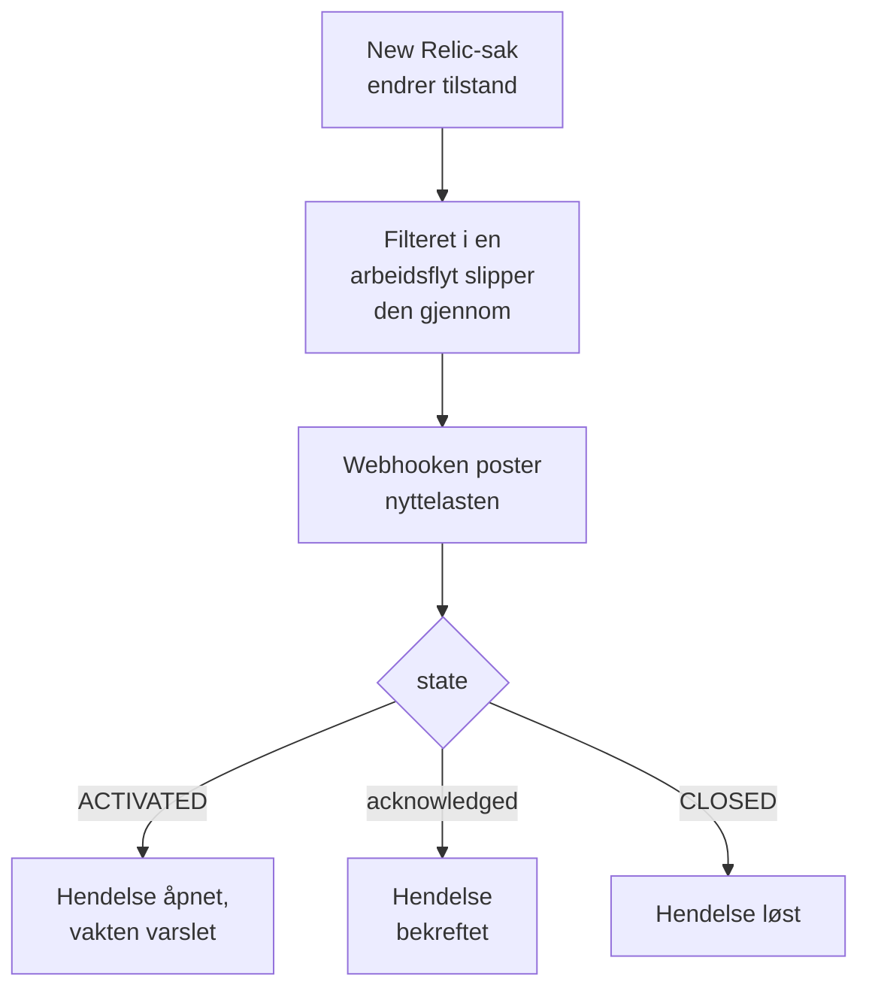

# New Relic

Send [New Relic](https://newrelic.com)-saker til OneUptime, slik at hver sak blir en hendelse eller et varsel som varsler vaktteamet ditt, bekreftes når noen bekrefter saken, og løses når saken lukkes. New Relic sender sakene sine gjennom en [webhook-destinasjon](https://docs.newrelic.com/docs/alerts/get-notified/notification-integrations/), så det er ingenting å installere på noen av sidene.

:::cards
- [Start med malen](#start-med-malen): Velg hvem som skal varsles, kopier URL-en, og se hva hver sak gjør.
- [Konfigurer New Relic](#konfigurer-new-relic): En webhook-destinasjon, og arbeidsflyten som varsler den.
- [Test det](#test-det): Send en sak selv, deretter en fra New Relic.
- [Feilsøking](#feilsøking): Når saker ikke kommer frem, eller hendelser blir stående åpne.
:::

## Slik fungerer det



En New Relic-arbeidsflyt velger sakene som skal sendes med filteret sitt, og varsler en webhook-destinasjon når en sak aktiveres, bekreftes eller lukkes, med en JSON-nyttelast New Relic fyller ut. Sakens ID er slik OneUptime finner hendelsen den åpnet.

## Før du begynner

- En New Relic-konto der du kan opprette destinasjoner og arbeidsflyter.
- I OneUptime retten til å opprette arbeidsflyter. På OneUptime Cloud krever arbeidsflyter planen **Growth** eller høyere.

## Start med malen

Sett opp OneUptime først: det gir deg URL-en som New Relic sender til. Dialogen **Opprett en arbeidsflyt** har to New Relic-maler, under **New Relic** i kategorilisten: **Declare an incident for each New Relic issue**, og **Create an alert for each New Relic issue** for varsler. Begge gjør det samme, hver med sin egen type post.

:::steps
1. Gå til **Arbeidsflyter**, og klikk på **Opprett arbeidsflyt**. Under **Eller start fra en mal** velger du **New Relic** i kategorilisten, klikker på **Declare an incident for each New Relic issue**, eller **Create an alert for each New Relic issue**, og klikker på **Bruk denne malen**.
2. Under **Who to page for new New Relic issues** velger du vaktpolicyene som skal tilkalles, eller ingen for ikke å tilkalle noen, og klikker på **Opprett arbeidsflyt**. Arbeidsflyten åpnes i **Bygger**, slått av.
3. Klikk på triggeren **Webhook**, deretter på **Kopier URL**, og ta vare på URL-en til New Relic.
4. Slå på **Aktivert** øverst i **Bygger**. En arbeidsflyt som er slått av, svarer New Relic med `400`.
:::

Deretter [konfigurerer du New Relic](#konfigurer-new-relic) til å sende sakene sine til den URL-en. Arbeidsflytens steg `read-event-1` åpnes med det samme oppsettet, for når du kommer tilbake til det i **Bygger**.

### Hva arbeidsflyten gjør

Etter triggeren **Webhook** leser steget **Check With JavaScript** `read-event-1` den `state` New Relic sender, og **Incident From Another Tool**, eller **Alert From Another Tool** i varselmalen, gjør det den betyr, ut fra sakens ID. Hendelsen tar vare på ID-en i det egendefinerte feltet `newRelicIssueId`.

| Det New Relic sender | Hva arbeidsflyten gjør |
| --- | --- |
| `state` er `ACTIVATED` eller `CREATED` | Erklærer en hendelse med tittelen `New Relic: <issue>`, med alvorlighetsgraden sakens prioritet tilsvarer, holdt unna statussidene dine. Beskrivelsen lenker til saken i New Relic, og viser prioriteten, entitetene, retningslinjene og betingelsene. Den varsler vaktretningslinjene du valgte. Den samme saken igjen, for eksempel når New Relic hever den til CRITICAL, åpner ingen ny hendelse, og varsler ingen på nytt. |
| `state` er `ACTIVATED` og `isAcknowledged` er `true` | Bekrefter sakens hendelse, slik at vakten slutter å eskalere den. Hvorfor står på tidslinjen. |
| `state` er `CLOSED` | Løser sakens hendelse, med mindre den allerede er løst. Hvorfor står på tidslinjen. |

En bekreftelse eller en lukking for en sak uten hendelse endrer ingenting. Alt annet, for eksempel en forespørsel fra et annet verktøy, blir stående: `read-event-1` tar **No**, og kjøringens **Trinn** sier hvorfor. Ingenting går tilbake til New Relic: det lukker sine egne saker når signalet er gjenopprettet, og det er det som løser hendelsen.

### Prioriteter og varsling

Hver ny sak varsler vaktretningslinjene du valgte, uansett prioritet: New Relic hever en sak fra HIGH til CRITICAL på stedet, på den samme saken, så å vente på CRITICAL ville aldri varslet for en sak som åpnet på HIGH og ble verre. For å varsle for færre saker begrenser du filteret til arbeidsflyten i New Relic: bare det som passerer det, når OneUptime. I et nytt prosjekt knytter prioritetene seg til disse alvorlighetsgradene for hendelser og varsler:

| New Relic-prioritet | Hendelse | Varsel | Vakt |
| --- | --- | --- | --- |
| CRITICAL | Critical Incident | High | Varslet |
| HIGH | Major Incident | Low | Varslet |
| MEDIUM | Minor Incident | Low | Varslet |
| LOW | Minor Incident | Low | Varslet |

Med egne alvorlighetsgrader går CRITICAL til den mest alvorlige, HIGH til den midterste, og MEDIUM og LOW til den minst alvorlige. En hendelse beholder alvorlighetsgraden den åpnet med når New Relic hever saken.

For å knytte en prioritet til en av dine etter navn, rediger `SEVERITY_BY_NAME` i steget `read-event-1`, for eksempel `{ HIGH: 'Critical Incident' }`.

## Konfigurer New Relic

:::steps
### Legg til webhook-destinasjonen

Gå i New Relic til **Alerts → Destinations** og legg til en **Webhook**-destinasjon. Sett **Webhook name** til `OneUptime` og **Endpoint URL** til URL-en du kopierte fra OneUptime, og lagre den. La **Use authorization** være av: URL-en er den eneste legitimasjonen.

### Legg til arbeidsflyten

Gå til **Alerts → Workflows** og klikk på **Add a workflow**. Gi den navnet `OneUptime`. Filteret avgjør hvilke saker som når OneUptime, for eksempel bare CRITICAL-saker, eller ett teams saker.

### Varsle destinasjonen

Legg **Webhook**-destinasjonen du opprettet, til arbeidsflyten. Behold nyttelasten New Relic fyller ut, og legg til en linje for `isAcknowledged` etter `state`, slik at hendelsen bekreftes sammen med saken:

```json
{
  "id": {{ json issueId }},
  "issueUrl": {{ json issuePageUrl }},
  "title": {{ json annotations.title.[0] }},
  "priority": {{ json priority }},
  "impactedEntities": {{ json entitiesData.names }},
  "totalIncidents": {{ json totalIncidents }},
  "state": {{ json state }},
  "isAcknowledged": {{ json isAcknowledged }},
  "trigger": {{ json triggerEvent }},
  "isCorrelated": {{ json isCorrelated }},
  "createdAt": {{ createdAt }},
  "updatedAt": {{ updatedAt }},
  "sources": {{ json accumulations.source }},
  "alertPolicyNames": {{ json accumulations.policyName }},
  "alertConditionNames": {{ json accumulations.conditionName }},
  "workflowName": {{ json workflowName }}
}
```

Linjen som skal legges til, er `"isAcknowledged": {{ json isAcknowledged }},`. Klikk deretter på **Update message**.

### Varsle den ved aktivering, bekreftelse og lukking

Klikk på de tre prikkene på destinasjonen og velg **Notify when**. La **Activated**, **Acknowledged** og **Closed** være på.

### Aktiver arbeidsflyten

Klikk på **Activate workflow**.
:::

OneUptime-arbeidsflyten leser disse feltene i nyttelasten, og lar de andre være:

| Felt | Hva New Relic setter i det |
| --- | --- |
| `id` | ID-en til saken. |
| `issueUrl` | En lenke til saken i New Relic. |
| `title` | Tittelen på saken. |
| `priority` | Hvor presserende saken er: `CRITICAL`, `HIGH`, `MEDIUM` eller `LOW`. |
| `state` | Hvor saken står: `CREATED`, `ACTIVATED` eller `CLOSED`. |
| `isAcknowledged` | `true` når noen bekrefter saken i New Relic. |
| `impactedEntities` | Navnene på entitetene saken gjelder. |
| `alertPolicyNames` | Navnene på retningslinjene bak saken. |
| `alertConditionNames` | Navnene på betingelsene bak saken. |

## Test det

Send en sak til URL-en du kopierte, slik New Relic ville gjort:

```bash
curl -X POST "<url>" \
  -H "Content-Type: application/json" \
  -d '{
    "id": "7d4a2e1c-3b5f-4c8e-9a1d-2f6b8c0e4a71",
    "issueUrl": "https://radar-api.service.newrelic.com/accounts/1234567/issues/7d4a2e1c-3b5f-4c8e-9a1d-2f6b8c0e4a71?notifier=WEBHOOK",
    "title": "High CPU on checkout-service",
    "priority": "CRITICAL",
    "impactedEntities": ["checkout-service"],
    "state": "ACTIVATED",
    "isAcknowledged": false,
    "alertPolicyNames": ["Production"],
    "alertConditionNames": ["CPU above 90%"]
  }'
```

En hendelse åpnes med tittelen `New Relic: High CPU on checkout-service`, og vaktpolicyene du valgte, varsles. Send den samme forespørselen med `isAcknowledged` satt til `true`, og hendelsen bekreftes. Send den med `state` satt til `CLOSED`, og hendelsen løses.

Test deretter fra New Relic: åpne webhook-meldingen til arbeidsflyten, og klikk på **Send test notification**. For å se at den kom frem åpner du OneUptime-arbeidsflytens **Logger → Kjøringer**.

## Feilsøking

:::details Ingenting kommer frem til OneUptime
- Kontroller at arbeidsflyten i New Relic er aktiv, og at filteret slipper saken gjennom.
- Kontroller at destinasjonens **Endpoint URL** er URL-en til triggeren **Webhook**.
- En arbeidsflyt som er slått av, svarer `400`. Slå på **Aktivert** øverst i **Bygger** for den.
:::

:::details Arbeidsflyten kjører, men åpner ingenting
Åpne kjøringen i **Logger → Kjøringer**. Oppføringen `read-event-1` under **Trinn** sier hvorfor den tok **No**.

- `New Relic named no issue ID`: behold linjen `"id": {{ json issueId }},` i nyttelasten.
- `is in no state`: behold linjen `"state": {{ json state }},` i nyttelasten.
:::

:::details Hendelser blir ikke bekreftet
- Nyttelasten trenger linjen `"isAcknowledged": {{ json isAcknowledged }},`. Uten den åpnes en hendelse og løses sammen med saken, men bekreftes aldri.
- Arbeidsflyten i New Relic må ha **Acknowledged** på under **Notify when**.
:::

:::details Hendelser opprettes, men løses aldri
- Arbeidsflyten i New Relic må ha **Closed** på under **Notify when**.
- Åpne kjøringen til lukkingen i **Logger → Kjøringer**: det siste steget sier hvorfor. Lukkingens `id` må være sakens, så behold `"id": {{ json issueId }},` slik det står i nyttelasten.
:::

:::details Vakten blir varslet for for mange saker
Hver ny sak som når OneUptime, varsler. Begrens filteret til arbeidsflyten i New Relic, slik at bare sakene som skal varsle, når den. Se [Prioriteter og varsling](#prioriteter-og-varsling).
:::

:::details Vakten blir ikke varslet
- En varsling for en sak som har sin hendelse, varsler ingen på nytt, så en heving til CRITICAL varsler ingen.
- Hvis ingen ble valgt i dialogen **Opprett en arbeidsflyt**, har arbeidsflyten ikke noe steg som varsler.
:::

## Sikkerhet

- **Behandle URL-en som et passord.** Alle som har den, kan åpne hendelser. Hvis den lekker, klikker du på **Tilbakestill URL** i arbeidsflytens **Webhook**-trigger. Oppdater deretter destinasjonens **Endpoint URL** i New Relic.
- **Lenker går til New Relic.** Malen lenker en sak bare på et New Relic-nettsted, uansett hva en forespørsel sier, og skriver det New Relic sendte, som tekst.
- **Selvdriftet?** New Relic sender webhooks fra internett, så OneUptime-instansen din må kunne nås derfra over HTTPS.

## Neste trinn

:::cards
- [Arbeidsflytmaler](/docs/workflows/authoring): Opprett en arbeidsflyt fra en mal, og endre den i Bygger.
- [Datadog](/docs/integrations/datadog): Den samme malen, for Datadog-monitorer.
- [Eskaleringsregler](/docs/on-call/escalation-rules): Bestem hvem en vaktretningslinje varsler, og når.
- [Oversikt over integrasjoner](/docs/integrations/index): De andre verktøyene du kan koble til.
:::
