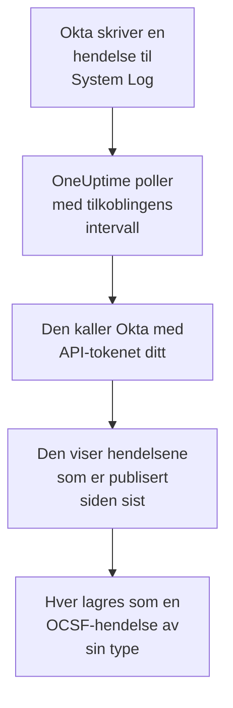

# Okta-systemlogg

Importer [Okta System Log](https://developer.okta.com/docs/reference/system-log-query/) til sikkerhetshendelsene i OneUptime: pålogginger, MFA-utfordringer, konto- og gruppeendringer og Oktas egne trusseldeteksjoner. Der søker du i dem ved siden av logger, sporinger og metrikker, korrelerer dem med alle andre kilder og varsler vakten om dem som betyr noe. OneUptime leser dem med et API-token du selv oppretter, og endrer ingenting i Okta.

:::cards
- [Sett opp tilkoblingen](#sett-opp-tilkoblingen): Et API-token og skjemaet for tilkoblingen.
- [Hva som importeres](#hva-som-importeres): Hvilke hendelser, og hvordan hver blir en sikkerhetshendelse.
- [Slik fungerer polling](#slik-fungerer-polling): Vinduet hver poll leser, og hvorfor det overlapper det forrige med 15 minutter.
- [Feilsøking](#feilsøking): Hva hver feil betyr, og hva du skal endre.
:::

## Slik fungerer det



Hvert minutt poller OneUptime hver aktiverte tilkobling der pollintervallet er gått. En poll ber Okta om System Log-hendelsene som er publisert siden forrige poll, og lagrer hver som en [OCSF](https://schema.ocsf.io/)-hendelse: en pålogging som en Authentication-hendelse, en kontoendring som en Account Change og en Okta-deteksjon som et Detection Finding. Deteksjonsregler, monitorer og dashbord behandler den deretter som en sikkerhetshendelse fra en hvilken som helst annen kilde. Det fungerer med alle Okta-celler, `okta.com`, `oktapreview.com` og `okta-emea.com`, og med en organisasjon på et eget domene.

## Før du begynner

- I OneUptime rollen Project Owner, Project Admin eller Security Admin. Security Member og Security Viewer kan se tilkoblinger og kjøringshistorikken deres, men ikke endre dem.
- En Okta-administrator som kan se System Log, for å opprette tokenet. Et token kan det administratoren kan, så bruk en Read-only Administrator: den leser System Log og endrer ingenting. En skrivebeskyttet administrator ser også brukere, grupper, apper og innstillinger, så ta like godt vare på tokenet som på et passord.
- Helst en tjenestekonto for den administratoren. Okta deaktiverer et token når administratoren deaktiveres, og når det står ubrukt i 30 dager. Pollingen bruker det med noen få minutters mellomrom, så det forblir i bruk så lenge tilkoblingen er aktivert.
- Hvis organisasjonen din bare tar imot API-kall fra en nettverkssone, en sone som inneholder adressene OneUptime kaller fra: på OneUptime Cloud de utgående adressene, og på en selvdriftet installasjon den offentlige adressen til app- og workervertene dine.

## Sett opp tilkoblingen

:::steps
### Opprett et API-token

1. Logg på **Admin Console** i Okta som den skrivebeskyttede administratoren.
2. Åpne **Security → API**, deretter fanen **Tokens**, og velg **Create token**.
3. Gi det et navn, for eksempel `OneUptime security events`. La **Any IP** stå som stedet kallene kan komme fra, med mindre organisasjonen din trenger en sone.
4. Velg **Create token**, og kopier **Token Value**. Okta viser den bare én gang.

Hvert token kan bruke en andel av organisasjonens API-hastighetsgrense, som raden i fanen **Tokens** viser. En poll gjør høyst 20 forespørsler, så standardandelen er mer enn nok, med mindre andre verktøy bruker det samme tokenet.

### Legg til tilkoblingen i OneUptime

Åpne **Produkter → Security Events → Tilkoblinger** (`/dashboard/{projectId}/security-events/connections`), klikk på **Legg til tilkobling**, velg **Okta System Log**, og klikk på **Neste**. Fyll inn innstillingene i tabellen nedenfor, klikk på **Neste**, og lim inn tokenet i **API token**.

### Test den før du lagrer

Klikk på **Test disse innstillingene** under **Test før du lagrer**. Testen logger på og leser hendelser med verdiene i skjemaet og lagrer ingenting, så en feil URL eller et ugyldig filter viser seg før tilkoblingen finnes. Klikk deretter på **Neste**, gi tilkoblingen et **Navn**, og opprett den.
:::

| Innstilling | Hva du skal skrive inn |
| --- | --- |
| **Okta organization URL** | Adressen brukerne dine logger på hos, for eksempel `https://acme.okta.com`, `https://acme.oktapreview.com` eller `https://login.example.com`. Den må bruke `https`, uten bane. Ikke `-admin`-adressen til Admin Console, som ikke tilbyr API-et. |
| **Event filter** | Valgfritt. Et [System Log-filter](https://developer.okta.com/docs/reference/core-okta-api/#filter) som velger hendelsene som skal importeres, for eksempel `eventType sw "user.session" or eventType sw "security"`. Tomt importerer familiene nedenfor. Høyst 2 000 tegn, på én linje, og ikke på `published`: OneUptime setter tidsrommet selv. |
| **API token** | Verdien til tokenet, alene: OneUptime legger selv til skjemaet `SSWS`. Den krypteres, returneres aldri av API-et og vises aldri igjen. Erstatt den med **Oppdater påloggingsinformasjon** på tilkoblingen. |

Trinnet **Henting** har også en valgfri **Beskrivelse**, **Henteintervall (minutter)**, et heltall fra `1` til `1440` som starter på `5`, og **Aktivert**, som starter slått på.

## Hva som importeres

Uten **Event filter** importerer OneUptime hendelsesfamiliene et sikkerhetsteam følger med på, etter `eventType`-prefiks. Et eget filter erstatter denne listen i stedet for å legge til i den:

| Prefiks | Hendelser |
| --- | --- |
| `user.session` | Pålogginger og avlogginger, tilgang til Admin Console, etterligning |
| `user.authentication` | Autentiseringsresultater, inkludert single sign-on |
| `user.mfa` | Registrering, utfordringer og tilbakestillinger av faktorer |
| `user.account` | Passordendringer og -tilbakestillinger, sperringer, profil- og rettighetsendringer |
| `user.lifecycle` | Brukere som er opprettet, aktivert, suspendert, deaktivert og slettet |
| `security.` | ThreatInsight, rapporter om mistenkelig aktivitet og Oktas andre deteksjoner |
| `policy.` | Evalueringer av påloggingspolicyer og policyendringer |
| `system.api_token` | API-tokener som er opprettet og tilbakekalt |
| `application.user_membership` | Apptildelinger |
| `group.user_membership` | Endringer i gruppemedlemskap |

Hver hendelse blir én OCSF-hendelse med leverandøren `Okta` og produktet `Okta System Log`, av klassen som `eventType` krever:

| `eventType` | OCSF-klasse | Aktivitet |
| --- | --- | --- |
| `user.session.start` | Authentication (`3002`) | `Logon` |
| `user.session.end` | Authentication (`3002`) | `Logoff` |
| `user.authentication.*` | Authentication (`3002`) | `Logon` |
| `user.mfa.*` | Authentication (`3002`) | `Authentication Ticket` |
| Andre `user.session.*`-hendelser | Authentication (`3002`) | `Other` |
| `user.account.*`, `user.lifecycle.*` | Account Change (`3001`) | Den siste delen av hendelsestypen, for eksempel `Update Password` |
| `group.*` | Group Management (`3006`) | Den siste delen av hendelsestypen, for eksempel `Add` |
| `security.*`, og en `policy.evaluate_sign_on` som nektet tilgang | Detection Finding (`2004`) | `Create`, med hendelsestypen som regelnavn |
| Alt annet | `0`, oppkalt etter hendelsestypen | Den siste delen av hendelsestypen |

En hendelse som ikke hører til noen av disse klassene, beholder likevel hvert felt og er fortsatt søkbar etter hvert av dem. Hver hendelse fyller disse kolonnene:

| Okta-felt | OneUptime-kolonne |
| --- | --- |
| `uuid` | Hendelses-UID, som også duplikater fjernes etter |
| `published`, når hendelsen skjedde | Tidspunktet for hendelsen |
| `displayMessage`, ellers hendelsestypen og `outcome.reason` | Melding |
| `severity`: `DEBUG` og `INFO` er Informational, `WARN` Medium, `ERROR` High | Alvorlighetsgrad |
| `outcome.result`, for eksempel `SUCCESS`, `FAILURE`, `ALLOW` eller `DENY` | Status |
| `actor.alternateId`, ellers `actor.displayName`; `client.ipAddress` | Aktørens bruker og IP |
| `alternateId` for `User` i `target` | Målbruker |
| `alternateId` for `AppInstance` i `target` | Målressurs |
| Aktøren, hvert mål og IP-en til klienten | Observables |
| Hele hendelsen, flatet ut til nøkler med punktum, for eksempel `client.userAgent.browser` og `debugContext.debugData.requestUri` | `attributes` |

En mislykket eller nektet pålogging på `INFO` heves til Low, slik at den skiller seg ut fra en vellykket. System Log inneholder ingen MITRE ATT&CK-referanser, så de kolonnene forblir tomme.

## Slik fungerer polling

Hver poll viser hendelsene som er publisert i vinduet, de eldste først, 1 000 per side, og følger `next`-lenken Okta sender, frem til den siste siden:

```text
GET {Okta organization URL}/api/v1/logs?since={window start}&until={window end}&sortOrder=ASCENDING&limit=1000&filter={Event filter}
```

- **Publiseringstidspunktet er markøren.** En System Log-hendelse er selve aktiviteten, så `published` er både når den skjedde og det pollingen leser.
- **Den første pollen ser 24 timer tilbake**, slik at en ny tilkobling viser de nylige hendelsene sine med en gang.
- **Hver senere poll starter 15 minutter før den lagrede markøren.** Okta advarer om at en forespørsel med et sluttidspunkt kan utelate forsinkede hendelser, noe Okta kaller sjeldent. Overlappingen leser dem ved neste poll. En hendelse som er forsinket mer enn 15 minutter, kan havne bak markøren: importer tidsrommet for å hente den.
- **En poll leser høyst 24 timer forbi markøren.** En tilkobling der markøren har kommet på etterskudd, tar igjen i en rekke vinduer på 24 timer, og **Helse** viser **Catching up**.
- **Duplikater fjernes etter `uuid`** i prosjektet, slik at overlappingen, et gjentatt vindu og en import aldri lagrer en hendelse to ganger.

En `next`-lenke som peker et annet sted enn din **Okta organization URL**, følges aldri, siden tokenet sendes med hver forespørsel.

### Når et vindu inneholder mer enn én poll kan lese

En poll leser høyst 10 000 hendelser, i høyst 20 forespørsler. Når et vindu inneholder flere, er kjøringen **Delvis**, med en advarsel som:

```text
Stopped after collecting 10000 events; the window holds more. The last event read was published at 2026-09-14T08:12:44.000Z.
```

Hendelser leses de eldste først, så OneUptime flytter markøren til publiseringstidspunktet for den sist leste hendelsen, og den neste pollen starter der, uten overlappingen på 15 minutter, med samme vinduslengde. En travel organisasjon tar igjen 10 000 hendelser per poll i stedet for å lese de samme på nytt. Overlappingen kommer tilbake når markøren har flyttet seg 15 minutter forbi det punktet.

Når en kjøring ikke kommer forbi den lagrede markøren i det hele tatt, for eksempel fordi de 15 minuttene med overlapping alene inneholder mer enn 10 000 hendelser, gjør OneUptime i stedet vinduet kortere:

1. **Snevre inn.** Den neste pollen leser et vindu som er halvparten så langt, fra det samme startpunktet, og fortsetter å halvere til et vindu leses helt, ned til ett minutt. Kjøringens advarsel sier det: `This window holds more records than one poll can read; the next poll reads a {n} minute window from the same starting point.`
2. **Vokse igjen.** Når et vindu er lest helt, er det neste igjen dobbelt så langt, opptil 24 timer.
3. **Gå forbi ett enkelt minutt.** Hvis selv ett minutt inneholder mer enn en poll kan lese, går pollingen forbi det, slik at nyere hendelser fortsetter å komme, og overlappingen til senere poller når ikke lenger tilbake til det. Kjøringen forblir **Delvis**, og **Siste feil** lyder `More records were created in the one minute from {cursor} to {end} than one poll can read. Polling moved past this minute so newer records keep arriving; use Import this time range in Diagnostics on this minute to recover what one run can read.` Importer det minuttet med **Import this time range** for å hente det én kjøring kan lese, eller snevre inn **Event filter**.

En kjøring som mislykkes helt, med en feil fra Okta, beholder markøren og vinduslengden, og den neste pollen leser det samme vinduet på nytt. Det eneste unntaket er en forespørsel som fikk tidsavbrudd: markøren blir stående, men det neste vinduet er halvparten så langt, fordi et vindu som er for tungt til å bli besvart i tide, ville fått tidsavbrudd ved hvert forsøk. Å endre **Henteintervall (minutter)** endrer ingenting av dette: det avgjør hvor ofte en poll starter, ikke hvor vinduet begynner.

### Kjør, forhåndsvis og importer ved behov

Klikk på **Diagnostikk** på en tilkobling for å se de siste kjøringene og arbeide med den manuelt. Alle som kan endre tilkoblingen, kan starte disse handlingene; alle som kan se den, kan lese historikken.

- **Kjør nå** starter en poll med en gang, med den vanlige markøren, også når tilkoblingen ikke er **Aktivert**.
- **Preview log events** leser et tidsrom på opptil 7 dager og importerer ingenting.
- **Import this time range** importerer et tidsrom på opptil 7 dager, etter at du har bekreftet, uten å flytte markøren. Hendelser som allerede er importert, hoppes over. Okta beholder 90 dager med System Log.
- **Copy diagnostics** på en kjøring kopierer rapporten for brukerstøtte. Den inneholder aldri legitimasjon.

## Test tilkoblingen

**Test tilkoblingen** på raden til en tilkobling og **Test disse innstillingene** i skjemaet kjører i API-prosessen, ikke i en bakgrunnsworker, slik at en test også svarer når det er workerne som er problemet. Den kjører disse kontrollene i rekkefølge:

| Kontroll | Hva den kontrollerer |
| --- | --- |
| **Konfigurasjon** | Hver innstilling er til stede og riktig formatert. Ingenting kontaktes når dette mislykkes. |
| **Authenticate with Okta** | Okta godtar tokenet for System Log, med én hendelse lest og uten filter. |
| **Read System Log events** | Én hendelse fra de siste 24 timene kan leses gjennom filteret pollingen bruker, ditt eget eller standardfilteret, så et ugyldig **Event filter** feiler her i stedet for ved den første pollen. |
| **Events available to import** | Hvor mange hendelser som er publisert de siste 24 timene og de siste 7 dagene, én side på 1 000 for hver, så `1000+` betyr flere. Ingen på 7 dager er en advarsel, ikke en feil. |
| **Background workers**, **Poll scheduler**, **Security event storage** | OneUptimes egen side: en prosess tar jobbene fra Worker-køen, poll-jobben kjører hvert minutt, og lageret for sikkerhetshendelser svarer. |
| **Scheduled polling** | For en lagret tilkobling: polling er slått på, ingen kjøring sitter fast og venter på en worker, og poller kjører i tide. |

Hver forespørsel i en test har en frist på 20 sekunder. En test importerer aldri noe og flytter aldri markøren, og hver kontroll som mislykkes, sier hva du skal endre.

## Feilsøking

**Siste feil** for tilkoblingen lagrer hele feilmeldingen, med legitimasjon maskert, bak et prefiks som navngir trinnet som mislyktes. Når en tilkobling har en feil, velger du **Vis feil** i kolonnen **Handlinger** for å lese den, og **Kopier feil** i dialogen for å kopiere den. Hver melding starter med `Okta System Log events request` og siterer Oktas egen feilkode etter statusen; les det som følger.

:::details Last Error sier `failed (HTTP 400)`
Okta avviste parameterne i forespørselen, `E0000053`. Når tokenet fungerte, er det nesten alltid **Event filter**: kontroller operatorene, `eq`, `ne`, `co`, `sw`, `ew`, `pr`, `gt`, `ge`, `lt` og `le`, `and` og `or`, og de doble anførselstegnene rundt verdiene, eller tøm det for å bruke standardfamiliene. Ved en import kan det også bety at tidsrommet starter for mer enn 180 dager siden.
:::

:::details Last Error sier `failed (HTTP 401)` eller `failed (HTTP 403)`
- `HTTP 401`: Okta godtok ikke tokenet, `E0000011`. Det er tilbakekalt, har stått ubrukt i 30 dager eller er deaktivert sammen med administratoren; eller det er limt inn med `SSWS` eller et ekstra tegn. Opprett et nytt token som skrivebeskyttet administrator, og lagre det med **Oppdater påloggingsinformasjon**.
- `HTTP 403`: tokenet logger på, men administratoren kan ikke lese System Log, `E0000006`. Opprett det som Read-only Administrator eller Super Administrator, og kontroller at nettverkssonen tillater adressene OneUptime kaller fra.
:::

:::details Last Error sier `failed (HTTP ...)` med en annen status
- `HTTP 404`: URL-en tilbyr ikke API-et til Okta. Bruk organisasjonens egen adresse, for eksempel `https://acme.okta.com`, uten bane og ikke `-admin`-adressen.
- `HTTP 3xx`: Okta omdirigerte forespørselen, og omdirigeringer avvises, siden tokenet sendes med hver forespørsel. Bruk organisasjonens egen adresse.
- `HTTP 429`: Okta begrenser tokenet, `E0000047`. Den neste pollen prøver igjen. Hvis det fortsetter, øker du tokenets andel av hastighetsgrensen i fanen **Tokens**, gir OneUptime et eget token eller poller sjeldnere.
- `HTTP 5xx`: Okta feilet, eller spørringen gikk over Oktas grense på 30 sekunder, `E0000009`. Den neste pollen prøver igjen; hvis det fortsetter, sjekk [status.okta.com](https://status.okta.com).
:::

:::details Last Error sier `returned` eller `did not complete`
- `returned a non-JSON body.` eller `returned an unrecognized response shape`: noe annet enn API-et til Okta svarte, for eksempel en påloggingsside eller en proxy, eller Okta svarte med en feil. Det rapporteres i stedet for å bli tatt som et tomt vindu, slik at markøren aldri flytter seg forbi hendelser som ingen har lest.
- `returned a next link outside the Okta organization URL`: en `next`-lenke pekte et annet sted, og ble ikke fulgt. Okta selv gjør aldri dette: se etter en proxy som skriver om headere.
- `did not complete`: forespørselen fikk ikke noe svar: et tidsavbrudd, et navn som ikke kan slås opp, et sertifikat OneUptime ikke stoler på, eller en avvist adresse. Kontroller at OneUptime-appen og -workerne kan nå organisasjonen din over HTTPS, gjennom proxyen du eventuelt bruker.
:::

:::details Last Polled er Never og Last Error er tom
Ingen poll er fullført for denne tilkoblingen. Kjør **Test tilkoblingen**: kontrollene **Background workers** og **Poll scheduler** navngir årsaken. På en selvdriftet installasjon er den vanlige årsaken `DISABLE_QUEUE_WORKERS=true` på appen, uten en separat worker-utrulling som tar jobbene: sett den til `false`, eller kjør worker-utrullingen (Helm: `worker.enabled: true`).
:::

:::details En kjøring er Partial
- `Stopped after collecting 10000 events`: vinduet inneholdt mer enn de 10 000 hendelsene én kjøring leser. Ingenting går tapt: den neste pollen starter etter den sist leste hendelsen. En tilkobling som forblir **Delvis** poll etter poll, er i ferd med å ta igjen et etterslep, og **Sist hentet** og **Siste importerte hendelse** fortsetter å gå fremover. Hvis den aldri tar igjen, publiserer organisasjonen flere samsvarende hendelser enn et pollintervall kan romme: snevre inn **Event filter**, eller gjør **Henteintervall (minutter)** kortere.
- `More records were created in the one minute from ... than one poll can read`: pollingen gikk forbi det minuttet. Importer det med **Import this time range** i **Diagnostikk**. En import leser like mye som en poll.
:::

:::details Testen lykkes, men ingenting importeres
Les **Events available to import** i rapporten fra testen. Med standardfilteret publiserer en organisasjon med brukere pålogginger hele tiden, så `0` de siste 7 dagene betyr at URL-en er en sandkasse eller en ubrukt organisasjon. Med ditt eget **Event filter** betyr det at filteret ikke fant noe: sammenlign det med hendelsestypene i System Log i Admin Console.
:::

## Hva du får

- **Søk.** Filtrer pålogginger, MFA-resultater, kontoendringer og Okta-deteksjoner etter alvorlighetsgrad, status, bruker, IP eller en hvilken som helst observable i utforskeren for sikkerhetshendelser, ved siden av alle andre kilder.
- **Korrelasjon.** Brukerne, appene og IP-ene i hver hendelse indekseres som observables, så ett søk finner alt én bruker gjorde, ved siden av appens egne logger.
- **Deteksjonsregler.** Sigma-regler som kjører etter en tidsplan over sikkerhetshendelsene dine, for eksempel mislykkede pålogginger per IP eller MFA-avslag per bruker, og åpner varsler som varsler vakten.
- **Monitorer.** Monitorer for sikkerhetshendelser teller samsvarende hendelser og åpner hendelser eller varsler over en terskel.

Sikkerhetshendelser faktureres som resten av telemetrien din, per innhentet GB. Se [Priser](https://oneuptime.com/pricing).

## Neste trinn

:::cards
- [Sikkerhetshendelser](/docs/telemetry/security-events): Søk, korreler og varsle på det du importerer.
- [AWS Security Hub](/docs/integrations/aws-security-hub): Importer også funnene fra skyen din.
- [Roller](/docs/permissions/reference#roller): Hva Security-rollene kan se og endre.
- [Oversikt over integrasjoner](/docs/integrations/index): De andre verktøyene du kan koble til.
:::
