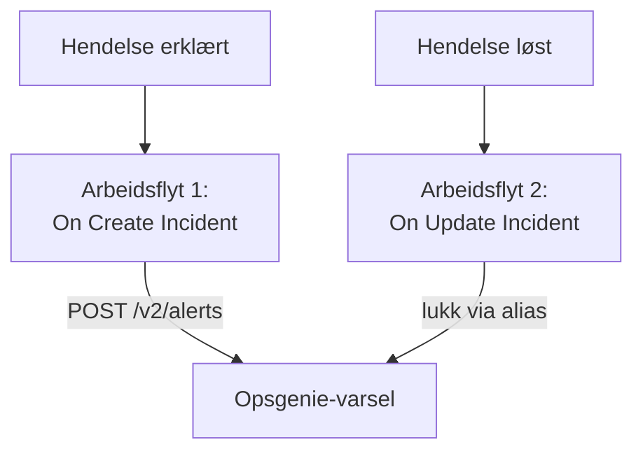

# Opsgenie

Send OneUptime-hendelser til [Opsgenie](https://www.atlassian.com/software/opsgenie). Én arbeidsflyt oppretter et Opsgenie-varsel når en OneUptime-hendelse erklæres, og en annen lukker det når OneUptime-hendelsen er løst. Bruk dette så lenge Opsgenie fortsatt varsler teamet ditt og OneUptime overvåker systemene dine.

:::cards
- [Lagre API-nøkkelen](#lagre-api-nøkkelen): Hold Opsgenies nøkkel utenfor arbeidsflytene dine.
- [Opprett Opsgenie-varsler](#opprett-et-opsgenie-varsel-for-hver-hendelse): Én arbeidsflyt, to blokker.
- [Lukk dem](#lukk-opsgenie-varselet): En annen arbeidsflyt som følger hendelsens tilstand.
- [Feilsøking](#feilsøking): Når Opsgenie avviser en forespørsel.
:::

> [!IMPORTANT]
> Atlassian sluttet å selge Opsgenie i juni 2025 og avslutter støtten i april 2027. OneUptime varsler også folk, med vaktretningslinjer, vaktplaner og eskaleringsregler. For å flytte teamet ditt over, se [Bytt fra Opsgenie](/docs/moving-to-oneuptime/opsgenie): en import henter over brukerne, teamene, vaktplanene og eskaleringene dine.

## Slik fungerer det



Begge arbeidsflytene kaller [Opsgenie Alert API](https://docs.opsgenie.com/docs/alert-api). Den første gir varselet et `alias` laget av OneUptime-hendelsens ID, og den andre lukker varselet via det aliaset.

## Før du begynner

- En Opsgenie-integrasjon av typen **API** og dens **API Key**. Legg til en under **Settings → Integrations** i Opsgenie, eller under et teams **Integrations** for å sende varsler til det teamet.
- Opsgenie-regionen din. Kontoer i Europa, som logger på `app.eu.opsgenie.com`, bruker `api.eu.opsgenie.com`. Alle andre bruker `api.opsgenie.com`.
- I OneUptime tilgang til å opprette arbeidsflyter og globale variabler. På OneUptime Cloud krever arbeidsflyter **Growth**-abonnementet eller høyere.

## Lagre API-nøkkelen

:::steps
1. Gå til **Arbeidsflyter → Globale variabler**, og klikk på **Opprett Workflow Variabel**.
2. Gi den navnet `OPSGENIE_KEY`, og klikk på **Neste**.
3. Lim inn API-nøkkelen i **Innhold**, slå på **Hemmelighet**, og klikk på **Opprett Workflow Variabel**.
:::

En hemmelig variabel erstattes med `[REDACTED]` i kjøringslogger, så nøkkelen vises aldri i en kjøring.

## Opprett et Opsgenie-varsel for hver hendelse

:::steps
### Opprett arbeidsflyten

Gå til **Arbeidsflyter**, klikk på **Opprett arbeidsflyt** og deretter på **Start fra bunnen**. Gi den navnet `Incidents to Opsgenie`, og klikk på **Opprett arbeidsflyt**.

### Legg til triggeren

Klikk på den stiplede blokken **Velg hva som starter denne arbeidsflyten**, og velg **On Create Incident**. Klikk på triggeren: **Fields to pass on** starter med **Tittel**, så klikk på **Legg til felt**, og velg **Beskrivelse**.

### Opprett varselet

Klikk på **Legg til komponent**, legg til en **API Post (JSON)**-blokk, og koble triggerens **Success**-punkt til den. Sett **URL** til `https://api.opsgenie.com/v2/alerts`, eller `https://api.eu.opsgenie.com/v2/alerts` i Europa. Sett **Request Headers** under **Flere felt** til:

```json
{ "Authorization": "GenieKey {{global.variables.OPSGENIE_KEY}}" }
```

Og **Request Body** til:

```json
{
  "message": "{{local.components.incident-on-create-1.returnValues.model.title}}",
  "alias": "oneuptime-{{local.components.incident-on-create-1.returnValues.model._id}}",
  "description": "{{local.components.incident-on-create-1.returnValues.model.description}}",
  "priority": "P1",
  "source": "OneUptime"
}
```

### Test den, og slå den deretter på

Klikk på **Kjør arbeidsflyt**, velg en testhendelse under **Hendelse**, og kjør den. Trinnet **API Post (JSON)** viser et `202`-svar, og varselet dukker opp i Opsgenie et øyeblikk senere. Slå deretter på **Aktivert** øverst i **Bygger**.
:::

Opsgenies skjema er ordet `GenieKey`, et mellomrom og deretter nøkkelen. Opsgenie begrenser `message` til 130 tegn, og prioritetene går fra `P1` til `P5`: se [Knytt prioriteter til Opsgenie](#knytt-prioriteter-til-opsgenie) for å sende hver hendelses egen.

## Lukk Opsgenie-varselet

En arbeidsflyt har én trigger, så det trengs en annen arbeidsflyt for å lukke det, startet når en hendelses tilstand endres.

:::steps
### Legg til triggeren On Update Incident

Opprett en arbeidsflyt som heter `Close Opsgenie alerts`, og velg **On Update Incident** som trigger. Klikk på **Legg til felt** i **Fields to watch**, og velg **Current Incident State**, slik at den bare kjører når tilstanden endres. Spør i **Fields to pass on** om den nye tilstanden er en løst tilstand: klikk på **Legg til felt**, åpne **Current Incident State**, og velg **Is Resolved State**. Eller klikk på **Rediger som JSON**, og erstatt JSON-en med:

```json
{ "_id": true, "currentIncidentState": { "isResolvedState": true } }
```

### Sjekk at hendelsen er løst

Legg til en **If / Else**-blokk etter triggeren. Sett **Value to check** til `{{local.components.incident-on-update-1.returnValues.model.currentIncidentState.isResolvedState}}` og **Comparison** til **is true**.

### Lukk varselet

Legg til en **API Post (JSON)**-blokk etter **Yes**-siden, med de samme **Request Headers** og denne **URL**:

```text
https://api.opsgenie.com/v2/alerts/oneuptime-{{local.components.incident-on-update-1.returnValues.model._id}}/close?identifierType=alias
```

Sett **Request Body** til `{ "source": "OneUptime", "note": "Resolved in OneUptime" }`.

### Slå den på

Slå på **Aktivert**, og løs deretter en testhendelse i OneUptime. Opsgenie lukker varselet sitt.
:::

`identifierType=alias` forteller Opsgenie at adressen angir varselet med aliaset, ikke med sin egen ID.

## Knytt prioriteter til Opsgenie

For å sende hver hendelses alvorlighetsgrad som en Opsgenie-prioritet legger du til en **Run Custom JavaScript**-blokk mellom triggeren og **API Post (JSON)**-blokken.

1. Klikk på **Legg til felt** i triggerens **Fields to pass on**, åpne **Hendelsesalvor**, og velg **Navn**.
2. Sett blokkens **Arguments** til `{ "severity": "{{local.components.incident-on-create-1.returnValues.model.incidentSeverity.name}}" }` og **JavaScript Code** til:

   ```javascript
   // Your incident severities, by name, to Opsgenie's priorities.
   const PRIORITY = {
     "Critical Incident": "P1",
     "Major Incident": "P2",
     "Minor Incident": "P3",
   };

   return { priority: PRIORITY[args.severity] || "P3" };
   ```

3. Sett `"priority"` i forespørselens innhold til `"{{local.components.javascript-1.returnValues.returnValue.priority}}"`.

Navnene ovenfor er de tre alvorlighetsgradene et nytt prosjekt starter med. Bruk dine egne hvis du har gitt dem nye navn.

## Feilsøking

:::details Opsgenie svarer 401 eller 403
Nøkkelen er feil, eller den hører til den andre regionen. Sjekk at overskriften inneholder `GenieKey`, et mellomrom og nøkkelen, at nøkkelen tilhører en **API**-integrasjon, og at verten passer til regionen din: `api.opsgenie.com` eller `api.eu.opsgenie.com`.
:::

:::details Lukkingen svarer 404
Ingen varsler har det aliaset. Begge arbeidsflytene må lage aliaset på samme måte, `oneuptime-` etterfulgt av hendelsens `_id`, og URL-en må slutte på `?identifierType=alias`.
:::

:::details Varselet dukker aldri opp, selv om trinnet viser 202
Opsgenie svarer `202` før den behandler forespørselen, så en forespørsel den avviser senere, viser likevel `202`. Finn forespørselen i Opsgenies logger for å se hvorfor den ble avvist, for eksempel en integrasjon som er slått av.
:::

:::details Arbeidsflyten kjører aldri
Sjekk at den er slått på: **Aktivert**, øverst i dens **Bygger**. Åpne deretter **Logger → Kjøringer**: en kjøring som tok **No**-siden av **If / Else**-blokken, er en oppdatering som ikke var en løsning.
:::

## Neste trinn

:::cards
- [Bytt fra Opsgenie](/docs/moving-to-oneuptime/opsgenie): Hent over teamet ditt, vaktplanene og eskaleringene før Opsgenie avsluttes.
- [Eskaleringsregler](/docs/on-call/escalation-rules): Varsle folk fra OneUptime selv.
- [PagerDuty](/docs/integrations/pagerduty): De samme to arbeidsflytene for PagerDuty.
- [Oversikt over integrasjoner](/docs/integrations/index): Mønstrene bak hver integrasjon.
:::
