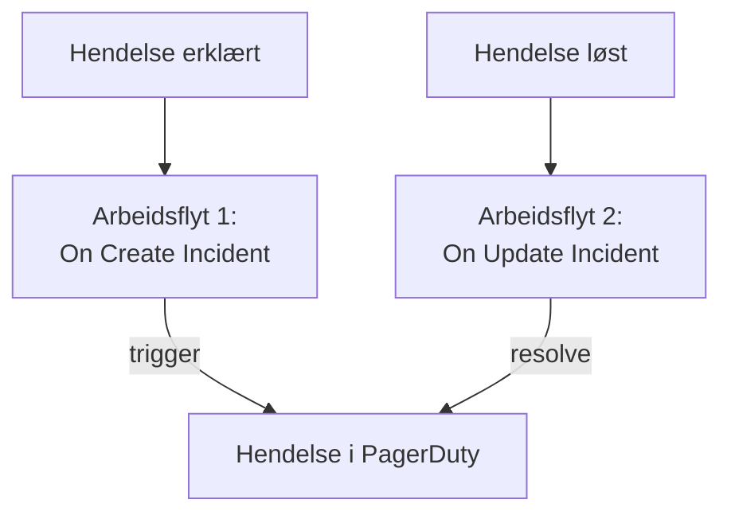

# PagerDuty

Send OneUptime-hendelser til [PagerDuty](https://www.pagerduty.com). Én arbeidsflyt utløser en hendelse i PagerDuty når en OneUptime-hendelse erklæres, og en annen løser den når OneUptime-hendelsen er løst. Bruk dette når PagerDuty varsler teamet ditt og OneUptime overvåker systemene dine.

:::cards
- [Lagre routing key-en](#lagre-routing-key-en): Hold PagerDutys nøkkel utenfor arbeidsflytene dine.
- [Utløs hendelser i PagerDuty](#utløs-en-hendelse-i-pagerduty-for-hver-hendelse): Én arbeidsflyt, to blokker.
- [Løs dem](#løs-hendelsen-i-pagerduty): En annen arbeidsflyt som følger hendelsens tilstand.
- [Feilsøking](#feilsøking): Når PagerDuty avviser en hendelse.
:::

> [!TIP]
> OneUptime varsler også folk, med vaktretningslinjer, vaktplaner og eskaleringsregler. For å flytte teamet ditt bort fra PagerDuty, se [Bytt fra PagerDuty](/docs/moving-to-oneuptime/pagerduty): en import henter over brukerne, vaktplanene og eskaleringsretningslinjene dine.

## Slik fungerer det



Begge arbeidsflytene kaller PagerDutys [Events API v2](https://developer.pagerduty.com/docs/events-api-v2/overview/) med den samme `dedup_key`, laget av OneUptime-hendelsens ID. Det er den nøkkelen som forteller PagerDuty at resolve-hendelsen lukker hendelsen som trigger-hendelsen åpnet.

## Før du begynner

- En PagerDuty-tjeneste med en Events API v2-integrasjon. Åpne tjenesten i PagerDuty, deretter **Integrations**, klikk på **Add an integration**, og velg **Events API V2**. Kopier **Integration Key**: Events API kaller den routing key.
- I OneUptime tilgang til å opprette arbeidsflyter og globale variabler. På OneUptime Cloud krever arbeidsflyter **Growth**-abonnementet eller høyere.

## Lagre routing key-en

:::steps
1. Gå til **Arbeidsflyter → Globale variabler**, og klikk på **Opprett Workflow Variabel**.
2. Gi den navnet `PAGERDUTY_ROUTING_KEY`, og klikk på **Neste**.
3. Lim inn integrasjonsnøkkelen i **Innhold**, slå på **Hemmelighet**, og klikk på **Opprett Workflow Variabel**.
:::

En hemmelig variabel erstattes med `[REDACTED]` i kjøringslogger, så nøkkelen vises aldri i en kjøring.

## Utløs en hendelse i PagerDuty for hver hendelse

:::steps
### Opprett arbeidsflyten

Gå til **Arbeidsflyter**, klikk på **Opprett arbeidsflyt** og deretter på **Start fra bunnen**. Gi den navnet `Incidents to PagerDuty`, og klikk på **Opprett arbeidsflyt**.

### Legg til triggeren

Klikk på den stiplede blokken **Velg hva som starter denne arbeidsflyten**, og velg **On Create Incident**. Klikk på triggeren: **Fields to pass on** starter med **Tittel**, så klikk på **Legg til felt**, og velg **Beskrivelse**.

### Send trigger-hendelsen

Klikk på **Legg til komponent**, legg til en **API Post (JSON)**-blokk, og koble triggerens **Success**-punkt til den. Sett **URL** til `https://events.pagerduty.com/v2/enqueue` og **Request Body** til:

```json
{
  "routing_key": "{{global.variables.PAGERDUTY_ROUTING_KEY}}",
  "event_action": "trigger",
  "dedup_key": "oneuptime-{{local.components.incident-on-create-1.returnValues.model._id}}",
  "payload": {
    "summary": "{{local.components.incident-on-create-1.returnValues.model.title}}",
    "source": "OneUptime",
    "severity": "critical",
    "custom_details": {
      "description": "{{local.components.incident-on-create-1.returnValues.model.description}}"
    }
  }
}
```

### Test den, og slå den deretter på

Klikk på **Kjør arbeidsflyt**, velg en testhendelse under **Hendelse**, og kjør den. Trinnet **API Post (JSON)** viser et `202`-svar med `"status": "success"`, og PagerDuty oppretter en hendelse. Slå deretter på **Aktivert** øverst i **Bygger**.
:::

Blokken sender JSON, så den trenger ingen `Content-Type`-overskrift. PagerDutys `severity` er en av `critical`, `error`, `warning` og `info`: se [Knytt alvorlighetsgrader til PagerDuty](#knytt-alvorlighetsgrader-til-pagerduty) for å sende hver hendelses egen.

## Løs hendelsen i PagerDuty

En arbeidsflyt har én trigger, så det trengs en annen arbeidsflyt for å løse den, startet når en hendelses tilstand endres.

:::steps
### Legg til triggeren On Update Incident

Opprett en arbeidsflyt som heter `Resolve PagerDuty incidents`, og velg **On Update Incident** som trigger. Klikk på **Legg til felt** i **Fields to watch**, og velg **Current Incident State**, slik at den bare kjører når tilstanden endres. Spør i **Fields to pass on** om den nye tilstanden er en løst tilstand: klikk på **Legg til felt**, åpne **Current Incident State**, og velg **Is Resolved State**. Eller klikk på **Rediger som JSON**, og erstatt JSON-en med:

```json
{ "_id": true, "currentIncidentState": { "isResolvedState": true } }
```

### Sjekk at hendelsen er løst

Legg til en **If / Else**-blokk etter triggeren. Sett **Value to check** til `{{local.components.incident-on-update-1.returnValues.model.currentIncidentState.isResolvedState}}` og **Comparison** til **is true**.

### Send resolve-hendelsen

Legg til en **API Post (JSON)**-blokk etter **Yes**-siden, med samme **URL** og denne **Request Body**:

```json
{
  "routing_key": "{{global.variables.PAGERDUTY_ROUTING_KEY}}",
  "event_action": "resolve",
  "dedup_key": "oneuptime-{{local.components.incident-on-update-1.returnValues.model._id}}"
}
```

### Slå den på

Slå på **Aktivert**, og løs deretter en testhendelse i OneUptime. PagerDuty løser sin hendelse.
:::

Å sjekke `isResolvedState` i stedet for navnet på en tilstand fortsetter å virke når du gir nytt navn til tilstandene dine. Se [Hendelsestilstander og alvorlighetsgrader](/docs/incidents/states-and-severities).

## Knytt alvorlighetsgrader til PagerDuty

For å sende hver hendelses alvorlighetsgrad legger du til en **Run Custom JavaScript**-blokk mellom triggeren og **API Post (JSON)**-blokken, og leser svaret i innholdet.

1. Klikk på **Legg til felt** i triggerens **Fields to pass on**, åpne **Hendelsesalvor**, og velg **Navn**.
2. Sett blokkens **Arguments** til `{ "severity": "{{local.components.incident-on-create-1.returnValues.model.incidentSeverity.name}}" }` og **JavaScript Code** til:

   ```javascript
   // Your incident severities, by name, to PagerDuty's.
   const SEVERITY = {
     "Critical Incident": "critical",
     "Major Incident": "error",
     "Minor Incident": "warning",
   };

   return { severity: SEVERITY[args.severity] || "info" };
   ```

3. Sett `"severity"` i forespørselens innhold til `"{{local.components.javascript-1.returnValues.returnValue.severity}}"`.

Navnene ovenfor er de tre alvorlighetsgradene et nytt prosjekt starter med. Bruk dine egne hvis du har gitt dem nye navn.

## Feilsøking

:::details PagerDuty svarer 400
Svarets innhold sier hva PagerDuty avviste, og kjøringens **API Post (JSON)**-trinn viser det. Som regel er routing key-en ikke en Events API v2-integrasjonsnøkkel: kopier den på nytt fra tjenestens **Integrations**. En hendelse uten `summary`, `source` eller `severity` avvises også.
:::

:::details Resolve-hendelsen lukker ingenting
Begge hendelsene må ha nøyaktig den samme `dedup_key`. Sjekk at begge innholdene lager den som `oneuptime-` etterfulgt av hendelsens `_id`, og at resolve-arbeidsflyten er slått på.
:::

:::details Arbeidsflyten kjører aldri
Sjekk at den er slått på: **Aktivert**, øverst i dens **Bygger**. Åpne deretter **Logger → Kjøringer**: en kjøring som tok **No**-siden av **If / Else**-blokken, er en oppdatering som ikke var en løsning.
:::

:::details PagerDuty viser en referanse i stedet for en verdi
En referanse som ikke kan løses opp, sendes slik den er skrevet, krøllparenteser og alt. Sjekk blokkens identifier, feltnavnet og variabelens navn, som skiller mellom store og små bokstaver. På kjøringens fane **Trinn** er en innstilling med en slik referanse merket med **Did not resolve**.
:::

## Neste trinn

:::cards
- [Bytt fra PagerDuty](/docs/moving-to-oneuptime/pagerduty): Hent over teamet ditt, vaktplanene og eskaleringsretningslinjene.
- [Eskaleringsregler](/docs/on-call/escalation-rules): Varsle folk fra OneUptime selv.
- [Opsgenie](/docs/integrations/opsgenie): De samme to arbeidsflytene for Opsgenie.
- [Oversikt over integrasjoner](/docs/integrations/index): Mønstrene bak hver integrasjon.
:::
