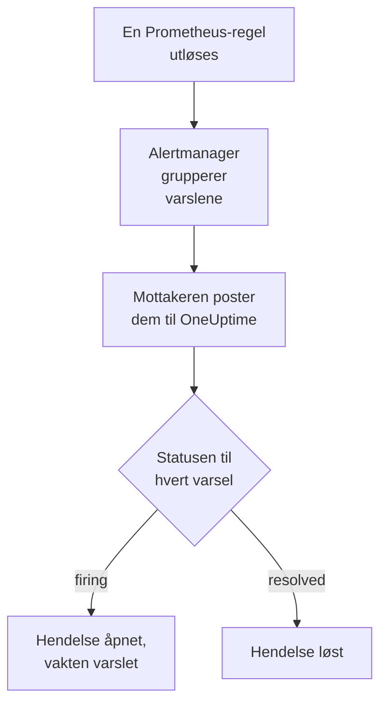

# Prometheus Alertmanager

Send varsler fra [Prometheus Alertmanager](https://prometheus.io/docs/alerting/latest/alertmanager/) til OneUptime, slik at hvert varsel som utløses, blir en hendelse som varsler vaktteamet ditt og løses når varselet er gjenopprettet. Alertmanager poster varslingene sine til en webhook-mottaker, så det er ingenting å installere på noen av sidene.

:::cards
- [Velg hvordan OneUptime mottar varsler](#velg-hvordan-oneuptime-mottar-varsler): En Incoming Request-monitor eller en egen arbeidsflyt.
- [Motta varsler med en monitor](#motta-varsler-med-en-monitor): Én hendelse per varsel, løst ved gjenoppretting.
- [Konfigurer Alertmanager](#konfigurer-alertmanager): En webhook-mottaker og ruten som bruker den.
- [Feilsøking](#feilsøking): Når varsler ikke kommer frem, eller hendelser blir stående åpne.
:::

## Slik fungerer det



Prometheus evaluerer varslingsreglene dine og sender varslene som utløses, til Alertmanager. Alertmanager grupperer dem etter etikettene i `group_by` for ruten din og poster hver gruppe til webhook-mottakeren som én JSON-varsling. Listen `alerts` i varslingen inneholder hvert varsel i gruppen, hvert med sin egen `status`, `firing` eller `resolved`, sine etiketter og annotasjoner og et `fingerprint` som identifiserer det.

## Før du begynner

- En Alertmanager der du kan redigere `alertmanager.yml`, og som kan nå OneUptime-instansen din over HTTPS.
- I OneUptime retten til å opprette monitorer, eller arbeidsflyter hvis du velger den veien.

## Velg hvordan OneUptime mottar varsler

Sett opp OneUptime først: det gir deg URL-en som Alertmanager sender til.

| Vei | Bruk den når |
| --- | --- |
| En Incoming Request-monitor (anbefalt) | Du vil at hvert varsel skal bli en hendelse som varsler vakten og løses når varselet er gjenopprettet. Det er ingenting å bygge. |
| En arbeidsflyt med en Webhook-trigger | Du trenger din egen logikk: filtrere varsler, omforme dem eller kalle andre systemer først. En arbeidsflyt åpner én hendelse per varsling, ikke per varsel, og løser den ikke ved gjenoppretting. |

Begge får den samme JSON-en fra den samme mottakeren, så du kan begynne med den ene og bytte senere ved å endre én URL i `alertmanager.yml`.

## Motta varsler med en monitor

En [Incoming Request-monitor](/docs/monitor/incoming-request-monitor) gir deg en URL, og kriteriene dens avgjør hva hver varsling gjør.

:::steps
### Opprett monitoren

Gå til **Monitorer**, og klikk på **Opprett monitor**. Velg **Incoming Request** under **Monitortype**, gi den navnet `Alertmanager`, og klikk på **Neste**.

### Erklær en hendelse for hvert utløst varsel

Åpne det første kriteriet i trinnet **Kriterier**, det som markerer monitoren som frakoblet. Sett filteret til **Forespørselstekst**, **Inneholder**, `"status":"firing"`. Dette kriteriet erklærer allerede en hendelse når filteret samsvarer. Fyll ut hendelsen:

- **Hendelsestittel**: `{{requestBody.commonLabels.alertname}} on {{requestBody.commonLabels.instance}}`.
- **Alvorlighetsgrad**: hendelsesalvorlighetsgraden disse varslene skal ha.
- **Vaktretningslinjer**, under **Vakt**: retningslinjene som skal varsles.
- **Løs hendelse automatisk**, under **Flere felt**: la den være slått på, slik den starter. Uten den ignoreres gjenopprettinger, og hendelser blir stående åpne.

### Åpne én hendelse per varsel

Åpne **Innstillinger** i det samme kriteriet, og slå på **Group incidents and alerts by a payload field**. Fyll den ut som nedenfor, slik at hvert varsel får sin egen hendelse, og gjenopprettingen løser den:

| Felt | Verdi |
| --- | --- |
| **Open a separate incident for each…** | `requestBody.alerts[*].fingerprint` |
| **Field that signals recovery** | `requestBody.alerts[*].status` |
| **Value that means recovered** | `resolved` |

### Få monitoren tilkoblet igjen

Åpne det andre kriteriet, det som markerer monitoren som tilkoblet, og sett filteret til **Forespørselstekst**, **Inneholder**, `"status":"resolved"`.

### Kopier URL-en

Klikk på **Opprett monitor**. Monitorens side **Oversikt** viser **Heartbeat URL**. Kopier den til Alertmanager:

```text
https://oneuptime.com/heartbeat/<secret key>
```

En selvdriftet installasjon har sin egen vert i stedet for `oneuptime.com`.
:::

`[*]` leser hvert varsel i en varsling, så en varsling med tre varsler kan åpne tre hendelser, opptil **Max incidents per request** (`100` med mindre du endrer det). Hvert varsels egen `status` avgjør hva som skjer med hendelsen: når ett varsel i en varsling er løst og to fortsatt er utløst, lukkes bare hendelsen til det løste varselet. Se [Motta varsler fra et annet system](/docs/monitor/incoming-request-monitor#motta-varsler-fra-et-annet-system) for hva hver innstilling gjør.

> [!WARNING]
> Grupper etter en verdi som varierer fra varsel til varsel innenfor én varsling. Alertmanagers `fingerprint` er en hash av hele etikettsettet til et varsel, så den varierer alltid. En etikett i `group_by` for ruten din varierer aldri: det er nettopp den som samler varslene i én varsling. Gruppering etter `requestBody.alerts[*].labels.alertname` med ruten nedenfor slår sammen hvert varsel i en varsling til én hendelse, som får statusen til det første varselet.

## Navngi hendelsene

Tittelen ovenfor leser etiketter som alle varslene i varslingen deler: `commonLabels` inneholder de etikettene, og `commonAnnotations` annotasjonene de deler. Med ruten nedenfor, som grupperer etter `alertname` og `instance`, er begge der. Gi hendelsen en **Hendelsesbeskrivelse** under **Beskrivelse**, for eksempel:

```text
{{requestBody.commonAnnotations.summary}}

{{requestBody.commonAnnotations.description}}
Severity: {{requestBody.commonLabels.severity}}
Alertmanager: {{requestBody.externalURL}}
```

- Grupperingsnøkkelen er også en variabel, oppkalt etter det siste segmentet i banen: `{{fingerprint}}`. Den er en hash, så den forteller ikke en responder noe.
- `{{requestBody.alerts[0].annotations.summary}}` leser det første varselet i varslingen, og det er ikke alltid varselet hendelsen ble åpnet for.
- En referanse til et felt som varslingen ikke har, blir stående slik den er skrevet, med klammeparenteser og alt, i stedet for å bli tømt.

Se [Hendelse- og varslingsmaler](/docs/monitor/incident-alert-templating) for alle variablene du kan bruke.

## Konfigurer Alertmanager

:::steps
### Legg til en webhook-mottaker

Legg til en mottaker i `alertmanager.yml` som sender til URL-en du kopierte, og gjør den til mottakeren for ruten:

```yaml title="alertmanager.yml"
route:
  receiver: oneuptime
  group_by: ["alertname", "instance"]

receivers:
  - name: oneuptime
    webhook_configs:
      - url: "https://oneuptime.com/heartbeat/<secret key>"
        send_resolved: true
```

`send_resolved: true` er Alertmanagers standard, skrevet ut slik at den forblir slått på: uten den får OneUptime aldri vite at et varsel er gjenopprettet. Alertmanager sender `Content-Type: application/json`, som monitoren trenger for å lese feltene i en varsling.

### Last inn Alertmanager på nytt

Last inn konfigurasjonen på nytt, eller start Alertmanager på nytt:

```bash
curl -X POST http://localhost:9093/-/reload
```
:::

Ruten beholder Alertmanagers standardtider. Den venter `30s` før den sender en ny gruppe (`group_wait`), `5m` før den sender en gruppe med nye varsler på nytt (`group_interval`) og `4h` før den gjentar en varsling som ikke har endret seg (`repeat_interval`).

## Test det

Send OneUptime en varsling med to utløste varsler, slik Alertmanager ville gjort:

```bash
curl -X POST "https://oneuptime.com/heartbeat/<secret key>" \
  -H "Content-Type: application/json" \
  -d '{
    "version": "4",
    "status": "firing",
    "receiver": "oneuptime",
    "groupLabels": { "alertname": "DiskFull", "instance": "web-1" },
    "commonLabels": { "alertname": "DiskFull", "instance": "web-1", "severity": "critical" },
    "commonAnnotations": { "summary": "Disk almost full on web-1" },
    "externalURL": "http://alertmanager:9093",
    "alerts": [
      {
        "status": "firing",
        "labels": { "alertname": "DiskFull", "instance": "web-1", "severity": "critical", "device": "/dev/sda1" },
        "fingerprint": "a1b2c3d4e5f60001"
      },
      {
        "status": "firing",
        "labels": { "alertname": "DiskFull", "instance": "web-1", "severity": "critical", "device": "/dev/sdb1" },
        "fingerprint": "a1b2c3d4e5f60002"
      }
    ]
  }'
```

To hendelser åpnes, én per `fingerprint`, hver med tittelen `DiskFull on web-1`. Send den samme forespørselen med hver `status` satt til `resolved`, og begge løses.

For å teste hele veien fra Alertmanager utløser du et varsel med `amtool`. Alertmanager sender det etter `group_wait` og sender deretter gjenopprettingen når varselet utløper noen minutter senere:

```bash
amtool alert add test_alert severity=warning \
  --annotation=summary="Test from Alertmanager" \
  --alertmanager.url=http://localhost:9093
```

## Motta varsler med en arbeidsflyt

Bruk en [arbeidsflyt](/docs/workflows/index) når du trenger egne trinn mellom Alertmanager og hendelsen.

:::steps
### Opprett arbeidsflyten

Gå til **Arbeidsflyter**, klikk på **Opprett arbeidsflyt** og deretter på **Start fra bunnen**. Gi den navnet `Alertmanager alerts`, og klikk på **Opprett arbeidsflyt**.

### Legg til Webhook-triggeren

Klikk på den stiplede blokken **Velg hva som starter denne arbeidsflyten**, og velg **Webhook**. Klikk på triggeren, deretter på **Kopier URL**, og bruk den URL-en i mottakeren i `alertmanager.yml`.

### Kontroller at varslingen er utløst

Klikk på **Legg til komponent**, legg til en blokk **If / Else**, og koble triggerens punkt **Out** til den. Sett **Value to check** til `{{local.components.webhook-1.returnValues.request-body.status}}`, **Comparison** til **is equal to** og **Compare with** til `firing`.

### Erklær hendelsen

Legg til en blokk **Create One Incident**, og koble siden **Yes** av blokken **If / Else** til den. Velg en mal under **Incident Template** som setter alvorlighetsgraden og vaktretningslinjene som skal varsles (se [Hendelsesmaler](/docs/incidents/settings#hendelsesmaler)). Angi under **JSON Object** hva som kommer fra Alertmanager:

```json
{
  "title": "{{local.components.webhook-1.returnValues.request-body.commonLabels.alertname}}",
  "description": "{{local.components.webhook-1.returnValues.request-body.commonAnnotations.summary}}\nAlertmanager: {{local.components.webhook-1.returnValues.request-body.externalURL}}"
}
```

Uten en mal må **JSON Object** også inneholde `incidentSeverityId`, ID-en til en av prosjektets hendelsesalvorlighetsgrader.

### Slå på arbeidsflyten

Slå på **Aktivert** øverst i **Bygger**. En arbeidsflyt som er slått av, svarer Alertmanager med `400`.
:::

En kjøring håndterer én varsling, så den erklærer én hendelse uansett hvor mange varsler varslingen inneholder. En varsling som er `resolved`, tar siden **No** av blokken **If / Else**, der ingenting er koblet til, så kjøringen slutter der. Bruk monitoren for én hendelse per varsel som løses ved gjenoppretting.

## Overvåk selve Alertmanager

Ingen av veiene merker det når Prometheus eller Alertmanager slutter å virke: å ikke få noen varsler ser akkurat ut som at alt er i orden. Send derfor et varsel som alltid er utløst, til en andre monitor, som erklærer en hendelse når det varselet slutter å komme. [kube-prometheus-stack](https://github.com/prometheus-community/helm-charts/tree/main/charts/kube-prometheus-stack) leveres med et slikt varsel, kalt `Watchdog`. På en vanlig Prometheus legger du til en varslingsregel kalt `Watchdog` der uttrykket alltid er sant, for eksempel `vector(1)`.

:::steps
### Opprett watchdog-monitoren

Opprett en andre Incoming Request-monitor, kalt `Alertmanager watchdog`. Sett filteret for det første kriteriet, det som markerer monitoren som frakoblet, til **Incoming Request**, **Not Recieved In Minutes**, `10`, og filteret for det andre kriteriet til **Incoming Request**, **Recieved In Minutes**, `10`. Dashbordet staver begge slik. Kopier **Heartbeat URL** for den nye monitoren.

### Send watchdog-varselet dit

Legg til en mottaker for URL-en til watchdog-monitoren og en rute som sender `Watchdog` dit hvert femte minutt. En underordnet rute kontrolleres før mottakeren til den overordnede ruten, så `Watchdog` går til watchdog-monitoren, og alle andre varsler går fortsatt til den første:

```yaml title="alertmanager.yml"
route:
  receiver: oneuptime
  group_by: ["alertname", "instance"]
  routes:
    - receiver: oneuptime-watchdog
      matchers:
        - alertname = "Watchdog"
      group_wait: 0s
      group_interval: 5m
      repeat_interval: 5m

receivers:
  - name: oneuptime
    webhook_configs:
      - url: "https://oneuptime.com/heartbeat/<secret key>"
        send_resolved: true
  - name: oneuptime-watchdog
    webhook_configs:
      - url: "https://oneuptime.com/heartbeat/<watchdog secret key>"
```
:::

Når watchdog-varselet ikke har kommet på ti minutter, blir watchdog-monitoren frakoblet og erklærer en hendelse. Den neste watchdog-varslingen gjør monitoren tilkoblet igjen og løser hendelsen.

## Feilsøking

:::details Ingenting kommer frem til OneUptime
- Sjekk Alertmanagers logg for feil ved levering til mottakeren.
- Monitoren svarer `200` med en gang, før den kontrollerer noe, også ved en feil hemmelig nøkkel. Sjekk monitorens tidslinje for å se om varslinger kommer frem.
- En arbeidsflyt som er slått av, svarer `400`. Slå på **Aktivert** øverst i **Bygger** for den.
:::

:::details Hendelser opprettes, men løses aldri
- Kontroller at ingen mottaker setter `send_resolved: false`: da sender Alertmanager aldri en gjenoppretting.
- Hendelsen i kriteriet trenger **Løs hendelse automatisk**, under **Flere felt**.
- **Field that signals recovery** må være `requestBody.alerts[*].status`, og **Value that means recovered** nøyaktig `resolved`. Sammenligningen skiller mellom store og små bokstaver.
- Varsler i en varsling utover **Max incidents per request** leses ikke i det hele tatt, så gjenopprettingene deres går også tapt.
- En gjenoppretting som hoppes over i et utbrudd (se nedenfor), lar hendelsen sin stå åpen for alltid: Alertmanager gjentar utløste varsler, men aldri en gjenoppretting. Løs en slik hendelse manuelt.
:::

:::details Ingen hendelse åpnes
Grupperingsbanene må begynne med `requestBody.`, og bare den første `[*]` i en bane leser en liste. En bane som bryter en av reglene, samsvarer med ingenting, uten noen feil.
:::

:::details Én hendelse for en varsling full av varsler
Du har gruppert etter en etikett som er lik for hvert varsel i en varsling, oftest en etikett fra `group_by` for ruten din. Grupper i stedet etter `requestBody.alerts[*].fingerprint`.
:::

:::details Hendelsen viser en referanse i stedet for en verdi
En referanse til et felt som varslingen ikke har, blir stående slik den er skrevet, med klammeparenteser og alt. Regler setter ulike annotasjoner, så bruk feltene reglene dine setter: i `commonAnnotations` eller i `annotations` for hvert varsel.
:::

:::details For mange hendelser
Grupper ruten din etter færre etiketter, eller øk `group_interval`, slik at Alertmanager sender relaterte varsler sammen. En lavere **Max incidents per request** begrenser hendelsene fra én varsling, men varsler utover grensen leses ikke, så gjenopprettingene deres går også tapt.
:::

:::details Varslinger hoppes over under et utbrudd
Når en nyere forespørsel når en monitor før en tidligere er evaluert, evaluerer OneUptime bare den nyeste, slik at én avsender ikke kan oversvømme en monitor. Den siste varslingen i et utbrudd evalueres alltid, men en tidligere om andre varsler kan hoppes over, fordi Alertmanager sender hver gruppe til den samme URL-en. Øk `group_wait` og `group_interval` for å spre varslingene. På en selvdriftet installasjon setter du `INCOMING_REQUEST_INGEST_COALESCE_ENABLED=false` i miljøet til OneUptime-appen for å evaluere hver forespørsel.
:::

## Sikkerhet

- **Behandle URL-en som et passord.** Alle som har den, kan åpne hendelser. Hvis den lekker, tilbakestiller du den: **Tilbakestill hemmelig nøkkel for innkommende forespørsel** på monitorens side **Innstillinger**, eller **Tilbakestill URL** i arbeidsflytens **Webhook**-trigger. Oppdater deretter mottakerens `url` i `alertmanager.yml`.
- **Selvdriftet?** La Alertmanager nå OneUptime-instansen din over HTTPS gjennom brannmuren din.

## Neste trinn

:::cards
- [Innkommende forespørsel-overvåking](/docs/monitor/incoming-request-monitor): Hver innstilling for monitoren som mottar varslene dine.
- [Grafana](/docs/integrations/grafana): Det samme oppsettet, for Grafana-varsler.
- [Eskaleringsregler](/docs/on-call/escalation-rules): Bestem hvem en vaktretningslinje varsler, og når.
- [Oversikt over integrasjoner](/docs/integrations/index): De andre verktøyene du kan koble til.
:::
