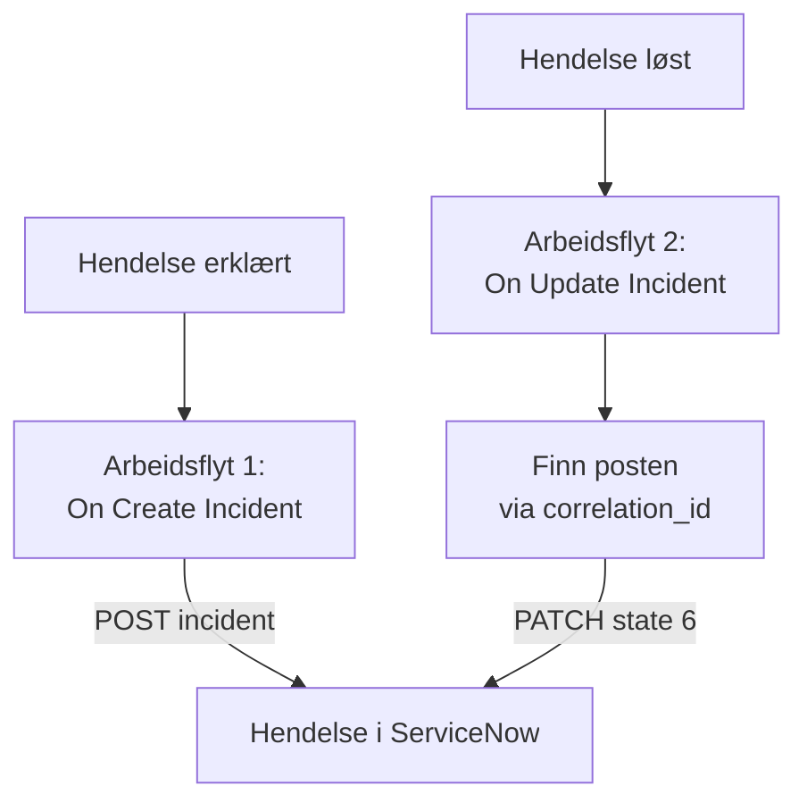

# ServiceNow

Opprett en hendelse i [ServiceNow](https://www.servicenow.com) for hver OneUptime-hendelse, og løs den når OneUptime-hendelsen er løst, slik at servicedesken din følger det overvåkingen din ser. To arbeidsflyter kaller ServiceNows [Table API](https://developer.servicenow.com/dev.do#!/reference/api/latest/rest/c_TableAPI).

:::cards
- [Lagre påloggingsinformasjonen](#lagre-påloggingsinformasjonen): Hold ServiceNow-passordet utenfor arbeidsflytene dine.
- [Opprett hendelser i ServiceNow](#opprett-en-hendelse-i-servicenow-for-hver-hendelse): Én arbeidsflyt, to blokker.
- [Løs dem](#løs-hendelsen-i-servicenow): Finn posten, og lukk den deretter.
- [Feilsøking](#feilsøking): Når ServiceNow avviser en forespørsel.
:::

## Slik fungerer det



Den første arbeidsflyten skriver OneUptime-hendelsens ID i postens `correlation_id`. Den andre finner posten via den ID-en og løser den deretter.

## Før du begynner

- En ServiceNow-instans, f.eks. `https://your-instance.service-now.com`.
- En ServiceNow-bruker for integrasjonen som kan opprette og oppdatere poster i tabellen `incident`, vanligvis med rollen `itil`. Brukerens navn og passord signerer forespørslene.
- I OneUptime tilgang til å opprette arbeidsflyter og globale variabler. På OneUptime Cloud krever arbeidsflyter **Growth**-abonnementet eller høyere.

## Lagre påloggingsinformasjonen

Table API godtar Basic-autentisering: brukerens navn og passord, kodet sammen.

:::steps
1. Kod dem én gang, på macOS eller Linux:

   ```bash
   printf '%s' 'integration.user:password' | base64 | tr -d '\n'
   ```

   Bruk `printf`, ikke `echo`: `echo` legger til et linjeskift, som kodes sammen med resten og ødelegger påloggingsinformasjonen.

2. Gå i OneUptime til **Arbeidsflyter → Globale variabler**, og klikk på **Opprett Workflow Variabel**. Gi den navnet `SERVICENOW_AUTH`, og klikk på **Neste**.
3. Lim inn den kodede verdien i **Innhold**, slå på **Hemmelighet**, og klikk på **Opprett Workflow Variabel**.
:::

## Opprett en hendelse i ServiceNow for hver hendelse

:::steps
### Opprett arbeidsflyten

Gå til **Arbeidsflyter**, klikk på **Opprett arbeidsflyt** og deretter på **Start fra bunnen**. Gi den navnet `Incidents to ServiceNow`, og klikk på **Opprett arbeidsflyt**.

### Legg til triggeren

Klikk på den stiplede blokken **Velg hva som starter denne arbeidsflyten**, og velg **On Create Incident**. Klikk på triggeren: **Fields to pass on** starter med **Tittel**, så klikk på **Legg til felt**, og velg **Beskrivelse**.

### Opprett posten

Klikk på **Legg til komponent**, legg til en **API Post (JSON)**-blokk, og koble triggerens **Success**-punkt til den. Sett **URL** til `https://your-instance.service-now.com/api/now/table/incident`. Sett **Request Headers** under **Flere felt** til:

```json
{
  "Authorization": "Basic {{global.variables.SERVICENOW_AUTH}}",
  "Accept": "application/json"
}
```

Og **Request Body** til:

```json
{
  "short_description": "OneUptime: {{local.components.incident-on-create-1.returnValues.model.title}}",
  "description": "{{local.components.incident-on-create-1.returnValues.model.description}}",
  "urgency": "1",
  "impact": "1",
  "correlation_id": "oneuptime-{{local.components.incident-on-create-1.returnValues.model._id}}"
}
```

### Test den, og slå den deretter på

Klikk på **Kjør arbeidsflyt**, velg en testhendelse under **Hendelse**, og kjør den. Trinnet **API Post (JSON)** viser et `201`-svar med den nye posten, med `sys_id` og `number`, f.eks. `INC0012345`. Slå deretter på **Aktivert** øverst i **Bygger**.
:::

`urgency` og `impact` tar `1` for høy, `2` for middels og `3` for lav, og ServiceNow regner ut prioriteten fra de to. Enhver annen kolonne i tabellen `incident` kan legges i innholdet under kolonnenavnet sitt.

## Løs hendelsen i ServiceNow

En arbeidsflyt har én trigger, så det trengs en annen arbeidsflyt for å løse den, startet når en hendelses tilstand endres.

:::steps
### Legg til triggeren On Update Incident

Opprett en arbeidsflyt som heter `Resolve ServiceNow incidents`, og velg **On Update Incident** som trigger. Klikk på **Legg til felt** i **Fields to watch**, og velg **Current Incident State**, slik at den bare kjører når tilstanden endres. Spør i **Fields to pass on** om den nye tilstanden er en løst tilstand: klikk på **Legg til felt**, åpne **Current Incident State**, og velg **Is Resolved State**. Eller klikk på **Rediger som JSON**, og erstatt JSON-en med:

```json
{ "_id": true, "currentIncidentState": { "isResolvedState": true } }
```

### Sjekk at hendelsen er løst

Legg til en **If / Else**-blokk etter triggeren. Sett **Value to check** til `{{local.components.incident-on-update-1.returnValues.model.currentIncidentState.isResolvedState}}` og **Comparison** til **is true**.

### Finn posten

Legg til en **API Get (JSON)**-blokk etter **Yes**-siden, med de samme **Request Headers** og denne **URL**:

```text
https://your-instance.service-now.com/api/now/table/incident?sysparm_query=correlation_id=oneuptime-{{local.components.incident-on-update-1.returnValues.model._id}}&sysparm_fields=sys_id&sysparm_limit=1
```

### Løs posten

Legg til en **API Patch (JSON)**-blokk etter søkeblokkens **Success**, med de samme **Request Headers** og denne **URL**:

```text
https://your-instance.service-now.com/api/now/table/incident/{{local.components.api-get-1.returnValues.response-body.result[0].sys_id}}
```

Sett **Request Body** til:

```json
{
  "state": "6",
  "close_code": "Solution provided",
  "close_notes": "Resolved in OneUptime"
}
```

### Slå den på

Slå på **Aktivert**, og løs deretter en testhendelse i OneUptime. Hendelsen i ServiceNow går over til Resolved.
:::

`state` `6` er Resolved i ServiceNows standardtilstander for hendelser. `close_code` må være en av løsningskodene i instansen din. Mange instanser løser ikke en hendelse uten en løsningskode og notater, så send begge.

## Feilsøking

:::details ServiceNow svarer 401
Påloggingsinformasjonen er feil. Kod `username:password` på nytt med `printf`, ikke `echo`, og erstatt innholdet i `SERVICENOW_AUTH`.
:::

:::details ServiceNow svarer 403
Brukeren kan ikke skrive til tabellen `incident`. Gi brukeren rollen `itil`, eller en rolle med de samme rettighetene, og sjekk at ingen tilgangsregel blokkerer Table API for brukeren.
:::

:::details ServiceNow svarer 400, eller løsningen endrer ingenting
Et kolonnenavn eller en verdi passer ikke til instansen din: en tilpasset `state`-liste eller en `close_code` som instansen din ikke har. Sammenlign med tabellen `incident` under **System Definition → Tables** i ServiceNow og med postens eget skjema.
:::

:::details Løsningen svarer 404
Søketrinnet fant ingen post, så URL-en beholdt referansen slik den er skrevet. Sjekk at den første arbeidsflyten skrev `correlation_id`, og at begge arbeidsflytene lager den på samme måte: `oneuptime-` etterfulgt av hendelsens `_id`.
:::

## Neste trinn

:::cards
- [Jira](/docs/integrations/jira): En toveisintegrasjon, holdt i takt av ferdige maler.
- [Arbeidsflyt-komponenter](/docs/workflows/components#api): Alle innstillingene for API-blokkene.
- [Arbeidsflyt-kjøringer](/docs/workflows/runs-and-logs): Les hva hver forespørsel sendte og fikk tilbake.
- [Oversikt over integrasjoner](/docs/integrations/index): Mønstrene bak hver integrasjon.
:::
