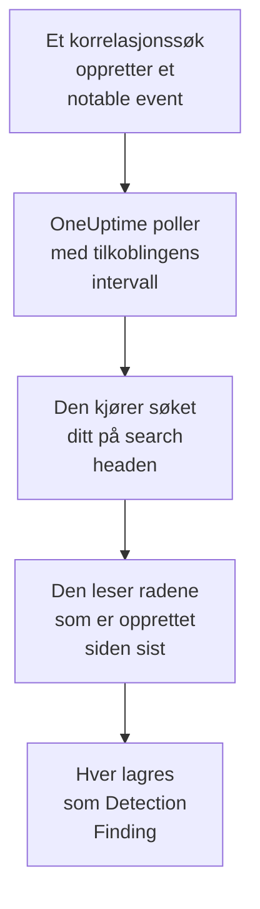

# Splunk Enterprise Security

Importer notable events som korrelasjonssøkene i [Splunk Enterprise Security](https://www.splunk.com/en_us/products/enterprise-security.html) oppretter, til sikkerhetshendelsene i OneUptime. Der søker du i dem ved siden av logger, sporinger og metrikker, korrelerer dem med alle andre kilder og varsler vakten om dem som betyr noe. OneUptime leser dem ved å kjøre et søk på search headen din som en Splunk-bruker du selv oppretter, og endrer ingenting i Splunk. Siden det bare er et søk, importerer det hvilken som helst indeks eller utdataene fra et hvilket som helst lagret søk, ikke bare notable events.

:::cards
- [Sett opp tilkoblingen](#sett-opp-tilkoblingen): Et token, en rolle og skjemaet for tilkoblingen.
- [Hva som importeres](#hva-som-importeres): Hvordan hver rad i søket blir en sikkerhetshendelse.
- [Slik fungerer polling](#slik-fungerer-polling): Vinduet hver poll leser, og hva en travel search head gjør med det.
- [Feilsøking](#feilsøking): Hva hver feil betyr, og hva du skal endre.
:::

## Slik fungerer det



Hvert minutt poller OneUptime hver aktiverte tilkobling der pollintervallet er gått. En poll kjører søket ditt via REST API-et til search headen, over radene som er opprettet siden forrige poll, og lagrer hver rad som en [OCSF](https://schema.ocsf.io/) Detection Finding-hendelse (klasse `2004`). Deteksjonsregler, monitorer og dashbord behandler den deretter som en sikkerhetshendelse fra en hvilken som helst annen kilde.

## Før du begynner

- I OneUptime rollen Project Owner, Project Admin eller Security Admin. Security Member og Security Viewer kan se tilkoblinger og kjøringshistorikken deres, men ikke endre dem.
- En search head med Splunk Enterprise 9.0.1 eller nyere, eller Splunk Cloud Platform. OneUptime snakker med REST API-et på administrasjonsporten, vanligvis `8089`. Splunk Web, på port `8000`, tilbyr ikke REST API-et.
- En Splunk-bruker for OneUptime, der rollen har capabilityen `search` og kan lese indeksen søket leser: `notable` for notable events. Enterprise Security-rollene `ess_analyst` og `ess_user` gir begge deler. Tilkoblingen leser bare, så rollen trenger ingenting annet.
- En search head som OneUptime kan nå over HTTPS. OneUptime Cloud kobler til fra internett, så search headen trenger en offentlig adresse: private adresser avvises. En selvdriftet OneUptime kobler til fra app- og workercontainerne sine og kan nå en search head på det private nettverket ditt, med mindre `DATA_SOURCE_BLOCK_PRIVATE_ADDRESSES` er `true`.

## Sett opp tilkoblingen

Tilkoblingen autentiserer med et Splunk-autentiseringstoken, eller med et brukernavn og et passord.

:::steps
### Opprett et autentiseringstoken

1. Åpne **Settings → Tokens** i Splunk Web. Hvis Splunk sier at tokenautentisering er slått av, velger du først **Enable Token Authentication**.
2. Velg **New Token**. Skriv inn Splunk-brukeren som er opprettet for OneUptime i **User**, og si i **Audience** hva tokenet er til, for eksempel `OneUptime security events`.
3. Velg en **Expiration**, eller ingen. Et token som utløper, stopper tilkoblingen til du erstatter det.
4. Velg **Create**, og kopier tokenet. Splunk viser det bare én gang.

Vil du heller autentisere med et passord, hopper du over dette trinnet og har brukerens navn og passord klart.

### Legg til tilkoblingen i OneUptime

Åpne **Produkter → Security Events → Tilkoblinger** (`/dashboard/{projectId}/security-events/connections`), klikk på **Legg til tilkobling**, velg **Splunk Enterprise Security**, og klikk på **Neste**. Fyll inn innstillingene i tabellen nedenfor, klikk på **Neste**, og lim inn tokenet i **Authentication token**, eller passordet i **Passord**.

### Test den før du lagrer

Klikk på **Test disse innstillingene** under **Test før du lagrer**. Testen autentiserer og kjører søket ditt med verdiene i skjemaet og lagrer ingenting, så en feil port eller en manglende rolle viser seg før tilkoblingen finnes. Klikk deretter på **Neste**, gi tilkoblingen et **Navn**, og opprett den.
:::

| Innstilling | Hva du skal skrive inn |
| --- | --- |
| **Splunk management URL** | REST API-et til search headen, for eksempel `https://splunk.example.com:8089`. Den må bruke `https`, uten spørrestreng. En bane beholdes, for en omvendt proxy som tilbyr API-et under en bane. |
| **Søk** | Søket som velger hva som skal importeres, `index=notable` til du endrer det. Snevre det inn, for eksempel med `index=notable urgency IN (high, critical)`. OneUptime legger selv til tidsrommet, så søket kan ikke sette `earliest` eller `latest` og kan ikke starte med en pipe. En innledende `search` fjernes. |
| **Brukernavn** | Navnet på Splunk-brukeren, bare hvis den autentiserer med et passord. |
| **Authentication token** | Tokenet fra det første trinnet. Når et token er lagret, er det det som brukes, og ikke brukernavnet eller passordet. |
| **Passord** | Passordet til Splunk-brukeren, bare når det ikke brukes noe token. |

**Authentication token** og **Passord** krypteres, returneres aldri av API-et og vises aldri igjen. Erstatt dem med **Oppdater påloggingsinformasjon** på tilkoblingen. For å bytte fra den ene autentiseringen til den andre skriver du inn den nye der og slår på **Remove the stored Authentication token** eller **Remove the stored Password**.

Trinnet **Henting** har også en valgfri **Beskrivelse**, **Henteintervall (minutter)**, et heltall fra `1` til `1440` som starter på `5`, og **Aktivert**, som starter slått på.

## Hva som importeres

Hver rad søket returnerer, blir en Detection Finding-hendelse (OCSF-klasse `2004`) med leverandøren `Splunk` og produktet `Splunk Enterprise Security`. For et notable event:

| Splunk-felt | OneUptime-kolonne |
| --- | --- |
| `event_id`, ellers `_bkt` og `_cd`, ellers en hash av raden | Hendelses-UID, som også duplikater fjernes etter |
| `_time`, da korrelasjonssøket opprettet det notable eventet | Tidspunktet for hendelsen |
| `rule_name`, ellers `search_name`, ellers `source` | Regelnavn |
| `search_name`, ellers `source`, ellers `rule_name` | Regel-ID |
| `rule_title`, ellers `rule_description`, ellers regelnavnet | Melding |
| `urgency`, ellers `severity` | Alvorlighetsgrad |
| `status_label`, ellers `status_description`, ellers navnet på gjennomgangsstatusen som `status` inneholder | Status |
| `annotations.mitre_attack`, og felt som `mitre_technique_id` og `mitre_tactic` | MITRE ATT&CK-taktikker og -teknikker |
| `user` eller `src_user`; `src`, `src_ip` eller `src_host`; `process`, `process_name` eller `parent_process` | Aktørens bruker, IP, vert og prosess |
| `dest_user`; `dest`, `dest_ip` eller `dest_host`; `dest_port` | Målets bruker, IP, vert og port |
| `file_path`, `url` eller `risk_object` | Målressurs |
| Hver bruker, vert og IP, pluss `dvc`, `host`, `file_hash`, `file_name`, `url`, `domain`, `query` og `risk_object` | Observables |
| Hvert felt i raden, for eksempel `security_domain`, `owner`, `orig_sid` og `_raw` | `attributes`, under feltets eget navn |

En rad fra en annen indeks importeres på samme måte. Kolonnene som feltene ikke fyller, forblir tomme, og hvert felt er fortsatt søkbart i `attributes`.

## Slik fungerer polling

Hver poll kjører et eksportsøk over vinduet sitt, de eldste først:

```text
POST {Splunk management URL}/services/search/v2/jobs/export
    search=search index=notable | fields * | sort 0 _time | head 10001
    earliest_time={window start}
    latest_time={window end}
    output_mode=json
```

- **Opprettelsestidspunktet er markøren.** Vinduet gjelder `_time`, som for et notable event er når korrelasjonssøket opprettet det, ikke når aktiviteten det fant, skjedde. Et søk som kjører hver time, daterer sine notable events til tidspunktet for kjøringen, så ingen havner bak markøren.
- **Den første pollen ser 24 timer tilbake**, slik at en ny tilkobling viser de nylige notable eventene sine med en gang.
- **Hver senere poll starter 1 minutt før den lagrede markøren**, slik at en rad som er opprettet på grensen mellom to vinduer, aldri går tapt.
- **En poll leser høyst 24 timer forbi markøren.** En tilkobling der markøren har kommet på etterskudd, tar igjen i en rekke vinduer på 24 timer, og **Helse** viser **Catching up**.
- **Duplikater fjernes etter `event_id`**, eller Splunks egne `_bkt` og `_cd`, i prosjektet, slik at overlappingen, et gjentatt vindu og en import aldri lagrer en rad to ganger.

En search head eldre enn 9.0.1 svarer `404` på forespørselen til `search/v2/jobs/export`. OneUptime sender den da til den utgåtte `search/jobs/export`, og kjøringen sier det i en advarsel. Oppgrader search headen: gjeldende versjoner slår av det endepunktet.

### Når et vindu inneholder mer enn én poll kan lese

En poll leser høyst 10 000 rader. Når et vindu inneholder flere, er kjøringen **Delvis**, med en advarsel som:

```text
Stopped after collecting 10000 records; the window holds more. Records are read oldest first, and the last one read was created at 2026-09-14T08:12:44.000Z, where the next poll can resume.
```

Søket sorterer vinduet etter `_time`, de eldste først, så OneUptime flytter markøren til opprettelsestidspunktet for den sist leste raden, og den neste pollen starter der med samme vinduslengde. En travel search head tar igjen 10 000 rader per poll i stedet for å lese de samme på nytt. Rader som er opprettet i samme øyeblikk, leses to ganger, og duplikatkontrollen fjerner den andre kopien. Splunk sorterer hele vinduet før det returnerer en rad, så et søk i **Søk** som finner langt mer enn nødvendig, gjør hver poll tregere. Hold det målrettet.

Når en kjøring ikke kommer forbi den lagrede markøren i det hele tatt, gjør OneUptime i stedet vinduet kortere:

1. **Snevre inn.** Den neste pollen leser et vindu som er halvparten så langt, fra det samme startpunktet, og fortsetter å halvere til et vindu leses helt, ned til ett minutt. Kjøringens advarsel sier det: `This window holds more records than one poll can read; the next poll reads a {n} minute window from the same starting point.`
2. **Vokse igjen.** Når et vindu er lest helt, er det neste igjen dobbelt så langt, opptil 24 timer.
3. **Gå forbi ett enkelt minutt.** Hvis selv ett minutt inneholder mer enn en poll kan lese, går pollingen forbi det, slik at nyere notable events fortsetter å komme. Kjøringen forblir **Delvis**, og **Siste feil** lyder `More records were created in the one minute from {cursor} to {end} than one poll can read. Polling moved past this minute so newer records keep arriving; use Import this time range in Diagnostics on this minute to recover what one run can read.` Importer det minuttet med **Import this time range** for å hente det én kjøring kan lese.

En kjøring som mislykkes helt, med en feil fra Splunk, beholder markøren og vinduslengden, og den neste pollen leser det samme vinduet på nytt. Det eneste unntaket er en forespørsel som fikk tidsavbrudd: markøren blir stående, men det neste vinduet er halvparten så langt, fordi et vindu som er for tungt til å bli besvart i tide, ville fått tidsavbrudd ved hvert forsøk. Å endre **Henteintervall (minutter)** endrer ingenting av dette: det avgjør hvor ofte en poll starter, ikke hvor vinduet begynner.

### Kjør, forhåndsvis og importer ved behov

Klikk på **Diagnostikk** på en tilkobling for å se de siste kjøringene og arbeide med den manuelt. Alle som kan endre tilkoblingen, kan starte disse handlingene; alle som kan se den, kan lese historikken.

- **Kjør nå** starter en poll med en gang, med den vanlige markøren, også når tilkoblingen ikke er **Aktivert**.
- **Preview notable events** leser et tidsrom på opptil 7 dager og importerer ingenting.
- **Import this time range** importerer et tidsrom på opptil 7 dager, etter at du har bekreftet, uten å flytte markøren. Rader som allerede er importert, hoppes over.
- **Copy diagnostics** på en kjøring kopierer rapporten for brukerstøtte. Den inneholder aldri legitimasjon.

## Test tilkoblingen

**Test tilkoblingen** på raden til en tilkobling og **Test disse innstillingene** i skjemaet kjører i API-prosessen, ikke i en bakgrunnsworker, slik at en test også svarer når det er workerne som er problemet. Den kjører disse kontrollene i rekkefølge:

| Kontroll | Hva den kontrollerer |
| --- | --- |
| **Konfigurasjon** | Hver innstilling er til stede og riktig formatert. Ingenting kontaktes når dette mislykkes. |
| **Authenticate with Splunk** | Splunk godtar tokenet, eller brukernavnet og passordet, og navngir brukeren og rollene, slik at du kan sammenligne dem med rollen du ville gi. |
| **Run the search on Splunk** | Søket i **Søk** kjører over de siste 24 timene for én rad, og sier hvilket eksportendepunkt som svarte. |
| **Notable events available to import** | Hvor mange rader søket i **Søk** finner de siste 24 timene og de siste 7 dagene. Ingen på 7 dager er en advarsel, ikke en feil. |
| **Background workers**, **Poll scheduler**, **Security event storage** | OneUptimes egen side: en prosess tar jobbene fra Worker-køen, poll-jobben kjører hvert minutt, og lageret for sikkerhetshendelser svarer. |
| **Scheduled polling** | For en lagret tilkobling: polling er slått på, ingen kjøring sitter fast og venter på en worker, og poller kjører i tide. |

Hver forespørsel i en test har en frist på 20 sekunder. En test importerer aldri noe og flytter aldri markøren, og hver kontroll som mislykkes, sier hva du skal endre.

## Send sikkerhetshendelser til Splunk

OneUptime kan også sende det den finner til Splunk, gjennom HTTP Event Collector (HEC), slik at søkene og dashbordene dine ser OneUptimes deteksjoner ved siden av dine egne. Hver sikkerhetshendelse er én HEC-hendelse med sourcetypen `oneuptime:security`, og feltene heter det Splunks Common Information Model kaller dem: `src`, `src_ip`, `src_user`, `dest`, `dest_ip`, `dest_port`, `user`, `signature` og `severity`.

:::steps
### Opprett et HEC-token

Åpne **Settings → Data inputs → HTTP Event Collector** i Splunk Web, og klikk på **New Token**. Gi det et navn, velg indeksene det kan skrive til og standardindeksen, og kopier verdien til tokenet. På Splunk Cloud lytter HEC på `https://http-inputs-<stack>.splunkcloud.com`; på Splunk Enterprise på port `8088` når **Global Settings** har slått på tokener.

### Legg til målet

Åpne **Produkter → Security Events → Tilkoblinger**. Klikk på **Legg til mål** under **Send til SIEM-et ditt**, velg Splunk under **SIEM**, og klikk på **Neste**. Fyll inn **HEC-URL**, og lim inn tokenet i **HEC-token**. **Indeks** og **Kildetype** er valgfrie: står de tomme, går hendelsene til tokenets standardindeks med sourcetypen `oneuptime:security`.

### Send en testhendelse og begynn å sende

Klikk på **Send en testhendelse**: én informativ hendelse går til Splunk med innstillingene i skjemaet, og ingenting lagres. Søk etter den med `sourcetype="oneuptime:security"`. Behold deretter **Bare deteksjoner** under **Hva som skal sendes**, eller velg **Alle sikkerhetshendelser**, og klikk på **Begynn å sende**.
:::

- **HEC-URL** må bruke `https`, med et sertifikat OneUptime stoler på: sertifikatkontroller hoppes aldri over.
- Hendelser sendes i bunter på opptil 500. En hendelse Splunk avviser, utelates og nevnes i **Vis feil**, en travel collector (`503`) prøves på nytt, og et avvist token eller en avvist indeks stopper sendingen til du retter det.
- Notable events som OneUptime har importert fra Splunk, sendes aldri tilbake dit.

## Feilsøking

**Siste feil** for tilkoblingen lagrer hele feilmeldingen, med legitimasjon maskert, bak et prefiks som navngir trinnet som mislyktes. Når en tilkobling har en feil, velger du **Vis feil** i kolonnen **Handlinger** for å lese den, og **Kopier feil** i dialogboksen for å kopiere den. Les prefikset først.

:::details Last Error starter med `Splunk Enterprise Security authentication request`
- `Splunk Enterprise Security authentication request failed (HTTP ...)`: Splunk nektet å si hvem som kaller.
  - `HTTP 401`: Splunk godtok ikke legitimasjonen. Tokenet er feil, utløpt eller slettet, tokenautentisering er slått av på search headen, eller brukernavnet eller passordet er feil. Opprett et nytt token, og lagre det med **Oppdater påloggingsinformasjon**.
  - `HTTP 404`: **Splunk management URL** er ikke REST API-et. Den peker til Splunk Web på port `8000`, eller den har en bane som search headen ikke tilbyr.
- `Splunk Enterprise Security authentication request returned ...`: noe annet enn REST API-et til search headen svarte, for eksempel HTML-en fra Splunk Web på port `8000` eller siden til en proxy. Pek URL-en til administrasjonsporten.
:::

:::details Last Error starter med `Splunk Enterprise Security search export` eller `Splunk Enterprise Security count search`
- `Splunk Enterprise Security search export failed (HTTP ...)`: Splunk nektet å kjøre søket.
  - `HTTP 400`: Splunk kan ikke tolke søket. Kjør søket fra **Søk** i Splunk Web for å lese feilen.
  - `HTTP 403`: rollen til brukeren mangler capabilityen `search`, eller kan ikke lese indeksen. Legg til `notable`, eller indeksen din, i indeksene rollen kan søke i.
  - `HTTP 404`: ingen av de to eksportendepunktene finnes på den URL-en, så det er ikke administrasjonsporten til en search head.
  - `HTTP 429` eller `HTTP 5xx`: Splunk begrenser brukeren, er overbelastet, eller søket traff en av grensene sine. Den neste pollen prøver igjen.
- `Splunk Enterprise Security search export was rejected by Splunk on an HTTP 200`: Splunk svarte, men stoppet søket med en feil. Meldingen siterer den.
- `Splunk Enterprise Security search export returned a body that is not newline-delimited JSON.`: noe annet enn REST API-et svarte, for eksempel Splunk Web eller påloggingssiden til en proxy. Det rapporteres i stedet for å bli tatt som et tomt vindu, slik at markøren aldri flytter seg forbi rader som ingen har lest.
- `Splunk Enterprise Security count search ...`: de samme feilene, fra tellingen til **Notable events available to import**, som bare en test kjører.
:::

:::details Last Error slutter med `did not complete`
`Splunk Enterprise Security search export did not complete`, og det samme for de andre trinnene, betyr at forespørselen ikke fikk noe svar: et tidsavbrudd, et navn som ikke kan slås opp, et sertifikat OneUptime ikke stoler på, eller en avvist privat adresse. Kontroller at OneUptime-appen og workerne kan åpne en HTTPS-tilkobling til administrasjonsporten. En search head som svarer på andre forespørsler, men får tidsavbrudd på søket, sorterer for mye: den neste pollen leser et vindu som er halvparten så langt, og et mer målrettet søk i **Søk** løser det for godt.
:::

:::details Last Polled er Never og Last Error er tom
Ingen poll er fullført for denne tilkoblingen. Kjør **Test tilkoblingen**: kontrollene **Background workers** og **Poll scheduler** navngir årsaken. På en selvdriftet installasjon er den vanlige årsaken `DISABLE_QUEUE_WORKERS=true` på appen, uten en separat worker-utrulling som tar jobbene: sett den til `false`, eller kjør worker-utrullingen (Helm: `worker.enabled: true`).
:::

:::details En kjøring er Partial
- `Stopped after collecting 10000 records; the window holds more`: vinduet inneholdt mer enn de 10 000 radene én kjøring leser. Ingenting går tapt: den neste pollen starter etter den sist leste raden. En tilkobling som forblir **Delvis** poll etter poll, er i ferd med å ta igjen et etterslep, og **Sist hentet** og **Siste importerte hendelse** fortsetter å gå fremover. Hvis den aldri tar igjen, finner søket i **Søk** mer enn 10 000 rader per pollintervall: snevre det inn, eller gjør **Henteintervall (minutter)** kortere.
- `More records were created in the one minute from ... than one poll can read`: pollingen gikk forbi det minuttet. Importer det med **Import this time range** i **Diagnostikk**. En import leser like mye som en poll.
:::

:::details Testen lykkes, men ingenting importeres
Les **Notable events available to import** i rapporten fra testen. `0` de siste 7 dagene betyr at søket i **Søk** ikke fant noe i Splunk: kontroller i Incident Review at korrelasjonssøkene er aktivert og oppretter notable events, og at søket i **Søk** ikke er smalere enn tiltenkt.
:::

## Hva du får

- **Søk.** Filtrer notable events etter hastegrad, status, regel, bruker, vert eller en hvilken som helst observable i utforskeren for sikkerhetshendelser, ved siden av alle andre kilder.
- **Korrelasjon.** Brukerne, vertene, IP-ene og domenene i hver rad indekseres som observables, så ett søk finner alt som nevner dem.
- **Deteksjonsregler.** Sigma-regler som kjører etter en tidsplan over sikkerhetshendelsene dine, og åpner varsler som varsler vakten.
- **Monitorer.** Monitorer for sikkerhetshendelser teller samsvarende hendelser, for eksempel nye kritiske notable events, og åpner hendelser eller varsler over en terskel.

Sikkerhetshendelser faktureres som resten av telemetrien din, per innhentet GB. Se [Priser](https://oneuptime.com/pricing).

## Neste trinn

:::cards
- [Sikkerhetshendelser](/docs/telemetry/security-events): Søk, korreler og varsle på det du importerer.
- [Elastic Security](/docs/integrations/elastic-security): Importer også deteksjonsvarslene fra en Elastic-stakk.
- [Roller](/docs/permissions/reference#roller): Hva Security-rollene kan se og endre.
- [Oversikt over integrasjoner](/docs/integrations/index): De andre verktøyene du kan koble til.
:::
