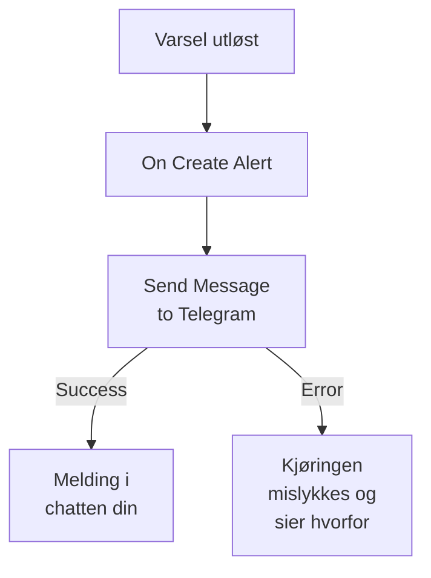

# Telegram

Send en melding til en [Telegram](https://telegram.org)-chat, -gruppe eller -kanal når et varsel utløses eller en hendelse åpnes. OneUptimes arbeidsflyttrinn **Send Message to Telegram** sender den som en bot du selv oppretter, og en ferdig mal bygger arbeidsflyten for varsler. Denne integrasjonen er **utgående**: boten sender meldinger og leser ikke det som blir sagt i chatten.

:::cards
- [Slik fungerer det](#slik-fungerer-det): Hva arbeidsflyten gjør når et varsel utløses.
- [Oppsett](#sett-opp-integrasjonen): En bot, chatten dens og så arbeidsflyten: fra malen eller fra bunnen.
- [Tips](#tips): Ren tekst, lange meldinger og hendelser.
- [Feilsøking](#feilsøking): Hva feilene fra Telegram betyr, og hva du bør endre.
:::

## Slik fungerer det



Trinnet sender **Message Text** til chatten som boten din via Telegrams Bot API. Det tar utgangen **Success** når Telegram tar imot meldingen, og utgangen **Error**, med Telegrams begrunnelse, når Telegram avviser den. Er ingenting koblet til **Error**, som i malen, mislykkes en kjøring som ikke kunne sende, og dens **Trinn** sier hvorfor.

## Før du begynner

- En Telegram-konto, for å opprette boten og legge den til i chatten.
- I OneUptime retten til å opprette arbeidsflyter og variabler. På OneUptime Cloud krever arbeidsflyter planen **Growth** eller høyere.

## Sett opp integrasjonen

:::steps
### Opprett en bot

Send `/newbot` til [@BotFather](https://t.me/BotFather) i Telegram, og svar på spørsmålene. Den gir deg tokenet til boten, for eksempel `123456789:ABCdefGhIJKlmnoPQRstuVWxyz`. Alle som har tokenet, kan sende meldinger som boten din, så ta like godt vare på det som på et passord.

### Finn ID-en til chatten

1. Legg boten til i gruppen, eller gjør den til administrator for kanalen. For å skrive til en person starter vedkommende først en chat med boten.
2. Send en melding i gruppen som nevner boten, for eksempel `/start@your_bot`, slik at boten ser den.
3. Åpne `https://api.telegram.org/bot<token>/getUpdates` i en nettleser, med tokenet til boten i stedet for `<token>`.
4. Finn `"chat":{"id":` i svaret. Tallet etter er ID-en til chatten. ID-en til en gruppe starter med `-`, og ID-en til en stor gruppe med `-100`.

En offentlig kanal kan angis med sitt `@username` i stedet for en ID.

### Bygg arbeidsflyten

Start fra malen, som bygger hele arbeidsflyten for varsler, eller fra bunnen.

:::tabs
@tab Fra malen
1. Åpne **Arbeidsflyter**, og klikk på **Opprett arbeidsflyt**.
2. Skriv `Telegram` i **Søk i maler…**, klikk på **Tell Telegram when an alert fires**, og klikk deretter på **Bruk denne malen**.
3. Behold navnet **Notify Telegram on new alert**, eller endre det, og klikk på **Neste**.
4. Lim inn tokenet i **Telegram Bot Token** og ID-en i **Telegram Chat ID**, og klikk på **Opprett arbeidsflyt**.

Arbeidsflyten åpnes i **Bygger** med to trinn: **On Create Alert** og **Send Message to Telegram**, som sender nummeret, tittelen, alvorlighetsgraden og tilstanden til varselet. Tokenet lagres som arbeidsflytens hemmelige variabel `telegramBotToken`, og ID-en som `telegramChatId`.
@tab Fra bunnen
1. Lagre tokenet som en hemmelig global variabel: gå til **Arbeidsflyter → Globale variabler**, klikk på **Opprett Workflow Variabel**, gi den navnet `TELEGRAM_BOT_TOKEN`, og klikk på **Neste**. Lim inn tokenet i **Innhold**, slå på **Hemmelighet**, og klikk på **Opprett Workflow Variabel**.
2. Gå til **Arbeidsflyter**, klikk på **Opprett arbeidsflyt**, velg **Start fra bunnen**, gi arbeidsflyten et navn, og klikk på **Opprett arbeidsflyt**.
3. Klikk på **Velg hva som starter denne arbeidsflyten** i **Bygger**, og velg **On Create Alert** under **Populære**. Klikk på utløseren: **Fields to pass on** starter med **Tittel**, så klikk på **Legg til felt**, og velg de andre feltene meldingen din viser, for eksempel **Alert Number With Prefix**.
4. Klikk på **Legg til komponent**, søk etter `telegram`, og klikk på **Send Message to Telegram**. Koble utgangen **Success** fra utløseren til den.
5. Klikk på det nye trinnet. Klikk på **{ }** i **Telegram Bot Token**, og velg `TELEGRAM_BOT_TOKEN` under **Global variables**. Skriv inn ID-en til chatten i **Chat ID**, skriv meldingen i **Message Text**, og sett inn feltene til varselet med **{ }**.
:::

En melding bygget fra bunnen leser feltene til varselet med referanser som disse:

```text
🚨 Alert {{local.components.alert-on-create-1.returnValues.model.alertNumberWithPrefix}} fired
Title: {{local.components.alert-on-create-1.returnValues.model.title}}
```

### Slå den på og test den

Slå på **Aktivert** øverst i **Bygger**. Fra nå av sendes hvert nye varsel til chatten.

For å teste uten å utløse et varsel klikker du på **Kjør arbeidsflyt** og velger et varsel du allerede har, under **Varsel**: de nyeste er listet opp, og når du skriver inn nummeret eller en del av tittelen, finner du et annet. Klikk på **Kjør arbeidsflyten manuelt**, og bekreft med **Kjør**. Panelet **Arbeidsflytkjøring** følger kjøringen, og meldingen dukker opp i chatten. Tar trinnet **Error** i stedet, mislykkes kjøringen, og trinnets oppføring under **Trinn** sier hvorfor: se [Feilsøking](#feilsøking).
:::

## Tips

- **Ren tekst.** Trinnet sender teksten slik den er skrevet, uten Telegrams formatering, så `*` og `_` vises som de er.
- **Følg med på grensen på 4 096 tegn.** Telegram tar imot meldinger på opptil 4 096 tegn. En lengre blir kuttet og slutter med "… (truncated — see OneUptime for the full text)" i stedet for å bli avvist.
- **Hendelser også.** Bygg den samme arbeidsflyten på **On Create Incident**, eller på **On Update Incident** for tilstandsendringer. For å sende bare noen varsler setter du en blokk **If / Else** foran trinnet.
- **Formen på tokenet kontrolleres.** Et token som ikke har formen `123456789:ABCdef…`, stopper kjøringen før noe sendes, og tokenet skrives aldri til loggen.

## Feilsøking

Når trinnet tar **Error**, mislykkes kjøringen, og trinnets oppføring under kjøringens **Trinn** gir Telegrams begrunnelse. Boten må være i chatten, så sjekk det først.

:::details Telegram svarer "Bad Request: chat not found"
**Chat ID** er feil, eller boten kan ikke se chatten: legg boten til i gruppen, gjør den til administrator for kanalen, eller be personen om å starte en chat med boten. ID-en til en gruppe starter med `-`.
:::

:::details Telegram svarer "Forbidden: bot was blocked by the user" eller "bot is not a member"
Personen har blokkert boten, eller boten er fjernet fra gruppen eller kanalen. Legg den til igjen, eller send til en annen chat.
:::

:::details Telegram svarer "Unauthorized"
Telegram godtok ikke tokenet: det er tilbakekalt hos @BotFather, eller kopiert feil. Kopier det gjeldende tokenet til boten fra @BotFather, og erstatt verdien til variabelen.
:::

:::details Telegram svarer "Too Many Requests: retry after"
Telegram begrenser hvor raskt én bot sender, særlig til en gruppe. En byge av varsler kan treffe grensen: send færre meldinger, for eksempel bare for noen alvorlighetsgrader.
:::

## Neste trinn

:::cards
- [Arbeidsflyt-komponenter](/docs/workflows/components#telegram): Hver innstilling i trinnet, og hva utgangene betyr.
- [Discord](/docs/integrations/discord): Den samme ideen, i en Discord-kanal.
- [Arbeidsflyt-kjøringer](/docs/workflows/runs-and-logs): Les hva hver kjøring av arbeidsflyten gjorde.
- [Oversikt over integrasjoner](/docs/integrations/index): Det utgående mønsteret og de andre verktøyene du kan koble til.
:::
