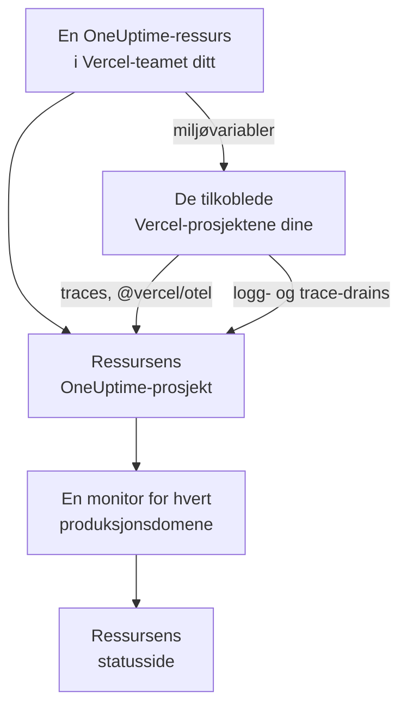

# Vercel

Legg til OneUptime i Vercel-teamet ditt fra [Vercel Marketplace](https://vercel.com/marketplace). Du logger inn med Vercel-kontoen din og betaler via Vercel-regningen din, og Vercel-prosjektene dine får traces, logger, oppetidsovervåking og en statusside i OneUptime, uten at du trenger å sette opp noe for hånd.

:::cards
- [Legg til OneUptime i Vercel-teamet ditt](#legg-til-oneuptime-i-vercel-teamet-ditt): En ressurs, et abonnement og prosjektene dine, i Vercel-dashbordet.
- [Send traces med @vercel/otel](#send-traces-med-vercelotel): Miljøvariablene er der allerede.
- [Send logger og traces med drains](#send-logger-og-traces-med-drains): Vercels egne logger og spans, på Pro og Enterprise.
- [Abonnementer og fakturering](#abonnementer-og-fakturering): OneUptimes abonnementer, på Vercel-fakturaen din.
:::

## Slik fungerer det

Hver OneUptime-ressurs du legger til i Vercel, er et eget OneUptime-prosjekt. Vercel gir hvert Vercel-prosjekt du kobler til ressursen, ressursens miljøvariabler, og de sender prosjektets traces til OneUptime. Drains sender Vercels logger og spans, og produksjonsdomenet til hvert tilkoblet prosjekt får en oppetidsmonitor på ressursens statusside.



Integrasjonen er for OneUptime Cloud (`oneuptime.com`). En selvhostet OneUptime kan ikke legges til fra Vercel Marketplace: se [Selvhostet OneUptime](#selvhostet-oneuptime).

## Før du begynner

- **Et Vercel-team**, på et hvilket som helst abonnement. Logg- og trace-drains krever Vercels Pro- eller Enterprise-abonnement; traces fra `@vercel/otel` virker på alle abonnementer.
- **En bekreftet e-postadresse** på Vercel-kontoen din. OneUptime logger deg inn med den, og oppretter OneUptime-kontoen din med den hvis du ikke har en.
- **En betalingsmetode i Vercel**, for alle abonnementer: monitorer og telemetri faktureres etter bruk, også på Free-abonnementet. Se [Abonnementer og fakturering](#abonnementer-og-fakturering).

## Legg til OneUptime i Vercel-teamet ditt

:::steps
### Åpne OneUptime på Vercel Marketplace

Åpne **Integrations** i Vercel-dashbordet, deretter **Browse Marketplace**, og finn OneUptime under **Observability**. Klikk på **Installasjon**, og godta vilkårene til OneUptime.

### Velg et abonnement

Velg **Gratis**, **Growth** eller **Scale**. Abonnementene er OneUptimes egne, til prisene på [oneuptime.com/pricing](https://oneuptime.com/pricing).

### Gi ressursen et navn, og velg innstillingene

Gi ressursen navn etter det den overvåker, for eksempel `storefront`: OneUptime-prosjektet og statussiden til ressursen får navn etter den. To innstillinger er slått på fra start:

- **Monitor production domains**: en nettstedsmonitor for produksjonsdomenet til hvert Vercel-prosjekt du kobler til.
- **Create a status page**: en offentlig statusside for ressursen, som viser disse monitorene.

### Koble til prosjektene dine

Velg Vercel-prosjektene som sender til denne ressursen, og miljøene som får miljøvariablene til ressursen. Ikke gi tilkoblingen et egendefinert prefiks: `@vercel/otel` leser variablene under deres egne navn.
:::

Ressursen er klar på noen sekunder. Klikk på **Open in OneUptime** for å se prosjektet til ressursen.

## Hva du får med hver ressurs

| Hva | Hvor du finner det |
| --- | --- |
| Et OneUptime-prosjekt, oppkalt etter ressursen | Du eier det. Teamkameratene dine blir med i det når de åpner det fra Vercel. |
| En inntaksnøkkel med navnet `Vercel` | **Prosjektinnstillinger → Telemetri og APM → Inntaksnøkler** |
| Miljøvariabler i hvert tilkoblet Vercel-prosjekt | **Settings → Environment Variables** for prosjektet i Vercel |
| En nettstedsmonitor for hvert tilkoblet prosjekt | **Monitorer**, oppkalt etter Vercel-prosjektet |
| En offentlig statusside | **Statussider**, oppkalt etter ressursen |

Miljøvariablene er de samme i alle tilkoblede prosjekter:

| Variabel | Verdi |
| --- | --- |
| `OTEL_EXPORTER_OTLP_ENDPOINT` | `https://oneuptime.com/otlp` |
| `OTEL_EXPORTER_OTLP_HEADERS` | `x-oneuptime-token=` og inntaksnøkkelen til ressursen |
| `OTEL_EXPORTER_OTLP_PROTOCOL` | `http/protobuf` |
| `ONEUPTIME_TELEMETRY_INGESTION_KEY` | Inntaksnøkkelen alene, som drains sender |

En utrulling får variablene når den bygges: rull ut på nytt etter at du har koblet til et prosjekt.

## Send traces med @vercel/otel

`@vercel/otel` er Vercels OpenTelemetry-pakke for Next.js og de andre rammeverkene Vercel kjører. Den leser `OTEL_EXPORTER_OTLP_*`-variablene, så et prosjekt som er koblet til ressursen, trenger bare pakken.

:::steps
### Installer pakken

```bash
npm install @vercel/otel @opentelemetry/api @opentelemetry/api-logs
```

### Registrer pakken

Opprett `instrumentation.ts` i roten av prosjektet, eller i `src` hvis prosjektet har en slik mappe, og gi tjenesten et navn:

```ts title="instrumentation.ts"
import { registerOTel } from "@vercel/otel";

export function register(): void {
  registerOTel({ serviceName: "storefront" });
}
```

### Rull ut

Rull ut prosjektet. Traces fra prosjektet vises i **Spor**, under tjenestenavnet.
:::

På Vercels Pro- og Enterprise-abonnementer legger du også til en trace-drain: Vercel sender da OneUptime sine egne spans for hver forespørsel, sammen med spans fra applikasjonen din, og `@vercel/otel` overlater dem til drainen, så ingenting kommer fram to ganger.

## Send logger og traces med drains

En drain sender det Vercel registrerer om prosjektene dine, til OneUptime: en loggdrain sender build-, funksjons-, edge- og forespørselsloggene deres, og en trace-drain deres spans. Drains krever Vercels Pro- eller Enterprise-abonnement, og Vercel fakturerer dataene de sender, på Vercel-regningen din.

:::steps
### Legg til en drain

Åpne **Team Settings → Drains** i Vercel, og klikk på **Add Drain**. Velg **Logs** eller **Traces**, og deretter OneUptime under **Native Integrations**.

### Velg prosjektene

Velg prosjektene, og for logger kildene og miljøene. Drainen sender med inntaksnøkkelen til ressursen: det er ingenting å skrive inn.
:::

Hvert Vercel-prosjekt er en tjeneste i OneUptime, oppkalt etter prosjektet. En logg beholder tidspunktet, nivået og meldingen sin, og forespørselen havner under OpenTelemetrys navn:

| Vercel-felt | I OneUptime |
| --- | --- |
| `projectName` | Tjenesten, `service.name` |
| `timestamp`, `level`, `message` | Loggens tidspunkt, alvorlighetsgrad og brødtekst |
| `deploymentId`, `environment` | `vercel.deployment.id`, `deployment.environment.name` |
| `proxy.method`, `proxy.path`, `proxy.statusCode` | `http.request.method`, `url.path`, `vercel.proxy.status_code` |
| `traceId`, `spanId` | Loggens trace, lenket til tracen i **Spor** |
| Alle andre felt | Et attributt under `vercel.`, for eksempel `vercel.source` |

## Oppetidsmonitorer og statussiden

Når du kobler til et Vercel-prosjekt, oppretter OneUptime en nettstedsmonitor for produksjonsdomenet til prosjektet, som sjekkes fra OneUptimes sonder, og legger den til på statussiden til ressursen. Et prosjekt som kobles til før sin første produksjonsutrulling, har ikke noe domene ennå: monitoren opprettes ved den utrullingen. Når du kobler fra prosjektet, slettes monitoren.

Hver monitor er en aktiv monitor, som faktureres som alle andre og fungerer som en du har opprettet selv: se [Nettsted-overvåking](/docs/monitor/website-monitor). Vil du ikke ha noen, slår du av **Monitor production domains** i innstillingene til ressursen i Vercel. Når du slår den på igjen, opprettes monitorene som fortsatt mangler.

## Åpne OneUptime fra Vercel

Klikk på **Open in OneUptime** på ressursen, eller på en av lenkene dens i Vercel, så er du logget inn i OneUptime med e-postadressen til Vercel-kontoen din. Første gang blir du med i prosjektet til ressursen: som administrator hvis du er eier eller medlem av Vercel-teamet, og som medlem hvis du har en av teamets skrivebeskyttede roller.

Finnes det allerede en OneUptime-konto med den e-postadressen, er det den du logger inn på. En konto som har tofaktorautentisering slått på, eller som tilhører en OneUptime-administrator, logger i stedet inn med passordet sitt. Du er med i prosjektet likevel.

## Abonnementer og fakturering

| | Slik fungerer det |
| --- | --- |
| Abonnementer | **Gratis**, **Growth** og **Scale**, til prisene på oneuptime.com: abonnementets pris per bruker, aktive monitorer til $1 per monitor per måned, og telemetri per GB. |
| Hvor du betaler | På Vercel-fakturaen din, én gang i måneden, for hver ressurs. Vercel viser månedens bruk så langt på ressursen, oppdatert hver time. |
| Prøveperioder | Ingen belastning så lenge abonnementets prøveperiode varer: verken for brukerne, monitorene eller telemetrien. |
| Bytte abonnement | I Vercel, på ressursen, eller i OneUptime under **Prosjektinnstillinger → Fakturering og fakturaer → Fakturering**. En endring på det ene stedet gjelder begge steder. |
| Ubetalte fakturaer | Vercel prøver betalingen på nytt i 15 dager. Etter det er prosjektet utilgjengelig til fakturaen er betalt: dataene beholdes, og ingenting slettes. |

På fakturaen har hver ressurs en linje for brukerne, de aktive monitorene, telemetrien og eventuelle påfyllinger av saldoen, i bruksenheter på $0.01.

## Fjern OneUptime

| Du | Hva som skjer |
| --- | --- |
| Sletter en ressurs i Vercel | Prosjektet til ressursen slettes, etter at bruken fram til da er fakturert. De tilkoblede Vercel-prosjektene mister miljøvariablene til ressursen ved neste utrulling. |
| Avinstallerer OneUptime fra teamet | Prosjektet til hver ressurs slettes, og den endelige fakturaen sendes. |
| Sletter prosjektet i OneUptime | Ressursen slettes også i Vercel. |

> [!CAUTION]
> Å slette et prosjekt sletter monitorene, statussiden, hendelsene og telemetrien til prosjektet for godt. Eksporter først alt du vil beholde.

## Selvhostet OneUptime

En selvhostet OneUptime kan ikke legges til fra Vercel Marketplace, som bare klargjør OneUptime Cloud. Vercel-prosjektene dine kan likevel sende til den:

- **Traces**: angi variablene fra [Hva du får med hver ressurs](#hva-du-får-med-hver-ressurs) i **Settings → Environment Variables** for Vercel-prosjektet, med `https://YOUR-ONEUPTIME-HOST/otlp` som endepunkt og en inntaksnøkkel fra prosjektet ditt.
- **Logger**: legg til en egendefinert loggdrain i **Team Settings → Drains**, til `https://YOUR-ONEUPTIME-HOST/telemetry/vercel/v1/logs`, i JSON eller NDJSON. Legg til headeren `x-oneuptime-token` med inntaksnøkkelen din, og sett signeringshemmeligheten til drainen til den samme nøkkelen: OneUptime godtar bare leveranser som Vercel har signert med den.

Den samme egendefinerte drainen fungerer på OneUptime Cloud, med `oneuptime.com` som vert.

## Feilsøking

:::details Det kommer ingen traces
- Rull ut prosjektet på nytt: en utrulling som ble bygget før prosjektet ble koblet til, har ingen `OTEL_EXPORTER_OTLP_*`-variabler.
- Kontroller navnene på variablene i **Settings → Environment Variables** for prosjektet. En tilkobling som er laget med et egendefinert prefiks, gir dem nye navn, og da leser ikke `@vercel/otel` dem lenger: koble til prosjektet på nytt uten prefiks.
- Kontroller at `instrumentation.ts` kaller `registerOTel`, og, på Next.js 14 og eldre, at `experimental.instrumentationHook` er slått på i `next.config.js`.
:::

:::details Vercel viser drainen med feil
Vercel viser svaret fra OneUptime på leveransene til drainen:

- `403` med `x-vercel-signature` i meldingen: Vercel signerte ikke leveransen med nøkkelen Vercel sender. For en egendefinert drain kontrollerer du `x-oneuptime-token`-headeren, og setter signeringshemmeligheten til den samme nøkkelen.
- `401`: OneUptime kjenner ikke noe prosjekt med nøkkelen drainen sender: den er slettet, eller skrevet feil begge steder. Bruk en nøkkel fra **Prosjektinnstillinger → Telemetri og APM → Inntaksnøkler**.
- `422`: nøkkelen er slått av. Slå den på igjen på samme side, eller bruk en annen.
:::

:::details Et tilkoblet prosjekt har ingen monitor
- **Monitor production domains** er slått av i innstillingene til ressursen i Vercel.
- Prosjektet har ikke noe produksjonsdomene ennå: monitoren opprettes ved den første produksjonsutrullingen.
- Abonnementet til prosjektet har så mange aktive monitorer som det tillater: oppgrader abonnementet, og slå deretter **Monitor production domains** av og på igjen.
:::

:::details Vercel ber deg bekrefte e-postadressen din
OneUptime trenger en e-postadresse som Vercel har bekreftet, og en eksisterende OneUptime-konto med den adressen må også ha fått sin egen adresse bekreftet. Bekreft adressen, og legg deretter til ressursen eller åpne OneUptime på nytt.
:::

## Neste trinn

:::cards
- [Sporutforsker](/docs/telemetry/traces-explorer): Finn en treg forespørsel og spans i den.
- [Loggutforsker](/docs/telemetry/logs-explorer): Søk i Vercel-loggene dine.
- [Statussider](/docs/status-pages/index): Gi statussiden til ressursen din egen merkevare, og legg til abonnenter.
- [Inntaksnøkler](/docs/telemetry/ingestion-keys): Bytt ut eller slå av nøkkelen til ressursen.
:::
