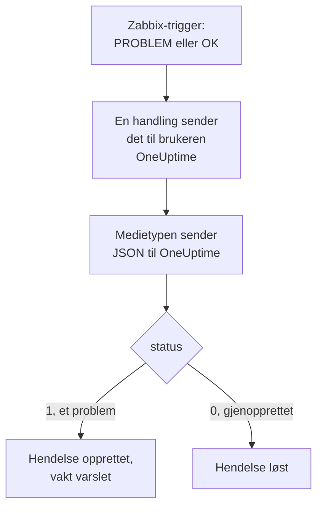

# Zabbix

Send [Zabbix](https://www.zabbix.com)-problemer til OneUptime, slik at hvert problem blir en hendelse som varsler vaktteamet ditt og løses når Zabbix er gjenopprettet. Zabbix sender hvert problem via en webhook-medietype, så det er ingenting å installere på noen av sidene.

:::cards
- [Velg hvordan OneUptime mottar problemer](#velg-hvordan-oneuptime-mottar-problemer): En Incoming Request-monitor eller en egen arbeidsflyt.
- [Motta problemer med en monitor](#motta-problemer-med-en-monitor): Én hendelse per problem, løst ved gjenoppretting.
- [Konfigurer Zabbix](#konfigurer-zabbix): En medietype, en bruker og en handling.
- [Feilsøking](#feilsøking): Når problemer ikke kommer frem, eller hendelser blir stående åpne.
:::

## Slik fungerer det



Zabbix sender et problem til en bruker via brukerens medier. Her er mediet en webhook-medietype som heter **OneUptime**: skriptet sender et lite JSON-dokument til OneUptime med problemets hendelses-ID, navn, vert, alvorlighetsgrad og status. Statusen er `1` for et problem og `0` for gjenopprettingen av det.

## Før du begynner

- En Zabbix-server som du administrerer. Denne veiledningen er skrevet for Zabbix 6.0 LTS og 7.0 LTS. Webhook-medietyper fungerer på samme måte fra Zabbix 5.0.
- En Zabbix-server som kan nå OneUptime-installasjonen din via HTTPS.
- I OneUptime tilgang til å opprette monitorer, eller arbeidsflyter hvis du velger den veien.

## Velg hvordan OneUptime mottar problemer

Sett opp OneUptime først: det gir deg URL-en som Zabbix sender til.

| Måte | Bruk den når |
| --- | --- |
| En Incoming Request-monitor (anbefalt) | Du vil at hvert Zabbix-problem skal bli en hendelse som varsler vakten og løses når Zabbix er gjenopprettet. Det er ingenting å bygge. |
| En arbeidsflyt med en Webhook-trigger | Du trenger din egen logikk: filtrere problemer, gi dem en annen form eller kalle andre systemer først. En arbeidsflyt løser ikke hendelsen av seg selv ved gjenoppretting. |

Begge får den samme JSON-en fra den samme medietypen, så du kan starte med den ene og bytte senere ved å endre én URL i Zabbix.

## Motta problemer med en monitor

En [Incoming Request-monitor](/docs/monitor/incoming-request-monitor) gir deg en URL, og kriteriene bestemmer hva hver forespørsel gjør.

:::steps
### Opprett monitoren

Gå til **Monitorer**, og klikk på **Opprett monitor**. Velg **Incoming Request** under **Monitortype**, gi den navnet `Zabbix`, og klikk på **Neste**.

### Erklær en hendelse for hvert problem

I trinnet **Kriterier** åpner du det første kriteriet, det som markerer monitoren som frakoblet. Sett filteret til **Forespørselstekst**, **Inneholder**, `"status":"1"`. Dette kriteriet erklærer allerede en hendelse når filteret samsvarer. Fyll ut hendelsen:

- **Hendelsestittel**: `Zabbix: {{requestBody.name}} on {{requestBody.host}}`.
- **Alvorlighetsgrad**: alvorlighetsgraden Zabbix-problemer skal ha.
- **Vaktretningslinjer**, under **Vakt**: retningslinjene som skal varsles.
- **Løs hendelse automatisk**, under **Flere felt**: la den være på, slik den starter. Uten den ignoreres gjenopprettinger, og hendelser blir stående åpne.

### Opprett én hendelse per problem

I samme kriterium åpner du **Innstillinger** og slår på **Group incidents and alerts by a payload field**. Fyll det ut som nedenfor, slik at hvert problem får sin egen hendelse, og gjenopprettingen av det løser den:

| Felt | Verdi |
| --- | --- |
| **Open a separate incident for each…** | `requestBody.event_id` |
| **Field that signals recovery** | `requestBody.status` |
| **Value that means recovered** | `0` |

### Ta monitoren tilbake på nett

Åpne det andre kriteriet, det som markerer monitoren som tilkoblet, og sett filteret til **Forespørselstekst**, **Inneholder**, `"status":"0"`.

### Kopier URL-en

Klikk på **Opprett monitor**. Monitorens side **Oversikt** viser **Heartbeat URL**. Kopier den til Zabbix:

```text
https://oneuptime.com/heartbeat/<secret key>
```

En selvhostet installasjon har sin egen vert i stedet for `oneuptime.com`.
:::

Monitoren leser forespørselens JSON slik den er skrevet: `"status":"1"`, uten mellomrom. Se [Motta varsler fra et annet system](/docs/monitor/incoming-request-monitor#motta-varsler-fra-et-annet-system) for hva hver innstilling gjør.

## Motta problemer med en arbeidsflyt

Bruk en [arbeidsflyt](/docs/workflows/index) når du trenger egne trinn mellom Zabbix og hendelsen.

:::steps
### Opprett arbeidsflyten

Gå til **Arbeidsflyter**, klikk på **Opprett arbeidsflyt** og deretter på **Start fra bunnen**. Gi den navnet `Zabbix problems`, og klikk på **Opprett arbeidsflyt**.

### Legg til Webhook-triggeren

Klikk på den stiplede blokken **Choose what starts this workflow**, og velg **Webhook**. Klikk på triggeren og deretter på **Kopier URL**, og ta vare på URL-en til Zabbix.

### Sjekk at det er et problem

Klikk på **Legg til komponent**, legg til en **If / Else**-blokk, og koble triggerens **Out**-punkt til den. Sett **Value to check** til `{{local.components.webhook-1.returnValues.request-body.status}}`, **Comparison** til **is equal to** og **Compare with** til `1`.

### Erklær hendelsen

Legg til en **Create One Incident**-blokk, og koble **Yes**-siden av **If / Else**-blokken til den. Velg i **Incident Template** en mal som setter alvorlighetsgraden og vaktretningslinjene som skal varsles (se [Hendelsesmaler](/docs/incidents/settings#hendelsesmaler)). Sett i **JSON Object** det som kommer fra Zabbix:

```json
{
  "title": "Zabbix: {{local.components.webhook-1.returnValues.request-body.name}}",
  "description": "Host: {{local.components.webhook-1.returnValues.request-body.host}}\nSeverity: {{local.components.webhook-1.returnValues.request-body.severity}}\nZabbix event: {{local.components.webhook-1.returnValues.request-body.event_id}}"
}
```

Uten en mal trenger **JSON Object** også `incidentSeverityId`, ID-en til en av prosjektets alvorlighetsgrader for hendelser.

### Slå den på

Slå på **Aktivert** øverst i **Bygger**. En arbeidsflyt som er slått av, svarer Zabbix med `400`.
:::

En gjenoppretting tar **No**-siden av **If / Else**-blokken, der ingenting er koblet til, så kjøringen slutter der. Bruk monitoren for å løse hendelser ved gjenoppretting.

## Konfigurer Zabbix

Zabbix trenger tre ting: en medietype som sender til OneUptime, en bruker å sende den til og en handling som sender problemer til den brukeren.

:::steps
### Opprett medietypen OneUptime

1. Gå til **Alerts → Media types**, eller **Administration → Media types** i Zabbix 6.0, og klikk på **Create media type**.
2. Sett **Name** til `OneUptime` og **Type** til **Webhook**.
3. Legg til disse **Parameters**. Hver av dem fører en Zabbix-[makro](https://www.zabbix.com/documentation/current/en/manual/appendix/macros/supported_by_location) inn i forespørselen:

   | Navn | Verdi |
   | --- | --- |
   | `url` | `{ALERT.SENDTO}` |
   | `event_id` | `{EVENT.ID}` |
   | `event_name` | `{EVENT.NAME}` |
   | `event_value` | `{EVENT.VALUE}` |
   | `event_severity` | `{EVENT.SEVERITY}` |
   | `host` | `{HOST.NAME}` |
   | `event_date` | `{EVENT.DATE}` |
   | `event_time` | `{EVENT.TIME}` |

4. Lim inn dette i **Script**:

   ```javascript
   var params = JSON.parse(value);
   var request = new HttpRequest();
   request.addHeader("Content-Type: application/json");

   var payload = {
     source: "zabbix",
     event_id: params.event_id,
     name: params.event_name,
     host: params.host,
     severity: params.event_severity,
     // "1" for a problem, "0" for its recovery.
     status: params.event_value,
     date: params.event_date,
     time: params.event_time,
   };

   var response = request.post(params.url, JSON.stringify(payload));

   if (request.getStatus() < 200 || request.getStatus() >= 300) {
     throw (
       "OneUptime responded with HTTP " + request.getStatus() + ": " + response
     );
   }

   return "OK";
   ```

5. Legg til en mal for **Problem** og en for **Problem recovery** på fanen **Message templates**. La teksten være tom: skriptet bygger forespørselen. Zabbix bruker bare en medietype for de typene hendelser den har en mal for.
6. Klikk på **Add**.

### Opprett en bruker som mottar problemer

1. Gå til **Users → Users**, eller **Administration → Users** i Zabbix 6.0, og klikk på **Create user**. Gi brukeren navnet `OneUptime`, og gi den en brukergruppe og en rolle som kan motta varslinger, f.eks. **User role**.
2. Klikk på **Add** på fanen **Media**. Sett **Type** til `OneUptime` og **Send to** til URL-en du kopierte fra OneUptime. La **When active** og alvorlighetsgradene være som de er, eller fjern avkryssingen for alvorlighetsgradene OneUptime ikke skal få.
3. Klikk på **Add**, og deretter på **Add** igjen for å lagre brukeren.

### Send problemer til OneUptime med en handling

1. Gå til **Alerts → Actions → Trigger actions**, eller **Configuration → Actions** i Zabbix 6.0, og klikk på **Create action**. Gi den navnet `Notify OneUptime`.
2. Avgrens den under **Conditions** hvis du vil, f.eks. med **Trigger severity is greater than or equals Warning**. Uten betingelser sendes hvert problem.
3. Legg til en operasjon på fanen **Operations** som sender til brukeren `OneUptime` via medietypen `OneUptime`.
4. Legg til den samme operasjonen under **Recovery operations**, slik at gjenopprettinger også sendes.
5. Klikk på **Add**, og sjekk at handlingen er aktivert.
:::

## Test det

1. Åpne **Alerts → Media types** i Zabbix, og klikk på **Test** ved siden av `OneUptime`. Fyll inn URL-en du kopierte, og eksempelverdier som `event_id` `12345`, `event_name` `Test problem`, `host` `web-1` og `event_value` `1`. Klikk på **Test**: Zabbix viser svaret fra skriptet, `OK`, eller feilen det kastet.
2. Åpne monitoren i OneUptime, og sjekk at en hendelse ble opprettet, eller åpne arbeidsflytens **Logger → Kjøringer** og sjekk kjøringen.
3. Test igjen med `event_value` `0` og samme `event_id`. Med monitoren blir hendelsen løst.

La deretter en ekte trigger utløses, for eksempel ved å senke en terskel et øyeblikk, og se problemet komme inn.

## Knytt Zabbix-alvorlighetsgrader til OneUptime

Zabbix sender alvorlighetsgraden som tekst: `Not classified`, `Information`, `Warning`, `Average`, `High` eller `Disaster`.

- **Med monitoren** klikker du på **Legg til kriterier** for hver gruppe alvorlighetsgrader og drar det nye kriteriet over det første: kriteriene sjekkes ovenfra, og det første som samsvarer, avgjør. Gi hvert kriterium to filtre, `"status":"1"` og en alvorlighetsgrad som `"severity":"Disaster"`, med **Samsvarsbetingelse** satt til **Alle**. Gi hvert kriterium en hendelse med sin egen **Alvorlighetsgrad** og **Løs hendelse automatisk**, og de samme grupperingsinnstillingene.
- **Med arbeidsflyten** legger du til en [Switch / Case](/docs/workflows/components#switch-case)-blokk på `{{local.components.webhook-1.returnValues.request-body.severity}}`, med en case for hver alvorlighetsgrad, og en **Create One Incident**-blokk med sin egen mal etter hver case.

## Feilsøking

:::details Ingenting kommer frem til OneUptime
- Åpne **Reports → Action log** i Zabbix, og sjekk at handlingen sendte problemet, og hva som kom tilbake.
- Send en forespørsel selv fra Zabbix-serveren: `curl -i -X POST <url> -H 'Content-Type: application/json' -d '{"status":"1","event_id":"1","name":"Test","host":"test"}'`.
- Monitoren svarer `200` med en gang, før den sjekker noe, selv for en feil hemmelig nøkkel. Sjekk monitorens tidslinje for å se om forespørslene kommer frem.
- En arbeidsflyt som er slått av, svarer `400`. Slå på **Aktivert** øverst i dens **Bygger**.
:::

:::details Zabbix rapporterer en skriptfeil
Åpne medietypen, og bruk **Test**: Zabbix viser resultatet fra skriptet eller feilen det kastet. Et svar fra OneUptime som ikke er `2xx`, kastes av skriptet sammen med statusen, så sjekk URL-en først.
:::

:::details Hendelser opprettes, men løses aldri
- Handlingen trenger **Recovery operations**, ellers sender Zabbix aldri gjenopprettingen.
- Kriteriets hendelse trenger **Løs hendelse automatisk**, under **Flere felt**.
- **Field that signals recovery** må være `requestBody.status`, og **Value that means recovered** nøyaktig `0`.
- En arbeidsflyt løser ikke hendelser ved gjenoppretting. Bruk monitoren.
:::

:::details Hendelsen viser en referanse i stedet for en verdi
En referanse til et felt som forespørselen ikke har, blir stående slik den er skrevet, krøllparenteser og alt, i stedet for å bli tømt. Sjekk at Zabbix sender `Content-Type: application/json`, og at feltnavnene du bruker (`name`, `host`, `severity`, `status`, `event_id`), samsvarer med skriptets payload. For en arbeidsflyt åpner du kjøringen i **Logger → Kjøringer** og sammenligner med det triggeren mottok. Se [Fallgruver](/docs/workflows/variables#feller).
:::

:::details Hvert problem kommer to ganger
Handlingen har sannsynligvis to operasjoner som sender til den samme brukeren, for eksempel et første trinn og et eskaleringstrinn. Sjekk handlingens **Operations**.
:::

## Sikkerhet

- **Behandle URL-en som et passord.** Alle som har den, kan opprette hendelser. Hvis den lekker, tilbakestiller du den: **Tilbakestill hemmelig nøkkel for innkommende forespørsel** på monitorens side **Innstillinger**, eller **Tilbakestill URL** i arbeidsflytens **Webhook**-trigger. Oppdater deretter **Send to** i Zabbix-brukerens medie.
- **Send bare det som trenger en hendelse.** Bruk handlingens betingelser, eller alvorlighetsgradene i brukerens medie, til å holde problemer med lav alvorlighetsgrad i Zabbix.
- **Selvhostet?** La Zabbix-serveren din nå OneUptime-installasjonen din via HTTPS gjennom brannmuren.

## Neste trinn

:::cards
- [Innkommende forespørsel-overvåking](/docs/monitor/incoming-request-monitor): Alle innstillingene for monitoren som mottar Zabbix-problemer.
- [Eskaleringsregler](/docs/on-call/escalation-rules): Bestem hvem en vaktretningslinje varsler, og når.
- [Arbeidsflyt-triggere](/docs/workflows/triggers#webhook): Slik fungerer webhook-URL-en til en arbeidsflyt.
- [Oversikt over integrasjoner](/docs/integrations/index): De andre verktøyene du kan koble til.
:::
