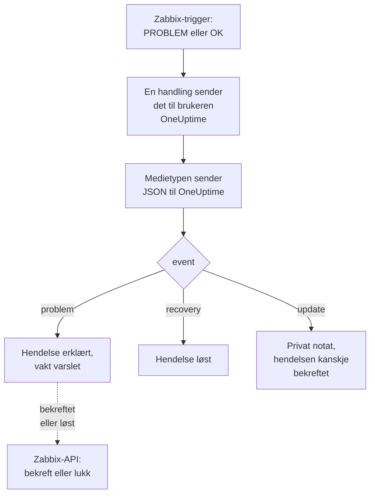

# Zabbix

Send [Zabbix](https://www.zabbix.com)-problemer til OneUptime, slik at hvert problem blir en hendelse som varsler vaktteamet ditt og løses når Zabbix er gjenopprettet. Ferdige arbeidsflytmaler holder begge sider i takt: det folk gjør i Zabbix, noteres på hendelsen, og å bekrefte eller løse hendelsen bekrefter eller lukker problemet i Zabbix. Zabbix sender hvert problem via en webhook-medietype, så det er ingenting å installere på noen av sidene.

:::cards
- [Velg hvordan OneUptime mottar problemer](#velg-hvordan-oneuptime-mottar-problemer): Arbeidsflytmaler eller en Incoming Request-monitor.
- [Start med malene](#start-med-malene): Seks maler, hva de gjør og hva de ber om.
- [Konfigurer Zabbix](#konfigurer-zabbix): En medietype, en bruker og en handling.
- [Feilsøking](#feilsøking): Når problemer ikke kommer frem, eller hendelser blir stående åpne.
:::

## Slik fungerer det



Zabbix sender et problem til en bruker via brukerens medier. Her er mediet en webhook-medietype som heter **OneUptime**: skriptet sender et lite JSON-dokument til OneUptime for hvert problem, for gjenopprettingen av det og for hver oppdatering noen gjør på det i Zabbix, med problemets hendelses-ID, navn, vert og alvorlighetsgrad. Det er med hendelses-ID-en at OneUptime finner hendelsen et problem opprettet.

## Før du begynner

- En Zabbix-server som du administrerer. Denne veiledningen er skrevet for Zabbix 6.0 LTS og 7.0 LTS. Webhook-medietyper fungerer på samme måte fra Zabbix 5.0. Malene som kaller Zabbix sitt API, trenger Zabbix 6.4 eller nyere, eller [én endring på Zabbix 6.0](#på-zabbix-60).
- En Zabbix-server som kan nå OneUptime-installasjonen din via HTTPS, og for malene som kaller Zabbix, en OneUptime som kan nå Zabbix.
- I OneUptime tilgang til å opprette arbeidsflyter, eller monitorer hvis du velger den veien. I OneUptime Cloud krever arbeidsflyter planen **Growth** eller høyere.

## Velg hvordan OneUptime mottar problemer

Sett opp OneUptime først: det gir deg URL-en som Zabbix sender til.

| Måte | Bruk den når |
| --- | --- |
| Arbeidsflytmalene (anbefalt) | Du vil ha hvert problem som en hendelse eller et varsel med Zabbix-alvorlighetsgraden, med vakten varslet for High og Disaster, løst ved gjenoppretting, med det folk gjør i Zabbix notert på den, og Zabbix bekreftet eller lukket fra OneUptime. |
| En Incoming Request-monitor | Du vil ha hendelser uten en arbeidsflyt, på hvilken som helst plan, og en monitor hvis status følger Zabbix. Ingenting går tilbake til Zabbix. |

Begge får den samme JSON-en fra den samme medietypen, så du kan starte med den ene og bytte senere ved å endre én URL i Zabbix.

## Start med malene

Dialogen **Opprett en arbeidsflyt** har seks Zabbix-maler, under **Zabbix** i kategorilisten: tre for hendelser, deretter de samme tre for varsler.

| Mal | Hva den gjør | Hva den ber om |
| --- | --- | --- |
| **Hendelser** | | |
| Declare an incident for each Zabbix problem | Arbeidsflyten Zabbix sender alle meldingene sine til. Den erklærer en hendelse for hvert problem, varsler vakten for High og Disaster, noterer oppdateringer gjort i Zabbix og løser hendelsen ved gjenoppretting. | Zabbix URL |
| Acknowledge or close the Zabbix problem with the incident | Når hendelsen bekreftes, bekrefter den problemet. Når den løses, lukker den problemet, eller bekrefter det der Zabbix ikke tillater å lukke det manuelt. | Zabbix URL, Zabbix API Token |
| Copy incident private notes to the Zabbix problem | Legger til hvert private notat på hendelsen som en melding på problemet. | Zabbix URL, Zabbix API Token |
| **Varsler** | | |
| Create an alert for each Zabbix problem | Det samme som for hendelser, med et varsel for hvert problem. | Zabbix URL |
| Acknowledge or close the Zabbix problem with the alert | Det samme som for hendelser, ut fra varselets tilstand. | Zabbix URL, Zabbix API Token |
| Copy alert private notes to the Zabbix problem | Legger til hvert private notat på varselet som en melding på problemet. | Zabbix URL, Zabbix API Token |

Start med **Declare an incident for each Zabbix problem**, eller **Create an alert for each Zabbix problem** for varsler: hendelsen eller varselet den oppretter, tar vare på problemets hendelses-ID i det egendefinerte feltet `zabbixEventId`, og de to andre malene finner problemet med den.

### Hva malene ber om

- **Zabbix URL**: adressen du åpner Zabbix på, for eksempel `https://zabbix.example.com`, eller `https://example.com/zabbix` når Zabbix kjører under en sti. Lenker til et problem går dit, og malene som kaller Zabbix, sender forespørslene sine til `api_jsonrpc.php` der. Feltet avviser adressen til en side i Zabbix.
- **Zabbix API Token**: et API-token for Zabbix-brukeren arbeidsflyten handler som. [Opprett API-tokenet](#opprett-api-tokenet) viser hvordan. Det lagres som en hemmelig variabel og sendes bare til Zabbix: i headeren `Authorization`, eller i forespørselens brødtekst på Zabbix 6.0.

### Motta problemer med malen

:::steps
1. Gå til **Arbeidsflyter**, og klikk på **Opprett arbeidsflyt**. Under **Eller start fra en mal** velger du **Zabbix** i kategorilisten, klikker på **Declare an incident for each Zabbix problem** og klikker på **Bruk denne malen**.
2. Fyll inn **Zabbix URL**. Under **Who to page for High and Disaster problems** velger du vaktpolicyene som skal tilkalles, eller ingen for ikke å tilkalle noen, og klikker på **Opprett arbeidsflyt**. Arbeidsflyten åpnes i **Bygger**, slått av.
3. Klikk på triggeren **Webhook**, deretter på **Kopier URL**, og ta vare på URL-en til Zabbix.
4. Slå på **Aktivert** øverst i **Bygger**. En arbeidsflyt som er slått av, svarer Zabbix med `400`.
:::

Deretter [konfigurerer du Zabbix](#konfigurer-zabbix) til å sende problemene sine til den URL-en.

### Hva arbeidsflyten gjør

Etter triggeren **Webhook** leser steget **Check With JavaScript** `read-event-1` den `event` medietypen sender, og **Incident From Another Tool**, eller **Alert From Another Tool** i varselmalen, gjør det den betyr, ut fra problemets hendelses-ID:

| Event | Hva arbeidsflyten gjør |
| --- | --- |
| `problem` | Erklærer en hendelse med tittelen `Zabbix: <problem> on <host>`, med alvorlighetsgraden Zabbix-alvorlighetsgraden tilsvarer, holdt unna statussidene dine. Beskrivelsen lenker til problemet i Zabbix og viser verten, alvorlighetsgraden, når det startet, driftsdataene og taggene. For et problem med High eller Disaster varsler den vaktretningslinjen du valgte. Et problem Zabbix sender på nytt, med samme hendelses-ID, oppretter ingen ny hendelse. |
| `recovery` | Løser problemets hendelse, med mindre den allerede er løst. Hvorfor står på tidslinjen. |
| `update` | Legger til det som ble gjort i Zabbix som et privat notat på hendelsen: hvem som gjorde det, hva de gjorde og hva de skrev. Når oppdateringen bekreftet problemet, bekrefter den også hendelsen, slik at vakten slutter å eskalere den. |

Alt annet, for eksempel en forespørsel fra et annet verktøy, blir stående: `read-event-1` tar **No**, og kjøringens **Trinn** sier hvorfor. Et steg som feiler, får kjøringen til å mislykkes, og oppføringen under **Trinn** sier hvorfor.

### Alvorlighetsgrader

I et nytt prosjekt knytter malen Zabbix sine seks alvorlighetsgrader til disse alvorlighetsgradene for hendelser og varsler:

| Zabbix-alvorlighetsgrad | Hendelse | Varsel | Vakt |
| --- | --- | --- | --- |
| Disaster | Critical Incident | High | Varslet |
| High | Critical Incident | High | Varslet |
| Average | Major Incident | Low | Ikke varslet |
| Warning | Major Incident | Low | Ikke varslet |
| Information | Minor Incident | Low | Ikke varslet |
| Not classified | Minor Incident | Low | Ikke varslet |

Med egne alvorlighetsgrader går Disaster og High til den mest alvorlige, Average og Warning til den midterste, og Information og Not classified til den minst alvorlige. Zabbix nummererer alvorlighetsgradene sine fra 0 (Not classified) til 5 (Disaster), og malen leser nummeret, så å gi nytt navn til en alvorlighetsgrad i Zabbix endrer ingenting.

- For å knytte en alvorlighetsgrad til en av dine etter navn, rediger `SEVERITY_BY_NAME` i steget `read-event-1`, for eksempel `{ 2: 'Minor Incident' }` for Warning.
- For å varsle også for Average-problemer, sett **Compare with** i steget `if-page-1` **If / Else** til `3`.

### Send bekreftelser og notater tilbake til Zabbix

:::steps
1. [Opprett API-tokenet](#opprett-api-tokenet).
2. Opprett en arbeidsflyt fra **Acknowledge or close the Zabbix problem with the incident**. Fyll inn **Zabbix URL** og **Zabbix API Token**, klikk på **Opprett arbeidsflyt**, og slå på **Aktivert**.
3. Hvis du også vil ha notatene i Zabbix, gjør det samme med **Copy incident private notes to the Zabbix problem**.
:::

Tilstandsmalen spør først Zabbix om problemet, så et problem Zabbix allerede har bekreftet eller løst, blir stående som det er. For å lukke et problem trenger triggeren **Allow manual close** i Zabbix. Uten den blir problemet bekreftet i stedet, med en melding om at hendelsen ble løst, og Zabbix lukker det når det er gjenopprettet. Hendelser som ikke noe Zabbix-problem opprettet, og hendelser merket **Privat hendelse**, sendes aldri til Zabbix.

### Opprett API-tokenet

:::steps
1. Bruk brukeren `OneUptime` som [mottar problemene](#opprett-en-bruker-som-mottar-problemer). Zabbix sender ikke en bruker brukerens egne oppdateringer, så med denne brukerens token kommer OneUptime sine bekreftelser og meldinger aldri tilbake til OneUptime som oppdateringer.
2. Sjekk brukerens rolle i **Users → User roles**. Den trenger **Access to API** slått på, og **Acknowledge problems**, **Add problem comments** og **Close problems** tillatt. **User role** tillater dem med mindre noen har endret den.
3. Sjekk brukerens gruppe i **Users → User groups**. Tillatelsen **Read** på vertsgruppene er nok til å bekrefte problemer og legge til meldinger. For å lukke problemer trenger den **Read-write**.
4. Gå til **Users → API tokens**, og klikk på **Create API token**. Velg brukeren `OneUptime`, fjern haken for **Set expiration date and time** eller noter datoen, og klikk på **Add**.
5. Kopier **Auth token**: Zabbix viser den bare én gang. Lim den inn i **Zabbix API Token**.
:::

### På Zabbix 6.0

Zabbix 6.0 leser API-tokenet fra forespørselens brødtekst, ikke fra headeren `Authorization`. I steget **Update Zabbix Problem** i hver mal som kaller Zabbix, slår du på **Zabbix 6.0** under **Flere felt**. Zabbix 7.2 og nyere avviser et token i brødteksten, så slå det av igjen når du oppgraderer.

## Motta problemer med en monitor

En [Incoming Request-monitor](/docs/monitor/incoming-request-monitor) gir deg en URL, og kriteriene bestemmer hva hver forespørsel gjør.

:::steps
### Opprett monitoren

Gå til **Monitorer**, og klikk på **Opprett monitor**. Velg **Incoming Request** under **Monitortype**, gi den navnet `Zabbix`, og klikk på **Neste**.

### Erklær en hendelse for hvert problem

I trinnet **Kriterier** åpner du det første kriteriet, det som markerer monitoren som frakoblet. Sett filteret til **Forespørselstekst**, **Inneholder**, `"status":"1"`. Dette kriteriet erklærer allerede en hendelse når filteret samsvarer. Fyll ut hendelsen:

- **Hendelsestittel**: `Zabbix: {{requestBody.name}} on {{requestBody.host}}`.
- **Alvorlighetsgrad**: alvorlighetsgraden Zabbix-problemer skal ha.
- **Vaktretningslinjer**, under **Vakt**: retningslinjene som skal varsles.
- **Løs hendelse automatisk**, under **Flere felt**: la den være på, slik den starter. Uten den ignoreres gjenopprettinger, og hendelser blir stående åpne.

### Opprett én hendelse per problem

I samme kriterium åpner du **Innstillinger** og slår på **Group incidents and alerts by a payload field**. Fyll det ut som nedenfor, slik at hvert problem får sin egen hendelse, og gjenopprettingen av det løser den:

| Felt | Verdi |
| --- | --- |
| **Open a separate incident for each…** | `requestBody.event_id` |
| **Field that signals recovery** | `requestBody.status` |
| **Value that means recovered** | `0` |

### Ta monitoren tilbake på nett

Åpne det andre kriteriet, det som markerer monitoren som tilkoblet, og sett filteret til **Forespørselstekst**, **Inneholder**, `"status":"0"`.

### Kopier URL-en

Klikk på **Opprett monitor**. Monitorens side **Oversikt** viser **Heartbeat URL**. Kopier den til Zabbix:

```text
https://oneuptime.com/heartbeat/<secret key>
```

En selvhostet installasjon har sin egen vert i stedet for `oneuptime.com`.
:::

Monitoren leser forespørselens JSON slik den er skrevet: `"status":"1"`, uten mellomrom. Se [Motta varsler fra et annet system](/docs/monitor/incoming-request-monitor#motta-varsler-fra-et-annet-system) for hva hver innstilling gjør. En oppdatering gjort i Zabbix sendes også med `"status":"1"`, som monitoren leser som problemet igjen, uten å opprette en ny hendelse.

## Konfigurer Zabbix

Zabbix trenger tre ting: en medietype som sender til OneUptime, en bruker å sende den til og en handling som sender problemer til den brukeren.

:::steps
### Opprett medietypen OneUptime

1. Gå til **Alerts → Media types**, eller **Administration → Media types** i Zabbix 6.0, og klikk på **Create media type**.
2. Sett **Name** til `OneUptime` og **Type** til **Webhook**.
3. Legg til disse **Parameters**. Hver av dem fører en Zabbix-[makro](https://www.zabbix.com/documentation/current/en/manual/appendix/macros/supported_by_location) inn i forespørselen:

   | Navn | Verdi |
   | --- | --- |
   | `url` | `{ALERT.SENDTO}` |
   | `event_id` | `{EVENT.ID}` |
   | `event_name` | `{EVENT.NAME}` |
   | `event_value` | `{EVENT.VALUE}` |
   | `event_severity` | `{EVENT.SEVERITY}` |
   | `event_nseverity` | `{EVENT.NSEVERITY}` |
   | `host` | `{HOST.NAME}` |
   | `event_date` | `{EVENT.DATE}` |
   | `event_time` | `{EVENT.TIME}` |
   | `event_opdata` | `{EVENT.OPDATA}` |
   | `event_tags` | `{EVENT.TAGSJSON}` |
   | `trigger_id` | `{TRIGGER.ID}` |
   | `event_update_status` | `{EVENT.UPDATE.STATUS}` |
   | `event_update_action` | `{EVENT.UPDATE.ACTION}` |
   | `event_update_message` | `{EVENT.UPDATE.MESSAGE}` |
   | `event_update_user` | `{USER.FULLNAME}` |

4. Lim inn dette i **Script**:

   ```javascript
   var params = JSON.parse(value);

   // Zabbix leaves a macro it has no value for as it is written, such as
   // {EVENT.UPDATE.MESSAGE} on a problem: it is sent as nothing.
   function given(text) {
     var written = String(text === undefined || text === null ? "" : text);
     return /^\{[A-Z0-9_.]+\}$/.test(written) || written === "*UNKNOWN*"
       ? ""
       : written;
   }

   var isUpdate = given(params.event_update_status) === "1";
   var payload = {
     source: "zabbix",
     // "problem", "recovery" or "update".
     event: isUpdate
       ? "update"
       : params.event_value === "0"
         ? "recovery"
         : "problem",
     event_id: params.event_id,
     name: params.event_name,
     host: params.host,
     severity: params.event_severity,
     // 0 Not classified, 1 Information, 2 Warning, 3 Average, 4 High, 5 Disaster.
     severity_number: params.event_nseverity,
     // "1" for a problem, "0" for its recovery.
     status: params.event_value,
     date: params.event_date,
     time: params.event_time,
     opdata: given(params.event_opdata),
     tags: [],
     trigger_id: params.trigger_id,
   };

   try {
     var tags = JSON.parse(given(params.event_tags) || "[]");
     payload.tags = Array.isArray(tags) ? tags : [];
   } catch (error) {
     payload.tags = [];
   }

   if (isUpdate) {
     payload.update = {
       action: given(params.event_update_action),
       message: given(params.event_update_message),
       user: given(params.event_update_user),
     };
   }

   var request = new HttpRequest();
   request.addHeader("Content-Type: application/json");

   var response = request.post(params.url, JSON.stringify(payload));

   if (request.getStatus() < 200 || request.getStatus() >= 300) {
     throw (
       "OneUptime responded with HTTP " + request.getStatus() + ": " + response
     );
   }

   return "OK";
   ```

5. Legg til en mal for **Problem**, en for **Problem recovery** og en for **Problem update** på fanen **Message templates**. La teksten være tom: skriptet bygger forespørselen. Zabbix bruker bare en medietype for de typene hendelser den har en mal for.
6. Klikk på **Add**.

### Opprett en bruker som mottar problemer

1. Gå til **Users → Users**, eller **Administration → Users** i Zabbix 6.0, og klikk på **Create user**. Gi brukeren navnet `OneUptime`, og gi den en brukergruppe og en rolle som kan motta varslinger, f.eks. **User role**.
2. Klikk på **Add** på fanen **Media**. Sett **Type** til `OneUptime` og **Send to** til URL-en du kopierte fra OneUptime. La **When active** og alvorlighetsgradene være som de er, eller fjern avkryssingen for alvorlighetsgradene OneUptime ikke skal få.
3. Klikk på **Add**, og deretter på **Add** igjen for å lagre brukeren.

### Send problemer til OneUptime med en handling

1. Gå til **Alerts → Actions → Trigger actions**, eller **Configuration → Actions** i Zabbix 6.0, og klikk på **Create action**. Gi den navnet `Notify OneUptime`.
2. Avgrens den under **Conditions** hvis du vil, f.eks. med **Trigger severity is greater than or equals Warning**. Uten betingelser sendes hvert problem.
3. Legg til en operasjon på fanen **Operations** som sender til brukeren `OneUptime` via medietypen `OneUptime`.
4. Legg til den samme operasjonen under **Recovery operations**, slik at gjenopprettinger også sendes, og under **Update operations**, slik at bekreftelser og kommentarer gjort i Zabbix sendes.
5. Klikk på **Add**, og sjekk at handlingen er aktivert.
:::

For å sende noen problemer til hendelsesmalen og andre til varselmalen, gi brukeren `OneUptime` to medier av typen `OneUptime`: hvert sender til URL-en til én arbeidsflyt, med alvorlighetsgradene det skal få.

## Test det

1. Åpne **Alerts → Media types** i Zabbix, og klikk på **Test** ved siden av `OneUptime`. Fyll inn URL-en du kopierte, og eksempelverdier som `event_id` `12345`, `event_name` `Test problem`, `host` `web-1`, `event_nseverity` `4` og `event_value` `1`. Klikk på **Test**: Zabbix viser svaret fra skriptet, `OK`, eller feilen det kastet.
2. Åpne arbeidsflytens **Logger → Kjøringer** i OneUptime og sjekk kjøringen, eller åpne monitoren og sjekk at en hendelse ble opprettet.
3. Test igjen med `event_value` `0` og samme `event_id`. Hendelsen blir løst.

La deretter en ekte trigger utløses, for eksempel ved å senke en terskel et øyeblikk, og se problemet komme inn. For å prøve en oppdatering, bekreft problemet i Zabbix med en melding: hendelsen får et privat notat og blir bekreftet.

## Knytt Zabbix-alvorlighetsgrader til OneUptime

Zabbix sender alvorlighetsgraden som tekst: `Not classified`, `Information`, `Warning`, `Average`, `High` eller `Disaster`.

- **Med malene** knyttes alvorlighetsgradene for deg: se [Alvorlighetsgrader](#alvorlighetsgrader).
- **Med monitoren** klikker du på **Legg til kriterier** for hver gruppe alvorlighetsgrader og drar det nye kriteriet over det første: kriteriene sjekkes ovenfra, og det første som samsvarer, avgjør. Gi hvert kriterium to filtre, `"status":"1"` og en alvorlighetsgrad som `"severity":"Disaster"`, med **Samsvarsbetingelse** satt til **Alle**. Gi hvert kriterium en hendelse med sin egen **Alvorlighetsgrad** og **Løs hendelse automatisk**, og de samme grupperingsinnstillingene.

## Feilsøking

:::details Ingenting kommer frem til OneUptime
- Åpne **Reports → Action log** i Zabbix, og sjekk at handlingen sendte problemet, og hva som kom tilbake.
- Send en forespørsel selv fra Zabbix-serveren: `curl -i -X POST <url> -H 'Content-Type: application/json' -d '{"source":"zabbix","event":"problem","event_id":"1","name":"Test","host":"test","severity_number":"4","status":"1"}'`.
- Monitoren svarer `200` med en gang, før den sjekker noe, selv for en feil hemmelig nøkkel. Sjekk monitorens tidslinje for å se om forespørslene kommer frem.
- En arbeidsflyt som er slått av, svarer `400`. Slå på **Aktivert** øverst i dens **Bygger**.
:::

:::details Zabbix rapporterer en skriptfeil
Åpne medietypen, og bruk **Test**: Zabbix viser resultatet fra skriptet eller feilen det kastet. Et svar fra OneUptime som ikke er `2xx`, kastes av skriptet sammen med statusen, så sjekk URL-en først.
:::

:::details Hendelser opprettes, men løses aldri
- Handlingen trenger **Recovery operations**, ellers sender Zabbix aldri gjenopprettingen.
- Med malen åpner du arbeidsflytens **Logger → Kjøringer** og kjøringen for gjenopprettingen: det siste steget sier hvorfor. En gjenoppretting for et problem som ikke opprettet noen hendelse, endrer ingenting.
- Med monitoren trenger kriteriets hendelse **Løs hendelse automatisk**, under **Flere felt**. **Field that signals recovery** må være `requestBody.status`, og **Value that means recovered** nøyaktig `0`.
:::

:::details Zabbix-problemet blir ikke bekreftet eller lukket
Åpne kjøringen til tilstandsmalen i **Logger → Kjøringer**: det siste steget sier hva Zabbix svarte.

- `Not authorized`: API-tokenet er feil, utløpt eller deaktivert, eller Zabbix er eldre enn 6.4 (se [På Zabbix 6.0](#på-zabbix-60)).
- `Cannot close problem: trigger does not allow manual closing`: slå på **Allow manual close** på triggeren. Malen bekrefter allerede slike problemer i stedet for å lukke dem.
- `No permissions to referred object or it does not exist!`: brukeren ser problemet, men trenger tillatelsen **Read-write** for å lukke det.
- `Zabbix has no problem with event ID`: brukeren ser ikke problemets vert. Gi brukergruppen tillatelsen **Read** på vertsgruppen.
:::

:::details Hendelsen viser en referanse i stedet for en verdi
En referanse til et felt som forespørselen ikke har, blir stående slik den er skrevet, krøllparenteser og alt, i stedet for å bli tømt. Sjekk at Zabbix sender `Content-Type: application/json`, og at feltnavnene du bruker (`name`, `host`, `severity`, `status`, `event_id`), samsvarer med skriptets payload. For en arbeidsflyt åpner du kjøringen i **Logger → Kjøringer** og sammenligner med det triggeren mottok. Se [Fallgruver](/docs/workflows/variables#feller).
:::

:::details Hvert problem kommer to ganger
Handlingen har sannsynligvis to operasjoner som sender til den samme brukeren, for eksempel et første trinn og et eskaleringstrinn. Malen oppretter én hendelse per hendelses-ID uansett hva som kommer, men hver levering er en kjøring. Sjekk handlingens **Operations**.
:::

## Sikkerhet

- **Behandle URL-en som et passord.** Alle som har den, kan opprette hendelser. Hvis den lekker, tilbakestiller du den: **Tilbakestill URL** i arbeidsflytens **Webhook**-trigger, eller **Tilbakestill hemmelig nøkkel for innkommende forespørsel** på monitorens side **Innstillinger**. Oppdater deretter **Send to** i Zabbix-brukerens medie.
- **Lenker går til din Zabbix.** Malen lenker et problem på nettstedet som **Zabbix URL** navngir, uansett hva en forespørsel sier, og skriver det Zabbix sendte, som tekst.
- **Begrens API-tokenet til det arbeidsflyten gjør.** Det er en hemmelig variabel, skjult i kjøringslogger og sendt bare til Zabbix, i headeren `Authorization` med mindre **Zabbix 6.0** er slått på. Gi brukeren en rolle med ikke mer enn handlingene over, og slett tokenet i **Users → API tokens** hvis det lekker.
- **Send bare det som trenger en hendelse.** Bruk handlingens betingelser, eller alvorlighetsgradene i brukerens medie, til å holde problemer med lav alvorlighetsgrad i Zabbix.
- **Selvhostet?** La Zabbix-serveren din nå OneUptime-installasjonen din via HTTPS gjennom brannmuren. For å kalle en Zabbix på et privat nettverk trenger arbeidsflyten [utgående nettverkstilgang](/docs/workflows/configuration#utgående-nettverkstilgang).

## Neste trinn

:::cards
- [Arbeidsflytmaler](/docs/workflows/authoring): Opprett en arbeidsflyt fra en mal, og endre den i Bygger.
- [Innkommende forespørsel-overvåking](/docs/monitor/incoming-request-monitor): Alle innstillingene for monitoren som mottar Zabbix-problemer.
- [Eskaleringsregler](/docs/on-call/escalation-rules): Bestem hvem en vaktretningslinje varsler, og når.
- [Oversikt over integrasjoner](/docs/integrations/index): De andre verktøyene du kan koble til.
:::
