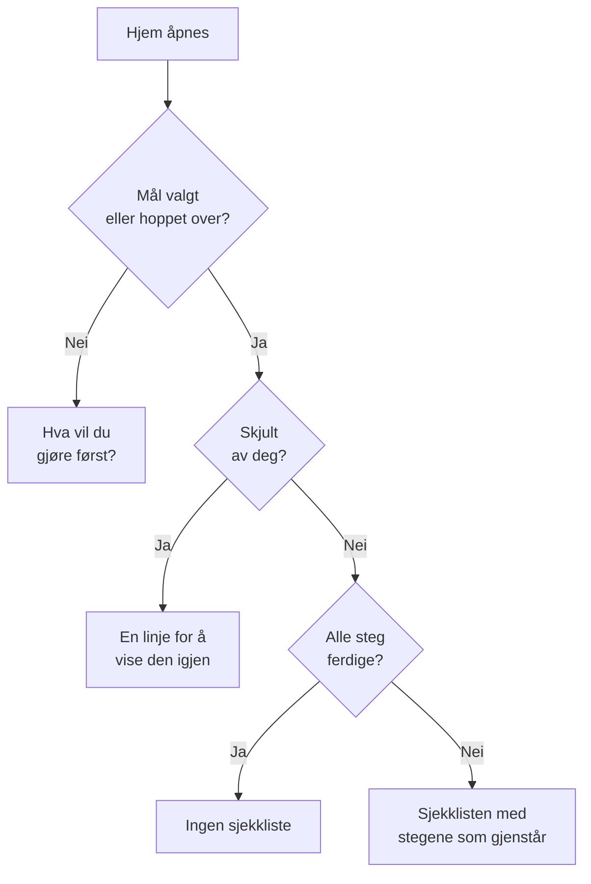

# Startside og snarveier

Hjem er den første siden du ser i et prosjekt. Den viser med et blikk om noe trenger deg akkurat nå, og leder et nytt prosjekt gjennom det første oppsettet. Denne siden forklarer hva Hjem viser, hvordan du finner ethvert produkt, enhver side og handling i dashbordet, og hurtigtastene som sparer deg for turer gjennom menyene.

:::cards
- [Hva Hjem viser](#hva-hjem-viser): Om noe er galt, hva som trenger deg, hva prosjektet inneholder og alle produktene.
- [Finn frem](#finn-frem): Menyen Produkter og linjene øverst på hver side.
- [Søk](#søk-etter-en-side-en-innstilling-eller-en-handling): Finn enhver side, innstilling eller handling ved å skrive navnet.
- [Hurtigtaster](#hurtigtaster): Gå til Hjem, Overvåkere eller Hendelser med to taster.
:::

## Hva Hjem viser

Åpne **Hjem** i linjen øverst, eller trykk `g` og deretter `h` hvor som helst. Hjem er oversikten over prosjektet ditt, én side uten sidemeny. Fra topp til bunn viser den:

1. Et søkefelt, med **Erklær hendelse** og **Opprett** ved siden av.
2. Én linje som sier om noe er galt, over fem tall som teller det som trenger oppmerksomhet.
3. **Velkommen til OneUptime 👋**, en sjekkliste for et nytt prosjekt, til den er fullført.
4. **Krever oppmerksomhet**, hvert problem som er åpent akkurat nå, ved navn.
5. **Prosjektet ditt**, hva prosjektet består av, og **Kommende vedlikehold** når noe er planlagt.
6. **Utforsk OneUptime**, alle produktene, én kategori om gangen.

### Søk og opprett

Søkefeltet åpner søket, akkurat som `Mod` + `K`: skriv navnet på en side, monitor, hendelse, varsel, statusside eller vaktpolicy. Se [Søk](#søk-etter-en-side-en-innstilling-eller-en-handling). **Erklær hendelse** åpner skjemaet der du erklærer en hendelse. **Opprett** tilbyr **Opprett monitor**, **Planlegg vedlikehold** og **Opprett kunngjøring**. Hver av dem vises bare for dem som har lov til å bruke den.

### Overskriften

Linjen øverst nevner det mest presserende som er åpent, i en farge som passer:

| Når | Hjem sier |
| --- | --- |
| En hendelse er åpen | Hvor mange hendelser som er aktive, i rødt |
| Ingen hendelse er åpen, men det finnes åpne varsler, monitorer som ikke er i drift, eller SLO-er i faresonen | Hvor mange problemer som krever oppmerksomhet, i gult |
| Ingenting er galt, og vedlikehold pågår | Hvor mange vedlikehold som pågår |
| Monitorer kjører, og ingenting er åpent | **Alle systemer er i drift** |
| Prosjektet har ingen monitorer ennå | **Ingenting overvåkes ennå** |

Ved siden av sier Hjem når den sist leste prosjektet, og **Oppdater** leser det på nytt. Når du kommer tilbake til en fane med Hjem etter ett minutt eller mer, oppdaterer den seg selv.

Så lenge ingenting overvåkes ennå, slutter linjen med knappen **Opprett din første overvåker**, som åpner det veiledede oppsettet **Vite når nettstedet eller API-et mitt er nede**. Bare de som har lov til å opprette monitorer, ser den.

### De fem tallene

Hvert tall teller noe, sier om det trenger deg, og åpner listen bak det i produktet den hører til.

| Tall | Hva det teller | Når tallet er null | Åpner |
| --- | --- | --- | --- |
| **Aktive hendelser** | Hendelser som ikke er løst | **Alt er i orden** | **Hendelser → Aktive hendelser** |
| **Aktive varsler** | Varsler som ikke er løst | **Alt er i orden** | **Varsler → Aktive varsler** |
| **Ikke-operative monitorer** | Monitorer med en status som ikke er en driftsstatus. Arkiverte monitorer, og monitorer med overvåking slått av, telles ikke. | **Alle i drift** | **Monitorer → Ikke operativ** |
| **Pågående vedlikehold** | Vedlikeholdshendelser som pågår | **Ingen pågår** | **Planlagt vedlikehold → Pågående vedlikeholdshendelser** |
| **SLO-er i faresonen** | Påslåtte SLO-er som er i faresonen eller har brukt opp feilbudsjettet | **Budsjettene er sunne** | **SLOs** |

Et tall over null viser **Krever oppmerksomhet**, eller **Pågår** og **Budsjettet brukes opp** for vedlikehold og SLO-er. Så lenge en SLO er i faresonen, åpner **SLO-er i faresonen** listen **SLOs** filtrert til akkurat dem. Et prosjekt uten monitorer ser **Ingen monitorer ennå**, og ett uten SLO-er ser **Ingen SLO-er ennå**: et tomt prosjekt er ikke det samme som et sunt. De to åpner da listene **Monitorer** og **SLOs**, der du oppretter en.

### Velkomstsjekklisten

Første gang en prosjekteier eller prosjektadministrator åpner Hjem i et nytt prosjekt, spør kortet **Hva vil du gjøre først?** Kryss av for ett eller flere mål, for eksempel **Vite når nettstedet eller API-et mitt er nede** eller **Jeg ser meg bare rundt**, og klikk på **Fortsett**: sjekklisten inneholder da stegene disse målene trenger. **Hopp over** gir de fire stegene alle prosjekter får. For å svare på nytt senere klikker du på **Endre** i sjekklisten. Et prosjekt som allerede bruker overvåkere, telemetri eller vakt, blir ikke spurt.

Hvert steg krysser seg selv av når tingen virker, ikke når en post finnes, og alle som setter opp prosjektet ser den samme listen, på alle enheter:

| Steg | Fullført når | Åpner |
| --- | --- | --- |
| **Importer fra verktøyet du bruker nå** | En import fra et annet verktøy er fullført. | **Importer fra et annet verktøy** |
| **Opprett din første overvåker** | Den første sjekken kommer inn. | Det veiledede oppsettet **Vite når nettstedet eller API-et mitt er nede**, eller listen **Monitorer** for den som ikke kan opprette overvåkere. |
| **Koble til en server eller en klynge** | De første målingene kommer inn. | **Verter** |
| **Send de første loggene, målingene eller sporene dine** | Prosjektets første logger, målinger, spor, unntak eller profiler kommer inn. | Det veiledede oppsettet **Send logger, målinger og spor, og få deretter varsler** |
| **Sett opp en vaktpolicy** | Et testvarsel blir kvittert, et varsel når noen, eller en vaktregel kjører en policy som kan nå noen. | Det veiledede oppsettet **Varsle rett person når noe går ned** |
| **Publiser en statusside** | En statusside viser en overvåker. | Det veiledede oppsettet **Publiser en statusside**, eller listen **Statussider** for den som ikke kan opprette statussider. |
| **Inviter teamet ditt** | Noen godtar invitasjonen din. | **Brukere** |

Steget du skal ta først, er merket med **Neste steg**. På Free-abonnementet i OneUptime Cloud, som har én person, sier **Inviter teamet ditt** at det trenger Growth-abonnementet, og åpner **Fakturering**. På en selvhostet server som ennå ikke kan sende e-post, ser serverens administratorer først **Denne serveren kan ikke sende e-post ennå**; det åpner administrasjonsdashbordet.

Et veiledet oppsett gjør hele jobben på én side, ett steg om gangen, og avslutter med hva det har satt opp og hva du kan gjøre etterpå. Søk etter navnet for å åpne det igjen senere.

Under stegene viser **Slik fungerer OneUptime** de fire kjerneproduktene i rekkefølgen et problem går gjennom dem: **Monitorer**, **Hendelser og varsler**, **Vakt** og **Statussider**. Klikk på ett for å åpne det. Under dem står det hva som mater kretsløpet, telemetri og infrastruktur, med lenker til [Grunnbegreper](/docs/introduction/core-concepts) og [Ordliste](/docs/introduction/glossary).

Sjekklisten forsvinner for alle når hvert steg er ferdig. For å skjule den tidligere klikker du på **Skjul**: den er da bare skjult for deg, på alle enheter, og en linje blir stående med **Vis den** og **Slik fungerer OneUptime**. De som er invitert til prosjektet som medlemmer, ser ikke sjekklisten. **Slik fungerer OneUptime** er fortsatt ett klikk unna, i alle prosjekter: åpne det fra **Hjelp** eller med knappen ved siden av **Utforsk OneUptime**.

### Krever oppmerksomhet

**Krever oppmerksomhet** viser ved navn det tallene teller: de åpne hendelsene, de åpne varslene, monitorene som ikke er i drift, SLO-ene i faresonen og vedlikeholdet som pågår, det mest presserende først. Hver rad viser alvorlighetsgrad eller status, sier når en hendelse eller et varsel startet og når vedlikeholdet slutter, og åpner oppføringen. Hver type viser opptil fem, med **Vis alle** for resten, som åpner den samme listen som tallet. Når ingenting er åpent, står det **Ingenting krever oppmerksomheten din**.

### Oppsettets helse

Når noe i prosjektets oppsett ville hindre at folk blir varslet, slutter **Krever oppmerksomhet** med **Oppsett**: hvor mange ting som bør ses på. Den åpner **Oppsettets helse**, som viser hva som er satt opp feil, det verste først, under **Varsler kommer ikke frem**, **Verdt å rette** og **Forslag**: en monitor som ikke varsler noen, en vaktpolicy som ingenting kjører, en person som ikke kan varsles, SMS slått av, en vakttidsplan uten noen på vakt, en statusside som ikke viser noen monitor. Hvert funn sier i én setning hva som er galt, med knappen som åpner rettingen, og funnene for en monitor er bruddene som kortet **Når den går ned** nevner. Et funn som teamet ditt lar være med vilje, kan skjules med en begrunnelse, for alle, og gjenopprettes fra **Avvist**. Søk finner siden som **Oppsettets helse**, og Spør AI svarer på «er oppsettet mitt i orden?» ut fra den.

### Prosjektet ditt

**Prosjektet ditt** teller prosjektets **Monitorer**, **Statussider**, **Vaktretningslinjer**, **SLOs**, **Tjenester**, **Dashbord** og **Arbeidsflyter**, uten de arkiverte. Hver rad åpner listen sin. En type som prosjektet ikke har noen av, viser **Konfigurer** i stedet for et tall.

**Kommende vedlikehold** viser de neste tre planlagte vedlikeholdsvinduene, det tidligste først. Den utelates når ingenting er planlagt.

### Utforsk OneUptime

**Utforsk OneUptime** viser produktene i menyen **Produkter** én kategori om gangen, og begynner med det grunnleggende. Hvert produkt sier hva det er til, og åpnes når du klikker på det. Produktene prosjektet ditt skjuler, er ikke med.

## Finn frem

Alt i OneUptime ligger under **Produkter** i topplinjen. Menyen viser gruppene sine som radene i én liste, og åpner alltid med den første av dem, det grunnleggende, utvidet: Overvåkere, Hendelser, Varsler, Vakt, Statussider, Planlagt vedlikehold og SLOs. Hver annen gruppe (Observerbarhet, Sikkerhet, AI, Kode, Ressurser, Infrastruktur, Sky, Dashbord og automatisering og Innstillinger) er slått sammen til en rad i den samme listen. Hver rad nevner produktene i gruppen og sier hvor mange det er. Klikk på en rad for å utvide eller slå den sammen, eller gå til den med piltastene og trykk **Enter**.

- **Søk finner alt.** Skriv i menyens søkefelt for å finne ethvert produkt etter navn, etter hva det gjør, eller etter et kjent ord som `k8s` eller `RUM`. Søket ser også inni de sammenslåtte gruppene.
- **Du starter der du er.** Gruppen til siden du er på, utvides av seg selv, og produktene du nylig har åpnet, står øverst.
- **Valgene dine blir værende.** Menyen husker i nettleseren din hvilke av de andre gruppene du har utvidet eller slått sammen. Det grunnleggende er utvidet igjen hver gang du åpner menyen, selv om du slo det sammen.
- **På en telefon** viser menyknappen produktene på samme måte: det grunnleggende utvidet øverst, og hver annen gruppe som én rad som åpnes med et trykk.
- **Produkter prosjektet ikke bruker.** En prosjekteier eller -administrator kan skjule dem under **Prosjektinnstillinger → Grunnleggende → Produkter**. Et skjult produkt flyttes til **Flere produkter**, menyens siste rad: Søk finner det fortsatt, sidene virker fortsatt, og dataene fortsetter å komme. Når ett av dem begynner å motta data, sier Hjem fra til dem som kan vise det igjen.
- **Fest.** Behold et produkt i den øverste linjen, ved siden av **Hjem** og **Produkter**: trykk på nålen på kortet i menyen, eller på **Fest** ved siden av sidetittelen. Du kan feste fem, og de følger deg til alle nettlesere. På en telefon kommer de festede produktene dine først i menyen.
- **Hva som er i bruk.** I hver gruppe unntatt det grunnleggende og innstillingene kommer produktene prosjektet ditt bruker, først, og et du ikke har satt opp ennå, sier **Ikke satt opp**. I OneUptime Cloud nevner et produkt som abonnementet ditt ikke omfatter, abonnementet som omfatter det.

### Linjene øverst

To linjer går over toppen av hver side.

| Hvor | Hva som er der |
| --- | --- |
| Øverst til venstre | Prosjektvelgeren: bytt til et annet av prosjektene dine, eller opprett et nytt. |
| Øverst til høyre | **Søk** og **Spør AI**, varselklokken med det som trenger deg nå (aktive hendelser og varsler, vaktpolicyene du har vakt i, ventende invitasjoner), **Hjelp**, og bildet ditt, som åpner menyen for [kontoen](/docs/introduction/your-account) din. |
| Under dem | **Hjem** og **Produkter** til venstre, **Brukerinnstillinger** til høyre: hvordan OneUptime når deg i dette prosjektet. |

**Hjelp** starter med det som hjelper deg å lære: **Hurtigstart**, **Slik fungerer OneUptime**, **Ordliste** og denne dokumentasjonen (**Dokumentasjon**). Under dem ligger listen **Hurtigtaster** og støtte på e-post og på Slack. På et nettbrett eller i et smalt vindu er **Spør AI** utelatt for å spare plass: den finnes blant handlingene i **Søk**. På en telefon flytter **Søk** og **Hjelp** inn i listen til menyknappen, øverst og nederst; klokken og bildet ditt blir værende.

Et ord med en prikket linje under, som **Sonder** i skjemaet for en ny monitor, forteller hva det betyr når du peker på det, tabber til det eller trykker på det. **Les mer** åpner ordet i [Ordliste](/docs/introduction/glossary).

### Sider og lister

Over tittelen på hver side viser et spor som *Prosjekt › Docker › Innstillinger › Eierregler* hvor siden ligger. Hvert trinn før det siste åpner siden sin.

- **Listene holder seg oppdatert selv.** Når en hendelse eller et varsel opprettes, bekreftes eller løses hvor som helst, viser listene over hendelser, varsler og episoder det i løpet av sekunder, uten å laste inn på nytt. Mens du er midt i noe på en liste, for eksempel med rader avkrysset eller en dialog åpen, venter den og tar igjen alt når du er ferdig.
- **På en telefon foldes filterbrikkene sammen** bak **Filter**, så listen starter høyere opp. Brikkene du har satt, blir stående synlige, med **Tøm alt**. Trykk på **Filter** for å se alle brikkene, og en gang til for å folde dem sammen igjen.
- **Kolonner**, i menyen **⋯** på en liste, velger hvilke kolonner listen viser og i hvilken rekkefølge, og husker dem for deg i denne nettleseren. En prosjekteier eller en prosjektadministrator kan også krysse av for **Vis disse kolonnene for alle i dette prosjektet** der: alle som ikke har valgt egne kolonner for listen, ser disse, og **Tilbakestill til prosjektets standard** setter dine egne tilbake til dem.
- **Kompakte rader**, i samme meny, gjør radene i alle lister lavere, så en lang liste viser omtrent en femtedel flere av dem. Valget huskes i denne nettleseren.
- **På en telefon, eller i et kort som er for smalt for radene sine, vises en liste som kort, ett per rad.** Båndet over dem sier hvilken rekkefølge de står i, for eksempel **Sortert etter Navn**: trykk på det for å velge kolonnen det sorteres etter, og **Stigende** eller **Synkende**.
- **Sidene til en hendelse begynner med nummeret.** Overskriften, trinnet i sporet og nettleserfanen viser `INC-42 Checkout is down`, og det samme gjør dialogene som nevner den, så hendelser med samme tittel kan skilles fra hverandre. Varsler, vedlikeholdshendelser og episoder gjør det samme.

## Søk etter en side, en innstilling eller en handling

Trykk **Cmd+K** (Mac) eller **Ctrl+K** (Windows og Linux), eller klikk på søkeikonet i topplinjen, og begynn å skrive. Søket finner:

- **Hver side i menyene**, under navnet menyen gir den: API-nøkler, Faresone, Vaktplaner, Hendelsesalvor, dine egne Varselmetoder. Hvert resultat sier hvor det ligger, for eksempel *Prosjektinnstillinger › Avansert*, slik at sider med samme navn (Egendefinerte felt under Hendelser, Varsler og Monitorer) er lette å skille fra hverandre.
- **Innstillingene på en side**, under navnet kortet eller bryteren deres viser: *Krev SSO for innlogging* finner SSO, og *Egendefinerte SMTP-konfigurasjoner* finner Varslingskanaler. Skriv navnet på engelsk eller på ditt eget språk.
- **Handlinger**, etter hva du vil gjøre: Erklær hendelse, Opprett monitor eller Delete Project, som åpner Faresone. En handling som endrer noe, tilbys bare dem som har lov til å utføre den.
- **Monitorene, hendelsene, varslene, statussidene og vaktpolicyene dine**, etter navn, og hendelser og varsler også etter nummer, for eksempel `INC-42`. Hvert resultat for en hendelse eller et varsel begynner med nummeret, så to med samme tittel kan skilles fra hverandre.
- **Dokumentasjonen**, i en gruppe *Dokumentasjon* under alt annet: sidene og avsnittene der ordene passer til det du skriver, på ditt språk, også med en skrivefeil. Hver åpnes i en ny fane, så du beholder plassen din.

Søket leser det du skriver slik du mener det:

- Store og små bokstaver, aksenter, mellomrom og bindestreker spiller ingen rolle: *on-call*, *on call* og *oncall* finner de samme sidene, og ordene kan stå i hvilken som helst rekkefølge.
- Det kjenner andre ord for mange sider, på engelsk: *pager* eller *escalation* for Vaktretningslinjer, *rota* for Vaktplaner, *2fa* for totrinnsbekreftelse, *delete project* for Faresone.
- Legg til produktets navn for å snevre inn et søk: *incident custom fields* finner siden Egendefinerte felt under Hendelser.
- En liten skrivefeil, som *incidnet*, finner likevel det du mente når ingenting treffer slik det er skrevet.

Med tomt søkefelt viser søket sidene du nylig har åpnet, handlingene og produktene.

## Hurtigtaster

Trykk `?` hvor som helst i dashbordet for å se alle hurtigtastene, eller åpne **Hjelp** og velg **Hurtigtaster**. På en Mac er `Mod` Command-tasten; på Windows og Linux er det Ctrl.

| Taster | Hva de gjør |
| --- | --- |
| `Mod` + `K` | Åpne kommandopaletten: søk etter enhver side, innstilling eller handling. |
| `Mod` + `I` | Spør AI om det du ser på. |
| `/` | Søk i listen på denne siden. |
| `?` | Vis hurtigtastene. |
| `Esc` | Lukk en dialog eller et panel. |

### Gå til et produkt

Trykk `g` og deretter en bokstav for å gå rett til et produkt. Trykk bokstaven innen halvannet sekund etter `g`.

| Taster | Går til |
| --- | --- |
| `g` deretter `h` | Hjem |
| `g` deretter `m` | Overvåkere |
| `g` deretter `i` | Hendelser |
| `g` deretter `a` | Varsler |
| `g` deretter `o` | Vakt |
| `g` deretter `s` | Statussider |
| `g` deretter `e` | Planlagt vedlikehold |
| `g` deretter `d` | Dashbord |
| `g` deretter `l` | Logger |
| `g` deretter `t` | Spor |

Hurtigtastene står ikke i veien for deg. `?`, `/` og `g` gjør ingenting mens du skriver i et felt, og ingenting navigerer bort mens en dialog er åpen, så et feiltrykk kan ikke koste deg et halvutfylt skjema. Alle andre produkter er ett søk unna med `Mod` + `K`.

## Neste steg

:::cards
- [Hurtigstart](/docs/introduction/quickstart): Gå gjennom velkomstsjekklisten, steg for steg.
- [Kontoen din](/docs/introduction/your-account): Profilen din, sikkerheten rundt innloggingen, språk og tema.
- [Spør AI](/docs/ai/ask-ai): Hva Ask AI kan svare på og gjøre for deg.
- [Grunnbegreper](/docs/introduction/core-concepts): Hva monitorer, hendelser, varsler og vakt er.
:::
