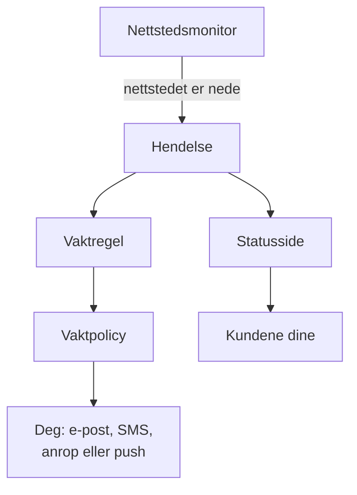

# Hurtigstart

Denne guiden tar deg fra en ny konto til et oppsett som virker, på omtrent femten minutter: en monitor som sjekker nettstedet ditt hvert femte minutt, en vaktpolicy som varsler deg når nettstedet går ned, og en statusside som informerer kundene dine. Den følger sjekklisten **Velkommen til OneUptime 👋** på prosjektets startside, og de veiledede oppsettene som stegene i den åpner.

Kommer du fra et annet verktøy? [Importer oppsettet ditt](/docs/introduction/getting-started#hvis-du-kommer-fra-et-annet-verktøy) først: monitorene, vaktplanene og statussidene dine blir med.

## Før du begynner

- **En konto.** På OneUptime Cloud registrerer du deg på [oneuptime.com](https://oneuptime.com/accounts/register) og åpner lenken i e-posten du får. På din egen installasjon åpner du den i nettleseren og registrerer deg: den første kontoen blir hovedadministrator. Se [Docker Compose](/docs/installation/docker-compose) for å installere en.
- **Et nettsted å følge med på.** Enhver adresse som svarer over HTTP eller HTTPS, for eksempel forsiden til bedriften din.

## Opprett et prosjekt

I OneUptime ligger alt i et prosjekt: monitorene, hendelsene, vaktpolicyene, statussidene og folkene som jobber med dem.

:::steps
### Start et nytt prosjekt

Første gang du logger inn, viser OneUptime **Ingen prosjekter**. Klikk på **Opprett nytt prosjekt**. Har noen allerede invitert deg til et prosjekt, godtar du heller invitasjonen på samme side.

### Gi det et navn

Skriv inn et **Prosjektnavn**, for eksempel navnet på bedriften din. På OneUptime Cloud velger du også en plan rett under: Free er allerede valgt, og de betalte planene starter med en gratis prøveperiode.

### Opprett det

Klikk på **Opprett prosjekt**. Prosjektets startside åpnes, med sjekklisten **Velkommen til OneUptime 👋** øverst. Først spør den **Hva vil du gjøre først?**: kryss av for **Vite når nettstedet eller API-et mitt er nede**, **Varsle rett person når noe går ned** og **Fortelle kundene mine det med en statusside**, og klikk på **Fortsett**.
:::

## Overvåk nettstedet ditt

:::steps
### Åpne oppsettet for nettstedet

Klikk på **Opprett din første overvåker** i sjekklisten. Det åpner det veiledede oppsettet **Vite når nettstedet eller API-et mitt er nede**, som sjekker nettstedet ditt, velger hvem som får beskjed og sender en test, på én side. Den som ikke har lov til å opprette monitorer, får i stedet listen **Monitorer**.

### Skriv inn adressen

Under **Hva skal vi sjekke?** skriver du hele adressen til nettstedet ditt i **Adresse til nettsted eller API**, for eksempel `https://example.com`, og klikker på **Start sjekkingen**. Sondene sjekker det med en gang, og deretter hvert 5. minutt: Når nettstedet ikke svarer, eller svarer med en feil, går monitoren til **Frakoblet** og erklærer en hendelse. Klikk på **Fortsett**.

På Free-planen i OneUptime Cloud faktureres monitorer etter bruk, så prosjektet trenger en betalingsmåte før det kan sjekke nettstedet ditt: uten en ber steget deg om å [legge til en betalingsmåte](/docs/configuration/billing#betalingsmetoder).

### Velg hvem som får beskjed

Under **Hvem skal få beskjed?** står du allerede i **Hvem som tilkalles**. Klikk på **Lagre og fortsett**: Det oppretter `Default on-call policy`, som tilkaller deg ved hver nye hendelse og hvert nye varsel i prosjektet, til å begynne med på e-post. For også å tilkalle teammedlemmer som allerede er i prosjektet, klikker du først på **Legg til teammedlemmer**.

### Send deg selv en test

Under **Send en test** klikker du på **Send meg et testoppkall**, velger en **Alvorlighetsgrad** og klikker på **Send testoppkall**. Åpne lenken i e-posten, der det står TEST, og bekreft oppkallet der. Klikk deretter på **Ferdig** i dialogen, og på **Fortsett**: Oppsettet slutter med en oppsummering av hva det har satt opp.
:::

For å stille inn hvert valg selv, eller for å sjekke noe annet enn et nettsted, åpner du **Monitorer** fra menyen **Produkter** og klikker på **Opprett monitor**. [Opprett en monitor](/docs/monitor/create-monitor) beskriver skjemaet og alle monitortyper.

For også å sjekke et API, og se hva du gjør når den første sjekken aldri kommer tilbake, følger du [Få beskjed når nettstedet eller API-et ditt går ned](/docs/guides/website-down).

## Bli varslet når det går ned

Oppsettet for nettstedet har allerede opprettet `Default on-call policy`, som tilkaller deg på e-post ved hver nye hendelse og hvert nye varsel, så sjekklisten krysser av **Sett opp en vaktpolicy** som gjort. Det veiledede oppsettet for det legger likevel til telefonen din, personene som tilkalles sammen med deg, og hva som skjer når ingen svarer.

:::steps
### Åpne vaktoppsettet

Trykk på `Ctrl+K` (`Cmd+K` på en Mac), skriv `get paged` og velg **Varsle rett person når noe går ned**. Så lenge sjekklisten ikke har krysset av **Sett opp en vaktpolicy**, åpner det steget det samme veiledede oppsettet.

### Velg hvordan du nås

Under **Hvordan skal vi nå deg?** står e-posten du logger inn med, allerede. For push-varsler installerer du appen OneUptime On-Call fra App Store eller Google Play, logger inn og klikker på **Kontroller på nytt**. For også å få SMS og anrop klikker du på **Slå på SMS og anrop**, skriver nummeret ditt i **Telefonnummeret ditt** og klikker på **Send meg en kode på SMS**: På OneUptime Cloud betales SMS og anrop fra prosjektets saldo, så steget ber deg først fylle på. Klikk på **Fortsett**.

### Velg hvem andre som tilkalles

Under **Hvem andre har vakt?** beholder du `Default on-call policy` under **Vaktpolicy**. For å tilkalle teammedlemmer sammen med deg legger du dem til under **Legg til i den første eskaleringsregelen**. Klikk på **Lagre og fortsett**.

### Bestem hva som skjer hvis ingen svarer

Under **Hva om ingen svarer?** velger du **Tilkall de samme personene igjen** så lenge du er den eneste personen i prosjektet. Når det er kommet teammedlemmer, tilkaller **Tilkall noen andre** personen du velger under **Tilkalles deretter**. I OneUptime Cloud tilbyr bare de betalte planene det valget. Klikk på **Lagre og fortsett**.

### Send et testoppkall

Under **Send et testoppkall** klikker du på **Test denne policyen**, velger en **Alvorlighetsgrad** og klikker på **Send testoppkall**. Bekreft oppkallet fra e-posten, SMS-en eller anropet, og klikk deretter på **Ferdig** i dialogen, og på **Fortsett**. Oppsettet slutter på **Tilkalling er satt opp**.
:::

> [!NOTE]
> SMS og telefonanrop er slått av i et nytt prosjekt. En prosjekteier, en Billing Admin eller noen med Manage Billing slår dem på i kortet **Varslingskanaler** under **Prosjektinnstillinger → Varsler → Varslingskanaler**.

To vaktregler utløser policyen: én ved hver nye hendelse og én ved hvert nye varsel. For å se den første åpner du **Hendelser** fra menyen **Produkter**, folder ut **Regler** i sidemenyen og velger **Vaktregler**: Den treffer **Alle hendelser**. For å utløse policyen bare ved noen hendelser, for eksempel kritiske, redigerer du regelen der, eller klikker på **Opprett Incident On-Call Rule** for å legge til din egen.

For i stedet å bygge en policy felt for felt åpner du **Vakt** fra menyen **Produkter** og klikker på **Opprett Vaktpolicy**. Se [Eskaleringsregler](/docs/on-call/escalation-rules) og [Vaktplaner](/docs/on-call/schedules) for flere nivåer, rotasjoner og hvor lenge hvert nivå venter.

For hvert skjermbilde i oppsettet, og hva du gjør når et oppkall ikke kommer frem, følger du [Bli varslet via telefon, SMS eller push](/docs/guides/paging).

## Publiser en statusside

:::steps
### Åpne oppsettet for statussiden

Klikk på **Publiser en statusside** i sjekklisten. Det åpner det veiledede oppsettet **Publiser en statusside**, som gir siden et navn, setter monitoren din på den og viser hva kundene dine ser. Den som ikke har lov til å opprette statussider, får i stedet listen **Statussider**. Oppsummeringen i oppsettet for nettstedet åpner det samme oppsettet, som **Vis den på en statusside**.

### Gi den et navn og velg monitoren din

Under **Gi den et navn og velg hva den viser** beholder du **Navn på statussiden** som foreslås, eller skriver ditt eget. Under **Hva den viser** krysser du av for nettstedsmonitoren din, og klikker på **Opprett statussiden**. Fra dette øyeblikket er siden offentlig på lenken sin: Alle med adressen kan åpne den.

### Åpne siden

Under **Dette ser kundene dine** åpner du adressen under **Offentlig lenke**: Nettstedet ditt vises som i drift. Tilbake i oppsettet klikker du på **Ser bra ut**. Oppsettet slutter med en oppsummering av hva du kan gjøre videre.
:::

For i stedet å lage en side for hånd åpner du **Statussider** fra menyen **Produkter** og klikker på **Opprett statusside**, og legger deretter til monitoren din med **Legg til monitorer** på sidens **Oversikt**. Se [Statusside – merkevare og domener](/docs/status-pages/branding-and-domains) for å gi siden din egen logo og dine egne farger.

For å legge statussiden på ditt eget domene, over HTTPS, følger du [Publiser en statusside](/docs/guides/status-page).

## Inviter teamet ditt

Klikk på **Inviter teamet ditt** i sjekklisten, eller åpne **Brukere** fra menyen **Produkter**, under **Innstillinger**. Klikk på **Inviter bruker**, skriv inn personens **E-post**, og velg et **Team**: medlemsteamet er valgt fra start. Klikk på **Inviter**. OneUptime sender invitasjonen på e-post, og teamet avgjør hva personen kan gjøre. Se [Brukere, team og tillatelser](/docs/permissions/index).

## Prøv det

Erklær en testhendelse for å se hele kjeden virke.

:::steps
### Erklær en testhendelse

Åpne **Hendelser**, og klikk på **Erklær hendelse**. Skriv inn en **Tittel**, for eksempel `Test incident`, velg en **Hendelsesalvor**, og klikk på **Neste**. Under **Monitorer** velger du nettstedsmonitoren din, slik at hendelsen vises på statussiden din. Klikk på **Neste** til du kommer til sammendraget, og deretter på **Erklær hendelse**.

### Se hva som skjer

I løpet av et minutt eller to varsler vaktpolicyen deg, og hendelsen vises på statussiden din.

### Løs den

Klikk på **Løs** på hendelsens side. Varslingen stopper, og hendelsen forsvinner fra statussiden din.
:::

> [!WARNING]
> Alle som åpner statussiden din, ser testhendelsen til du løser den. Kjør testen før du deler adressen til siden.

## Feilsøking

:::details Jeg ble ikke varslet
Åpne hendelsen, og velg **Vaktutførelser** i sidemenyen: der ser du om policyen din kjørte, og hvem den varslet. Kjørte den ikke, sjekk at vaktregelen din er slått på og nevner policyen. Kjørte den, sjekk at metodene dine under **Brukerinnstillinger → Varselmetoder** er verifisert.
:::

:::details Hendelsen vises ikke på statussiden min
En statusside viser en hendelse når en av hendelsens monitorer er på siden. Sjekk at hendelsen har monitoren din blant de berørte ressursene, og at monitoren er på statussiden.
:::

:::details Monitoren sier frakoblet, men nettstedet mitt virker
Åpne monitoren, og se hva sondene mottok. Se feilsøkingsdelen i [Nettsted-overvåking](/docs/monitor/website-monitor).
:::

## Neste steg

:::cards
- [Grunnbegreper](/docs/introduction/core-concepts): Ideene bak det du nettopp satte opp.
- [Ordliste](/docs/introduction/glossary): Hvert ord du møtte underveis, forklart med en setning eller to.
- [Vaktplaner](/docs/on-call/schedules): Del vaktene med teamet ditt.
- [Statusside – merkevare og domener](/docs/status-pages/branding-and-domains): Gjør statussiden til din egen.
- [OpenTelemetry](/docs/telemetry/open-telemetry): Send logger, metrikker og spor fra appene dine.
:::
