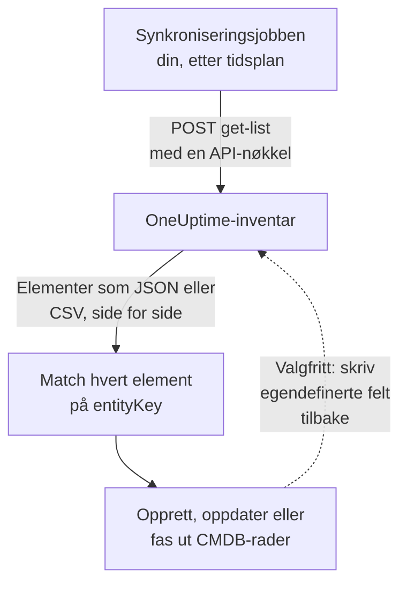

# Eksportere til en CMDB

Hvis du allerede har en CMDB eller et eiendelsregister, prøver ikke OneUptime å erstatte det. Det OneUptime har, og som en CMDB vanligvis mangler, er et bilde av hva som faktisk kjører, holdt oppdatert uten at noen vedlikeholder det: oppdaget fra telemetri og fra pollerne som allerede følger med på nettverket og skykontoene dine. Denne siden er oppskriften på å hente det bildet inn i ditt eget styrende system.

:::cards
- [Slik fungerer en synkronisering](#slik-fungerer-en-synkronisering): En planlagt jobb som leser listen og matcher på en stabil nøkkel.
- [Hent katalogen](#hent-katalogen): Forespørselen, side for side, som JSON eller CSV.
- [Eiendelsdetaljer](#eiendelsdetaljer): De samme opplysningene og nøklene for verter og nettverksenheter.
- [Skriv tilbake](#skriv-tilbake): Send eiendelsmerkene dine inn i OneUptime, og legg til det det ikke kan se.
:::

## Slik fungerer en synkronisering

En synkronisering er en jobb du kjører etter en tidsplan. Den leser inventarlisten via REST-API-et med en API-nøkkel, matcher hvert element med en rad i CMDB-en din via identitetsnøkkelen, og oppretter, oppdaterer eller faser ut rader slik at de stemmer. Den kan også skrive verdier tilbake i elementenes egendefinerte felt.



## Hva du kan hente

Tre REST-ressurser, hver med standardendepunktene i [OneUptime-API-et](/docs/api-reference/api-reference):

| Ressurs | Endepunkt | Hva den inneholder |
| --- | --- | --- |
| Inventarelement | `/api/inventory-item` | Én rad per ting i miljøet |
| Definisjoner av egendefinerte felt | `/api/inventory-item-custom-field` | Prosjektets eget feltvokabular |
| Relasjoner | `/api/inventory-item-relationship` | De rettede koblingene mellom elementer |

De nyttige kolonnene i et inventarelement:

| Kolonne | Betydning |
| --- | --- |
| `_id` | OneUptimes ID: bruk den som din eksterne referanse |
| `entityType` | `host`, `k8s.pod`, `network.device`, `appliance`, … |
| `entityKey` | En stabil identitetshash. Den overlever nye navn og er derfor den beste nøkkelen å matche på |
| `displayName` | Navnet mennesker leser |
| `source` | `discovered`, `inventory` eller `manual` |
| `description` | Fritekst |
| `identifyingAttributes` | Attributtene som gjør elementet til det det er, og som aldri endres |
| `descriptiveAttributes` | Alt annet som er observert på det: se [Eiendelsdetaljer](#eiendelsdetaljer), [Eiendelsattributter for verter](#eiendelsattributter-for-verter) og [Eiendelsattributter for nettverksenheter](#eiendelsattributter-for-nettverksenheter) nedenfor |
| `customFields` | Dine egne felt, etter feltnavn |
| `resourceType` / `resourceId` | En peker til den mer detaljerte OneUptime-posten, når det finnes en |
| `firstSeenAt` / `lastSeenAt` | Når det første og siste gang ble observert |
| `isArchived` | Om det er tatt ut av den aktive listen |

## Før du begynner

En synkronisering trenger en API-nøkkel som har lov til å lese inventaret. I OneUptime Cloud krever API-nøkler abonnementet **Growth** eller høyere.

:::steps
### Opprett en API-nøkkel

Åpne **Prosjektinnstillinger → Avansert → API-nøkler**, og klikk på **Opprett API-nøkkel**. Gi den et **Navn**, og velg under **Tilgang** **Viser** for å lese alt i prosjektet, eller **Velg tillatelser senere** for å gi den bare det en synkronisering trenger.

### Gi den bare det den trenger

En skrivebeskyttet eksport trenger én tillatelse, **Read Telemetry Service**: inventaret deler telemetritillatelsene i stedet for å ha egne. Klikk på **Legg til tillatelse** på nøkkelens side, og velg den. For å skrive verdier tilbake legger du også til **Edit Telemetry Service**.

### Kopier nøkkelen

Kopier **API-nøkkel** fra nøkkelens side, og gjør den tilgjengelig for jobben din:

```bash
export ONEUPTIME_API_KEY="your-api-key"
```
:::

Nøkkelen sendes i headeren `ApiKey` i hver forespørsel og leser inventaret til sitt eget prosjekt, så en forespørsel nevner ikke noe prosjekt.

## Hent katalogen

Send en `POST` til listeendepunktet med kolonnene du vil ha. `select` er påkrevd: API-et returnerer bare det du ber om.

```bash
curl -X POST 'https://oneuptime.com/api/inventory-item/get-list' \
  -H "ApiKey: $ONEUPTIME_API_KEY" \
  -H 'Content-Type: application/json' \
  -d '{
    "query": { "isArchived": false },
    "select": {
      "_id": true,
      "entityType": true,
      "entityKey": true,
      "displayName": true,
      "source": true,
      "customFields": true,
      "descriptiveAttributes": true,
      "lastSeenAt": true
    },
    "sort": { "displayName": "ASC" },
    "limit": 100,
    "skip": 0
  }'
```

På en selvdriftet installasjon bruker du din egen OneUptime-adresse i stedet for `https://oneuptime.com`. Svaret er `{ "data": [...], "count": ... }`, der `count` er hvor mange elementer som passer totalt. Bla ved å øke `skip` med `limit`, til du har alle; `limit` går opp til 10 000. Datoer og ID-er utenom `_id` kommer pakket inn, som `{ "_type": "DateTime", "value": "..." }` og `{ "_type": "ObjectID", "value": "..." }`: les dem fra `value`.

### Bare nettverksenhetene

Avgrens listen med `entityType`:

```bash
curl -X POST 'https://oneuptime.com/api/inventory-item/get-list' \
  -H "ApiKey: $ONEUPTIME_API_KEY" \
  -H 'Content-Type: application/json' \
  -d '{
    "query": { "entityType": "network.device", "isArchived": false },
    "select": { "_id": true, "entityKey": true, "displayName": true, "customFields": true },
    "limit": 100,
    "skip": 0
  }'
```

Hver nettverksenhets `descriptiveAttributes` inneholder vertsnavn, IP-adresse, serienummer, MAC-adresse, merke, modell, fastvare, operativsystem, rolle, sted og plassering: se [Eiendelsattributter for nettverksenheter](#eiendelsattributter-for-nettverksenheter) nedenfor. Det polleren ellers vet, som grensesnitt og naboer, ligger på selve Network Device-posten: følg `resourceId` til `/api/network-device/:id/get-item`, eller hent `/api/network-device/get-list` direkte.

### Som CSV

Alle listeendepunkter svarer i CSV i stedet for JSON med `?output-type=csv`:

```bash
curl -X POST 'https://oneuptime.com/api/inventory-item/get-list?output-type=csv' \
  -H "ApiKey: $ONEUPTIME_API_KEY" \
  -H 'Content-Type: application/json' \
  -d '{ "query": {}, "select": { "displayName": true, "entityType": true, "customFields": true }, "limit": 500, "skip": 0 }' \
  -o inventory.csv
```

Listen **All Items** i dashbordet eksporterer på samme måte, med kolonnene for egendefinerte felt som du har slått på. Hver [eiendelsdetalj](#eiendelsdetaljer) er også en kolonne der: **Vertsnavn**, **IP-adresse**, **Serienummer**, **Modell** og resten er først skjult, så slå dem på fra kolonnevelgeren, og eksporten får én kolonne per opplysning, enten raden er en vert eller en nettverksenhet.

## Eiendelsdetaljer

Verter og nettverksenheter beskrives med de samme opplysningene, lagret under de samme nøklene. Én CMDB-kolonne inneholder serienummeret enten raden er en server eller en svitsj, og et elements kort **Eiendelsdetaljer** i dashbordet viser hver opplysning i samme rekkefølge for begge. En opplysning som ingenting har rapportert, står som **Ukjent** i stedet for å bli utelatt, slik at et hull er synlig.

| Opplysning | Nøkkel | På en vert | På en nettverksenhet |
| --- | --- | --- | --- |
| Vertsnavn | `host.name` | Vertens navn. Det er vertens identitet, så det står i `identifyingAttributes` | Enhetens eget navn: SNMP-`sysName`, ellers NetBIOS- eller DNS-navnet oppdagelsen fant. Aldri IP-adressen |
| IP-adresse | `host.ip` | Hver adresse collectoren rapporterer | Adressen OneUptime poller, når den er en IP-adresse, ellers adressen sonden slo opp DNS-navnet til |
| MAC-adresse | `host.mac` | Oppdaget | Skrevet inn på enheten, eller lært fra ARP-tabellen i en gjennomgått ruter |
| Serienummer | `host.serial_number` | Stemplet | ENTITY-MIB |
| Manufacturer | `device.manufacturer` | Stemplet | ENTITY-MIB, ellers det `sysDescr` eller `sysObjectID` nevner |
| Modell | `device.model.name` | Stemplet | ENTITY-MIB, ellers det `sysDescr` nevner |
| Fastvareversjon | `device.firmware.version` | Stemplet | ENTITY-MIB, ellers det `sysDescr` nevner |
| Operativsystem | `os.name` | `os.description` (eller `os.type`) | Det `sysDescr` nevner: Cisco IOS, Junos OS, Arista EOS, Linux |
| OS-versjon | `os.version` | Oppdaget | ENTITY-MIB, ellers det `sysDescr` nevner |
| Device Type | `device.type` | Stemplet. Ellers klassifiserer kortet den ut fra operativsystem og navn (Server, Brannmur, ...) | Rollen: den du tildelte, ellers den topologikartet tegner den som |
| Location | `device.location` | Stemplet. Ellers viser kortet skysonen | `sysLocation`. Kortet viser stedet først |

[Verttabellen](#eiendelsattributter-for-verter) og [tabellen over nettverksenheter](#eiendelsattributter-for-nettverksenheter) nedenfor forteller i detalj hvor hver verdi kommer fra.

## Eiendelsattributter for verter

`descriptiveAttributes` på en vert inneholder eiendelsopplysningene en CMDB-rad vanligvis vil ha, etter OpenTelemetry-attributtnavnet:

| Felt | Nøkkel | Samles inn som standard? |
| --- | --- | --- |
| IP-adresser | `host.ip` | Ja: kommaseparert når maskinen har flere |
| MAC-adresser | `host.mac` | Ja: kommaseparert, én per aktivt grensesnitt, som `AC-DE-48-23-45-67` |
| Arkitektur | `host.arch` | Ja |
| Maskin-ID | `host.id` | Ja: maskinens GUID på Windows, `/etc/machine-id` på Linux |
| Operativsystem | `os.type`, `os.description`, `os.version` | Ja |
| Skyplassering | `cloud.provider`, `cloud.region`, `cloud.availability_zone` | Bare med en skydetektor |
| Serienummer | `host.serial_number` | Krever ett konfigurasjonstrinn |
| Merke | `device.manufacturer` | Krever ett konfigurasjonstrinn |
| Modell | `device.model.name` | Krever ett konfigurasjonstrinn |
| Fastvareversjon (BIOS eller UEFI) | `device.firmware.version` | Krever ett konfigurasjonstrinn |
| Navn på operativsystem | `os.name` | Bare fra SDK-er som rapporterer det: ellers nevner `os.description` operativsystemet |
| Enhetstype | `device.type` | Valgfritt: stemple det på samme måte (`Hypervisor`, `Workstation`) |
| Plassering | `device.location` | Valgfritt: stemple det på samme måte (`Frankfurt DC, Rack B4`) |

Alt som er merket med Ja, kommer fra collectorens prosessor `resourcedetection` og står allerede i konfigurasjonen OneUptime lager for deg.

Nøklene `cloud.*` krever en skydetektor i den prosessoren: `detectors: [system, env, ec2]`, eller `gcp` eller `azure` for de andre. Den medfølgende konfigurasjonen kjører bare `[system, env]`, så de tre forblir tomme til du legger til en.

Serienummer, merke, modell og fastvare har ingen ressursdetektor: de ligger i maskinens fastvare, leses via WMI på Windows og DMI på Linux, og stemples derfor på ressursen én gang, når maskinen klargjøres. En enhetstype eller plassering du vil ha på raden, stemples på samme måte. [Inventarattributter](/docs/telemetry/host-otel-collector#inventarattributter-ip-mac-serienummer-produsent-modell-fastvare) har det nøyaktige utdraget for hvert operativsystem. `host.manufacturer`, `host.model.name`, `host.firmware.version` og `host.bios.version` godtas som andre stavemåter og lagres under nøklene `device.*` (og `device.serial_number` under `host.serial_number`), så en synkronisering bare leser én nøkkel per opplysning.

`host.id` er verdt å se på som matchnøkkel hvis CMDB-en din allerede bruker en maskinvare-ID: i motsetning til `entityKey` er det maskinens egen ID, så den stemmer med det et verktøy for endepunktstyring rapporterer for samme maskin.

Attributter legges til og tømmes aldri: en attributt som slutter å bli rapportert, blir værende på raden, så en verdi synkroniseringen din allerede har lest, aldri forsvinner i det stille.

## Eiendelsattributter for nettverksenheter

En nettverksenhet (`entityType: network.device`) speiles fra Network Device-posten sin, og `descriptiveAttributes` bruker de samme nøklene en vert bruker for de samme opplysningene, så én CMDB-kolonne inneholder serienummeret enten raden er en server eller en svitsj:

| Felt | Nøkkel | Hvor det kommer fra |
| --- | --- | --- |
| Vertsnavn | `host.name` | Enhetens eget navn: SNMP-`sysName`, ellers NetBIOS- eller revers-DNS-navnet oppdagelsen fant. Utelates når bare IP-adressen navngir den |
| IP-adresse | `host.ip` | Adressen OneUptime poller, når den er en IP-adresse. For en enhet som polles på et DNS-navn, adressen sonden sist slo opp navnet til |
| DNS-navn | `net.device.dns_name` | Revers-DNS-navnet som ble funnet ved oppdagelsen, eller DNS-navnet OneUptime poller |
| MAC-adresse | `host.mac` | Skrevet inn på enheten, eller lært fra ARP-tabellen i en gjennomgått ruter |
| Merke | `device.manufacturer` | ENTITY-MIB `entPhysicalMfgName`, ellers produsenten `sysDescr` nevner, ellers leverandøren til `sysObjectID` |
| Modell | `device.model.name` | ENTITY-MIB `entPhysicalModelName`, ellers modellen `sysDescr` nevner |
| Serienummer | `host.serial_number` | ENTITY-MIB `entPhysicalSerialNum` |
| Fastvareversjon | `device.firmware.version` | ENTITY-MIB `entPhysicalFirmwareRev`, ellers fastvaren `sysDescr` nevner på Ubiquiti-, HPE- og Aruba-enheter |
| Operativsystem | `os.name` | Operativsystemet `sysDescr` nevner |
| Programvare- eller OS-versjon | `os.version` | ENTITY-MIB `entPhysicalSoftwareRev`, ellers utgivelsen `sysDescr` nevner |
| Systembeskrivelse | `os.description` | `sysDescr` |
| Enhetstype | `device.type` | Rollen du har tildelt enheten, ellers rollen topologikartet klassifiserer den som, under prosjektets navn på den |
| Plassering | `device.location` | `sysLocation`, med mindre det er en agents standardverdi, som Net-SNMPs «Sitting on the Dock of the Bay» |
| Sted | `oneuptime.site.name` | Network Site som enheten er tildelt |
| Pollet adresse | `net.device.hostname` | Adressen OneUptime poller: en IP-adresse eller et DNS-navn. Beholdt for synkroniseringer som ble skrevet før `host.name` og `host.ip` fantes |

ENTITY-MIB-radene fylles ut etter enhetens første SNMP-walk. En enhet som ikke gjennomgås, fordi den bare overvåkes med ping eller ikke er pollet ennå, får likevel navn, merke, operativsystem og plassering fra det den siste discovery-skanningen av adressen leste over SNMP, og MAC-adressen fra ARP-tabellen i en gjennomgått ruter. En enhet som ikke implementerer ENTITY-MIB, har ikke noe serienummer eller fastvare å rapportere. `sysDescr` nevner likevel modell og operativsystem for mange plattformer: en Cisco Meraki MX rapporterer `Meraki MX85`, som fyller ut merke og modell. En plattform der `sysDescr` ikke har en kjent form, legger ikke til noe, i stedet for å gjette.

En verdi som er lagret på enheten, skrevet inn eller satt via API-et, erstattes aldri av det discovery leser. Av en verdi enhetens egen walk leste og en en skanning leste, brukes den nyeste. Det en skanning leste, brukes bare når skanningen fant den samme maskinen på adressen: når systemnavnet, `sysObjectID` eller NetBIOS-navnet den leste, motsier enhetens, brukes ingenting av det den leste der. Elementets kort **Eiendelsdetaljer** viser hvor hver verdi kom fra, og når.

Vertsnavnet er aldri IP-adressen. En enhet som bare adressen navngir, har `host.ip` og ikke noe `host.name`. Når SNMP-walken rapporterer et systemnavn, følger `host.name` ved neste gjennomgang.

Disse verdiene kopieres fra Network Device-posten hvert femtende minutt, og de **erstatter** de forrige verdiene i stedet for å legge seg til dem, så en verdi som fjernes på enheten (en fjernet MAC-adresse, for eksempel), også forsvinner fra inventarelementet.

Det finnes ingen versjon for en *tilgjengelig oppgradering*: SNMP har ikke noe standardobjekt for det, så OneUptime registrerer versjonen enheten kjører.

## Match elementer med CMDB-rader

Match på `entityKey`, ikke på `displayName`. Den er en hash av elementets identifiserende attributter, så den overlever nye navn og nye merker: en vert som får ny etikett, beholder samme nøkkel mens visningsnavnet endres. `_id` er like stabil og er den enkleste fremmednøkkelen hvis du bare snakker med ett prosjekt.

Datoer i `customFields` er ISO-8601-strenger i UTC, og CSV-eksporten skriver dem slik i stedet for i den vennligere formen dashbordet viser, slik at de importeres uten overraskelser ved tolkningen.

## Hold det oppdatert

Det finnes ingen endringsstrøm. Poll listeendepunktet med det intervallet som passer deg, og sammenlign på `entityKey`. `lastSeenAt` forteller når et element sist ble observert, noe som vanligvis er den billigste måten å oppdage det som har blitt stille siden forrige kjøring.

Et element som forsvinner mellom to kjøringer, har enten utløpt (et oppdaget element som var stille lenger enn vinduet sitt), eller fått den egne posten slettet. Et speilet element som har verdier i egendefinerte felt, arkiveres i stedet for å slettes når posten forsvinner, så spør med `"isArchived": true` for å se hva som er faset ut uten å miste eiendelsdataene knyttet til det.

## Skriv tilbake

De samme endepunktene tar imot skriving, så en synkronisering kan sende verdier inn i `customFields`: for eksempel eiendelsmerket CMDB-en din allerede eier, stemplet på det tilsvarende OneUptime-elementet. Nøkkelen trenger **Edit Telemetry Service** til det.

Du kan også legge til elementer for ting OneUptime ikke kan se, med `POST /api/inventory-item`, en `entityType` av `external.service`, `external.database` eller `appliance` og et `displayName`. OneUptime regner ut identitetsnøkkelen for deg, og de elementene utløper aldri. Nøkkelen trenger **Create Telemetry Service** for det.

## Feilsøking

:::details Hver forespørsel avvises med 402 Payment Required
I OneUptime Cloud fungerer API-nøkler bare mens prosjektet er på abonnementet **Growth** eller høyere. Ingenting slettes: nøkkelen fungerer igjen som den er så snart prosjektet er tilbake på abonnementet. Se [API-nøkler og SCIM under abonnementet sitt](/docs/api-reference/api-reference#api-nøkler-og-scim-under-abonnementet-sitt).
:::

:::details Hver forespørsel svarer 422 You do not have permissions
Nøkkelen har ingen tillatelse som leser inventaret. En nøkkel opprettet med **Velg tillatelser senere** kan ingenting før den får en: legg til **Read Telemetry Service** på siden dens, som i [Før du begynner](#før-du-begynner).
:::

:::details Listen kommer tilbake uten kolonnene jeg trenger
Listen returnerer bare kolonnene `select` nevner, og `_id`. Legg til hver kolonne du leser i `select`, inkludert `descriptiveAttributes` og `customFields`.
:::

:::details Et element jeg forventet, mangler
Arkiverte elementer utelates når du sender `"isArchived": false`. Et oppdaget element fjernes når det har vært stille lenger enn vinduet sitt, og et speilet forsvinner sammen med posten sin. Be om `"isArchived": true` for å se de arkiverte.
:::

## Neste steg

:::cards
- [Inventar – Oversikt](/docs/inventory/overview): Hvor elementer kommer fra, og hvor lenge hvert blir.
- [Egendefinerte inventarfelt](/docs/inventory/custom-fields): Definer feltene synkroniseringen din leser og skriver.
- [OneUptime API-referanse](/docs/api-reference/api-reference): Forespørsler, statuskoder og reglene hver skriving følger.
:::
