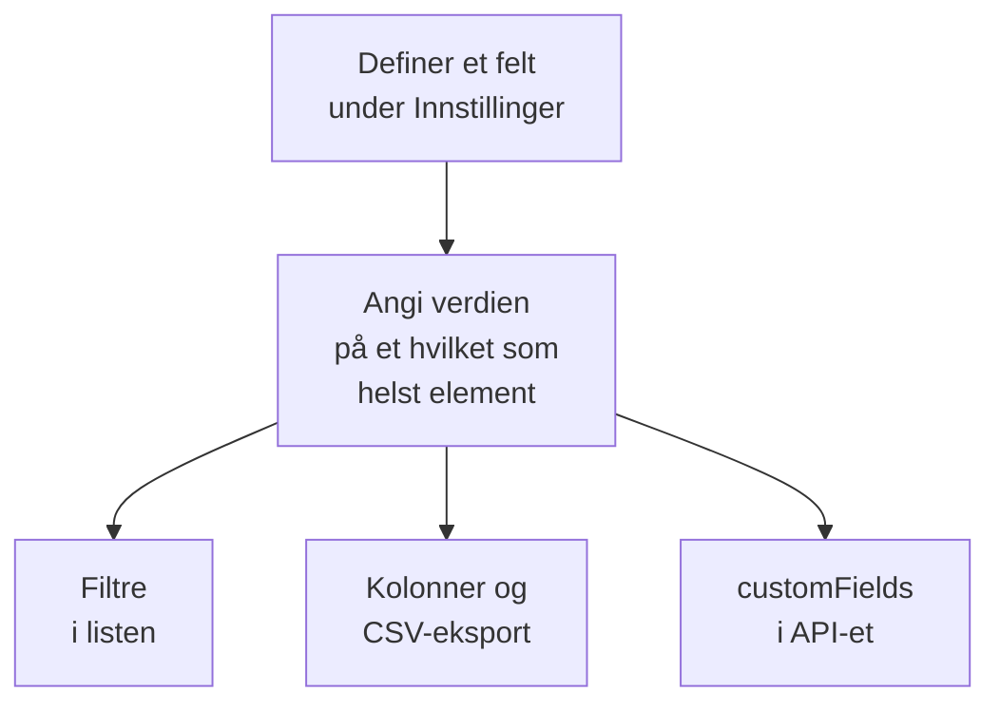

# Egendefinerte inventarfelt

OneUptime oppdager hva som finnes i miljøet ditt. Egendefinerte felt registrerer det ingen overvåking kan fortelle: serienummeret på klistremerket, datoen garantien går ut, hvilket team som eier en ting, om den er i drift eller ligger i en skuff med reservedeler. Definer feltene én gang for prosjektet, og fyll dem deretter ut på hvert element.

:::cards
- [Slik fungerer egendefinerte felt](#slik-fungerer-egendefinerte-felt): Ett vokabular, på hvert element, uansett kilde.
- [Definer felt](#definer-felt): Opprett et felt, velg typen, angi alternativene i en nedtrekksliste.
- [Filtrer listen](#filtrer-listen): Finn det som utløper neste kvartal, med to klikk.
- [Merknader og begrensninger](#merknader-og-begrensninger): Nye navn, duplikater, datoer og slettede felt.
:::

## Slik fungerer egendefinerte felt

Et felt defineres én gang for prosjektet, og hvert element kan ha en verdi for det: de OneUptime har oppdaget, de det speiler, og de du har lagt til manuelt. Et felt blir et filter over listen, en valgfri kolonne og en kolonne i CSV-eksporten. API-et leser og skriver de samme verdiene, under hvert elements `customFields`.

> [!NOTE]
> I OneUptime Cloud er egendefinerte felt en del av abonnementet **Growth** og høyere. Under det kan felt verken defineres, vises eller endres: API-et svarer `402 Payment Required`, og listen viser ingen filtre eller kolonner for egendefinerte felt.

## Definer felt

:::steps
### Åpne siden med egendefinerte felt

Gå til **Produkter → Ressurser → Inventar**, åpne **Innstillinger** i sidemenyen, og deretter **Egendefinerte felt**.

### Opprett et felt

Klikk på **Opprett Inventory Item Custom Field**. Gi det et **Feltnavn**, en valgfri **Feltbeskrivelse** og en **Felttype** fra tabellen nedenfor.

### Angi alternativene i en nedtrekksliste

For en nedtrekkstype legger du til alternativene under **Nedtrekksalternativer**. Hvert alternativ kan ha en farge, som brukes på samme måte i tabellcellen og i filteret: velg en av de navngitte fargene, **Ingen farge**, eller **Egendefinert farge** for en eksakt fargekode. Dra et alternativ i håndtaket for å endre plasseringen i listen.
:::

| Type | Bruk den til |
| --- | --- |
| **Tekst** | Serienummer, eiendelsmerke, plassering i racket, innkjøpsordrenummer |
| **Antall** | Kostnad, rackenhet, antall porter |
| **Boolsk** | Under support, innenfor PCI-omfang |
| **Nedtrekksliste (enkeltvalg)** | Livssyklusstatus, miljø, kritikalitet: ett svar fra en fast liste |
| **Nedtrekksliste (flervalg)** | Samsvarsområder, tagger: flere svar fra en fast liste |
| **Dato** | Kjøpsdato, garantiutløp, dato for end-of-life |
| **Dato og klokkeslett** | Sist revidert, tatt ut av drift |
| **Lang tekst** | Tilgangsinstruksjoner, notater: flere linjer ren tekst |
| **Formatert tekst (Markdown)** | Notater med formatering og lenker, skrevet i Markdown-redigeringsprogrammet |
| **Fil** | Et garantibevis, en signert innkjøpsordre, et bilde av rackens etikett: én fil |
| **Flere filer** | Håndbøker, fakturaer og bilder: opptil 10 filer |

## Et gjennomarbeidet eiendelsvokabular

Et typisk register over maskinvareeiendeler passer rett inn i disse feltene:

| Feltnavn | Type | Eksempel |
| --- | --- | --- |
| `Serial Number` | Tekst | `FDO24160ABC` |
| `Asset Tag` | Tekst | `IT-004821` |
| `Purchase Date` | Dato | 2024-03-11 |
| `Warranty Expiry` | Dato | 2027-03-10 |
| `Lifecycle Status` | Nedtrekksliste | I drift, Reserve, Til reparasjon, Faset ut |
| `Assigned Site` | Nedtrekksliste | Datasenter London, Datasenter Frankfurt, Hovedkontor |
| `Owner Team` | Nedtrekksliste | Nettverk, Plattform, Sikkerhet |
| `Cost Centre` | Tekst | `CC-4410` |

Angi verdiene på et elements side **Egendefinerte felt**. Alle elementer tar imot dem, uansett kilde, så svitsjene OneUptime har oppdaget og nettverksenhetene det speiler, har samme eiendelsvokabular som appliancene du har lagt til manuelt.

## Filtrer listen

Hvert egendefinert felt blir et filter over listen **All Items**, og filteret tilbyr sammenligningene som passer til typen:

| Felttype | Sammenligninger |
| --- | --- |
| **Tekst**, **Lang tekst**, **Formatert tekst (Markdown)** | er, er ikke, inneholder, inneholder ikke, begynner med, slutter med, er tom, er ikke tom |
| **Antall** | er, er ikke, er større enn, er større enn eller lik, er mindre enn, er mindre enn eller lik, er tom, er ikke tom |
| **Boolsk**, **Nedtrekksliste (enkeltvalg)**, **Nedtrekksliste (flervalg)** | er, er ikke, er tom, er ikke tom |
| **Dato**, **Dato og klokkeslett** | er, er før, er etter, er mellom, er tom, er ikke tom |
| **Fil**, **Flere filer** | er |

En brikke for **Fil** eller **Flere filer** spør bare om én ting: om feltet **Har filer** eller har **Ingen filer**.

Filtre kombineres med OG, så «Warranty Expiry er før 2026-10-01 OG Lifecycle Status er I drift» er én visning av listen. Det er spørsmålet et eiendelsregister finnes for å besvare, og grunnen til å bruke datotypene i stedet for en dato i et tekstfelt: et tekstfelt lagrer gjerne `2026-10-01` og kan så ikke fortelle deg hva som utløper neste kvartal.

Kolonner for egendefinerte felt er først skjult: slå dem på fra kolonnevelgeren. De kan ikke sorteres, fordi verdiene ligger samlet i én JSON-kolonne som listen ikke kan sortere etter.

## Merknader og begrensninger

- Verdier lagres på hvert element under feltets navn. Å gi et felt nytt navn flytter ikke verdiene som allerede er lagret under det gamle navnet. Egendefinerte felt på hendelser er unntaket: gir du et av dem nytt navn, flyttes verdiene med (se [Gi et felt nytt navn](/docs/incidents/settings#gi-et-felt-nytt-navn)).
- Alternativene i en nedtrekksliste kan legges til, få nytt navn, dras i ny rekkefølge og fjernes etter at elementer har verdier. Et alternativ med nytt navn endres på hvert element som har det; et fjernet alternativ blir værende på elementene som har det, vist som ikke lenger et alternativ, med mindre du velger et annet for dem (se [Endre alternativene i en nedtrekksliste](/docs/incidents/settings#endre-alternativene-i-en-nedtrekksliste)).
- Ingenting gjør en verdi unik. To elementer kan ha samme serienummer, og ingenting stopper deg.
- Datoer lagres som ISO-8601-tidsstempler i UTC og vises i din egen tidssone.
- Å slette et felt fjerner det fra listen og fra filterlinjen. Verdiene som allerede er skrevet, blir værende på elementene.
- Et felt av typen **Fil** eller **Flere filer** tar filer på opptil 10 MB hver, av slagene som står under [Filfelt](/docs/incidents/settings#filfelt), lastet opp i prosjektet. Bare den som kan se elementet, kan laste dem ned, og en fil slettes så snart ingenting holder den lenger.

## Neste steg

:::cards
- [Inventar – Oversikt](/docs/inventory/overview): Hvor elementer kommer fra, og hva hver side viser.
- [Eksportere til en CMDB](/docs/inventory/cmdb-sync): Hent elementene og de egendefinerte feltene deres inn i et annet system.
- [Egendefinerte felt på hendelser](/docs/incidents/settings#egendefinerte-felt): De samme felttypene på hendelser, med noen ekstra.
:::
