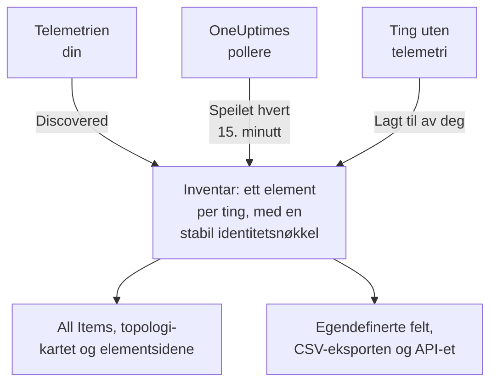

# Inventar – Oversikt

Inventaret er én liste over alt OneUptime vet om miljøet ditt: tjenester, verter, Kubernetes-objekter, virtuelle maskiner, nettverksenheter, skyressurser, IoT-enheter, serverløse funksjoner og de tingene som ikke sender telemetri i det hele tatt. Det meste fyller seg selv ut fra det OneUptime allerede følger med på. Du legger til det overvåking ikke kan fortelle: hva en ting er til, hvem som eier den, når garantien går ut. I [Ordliste](/docs/introduction/glossary#det-du-overvåker) ser du hva hver type post i inventaret er.

:::cards
- [Slik kommer elementer inn i inventaret](#slik-kommer-elementer-inn-i-inventaret): Oppdaget, speilet eller lagt til av deg.
- [Finn frem](#finn-frem): Inventarets sider og hvert elements egne sider.
- [Importer enheter fra Esper](#importer-enheter-fra-esper): Alle Android- og Apple-enheter Esper-leieren din registrerer, holdt oppdatert.
- [Legg til noe manuelt](#legg-til-noe-manuelt): Et tredjeparts-API, en ekstern database eller en appliance.
- [Arkiver i stedet for å slette](#arkiver-i-stedet-for-å-slette): Måten å rydde i listen på som varer.
:::

## Slik kommer elementer inn i inventaret

OneUptime følger allerede med på miljøet ditt for å overvåke det, så katalogen bygges ut fra det den observerer, og ikke ut fra det noen husket å skrive inn. Hvert element har en kilde, og kilden avgjør hvem som eier elementet: om du kan redigere det, og om det kan forsvinne av seg selv.

| Kilde | I API-et | Hvor det kommer fra | Hvor lenge det blir |
| --- | --- | --- | --- |
| **Oppdaget** | `discovered` | OpenTelemetry-ressursattributter, lest etter hvert som telemetri kommer inn: en tjeneste, en vert, et Kubernetes-objekt eller en virtuell maskin som sender telemetri. | Registreres på nytt med hver batch. Fjernes når det har vært stille lenger enn vinduet for typen sin (se nedenfor). |
| **Speilet** | `inventory` | En post som en OneUptime-poller vedlikeholder: nettverksenheter, skyressurser, IoT-enheter, serverløse funksjoner, RUM-applikasjoner, Docker-verter, Podman-verter og Android- og Apple-enhetene som en Esper-tilkobling importerer. Kopieres hvert 15. minutt. En Esper-enhet hver gang tilkoblingen dens leses. | Så lenge posten finnes. Slett posten, og elementet forsvinner med den. |
| **Lagt til av deg** | `manual` | Lagt til av deg, for noe OneUptime ikke kan se: et tredjeparts-API, en database som en leverandør administrerer, en appliance i et rack. | Til du sletter det. Ingenting får det til å utløpe. |

Et oppdaget eller speilet element kan ikke gis nytt navn eller en annen type: kilden ville overskrevet endringen ved neste gjennomgang. Elementets side **Innstillinger** forteller i stedet hvor en varig endring skal gjøres. Det du alltid kan legge til på et hvilket som helst element, uansett kilde, er verdier i egendefinerte felt: se [Egendefinerte inventarfelt](/docs/inventory/custom-fields).

### Hvor lenge et stille element blir

Et oppdaget element har et hjerteslag. Hver gang det kommer telemetri for det, flyttes tidspunktet det sist ble sett fremover, og listens kolonne **Status** viser hvor nylig det er. Det samme gjør en enhet fra Esper: hver gang den sjekker inn hos Esper. Andre speilede elementer og de du har lagt til har ikke hjerteslag, så statusen deres forblir tom i stedet for å slå alarm.

| Status | Hva det betyr |
| --- | --- |
| **Direkte** | Sett i løpet av de siste 30 minuttene. |
| **Nylig** | Sett i løpet av det siste døgnet. |
| **Foreldet** | Ikke sett på mer enn et døgn. Siden **Blitt stille** viser dem. |

Hver tredje time fjerner OneUptime de oppdagede elementene som har vært stille lenger enn vinduet for typen sin, også de arkiverte, og verdiene deres i egendefinerte felt forsvinner med dem. Speilede elementer og de du har lagt til, fjernes aldri på denne måten.

| Type element | Fjernes etter så lang tid uten telemetri |
| --- | --- |
| Pods, deployments, Proxmox-gjester og virtuelle VMware-maskiner | 1 dag |
| Kubernetes-noder og -navnerom, Proxmox-noder, VMware-verter, -klynger og -datalagre, og databasene og de eksterne tjenestene tracene dine kaller | 7 dager |
| Tjenester, verter, Kubernetes-, Proxmox- og Ceph-klynger, lagringsarrayer, vCenters og Docker Swarm-klynger | 30 dager |

En relasjon OneUptime har oppdaget, fjernes når den ikke er sett igjen på 30 dager.

## Finn frem

Åpne **Produkter → Ressurser → Inventar**. Sidemenyen har disse sidene. **Etter kilde**, **Innstillinger**, **Hjelp** og **Avansert** er først slått sammen: klikk på tittelen til en seksjon for å åpne den.

| Side | Hva du finner der |
| --- | --- |
| **Oversikt** | Hvor mange elementer du har, hva de er, hvor mange som har blitt stille, og hva som sist ble lagt til. |
| **Alle elementer** | Alle elementer. Søk etter navn, beskrivelse eller identitetsnøkkel, avgrens listen etter type, kilde, status eller egendefinert felt, og legg til et element manuelt. |
| **Administrerte enheter** | Esper-tilkoblingene dine, og alle enhetene de importerer, med status, gruppe, modell og operativsystem. |
| **Topologikart** | Hvordan elementene henger sammen: tjenester, hva de kaller, og vertene, podene og enhetene de kjører på. |
| **Blitt stille** | Elementene det ikke er hørt fra på mer enn et døgn: oppdagede elementer som ikke har sendt telemetri, og enheter som har sluttet å sjekke inn hos Esper. |
| **Etter kilde** | Elementene fra én kilde: **Oppdaget**, **Speilet** eller **Lagt til av deg**. |
| **Innstillinger → Egendefinerte felt** | Feltene prosjektet ditt fører på hvert element. |
| **Hjelp → Dokumentasjon** | En kort guide til inventaret, med typene elementer det gjenkjenner. |
| **Avansert → Arkivert** | Elementene du har arkivert. Gjenopprett dem herfra. |

Åpne et element, og den egne sidemenyen har elementets **Oversikt** (type, kilde og status, og hver attributt som er observert på det), dets **Tilkoblinger** og dets **Egendefinerte felt**; dets **Logger**, **Spor**, **Målinger**, **Profiler** og **Unntak**; og dets **Hendelser**, **Varsler** og **Planlagt vedlikehold**. Under **Avansert** ligger dets **Innstillinger**, dets **Revisjonslogger** og **Slett element**. Telemetrisidene viser det elementet selv har sendt. Hendelsene, varslene og vedlikeholdshendelsene er de som hører til tjenesten, verten eller Kubernetes-klyngen elementet står for; på alle andre elementer forteller de sidene hvilken ressurs du skal se på i stedet.

### Eiendelsdetaljer

En vert eller en nettverksenhet har et kort **Eiendelsdetaljer** som beskriver begge på samme måte: vertsnavn, IP-adresse, MAC-adresse, serienummer, produsent, modell, fastvareversjon, operativsystem, OS-versjon, enhetstype og plassering. Kortet for en Android-enhet har også sikkerhetspatchnivået, fra Android-agenten eller Esper. En opplysning som ingenting har rapportert, står som **Ukjent**, og kortet forklarer hvorfor det er slik og hvordan de ukjente fylles ut: en enhet som ikke rapporterer dem over SNMP, en enhet som ikke er lest ennå, eller en Meraki-enhet der dashbordet har dem.

- En verts opplysninger kommer fra ressursattributtene i telemetrien: IP- og MAC-adressene, arkitekturen og operativsystemet fra start, og serienummer, merke, modell og fastvare når du stempler dem på.
- En nettverksenhets opplysninger kommer fra SNMP-pollingen, rollen og stedet. Det pollingen ikke har lest, kommer fra discovery: den siste skanningen av adressen, en ruters ARP-tabell eller sondens DNS-oppslag. En enhet uten ENTITY-MIB, som en Meraki MX, får likevel merke, modell og operativsystem fra systembeskrivelsen sin, og MAC-adressen fra sine egne porter. IP-adressen vises aldri som vertsnavnet.
- En Meraki-enhet henter også det pollingen lar stå tomt, fra Meraki-dashbordet, blant annet serienummer, modell og fastvare, når en [Meraki-tilkobling](/docs/monitor/network-traffic#cisco-meraki-uten-netflow) leser organisasjonen dens.

Kortet viser hvor hver opplysning kom fra, og når. Kilden de fleste opplysningene deler, som en verts collector, en nettverksenhets egen SNMP-polling eller discovery-skanningen som leste den, nevnes én gang, under opplysningene. Enhver annen kilde, som en ruters ARP-tabell eller en verdi lagret på enheten, nevnes under sin opplysning. En verdi som er lagret på en nettverksenhet, erstattes aldri av det discovery leser, og når de to er forskjellige, viser kortet begge.

Kortet til en nettverksenhet har en knapp **Oppdater** for dem som kan redigere nettverksenheter. Den leser enheten på nytt nå: sonden poller den innen et minutt, og Meraki-tilkoblingen leser organisasjonen på nytt. Kortet sier når den nye avlesningen er kommet inn, eller at sonden ikke nådde enheten, og elementet kopieres fra enheten så snart avlesningen er kommet inn.

De samme opplysningene er kolonner i listen **Alle elementer**, skjult til du slår dem på, og de blir med i CSV-eksporten. [Eksportere til en CMDB](/docs/inventory/cmdb-sync#eiendelsdetaljer) viser nøklene deres.

### Tilkoblinger

Et elements side **Tilkoblinger** viser naboene i begge retninger, gruppert i **Kall**, **Kalt av**, **Kjører på** og **Relatert**. Hver gruppe viser totalen sin (en gruppe med mer enn 100 000 tilkoblinger viser «100 000+»), og **Vis mer** blar gjennom resten, slik at en travel klynge, et travelt navnerom eller en travel node viser hver tilkobling i stedet for bare de første. Siden er ikke begrenset til et tidsrom: den tar med relasjoner som er lagt til manuelt via API-et, og naboer som er arkivert. En nabo som ikke lenger er i inventaret, vises med nøkkelen sin.

## Importer enheter fra Esper

Koble til en Esper-leier, og alle enhetene den registrerer, er i inventaret: Android-enhetene, også de der appen aldri har startet, og iPhone-, iPad- og Apple TV-enhetene. Hver enhet er én vert, med det bare Esper vet om den: gruppen, operativsystemet og bygget, serienummeret og IMEI, batteriet og lagringen, og for en Android-enhet sikkerhetspatchnivået og de installerte appene. Esper sender ingenting av seg selv, så OneUptime leser leieren etter en tidsplan: enhetene hvert 15. minutt, og appene på hver Android-enhet hver 6. time.

:::steps
### Opprett en API-nøkkel i Esper

Opprett en nøkkel i Esper-konsollen under API Key Management. OneUptime leser bare, så nøkkelen til en bruker med en Esper-rolle som kan lese enheter, grupper og apper, er nok. En nøkkel slutter å virke når den erstattes, eller når brukeren dens slettes.

### Koble til leieren

Gå til **Produkter → Ressurser → Inventar**, deretter **Administrerte enheter**, og klikk på **Koble til Esper**. Fyll inn **Leier**, navnet foran `.esper.cloud` i adressen til Esper-konsollen din (`acme` for `acme.esper.cloud`), og **API-nøkkel**. **Flere felt** inneholder navnet på tilkoblingen og hvor ofte den leses.

### Sjekk den første lesingen

**Koble til** tester nøkkelen før noe lagres: den forteller hvor mange enheter en lesing vil importere, eller hva som er galt og hvordan det rettes. Den første lesingen starter innen ett minutt, og raden til tilkoblingen viser hvordan det gikk.
:::

| Hva Esper rapporterer | Hvor det vises |
| --- | --- |
| Modell, produsent, serienummer, operativsystem og versjonen av det, bygg, og IP- og MAC-adresser | Enhetens kort **Eiendelsdetaljer**, og kolonnene i **Alle elementer** |
| Status, siste innsjekking, gruppe, sikkerhetspatchnivå, IMEI, batteri, lagring og Esper-agent | Enhetens kort **Esper**, og listen **Enheter** under **Administrerte enheter** |
| Apper og versjonene deres | Enhetens liste **Installerte apper** |

### Én enhet, ikke to

En app eller Android Agent som sender telemetri fra en enhet, blir ett element sammen med enheten Esper importerer når den gir enheten samme navn som Esper gjør. Sett disse ressursattributtene fra den administrerte konfigurasjonen Esper fyller inn på hver enhet:

| Ressursattributt | Verdi i den administrerte konfigurasjonen | Hva det er |
| --- | --- | --- |
| `host.name` | `${esper.deviceName}` | Enhetens navn i Esper, for eksempel `ESP-ID-AAAAW`. Påkrevd. |
| `host.serial_number` | `${esper.serialNumber}` | Enhetens serienummer. Valgfritt. |

OneUptime finner elementet til en enhet etter navnet i Esper, deretter etter serienummeret, og oppretter bare et nytt når ingen passer. Android Agent setter begge fra innstillingene `device_name` og `device_serial`, og [Android-oppsett](/docs/rum/android-setup#importer-flåten-fra-esper) viser den administrerte konfigurasjonen til en app.

### Når en enhet blir stille eller forlater Esper

En Android-enhet som ikke har sjekket inn på 30 minutter, er **Offline** og viser hvor lenge siden den sist gjorde det; en iPhone, iPad eller Apple TV, som sjekker inn når Apples push-tjeneste vekker den, ofte med timers mellomrom, er **Offline** etter et døgn. **Status** for elementet følger den siste innsjekkingen, eller telemetrien når den er nyere, så en enhet som har vært stille i et døgn, står på siden **Blitt stille**.

En enhet som fjernes fra Esper, merkes **Fjernet**, og elementet arkiveres: det forsvinner fra listen og venter under **Avansert → Arkivert**. En enhet som kommer tilbake til Esper, kommer tilbake i listen. 30 dager etter at den forsvant, slettes enheten, og det samme gjør elementet, med mindre telemetri eller du har lagt til noe på det.

### Få et varsel når en enhet slutter å sjekke inn

Under **Administrerte enheter** klikker du **Sett opp varsler** på raden til tilkoblingen og oppretter **Esper Android Device Stopped Checking In** og **Esper Apple Device Stopped Checking In**. Den første åpner ett varsel for hver Android-enhet som ikke har sjekket inn hos Esper på over en time, den andre for hver Apple-enhet etter over et døgn, hvert oppkalt etter enheten og løst så snart den sjekker inn igjen.

Hver lesing av tilkoblingen registrerer som målingen `oneuptime.managed_device.check_in.age` hvor mange minutter siden hver enhet sist sjekket inn, og monitoren sjekker den nyeste verdien for hver enhet hvert 5. minutt. En enhet som også kjører Android Agent, overlates til **Host Stopped Reporting**, så den aldri varsler to ganger, og en enhet som er fjernet fra Esper, løser varselet sitt. En lesing som feiler, registrerer ingenting, så ingen varsler åpnes eller løses før den neste. For en flåte som slås av om natten, øk terskelen til monitoren.

## Legg til noe manuelt

Legg til et element for noe OneUptime aldri vil se på egen hånd, slik at en avhengighet ender et virkelig sted og tingen kan bære de egendefinerte feltene dine.

:::steps
### Åpne Alle elementer

Gå til **Produkter → Ressurser → Inventar**, og deretter **Alle elementer**.

### Legg til elementet

Klikk på **Legg til Element**. Velg **Type**, gi det et **Navn** og eventuelt en **Beskrivelse**. Navn og type utgjør sammen elementets identitet, så to elementer av samme type kan ikke ha samme navn.

### Fyll ut de egendefinerte feltene

Åpne det nye elementet. Kilden står som **Lagt til av deg**, og siden **Egendefinerte felt** tar imot verdiene prosjektet ditt følger.
:::

Tre typer kan du legge til manuelt:

- `external.service` (**Ekstern tjeneste**): et tredjeparts-API eller en software-as-a-service-avhengighet.
- `external.database` (**Ekstern database**): en database som ikke er en server OneUptime kan modellere. En databaseserver, selvdriftet eller administrert, fra PostgreSQL til Snowflake, hører i stedet hjemme under **Databaser → Opprett Database** ([Databaser](/docs/telemetry/databases)): den posten kobles til tracene, containerne og motormålingene som nevner samme adresse, noe et inventarelement aldri gjør, og legger du til samme server begge veier, sitter du igjen med to frakoblede poster.
- `appliance` (**Appliance**): maskinvare eller programvare uten agent.

Begrensningen hindrer duplikater. Et manuelt opprettet element av en type OneUptime kan observere, som en vert, ville fått nøkkel etter navnet du skrev, mens det oppdagede elementet for samme maskin får nøkkel etter attributtene den rapporterer. De to ville aldri smelte sammen, så den samme verten ville stått to ganger i listen din for alltid.

## Arkiver i stedet for å slette

Arkivering tar et element ut av listen mens det beholder identiteten, historikken og verdiene i egendefinerte felt. Det sier: Dette har jeg sett, og jeg vil ikke ha det i listen min. Et arkivert element fortsetter å samle inn telemetri.

| Kilde | Arkiver | Slett |
| --- | --- | --- |
| **Oppdaget** | Forblir arkivert. | Kommer tilbake med neste batch av telemetrien. |
| **Speilet** | Forblir arkivert. | Kommer tilbake med neste kopi. Slett den opprinnelige posten i stedet. |
| **Lagt til av deg** | Forblir arkivert. | Borte for godt. |

For å arkivere elementer merker du dem i **Alle elementer** og arkiverer dem på én gang, eller du åpner et element og bruker kortet **Arkiver** på siden **Innstillinger**. Arkiverte elementer ligger under **Inventar → Avansert → Arkivert**, der du kan merke dem og gjenopprette dem.

> [!NOTE]
> Når en speilet enhet fjernes fra sin egen post, fjerner OneUptime også elementet, med mindre elementet har verdier i egendefinerte felt som du har lagt inn. De verdiene er den eneste kopien, og det finnes ingen angrefunksjon, så elementet arkiveres i stedet for å bli slettet. Du finner det under **Avansert → Arkivert** med alt du skrev, i behold.

## Relasjoner og topologi

OneUptime kobler elementer sammen med rettede relasjoner etter hvert som det observerer dem. **Inventar → Topologikart** tegner dem, og et elements side **Tilkoblinger** viser elementets egne. Se [Topologi](/docs/telemetry/topology).

| Relasjon | For eksempel |
| --- | --- |
| `runs-on` | En pod kjører på en node; en virtuell maskin kjører på verten sin. |
| `member-of` | En pod, node eller et navnerom er medlem av en klynge. |
| `hosted-on` | En tjeneste driftes på en vert. |
| `part-of` | En pod er en del av deploymenten sin. |
| `depends-on` | En tjeneste kaller en annen, ut fra spanene som går mellom dem. |

## Neste steg

:::cards
- [Egendefinerte inventarfelt](/docs/inventory/custom-fields): Følg serienumre, garantidatoer, eiere og livssyklusstatus.
- [Eksportere til en CMDB](/docs/inventory/cmdb-sync): Hent katalogen inn i ditt eget styrende system.
- [Databaser](/docs/telemetry/databases): Overvåk databaseserverne tjenestene dine bruker.
:::
