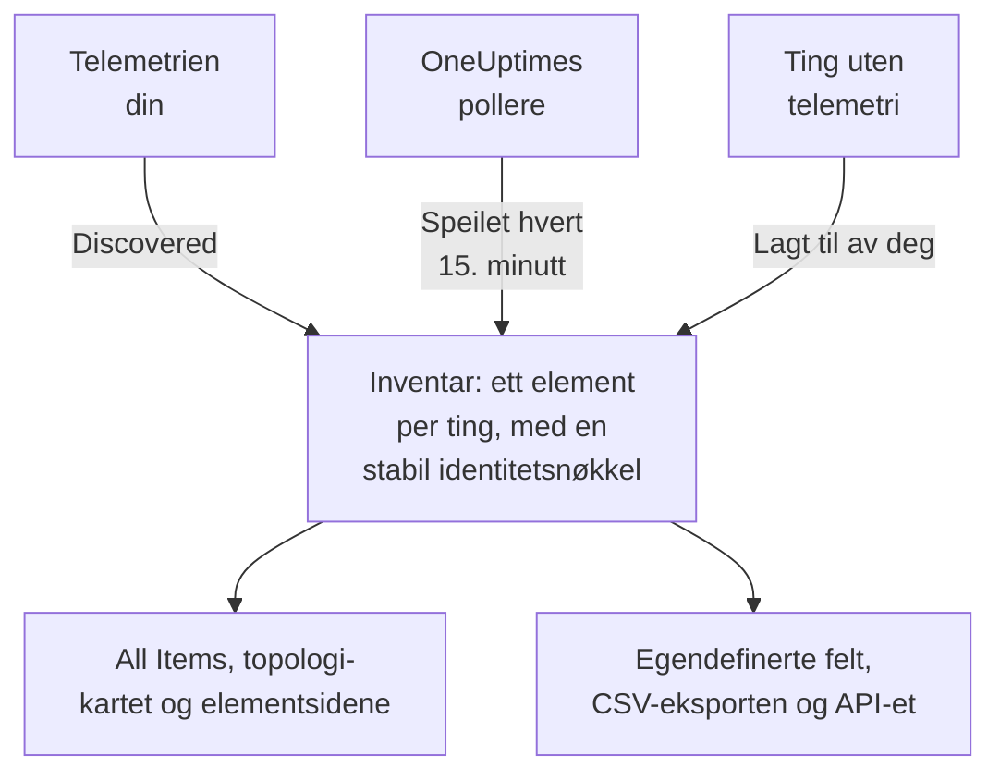

# Inventar – Oversikt

Inventaret er én liste over alt OneUptime vet om miljøet ditt: tjenester, verter, Kubernetes-objekter, virtuelle maskiner, nettverksenheter, skyressurser, IoT-enheter, serverløse funksjoner og de tingene som ikke sender telemetri i det hele tatt. Det meste fyller seg selv ut fra det OneUptime allerede følger med på. Du legger til det overvåking ikke kan fortelle: hva en ting er til, hvem som eier den, når garantien går ut.

:::cards
- [Slik kommer elementer inn i inventaret](#slik-kommer-elementer-inn-i-inventaret): Oppdaget, speilet eller lagt til av deg.
- [Finn frem](#finn-frem): Inventarets sider og hvert elements egne sider.
- [Legg til noe manuelt](#legg-til-noe-manuelt): Et tredjeparts-API, en ekstern database eller en appliance.
- [Arkiver i stedet for å slette](#arkiver-i-stedet-for-å-slette): Måten å rydde i listen på som varer.
:::

## Slik kommer elementer inn i inventaret

OneUptime følger allerede med på miljøet ditt for å overvåke det, så katalogen bygges ut fra det den observerer, og ikke ut fra det noen husket å skrive inn. Hvert element har en kilde, og kilden avgjør hvem som eier elementet: om du kan redigere det, og om det kan forsvinne av seg selv.

| Kilde | I API-et | Hvor det kommer fra | Hvor lenge det blir |
| --- | --- | --- | --- |
| **Discovered** | `discovered` | OpenTelemetry-ressursattributter, lest etter hvert som telemetri kommer inn: en tjeneste, en vert, et Kubernetes-objekt eller en virtuell maskin som sender telemetri. | Registreres på nytt med hver batch. Fjernes når det har vært stille lenger enn vinduet for typen sin (se nedenfor). |
| **Mirrored** | `inventory` | En post som en OneUptime-poller vedlikeholder: nettverksenheter, skyressurser, IoT-enheter, serverløse funksjoner, RUM-applikasjoner, Docker-verter og Podman-verter. Kopieres hvert 15. minutt. | Så lenge posten finnes. Slett posten, og elementet forsvinner med den. |
| **Added by you** | `manual` | Lagt til av deg, for noe OneUptime ikke kan se: et tredjeparts-API, en database som en leverandør administrerer, en appliance i et rack. | Til du sletter det. Ingenting får det til å utløpe. |

Et oppdaget eller speilet element kan ikke gis nytt navn eller en annen type: kilden ville overskrevet endringen ved neste gjennomgang. Elementets side **Innstillinger** forteller i stedet hvor en varig endring skal gjøres. Det du alltid kan legge til på et hvilket som helst element, uansett kilde, er verdier i egendefinerte felt: se [Egendefinerte inventarfelt](/docs/inventory/custom-fields).

### Hvor lenge et stille element blir

Et oppdaget element har et hjerteslag. Hver gang det kommer telemetri for det, flyttes tidspunktet det sist ble sett fremover, og listens kolonne **Status** viser hvor nylig det er. Speilede elementer og de du har lagt til har ikke hjerteslag, så statusen deres forblir tom i stedet for å slå alarm.

| Status | Hva det betyr |
| --- | --- |
| **Direkte** | Sett i løpet av de siste 30 minuttene. |
| **Recent** | Sett i løpet av det siste døgnet. |
| **Stale** | Ikke sett på mer enn et døgn. Siden **Gone Quiet** viser dem. |

Hver tredje time fjerner OneUptime de oppdagede elementene som har vært stille lenger enn vinduet for typen sin, også de arkiverte, og verdiene deres i egendefinerte felt forsvinner med dem. Speilede elementer og de du har lagt til, fjernes aldri på denne måten.

| Type element | Fjernes etter så lang tid uten telemetri |
| --- | --- |
| Pods, deployments, Proxmox-gjester og virtuelle VMware-maskiner | 1 dag |
| Kubernetes-noder og -navnerom, Proxmox-noder, VMware-verter, -klynger og -datalagre, og databasene og de eksterne tjenestene tracene dine kaller | 7 dager |
| Tjenester, verter, Kubernetes-, Proxmox- og Ceph-klynger, lagringsarrayer, vCenters og Docker Swarm-klynger | 30 dager |

En relasjon OneUptime har oppdaget, fjernes når den ikke er sett igjen på 30 dager.

## Finn frem

Åpne **Produkter → Ressurser → Inventar**. Sidemenyen har disse sidene. **By Source**, **Innstillinger**, **Hjelp** og **Avansert** er først slått sammen: klikk på tittelen til en seksjon for å åpne den.

| Side | Hva du finner der |
| --- | --- |
| **Oversikt** | Hvor mange elementer du har, hva de er, hvor mange som har blitt stille, og hva som sist ble lagt til. |
| **All Items** | Alle elementer. Søk etter navn, beskrivelse eller identitetsnøkkel, avgrens listen etter type, kilde, status eller egendefinert felt, og legg til et element manuelt. |
| **Topology Map** | Hvordan elementene henger sammen: tjenester, hva de kaller, og vertene, podene og enhetene de kjører på. |
| **Gone Quiet** | De oppdagede elementene som ikke har sendt telemetri på mer enn et døgn. |
| **By Source** | Elementene fra én kilde: **Discovered**, **Mirrored** eller **Added by You**. |
| **Innstillinger → Egendefinerte felt** | Feltene prosjektet ditt fører på hvert element. |
| **Hjelp → Dokumentasjon** | En kort guide til inventaret, med typene elementer det gjenkjenner. |
| **Avansert → Arkivert** | Elementene du har arkivert. Gjenopprett dem herfra. |

Åpne et element, og den egne sidemenyen har elementets **Oversikt** (type, kilde og status, og hver attributt som er observert på det), dets **Tilkoblinger** og dets **Egendefinerte felt**; dets **Logger**, **Spor**, **Målinger**, **Ytelsesprofiler** og **Unntak**; og dets **Hendelser**, **Varsler** og **Planlagt vedlikehold**. Under **Avansert** ligger dets **Innstillinger**, dets **Revisjonslogger** og **Delete Item**. Telemetrisidene viser det elementet selv har sendt. Hendelsene, varslene og vedlikeholdshendelsene er de som hører til tjenesten, verten eller Kubernetes-klyngen elementet står for; på alle andre elementer forteller de sidene hvilken ressurs du skal se på i stedet.

### Eiendelsdetaljer

En vert eller en nettverksenhet har et kort **Eiendelsdetaljer** som beskriver begge på samme måte: vertsnavn, IP-adresse, MAC-adresse, serienummer, produsent, modell, fastvareversjon, operativsystem, OS-versjon, enhetstype og plassering. En opplysning som ingenting har rapportert, står som **Ukjent**, og kortet forklarer hvordan de ukjente fylles ut.

- En verts opplysninger kommer fra ressursattributtene i telemetrien: IP- og MAC-adressene, arkitekturen og operativsystemet fra start, og serienummer, merke, modell og fastvare når du stempler dem på.
- En nettverksenhets opplysninger kommer fra SNMP-pollingen, rollen og stedet. Det pollingen ikke har lest, kommer fra discovery: den siste skanningen av adressen, en ruters ARP-tabell eller sondens DNS-oppslag. En enhet uten ENTITY-MIB, som en Meraki MX, får likevel merke og modell fra systembeskrivelsen sin. IP-adressen vises aldri som vertsnavnet.

Kortet viser hvor hver opplysning kom fra, og når. Kilden de fleste opplysningene deler, som en verts collector, en nettverksenhets egen SNMP-polling eller discovery-skanningen som leste den, nevnes én gang, under opplysningene. Enhver annen kilde, som en ruters ARP-tabell eller en verdi lagret på enheten, nevnes under sin opplysning. En verdi som er lagret på en nettverksenhet, erstattes aldri av det discovery leser, og når de to er forskjellige, viser kortet begge.

De samme opplysningene er kolonner i listen **All Items**, skjult til du slår dem på, og de blir med i CSV-eksporten. [Eksportere til en CMDB](/docs/inventory/cmdb-sync#eiendelsdetaljer) viser nøklene deres.

### Tilkoblinger

Et elements side **Tilkoblinger** viser naboene i begge retninger, gruppert i **Kall**, **Kalt av**, **Kjører på** og **Relatert**. Hver gruppe viser totalen sin (en gruppe med mer enn 100 000 tilkoblinger viser «100 000+»), og **Vis mer** blar gjennom resten, slik at en travel klynge, et travelt navnerom eller en travel node viser hver tilkobling i stedet for bare de første. Siden er ikke begrenset til et tidsrom: den tar med relasjoner som er lagt til manuelt via API-et, og naboer som er arkivert. En nabo som ikke lenger er i inventaret, vises med nøkkelen sin.

## Legg til noe manuelt

Legg til et element for noe OneUptime aldri vil se på egen hånd, slik at en avhengighet ender et virkelig sted og tingen kan bære de egendefinerte feltene dine.

:::steps
### Åpne All Items

Gå til **Produkter → Ressurser → Inventar**, og deretter **All Items**.

### Legg til elementet

Klikk på **Legg til Item**. Velg **Type**, gi det et **Navn** og eventuelt en **Beskrivelse**. Navn og type utgjør sammen elementets identitet, så to elementer av samme type kan ikke ha samme navn.

### Fyll ut de egendefinerte feltene

Åpne det nye elementet. Kilden står som **Added by you**, og siden **Egendefinerte felt** tar imot verdiene prosjektet ditt følger.
:::

Tre typer kan du legge til manuelt:

- `external.service` (**Ekstern tjeneste**): et tredjeparts-API eller en software-as-a-service-avhengighet.
- `external.database` (**Ekstern database**): en database som ikke er en server OneUptime kan modellere. En databaseserver, selvdriftet eller administrert, fra PostgreSQL til Snowflake, hører i stedet hjemme under **Databases → Opprett Database** ([Databaser](/docs/telemetry/databases)): den posten kobles til tracene, containerne og motormålingene som nevner samme adresse, noe et inventarelement aldri gjør, og legger du til samme server begge veier, sitter du igjen med to frakoblede poster.
- `appliance` (**Appliance**): maskinvare eller programvare uten agent.

Begrensningen hindrer duplikater. Et manuelt opprettet element av en type OneUptime kan observere, som en vert, ville fått nøkkel etter navnet du skrev, mens det oppdagede elementet for samme maskin får nøkkel etter attributtene den rapporterer. De to ville aldri smelte sammen, så den samme verten ville stått to ganger i listen din for alltid.

## Arkiver i stedet for å slette

Arkivering tar et element ut av listen mens det beholder identiteten, historikken og verdiene i egendefinerte felt. Det sier: Dette har jeg sett, og jeg vil ikke ha det i listen min. Et arkivert element fortsetter å samle inn telemetri.

| Kilde | Arkiver | Slett |
| --- | --- | --- |
| **Discovered** | Forblir arkivert. | Kommer tilbake med neste batch av telemetrien. |
| **Mirrored** | Forblir arkivert. | Kommer tilbake med neste kopi. Slett den opprinnelige posten i stedet. |
| **Added by you** | Forblir arkivert. | Borte for godt. |

For å arkivere elementer merker du dem i **All Items** og arkiverer dem på én gang, eller du åpner et element og bruker kortet **Arkiver** på siden **Innstillinger**. Arkiverte elementer ligger under **Inventar → Avansert → Arkivert**, der du kan merke dem og gjenopprette dem.

> [!NOTE]
> Når en speilet enhet fjernes fra sin egen post, fjerner OneUptime også elementet, med mindre elementet har verdier i egendefinerte felt som du har lagt inn. De verdiene er den eneste kopien, og det finnes ingen angrefunksjon, så elementet arkiveres i stedet for å bli slettet. Du finner det under **Avansert → Arkivert** med alt du skrev, i behold.

## Relasjoner og topologi

OneUptime kobler elementer sammen med rettede relasjoner etter hvert som det observerer dem. **Inventar → Topology Map** tegner dem, og et elements side **Tilkoblinger** viser elementets egne. Se [Topologi](/docs/telemetry/topology).

| Relasjon | For eksempel |
| --- | --- |
| `runs-on` | En pod kjører på en node; en virtuell maskin kjører på verten sin. |
| `member-of` | En pod, node eller et navnerom er medlem av en klynge. |
| `hosted-on` | En tjeneste driftes på en vert. |
| `part-of` | En pod er en del av deploymenten sin. |
| `depends-on` | En tjeneste kaller en annen, ut fra spanene som går mellom dem. |

## Neste steg

:::cards
- [Egendefinerte inventarfelt](/docs/inventory/custom-fields): Følg serienumre, garantidatoer, eiere og livssyklusstatus.
- [Eksportere til en CMDB](/docs/inventory/cmdb-sync): Hent katalogen inn i ditt eget styrende system.
- [Databaser](/docs/telemetry/databases): Overvåk databaseserverne tjenestene dine bruker.
:::
