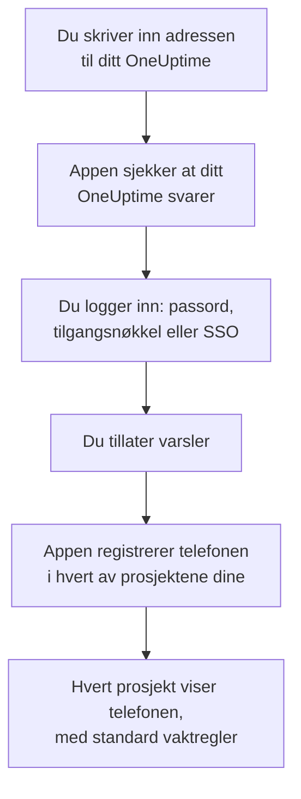
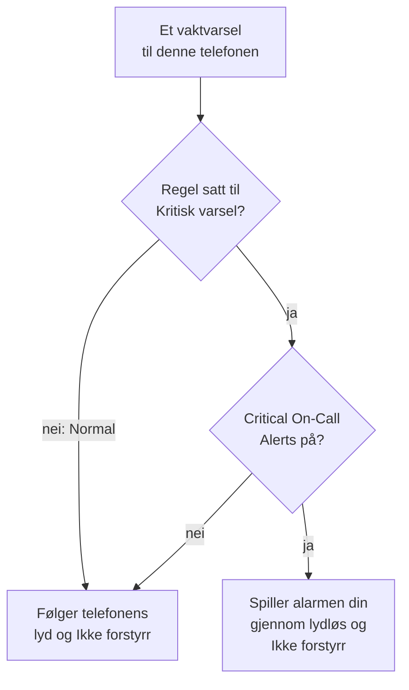

# Android-installasjon

Installer **OneUptime On-Call** på en Android-telefon eller et Android-nettbrett, koble appen til ditt OneUptime, og logg inn. Send deg selv et testvarsel etterpå, og la akutte vaktvarsler ringe gjennom lydløs og Ikke forstyrr.

:::cards
- [Installer appen](#installer-appen): Fra Google Play, eller APK-en på en telefon uten Google Play.
- [Logg inn](#logg-inn): Adressen til ditt OneUptime, deretter kontoen din.
- [Sjekk at varsler når telefonen](#sjekk-at-varsler-når-telefonen): Finn telefonen i dashbordet, og test den.
- [Ring gjennom lydløs](#ring-gjennom-lydløs): Kritiske varsler og alarmlyden.
- [Feilsøking](#feilsøking): Problemer med innlogging, varsler og installasjon.
:::

## Før du begynner

- En telefon eller et nettbrett med Android 7.0 eller nyere.
- En konto i et OneUptime-prosjekt. For å bli varslet må du også ha vakt: se [Eskaleringsregler](/docs/on-call/escalation-rules).
- Adressen til ditt OneUptime: `https://oneuptime.com` på OneUptime Cloud, eller din egen, for eksempel `https://oneuptime.example.com`. Appen kobler bare til over HTTPS.

## Installer appen

:::tabs
@tab Google Play
1. Åpne [OneUptime On-Call på Google Play](https://play.google.com/store/apps/details?id=com.oneuptime.oncall) på telefonen, eller søk etter OneUptime On-Call i Google Play.
2. Trykk på **Installer** og deretter på **Åpne**.

Google Play holder appen oppdatert.
@tab APK
For en telefon uten Google Play. APK-en bygges fra den samme koden for hver OneUptime-versjon og legges ved versjonen på GitHub.

1. Åpne [den nyeste APK-en](https://github.com/OneUptime/oneuptime/releases/latest/download/oneuptime-on-call-android-app.apk) på telefonen.
2. Åpne den nedlastede filen. Hvis Android spør, la nettleseren din installere ukjente apper, og trykk deretter på **Installer**.
3. Åpne OneUptime On-Call fra appene dine.

En APK oppdaterer seg ikke selv: installer den nyeste over den innimellom. Innloggingen og innstillingene dine beholdes.
:::

## Logg inn

:::steps
### Skriv inn adressen til ditt OneUptime
Åpne appen. Behold `https://oneuptime.com` på **Connect your workspace** for OneUptime Cloud, eller skriv inn adressen til ditt eget OneUptime, og trykk på **Connect**. Appen går videre så snart `https://<your-oneuptime>/api/status` svarer.

### Logg inn på kontoen din
Bruk måten kontoen din logger inn på:

- E-postadressen og passordet ditt, deretter **Sign In**. **Forgot password?** sender deg en lenke på e-post for å velge et nytt.
- **Sign in with a passkey**, når du har lagt til en i dashbordet: se [Legg til en tilgangsnøkkel](/docs/introduction/your-account#legg-til-en-passnøkkel). Nettleseren åpnes for å bekrefte den og sender deg deretter tilbake.
- **Sign in with SSO**, hvis organisasjonen din bruker single sign-on. Velg leverandøren din, eller skriv inn jobb-e-posten din og trykk på **Continue**. En sikker nettleser åpnes, og du er tilbake i appen så snart du har logget inn.

Med tofaktorautentisering slått på skriver du inn den sekssifrede koden fra autentiseringsappen din, eller en av reservekodene dine. En sikkerhetsnøkkel kan ikke brukes i appen. Krever administratoren din tofaktorautentisering, og du ikke har satt den opp ennå, setter appen først opp en autentiseringsapp sammen med deg.

### Tillat varsler
Når Android spør om OneUptime On-Call kan sende varsler, trykker du på **Tillat**. Android 13 og nyere spør; eldre versjoner tillater dem så lenge du ikke slår dem av.

Appen registrerer deretter telefonen i hvert av prosjektene dine. Hvert prosjekt viser den blant push-enhetene dine med standard vaktregler, så varslene dine når den fra nå av.
:::

Appen viser ett prosjekt om gangen: trykk på prosjektets navn øverst på en skjerm for å bytte. Et prosjekt som krever single sign-on, står som **SSO Required** under **Settings → Manage Projects** til du trykker på **Authenticate with SSO** der.

## Sjekk at varsler når telefonen

:::steps
### Finn telefonen i dashbordet
Åpne **Brukerinnstillinger → Varselmetoder** og fanen **Push Notifications** i dashbordet. Telefonen står under **Enheter for push-varsler** med modellnavnet sitt. Hvert prosjekt har sin egen liste.

### Send en test
Klikk på **Testvarsel** i telefonens rad. Et varsel kommer frem på telefonen; trykk på det for å åpne appen.
:::

Vaktreglene dine bestemmer hvilke varsler som går til telefonen, og hvor raskt: se **Brukerinnstillinger → Vaktregler**. En ny telefon får de samme standardreglene som enhver annen metode du legger til.

## Ring gjennom lydløs

Som standard følger et vaktvarsel telefonens lydinnstillinger: en telefon på lydløs forblir stille, og Ikke forstyrr holder varselet tilbake. Kritiske varsler lar vaktvarsler ringe gjennom begge. De er av til du slår dem på, telefon for telefon.

:::steps
### Slå på Critical On-Call Alerts
Åpne **Settings** i appen, og slå på **Critical On-Call Alerts** under **Notifications**.

### Tillat tilgang til Ikke forstyrr
Android åpner listen **Tilgang til Ikke forstyrr**. Slå på tilgangen for OneUptime On-Call, og gå tilbake til appen: den sjekker tilgangen og sier under bryteren om varsler vil ringe gjennom.

### Velg en alarmlyd
Trykk på **Alarm sound** under bryteren. I tillegg til telefonens egen lyd tilbyr appen Klaxon, Siren, Digital alarm, Smoke alarm og Rising alarm, som starter lavt og blir sterkere. Trykk på spill av ved siden av en lyd for å høre den. Et kritisk varsel spilles med telefonens alarmvolum, så hold det skrudd opp.
:::

Bare vaktvarsler ringer gjennom, og bare fra vaktregler satt til **Kritisk varsel**, standarden. En regel satt til **Normal** følger telefonens innstillinger uansett hva bryteren sier, så du kan bli vekket av en kritisk hendelse og varslet stille om en mindre. Send et **Testvarsel** med telefonen på lydløs for å høre hva et varsel vil gjøre.

## Unngå at varsler kommer for sent

OneUptime sender vaktvarsler med høy prioritet, som Android leverer selv til en telefon som har ligget i ro i timevis. En telefon som begrenser appens batteribruk, kan likevel holde dem tilbake:

- Åpne **Innstillinger → Apper → OneUptime On-Call → Batteri**, og velg **Ubegrenset**. Noen telefoner kaller det **Appens batteribruk**.
- Sjekk at appens varsler er på, under **Innstillinger → Apper → OneUptime On-Call → Varsler**.
- Hold OneUptime On-Call utenfor enhver liste over batterisparing eller sovende apper som telefonen din har.

## Lås appen

Slå på **Biometrics Login** under **Settings** i appen, så spør appen om fingeravtrykket ditt, ansiktet ditt eller telefonens skjermlås hver gang den starter. Bryteren vises når telefonen har opplåsing med fingeravtrykk eller ansikt satt opp. **Appearance** på samme skjerm velger lyst eller mørkt utseende, eller følger telefonen.

## Oppdater, logg ut eller avinstaller

- **Oppdater.** Google Play oppdaterer appen. For APK-en installerer du den nyeste over den. Appens versjon står nederst på skjermen **Settings**.
- **Logg ut.** **Settings → Log Out** logger deg ut og fjerner telefonen fra push-enhetene dine i alle prosjekter, sammen med vaktreglene. Logger du inn igjen, kommer den tilbake med standardreglene.
- **Avinstaller.** Fjern appen som enhver annen. Var du fortsatt logget inn, blir telefonen stående i listen din til et push til den mislykkes: OneUptime merker den da som **Mottar ikke varsler**. Slett den oppføringen med **Slett**: installerer du appen igjen og logger inn, legges telefonen til som en ny oppføring med standardreglene.

## Feilsøking

:::details «Could not connect to the server»
Appen nådde ikke `https://<your-oneuptime>/api/status`. Sjekk adressen, inkludert `https://`. Er ditt OneUptime på et privat nettverk, kobler du telefonen til det først, for eksempel via VPN. Åpne den adressen i telefonens nettleser: den viser `{"status":"ok"}` når telefonen når OneUptime.
:::

:::details Det kommer ingen varsler
- Sjekk i Android-innstillingene at varsler er på for appen, og at Ikke forstyrr er av eller kritiske varsler er på.
- Sjekk at telefonen står under **Push Notifications** i **Brukerinnstillinger → Varselmetoder**, og send den et **Testvarsel**.
- Er telefonen merket **Mottar ikke varsler**, åpner du appen mens du er logget inn. Den registrerer telefonen på nytt; se [Når en telefon må registreres på nytt](/docs/mobile-desktop-apps/faq-troubleshooting#når-en-telefon-må-registreres-på-nytt).
- Sjekk vaktreglene dine under **Brukerinnstillinger → Vaktregler**.
- På et selvdriftet OneUptime sjekker du at serveren din når push-reléet sitt: se [Push-varsler](/docs/self-hosted/push-notifications#nettverkstilgang).
:::

:::details Kritiske varsler er stille i Ikke forstyrr
Åpne **Settings** i appen: linjen under **Critical On-Call Alerts** sier hva som mangler. Som oftest ble ikke tilgang til Ikke forstyrr tillatt: tillat den under **Innstillinger → Varsler → Tilgang til Ikke forstyrr**, og gå tilbake til appen. Har du valgt en alarmlyd, må også den lydens varselkanal få overstyre Ikke forstyrr.
:::

:::details «Appen ble ikke installert» når du installerer APK-en
OneUptime On-Call er allerede på telefonen fra en annen kilde, som Google Play, og Android installerer ikke den ene over den andre. Avinstaller den, installer APK-en, og logg inn igjen.
:::

:::details Ingen bryter for Biometrics Login
Bryteren vises når opplåsing med fingeravtrykk eller ansikt er satt opp i Android-innstillingene.
:::

## Neste trinn

:::cards
- [Vanlige spørsmål og feilsøking](/docs/mobile-desktop-apps/faq-troubleshooting): Hva du gjør når en telefon slutter å få varsler.
- [iOS-installasjon](/docs/mobile-desktop-apps/ios-installation): Den samme appen på en iPhone eller iPad.
- [Eskaleringsregler](/docs/on-call/escalation-rules): Bestem hvem som varsles, og når.
- [Push-varsler](/docs/self-hosted/push-notifications): Slik sender et selvdriftet OneUptime varsler til telefoner.
:::
