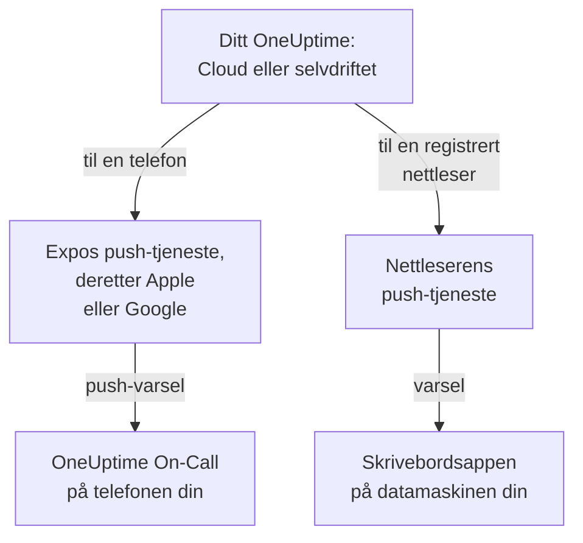

# Apper – Oversikt

OneUptime har en app for telefonen din og en for datamaskinen din. **OneUptime On-Call**, for iPhone, iPad og Android, varsler deg når du har vakt, og lar deg bekrefte og løse uansett hvor du er. På Windows, macOS og Linux installerer du OneUptime-dashbordet fra nettleseren som en skrivebordsapp med sitt eget vindu. Begge fungerer med OneUptime Cloud og med et OneUptime du drifter selv.

:::cards
- [Velg en app](#velg-en-app): Hva hver app er til, side om side.
- [Slik når appene OneUptime](#slik-når-appene-oneuptime): Hvilken vei innlogging og vaktvarsler går.
- [Hent mobilappen](#hent-mobilappen): Fra App Store, Google Play eller GitHub.
- [Hent skrivebordsappen](#hent-skrivebordsappen): Installer dashbordet fra Edge, Chrome eller Safari.
:::

## Velg en app

|  | Mobilapp | Skrivebordsapp |
| --- | --- | --- |
| Hva den er | OneUptime On-Call, en native app for iPhone, iPad og Android | OneUptime-dashbordet, installert fra nettleseren din |
| Hvor du får den | App Store, Google Play, eller en APK fra GitHub | Ditt eget OneUptime: det er ingenting å laste ned |
| Vaktvarsler | Push-varsler, som kan ringe gjennom lydløs og Ikke forstyrr | Nettleservarsler, når du har registrert nettleseren |
| Hva du kan gjøre | Hendelser, varsler, sikkerhetssaker, monitorer og hvem som har vakt; bekrefte, løse, godkjenne playbook-steg og legge til notater | Alt dashbordet kan |
| Oppdateringer | Fra butikken, eller ved å installere en nyere APK | Hver gang den åpnes, henter den dashbordet fra ditt OneUptime |
| Kjører på | iOS 16.4 eller nyere, Android 7.0 eller nyere | Windows, macOS og Linux, med Edge eller Chrome, eller Safari på macOS Sonoma 14 eller nyere |

Du kan bruke begge: ha skrivebordsappen åpen på jobb, og la telefonen vekke deg om natten.

## Slik når appene OneUptime

Mobilappen logger inn på ditt OneUptime og registrerer telefonen i hvert prosjekt du er medlem av. Deretter sender OneUptime telefonens push-varsler, blant dem vaktvarslene, gjennom Expos push-tjeneste, som gir dem videre til Apple eller Google for levering. Som standard sender et selvdriftet OneUptime dem gjennom OneUptimes push-relé, så det trenger ingen egen konto hos Apple, Google eller Expo: se [Push-varsler](/docs/self-hosted/push-notifications).

Skrivebordsappen er selve dashbordet i et eget vindu. Den viser varsler når du har registrert nettleseren dens for push-varsler: sidene om Windows, macOS og Linux viser hvordan.

## Før du begynner

- En konto i et OneUptime-prosjekt. For å bli varslet må du også ha vakt: se [Eskaleringsregler](/docs/on-call/escalation-rules).
- Adressen til ditt OneUptime. På OneUptime Cloud er det `https://oneuptime.com`; et selvdriftet OneUptime har sin egen, for eksempel `https://oneuptime.example.com`.
- Ditt OneUptime over HTTPS. Mobilappen kobler ikke til over vanlig HTTP, og nettlesere viser bare varsler, og Edge og Chrome installerer bare apper, for HTTPS-nettsteder.

## Hent mobilappen

:::steps
### Installer OneUptime On-Call
Hent den fra [App Store](https://apps.apple.com/us/app/oneuptime-on-call/id6759615391) på en iPhone eller iPad, eller fra [Google Play](https://play.google.com/store/apps/details?id=com.oneuptime.oncall) på Android. For en Android-telefon uten Google Play installerer du [APK-en](https://github.com/OneUptime/oneuptime/releases/latest/download/oneuptime-on-call-android-app.apk) i stedet. De samme lenkene står i dashbordet under **Prosjektinnstillinger → Varsler → Mobilapper**.

### Koble den til ditt OneUptime
Åpne appen, behold `https://oneuptime.com` for OneUptime Cloud eller skriv inn adressen til ditt eget OneUptime, og logg inn med passordet ditt, en tilgangsnøkkel eller single sign-on.

### Tillat varsler
Tillat dem når telefonen spør. Appen registrerer telefonen i hvert av prosjektene dine, og vaktvarslene dine når den fra da av.
:::

Hvert trinn i detalj, med hva du sjekker etterpå: [Android-installasjon](/docs/mobile-desktop-apps/android-installation) og [iOS-installasjon](/docs/mobile-desktop-apps/ios-installation).

## Hent skrivebordsappen

:::steps
### Åpne dashbordet ditt
Logg inn på ditt OneUptime i Microsoft Edge eller Google Chrome, eller i Safari på en Mac.

### Installer det
Klikk på installeringsikonet til høyre i adresselinjen i Edge eller Chrome. Velg **Arkiv → Legg til i Dock** i Safari.

### Åpne det som en hvilken som helst annen app
Det åpnes i sitt eget vindu, fra Start-menyen, Dock eller appstarteren din.
:::

Hver nettleser trinn for trinn: [Windows-installasjon](/docs/mobile-desktop-apps/windows-installation), [macOS-installasjon](/docs/mobile-desktop-apps/macos-installation) og [Linux-installasjon](/docs/mobile-desktop-apps/linux-installation).

## Neste trinn

:::cards
- [Android-installasjon](/docs/mobile-desktop-apps/android-installation): Installer appen på Android, logg inn, og sjekk at varsler kommer frem.
- [iOS-installasjon](/docs/mobile-desktop-apps/ios-installation): Installer appen på en iPhone eller iPad, og slå på kritiske varsler.
- [Windows-installasjon](/docs/mobile-desktop-apps/windows-installation): Installer dashbordet fra Edge eller Chrome.
- [macOS-installasjon](/docs/mobile-desktop-apps/macos-installation): Legg dashbordet til i Dock fra Safari, Chrome eller Edge.
- [Linux-installasjon](/docs/mobile-desktop-apps/linux-installation): Installer dashbordet fra Chrome, Chromium eller Edge.
- [Vanlige spørsmål og feilsøking](/docs/mobile-desktop-apps/faq-troubleshooting): Svar, løsninger, og hva du gjør når en telefon slutter å få varsler.
:::
