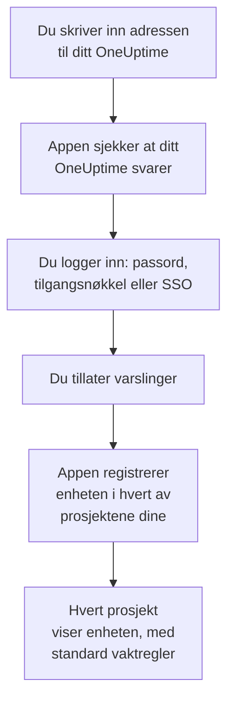
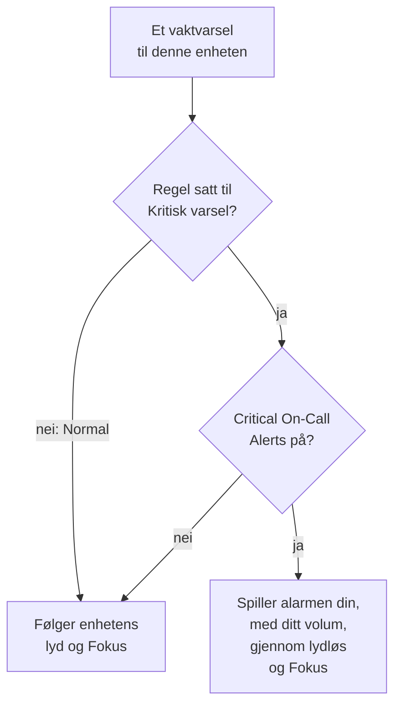

# iOS-installasjon

Installer **OneUptime On-Call** fra App Store på en iPhone eller iPad, koble appen til ditt OneUptime, og logg inn. Send deg selv et testvarsel etterpå, og la akutte vaktvarsler ringe gjennom lydløs og Fokus.

:::cards
- [Installer appen](#installer-appen): Fra App Store.
- [Logg inn](#logg-inn): Adressen til ditt OneUptime, deretter kontoen din.
- [Sjekk at varsler når enheten](#sjekk-at-varsler-når-enheten): Finn den i dashbordet, og test den.
- [Ring gjennom lydløs](#ring-gjennom-lydløs): Kritiske varsler, alarmlyden og volumet.
- [Feilsøking](#feilsøking): Problemer med innlogging, varsler og kritiske varsler.
:::

## Før du begynner

- En iPhone eller iPad med iOS 16.4 eller nyere, eller iPadOS 16.4 eller nyere.
- En konto i et OneUptime-prosjekt. For å bli varslet må du også ha vakt: se [Eskaleringsregler](/docs/on-call/escalation-rules).
- Adressen til ditt OneUptime: `https://oneuptime.com` på OneUptime Cloud, eller din egen, for eksempel `https://oneuptime.example.com`. Appen kobler bare til over HTTPS.

## Installer appen

1. Åpne [OneUptime On-Call i App Store](https://apps.apple.com/us/app/oneuptime-on-call/id6759615391) på iPhone eller iPad, eller søk etter OneUptime On-Call i App Store.
2. Trykk på **Hent**, og bekreft med Face ID, Touch ID eller passordet til Apple-kontoen din.
3. Trykk på **Åpne**, eller åpne OneUptime On-Call fra Hjem-skjermen.

App Store holder appen oppdatert så lenge **Appoppdateringer** er på, under **Innstillinger → App Store**.

## Logg inn

:::steps
### Skriv inn adressen til ditt OneUptime
Åpne appen. Behold `https://oneuptime.com` på **Connect your workspace** for OneUptime Cloud, eller skriv inn adressen til ditt eget OneUptime, og trykk på **Connect**. Appen går videre så snart `https://<your-oneuptime>/api/status` svarer.

### Logg inn på kontoen din
Bruk måten kontoen din logger inn på:

- E-postadressen og passordet ditt, deretter **Sign In**. **Forgot password?** sender deg en lenke på e-post for å velge et nytt.
- **Sign in with a passkey**, når du har lagt til en i dashbordet: se [Legg til en tilgangsnøkkel](/docs/introduction/your-account#legg-til-en-passnøkkel). Et nettleserark åpnes for å bekrefte den og sender deg deretter tilbake.
- **Sign in with SSO**, hvis organisasjonen din bruker single sign-on. Velg leverandøren din, eller skriv inn jobb-e-posten din og trykk på **Continue**. En sikker nettleser åpnes, og du er tilbake i appen så snart du har logget inn.

Med tofaktorautentisering slått på skriver du inn den sekssifrede koden fra autentiseringsappen din, eller en av reservekodene dine. En sikkerhetsnøkkel kan ikke brukes i appen. Krever administratoren din tofaktorautentisering, og du ikke har satt den opp ennå, setter appen først opp en autentiseringsapp sammen med deg.

### Tillat varslinger
Når iOS spør om OneUptime On-Call kan sende deg varslinger, trykker du på **Tillat**.

Appen registrerer deretter iPhone eller iPad i hvert av prosjektene dine. Hvert prosjekt viser den blant push-enhetene dine med standard vaktregler, så varslene dine når den fra nå av.
:::

Appen viser ett prosjekt om gangen: trykk på prosjektets navn øverst på en skjerm for å bytte. Et prosjekt som krever single sign-on, står som **SSO Required** under **Settings → Manage Projects** til du trykker på **Authenticate with SSO** der.

## Sjekk at varsler når enheten

:::steps
### Finn enheten i dashbordet
Åpne **Brukerinnstillinger → Varselmetoder** og fanen **Push Notifications** i dashbordet. iPhone eller iPad står under **Enheter for push-varsler** med modellnavnet sitt. Hvert prosjekt har sin egen liste.

### Send en test
Klikk på **Testvarsel** i enhetens rad. Et varsel kommer frem på enheten; trykk på det for å åpne appen.
:::

Vaktreglene dine bestemmer hvilke varsler som går til enheten, og hvor raskt: se **Brukerinnstillinger → Vaktregler**. En ny enhet får de samme standardreglene som enhver annen metode du legger til.

## Ring gjennom lydløs

Som standard følger et vaktvarsel enhetens lydinnstillinger: lydløs holder det stille, og et Fokus som Ikke forstyrr holder det tilbake. Kritiske varsler lar vaktvarsler ringe gjennom begge. De er av til du slår dem på, enhet for enhet.

:::steps
### Slå på Critical On-Call Alerts
Åpne **Settings** i appen, og slå på **Critical On-Call Alerts** under **Notifications**.

### Tillat kritiske varsler
Når iOS spør om OneUptime On-Call kan sende kritiske varsler, trykker du på **Tillat**. iOS legger da til en bryter **Kritiske varsler** for appen under **Innstillinger → Varslinger → OneUptime On-Call**, der du kan ombestemme deg senere. Linjen under appens bryter sier om varsler vil ringe gjennom.

### Velg en alarmlyd og volumet
Trykk på **Alarm sound** under bryteren. I tillegg til enhetens egen lyd for kritiske varsler tilbyr appen Klaxon, Siren, Digital alarm, Smoke alarm og Rising alarm, som starter lavt og blir sterkere. Trykk på spill av ved siden av en lyd for å høre den. Velg deretter volumet et varsel spilles med: 25 %, 50 %, 75 % eller 100 %, standarden.
:::

Bare vaktvarsler ringer gjennom, og bare fra vaktregler satt til **Kritisk varsel**, standarden. En regel satt til **Normal** følger enhetens innstillinger uansett hva bryteren sier, så du kan bli vekket av en kritisk hendelse og varslet stille om en mindre. Send et **Testvarsel** med enheten på lydløs for å høre hva et varsel vil gjøre. Forhåndsvisningen på skjermen **Alarm sound** spilles med ringevolumet, og ikke i det hele tatt på lydløs; et ekte varsel ringer gjennom lydløs med volumet du valgte.

> [!NOTE]
> Kritiske varsler krever OneUptime On-Call 1.5.0 eller nyere fra App Store. Tidligere versjoner ble bygget uten Apples tillatelse til kritiske varsler, så iOS tilbød dem aldri bryteren.

## Unngå at varsler holdes tilbake

Uten kritiske varsler kan et Fokus eller et sammendrag holde varsler tilbake:

- **Fokus.** Legg OneUptime On-Call til appene hvert Fokus tillater, under **Innstillinger → Fokus**.
- **Planlagt sammendrag.** Hold OneUptime On-Call utenfor det, under **Innstillinger → Varslinger → Planlagt sammendrag**: en varsling i sammendraget venter til sammendragets neste tidspunkt.
- **Varslinger.** La **Tillat varslinger** være på, under **Innstillinger → Varslinger → OneUptime On-Call**.

## Lås appen

Slå på **Biometrics Login** under **Settings** i appen, så spør appen om Face ID, Touch ID eller koden din hver gang den starter. Bryteren vises når Face ID eller Touch ID er satt opp på enheten. **Appearance** på samme skjerm velger lyst eller mørkt utseende, eller følger enheten.

## Oppdater, logg ut eller slett appen

- **Oppdater.** App Store oppdaterer appen; du kan også oppdatere den fra kontoen din i App Store. Appens versjon står nederst på skjermen **Settings**.
- **Logg ut.** **Settings → Log Out** logger deg ut og fjerner enheten fra push-enhetene dine i alle prosjekter, sammen med vaktreglene. Logger du inn igjen, kommer den tilbake med standardreglene.
- **Slett.** Hold inne appens symbol, og trykk på **Fjern app** og deretter **Slett app**. Var du fortsatt logget inn, blir enheten stående i listen din til et push til den mislykkes: OneUptime merker den da som **Mottar ikke varsler**. Installerer du appen igjen og logger inn, kommer den oppføringen som regel tilbake med reglene sine; bruker du ikke enheten lenger, sletter du oppføringen med **Slett**.

## Feilsøking

:::details «Could not connect to the server»
Appen nådde ikke `https://<your-oneuptime>/api/status`. Sjekk adressen, inkludert `https://`. Er ditt OneUptime på et privat nettverk, kobler du enheten til det først, for eksempel via VPN. Åpne den adressen i Safari på enheten: den viser `{"status":"ok"}` når enheten når OneUptime.
:::

:::details Det kommer ingen varsler
- Sjekk at **Tillat varslinger** er på under **Innstillinger → Varslinger → OneUptime On-Call**, og at ingen Fokus holder varsler tilbake.
- Sjekk at enheten står under **Push Notifications** i **Brukerinnstillinger → Varselmetoder**, og send den et **Testvarsel**.
- Er enheten merket **Mottar ikke varsler**, åpner du appen mens du er logget inn. Den registrerer enheten på nytt; se [Når en telefon må registreres på nytt](/docs/mobile-desktop-apps/faq-troubleshooting#når-en-telefon-må-registreres-på-nytt).
- Sjekk vaktreglene dine under **Brukerinnstillinger → Vaktregler**.
- På et selvdriftet OneUptime sjekker du at serveren din når push-reléet sitt: se [Push-varsler](/docs/self-hosted/push-notifications#nettverkstilgang).
:::

:::details Ingen bryter for kritiske varsler i iOS-innstillingene
Slå først på **Critical On-Call Alerts** i appen: iOS legger bare til bryteren sin etter at appen har bedt om kritiske varsler. Sier appen at denne versjonen ikke kan motta kritiske varsler, oppdaterer du OneUptime On-Call fra App Store.
:::

:::details Kritiske varsler er stille
Åpne **Settings** i appen: linjen under **Critical On-Call Alerts** sier hva som mangler. Sjekk at **Kritiske varsler** er på under **Innstillinger → Varslinger → OneUptime On-Call**, og at volumet på appens skjerm **Alarm sound** ikke står lavt.
:::

:::details Ingen bryter for Biometrics Login
Bryteren vises når Face ID eller Touch ID er satt opp under **Innstillinger → Face ID og kode** eller **Innstillinger → Touch ID og kode**.
:::

## Neste trinn

:::cards
- [Vanlige spørsmål og feilsøking](/docs/mobile-desktop-apps/faq-troubleshooting): Hva du gjør når en telefon slutter å få varsler.
- [Android-installasjon](/docs/mobile-desktop-apps/android-installation): Den samme appen på Android.
- [Eskaleringsregler](/docs/on-call/escalation-rules): Bestem hvem som varsles, og når.
- [Push-varsler](/docs/self-hosted/push-notifications): Slik sender et selvdriftet OneUptime varsler til telefoner.
:::
