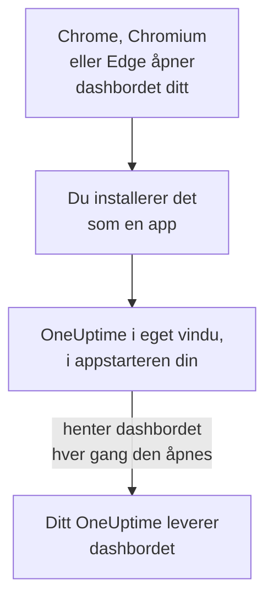

# Linux-installasjon

OneUptime-dashbordet installeres på Linux som en app, fra Google Chrome, Chromium eller Microsoft Edge. Det åpnes i sitt eget vindu, med en egen oppføring i appstarteren på skrivebordet ditt, og kan vise varsler. Det er ingenting å laste ned: appen er dashbordet til ditt OneUptime, og den er oppdatert så snart ditt OneUptime er det.

:::cards
- [Installer appen](#installer-appen): Fra Chrome, Chromium eller Edge.
- [Åpne den fra appstarteren](#åpne-den-fra-appstarteren): Som en hvilken som helst annen skrivebordsapp.
- [Få varsler på denne datamaskinen](#få-varsler-på-denne-datamaskinen): Registrer nettleseren for push-varsler.
- [Feilsøking](#feilsøking): Ingen installeringsikon, ingen varsler, ingen oppføring i appstarteren.
:::

## Slik fungerer skrivebordsappen

Den installerte appen deler innlogging, innstillinger og varseltillatelse med nettleseren sin. Lukk nettleseren, og appen fortsetter i sitt eget vindu.

## Før du begynner

- Et Linux-skrivebord med en nyere Google Chrome, Chromium eller Microsoft Edge.
- Adressen til ditt OneUptime, over HTTPS: `https://oneuptime.com` på OneUptime Cloud, eller din egen, for eksempel `https://oneuptime.example.com`.
- En konto du kan logge inn på dashbordet med.

## Installer appen

:::tabs
@tab Chrome
1. Åpne ditt OneUptime i Chrome eller Chromium, og logg inn.
2. Klikk på installeringsikonet til høyre i adresselinjen på en hvilken som helst dashbordside, og deretter på **Installer**. Eller åpne **⋮ → Cast, lagre og del → Installer siden som app…**.
3. Chrome åpner OneUptime i eget vindu og legger det til i appstarteren din.
@tab Edge
1. Åpne ditt OneUptime i Edge, og logg inn.
2. Klikk på installeringsikonet til høyre i adresselinjen på en hvilken som helst dashbordside, og deretter på **Installer**. Eller åpne **Innstillinger og mer (…) → Flere verktøy → Apper → Installer dette nettstedet som en app**.
3. Edge åpner OneUptime i eget vindu og legger det til i appstarteren din.
:::

Installer fra en dashbordside etter at du har logget inn: innloggingssiden er ikke appen.

## Åpne den fra appstarteren

Nettleseren legger til en skrivebordsoppføring for appen, en `.desktop`-fil i `~/.local/share/applications`, så OneUptime vises i GNOME, KDE Plasma og andre appstartere. Fest den til docken eller panelet derfra, som en hvilken som helst annen app.

## Få varsler på denne datamaskinen

Appen viser varsler gjennom nettleseren sin, når du har registrert nettleseren for push-varsler i hvert prosjekt du vil ha dem fra.

:::steps
### Åpne push-enhetene dine
Åpne **Brukerinnstillinger → Varselmetoder** og fanen **Push Notifications** i appen.

### Registrer denne nettleseren
Klikk på **Registrer enhet**, behold det foreslåtte **Enhetsnavn**, for eksempel `Chrome on Linux`, eller endre det, og klikk på **Registrer enhet** igjen. Når nettleseren spør om OneUptime kan vise varsler, velger du **Tillat**.

### Send en test
Klikk på **Send Test Notification** i dialogen **Browser Registered**. Skrivebordet ditt viser det gjennom varslingstjenesten sin; vises ingenting, se [Feilsøking](#feilsøking).
:::

En nettleser kan ikke ringe gjennom Ikke forstyrr på skrivebordet ditt. Bruk mobilappen med kritiske varsler for varsler som må vekke deg: se [Android-installasjon](/docs/mobile-desktop-apps/android-installation#ring-gjennom-lydløs).

På et selvdriftet OneUptime trenger nettleservarsler serverens VAPID-nøkler: se [Push-varsler](/docs/self-hosted/push-notifications#selvhostet-oppsett).

## Oppdateringer

Det er ingenting å oppdatere. Appen henter dashbordet fra ditt OneUptime hver gang den åpnes, så den endrer seg når ditt OneUptime oppgraderes. Har et vindu vært åpent siden oppgraderingen, laster du det inn på nytt med Ctrl+R.

## Avinstaller

:::tabs
@tab Chrome
Åpne menyen **⋮** i appens vindu, velg elementet som avinstallerer appen, og deretter **Fjern**.
@tab Edge
Åpne `edge://apps` i Edge, velg **Detaljer** for OneUptime, og deretter **Avinstaller**.
:::

Å avinstallere appen avregistrerer ikke nettleseren: den får fortsatt varsler. For å stoppe dem sletter du nettleseren under **Brukerinnstillinger → Varselmetoder**, på fanen **Push Notifications**, med **Slett**.

## Feilsøking

:::details Ingen installeringsikon i adresselinjen
Åpne en dashbordside etter innlogging, ikke innloggingssiden, og sjekk at adressen begynner med `https://`: nettlesere installerer bare apper fra sikre nettsteder. Vises ikonet fortsatt ikke, bruker du nettleserens meny som over. Andre nettlesere installerer kanskje ikke nettsteder som apper; bruk Chrome, Chromium eller Edge.
:::

:::details Det vises ingen varsler
- Sjekk under **Brukerinnstillinger → Varselmetoder**, på fanen **Push Notifications**, at denne nettleseren står i listen, og send den et **Testvarsel**.
- Sjekk at Ikke forstyrr på skrivebordet er av, og at varslingsinnstillingene tillater nettleseren.
- Blokkerer nettleseren varsler for OneUptime, klikker du på ikonet til venstre i adresselinjen, tillater varsler for nettstedet og registrerer nettleseren på nytt.
- På et selvdriftet OneUptime sier dialogen **Registrer enhet** fra når serveren ikke har VAPID-nøkler.
:::

:::details Appen mangler i appstarteren
Åpne den fra nettleseren i stedet: `chrome://apps` i Chrome eller Chromium, `edge://apps` i Edge. En appstarter som bare leser skrivebordsoppføringer ved pålogging, viser den etter at du har logget ut og inn igjen.
:::

## Neste trinn

:::cards
- [Android-installasjon](/docs/mobile-desktop-apps/android-installation): Bli varslet på telefonen din, med kritiske varsler.
- [Windows-installasjon](/docs/mobile-desktop-apps/windows-installation): Den samme appen på Windows.
- [Vanlige spørsmål og feilsøking](/docs/mobile-desktop-apps/faq-troubleshooting): Svar om begge appene.
- [Kontoen din](/docs/introduction/your-account): Slik når OneUptime deg i hvert prosjekt.
:::
