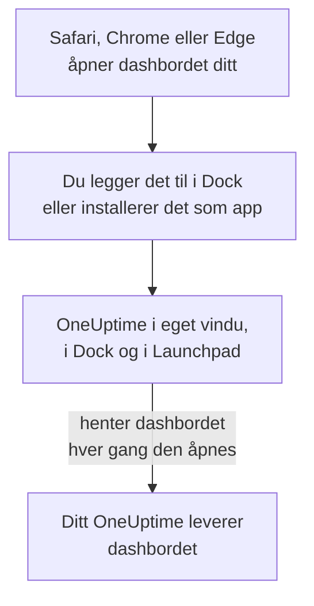

# macOS-installasjon

OneUptime-dashbordet installeres på en Mac som en app: legg det til i Dock fra Safari, eller installer det fra Google Chrome eller Microsoft Edge. Det åpnes i sitt eget vindu, med eget symbol i Dock og i Launchpad, og kan vise varsler. Det er ingenting å laste ned: appen er dashbordet til ditt OneUptime, og den er oppdatert så snart ditt OneUptime er det.

:::cards
- [Installer appen](#installer-appen): Fra Safari, Chrome eller Edge.
- [Behold den i Dock](#behold-den-i-dock): Åpne den med ett klikk, eller ved pålogging.
- [Få varsler på denne Macen](#få-varsler-på-denne-macen): Registrer appen for push-varsler.
- [Feilsøking](#feilsøking): Ingen Legg til i Dock, ingen varsler, logg inn igjen.
:::

## Slik fungerer skrivebordsappen

En Safari-nettapp har sin egen innlogging, egne informasjonskapsler og innstillinger, atskilt fra Safari. En app installert fra Chrome eller Edge deler dem med den nettleseren.

## Før du begynner

- macOS Sonoma 14 eller nyere for Safari. Chrome og Edge installerer apper på alle macOS-versjoner de kjører på.
- Adressen til ditt OneUptime, over HTTPS: `https://oneuptime.com` på OneUptime Cloud, eller din egen, for eksempel `https://oneuptime.example.com`.
- En konto du kan logge inn på dashbordet med.

## Installer appen

:::tabs
@tab Safari
1. Åpne ditt OneUptime i Safari, og logg inn.
2. Velg **Arkiv → Legg til i Dock** på en hvilken som helst dashbordside, eller klikk på Del-knappen i verktøylinjen og deretter på **Legg til i Dock**.
3. Behold navnet eller endre det, og klikk på **Legg til**.
4. Åpne OneUptime fra Dock, og logg inn én gang til: nettappen deler ikke Safaris innlogging.
@tab Chrome
1. Åpne ditt OneUptime i Chrome, og logg inn.
2. Klikk på installeringsikonet til høyre i adresselinjen på en hvilken som helst dashbordside, og deretter på **Installer**. Eller åpne **⋮ → Cast, lagre og del → Installer siden som app…**.
3. Chrome åpner OneUptime i eget vindu og legger det til i Launchpad.
@tab Edge
1. Åpne ditt OneUptime i Edge, og logg inn.
2. Klikk på installeringsikonet til høyre i adresselinjen på en hvilken som helst dashbordside, og deretter på **Installer**. Eller åpne **Innstillinger og mer (…) → Flere verktøy → Apper → Installer dette nettstedet som en app**.
3. Edge åpner OneUptime i eget vindu og legger det til i Launchpad.
:::

Installer fra en dashbordside etter at du har logget inn: innloggingssiden er ikke appen. Safari lagrer nettappen i Programmer-mappen i hjemmemappen din.

## Behold den i Dock

- **Dock.** Kontroll-klikk på appens symbol i Dock mens den er åpen, og velg **Valg → Behold i Dock**. En Safari-nettapp ligger allerede i Dock.
- **Åpne ved pålogging.** Kontroll-klikk på symbolet i Dock, og velg **Valg → Åpne ved pålogging**.
- **Spotlight.** Trykk Kommando-mellomrom, og skriv OneUptime.

## Få varsler på denne Macen

Appen viser varsler når du har registrert den for push-varsler, i hvert prosjekt du vil ha dem fra. Registrer Safari-nettappen inne fra selve nettappen: den er en nettleser for seg. En app installert fra Chrome eller Edge registreres med nettleseren sin.

:::steps
### Åpne push-enhetene dine
Åpne **Brukerinnstillinger → Varselmetoder** og fanen **Push Notifications** i appen.

### Registrer denne appen
Klikk på **Registrer enhet**, behold det foreslåtte **Enhetsnavn**, for eksempel `Safari on macOS`, eller endre det, og klikk på **Registrer enhet** igjen. Når macOS eller nettleseren spør om OneUptime kan sende varsler, velger du **Tillat**.

### Send en test
Klikk på **Send Test Notification** i dialogen **Browser Registered**. Vises ingenting, ser du på Macens varslingsinnstillinger: se [Feilsøking](#feilsøking).
:::

En nettleser kan ikke ringe gjennom et Fokus som Ikke forstyrr. Bruk mobilappen med kritiske varsler for varsler som må vekke deg: se [iOS-installasjon](/docs/mobile-desktop-apps/ios-installation#ring-gjennom-lydløs).

På et selvdriftet OneUptime trenger nettleservarsler serverens VAPID-nøkler: se [Push-varsler](/docs/self-hosted/push-notifications#selvhostet-oppsett).

## Oppdateringer

Det er ingenting å oppdatere. Appen henter dashbordet fra ditt OneUptime hver gang den åpnes, så den endrer seg når ditt OneUptime oppgraderes. Har et vindu vært åpent siden oppgraderingen, laster du det inn på nytt med Kommando-R.

## Avinstaller

:::tabs
@tab Safari
Åpne hjemmemappen din i Finder, deretter Programmer-mappen i den, og dra OneUptime til papirkurven.
@tab Chrome
Åpne menyen **⋮** i appens vindu, velg elementet som avinstallerer appen, og deretter **Fjern**.
@tab Edge
Åpne `edge://apps` i Edge, velg **Detaljer** for OneUptime, og deretter **Avinstaller**.
:::

Å avinstallere appen avregistrerer den ikke: nettleseren dens får fortsatt varsler. For å stoppe dem sletter du den under **Brukerinnstillinger → Varselmetoder**, på fanen **Push Notifications**, med **Slett**.

## Feilsøking

:::details Ingen Legg til i Dock i Safari
Safari legger nettapper til i Dock fra macOS Sonoma 14. Oppdater macOS, eller installer appen fra Chrome eller Edge i stedet.
:::

:::details Det vises ingen varsler
- Sjekk under **Brukerinnstillinger → Varselmetoder**, på fanen **Push Notifications**, at appen eller nettleseren dens står i listen, og send et **Testvarsel**.
- Åpne **Systeminnstillinger → Varslinger** på Macen, og sjekk at OneUptime, eller nettleseren det ble installert fra, kan sende varsler, og at ingen Fokus holder dem tilbake.
- Blokkerer nettleseren varsler for OneUptime, tillater du dem i innstillingene for nettstedet og registrerer på nytt.
- På et selvdriftet OneUptime sier dialogen **Registrer enhet** fra når serveren ikke har VAPID-nøkler.
:::

:::details Appen ber deg logge inn igjen
En Safari-nettapp har sin egen innlogging: logg inn i appen. En app installert fra Chrome eller Edge deler nettleserens innlogging, så logger du ut i nettleseren, eller sletter informasjonskapslene, logges den også ut.
:::

## Neste trinn

:::cards
- [iOS-installasjon](/docs/mobile-desktop-apps/ios-installation): Bli varslet på iPhonen din, med kritiske varsler.
- [Windows-installasjon](/docs/mobile-desktop-apps/windows-installation): Den samme appen på Windows.
- [Vanlige spørsmål og feilsøking](/docs/mobile-desktop-apps/faq-troubleshooting): Svar om begge appene.
- [Kontoen din](/docs/introduction/your-account): Slik når OneUptime deg i hvert prosjekt.
:::
