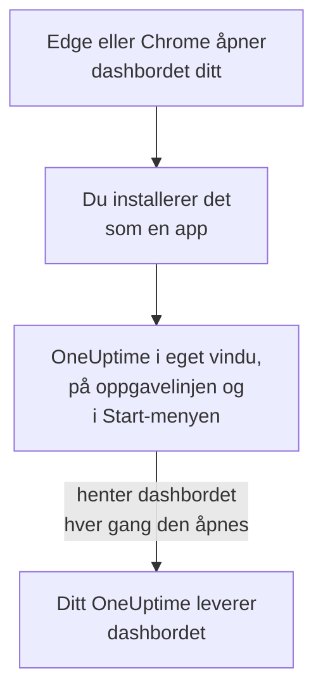

# Windows-installasjon

OneUptime-dashbordet installeres på Windows som en app, fra Microsoft Edge eller Google Chrome. Det åpnes i sitt eget vindu, med eget ikon på oppgavelinjen og i Start-menyen, og kan vise varsler. Det er ingenting å laste ned: appen er dashbordet til ditt OneUptime, og den er oppdatert så snart ditt OneUptime er det.

:::cards
- [Installer appen](#installer-appen): Fra Edge eller Chrome, med noen få klikk.
- [Fest den, og start den med Windows](#fest-den-og-start-den-med-windows): Hold den ett klikk unna.
- [Få varsler på denne datamaskinen](#få-varsler-på-denne-datamaskinen): Registrer nettleseren for push-varsler.
- [Feilsøking](#feilsøking): Ingen installeringsikon, ingen varsler, logg inn igjen.
:::

## Slik fungerer skrivebordsappen

Den installerte appen deler innlogging, innstillinger og varseltillatelse med nettleseren sin. Lukk nettleseren, og appen fortsetter i sitt eget vindu.

## Før du begynner

- Windows 10 eller Windows 11, med en nyere Microsoft Edge eller Google Chrome.
- Adressen til ditt OneUptime, over HTTPS: `https://oneuptime.com` på OneUptime Cloud, eller din egen, for eksempel `https://oneuptime.example.com`.
- En konto du kan logge inn på dashbordet med.

## Installer appen

:::tabs
@tab Edge
1. Åpne ditt OneUptime i Edge, og logg inn.
2. Klikk på installeringsikonet til høyre i adresselinjen på en hvilken som helst dashbordside, og deretter på **Installer**. Eller åpne **Innstillinger og mer (…) → Flere verktøy → Apper → Installer dette nettstedet som en app**.
3. Edge åpner OneUptime i eget vindu og tilbyr kanskje å feste det til oppgavelinjen eller Start.
@tab Chrome
1. Åpne ditt OneUptime i Chrome, og logg inn.
2. Klikk på installeringsikonet til høyre i adresselinjen på en hvilken som helst dashbordside, og deretter på **Installer**. Eller åpne **⋮ → Cast, lagre og del → Installer siden som app…**.
3. Chrome åpner OneUptime i eget vindu og legger det til i Start-menyen.
:::

Installer fra en dashbordside etter at du har logget inn: innloggingssiden er ikke appen. Søk etter OneUptime i Start-menyen for å åpne den senere.

## Fest den, og start den med Windows

- **Oppgavelinjen.** Høyreklikk på appens ikon på oppgavelinjen mens den er åpen, og velg **Fest til oppgavelinjen**.
- **Start med Windows.** Åpne `edge://apps` i Edge, velg **Detaljer** for OneUptime, og slå på **Start automatisk ved pålogging på enheten**. Den samme siden fester appen til oppgavelinjen eller Start, eller legger en snarvei på skrivebordet.

## Få varsler på denne datamaskinen

Appen viser varsler gjennom nettleseren sin, når du har registrert nettleseren for push-varsler i hvert prosjekt du vil ha dem fra.

:::steps
### Åpne push-enhetene dine
Åpne **Brukerinnstillinger → Varselmetoder** og fanen **Push Notifications** i appen.

### Registrer denne nettleseren
Klikk på **Registrer enhet**, behold det foreslåtte **Enhetsnavn**, for eksempel `Edge on Windows`, eller endre det, og klikk på **Registrer enhet** igjen. Når nettleseren spør om OneUptime kan vise varsler, velger du **Tillat**.

### Send en test
Klikk på **Send Test Notification** i dialogen **Browser Registered**. Vises ingenting, ser du på Windows' egne varselinnstillinger: se [Feilsøking](#feilsøking).
:::

En nettleser ringer ikke høyere enn Windows tillater: den kan ikke overstyre Ikke forstyrr. Bruk mobilappen med kritiske varsler for varsler som må vekke deg: se [Android-installasjon](/docs/mobile-desktop-apps/android-installation#ring-gjennom-lydløs) eller [iOS-installasjon](/docs/mobile-desktop-apps/ios-installation#ring-gjennom-lydløs).

På et selvdriftet OneUptime trenger nettleservarsler serverens VAPID-nøkler: se [Push-varsler](/docs/self-hosted/push-notifications#selvhostet-oppsett).

## Oppdateringer

Det er ingenting å oppdatere. Appen henter dashbordet fra ditt OneUptime hver gang den åpnes, så den endrer seg når ditt OneUptime oppgraderes. Har et vindu vært åpent siden oppgraderingen, laster du det inn på nytt med Ctrl+R.

## Avinstaller

:::tabs
@tab Edge
Åpne `edge://apps`, velg **Detaljer** for OneUptime, og deretter **Avinstaller**.
@tab Chrome
Åpne menyen **⋮** i appens vindu, velg elementet som avinstallerer appen, og deretter **Fjern**.
:::

Windows viser også appen under **Innstillinger → Apper → Installerte apper**, der **Avinstaller** også fjerner den.

Å avinstallere appen avregistrerer ikke nettleseren: den får fortsatt varsler. For å stoppe dem sletter du nettleseren under **Brukerinnstillinger → Varselmetoder**, på fanen **Push Notifications**, med **Slett**.

## Feilsøking

:::details Ingen installeringsikon i adresselinjen
Åpne en dashbordside etter innlogging, ikke innloggingssiden, og sjekk at adressen begynner med `https://`: nettlesere installerer bare apper fra sikre nettsteder. Vises ikonet fortsatt ikke, bruker du nettleserens meny som over. Andre nettlesere installerer kanskje ikke nettsteder som apper; bruk Edge eller Chrome.
:::

:::details Det vises ingen varsler
- Sjekk under **Brukerinnstillinger → Varselmetoder**, på fanen **Push Notifications**, at denne nettleseren står i listen, og send den et **Testvarsel**.
- Åpne **Innstillinger → System → Varsler** i Windows: varsler må være på, også for nettleseren, og Ikke forstyrr av. Windows 10 kaller siden «Varsler og handlinger».
- Blokkerer nettleseren varsler for OneUptime, klikker du på ikonet til venstre i adresselinjen, tillater varsler for nettstedet og registrerer nettleseren på nytt.
- På et selvdriftet OneUptime sier dialogen **Registrer enhet** fra når serveren ikke har VAPID-nøkler.
:::

:::details Appen ber deg logge inn igjen
Appen deler nettleserens innlogging. Logger du ut i nettleseren, eller sletter informasjonskapslene, logges appen også ut.
:::

## Neste trinn

:::cards
- [macOS-installasjon](/docs/mobile-desktop-apps/macos-installation): Den samme appen på en Mac.
- [Android-installasjon](/docs/mobile-desktop-apps/android-installation): Bli varslet på telefonen din.
- [Vanlige spørsmål og feilsøking](/docs/mobile-desktop-apps/faq-troubleshooting): Svar om begge appene.
- [Kontoen din](/docs/introduction/your-account): Slik når OneUptime deg i hvert prosjekt.
:::
