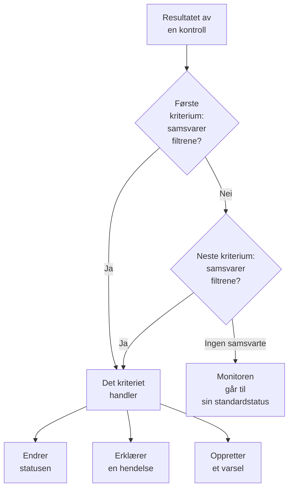
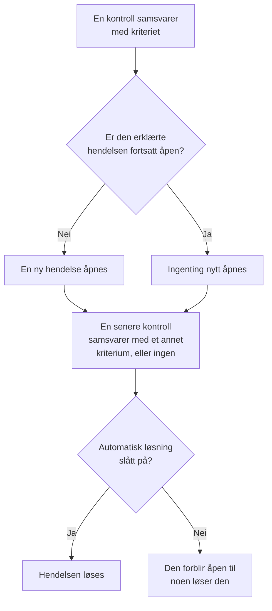

# Monitorkriterier og statuser

En monitors kriterier avgjør hva hver kontroll betyr: om monitoren er oppe eller nede, og om OneUptime erklærer en hendelse eller oppretter et varsel. Statuser er prosjektets liste over hva en monitor kan være, fra **I drift** til **Frakoblet**. Denne siden forklarer begge deler for alle monitortyper; hver types egen side viser filtrene den tilbyr.

:::cards
- [Slik avgjør kriteriene](#slik-avgjør-kriteriene): Ovenfra og ned, og det første samsvaret vinner.
- [Hva et kriterium inneholder](#hva-et-kriterium-inneholder): Filtre, en samsvarsbetingelse, handlinger og innstillinger.
- [Endre en monitors kriterier](#endre-en-monitors-kriterier): Rediger, legg til, omorganiser og test kriterier.
- [Monitorstatuser](#monitorstatuser): De innebygde statusene og dine egne statuser.
:::

## Slik avgjør kriteriene

Hver gang en monitor kontrolleres, vurderer kriteriene resultatet fra toppen av listen og nedover. Det første kriteriet der filtrene samsvarer, avgjør hva som skjer, og kriteriene under det blir ikke sett på for den kontrollen. Samsvarer ingen, går monitoren til sin **Standard overvåkingsstatus**.

Rekkefølgen er en del av regelen. En ny monitor lister kriteriene sine fra det verste tilfellet: frakoblet, så en advarsel der typen har en (et sertifikat eller et domene som snart utløper), så tilkoblet. Et bredt friskt kriterium, som **Is Online** satt til **Sann**, samsvarer med nesten hver kontroll, så det kommer sist: over de andre ville det samsvare først hver gang, og de andre ville aldri handle.

Et kriterium som samsvarer, men ikke endrer noen status, avgjør likevel kontrollen: monitoren beholder statusen sin, og kriteriene under det venter på neste kontroll. **Standard overvåkingsstatus** gjelder bare når ingen kriterier samsvarer. For en ny monitor er den **I drift**; endre den under **Flere felt**, under kriteriene.

> [!NOTE]
> En monitor som åpner en hendelse eller et varsel per vert, container, disk eller grensesnitt, vurderer alle kriterier ved hver kontroll, slik at to verter kan samsvare med to ulike kriterier samtidig. Det er en monitor der spørringen har en **Grupper etter**, som en metrikk- eller loggmonitor, eller et kriterium som angir `*` for hver disk eller hvert grensesnitt. En monitor for innkommende forespørsler som grupperer hendelser etter et payload-felt, stopper likevel ved det første samsvaret.

## Hva et kriterium inneholder

Åpne et kriterium: det har et navn og tre seksjoner, som hver kan slås sammen til et sammendrag på én linje.

| Del | Hva den inneholder |
| --- | --- |
| **Kriterienavn** | Navnet i listen over kriterier og i rotårsaken til hver hendelse og hvert varsel kriteriet åpner. **Legg til kriterier** gir et nytt kriterium navn etter filtrene, og navnet følger dem til du skriver ditt eget. |
| **Filtre** | Hva kontrollen må vise, som ett eller flere filtre. Kubernetes- og metrikkmonitorer kaller dem **Alert Rules**. |
| **Handlinger** | Hva som skjer når filtrene samsvarer: endre statusen, opprette et varsel, erklære en hendelse eller en kombinasjon. |
| **Innstillinger** | **Aktiver disse kriteriene**, en valgfri **Beskrivelse** og, på monitorer for innkommende forespørsler, **Group incidents and alerts by a payload field**. |

### Filtre

Et filter leser én ting fra kontrollen og sammenligner den: en **Filtertype** (hva som leses, som **Statuskode for svar**), et **Filtervilkår** (hvordan det sammenlignes, som **Større enn**) og en **Verdi**. Monitorer som sammenligner metrikker, som Kubernetes- og metrikkmonitorer, ber i stedet om en **Betingelse** og en **Terskel**. Hver monitortype tilbyr sine egne filtertyper, som står på siden for typen, for eksempel [Nettsted-overvåking](/docs/monitor/website-monitor#overvåkingskriterier).

Fra to filtre og oppover vises **Samsvarsbetingelse** under dem: **Alle** betyr at hvert filter må samsvare, **Hvilken som helst** at ett er nok. Et nytt kriterium starter på **Alle**.

Filtre som måler hver kontroll, som **Is Online**, **Statuskode for svar** og **Svartid (i ms)**, tilbyr **Evaluer disse kriteriene over en tidsperiode**. Det vurderer et vindu av nylige kontroller i stedet for bare den siste, og starter på de siste 5 minuttene med **All Values**, som først samsvarer når hver kontroll i vinduet har samsvart. Se [Evaluering over en tidsperiode](/docs/monitor/website-monitor#evaluering-over-en-tidsperiode).

### Handlinger

Hver handling er en bryter under **Handlinger**:

| Bryter | Hva den gjør |
| --- | --- |
| **Når filtre samsvarer, endre overvåkerstatus.** | Flytter monitoren til statusen som er valgt i **Endre overvåkingsstatus til**. |
| **Når filtre samsvarer, opprett et varsel.** | Oppretter varslene som er satt opp under **Opprett varsel**. Et varsel gir teamet ditt beskjed og vises aldri på en statusside. |
| **Når filtre samsvarer, erklær en hendelse.** | Erklærer hendelsene som er satt opp under **Opprett hendelse**. Statussidene dine kan vise dem. |

En hendelse eller et varsel ber om en tittel, en **Alvorlighetsgrad** og, sammenslått, en beskrivelse, eiere, etiketter og vaktretningslinjer. Titler og beskrivelser kan inneholde verdier fra kontrollen, som `{{monitorName}}`: se [Hendelse- og varslingsmaler](/docs/monitor/incident-alert-templating). For å tilkalle noen når kriteriet samsvarer, velger du en retningslinje under **Vakt**: se [Vaktretningslinjer](/docs/on-call/policies).

### Innstillinger

**Aktiver disse kriteriene** er slått på for hvert nytt kriterium. Slå det av for å beholde et kriterium uten å bruke det: det hoppes over ved hver kontroll, endrer ingen status, åpner ingenting, og overskriften viser **Deaktivert**.

**Group incidents and alerts by a payload field** åpner én hendelse per verdi som finnes i en innkommende forespørsel, slik at én webhook-adresse kan holde flere hendelser åpne. Se [Slå på hendelsesgruppering](/docs/monitor/incoming-request-monitor#slå-på-gruppering-av-hendelser).

## Når hendelser og varsler åpnes og lukkes

Et kriterium som erklærer hendelser, åpner én når det samsvarer. Når monitoren kommer seg, lukkes hendelsen av seg selv hvis kriteriet sier det.

- **Én om gangen.** Så lenge en hendelse som et kriterium har erklært fortsatt er åpen, erklærer ikke det samme kriteriet en ny når det samsvarer igjen. Varsler fungerer på samme måte. En monitor som grupperer etter vert eller payload-felt, holder én åpen per vert eller verdi, og et kriterium på en monitor for innkommende e-post med **Åpne en ny hendelse for hver e-post** åpner én per e-post.
- **Lukking.** Ved en senere kontroll der et annet kriterium samsvarer, eller ingen, løses en hendelse der kriteriet har **Løs hendelse automatisk** slått på, og det samme gjelder et varsel med **Løs varsel automatisk**. Begge ligger under **Flere felt** i hendelsen eller varselet, og kriteriene en ny monitor starter med, har dem slått på.
- **Flere sonder.** En monitor som kontrolleres av mer enn én sonde, endres bare når sondene er enige. Se [Slik evalueres kriteriene](/docs/monitor/create-monitor#slik-evalueres-kriterier).
- **En overordnet monitor som er nede.** På en monitors side **Konfigurasjon → Avhengigheter** angir **Depends On Monitors** monitorene den er avhengig av. Så lenge én av dem har en status som står i **Suppress When Parent Status Is** (enhver frakoblet-status, hvis feltet står tomt), åpner monitoren ingen hendelser eller varsler. Statusen endres fortsatt, og det som er åpent, løses fortsatt.
- **Planlagt vedlikehold.** En monitor i en vedlikeholdshendelse som pågår, kontrolleres ikke, så kriteriene kjører ikke. Se [Planlagt vedlikehold – Oversikt](/docs/scheduled-maintenance/index).

For å se hvordan en kontroll ble vurdert, åpner du monitorens **Oversikt**: kortet **Monitor-sammendrag** viser hvilket kriterium som samsvarte og hva hvert kriterium gjorde, også en hendelse som ble hoppet over fordi en allerede var åpen.

## Endre en monitors kriterier

:::steps
### Åpne kriteriesiden

Gå til **Monitorer** og åpne monitoren. Utvid **Konfigurasjon** i sidemenyen og klikk på **Kriterier**. Kortet **Overvåkingskriterier** viser hvert kriterium, hva det kontrollerer og hva det gjør.

### Klikk på Rediger overvåkingskriterier

Redigeringsprogrammet viser hvert kriterium utvidet. Klikk på overskriften til et kriterium for å slå det sammen til én linje: navnet, hvor mange filtre det har og hva det gjør.

### Legg til, endre eller omorganiser kriterier

**Legg til kriterier** legger til ett nederst, utvidet og navngitt etter filteret. Dra et kriterium i håndtaket til venstre for å flytte det: det første samsvaret vinner, så sett det verste tilfellet først. **Slett kriterier** fjerner ett; en monitor beholder minst ett kriterium.

### Lagre kriteriene

Klikk på **Lagre endringer**. Neste kontroll vurderes etter de nye kriteriene.

### Test monitoren

På en monitor som sonder kontrollerer, klikker du på **Test monitor** på kortet, velger en sonde under **Velg sonde** og klikker på **Kjør test**. **Resultat av overvåkingstest** viser hva kontrollen fant.
:::

En manuell monitor har ingen kriterier: du setter statusen selv. Se [Oppdatere status](/docs/monitor/manual-monitor#oppdater-status).

## Monitorstatuser

En monitor har alltid en av prosjektets statuser. Et nytt prosjekt har tre, fra den friskeste til den verste:

| Status | Plass | Farge | Hva OneUptime gjør med den |
| --- | --- | --- | --- |
| **I drift** | 1 | Grønn | Nye monitorer starter i den, og den er en ny monitors **Standard overvåkingsstatus**. Innebygd. |
| **Redusert** | 2 | Gul | Ingenting av seg selv: et av kriteriene dine flytter en monitor hit. |
| **Frakoblet** | 3 | Rød | En ny monitors frakoblet-kriterium flytter den hit, og OneUptime behandler en monitor med denne statusen som nede. Innebygd. |

Listen er en rekkefølge. Der monitorer vises sammen, vinner statusen som står lengst ned i listen: en monitorgruppe, en statussidegruppe og en statussides samlede status viser hver den verste statusen blant monitorene sine.

### Hvor en status teller

| Hvor | Hva statusen avgjør |
| --- | --- |
| Listen **Monitorer** | Hver monitors gjeldende status. **Ikke operativ** viser monitorene med enhver status unntatt den driftsklare, med et rødt tall ved siden av. |
| Statussider | Fargen på hver rad og tilgjengeligheten: bare statusene i sidens **Teller som nedetid** teller mot den. En ny statusside starter med alle statuser unntatt den driftsklare. Se [Velg hva siden viser](/docs/status-pages/index#å-velge-hva-som-vises-på-siden). |
| Monitorgrupper | Gruppens status: den verste blant monitorene i den. Se [Monitorgrupper](/docs/monitor/monitor-groups). |
| SLO-er | Nedetiden et SLO teller, ut fra sin egen liste over statuser. Se [Hvilke statuser som teller som nedetid](/docs/slo/introduction#hvilke-statuser-som-teller-som-nedetid). |
| Avhengigheter | Om en overordnet monitor holder tilbake hendelser og varsler for monitorene som avhenger av den: som standard så lenge den har en frakoblet-status. |

En status du legger til senere, kommer ikke med i listen **Teller som nedetid** på en eksisterende statusside: legg den til der selv.

### Legg til din egen status

:::steps
### Åpne Monitorstatus

Gå til **Overvåkere → Innstillinger → Monitorstatus**. **Innstillinger** er sammenslått i sidemenyen: utvid den først. Kortet **Monitor Statuser** viser statusene fra den friskeste til den verste.

### Opprett statusen

Klikk på **Opprett Monitorstatus** og fyll ut **Navn**, **Beskrivelse** og **Farge**. Den nye statusen plasseres rett over frakoblet-statusen, slik at et brudd fortsatt regnes som det verste.

### Sett den på plass

Dra statusen i håndtaket. En status lenger ned i listen regnes som verre enn alle statusene over den.

### Bruk den i et kriterium

En status gjør ingenting før et kriterium flytter monitorer til den. Velg den i **Endre overvåkingsstatus til** på kriteriet som skal sette den.
:::

Den driftsklare statusen og frakoblet-statusen er merket **Innebygd**: du kan gi dem nytt navn og endre fargen, men ikke slette dem. På OneUptime Cloud krever det Growth-planen å opprette eller endre en status. Å administrere statuser krever rollen Project Owner, Project Admin eller Monitor Admin, eller en egendefinert rolle med tilsvarende tillatelse for monitorstatuser.

### Statustidslinjen

Hver statusendring lagres på monitorens **Statustidslinje**: når den startet, hvor lenge den varte, og **Vis årsak** for kriteriet som satte den. **Opprett Monitor Status Hendelse** legger til en status manuelt. På en monitor som sonder kontrollerer, setter neste kontroll som samsvarer med et kriterium med en status den statusen igjen.

En statusendring varsler monitorens eiere bare hvis de har slått på **Overvåkingsstatus endret** i varslingsinnstillingene sine: den er slått av fra start. En monitor som går tilbake til sin **Standard overvåkingsstatus** fordi ingen kriterier samsvarte, varsler ingen. Se [Hva som er slått på for et nytt medlem](/docs/notifications/notification-settings#hva-som-er-slått-på-for-et-nytt-medlem).

## Arkivere en monitorstatus

Arkiver en status som teamet ditt ikke lenger skal bruke, i stedet for å slette den. Arkivering endrer ingen monitor: En monitor i statusen blir i den til statusen endres, og statustidslinjen viser den fortsatt.

- **Arkiver** ligger i radens meny **⋯**. Den spør først og viser monitorkriteriene, malene og statussidene som er satt opp til å bruke statusen: De fortsetter å bruke den til du endrer dem.
- **Ingen kan velge den igjen.** Et kriterium, en monitors statusmeny, monitorstatusen til en hendelse eller en vedlikeholdshendelse og en statussides nedetidsstatuser utelater den. API-et, Terraform og MCP avviser den.
- **Arkiverte statuser vises for seg**, i den sammenslåtte delen **Arkiverte monitorstatuser** under tabellen. **Fjern fra arkiv** setter en tilbake slik den var.
- **De innebygde statusene kan ikke arkiveres.** Nye monitorer starter i driftsstatusen, og OneUptime regner en monitor i frakoblet-statusen som nede. Deres **Arkiver** er låst, med begrunnelsen.

## Feilsøking

:::details Nettstedet er nede, men monitoren forblir I drift
Et kriterium høyere opp i listen samsvarte først. Åpne **Konfigurasjon → Kriterier** og sjekk rekkefølgen: det friske kriteriet kommer sist. Sjekk også at frakoblet-kriteriet har **Aktiver disse kriteriene** slått på, og at handlingen **Når filtre samsvarer, endre overvåkerstatus.** er slått på med en valgt status.
:::

:::details Ingen hendelse ble åpnet da monitoren gikk ned
Sjekk kriteriet som samsvarte: **Når filtre samsvarer, erklær en hendelse.** må være slått på. En hendelse erklæres ikke så lenge det samme kriteriets hendelse fortsatt er åpen, så lenge en overordnet monitor i **Depends On Monitors** er nede, eller så lenge monitoren er i planlagt vedlikehold. Kortet **Monitor-sammendrag** på monitorens **Oversikt** forteller hvilken det var.
:::

:::details Hendelsen forblir åpen etter at monitoren har kommet seg
Åpne kriteriet til hendelsen og utvid **Flere felt** i hendelsen: **Løs hendelse automatisk** må være slått på. En hendelse fra et kriterium du senere har slettet, løses ikke av monitoren: løs den manuelt.
:::

:::details Slett-knappen for Frakoblet er låst
**I drift** og **Frakoblet** er innebygde: OneUptime flytter monitorer til dem, så de kan få nytt navn, men ikke slettes. Slett i stedet en av dine egne statuser, eller gi den innebygde et nytt navn.
:::

## Neste trinn

:::cards
- [Opprett en monitor](/docs/monitor/create-monitor): De tre trinnene for en ny monitor.
- [Hendelse- og varslingsmaler](/docs/monitor/incident-alert-templating): Sett verdier fra kontrollen inn i titler og beskrivelser.
- [Monitorgrupper](/docs/monitor/monitor-groups): Samle flere monitorer i én status.
- [Hendelser – Oversikt](/docs/incidents/index): Hva som skjer etter at et kriterium har erklært en hendelse.
:::
