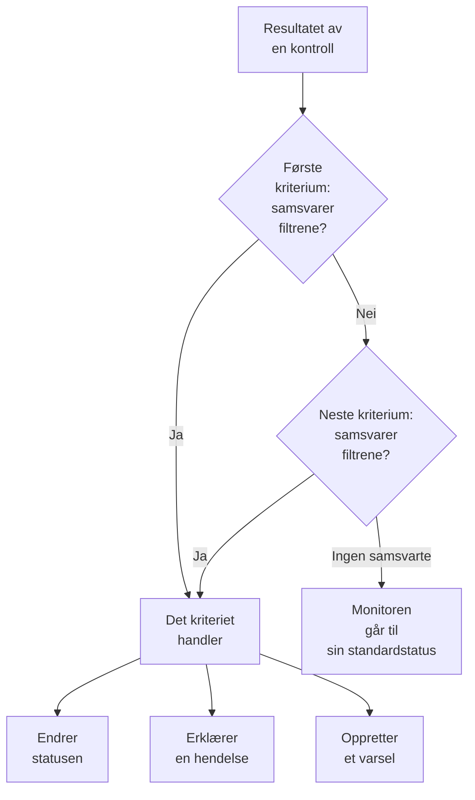
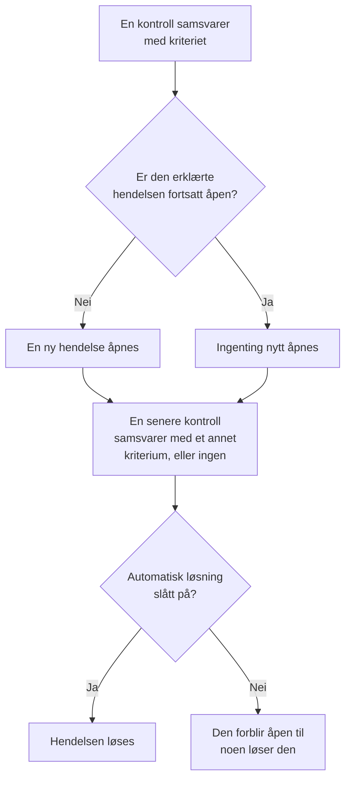

# Kriterier og statuser

En monitors kriterier avgjør hva hver kontroll betyr: om monitoren er oppe eller nede, og om OneUptime erklærer en hendelse eller oppretter et varsel. Statuser er prosjektets liste over hva en monitor kan være, fra **I drift** til **Offline**. Denne siden forklarer begge deler for alle monitortyper; hver types egen side viser filtrene den tilbyr.

:::cards
- [Slik avgjør kriteriene](#slik-avgjør-kriteriene): Ovenfra og ned, og det første samsvaret vinner.
- [Hva et kriterium inneholder](#hva-et-kriterium-inneholder): Filtre, en samsvarsbetingelse, handlinger og innstillinger.
- [Vurdere et vindu av sjekker](#vurdere-et-vindu-av-sjekker): Tell mislykkede sjekker, oppdag ustabilitet, les av en persentil.
- [Endre en monitors kriterier](#endre-en-monitors-kriterier): Rediger, legg til, omorganiser og test kriterier.
- [Monitorstatuser](#monitorstatuser): De innebygde statusene og dine egne statuser.
:::

## Slik avgjør kriteriene

Hver gang en monitor kontrolleres, vurderer kriteriene resultatet fra toppen av listen og nedover. Det første kriteriet der filtrene samsvarer, avgjør hva som skjer, og kriteriene under det blir ikke sett på for den kontrollen. Samsvarer ingen, går monitoren til sin **Standard monitorstatus**. Den beholder i stedet statusen sin så lenge et kriterium som bringer den tilbake, ennå ikke har samsvart: se [Når et kriterium gjenopprettes](#når-et-kriterium-gjenopprettes).

Rekkefølgen er en del av regelen. En ny monitor lister kriteriene sine fra det verste tilfellet: offline, så en advarsel der typen har en (et sertifikat eller et domene som snart utløper), så tilkoblet. Et bredt friskt kriterium, som **Er tilkoblet** satt til **Sann**, samsvarer med nesten hver kontroll, så det kommer sist: over de andre ville det samsvare først hver gang, og de andre ville aldri handle.

Et kriterium som samsvarer, men ikke endrer noen status, avgjør likevel kontrollen: monitoren beholder statusen sin, og kriteriene under det venter på neste kontroll. **Standard monitorstatus** gjelder bare når ingen kriterier samsvarer. For en ny monitor er den **I drift**; endre den under **Flere felt**, under kriteriene.

> [!NOTE]
> En monitor som åpner en hendelse eller et varsel per vert, container, disk eller grensesnitt, vurderer alle kriterier ved hver kontroll, slik at to verter kan samsvare med to ulike kriterier samtidig. Det er en monitor der spørringen har en **Grupper etter**, som en målings- eller loggmonitor, eller et kriterium som angir `*` for hver disk eller hvert grensesnitt. En spørring skrevet i PromQL teller også. En monitor for innkommende forespørsler som grupperer hendelser etter et payload-felt, stopper likevel ved det første samsvaret.
>
> En slik monitor har likevel én status, satt av det første kriteriet som samsvarer. Et kriterium som bare bringer den tilbake til **Standard monitorstatus** og ikke åpner noen hendelse eller noe varsel, venter på vertene som oppfylte et kriterium som setter en annen status: det samsvarer når hver av dem oppfyller det, uansett hva de andre vertene gjør. Inntil da beholder monitoren statusen sin, også når ingen kriterier samsvarer, mens hendelsene og varslene til hver vert fortsatt løses hver for seg.

## Hva et kriterium inneholder

Åpne et kriterium: det har et navn og tre seksjoner, som hver kan slås sammen til et sammendrag på én linje.

| Del | Hva den inneholder |
| --- | --- |
| **Kriterienavn** | Navnet i listen over kriterier og i rotårsaken til hver hendelse og hvert varsel kriteriet åpner. **Legg til kriterier** gir et nytt kriterium navn etter filtrene, og navnet følger dem til du skriver ditt eget. |
| **Filtre** | Hva kontrollen må vise, som ett eller flere filtre. Kubernetes- og målingsmonitorer kaller dem **Varselsregler**. |
| **Handlinger** | Hva som skjer når filtrene samsvarer: endre statusen, opprette et varsel, erklære en hendelse eller en kombinasjon. |
| **Innstillinger** | **Aktiver disse kriteriene**, en valgfri **Beskrivelse**, når det gjenopprettes og når det evalueres, og, på monitorer for innkommende forespørsler, **Group incidents and alerts by a payload field**. |

### Filtre

Et filter leser én ting fra kontrollen og sammenligner den: en **Filtertype** (hva som leses, som **Statuskode for svar**), et **Filtervilkår** (hvordan det sammenlignes, som **Større enn**) og en **Verdi**. Monitorer som sammenligner målinger, som Kubernetes- og målingsmonitorer, ber i stedet om en **Betingelse** og en **Terskel**. Hver monitortype tilbyr sine egne filtertyper, som står på siden for typen, for eksempel [Nettsted-monitor](/docs/monitor/website-monitor#overvåkingskriterier).

Fra to filtre og oppover vises **Samsvarsbetingelse** under dem: **Alle** betyr at hvert filter må samsvare, **Hvilken som helst** at ett er nok. Et nytt kriterium starter på **Alle**.

Filtre som måler hver kontroll, som **Er tilkoblet**, **Statuskode for svar** og **Svartid (i ms)**, tilbyr **Evaluer disse kriteriene over en tidsperiode**. Det vurderer et vindu av nylige kontroller i stedet for bare den siste, og starter på de siste 5 minuttene med **Alle verdier**, som først samsvarer når hver kontroll i vinduet har samsvart. Vinduet kan være opptil 24 timer langt og telle sjekkene, slik [Vurdere et vindu av sjekker](#vurdere-et-vindu-av-sjekker) forklarer. Se [Evaluering over en tidsperiode](/docs/monitor/website-monitor#evaluering-over-en-tidsperiode).

### Handlinger

Hver handling er en bryter under **Handlinger**:

| Bryter | Hva den gjør |
| --- | --- |
| **Når filtre samsvarer, endre monitorstatus.** | Flytter monitoren til statusen som er valgt i **Endre monitorstatus til**. |
| **Når filtre samsvarer, opprett et varsel.** | Oppretter varslene som er satt opp under **Opprett varsel**. Et varsel gir teamet ditt beskjed og vises aldri på en statusside. |
| **Når filtre samsvarer, erklær en hendelse.** | Erklærer hendelsene som er satt opp under **Opprett hendelse**. Statussidene dine kan vise dem. |

En hendelse eller et varsel ber om en tittel, en **Alvorlighetsgrad** og, sammenslått, en beskrivelse, eiere, etiketter og vaktpolicyer. Titler og beskrivelser kan inneholde verdier fra kontrollen, som `{{monitorName}}`: se [Hendelse- og varslingsmaler](/docs/monitor/incident-alert-templating). For å tilkalle noen når kriteriet samsvarer, velger du en policy under **Vakt**: se [Vaktpolicyer](/docs/on-call/policies).

### Innstillinger

**Aktiver disse kriteriene** er slått på for hvert nytt kriterium. Slå det av for å beholde et kriterium uten å bruke det: det hoppes over ved hver kontroll, endrer ingen status, åpner ingenting, og overskriften viser **Deaktivert**.

**Group incidents and alerts by a payload field** åpner én hendelse per verdi som finnes i en innkommende forespørsel, slik at én webhook-adresse kan holde flere hendelser åpne. Se [Slå på hendelsesgruppering](/docs/monitor/incoming-request-monitor#slå-på-gruppering-av-hendelser).

**Gjenopprett bare når en egen betingelse er oppfylt** og **Evaluer disse kriteriene bare på bestemte dager og tider** er slått av for et nytt kriterium. Se [Når et kriterium gjenopprettes](#når-et-kriterium-gjenopprettes) og [Bare på bestemte dager og tider](#bare-på-bestemte-dager-og-tider).

## Vurdere et vindu av sjekker

Med **Evaluer disse kriteriene over en tidsperiode** avkrysset angir **Evaluer** hvordan sjekkene i vinduet vurderes, og **For de siste** hvor langt vinduet er, fra 2 minutter til 24 timer. Filterets egen betingelse, for eksempel **Er tilkoblet** satt til **Usann**, sier hva hver sjekk må vise.

| Evaluer | Samsvarer når |
| --- | --- |
| **Alle verdier** | Hver sjekk i vinduet oppfylte betingelsen. |
| **Minst én verdi** | Minst én sjekk i vinduet oppfylte betingelsen. |
| **Gjennomsnitt**, **Sum**, **Maksimumsverdi**, **Minimumsverdi** | Den verdien av vinduets verdier oppfyller betingelsen, for eksempel en gjennomsnittlig responstid over 300 ms. |
| **Persentil** | Persentilen som er valgt under **Persentil**, fra p50 til p99, oppfyller betingelsen: p95 over 300 ms betyr at de tregeste 5 % av sjekkene ligger over 300 ms. |
| **Antall** | Antallet sjekker som oppfylte betingelsen, sammenlignes slik det er satt under **Sjekker som samsvarer**: for eksempel **Større enn** 30. |
| **Prosentandel** | Andelen deres av vinduets sjekker sammenlignes slik det er satt under **Andel sjekker som samsvarer**: for eksempel **Større enn** 10 %. |
| **Statusskifter** | Antall ganger sjekkene skiftet mellom å oppfylle betingelsen og ikke, sammenlignes slik det er satt under **Antall skifter**. En enhet som går ned og kommer opp igjen, skifter to ganger. |

En setning under vinduets innstillinger gjengir filteret slik det er satt: «Sjekk: "Er tilkoblet" er usann ved flere enn 30 sjekker i den siste perioden på 8 timer».

- **Hver probe for seg.** **Antall**, **Prosentandel** og **Statusskifter** teller sjekkene fra proben som utførte sjekken, så en monitor som sjekkes fra tre prober, teller ikke tre ganger så fort, og probene må deretter være enige som for ethvert kriterium.
- **Et vindu som ennå ikke er fullt.** Til sjekkene når tilbake til starten av vinduet, har en monitor som nettopp har startet, færre sjekker enn den vil få. **Antall** og **Statusskifter** samsvarer tidlig når de allerede er forbi **Større enn** eller **Større enn eller lik**, siden flere sjekker bare øker dem; alt annet venter på et fullt vindu.
- **Et vindu uten sjekker.** Så lenge vinduet ikke har sjekker eller ennå ikke er fullt, avgjør **Hvis ingen data**: **Ignore** venter, **Utløser** samsvarer, og **Treat As Zero** vurderer det som om de manglende sjekkene ikke hadde oppfylt betingelsen.

Gjennomsnitt og persentiler leser verdiene fra alle probers sjekker, slik **Gjennomsnitt** alltid har gjort. **Antall**, **Prosentandel** og **Statusskifter** tilbys for hvert filter som tilbys et vindu: på Website-, API-, Ping-, IP- og Port-monitorer, for en servers CPU, minne, disker og last, for en nettverksenhets **SNMP-enhet er tilkoblet** og responstid, og på DNS-, NTP-, database-, eksterne statusside- og probestatusmonitorer. **Er tilkoblet** for en Server-monitor telles ikke: den vurderes ut fra tiden siden serveren sist rapporterte. Metrics- og andre telemetrimonitorer vurderer i stedet tidsrommet for spørringen sin, med spørringens egen aggregering, som også leser persentiler.

### Eksempel: et tilgangspunkt som er nede, og et som er ustabilt

En Ping-monitor sjekker et tilgangspunkt på kontoret hvert minutt. Før vinduer kunne telle sjekker, så et tilgangspunkt som stadig falt ut, ut som et som var nede, eller som ingenting. Disse tre kriteriene, i denne rekkefølgen, skiller de to:

| Kriterium | Filter | Evaluer | Endrer statusen til |
| --- | --- | --- | --- |
| Tilgangspunktet er nede | **Er tilkoblet** er **Usann** | **Alle verdier**, **For de siste** 5 minutter | **Offline**, og erklærer en utfallshendelse |
| Tilgangspunktet er ustabilt | **Er tilkoblet** er **Usann** | **Statusskifter**, **Større enn** 5, **For de siste** 1 time | **Redusert**, og erklærer en ustabilitetshendelse |
| Tilgangspunktet er tilkoblet | **Er tilkoblet** er **Sann** | Ikke over en periode | **I drift** |

For det andre slår du på **Gjenopprett bare når en egen betingelse er oppfylt** med **Statusskifter**, **Mindre enn eller lik** 1, **For de siste** 1 time: ustabilitetshendelsen forblir åpen til tilgangspunktet har vært stabilt i en time, i stedet for å lukkes det første minuttet det er oppe. For å varsle når det feiler mer enn 30 ping på 8 timer, setter du i stedet det andre kriteriet til **Antall**, **Større enn** 30, **For de siste** 8 timer.

## Når et kriterium gjenopprettes

Et kriterium slutter å virke så snart filtrene slutter å samsvare: ved den sjekken løses hendelsen og varselet, når **Løs hendelse automatisk** og **Løs varsel automatisk** er slått på, og monitoren går videre til neste kriterium som samsvarer.

**Gjenopprett bare når en egen betingelse er oppfylt** holder kriteriet gjeldende etter at filtrene slutter å samsvare, til filtrene under **Gjenopprettes når** samsvarer. De starter som det motsatte av kriteriets filtre, over de siste 10 minuttene, og kan bruke alt et filter tilbyr, for eksempel et vindu som teller sjekker. Et kriterium er gjeldende så lenge monitoren har statusen det setter, eller en hendelse eller et varsel det erklærte, er åpent. Mens det holder, er det et samsvar på sin plass i listen: et kriterium over det som samsvarer, tar likevel over.

Når ingen kriterier samsvarer, beholder en monitor som et kriterium har flyttet bort fra **Standard monitorstatus**, statusen den har, så lenge den også har et kriterium som bare bringer den tilbake til den statusen og ikke åpner noe. Det er gjenopprettingsmarginen: malene utløses over 90 % og kommer tilbake ved 81 % eller lavere, så ved 89 % blir monitoren der den er. Hendelsene og varslene løses likevel når deres eget kriterium slutter å samsvare. En monitor uten et slikt kriterium går til **Standard monitorstatus**, slik den alltid har gjort.

## Bare på bestemte dager og tider

**Evaluer disse kriteriene bare på bestemte dager og tider** setter dagene, **Starttidspunkt** og **Sluttidspunkt** og **Tidssone**, som starter som din. Utenfor disse tidene hoppes kriteriet over som et deaktivert kriterium: det samsvarer med ingenting, så det det åpnet, løses, og evalueringsloggen sier at det var utenfor tidene sine. Tidene leses på klokken i den tidssonen, så 08:00 forblir 08:00 etter at klokken stilles, og tider som slutter tidligere enn de starter, varer inn i neste morgen.

## Når hendelser og varsler åpnes og lukkes

Et kriterium som erklærer hendelser, åpner én når det samsvarer. Når monitoren kommer seg, lukkes hendelsen av seg selv hvis kriteriet sier det.

- **Én om gangen.** Så lenge en hendelse som et kriterium har erklært fortsatt er åpen, erklærer ikke det samme kriteriet en ny når det samsvarer igjen. Varsler fungerer på samme måte. En monitor som grupperer etter vert eller payload-felt, holder én åpen per vert eller verdi, og et kriterium på en monitor for innkommende e-post med **Åpne en ny hendelse for hver e-post** åpner én per e-post.
- **Lukking.** Ved en senere kontroll der et annet kriterium samsvarer, eller ingen, løses en hendelse der kriteriet har **Løs hendelse automatisk** slått på, og det samme gjelder et varsel med **Løs varsel automatisk**. Begge ligger under **Flere felt** i hendelsen eller varselet, og kriteriene en ny monitor starter med, har dem slått på.
- **Flere sonder.** En monitor som kontrolleres av mer enn én sonde, endres bare når sondene er enige. Se [Slik evalueres kriteriene](/docs/monitor/create-monitor#slik-evalueres-kriterier).
- **En overordnet monitor som er nede.** På en monitors side **Konfigurasjon → Avhengigheter** angir **Avhenger av monitorer** monitorene den er avhengig av. Så lenge én av dem har en status som står i **Undertrykk når overordnet status er** (enhver offline-status, hvis feltet står tomt), åpner monitoren ingen hendelser eller varsler. Statusen endres fortsatt, og det som er åpent, løses fortsatt.
- **Planlagt vedlikehold.** En monitor i en vedlikeholdshendelse som pågår, kontrolleres ikke, så kriteriene kjører ikke. Se [Planlagt vedlikehold – Oversikt](/docs/scheduled-maintenance/index).

For å se hvordan en kontroll ble vurdert, åpner du monitorens **Oversikt**: kortet **Monitor-sammendrag** viser hvilket kriterium som samsvarte og hva hvert kriterium gjorde, også en hendelse som ble hoppet over fordi en allerede var åpen.

## Hvem som får beskjed når den går ned

**Når den går ned** forteller i noen få setninger hva som skjer når monitoren svikter, og hvem som får beskjed: statusen den setter, hendelsen eller varselet den åpner, hvem som får e-post, og hvem den tilkaller, med navn. Alt som ville hindre noen i å få beskjed, står på sin egen linje, med en lenke til siden der det rettes. Du finner det i en monitors **Oversikt**, under kriteriene på siden **Kriterier**, i kriterietrinnet i **Opprett monitor** for monitoren du setter opp, og i det veiledede oppsettet for nettsteder.

Det finner kjeden slik en ekte hendelse eller et ekte varsel gjør: med prosjektets eierregler, personvernregler, etikettregler og vaktregler, hendelsesregelen for varsler som gjør et varsel til en hendelse, og hvem den første eskaleringsregelen i hver vaktpolicy når akkurat nå. En vaktregel som spør hvem som eier et varsel (**Eier av varsel**), sammenlignes med eierne varselet får: personene og teamene kriteriene oppgir, eierne av nettverksenheten monitoren overvåker, og dem eierregler legger til. En plassholder i tittelen som bare en kontroll fyller ut, vises slik den er skrevet. **Vis kjeden** åpner den rad for rad:

| Rad | Hva den sier |
| --- | --- |
| **Status** | Statusen kriteriene setter. |
| **Åpner** | Hendelsen eller varselet, alvorlighetsgraden i parentes og tittelen. |
| **E-poster** | Hvem e-posten om opprettelsen når: eierne, eierne som eierregler legger til, eller Prosjekteierne når den ikke har noen. Den som tilkallingen når først, får ikke også e-posten som eier. |
| **Eierregler** | Eierreglene som legger til eiere. |
| **Privat** | Hvorfor den er privat: en personvernregel eller kriteriene. En privat hendelse vises ikke på noen statusside og gir ingen abonnenter beskjed, og bare eierne, Prosjekteierne og Prosjektadministratorene kan se den. |
| **Etikettregler** | Etikettreglene der etikettene endrer hvilke vaktregler som tilkaller. |
| **Vaktregler** | Vaktreglene som samsvarer med den. For en regel som sammenligner hvem som eier et varsel, står det hvilken eier som får den til å samsvare. |
| **Vaktpolicy** | Hver policy disse reglene kjører: hvem den første eskaleringsregelen når akkurat nå og hvordan, og hvem den ikke når, og hvorfor. |
| **Statussider** | Statussidene som viser den, hver med monitorgruppen siden viser monitoren gjennom. |
| **Hendelsesregel** | For et varsel: hendelsesregelen for varsler som oppretter en hendelse fra det, straks eller når varselet har vært åpent en stund, og den hendelsen, beskrevet som enhver hendelse. |

### Hva som hindrer at noen får beskjed

| Hva som hindrer det | Lenke |
| --- | --- |
| Ingen kriterier endrer statusen eller åpner en hendelse eller et varsel. | **Åpne kriterier** |
| Ingen tilkalles: ingen vaktregel samsvarer, eller prosjektet har ingen vaktpolicy ennå. | **Sett opp tilkalling** |
| Monitoren åpner varsler, og bare hendelser har vaktregler. | **Sett opp tilkalling** |
| En vaktpolicy har ingen eskaleringsregler. | **Åpne vaktpolicy** |
| En vaktpolicy når ingen akkurat nå. | **Åpne vaktpolicy** |
| Noen som en policy tilkaller, kan ikke nås: vedkommende har reservert seg, har ingen verifisert metode, eller har ingen regel for alvorlighetsgraden i et prosjekt uten reserveløsning. | **Åpne beredskap** |
| SMS, anrop, WhatsApp eller Telegram er slått av i prosjektet. | **Åpne varslingskanaler** |
| Prosjektet har ingen saldo igjen til SMS og anrop (OneUptime Cloud). | **Åpne fakturering** |
| Serveren kan ikke sende e-post eller SMS eller ringe ennå. | **Åpne Admin-dashbordet**, for serverens administratorer |

Et varsel som en hendelsesregel for varsler gjør om til en hendelse som tilkaller noen, er ikke et brudd: Da kontrolleres hendelsens egne policyer i stedet.

Eiere som ikke får e-post, står etter bruddene, hver med årsaken og stedet der de er oppgitt: noen som ikke er medlem av prosjektet, et team der ingen er medlem (**Åpne team**), eller et team fra et annet prosjekt, oppgitt i kriteriene (**Åpne kriterier**), på nettverksenheten monitoren overvåker (**Åpne nettverksenhet**) eller av en eierregel (**Åpne eierregler**). E-posten sendes likevel, til eierne den når eller til Prosjekteierne, så de er ikke brudd. Oppsettets helse viser dem også, som noe som er verdt å rette.

### Kontroller på nytt, og hva du kan se

Svaret er høyst ett minutt gammelt, og **Kontroller på nytt** finner det på nytt. Når en ny kontroll mislykkes, beholder kortet det siste svaret og forteller under hvorfor.

Kortet nevner bare det du har lov til å lese. En vaktpolicy, en regel, en statusside eller en monitorgruppe du ikke kan se, beholder plassen sin uten navnet, og en privat hendelse eller et privat varsel du ikke vil kunne se, sier bare at det åpnes og at det er privat.

## Hva en hendelse eller et varsel tar vare på av kontrollen

En hendelse eller et varsel som en monitor åpner, tar vare på kontrollen som åpnet den, så du kan se hvorfor lenge etter at monitorens egne logger er borte. Under rotårsaken nevner **Evalueringsdetaljer** kriteriet som samsvarte, og for hvert filter som samsvarte, hva kontrollen fant. **Vis detaljer** legger til resten av bevisene, filtrene som ikke samsvarte, og selve kontrollen: forespørselen, når den kjørte, fra hvilken sonde og hva som kom tilbake. Det et filter fant, kan være:

- **Feltet.** Hvor et filter **Svartekst** samsvarte i et JSON-innhold, for eksempel `checks[1].status`, eller headeren der et filter **Verdi for svarhode** samsvarte.
- **Verdiene.** Hva hver verdi et **JavaScript-uttrykk** leser inneholdt da den ble evaluert, for eksempel `responseBody.status = "down"`.
- **Et utdrag.** Et kort stykke av svaret rundt treffet, med treffet markert: aldri hele innholdet.

Hemmeligheter og personopplysninger maskeres før noe tas vare på: headere som `Authorization`, `Cookie` og `Set-Cookie`, felt der navnet sier `password`, `token`, `key`, `session` eller `email`, og tekst som ser ut som et bearer-token, en JWT, et kortnummer eller en e-postadresse. Forespørselens URL er den monitoren ble satt opp med, så `{{monitorSecrets.NAME}}` forblir et navn, og en hemmelig spørringsverdi maskeres. Monitorens **Overvåkingslogger**, og enhver verdi en rotårsak siterer, maskeres på samme måte. En hendelse eller et varsel som er åpnet manuelt, eller før evalueringsdetaljer ble tatt vare på, har ingen.

> [!TIP]
> Når svarene fra en nettsted- eller API-monitor er sensitive i seg selv, slår du av **Behold svarinnhold** på kortet **Svarinnhold** på siden **Avansert → Innstillinger**. Overvåkingsloggene, hendelsene og varslene tar da vare på hvilke filtre som samsvarte, statuskoden og svartiden, og ingen del av svaret. En monitor for innkommende forespørsler har den samme bryteren for forespørslene den mottar: **Behold forespørselsinnhold**, på kortet **Forespørselsinnhold**. Bryteren gjelder for kontrollene som kjøres, og hendelsene og varslene som åpnes, etter at du endrer den. Den siste forespørselen i oversikten over en monitor for innkommende forespørsler følger bryteren med en gang.

## Endre en monitors kriterier

:::steps
### Åpne kriteriesiden

Gå til **Monitorer** og åpne monitoren. Utvid **Konfigurasjon** i sidemenyen og klikk på **Kriterier**. Kortet **Kriterier** viser hvert kriterium, hva det kontrollerer og hva det gjør.

### Klikk på Rediger overvåkingskriterier

Redigeringsprogrammet viser hvert kriterium utvidet. Klikk på overskriften til et kriterium for å slå det sammen til én linje: navnet, hvor mange filtre det har og hva det gjør.

### Legg til, endre eller omorganiser kriterier

**Legg til kriterier** legger til ett nederst, utvidet og navngitt etter filteret. Dra et kriterium i håndtaket til venstre for å flytte det: det første samsvaret vinner, så sett det verste tilfellet først. **Slett kriterier** fjerner ett; en monitor beholder minst ett kriterium.

### Lagre kriteriene

Klikk på **Lagre endringer**. Neste kontroll vurderes etter de nye kriteriene.

### Test monitoren

På en monitor som sonder kontrollerer, klikker du på **Test monitor** på kortet: testen starter på en sonde som kontrollerer monitoren. Velg en annen under **Velg sonde** om du vil, og klikk så på **Kjør test**. **Resultat av monitortest** viser hva kontrollen fant. Det sier også hvilket kriterium svaret oppfyller og hva som ville fulgt: statusen, hendelsen eller varselet, og hvem som får beskjed.
:::

En manuell monitor har ingen kriterier: du setter statusen selv. Se [Oppdatere status](/docs/monitor/manual-monitor#oppdater-status).

## Monitorstatuser

En monitor har alltid en av prosjektets statuser. Et nytt prosjekt har tre, fra den friskeste til den verste:

| Status | Plass | Farge | Hva OneUptime gjør med den |
| --- | --- | --- | --- |
| **I drift** | 1 | Grønn | Nye monitorer starter i den, og den er en ny monitors **Standard monitorstatus**. Innebygd. |
| **Redusert** | 2 | Gul | Ingenting av seg selv: et av kriteriene dine flytter en monitor hit. |
| **Offline** | 3 | Rød | En ny monitors offline-kriterium flytter den hit, og OneUptime behandler en monitor med denne statusen som nede. Innebygd. |

Listen er en rekkefølge. Der monitorer vises sammen, vinner statusen som står lengst ned i listen: en monitorgruppe, en statussidegruppe og en statussides samlede status viser hver den verste statusen blant monitorene sine.

### Hvor en status teller

| Hvor | Hva statusen avgjør |
| --- | --- |
| Listen **Monitorer** | Hver monitors gjeldende status. **Ikke operativ** viser monitorene med enhver status unntatt den driftsklare, med et rødt tall ved siden av. Monitorer med overvåking slått av er utelatt: ingenting sjekker dem, og **Deaktivert** viser dem. **Deaktivert** ligger under **Alle monitorer** i sidemenyen, med et grått tall: å slå av overvåking er et valg, ikke en feil. Ved siden av **Ikke operativ**, under **Oppmerksomhet kreves**, viser **Sonder frakoblet** monitorene der alle de aktiverte sondene er frakoblet, og **Ingen sonde aktivert** monitorene som ingen aktivert sonde sjekker: sondene deres er alle deaktivert, eller de har ingen. |
| Statussider | Fargen på hver rad og tilgjengeligheten: bare statusene i sidens **Teller som nedetid** teller mot den. En ny statusside starter med alle statuser unntatt den driftsklare. Se [Velg hva siden viser](/docs/status-pages/index#å-velge-hva-som-vises-på-siden). |
| Monitorgrupper | Gruppens status: den verste blant monitorene i den. Se [Monitorgrupper](/docs/monitor/monitor-groups). |
| SLO-er | Nedetiden et SLO teller, ut fra sin egen liste over statuser. Se [Hvilke statuser som teller som nedetid](/docs/slo/introduction#hvilke-statuser-som-teller-som-nedetid). |
| Avhengigheter | Om en overordnet monitor holder tilbake hendelser og varsler for monitorene som avhenger av den: som standard så lenge den har en offline-status. |

En status du legger til senere, kommer ikke med i listen **Teller som nedetid** på en eksisterende statusside: legg den til der selv.

### Legg til din egen status

:::steps
### Åpne Monitorstatus

Gå til **Monitorer → Innstillinger → Monitorstatus**. **Innstillinger** er sammenslått i sidemenyen: utvid den først. Kortet **Monitorstatuser** viser statusene fra den friskeste til den verste.

### Opprett statusen

Klikk på **Opprett Monitorstatus** og fyll ut **Navn**, **Beskrivelse** og **Farge**. Den nye statusen plasseres rett over offline-statusen, slik at et brudd fortsatt regnes som det verste.

### Sett den på plass

Dra statusen i håndtaket. En status lenger ned i listen regnes som verre enn alle statusene over den.

### Bruk den i et kriterium

En status gjør ingenting før et kriterium flytter monitorer til den. Velg den i **Endre monitorstatus til** på kriteriet som skal sette den.
:::

Den driftsklare statusen og offline-statusen er merket **Innebygd**: du kan gi dem nytt navn og endre fargen, men ikke slette dem. På OneUptime Cloud krever det Growth-planen å opprette eller endre en status. Å administrere statuser krever rollen Prosjekteier, Prosjektadministrator eller Monitoradministrator, eller en egendefinert rolle med tilsvarende tillatelse for monitorstatuser.

### Statustidslinjen

Hver statusendring lagres på monitorens **Statustidslinje**: når den startet, hvor lenge den varte, og **Vis årsak** for kriteriet som satte den. **Opprett Statushendelse for monitor** legger til en status manuelt. På en monitor som sonder kontrollerer, setter neste kontroll som samsvarer med et kriterium med en status den statusen igjen.

En statusendring varsler monitorens eiere bare hvis de har slått på **Monitorstatus endret** i varslingsinnstillingene sine: den er slått av fra start. En monitor som går tilbake til sin **Standard monitorstatus** fordi ingen kriterier samsvarte, varsler ingen. Se [Hva som er slått på for et nytt medlem](/docs/notifications/notification-settings#hva-som-er-slått-på-for-et-nytt-medlem).

## Arkivere en monitorstatus

Arkiver en status som teamet ditt ikke lenger skal bruke, i stedet for å slette den. Arkivering endrer ingen monitor: En monitor i statusen blir i den til statusen endres, og statustidslinjen viser den fortsatt.

- **Arkiver** ligger i radens meny **⋯**. Den spør først og viser monitorkriteriene, malene og statussidene som er satt opp til å bruke statusen: De fortsetter å bruke den til du endrer dem.
- **Ingen kan velge den igjen.** Et kriterium, en monitors statusmeny, monitorstatusen til en hendelse eller en vedlikeholdshendelse og en statussides nedetidsstatuser utelater den. API-et, Terraform og MCP avviser den.
- **Arkiverte statuser vises for seg**, i den sammenslåtte delen **Arkiverte monitorstatuser** under tabellen. **Fjern fra arkivet** setter en tilbake slik den var.
- **De innebygde statusene kan ikke arkiveres.** Nye monitorer starter i driftsstatusen, og OneUptime regner en monitor i offline-statusen som nede. Deres **Arkiver** er låst, med begrunnelsen.

## Feilsøking

:::details Nettstedet er nede, men monitoren forblir I drift
Et kriterium høyere opp i listen samsvarte først. Åpne **Konfigurasjon → Kriterier** og sjekk rekkefølgen: det friske kriteriet kommer sist. Sjekk også at offline-kriteriet har **Aktiver disse kriteriene** slått på, og at handlingen **Når filtre samsvarer, endre monitorstatus.** er slått på med en valgt status.
:::

:::details Ingen hendelse ble åpnet da monitoren gikk ned
Sjekk kriteriet som samsvarte: **Når filtre samsvarer, erklær en hendelse.** må være slått på. En hendelse erklæres ikke så lenge det samme kriteriets hendelse fortsatt er åpen, så lenge en overordnet monitor i **Avhenger av monitorer** er nede, eller så lenge monitoren er i planlagt vedlikehold. Kortet **Monitor-sammendrag** på monitorens **Oversikt** forteller hvilken det var.
:::

:::details Hendelsen forblir åpen etter at monitoren har kommet seg
Åpne kriteriet til hendelsen og utvid **Flere felt** i hendelsen: **Løs hendelse automatisk** må være slått på. En hendelse fra et kriterium du senere har slettet, løses ikke av monitoren: løs den manuelt.
:::

:::details Slett-knappen for Offline er låst
**I drift** og **Offline** er innebygde: OneUptime flytter monitorer til dem, så de kan få nytt navn, men ikke slettes. Slett i stedet en av dine egne statuser, eller gi den innebygde et nytt navn.
:::

## Neste trinn

:::cards
- [Opprett en monitor](/docs/monitor/create-monitor): De tre trinnene for en ny monitor.
- [Hendelse- og varslingsmaler](/docs/monitor/incident-alert-templating): Sett verdier fra kontrollen inn i titler og beskrivelser.
- [Monitorgrupper](/docs/monitor/monitor-groups): Samle flere monitorer i én status.
- [Hendelser – Oversikt](/docs/incidents/index): Hva som skjer etter at et kriterium har erklært en hendelse.
:::
