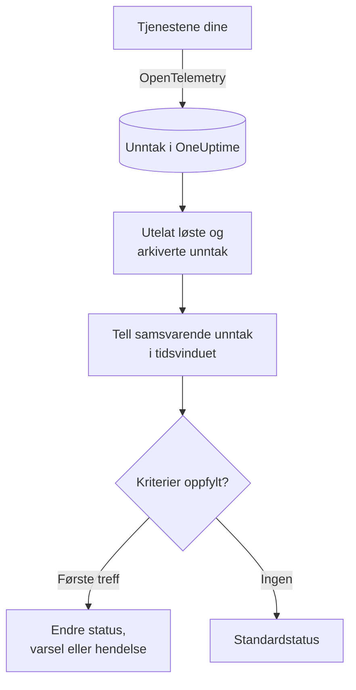

# Unntak-overvåking

En unntaksmonitor teller innenfor et tidsvindu unntakene tjenestene dine rapporterer til OneUptime som samsvarer med filtrene dine (melding, unntakstype, miljø, tjeneste). Når antallet oppfyller kriteriene dine, endrer den monitorens status, oppretter et varsel eller erklærer en hendelse. Bruk den til å bli varslet om hvert nytt krasj i produksjon, om én unntakstype eller om en plutselig økning i feil.

:::cards
- [Opprett monitoren](#opprett-en-unntaksmonitor): Velg hvilke unntak som telles, og når du skal varsles.
- [Miljøer](#miljøer): Begrens monitoren til `production`.
- [Slik evalueres den](#slik-evalueres-den): Hva som telles, og hva det gjør å løse et unntak.
- [Kriterier](#kriterier): Vilkårene og standardverdiene.
:::

## Slik fungerer det



Hvert minutt teller OneUptime unntakene som samsvarer med monitorens filtre og oppsto innenfor tidsvinduet, og utelater unntak du har merket som løst eller arkivert. Antallet sammenlignes med monitorens kriterier fra topp til bunn, og det første kriteriet som samsvarer, avgjør hva som skjer. Når ingen samsvarer, går monitoren tilbake til standardstatusen sin.

## Før du starter

- Tjenestene dine sender unntak til OneUptime via OpenTelemetry. Se [OpenTelemetry](/docs/telemetry/open-telemetry).
- For å begrense en monitor til et miljø må tjenestene dine angi ressursattributtet `deployment.environment`.

## Opprett en unntaksmonitor

:::steps
### Start en ny monitor

Gå til **Monitorer**, og klikk på **Opprett monitor**. Eller klikk på **Opprett monitor** ved siden av **Løs** på siden til et unntak: den nye monitoren følger fra start med på typen til det unntaket i tjenesten, og varsler når det skjer igjen.

### Velg Exceptions

Under **Monitortype** klikker du på **Flere monitortyper** og velger **Unntak** under **Telemetri**, eller du skriver `exceptions` i søkefeltet. Skriv inn et **Navn**, og klikk deretter på **Neste**.

### Velg hva monitoren skal fortelle deg om

Under **Hva skal denne overvåkingen fortelle deg om?** velger du **Hvilket som helst unntak** eller **For mange unntak**. Hvert valg fyller ut regelen, som du kan endre lenger ned. Velg **Noe annet** for å sette den opp selv. **Et nytt unntak**, **Et løst unntak kommer tilbake** og **Unntakene topper seg** varsler ved et unntak som ses for første gang, ved et som kom tilbake etter at du løste det, og ved en økning langt over det vanlige.

### Velg unntakene som skal telles

I **Unntak å følge med på** angir du **Meldingen inneholder**, **Unntakstyper** og **Environments**. Et filter du lar stå tomt, samsvarer med alle unntak. **Samsvarende unntak** under filtrene viser unntakene de samsvarer med akkurat nå.

### Snevre dem inn (valgfritt)

Åpne **Flere felt** for å filtrere etter telemetritjeneste eller infrastrukturentitet, eller for også å telle løste og arkiverte unntak.

### Si når det skal varsles

I **Når det skal varsles** velger du en **Betingelse**, **Antall unntak** og et **Tidsvindu**. Setningen under dem gjentar regelen med vanlige ord. Diagrammet under den teller de samsvarende unntakene i hvert vindu de siste timene, tegner regelens tall som en linje og forteller hvor ofte regelen ville ha varslet. Knappen der foreslår et tall som regelen ikke ville ha passert i den perioden. **Varsle ved** velger hva regelen sammenligner: **Unntak**, **Nye unntak**, **Unntak som kom tilbake** eller **En økning over det vanlige**. Diagrammet tegnes bare for **Unntak**.

### Velg hva som skjer

I **Hva som skjer** velger du **Opprett et varsel**, **Erklær en hendelse** eller **Begge**, og gir det en tittel og en alvorlighetsgrad. Mens regelen samsvarer, viser monitoren statusen under **Flere felt**; når den slutter å samsvare, går monitoren tilbake til standardstatusen sin, og varselet eller hendelsen løser seg selv.

### Opprett monitoren

Klikk på **Opprett monitor**. Monitoren åpnes på siden **Oversikt**, og den første evalueringen kjøres innen ett minutt.
:::

## Hva den spør etter

| Felt | Hva det samsvarer med | Standard |
| --- | --- | --- |
| **Meldingen inneholder** | Unntak der meldingen inneholder denne teksten, uten forskjell på store og små bokstaver. | Tom: alle unntak |
| **Unntakstyper** | Unntak av en av disse typene, atskilt med komma, som `TypeError, NullReferenceException`. Typenavnet må samsvare nøyaktig. | Tom: alle typer |
| **Environments** | Unntak fra et av disse miljøene, atskilt med komma (se [Miljøer](#miljøer)). | Tom: alle miljøer |
| **Tidsvindu** (i **Når det skal varsles**) | Unntak fra de siste 5 sekundene opp til de siste 24 timene. | **Siste 5 minutter** |
| **Filtrer etter telemetritjeneste** (under **Flere felt**) | Unntak fra en av de valgte tjenestene. | Tom: alle tjenester |
| **Filtrer etter infrastrukturenhet** (under **Flere felt**) | Unntak fra en av de valgte vertene, podene, containerne og andre entitetene. | Tom: alle entiteter |
| **Inkluder løste unntak** (under **Flere felt**) | Tell også unntak som er merket som løst. | Av |
| **Inkluder arkiverte unntak** (under **Flere felt**) | Tell også arkiverte unntak. | Av |

Alle filtrene du angir, må samsvare for at et unntak skal telles.

### Miljøer

Miljøer kommer fra OpenTelemetry-ressursattributtet `deployment.environment` på hvert unntak, den samme verdien som unntaksutforskeren filtrerer på med `env:production`. Skriv inn ett miljø, eller flere atskilt med komma; et unntak telles når miljøet samsvarer med ett av dem.

Sammenligningen er nøyaktig og skiller mellom store og små bokstaver: `production` samsvarer ikke med `Production` eller `prod`. Unntak uten miljø telles ikke når dette filteret er angitt. La det stå tomt for å telle unntak fra alle miljøer, også dem uten miljø.

Miljøfilteret kombineres med alle andre filtre, så en monitor som er begrenset til én telemetritjeneste og `production`, teller bare den tjenestens produksjonsunntak.

Når du oppretter monitoren via API-et, setter du `environments` på trinnets `exceptionMonitor` til en liste over miljønavn:

```json
{
  "exceptionMonitor": {
    "telemetryServiceIds": [],
    "environments": ["production"],
    "exceptionTypes": [],
    "message": "",
    "includeResolved": false,
    "includeArchived": false,
    "lastXSecondsOfExceptions": 300
  }
}
```

## Slik evalueres den

- **Hvert minutt.** En unntaksmonitor sjekkes ikke av sonder, så den har ikke noe intervall å angi og ingen side **Sonder og intervall**.
- **Forekomster, ikke unntakstyper.** Monitoren teller hver gang et samsvarende unntak oppsto innenfor **Tidsvindu**. Ett unntak som kastes 40 ganger, teller 40.
- **Løste og arkiverte unntak utelates.** Med mindre du slår på **Inkluder løste unntak** eller **Inkluder arkiverte unntak**, teller ikke forekomstene av et unntak du har merket som løst eller arkivert. Å merke et unntak som løst kan derfor lukke hendelsen det åpnet. Når et løst unntak oppstår igjen, blir det automatisk uløst og telles på nytt.
- **Ingen unntak er et antall på 0.**
- **OneUptimes eget nedetid er ikke stillhet.** Så lenge tidsvinduet inneholder tid da OneUptime selv ikke mottok data (det startet på nytt, ble oppgradert eller tok igjen et etterslep), venter sjekken: statusen endres ikke, og ingen hendelse eller varsel åpnes eller løses. Se [Når OneUptime ikke mottar data](/docs/monitor/when-oneuptime-is-not-receiving).
- **Kriterier fra topp til bunn.** Det første kriteriet som samsvarer, avgjør, så legg det mest alvorlige øverst.

Hver statusendring registreres med årsaken på monitorens **Statustidslinje**.

## Kriterier

Kriteriene til en unntaksmonitor har fire slags **Filtertype**: **Exception Count**, antallet unntak som samsvarte i vinduet, og **New Exceptions**, **Regressed Exceptions** og **Exception Increase (in %)**, som beskrives nedenfor. **Når det skal varsles** setter opp ett kriterium, der **Betingelse** er **Mer enn**, **Minst**, **Færre enn**, **Høyst** eller **Nøyaktig**. For flere kriterier, eller ett med mer enn ett filter, klikker du på **Rediger som egne kriterier** under **Flere felt** i **Hva som skjer**: hvert kriterium der har et **Filtervilkår** og en **Verdi**.

| Filtervilkår | Samsvarer når antallet unntak er… |
| --- | --- |
| **Større enn** | over verdien |
| **Større enn eller lik** | lik verdien eller høyere |
| **Mindre enn** | under verdien |
| **Mindre enn eller lik** | lik verdien eller lavere |
| **Lik** | nøyaktig verdien |
| **Ikke lik** | alt annet enn verdien |

Antall unntak har ingen avviksvilkår: det finnes ingen grunnlinje å sammenligne dem med.

En unntaksmonitor som er opprettet i Opprett monitor, starter med regelen for det du valgte under **Hva skal denne overvåkingen fortelle deg om?**:

| Valg | Regel | Hva som skjer |
| --- | --- | --- |
| **Hvilket som helst unntak** | **Mer enn** `0` i **Siste 5 minutter** | Oppretter et varsel, som løser seg selv |
| **For mange unntak** | **Mer enn** `20` i **Siste 5 minutter** | Oppretter et varsel, som løser seg selv |
| **Et nytt unntak** | **Nye unntak**: **Mer enn** `0` i **Siste 10 minutter** | Oppretter et varsel, som løser seg selv |
| **Et løst unntak kommer tilbake** | **Unntak som kom tilbake**: **Mer enn** `0` i **Siste 10 minutter** | Oppretter et varsel, som løser seg selv |
| **Unntakene topper seg** | **En økning over det vanlige**: **Mer enn** `200` i **Siste 15 minutter** | Oppretter et varsel, som løser seg selv |

En unntaksmonitor som er opprettet via API-et eller Terraform uten kriterier, starter med disse kriteriene:

| Kriterium | Filter | Virkning |
| --- | --- | --- |
| Check if … has exceptions | **Exception Count** **Større enn** `0` | Setter monitoren som frakoblet og erklærer en hendelse som løses automatisk |
| Check if … has no exceptions | **Exception Count** **Lik** `0` | Setter monitoren som tilkoblet |

## Nye, tilbakevendte og stigende unntak

I tillegg til hvor mange unntak som skjedde, kan en unntaksmonitor varsle ved det en feilsporer begynner med. Hvert leses bare når et kriterium sjekker det.

| Filtertype | Hva den teller i vinduet |
| --- | --- |
| **New Exceptions** | Samsvarende unntak som ses for første gang og verken er løst eller arkivert. |
| **Regressed Exceptions** | Samsvarende unntak du har løst, som kom tilbake og fortsatt er åpne. |
| **Exception Increase (in %)** | Hvor langt antallet samsvarende unntak ligger over det vanlige: dagen før vinduet, per vindu av samme lengde, minst ett. Ti unntak etter en rolig dag gir 900 %. |

Nye og tilbakevendte unntak filtreres etter tjeneste, unntakstype, miljø og melding, og også etter infrastrukturenhet: et unntak telles når en av forekomstene i vinduet kom fra en av de valgte enhetene.

## Gjennomgått eksempel: bare produksjonsunntak

Du vil ha en hendelse hver gang API-et kaster et unntak i produksjon, og ingenting for staging. Du velger **Hvilket som helst unntak**, setter **Environments** til `production`, beholder **Tidsvindu** på **Siste 5 minutter** og velger **Erklær en hendelse** under **Hva som skjer**. De siste fem minuttene:

| Unntak | Miljø | Tilstand | Telles? |
| --- | --- | --- | --- |
| `TypeError` × 3 | `production` | Aktivt | Ja: 3 |
| `TypeError` × 40 | `staging` | Aktivt | Nei: et annet miljø |
| `TimeoutError` × 2 | ingen | Aktivt | Nei: intet miljø |
| `NullReferenceException` × 4 | `production` | Løst etter at de oppsto | Nei: løst |

**Exception Count** er 3, så **Mer enn** `0` samsvarer: monitoren blir frakoblet, og en hendelse erklæres. Når det har gått fem minutter uten noe aktivt produksjonsunntak, slutter regelen å samsvare, monitoren går tilbake til standardstatusen sin, og hendelsen løser seg selv.

## Feilsøking

:::details Unntak vises i utforskeren, men monitoren teller 0
Sammenlign verdien i **Environments** med utforskerens filter `env:`: sammenligningen er nøyaktig og skiller mellom store og små bokstaver, og unntak uten miljø utelates når filteret er angitt. Sjekk deretter om unntakene er løst eller arkivert. Åpne monitorens side **Kriterier** (under **Konfigurasjon**), og klikk på **Edit Monitoring Criteria**: **Samsvarende unntak** viser hva filtrene samsvarer med.
:::

:::details Hendelsen ble løst da jeg løste unntaket
Det er forventet. Løste unntak telles ikke, så antallet falt, og kriteriet sluttet å samsvare. Hvis unntaket oppstår igjen, blir det uløst og telles på nytt. Slå på **Inkluder løste unntak** for å telle dem uansett.
:::

:::details Et filter på unntakstype samsvarer ikke med noe
**Unntakstyper** sammenlignes nøyaktig med typenavnet unntaket ble rapportert med, som `TypeError`. Kopier typen fra unntaksutforskeren.
:::

## Neste steg

:::cards
- [Trase-overvåking](/docs/monitor/traces-monitor): Bli varslet om mislykkede spans og endepunkter.
- [Logg-overvåking](/docs/monitor/logs-monitor): Bli varslet om loggmengde og -innhold.
- [Hendelse- og varslingsmaler](/docs/monitor/incident-alert-templating): Skriv nyttige titler og beskrivelser for varsler.
- [OpenTelemetry](/docs/telemetry/open-telemetry): Send unntak til OneUptime.
:::
