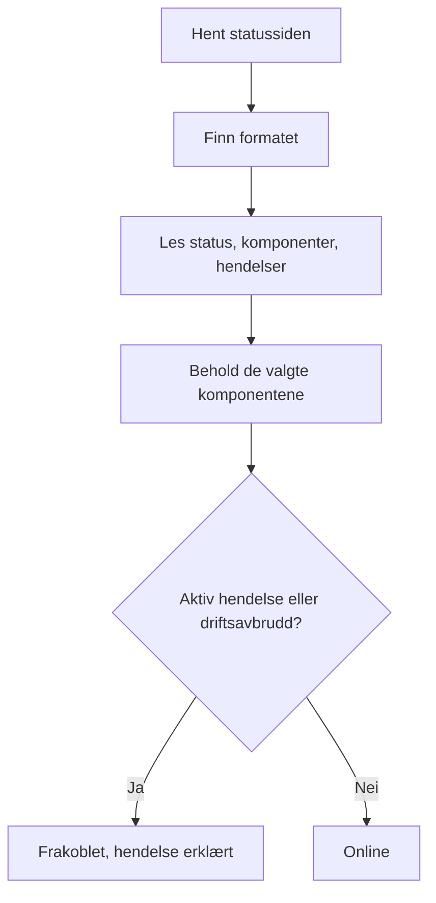

# Ekstern statusside-overvåking

En monitor for eksterne statussider følger med på den offentlige statussiden til en tjeneste du er avhengig av — AWS, GCP, Azure, GitHub, OpenAI, Anthropic og mange flere — og varsler deg når leverandøren melder om et driftsavbrudd eller redusert ytelse. Bruk den til å få vite om problemer hos leverandørene dine så snart de melder dem, og til å skille dem fra dine egne.

Den leser også statussider som er laget med OneUptime, ressurs for ressurs, og skiller planlagt vedlikehold fra et driftsavbrudd: følg med på prosjektet til et annet team, eller en leverandør der statussiden kjører på OneUptime.

:::cards
- [Opprett monitoren](#opprett-en-monitor-for-eksterne-statussider): Lim inn URL-en til en statusside, og velg hva du vil følge med på.
- [Velg komponenter](#komponenter): Følg bare med på komponentene du er avhengig av.
- [Kriterier](#overvåkingskriterier): Hva som regnes som nede som standard.
- [OneUptime-statussider](#oneuptime-statussider): Et annet prosjekts ressurser og vedlikeholdet deres.
- [Populære statussider](#populære-statusside-url-er): URL-er til tjenestene de fleste team er avhengige av.
:::

## Slik fungerer det

Ved hver kontroll henter en sonde statussiden, finner ut hvilket format den bruker, og leser den samlede statusen, komponentene og de aktive hendelsene. Hvis du har valgt komponenter eller en komponentgruppe, teller bare de. Deretter avgjør kriteriene om monitoren er online eller frakoblet.

Du kan bruke den til å:

- Overvåke tilgjengeligheten til tredjepartstjenester applikasjonen din er avhengig av
- Bli varslet når leverandørene dine har driftsavbrudd
- Følge statusen til enkeltkomponenter
- Bare følge med på komponentene du er avhengig av (f.eks. Git Operations og Pull Requests hos GitHub, eller gruppen "APIs" hos OpenAI), slik at hendelser andre steder på siden som ikke angår deg, ikke utløser monitoren din
- Oppdage redusert ytelse før det rammer brukerne dine
- Sammenholde dine egne hendelser med problemer hos leverandørene dine

## Støttede leverandører

| Leverandør | Beskrivelse |
| ------------------------ | ---------------------------------------------------------------------- |
| **Auto** (standard) | Finner formatet på statussiden automatisk |
| **Atlassian Statuspage** | Statussider som kjører på Atlassian Statuspage (JSON-API) |
| **incident.io** | Statussider som kjører på incident.io (f.eks. `https://status.openai.com`) |
| **OneUptime Status Page** | Statussider som er laget med OneUptime: statusen til hver ressurs, og hva som er under vedlikehold |
| **RSS** | Statussider som tilbyr en RSS-feed |
| **Atom** | Statussider som tilbyr en Atom-feed |

### Automatisk gjenkjenning

Når leverandøren er satt til **Auto**, finner OneUptime formatet på statussiden automatisk, i denne rekkefølgen:

1. Først prøver den statusside-API-et til incident.io (`/proxy/<host>`).
2. Deretter prøver den JSON-API-et til Atlassian Statuspage (`/api/v2/status.json`, `/api/v2/components.json` og `/api/v2/incidents/unresolved.json`).
3. Så ber den om sammendraget til en OneUptime-statusside (`/status-page-api/summary/<page>`).
4. Hvis de mislykkes, prøver den å lese siden som en RSS- eller Atom-feed.
5. Som siste utvei gjør den en enkel kontroll av om siden kan nås over HTTP.

> [!NOTE]
> incident.io sjekkes først fordi noen statussider fra incident.io (som `https://status.openai.com`) også eksponerer et begrenset, Atlassian-kompatibelt endepunkt som utelater komponentgrupper og aktive hendelser. Når incident.io sjekkes først, brukes de rikere dataene med grupper.

Kontrollen av om siden kan nås, er også utveien når en leverandør du har valgt uttrykkelig, feiler. Den forteller deg bare om siden svarer — online ved et svar `2xx` eller `3xx` — og melder ingen komponenter eller hendelser.

## Opprett en monitor for eksterne statussider

:::steps
### Start en ny monitor

Gå til **Monitorer**, og klikk på **Opprett monitor**. Under **Monitortype** klikker du på **Flere monitortyper** og velger **External Status Page** under **Basic Monitoring**, eller skriver `statuspage` i søkefeltet. Skriv inn et **Navn**, og klikk deretter på **Neste**.

### Skriv inn URL-en til statussiden

Skriv inn **URL til statusside**. La **Leverandør** stå på **Auto** med mindre du kjenner formatet.

### Velg komponenter, hvis du trenger det

Åpne **Komponenter** og velg komponentene du er avhengig av fra sidens egen liste, som `Git Operations` og `Pull Requests` på GitHubs side; la feltet stå tomt for å følge med på hele siden. For å følge med på én gruppe i stedet åpner du **Flere felt** og skriver inn et **Component Group Filter**, som `APIs`.

### Test den

Klikk på **Test monitor** for å hente siden én gang, og sjekk leverandøren, komponentene og hendelsene den fant.

### Gå gjennom kriteriene

Kriterietrinnet starter med [standardkriteriene](#standardkriterier), som markerer monitoren som frakoblet når leverandøren melder om en aktiv hendelse eller et driftsavbrudd innenfor avgrensningen. Endre dem hvis du trenger det, og klikk deretter på **Neste**.

### Velg sonder, og opprett

Velg **Sonder** og et **Overvåkingsintervall** — det starter på **Hvert 5. minutt** — og klikk deretter på **Opprett monitor**.
:::

## Konfigurasjonsalternativer

| Alternativ | Hva du skriver inn | Standard |
| --- | --- | --- |
| **URL til statusside** | URL-en til statussiden. For sider som kjører på Atlassian Statuspage og incident.io, er dette vanligvis rot-URL-en (f.eks. `https://status.example.com`). For RSS-/Atom-feeder skriver du inn URL-en til feeden direkte. | — |
| **Leverandør** | **Auto** for å finne formatet, eller **Atlassian Statuspage**, **incident.io**, **OneUptime Status Page**, **RSS** eller **Atom** hvis du kjenner det. | **Auto** |
| **Komponenter** | Komponentene du vil følge med på, valgt fra sidens egen liste eller skrevet inn. | Hele siden |
| **Component Group Filter** | Gruppen monitoren avgrenses til. Under **Flere felt**. | Alle grupper |
| **Tidsavbrudd (ms)** | Den lengste tiden det ventes på statussiden. Under **Flere felt**. | `10000` (10 sekunder) |
| **Nye forsøk** | Hvor mange ganger det prøves på nytt, med ett sekunds mellomrom, etter at det første forsøket har mislyktes; `0` betyr ett enkelt forsøk. Under **Flere felt**. | `3` (opptil 4 forsøk) |

### Komponenter

Velg komponentene du er avhengig av, så følger monitoren bare med på dem: **External Status Page Component Status** sammenligner bare statusene deres, den samlede statusen er den verste av deres, og **External Status Page Active Incidents** teller bare hendelsene som rammer minst én av dem. Det er fortsatt én kontroll av siden, uansett hvor mange du velger.

Når du åpner **Komponenter**, leser nettleseren din sidens egen liste fra en Atlassian Statuspage, en incident.io-side eller en OneUptime-statusside og viser den i sidens grupper; hver komponent som ikke er i drift, sier hvordan det står til. Et navn du velger, følger med på komponenten med nøyaktig det navnet, uten hensyn til store og små bokstaver: `Copilot` på GitHubs side er ikke `Copilot AI Model Providers`.

Når listen ikke kan leses (en intern side, en side som ikke deler listen sin med nettleseren din, en RSS- eller Atom-feed), skriver du et navn og trykker Enter. En `*` står for hvilken som helst tekst: `*us-east-1*` følger med på hver komponent med `us-east-1` i navnet. På en RSS- eller Atom-feed teller et element når tittelen inneholder et av navnene.

En hendelse som ikke nevner noen komponent, teller ikke mens du følger med på valgte komponenter: ingenting sier at den rammer dem. Er ingenting valgt, følger monitoren med på hele siden, og hver hendelse teller.

En monitor som ble lagret med det gamle Filter for komponentnavn, følger fortsatt med på det den fulgte med på: filteret vises i **Komponenter** som navnet mellom stjerner, som `*API*`, som samsvarer med hver komponent der navnet inneholder det.

> [!WARNING]
> Et navn som ikke samsvarer med noe, følger ikke med på noe og ser friskt ut. **Komponenter** og **Test monitor** nevner begge de valgte komponentene siden ikke viser.

### Component Group Filter

Hvis statussiden deler komponentene sine inn i grupper, kan du avgrense monitoren til én gruppe. På `https://status.openai.com` avgrenser du for eksempel monitoren til API-tjenestene til OpenAI ved å skrive inn `APIs`.

Når en komponentgruppe er angitt, beregnes **antallet aktive hendelser** og den **samlede statusen** bare ut fra komponentene i den gruppen — en hendelse som rammer en gruppe som ikke angår deg (for eksempel ChatGPT), utløser ikke en monitor som er avgrenset til gruppen "APIs". Er det også valgt komponenter, teller bare de valgte komponentene i gruppen.

Filtrering på komponentgruppe støttes for leverandørene **Atlassian Statuspage**, **incident.io** og **OneUptime Status Page**. RSS- og Atom-feeder har ingen komponentgrupper.

## Overvåkingskriterier

Du kan konfigurere kriterier som avgjør når den eksterne tjenesten regnes som online eller frakoblet, ut fra:

| Filtertype | Hva den sjekker | Filtervilkår |
| --- | --- | --- |
| **External Status Page Is Online** | Om statussiden kan nås og returnerer statusdata | Sann eller Usann |
| **External Status Page Overall Status** | Den samlede statusen siden melder | Lik, Ikke lik, Inneholder, Inneholder ikke, Starter med, Slutter med |
| **External Status Page Component Status** | Statusen til hver komponent innenfor avgrensningen (de valgte komponentene, eller gruppens, når de er angitt): I drift, Under Maintenance, Degraded Performance, Partial Outage, Major Outage eller Full Outage | Lik, Ikke lik, Inneholder, Inneholder ikke, Starter med, Slutter med |
| **External Status Page Active Incidents** | Antallet aktive hendelser statussiden melder om nå (bare de som rammer en komponent innenfor avgrensningen, når komponenter eller en gruppe er valgt) | Lik, Ikke lik og de numeriske sammenligningene |
| **External Status Page Response Time (in ms)** | Hvor lang tid det tar å hente dataene fra statussiden | Større enn, Mindre enn, Større enn eller lik, Mindre enn eller lik |

Den samlede statusen er det siden sier, så verdiene varierer med leverandøren: en Atlassian Statuspage melder sin egen beskrivelse, som `All Systems Operational`; en OneUptime-statusside den verste statusen blant komponentene i omfanget, som `under_maintenance`; en feed melder `operational` eller `degraded_performance`; kontrollen av om siden kan nås, melder `reachable` eller `unreachable`. Med valgte komponenter eller en gruppe er det den verste statusen blant dem, på hvilken som helst side. Disse sammenligningene skiller mellom store og små bokstaver. Monitorens sammendrag viser den samlede statusen i ord og farge, slik det viser hver komponents (`under_maintenance` står som **Under Maintenance**), mens kriteriene sammenligner verdien siden melder. For å varsle om driftsavbrudd er **External Status Page Active Incidents** og **External Status Page Component Status** som regel mer pålitelige.

På en RSS- eller Atom-feed regnes elementene fra de siste 24 timene som aktive hendelser: et RSS-element ut fra publiseringsdatoen, et Atom-element ut fra oppdateringsdatoen. Et element som er datert fram i tid, regnes først fra datoen sin.

### Standardkriterier

Som standard oppretter OneUptime kriterier ut fra det som virkelig betyr noe for en statusside — de aktive hendelsene og helsen til komponentene, i stedet for bare om den kan nås:

| Kriterium | Filtre | Virkning |
| --- | --- | --- |
| Offline | **Hvilken som helst** av: siden er ikke online; det finnes minst én aktiv hendelse innenfor avgrensningen; en komponent innenfor avgrensningen melder Degraded Performance, Partial Outage, Major Outage eller Full Outage | Markerer monitoren som frakoblet og erklærer en hendelse, som løser seg selv når kriteriet slutter å samsvare |
| Online | **Alle** av: siden er online; det finnes ingen aktive hendelser innenfor avgrensningen | Markerer monitoren som online |

Fordi antallet aktive hendelser og statusene til komponentene tar hensyn til de valgte komponentene og gruppen, treffer disse standardkriteriene automatisk bare komponentene du bryr deg om.

## OneUptime-statussider

Velg **OneUptime Status Page** som leverandør, eller la **Auto** stå, for å følge med på en statusside som er laget med OneUptime: prosjektet til et annet team, eller siden til en leverandør på OneUptime Cloud eller på en selvdriftet OneUptime. Skriv inn sidens egen adresse i **URL til statusside**: domenet, som `https://status.example.com`, eller `https://oneuptime.com/status-page/<status-page-id>` for en side uten eget domene.

Monitoren leser sammendraget til siden, `/status-page-api/summary/<page>` (se [Les sammendraget](/docs/status-pages/public-api#les-sammendraget)): bare det siden viser de besøkende, og ingenting annet fra det andre prosjektet. Hver ressurs på siden, en monitor eller en monitorgruppe, er en komponent, med navnet siden gir den, i gruppen på siden; en gruppe inni en annen heter `Core / Databases`. Velg ressurser i **Komponenter**, eller følg med på én gruppe med **Component Group Filter**.

Statusen til en komponent er verdien som statusen på siden står for, så kriteriene for komponentstatus virker som på en hvilken som helst statusside:

| På siden | Komponentstatus |
| --- | --- |
| Driftsstatusen til prosjektet | `operational` |
| En status som heter `Degraded` | `degraded_performance` |
| En status som heter `Offline`, `Down` eller `Major Outage` | `major_outage` |
| En status som heter `Partial Outage` | `partial_outage` |
| En status som heter `Full Outage` | `full_outage` |
| En status som heter `Maintenance` | `under_maintenance` |
| En hvilken som helst annen status | `degraded_performance` |
| En status siden skjuler, med **Show current status** slått av | `unknown` |

Mens en pågående planlagt vedlikeholdshendelse berører en ressurs, fordi den nevner en av monitorene til ressursen eller en monitor i monitorgruppen dens, er komponenten `under_maintenance`, uansett hvilken status monitorene har: en monitor blir ikke kontrollert mens en hendelse holder den. En hendelse som ikke har begynt ennå, eller som er over, endrer ingenting. De aktive hendelsene på siden regnes for ressursene de berører.

[Standardkriteriene](#standardkriterier) tar aldri vedlikehold for et driftsavbrudd: monitoren forblir online under det planlagte arbeidet til det andre prosjektet.

### Vis vedlikeholdet til det andre prosjektet på monitoren din

:::steps
### Legg til kriteriet

Klikk **Legg til kriterier** i kriteriene til monitoren. Gi det filteret **External Status Page Component Status**, **Lik**, **Under Maintenance**, og velg vedlikeholdsstatusen din i **Endre overvåkingsstatus til**.

### Flytt det helt øverst

Dra det nye kriteriet over de andre: det første kriteriet som treffer, vinner.

### Sjekk det med Test monitor

Klikk **Test monitor** mens det andre prosjektet har vedlikehold i gang: komponenten det berører, viser **Under Maintenance**.
:::

### Hva en OneUptime-statusside lar monitoren lese

En side alle kan åpne, blir lest slik de besøkende ser den. En privat side, som krever pålogging, SSO eller et passord, kan ikke leses: med **OneUptime Status Page** valgt mislykkes kontrollen og sier hvorfor. En side med en tillatelsesliste for IP-adresser må slippe inn adressen til sonden: følg med på den fra en sonde inne i det nettverket.

## Malvariabler

Når du oppretter hendelser eller varsler fra monitorer for eksterne statussider, kan du bruke disse variablene i titler, beskrivelser og utbedringsnotater (se [Hendelse- og varslingsmaler](/docs/monitor/incident-alert-templating)):

| Variabel | Beskrivelse |
| ------------------------- | ------------------------------------------------------------------------------- |
| `{{isOnline}}`            | Om statussiden er online (true/false) |
| `{{responseTimeInMs}}`    | Svartid i millisekunder |
| `{{failureCause}}`        | Årsaken til feilen, hvis noen |
| `{{overallStatus}}`       | Verdien til den samlede statusindikatoren |
| `{{activeIncidentCount}}` | Antall aktive hendelser (for komponentene den følger med på, hvis noen er valgt) |
| `{{componentStatuses}}`   | JSON-matrise med statusene til komponentene (`name`, `status`, `description`, `groupName`) |
| `{{provider}}`            | Den gjenkjente leverandøren (Atlassian Statuspage, incident.io, OneUptime Status Page, RSS, Atom); tom etter en kontroll av om siden kan nås |
| `{{componentGroup}}`      | Komponentgruppen monitoren er avgrenset til, hvis noen |
| `{{componentName}}`       | Komponentene monitoren følger med på, atskilt med komma, hvis noen er valgt |

## Populære statusside-URL-er

Her er en liste over statussidene til populære tjenester. Mange av dem bruker Atlassian Statuspage eller incident.io, så leverandøren **Auto** gjenkjenner dem automatisk. En side som ikke er bygd på noen av dem, og som ikke er en feed, får bare kontrollen av om den kan nås — for slike overvåker du heller RSS- eller Atom-feeden til leverandøren, hvis den publiserer en.

| Tjeneste | URL til statusside |
| ---------------------------- | --------------------------------------------- |
| AWS                          | `https://health.aws.amazon.com/health/status` |
| Google Cloud Platform        | `https://status.cloud.google.com`             |
| Microsoft Azure              | `https://status.azure.com`                    |
| GitHub                       | `https://www.githubstatus.com`                |
| OpenAI                       | `https://status.openai.com`                   |
| Anthropic                    | `https://status.anthropic.com`                |
| Cloudflare                   | `https://www.cloudflarestatus.com`            |
| Datadog                      | `https://status.datadoghq.com`                |
| PagerDuty                    | `https://status.pagerduty.com`                |
| Twilio                       | `https://status.twilio.com`                   |
| Stripe                       | `https://status.stripe.com`                   |
| Slack                        | `https://status.slack.com`                    |
| Atlassian (Jira, Confluence) | `https://status.atlassian.com`                |
| Vercel                       | `https://www.vercel-status.com`               |
| Netlify                      | `https://www.netlifystatus.com`               |
| DigitalOcean                 | `https://status.digitalocean.com`             |
| Heroku                       | `https://status.heroku.com`                   |
| MongoDB Atlas                | `https://status.cloud.mongodb.com`            |
| Fastly                       | `https://status.fastly.com`                   |
| New Relic                    | `https://status.newrelic.com`                 |
| Sentry                       | `https://status.sentry.io`                    |
| CircleCI                     | `https://status.circleci.com`                 |

## Beste praksis

- **Bruk leverandøren Auto** med mindre du kjenner det nøyaktige formatet — automatisk gjenkjenning fungerer godt for de fleste statussider.
- **Velg komponentene du er avhengig av** (f.eks. Git Operations og Pull Requests hos GitHub), slik at hendelser som ikke angår deg, ikke lager støy.
- **Følg med på en hel gruppe** når du er avhengig av hele den (f.eks. "APIs" hos OpenAI), slik at komponentene den får senere, også blir fulgt med på.
- **Kombiner med dine egne monitorer** — sett monitorer for eksterne statussider sammen med dine egne API- og nettstedsmonitorer. Når begge går ned samtidig, peker leverandørens statusside deg raskere mot årsaken.

## Feilsøking

:::details Monitoren er frakoblet, men hendelsen gjelder en del av tjenesten jeg ikke bruker
Velg komponentene du er avhengig av i **Komponenter**, eller én gruppe i **Component Group Filter**. Antallet aktive hendelser og statusene til komponentene teller da bare dem; en hendelse som ikke nevner noen komponent, teller ikke.
:::

:::details Monitoren blir aldri frakoblet, selv under et driftsavbrudd
Et valgt navn samsvarer kanskje ikke med noe på siden, noe som ser friskt ut, eller siden får kanskje bare kontrollen av om den kan nås. Kjør **Test monitor**: den viser leverandøren og komponentene den fant, og nevner hver valgt komponent siden ikke viser.
:::

:::details Auto velger feil format, eller finner ingen komponenter
Sett **Leverandør** til den du vet at siden bruker. For en RSS- eller Atom-feed skriver du inn URL-en til selve feeden i stedet for statussidens.
:::

:::details Listen i Komponenter lastes ikke
Nettleseren din leser listen rett fra statussiden. En intern side nettleseren din ikke når, en side som ikke deler listen sin med andre nettsteder, og en RSS- eller Atom-feed har ingen liste å velge fra: skriv inn navnet på hver komponent slik siden viser det, og trykk Enter. Sondene leser siden som før.
:::

:::details En OneUptime-statusside viser ingen komponenter
Velg **OneUptime Status Page** som **Leverandør** og klikk **Test monitor**: resultatet sier om siden er privat, eller om tillatelseslisten for IP-adresser stenger sonden ute. En selvdriftet OneUptime som ikke har blitt oppdatert på en stund, leverer ikke noe sammendrag ennå: til den gjør det, får siden kontrollen av om den kan nås, eller leses som en feed.
:::

:::details En intern statusside kan ikke nås
En sonde avviser adresser i private nettverk med mindre den har lov til å nå dem. Sett `PROBE_ALLOW_PRIVATE_NETWORK_MONITORS=true` på en sonde inne i nettverket ditt — se [Tilgang til privat nettverk](/docs/self-hosted/private-network-access).
:::

## Neste trinn

:::cards
- [Hendelse- og varslingsmaler](/docs/monitor/incident-alert-templating): Sett statusen til leverandøren inn i titlene på hendelsene dine.
- [API-overvåking](/docs/monitor/api-monitor): Sjekk dine egne endepunkter ved siden av statusen til leverandøren din.
- [Opprett en monitor](/docs/monitor/create-monitor): Trinnene alle monitortyper har felles.
:::
