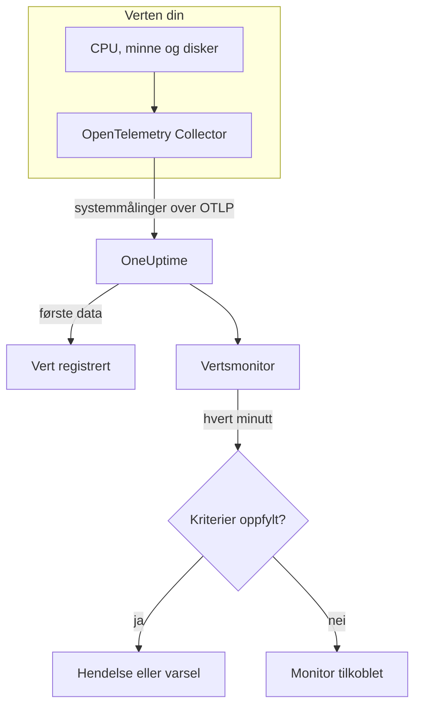

# Verts-monitor

En vertsmonitor overvåker én maskin – CPU, minne, disker, belastning og prosesser – og sier fra når den er mettet eller holder på å fylles opp. Den leser OpenTelemetry-målingene `system.*` som en OpenTelemetry Collector sender fra verten, de samme dataene som produktet **Verter** viser, så ingenting undersøkes utenfra.

:::cards
- [Opprett monitoren](#opprett-en-vertsmonitor): Seks trinn i dashbordet.
- [Maler](#ferdige-varslingsmaler): Ti ferdige varsler for en taus eller omstartet vert, CPU, minne, swap, disk, inoder, belastning, prosesser og mislykkede systemd-enheter.
- [Målinger](#innsamlede-målinger): Vertsmålingene du kan varsle på, og enhetene deres.
- [Vert eller Server / VM?](#vertsmonitor-eller-server-vm-monitor): Hvilken av de to maskinmonitorene du skal bruke.
- [Flere disker](#verter-med-flere-disker): Én monitor for alle disker, én hendelse per disk.
:::

## Slik fungerer det

En OpenTelemetry Collector kjører på verten med mottakeren `hostmetrics`. Hvert 30. sekund leser den vertens tall for CPU, minne, disk, nettverk, belastning og prosesser og sender dem til OneUptime over OTLP. De første dataene fra en vert registrerer den under **Verter**.

En vertsmonitor er knyttet til én vert. Hvert minutt kjører den spørringen sin over vertens målinger og sammenligner resultatet med kriteriene sine.

### Vertsmonitor eller Server- / VM-monitor?

OneUptime har to monitorer for maskiner. De kan kjøre på samme vert.

| | Vertsmonitor | Server- / VM-monitor |
| --- | --- | --- |
| **Agent** | En OpenTelemetry Collector med mottakeren `hostmetrics` | OneUptimes infrastrukturagent |
| **Data** | OpenTelemetry-målingene `system.*` og `process.*`, de samme som sidene under **Verter** viser i diagrammer | En statusrapport som agenten sender til monitoren |
| **Kriterier** | Terskler eller avviksdeteksjon på enhver målingsspørring eller formel | Innebygde kontroller som CPU-, minne- og diskbruk |
| **Oppsett** | Installer collectoren; verten registrerer seg selv | Opprett monitoren, og gi deretter den hemmelige nøkkelen til agenten |

Bruk vertsmonitoren når verten allerede sender OpenTelemetry-data, eller når du vil ha logger og rikere målinger fra samme collector. Se [Server- / VM-monitor](/docs/monitor/server-monitor) for den andre.

## Før du begynner

- **Kjør en OpenTelemetry Collector på verten** med mottakeren `hostmetrics`. Den raskeste veien er [Verter](/docs/telemetry/hosts): Én kommando installerer innsamleren, og OneUptime konfigurerer den. [OpenTelemetry-collector på verten](/docs/telemetry/host-otel-collector) dekker Linux, macOS og Windows, og **Produkter → Infrastruktur → Verter → Dokumentasjon** gir en ferdig konfigurasjon.
- **Slå på utnyttelsesmålingene.** `system.cpu.utilization`, `system.memory.utilization` og `system.filesystem.utilization` er valgfrie i mottakeren, og malene for CPU, minne og filsystem trenger dem. Konfigurasjonen fra dashbordet slår dem på.
- **Kontroller at verten er registrert.** Den vises under **Produkter → Infrastruktur → Verter → Alle verter**, oppkalt etter sitt `host.name`, så snart de første dataene kommer.

## Opprett en vertsmonitor

:::steps
### Start en ny monitor

Gå til **Monitorer** og klikk på **Opprett monitor**.

### Velg Vert

Klikk på **Flere monitortyper** under **Monitortype**, og velg **Vert** under **Infrastruktur**. Skriv inn et **Navn** – det brukes i titler på hendelser og varsler – og klikk på **Neste**.

### Velg verten

Velg maskinen i **Vert** under **Host Monitor Configuration**. Hver vert som har sendt data, står i listen. Når du har valgt, viser en linje under feltet om det kommer data. **Legg til vert** åpner oppsettstrinn med nøklene dine fylt inn, som venter på de første dataene.

### Velg hva som skal overvåkes

En ny monitor starter med **Host Stopped Reporting** under **Hva det skal varsles om**. Slik overvåker du noe annet:

- **Endre** – velg en annen [mal](#ferdige-varslingsmaler). Den angir målingen, aggregeringen, tidsintervallet og tersklene, og erstatter kriteriene nedenfor med sine egne. Du kan fortsatt endre **Tidsintervall**.
- **Custom Metric** (under **Flere felt**) – velg én måling i **Host Metric**, og angi deretter **Aggregering** og **Tidsintervall**.
- **Avansert** (under **Flere felt**) – bygg spørringer og formler selv under **Velg målinger**, for eksempel et filter på `state` eller en gruppering etter `mountpoint`.

### Kontroller kriteriene

Åpne hvert kriterium under **Kriterier** og kontroller **Måling**, **Aggregering**, **Betingelse** og **Terskel**. En mal fyller inn disse. Med **Custom Metric** eller **Avansert** starter monitoren med [standardkriteriene](#standardkriterier), som bare merker at målingen ikke sender data, så angi din egen terskel.

### Opprett monitoren

Klikk på **Opprett monitor**. OneUptime åpner monitorens side og evaluerer den hvert minutt. Hendelser og varsler den åpner, vises også på vertens sider **Hendelser** og **Varsler**.
:::

> [!TIP]
> For å sette opp flere maler samtidig åpner du verten fra **Produkter → Infrastruktur → Verter** og går til **Anbefalinger**. Velg malene du vil ha og hvem som skal varsles, så oppretter OneUptime én monitor per mal.

## Monitorinnstillinger

| Felt | Fane | Hva det gjør |
| --- | --- | --- |
| **Vert** | Alle | Påkrevd. Avgrenser hver spørring til vertens `resource.host.name`. |
| **Host Metric** | Custom Metric | Én måling fra [katalogen](#innsamlede-målinger), gruppert som CPU, minne, disk, nettverk, belastning og prosesser. |
| **Aggregering** | Custom Metric | Hvordan målinger kombineres: **Gjennomsnitt**, **Maksimum**, **Minimum**, **Sum** eller **Antall**. Starter på målingens vanlige aggregering. |
| **Tidsintervall** | Alle | Det glidende vinduet spørringen leser, fra **Past 1 Minute** til **Past 365 Days**. En ny monitor starter på **Past 1 Minute**; maler angir sitt eget. |
| **Velg målinger** | Avansert | Spørringsbyggeren: **Måling**, **Aggreger etter**, **Filtrer etter attributter**, **Grupper etter**, pluss **Legg til måling** og **Legg til formel** for å kombinere spørringer. |

## Ferdige varslingsmaler

Listen under **Hva det skal varsles om** tilbyr ti maler. Hver bygger en komplett monitor: en spørring, et kriterium som utløses, og et som gjenoppretter. Tersklene er utgangspunkter du kan redigere.

Et kriterium utløses bare når betingelsen gjelder i hvert minutt av vinduet, og det gjenoppretter 10 % forbi terskelen, slik at en verdi som svever ved grensen, ikke blafrer.

| Mal | Alvorlighetsgrad | Overvåker | Utløses når | Gjenoppretter når |
| --- | --- | --- | --- | --- |
| Host Stopped Reporting | Kritisk | `system.memory.usage`, Count, siste 10 minutter | Ingen data i hele vinduet | Data kommer inn igjen |
| Host Restarted | Advarsel | `system.uptime`, Min, siste 5 minutter | En verdi er under 600 (ti minutter) | Alle verdier er på eller over 660 |
| High CPU Utilization | Advarsel | `system.cpu.utilization` for tilstandene `user` og `system`, lagt sammen og vist som prosent, siste 5 minutter | Over 80 % | På eller under 72 % |
| High Memory Utilization | Advarsel | `system.memory.utilization` for tilstanden `used`, som prosent, siste 5 minutter | Over 85 % | På eller under 76,5 % |
| High Swap Usage | Advarsel | `system.paging.usage` for tilstandene `used` og `free`, brukt delt på brukt pluss ledig, som prosent, siste 5 minutter | Over 80 % | På eller under 72 % |
| High Filesystem Usage | Kritisk | `system.filesystem.utilization`, Max per `mountpoint` og `device`, som prosent, siste 5 minutter | Over 90 % | På eller under 81 % |
| Running Out of Inodes | Kritisk | `system.filesystem.inodes.usage` for tilstandene `used` og `free`, brukt delt på brukt pluss ledig, per `mountpoint` og `device`, som prosent, siste 5 minutter | Over 90 % | På eller under 81 % |
| High Load Average (1m) | Advarsel | `system.cpu.load_average.1m`, Avg, siste 5 minutter | Over 4 | På eller under 3,6 |
| High Process Count | Advarsel | `system.processes.count`, Max, siste 5 minutter | Over 2000 | På eller under 1800 |
| Systemd Unit Failed | Advarsel | `systemd.unit.state` med `systemd.unit.active_state = failed`, Max per `resource.systemd.unit.name`, siste 5 minutter | Over 0 | På eller under 0 |

**Alvorlighetsgrad** er etiketten velgeren viser. Hendelsen og varselet en mal oppretter, starter på prosjektets mest alvorlige hendelses- og varslingsgrad; endre dem i kriteriene.

- **Host Stopped Reporting** utløses når ingenting kommer fra verten på ti minutter: maskinen er nede eller utilgjengelig, eller collectoren har stoppet, mistet ruten sin til OneUptime eller fått tokenet sitt tilbakekalt. Den løses når data kommer tilbake. Når data stopper, har de andre malene ingenting å sammenligne og beholder sin siste status, så det er denne som sier fra.
- **Host Restarted** utløses ved den første rapporten etter en oppstart: verten har kjørt i mindre enn ti minutter. Den leser `system.uptime` fra collectorens skraper `system`, som OneUptimes standardkonfigurasjoner slår på, og løses av seg selv omtrent et kvarter etter oppstarten, når hver verdi i vinduet på fem minutter er minst elleve minutter. En vert som er nede, utløser i stedet **Host Stopped Reporting**.
- **CPU** er opptatt tid (`user` pluss `system`), det samme tallet som vertens **Oversikt** viser i diagrammer. Iowait og steal er utelatt.
- **Minne** utelater buffere og sidebuffer, så en vert som stort sett inneholder hurtigbuffer, ikke utløser den.
- **Swap** er brukt swap delt på brukt pluss ledig, på tvers av alle swap-enheter, slik `free` og `swapon` viser det. En vert uten swap rapporterer ingen og utløses aldri.
- **Filsystem** åpner én hendelse per montering. Skrivebeskyttede pseudofilsystemer, som snap-monteringer av typen `squashfs` eller `devfs` på macOS, er alltid 100 % fulle: OneUptimes collector-konfigurasjoner utelater dem fra skraperen `filesystem` med `exclude_fs_types`, og en konfigurasjon du skriver selv, trenger det samme.
- **Inoder** åpner én hendelse per montering, som **Filsystem**. Når et filsystem går tom for inoder, kan ingenting opprette en fil der, uansett hvor mye plass som er ledig. Et filsystem uten egen inodetabell, som btrfs, rapporterer ingen og utløses aldri.
- **Belastningsgjennomsnitt** er en rå lengde på kjørekøen, ikke delt på antall kjerner: 4 er metning på en vert med 2 kjerner og rutine på en med 32, så hev den på store verter.
- **Antall prosesser** sammenligner den største enkeltstående prosesstilstanden (`running`, `sleeping`, …), ikke vertens totale antall, så det vil ikke stemme med en prosessliste. Skraperen for prosesser rapporterer på Linux, macOS og BSD, ikke på Windows.
- **Systemd Unit Failed** åpner ett varsel per systemd-tjeneste i tilstanden `failed`, fra collectorens mottaker `systemd`, som OneUptimes standardkonfigurasjon leser på Linux-verter med systemd. Den løses når enheten kjører igjen, eller når `systemctl reset-failed` nullstiller den.

## Android-enheter

En vert der OS-et er Android, for eksempel en kiosk eller en POS-terminal som kjører [Android-agenten](/docs/telemetry/android-agent), tilbys egne maler, som leser det agenten sender, sammen med Host Stopped Reporting, Host Restarted og High Memory Utilization. Den tilbys ikke malene for det en enhet aldri sender, som swap, inoder, belastning eller systemd-enheter.

| Mal | Alvorlighetsgrad | Overvåker | Utløses når | Gjenoppretter når |
| --- | --- | --- | --- | --- |
| Device Unplugged | Advarsel | `android.battery.plugged`, Max, siste 10 minutter | Enheten går på batteriet sitt i hele vinduet | Den er koblet til strøm igjen |
| Low Battery | Advarsel | `hw.battery.charge`, Min, som prosent, siste 5 minutter | Under 20 % | På eller over 20 % |
| Device Overheating | Advarsel | `android.thermal.status`, Max, siste 5 minutter | 3 (alvorlig) eller verre | Under 3 |
| Restart Loop | Kritisk | `android.boot.recent_count`, Max, siste time | En verdi er 3 eller mer | Alle verdier er under 3 |
| Storage Nearly Full | Kritisk | `system.filesystem.utilization`, Max per `mountpoint`, som prosent, siste 5 minutter | Over 90 % | På eller under 90 % |
| Security Patch Out of Date | Advarsel | `android.os.security_patch.age`, antall dager siden sikkerhetspatchnivået til enheten, Min, siste time | Over 90 dager gammelt i hele vinduet | En avlesning på 90 dager eller færre, når enheten er oppdatert |
| High CPU Utilization | Advarsel | `system.cpu.utilization` for tilstanden `idle`, opptatt som 1 minus idle, som prosent, siste 5 minutter | Over 80 % | På eller under 80 % |

High CPU Utilization tilbys når enheten rapporterer CPU-bruk, noe som på Android 8 og nyere krever at agenten er enhetseier. Varselet for en Android-enhet begynner med adb-kommandoer som skal kjøres først, for eksempel `adb shell dumpsys battery`, `adb shell getprop sys.boot.reason` eller `adb shell getprop ro.build.version.security_patch`, i stedet for shell-kommandoene til en server.

## Innsamlede målinger

Listen **Host Metric** tilbyr disse målingene. Hver bærer `resource.host.name`, som er måten monitoren avgrenser spørringene sine til én vert på. Valgt der teller CPU tilstanden `user`, minne- og filsystembruk tilstanden `used`, og filsystemer og prosesser gir én serie per monteringspunkt og status.

> [!IMPORTANT]
> Utnyttelsesmålingene er et forhold fra 0 til 1, ikke en prosent: bruk `0.8` for 80 % i en terskel på den rå målingen. Malene regner om til prosent med en formel, så tersklene deres er 80, 85 og 90.

### CPU

| Måling | Enhet | Beskrivelse |
| --- | --- | --- |
| `system.cpu.utilization` | forhold | Andel av CPU-tiden i hver `state` (`user`, `system`, `idle`, …). Filtrer på `state`: et gjennomsnitt over alle tilstander når aldri en nyttig terskel. |
| `process.cpu.utilization` | forhold | CPU-utnyttelse for hver prosess på verten. |

### Minne

| Måling | Enhet | Beskrivelse |
| --- | --- | --- |
| `system.memory.utilization` | forhold | Andel av det fysiske minnet i hver `state` (`used`, `free`, `cached`, …). Filtrer på `state = used` for minne i bruk. |
| `system.memory.usage` | byte | Minnebruk i byte. |

### Disk

| Måling | Enhet | Beskrivelse |
| --- | --- | --- |
| `system.filesystem.utilization` | forhold | Andel av hvert filsystems kapasitet i bruk, per `mountpoint` og `device`. |
| `system.filesystem.usage` | byte | Filsystembruk i byte. |

### Nettverk

| Måling | Enhet | Beskrivelse |
| --- | --- | --- |
| `system.network.io` | byte | Mottatte og sendte byte. En teller over hele levetiden. |

### Belastning

| Måling | Enhet | Beskrivelse |
| --- | --- | --- |
| `system.cpu.load_average.1m` | antall | Belastningsgjennomsnitt det siste minuttet. |
| `system.cpu.load_average.5m` | antall | Belastningsgjennomsnitt de siste 5 minuttene. |
| `system.cpu.load_average.15m` | antall | Belastningsgjennomsnitt de siste 15 minuttene. |

### Prosesser

| Måling | Enhet | Beskrivelse |
| --- | --- | --- |
| `system.processes.count` | antall | Prosesser på verten, én serie per prosess-`status`. |

Spørringsbyggeren i **Avansert** viser hver måling verten sender, ikke bare disse.

## Overvåkingskriterier

Et kriterium sammenligner en av monitorens spørringer eller formler med en terskel. Kriteriene til en vertsmonitor har ingen **Filtertype**: hver regel kontrollerer målingsverdien, med disse feltene.

| Felt | Hva det gjør |
| --- | --- |
| **Måling** | Spørringen eller formelen som kontrolleres, etter variabelnavnet. |
| **Aggregering** | Hvordan verdiene i vinduet blir til ett svar: **Gjennomsnitt**, **Sum**, **Maksimumsverdi**, **Minimumsverdi**, **Alle verdier** (hver verdi må samsvare, i hele vinduet) eller **Minst én verdi** (én er nok). |
| **Betingelse** | **Større enn**, **Mindre enn**, **Større enn eller lik**, **Mindre enn eller lik**, **Lik** eller **Ikke lik** – eller en avviksbetingelse: **Unormalt høy**, **Unormalt lav** eller **Avvikende**. **Ingen data** stemmer når spørringen ikke ga noe i vinduet, og **Har data** når den ga noe. **Ventes å stige over** og **Ventes å falle under** treffer når målingens trend i vinduet er forbi terskelen ved slutten av **Tidshorisont**. |
| **Terskel** | Verdien det sammenlignes med. En liste over enheter står ved siden av når målingen har en enhet. Vises ikke for avviksbetingelser. |
| **Følsomhet** | Bare avviksbetingelser. **Lav** (4σ), **Middels** (3σ, standard) eller **Høy** (2σ). |
| **Grunnlinjevindu** | Bare avviksbetingelser. 14 dager (standard), 28, 60 eller 90 dager med historikk. |
| **Hvis ingen data** | Under **Flere felt**. Hva som skjer når vinduet ikke har noen målinger: **Ignore** (standard), **Treat As Zero** eller **Utløser**. |

Avviksbetingelser sammenligner hver verdi med samme time i uken i grunnlinjen. De blir værende i en «Learning»-tilstand og gir ingenting før grunnlinjevinduet inneholder nok historikk. Denne monitoren filtrerer spørringene sine etter attributter, så hver spørring, og hver serie i en gruppert spørring, sammenlignes med sin egen historikk, så langt tilbake som målingene dine beholdes. Er det under to uker, blir en sum, en telling eller en spørring på et histogram værende i den tilstanden for alltid, og alt annet sammenlignes med alle seriene til målingen. En persentil av et histogram blir alltid værende i den tilstanden.

Hvert kriterium sier også hva som skal skje når det samsvarer: endre monitorstatusen, opprette et varsel eller erklære en hendelse. Kriterier kontrolleres ovenfra og ned, og det første som samsvarer, avgjør.

### Standardkriterier

En monitor du ikke bygger fra en mal, starter med to kriterier:

| Rekkefølge | Kriterium | Samsvarer når | Deretter |
| --- | --- | --- | --- |
| 1 | Sjekk om _monitornavn_ er offline | Den første spørringen har ingen data i hele vinduet | Markerer monitoren som **Offline** og erklærer hendelsen «_monitornavn_ er offline», som løser seg selv når monitoren kommer seg. |
| 2 | Sjekk om _monitornavn_ er tilkoblet | Den første spørringen har data | Markerer monitoren som **I drift**. |

> [!IMPORTANT]
> En verdi på `0` er data, så en måling som ofte er null, som omstarter eller feil, gjør ikke monitoren offline. For å få varsel om en verdi, start fra en mal eller legg til et kriterium med en terskel. Når ingen data kommer i det hele tatt og ingen kriterier passer, beholder monitoren statusen sin, og åpne hendelser forblir åpne: stillhet er ikke bedring. Tid da OneUptime selv ikke mottok data, regnes aldri som manglende data: en sjekk der vinduet inneholder slik tid, venter i stedet, slik [Når OneUptime ikke mottar data](/docs/monitor/when-oneuptime-is-not-receiving) forklarer.

## Verter med flere disker

Én vertsmonitor dekker alle diskene verten rapporterer. Malene High Filesystem Usage og Running Out of Inodes grupperer spørringen sin etter `mountpoint` og `device`, så monitoren kontrollerer hver disk for seg og åpner én hendelse per disk: en annen disk som holder på å fylles opp, skjules ikke bak den første diskens åpne hendelse.

| Hvor | Hva det viser for hver disk |
| --- | --- |
| Monitorens side **Målinger** | Én linje per disk, oppkalt etter diskens `mountpoint` og `device`. |
| **Overvåkingslogger** | Kolonnen **Observert** teller seriene hver sjekk leste: én per disk. |
| **Hendelser** og **Varsler** | Én per disk, som nevner diskens montering og enhet. |
| Vertens tabell **Filsystemer** | Alle disker collectoren rapporterer, uansett hva monitorene dine overvåker. |

Hvert kriterium kontrolleres for hver disk:

- Mens hendelsen til en disk er åpen, åpner kriteriet som åpnet den, ingen annen for den disken. En annen disk som oppfyller det, åpner sin egen.
- En disk som oppfyller to kriterier, for eksempel ett over 98 % og ett over 90 %, får én hendelse, fra det første av dem i listen. Sett det strengeste først.
- Hendelsen til en disk løses når den disken ikke lenger oppfyller kriteriet som åpnet den, uansett hva de andre diskene gjør.
- Monitoren har én status, satt av det første kriteriet i listen som noen disk oppfyller. Når ingen disk oppfyller et kriterium som utløses, er én disk på eller under gjenopprettingsterskelen nok for kriteriet som gjenoppretter, så gjenopprettingsmarginen på 10 % gjelder ikke på en vert med en disk som aldri er nær full.

For å overvåke bare noen av diskene åpner du **Avansert** og legger til et filter på `mountpoint` i **Filtrer etter attributter** for spørringen under **Velg målinger**: **er en av** diskene som skal overvåkes, eller **er ingen av** diskene som skal utelates. Behold **Grupper etter**, og skriv hver disk slik tabellen **Filsystemer** viser den, for eksempel `C:` eller `/var`. For å slutte å samle inn en disk helt, slik at den også forsvinner fra vertens sider, angir du `include_mount_points` eller `exclude_mount_points` i collectorens skraper `filesystem` ([Vertsmålinger](/docs/telemetry/host-otel-collector#vertsmålinger)).

## Feilsøking

:::details Verten står ikke i listen Vert
Verter registrerer seg selv fra collectorens data, som trenger et `host.name` og vertens OS-type – begge kommer fra collectorens prosessor `resourcedetection`. Kontroller at collectoren kjører, og at verten står under **Produkter → Infrastruktur → Verter → Alle verter**. [OpenTelemetry-collector på verten](/docs/telemetry/host-otel-collector) dekker konfigurasjonen.
:::

:::details En CPU- eller minneterskel utløses aldri
Utnyttelsesmålingene er forhold som topper ut på `1.0`, så en håndskrevet terskel på `80` krysses aldri: bruk `0.8`, eller start fra en mal, som regner om til prosent. Filtrer også på `state` – `user` og `system` for CPU, `used` for minne. Et gjennomsnitt over alle tilstander holder seg nær 1 delt på antall tilstander.
:::

:::details Hendelser utløses for feil vert
Monitoren avgrenser hver spørring med `resource.host.name` lik verten du valgte. Verter som rapporterer samme `host.name`, slås sammen til én serie, så gi hver vert et unikt navn.
:::

:::details High Filesystem Usage utløses for en montering som alltid er full
Skrivebeskyttede pseudofilsystemer, som snap-loop-monteringer av typen `squashfs` under `/snap` eller `devfs` på macOS, er 100 % fulle med vilje og kommer seg aldri. Konfigurasjonene OneUptime kjører og deler ut, utelater dem med `exclude_fs_types`; en konfigurasjon du skriver selv, eller en Innsamlerkonfigurasjon som ble laget før de gjorde det, trenger det samme: kopier det fra [Vertsmålinger](/docs/telemetry/host-otel-collector#vertsmålinger). Utelat en annen montering som alltid er full, for eksempel en montert `.dmg`, med `exclude_mount_points`.
:::

:::details High Filesystem Usage viser én serie på en vert med flere disker
Spørringen har ingen **Grupper etter**. Hver sjekk leser da bare den fulleste disken, og én hendelse gjelder for alle diskene: monitorens side **Målinger** tegner én linje, oppkalt etter spørringen, og kolonnen **Observert** i **Overvåkingslogger** teller datapunkter i stedet for serier. Klikk på **Rediger kriterier** på monitorens side **Kriterier**, åpne **Avansert** under **Flere felt**, og sett **Grupper etter** for spørringen under **Velg målinger** til `mountpoint` og `device`. Velger du malen på nytt under **Hva det skal varsles om**, settes det også, men da erstattes kriteriene dine med malens. Ved neste sjekk åpner hver disk over terskelen sin egen hendelse, og den som var åpen for hele monitoren, løses hvis kriteriet dens løser hendelser automatisk.
:::

## Neste trinn

:::cards
- [OpenTelemetry-collector på verten](/docs/telemetry/host-otel-collector): Installer og konfigurer collectoren denne monitoren leser.
- [Server- / VM-monitor](/docs/monitor/server-monitor): Monitoren for maskiner som en agent sender til.
- [Målingsmonitor](/docs/monitor/metrics-monitor): Varsle på enhver måling, på tvers av verter og tjenester.
- [Hendelser – Oversikt](/docs/incidents/index): Hva som skjer etter at et kriterium har erklært en hendelse.
:::
