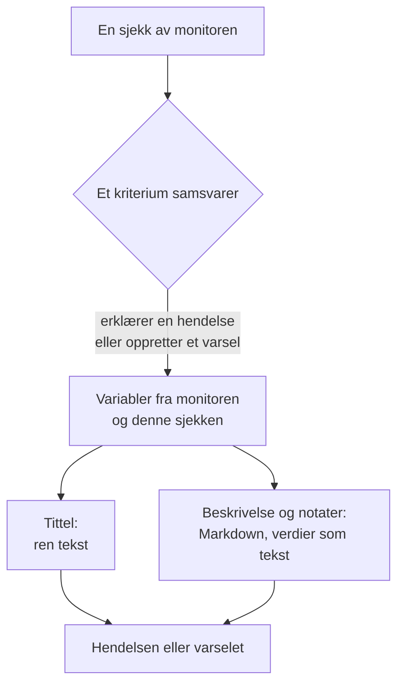

# Hendelse- og varslingsmaler

Når kriteriene til en monitor erklærer en hendelse eller oppretter et varsel, fyller de ut tittelen, beskrivelsen og utbedringsnotatene fra en mal du skriver selv. Sett inn plassholdere `{{variable}}`, som `{{monitorName}}` eller `{{responseStatusCode}}`, så sier hver hendelse hva som gikk galt, med verdiene fra sjekken som åpnet den.

:::cards
- [Hvor du skriver en mal](#hvor-du-skriver-en-mal): Tittelen, beskrivelsen og utbedringsnotatene for et kriteriums hendelse eller varsel.
- [Grunnleggende bruk](#grunnleggende-bruk): Plassholdere, stier inn i objekter og lister.
- [Variabler som alle monitorer har](#variabler-som-alle-monitorer-har): Monitorens navn og ressursen som overskred grensen.
- [Variabler etter monitortype](#variabler-etter-monitortype): Hva hver type sjekk rapporterer.
:::

## Slik fungerer maler

En mal fylles ut én gang, når kriteriet oppretter hendelsen eller varselet. OneUptime samler variablene fra monitoren og fra sjekken som samsvarte, setter hver verdi inn der plassholderen står, og lagrer resultatet. Endrer du malen senere, endrer det hendelsene og varslene som opprettes etterpå, ikke dem som allerede er åpne.



- **Tittelen er ren tekst.** Uansett hvor den vises, leses den nøyaktig slik malen gjengav den.
- **Beskrivelsen og utbedringsnotatene er Markdown.** Markdown du skriver, gjengis, og hver verdi som det overvåkede systemet sendte, settes inn som tekst, så ingenting i den kan legge til en lenke, et bilde eller en omtale. Se [Verdier i beskrivelser og utbedringsnotater](#verdier-i-beskrivelser-og-utbedringsnotater).
- **En gruppert monitor fyller ut hver hendelse for sin egen serie.** En monitor som åpner én hendelse per vert, pod eller enhet, fyller ut hver mal med den seriens verdier, og legger seriens navn til tittelen når malen din ikke allerede nevner det.

## Hvor du skriver en mal

:::steps
### Åpne monitorens kriterier

Gå til **Monitorer**, åpne monitoren, og klikk på **Kriterier** i sidemenyen. Klikk på **Rediger Overvåkingskriterier**.

### Slå på hendelsen eller varselet

Slå på **Når filtre samsvarer, erklær en hendelse.** eller **Når filtre samsvarer, opprett et varsel.** under **Handlinger** i et kriterium. Skjemaet for hendelsen eller varselet åpnes under.

### Skriv tittelen

Skriv tittelen i **Hendelsestittel** eller **Varseltittel**, for eksempel `{{monitorName}} is down`. **Learn about dynamic templates** ved siden av åpner **Dynamic Template Variables**: hver variabel denne monitortypen har, med hva den inneholder. Klikk på en variabel for å kopiere den.

### Skriv beskrivelsen og utbedringsnotatene

Åpne **Beskrivelse** for **Hendelsesbeskrivelse** eller **Varselbeskrivelse**, og **Flere felt** for **Utbedringsnotater**. Disse editorene tilbyr selv variablene: **Malvariabler** viser dem under editoren, **Sett inn variabel** i verktøylinjen åpner den samme listen, og når du skriver `{{`, åpnes den ved markøren.

### Lagre kriteriene

Klikk på **Lagre endringer**. Den neste hendelsen eller det neste varselet som dette kriteriet oppretter, bruker de nye malene.
:::

## Grunnleggende bruk

En plassholder er navnet på en variabel i doble krøllparenteser. Når hendelsen opprettes, erstatter OneUptime den med variabelens verdi og lar teksten rundt stå slik du skrev den.

```text title="Title template"
{{monitorName}} returned {{responseStatusCode}} in {{responseTimeInMs}} ms
```

Hvis monitoren heter `Checkout API`, svarets statuskode er `502` og svaret tok `842` millisekunder, får hendelsen tittelen:

```text title="Title as created"
Checkout API returned 502 in 842 ms
```

### Stier inn i objekter og lister

En variabel som inneholder et objekt eller en liste, leses med en sti, på samme måte som i [JavaScript-uttrykk](/docs/monitor/javascript-expression):

| Skriv | For å lese | Eksempel |
| --- | --- | --- |
| `{{object.field}}` | Et felt i et objekt, på hvilken som helst dybde | `{{responseBody.error.message}}` |
| `{{list[0]}}` eller `{{list.0}}` | Et element i en liste, talt fra 0 | `{{diskMetrics[0].usagePercent}}` |
| `{{list[last]}}` | Det siste elementet i en liste | `{{processes[last].name}}` |
| `{{object}}` | Hele objektet eller hele listen, som JSON | `{{responseBody}}` |

Et feltnavn kan inneholde en bindestrek, som i `{{responseHeaders.content-type}}`. En negativ indeks, som `[-1]`, leser ingenting: bruk `[last]`.

### Når en verdi mangler

En plassholder der stien ikke fører noe sted, blir stående i teksten slik du skrev den, med krøllparenteser og alt: hvis svaret ikke har et felt `error`, vises `{{responseBody.error.id}}` som det er i tittelen. Det samme gjelder en variabel som denne sjekken ikke rapporterte, som `failureCause` på en sjekk som ikke feilet. En verdi som sjekken rapporterte som tom tekst, erstattes med ingenting.

For å skrive én mal som fungerer enten monitoren er gruppert eller ikke, bruker du variablene for [berørt ressurs](#berørt-ressurs): de finnes alltid og er tomme når monitoren ikke er gruppert.

### Verdier i beskrivelser og utbedringsnotater

En beskrivelse og utbedringsnotater er Markdown: de vises på siden til hendelsen eller varselet, i e-post og i Slack- og Microsoft Teams-kanalene. Verdiene en mal setter inn der, er det det overvåkede systemet sendte - en svartekst eller -header, en innkommende forespørsel eller e-post, etikettene til en enhet eller en serie -, så hver verdi settes inn som tekst. Den leses nøyaktig slik den ble sendt, uansett hvor malen setter den, og en lenke, et bilde, en HTML-tagg eller en Slack-omtale som `<!channel>` i den vises som tekst i stedet for å virke. En bar nettadresse i en verdi blir likevel en lenke, en som viser hvor den fører. Markdown du skriver i selve malen, gjengis slik du skrev den.

En verdi kan ha hvilken som helst størrelse - en svartekst eller en logg på mange megabyte - og varslingen går likevel ut med den. Hver kanal bærer det den kan ta imot, og en beskrivelse som er for lang for den, kuttes ved et linjeskift hvis det finnes et, og slutter med "… (truncated — see OneUptime for the full text)":

- **E-post**: hver beskrivelse, merknad eller rotårsak bærer opptil rundt 256 KB av e-postens tekst, og merknaden på slutten av en lengre tekst lenker til hendelsen eller varselet. En hel e-post - teksten og skjermbildene - holder seg under 3 MB, som alle e-postservere og Microsoft Graph tar imot: et skjermbilde som ikke får plass ved siden av teksten, utelates, med en merknad i stedet.
- **Siden til hendelsen eller varselet** viser alt. En beskrivelse på over 128 KB som ville ta lang tid å sette opp, vises som ren tekst, linje for linje.
- **Slack** bærer høyst det Slack viser av en melding (rundt 30 000 tegn). **Microsoft Teams** bærer rundt 40 000 tegn i en melding fra OneUptime-appen og rundt 12 000 gjennom en innkommende webhook (abonnenter på statussider, arbeidsflyter) - målt når meldingen sendes, så en tabell teller som HTML-en den blir til.
- **SMS, telefonsamtaler, push-varsler, WhatsApp og Telegram** bærer det leverandørene deres tar imot: se [Slik varsler nivåene folk](/docs/on-call/escalation-rules#slik-varsler-nivåene-folk).

Hver kanal gjengir teksten på en tid som vokser med lengden. En del som ville ta en renderer langt lengre tid - en linje på over 64 KB, et langt avsnitt med rene linjer, et avsnitt fullt av `*`, `_` eller `[` som aldri lukkes, sitater eller lister nestet mer enn seksten nivåer, og på siden til hendelsen eller varselet en tabell eller liste på mer enn tusen linjer - leses som ren tekst der den står, og resten av beskrivelsen gjengis som vanlig.

## Avansert bruk

### Gå gjennom en liste

`{{#each path}}` gjentar teksten fram til `{{/each}}` én gang for hvert element i listen ved `path`:

```text title="Loop syntax"
{{#each arrayPath}}
  ...text with {{field}} placeholders for each item...
{{/each}}
```

Inne i løkken:

- `{{field}}` og `{{field.nested}}` leser det gjeldende elementet. Et navn som elementet ikke har, slås opp i det omsluttende elementet og deretter i variablene for hele malen.
- `{{@index}}` er elementets posisjon, talt fra 0.
- `{{this}}` er selve elementet, for en liste med enkle verdier som strenger.
- En løkke over en sti som ikke er en liste, eller over en tom liste, skriver ingenting.
- Løkker kan nestes: en `{{#each}}` inne i en annen leser den indre listen til hvert ytre element.

For eksempel en [Innkommende forespørsel-overvåking](/docs/monitor/incoming-request-monitor) som mottar denne varslingen:

```json title="Request body"
{
  "receiver": "payments",
  "alerts": [
    { "status": "firing", "labels": { "alertname": "HighLatency" } },
    { "status": "resolved", "labels": { "alertname": "DiskFull" } }
  ]
}
```

og har denne beskrivelsesmalen:

```text title="Description template"
Alerts for {{requestBody.receiver}}:
{{#each requestBody.alerts}}
- {{@index}}: {{labels.alertname}} ({{status}})
{{/each}}
```

oppretter en hendelse med en beskrivelse som ser slik ut. Hvert element beholder linjeskiftene rundt seg, så en tom linje skiller elementene, og beskrivelsen viser fortsatt én liste:

```text title="Description as created"
Alerts for payments:

- 0: HighLatency (firing)

- 1: DiskFull (resolved)
```

### Verdier fra en gruppert monitor

En metrikkbasert monitor med attributter i **Group by** åpner én hendelse per serie, og verdien til hvert attributt er en variabel under attributtets navn. Gruppering etter `host.name` gir `{{host.name}}`, og gruppering etter `resource.k8s.pod.name` gir `{{resource.k8s.pod.name}}`. `{{seriesLabels}}` inneholder alle, som et objekt.

En gruppert [Logg-overvåking](/docs/monitor/logs-monitor) fungerer på samme måte: verdien til hvert grupperingsattributt er en variabel under nøkkelen sin.

## Variabler som alle monitorer har

### Monitor

| Variabel | Hva den inneholder | Eksempel |
| --- | --- | --- |
| `monitorName` | Monitorens navn. | `Checkout API` |
| `monitorId` | Monitorens ID. | `a0f78958-da0a-4775-9fd9-c9fc63d3456f` |
| `monitorType` | Monitorens type. | `Website`, `Synthetic Monitor` |

### Berørt ressurs

Disse beskriver serien som en gruppert monitor åpnet hendelsen for: en pod, en container, en vert, en disk. De er tomme for en monitor som ikke er gruppert, så en mal kan bruke dem på hvilken som helst monitor.

| Variabel | Hva den inneholder |
| --- | --- |
| `seriesResourceSuffix` | Seriens identitet, med en skilletegn foran, til å sette på slutten av en tittel. |
| `seriesResourceSummary` | Den samme identiteten uten skilletegnet, til å sette i en setning. |
| `seriesResourceBlock` | Hver etikett for serien, som en Markdown-liste. Best i en beskrivelse. |
| `seriesDebugCommands` | Skrivebeskyttede kommandoer for akkurat denne ressursen, som `kubectl` eller `docker`, som en Markdown-liste. |

## Variabler etter monitortype

### Nettsted- og API-monitorer

| Variabel | Hva den inneholder | Type |
| --- | --- | --- |
| `responseBody` | Svarets body: et objekt når det er JSON, ellers teksten. | `JSON` eller `string` |
| `responseHeaders` | Svarets headere, etter navn med små bokstaver. | `Dictionary<string>` |
| `responseStatusCode` | HTTP-statuskoden. | `number` |
| `responseTimeInMs` | Svartiden, i millisekunder. | `number` |
| `isOnline` | Om monitoren regnet svaret som online. | `boolean` |

### Monitorer for innkommende forespørsler

| Variabel | Hva den inneholder | Type |
| --- | --- | --- |
| `requestBody` | Forespørselens body: et objekt når det er JSON. | `JSON` eller `string` |
| `requestHeaders` | Forespørselens headere, etter navn med små bokstaver. | `Dictionary<string>` |
| `requestMethod` | HTTP-metoden, som `POST`. | `string` |
| `incomingRequestReceivedAt` | Når forespørselen ble mottatt, som et ISO 8601-tidsstempel. | `string` |

Når kriteriet har **Group incidents and alerts by a payload field** slått på, er grupperingsnøkkelen også en variabel, oppkalt etter det **siste segmentet** av grupperingsstien: gruppering etter `requestBody.alerts[*].labels.alertname` gir `{{alertname}}`, og gruppering etter `requestBody.alerts[*].fingerprint` gir `{{fingerprint}}`. Hele `requestBody` finnes fortsatt ved siden av.

> [!NOTE]
> `[*]` virker bare i feltene for grupperingsstien. I en mal leser den ingenting, så plassholderen blir stående som den er skrevet. `{{requestBody.alerts[0].annotations.summary}}` leser alltid det første varselet i payloaden, ikke det hendelsen ble åpnet for: bruk grupperingsvariabelen og payloadens felles felt, som `commonLabels` og `commonAnnotations`. Se [Innkommende forespørsel-overvåking](/docs/monitor/incoming-request-monitor).

### Monitorer for innkommende e-post

| Variabel | Hva den inneholder | Type |
| --- | --- | --- |
| `emailSubject` | E-postens emne. | `string` |
| `emailFrom` | Avsenderens e-postadresse. | `string` |
| `emailTo` | Hvem e-posten ble sendt til, med monitorens egen adresse maskert. | `string` |
| `emailBody` | E-postens body som ren tekst. | `string` |
| `emailReceivedAt` | Når e-posten ble mottatt, som et ISO 8601-tidsstempel i UTC. | `string` |

I en tittel kuttes hver av dem til én linje på høyst 150 tegn. Beskrivelser og utbedringsnotater får hele verdien. Se [Innkommende e-post-overvåking](/docs/monitor/incoming-email-monitor#malvariabler).

### Ping-, IP- og portmonitorer

| Variabel | Hva den inneholder | Type |
| --- | --- | --- |
| `isOnline` | Om målet svarte. | `boolean` |
| `responseTimeInMs` | Svartiden, i millisekunder. For en port DNS-oppslaget og TCP-tilkoblingen sammen. | `number` |
| `failureCause` | Hvorfor sjekken feilet, når den gjorde det. | `string` |
| `isTimeout` | Om sjekken fikk tidsavbrudd. | `boolean` |

### NTP-monitorer

| Variabel | Hva den inneholder | Type |
| --- | --- | --- |
| `isOnline` | Om tidsserveren svarte på probens forespørsel. | `boolean` |
| `isSynchronized` | Om den svarte med stratum 1 til 15, uten leap-alarmen og med ekte tidsstempler. | `boolean` |
| `stratum` | Stratumet serveren rapporterte: 1 for en primærserver, 16 når den ikke er synkronisert, 0 for en kiss-o'-death. | `number` |
| `clockOffsetInMs` | Hvor langt serverens klokke er fra probens, i millisekunder. Positiv betyr at serveren er foran. | `number` |
| `referenceId` | Hva serveren synkroniserer mot: en kilde som `GPS` på stratum 1, eller adressen til serveren over den. | `string` |
| `leapIndicator` | 0 til 2 når alt er i orden, 3 når serveren sier at klokken ikke er synkronisert. | `number` |
| `kissCode` | Med stratum 0 koden på fire bokstaver som serveren sendte i stedet for tiden, som `RATE`. | `string` |
| `responseTimeInMs` | Tiden fra forespørsel til svar, i millisekunder. | `number` |
| `roundTripDelayInMs` | Utvekslingens rundtur over nettverket, uten serverens egen behandlingstid. | `number` |
| `rootDelayInMs` | Rundturen fra serveren til referanseklokken, i millisekunder. | `number` |
| `rootDispersionInMs` | Serverens eget anslag over sin største feil, i millisekunder. | `number` |
| `serverTime` | Serverens klokke da den sendte svaret, som et ISO 8601-tidsstempel. | `string` |
| `referenceTime` | Når serverens klokke sist ble stilt eller rettet, som et ISO 8601-tidsstempel. | `string` |
| `serverAddress` | Adressen forespørselen gikk til. | `string` |
| `port` | UDP-porten forespørselen gikk til. | `number` |
| `failureCause` | Hvorfor serveren ikke svarte, eller hvorfor den ikke er synkronisert. | `string` |
| `isTimeout` | Om serveren ikke svarte i tide. | `boolean` |

### SSL-sertifikatmonitorer

| Variabel | Hva den inneholder | Type |
| --- | --- | --- |
| `isOnline` | Om sertifikatsjekken lyktes. | `boolean` |
| `isSelfSigned` | Om sertifikatet er selvsignert. | `boolean` |
| `createdAt` | Når sertifikatet ble utstedt, som et ISO 8601-tidsstempel. | `string` |
| `expiresAt` | Når sertifikatet utløper, som et ISO 8601-tidsstempel. | `string` |
| `commonName` | Sertifikatets common name (CN). | `string` |
| `organizationalUnit` | Dets organisasjonsenhet (OU). | `string` |
| `organization` | Dets organisasjon (O). | `string` |
| `locality` | Dets sted (L). | `string` |
| `state` | Dets stat eller provins (ST). | `string` |
| `country` | Dets land (C). | `string` |
| `serialNumber` | Dets serienummer. | `string` |
| `fingerprint` | Dets SHA-1-fingeravtrykk. | `string` |
| `fingerprint256` | Dets SHA-256-fingeravtrykk. | `string` |
| `failureCause` | Hvorfor sjekken feilet, når den gjorde det. | `string` |

### DNS-monitorer

| Variabel | Hva den inneholder | Type |
| --- | --- | --- |
| `isOnline` | Om spørringen ble besvart. | `boolean` |
| `responseTimeInMs` | Spørringstiden, i millisekunder. | `number` |
| `isTimeout` | Om spørringen fikk tidsavbrudd. | `boolean` |
| `isDnssecValid` | Resultatet av DNSSEC-valideringen. | `boolean` |
| `records` | Postene som ble returnert, hver som `{type, value, ttl}`. | `Array<Object>` |
| `recordValues` | Bare verdiene til postene. | `Array<string>` |
| `failureCause` | Hvorfor spørringen feilet, når den gjorde det. | `string` |

### DNSSEC-monitorer

| Variabel | Hva den inneholder | Type |
| --- | --- | --- |
| `isOnline` | Om sjekken ble fullført. | `boolean` |
| `domainName` | Sonen som ble sjekket. | `string` |
| `isZoneSigned` | Om sonen har DNSKEY-poster. | `boolean` |
| `isParentDsPresent` | Om foreldresonen har DS-poster for den. | `boolean` |
| `isChainValid` | Om tillitskjeden validerer. | `boolean` |
| `resolverConsensusAd` | Om hver resolver returnerte AD-flagget. | `boolean` |
| `isNameserverConsistent` | Om hver autoritativ navneserver returnerte det samme SOA-serienummeret. | `boolean` |
| `earliestSignatureExpiration` | Når den første RRSIG-signaturen utløper, som et ISO 8601-tidsstempel. | `string` |
| `daysUntilSignatureExpiry` | Dager til den signaturen utløper. | `number` |
| `dnskeyCount` | Antall DNSKEY-poster. | `number` |
| `dsRecordCount` | Antall DS-poster hos forelderen. | `number` |
| `rrsigCount` | Antall RRSIG-poster som ble sett. | `number` |
| `responseTimeInMs` | Hvor lang tid sjekken tok, i millisekunder. | `number` |
| `failureCause` | Hvorfor sjekken feilet, når den gjorde det. | `string` |

### Domenemonitorer

| Variabel | Hva den inneholder | Type |
| --- | --- | --- |
| `isOnline` | Om oppslaget av registreringen lyktes. | `boolean` |
| `domainName` | Domenet som ble slått opp. | `string` |
| `lookupMethod` | Protokollen som svarte: RDAP eller WHOIS. | `string` |
| `registrar` | Registraren. | `string` |
| `createdDate` | Når domenet ble registrert. | `string` |
| `updatedDate` | Når registreringen sist ble endret. | `string` |
| `expiresDate` | Når registreringen utløper. | `string` |
| `nameServers` | Domenets navneservere. | `Array<string>` |
| `domainStatus` | Registerets statuskoder, som `clientTransferProhibited`. | `Array<string>` |
| `dnssec` | Registerets DNSSEC-status. | `string` |
| `responseTimeInMs` | Hvor lang tid oppslaget tok, i millisekunder. | `number` |
| `failureCause` | Hvorfor oppslaget feilet, når det gjorde det. | `string` |

### Server- / VM-monitorer

| Variabel | Hva den inneholder | Type |
| --- | --- | --- |
| `hostname` | Serverens vertsnavn. | `string` |
| `requestReceivedAt` | Når serverens rapport ble mottatt, som et ISO 8601-tidsstempel. | `string` |
| `cpuUsagePercent` | CPU i bruk, fra 0 til 100. | `number` |
| `cpuCores` | Antall CPU-kjerner. | `number` |
| `memoryUsagePercent` | Minne i bruk, fra 0 til 100. | `number` |
| `memoryFreePercent` | Ledig minne, fra 0 til 100. | `number` |
| `memoryTotalBytes` | Totalt minne, i byte. | `number` |
| `diskMetrics` | Én oppføring per montert disk. | `Array<Object>` |
| `diskMetrics[].diskPath` | Diskens monteringspunkt. | `string` |
| `diskMetrics[].usagePercent` | Plass i bruk på disken, fra 0 til 100. | `number` |
| `diskMetrics[].freePercent` | Ledig plass på disken, fra 0 til 100. | `number` |
| `diskMetrics[].totalBytes` | Diskens størrelse, i byte. | `number` |
| `processes` | Prosessene som kjører, som agenten rapporterte. | `Array<Object>` |
| `processes[].pid` | Prosess-ID-en. | `number` |
| `processes[].name` | Prosessnavnet. | `string` |
| `processes[].command` | Kommandoen prosessen ble startet med. | `string` |
| `failureCause` | Hvorfor sjekken feilet, når den gjorde det. | `string` |

### Syntetiske monitorer

En syntetisk monitor kjører skriptet sitt én gang for hver nettleser og skjermstørrelse den er satt til å bruke, som Chromium på en skrivebordsskjerm og Firefox på en mobilskjerm. `syntheticResponses` inneholder én oppføring per kjøring: les én kjøring etter posisjonen, som i `{{syntheticResponses[0].browserType}}`, eller alle kjøringer med `{{#each syntheticResponses}}`.

| Variabel | Hva den inneholder | Type |
| --- | --- | --- |
| `failureCause` | Hvorfor sjekken feilet, når den gjorde det. | `string` |
| `syntheticResponses` | Én oppføring per nettleser og skjermstørrelse skriptet kjørte på. | `Array<Object>` |
| `syntheticResponses[].executionTimeInMs` | Hvor lang tid kjøringen tok, i millisekunder. | `number` |
| `syntheticResponses[].result` | Hva skriptet returnerte. | `string`, `number`, `boolean` eller `JSON` |
| `syntheticResponses[].scriptError` | Feilen kjøringen endte med, hvis noen. | `string` |
| `syntheticResponses[].logMessages` | Hva kjøringen logget. | `Array<string>` |
| `syntheticResponses[].screenshots` | Skjermbildene kjøringen tok, etter navn, hvert som base64-tekst. Se [Vis et skjermbilde](#vis-et-skjermbilde). | `Object` |
| `syntheticResponses[].browserType` | Kjøringens nettleser. | `string` |
| `syntheticResponses[].screenSizeType` | Kjøringens skjermstørrelse. | `string` |

#### Vis et skjermbilde

Hver oppføring i `screenshots` er et skjermbilde skriptet tok, under navnet skriptet ga det (`screenshots["login-page"] = await page.screenshot()`), som base64-tekst. For å vise et i beskrivelsen eller utbedringsnotatene til en hendelse eller et varsel skriver du et bilde rundt det:

```text title="Description template"
{{syntheticResponses[0].scriptError}}


```

Skjermbildet vises da på siden til hendelsen eller varselet, på statussidene som viser hendelsen, i e-postvarslene om den og i Slack- og Microsoft Teams-meldingene om den. I en e-post legges det ved og vises i selve meldingen, som Gmail, Outlook og Apple Mail alle viser, så den som har vakt kan se hvordan siden så ut uten å åpne OneUptime.

- Skjermbilder i PNG, JPEG, GIF og WebP vises. `image/png` virker også for et JPEG-skjermbilde (`page.screenshot({ type: "jpeg" })`).
- Én e-post bærer høyst 2 MB med bilder, og høyst 20. Et bilde som ikke får plass, erstattes av en merknad med alt-teksten, så gi hvert bilde en alt-tekst. Et JPEG-skjermbilde er mye mindre enn et PNG, og ett skjermbilde av den feilede kjøringen sier som regel mer enn alle skjermbildene av alle kjøringene.
- I Slack og Microsoft Teams vises skjermbildet der beskrivelsen har det: et bilde på en egen linje tar den linjens plass, og et bilde midt i en setning, en liste eller en tabell etterlater alt-teksten der og vises etter den. Slack viser skjermbilder i PNG, JPEG og GIF, høyst 10 og 10 MB per melding; OneUptime-appen laster hvert bilde privat opp til Slack-arbeidsområdet ditt og viser det i meldingen. Teams viser skjermbilder i PNG, JPEG og GIF på opptil 1 MB hver inne i meldingens kort, høyst 10 og 2 MB per melding.
- Opplasting til Slack krever appens tillatelse `files:write`. Hvis arbeidsområdet ditt koblet til Slack før OneUptime ba om den, kobler du til Slack igjen under **Prosjektinnstillinger → Arbeidsområde → Slack** (på en selvhostet server legger du først tillatelsen til Slack-appen din - se [Slack-integrasjon](/docs/self-hosted/slack-integration#bilder-i-meldinger)).
- Et skjermbilde som en chat ikke kan vise - et WebP, et over de grensene, et som Slack eller Teams avviser, eller et hvilket som helst skjermbilde i en melding sendt gjennom en innkommende webhook - vises som alt-teksten, eller "[image]" når det ikke har noen, så gi hvert bilde en alt-tekst. Bildets base64 når aldri chatten.
- Bare et bilde du skriver i malen, vises. Et bilde i en verdi som den overvåkede siden eller det overvåkede skriptet rapporterte - en feilmelding, en logglinje - vises fortsatt som tekst (se [Verdier i beskrivelser og utbedringsnotater](#verdier-i-beskrivelser-og-utbedringsnotater)).
- OneUptime AI leser teksten rundt et skjermbilde, ikke skjermbildet. Det en undersøkelse, en utkastet postmortem eller merknad, et AI-trinn i en runbook eller et AI-trinn i en arbeidsflyt gir modellen, har en kort merknad i bildets sted, som `[image omitted: PNG, 340 KB]`: en modell leser tekst, ikke bilder, og base64 for et skjermbilde ville vært hundretusenvis av tokens ved hvert kall. Undersøkelsens aktivitet forteller hva som ble utelatt.

For å vise skjermbildet av hver feilet kjøring legger du bildet i en løkke. Her lagrer skriptet hvert skjermbilde som `screenshots["failure"]`:

```text title="Description template"
### What the page looked like
{{#each syntheticResponses}}
**{{browserType}} / {{screenSizeType}}**: {{scriptError}}


{{/each}}
```

### Monitorer for egendefinert JavaScript-kode

| Variabel | Hva den inneholder | Type |
| --- | --- | --- |
| `result` | Hva skriptet returnerte. Les et felt med en sti, som i `{{result.status}}`. | `string`, `number`, `boolean` eller `JSON` |
| `executionTimeInMs` | Hvor lenge skriptet kjørte, i millisekunder. | `number` |
| `scriptError` | Feilen skriptet endte med, hvis noen. | `string` |
| `logMessages` | Hva skriptet logget med `console.log`. | `Array<string>` |
| `failureCause` | Hvorfor sjekken feilet, når den gjorde det. | `string` |

### Nettverksenhetsmonitorer

| Variabel | Hva den inneholder | Type |
| --- | --- | --- |
| `isOnline` | Om enheten kan nås, via ping **eller** SNMP. Settes ved hver avspørring. | `boolean` |
| `responseTimeInMs` | Svartiden for SNMP-**gjennomgangen**, i millisekunder. Aldri pingens rundtur. | `number` |
| `failureCause` | Hvorfor SNMP-gjennomgangen feilet, når den gjorde det. | `string` |
| `isTimeout` | Om SNMP-gjennomgangen fikk tidsavbrudd. | `boolean` |
| `oidResponses` | OID-ene som ble spurt etter, hver som `{oid, name, value, type}`. | `Array<Object>` |
| `{{OID_NAME}}` | Verdien til en navngitt OID, etter navnet, som i `{{sysUpTime}}`. | `string` eller `number` |
| `sysName` | Enhetens navn, fra SNMP-systemgruppen. | `string` |
| `sysDescr` | Enhetens beskrivelse, fra SNMP-systemgruppen. | `string` |
| `sysObjectId` | Leverandørens registrerte enterprise-OID: enhetens fingeravtrykk. | `string` |
| `sysLocation` | Enhetens plassering, fra SNMP-systemgruppen. | `string` |
| `downInterfaces` | Grensesnitt som er administrativt oppe, men operasjonelt nede, hvert som `{name, alias, interfaceIndex}`. Krever grensesnittovervåking. | `Array<Object>` |
| `interfacesTotal` | Antall grensesnitt som ble gått gjennom. | `number` |
| `interfacesUp` | Grensesnitt som er administrativt og operasjonelt oppe. | `number` |
| `interfacesDown` | Grensesnitt som er administrativt oppe, men operasjonelt nede. | `number` |
| `interfaceWalkFailure` | Feilen, når gjennomgangen av grensesnitt feilet. | `string` |
| `tables` | Enhetens SNMP-tabeller, etter nøkkel: `rowCount`, `rows`, `unhealthyRowCount` og `unhealthyRows` for hver, som i `{{tables.ipsec_tunnels.unhealthyRowCount}}`. | `Object` |
| `snmpTable` | SNMP-tabellen et varsel per rad handler om. | `string` |
| `snmpTableRow` | Raden et varsel per rad handler om: en tunnel, en radio, en nabo. | `string` |
| `trapOid` | Trapens OID. Bare når en SNMP-trap utløste sjekken. | `string` |
| `trapSourceIp` | Adressen trapen kom fra. Bare når en SNMP-trap utløste sjekken. | `string` |
| `trapVarbinds` | Trapens varbinds, hver som `{oid, value}`. Bare når en SNMP-trap utløste sjekken. | `Array<Object>` |

En nettverksenhet pinges ved hver avspørring og gås bare gjennom via SNMP når den har påloggingsinformasjon, så **`isOnline` er den eneste variabelen over som en enhet med bare ping fyller ut**: alle de andre kommer fra SNMP-gjennomgangen og blir stående som de er skrevet uten den. Begynn med `{{isOnline}}` og enhetens navn i maler som kan brukes for enheter uten påloggingsinformasjon. Se [Nettverksenhets-overvåking](/docs/monitor/network-device-monitor#hva-en-polling-faktisk-gjør) for hva hver type avspørring samler inn.

### Monitorer for databasehelse

| Variabel | Hva den inneholder | Type |
| --- | --- | --- |
| `isOnline` | Om proben kunne koble til og kjøre grunnspørringen. Manglende metrikker gjør den aldri usann. | `boolean` |
| `responseTimeInMs` | Tiden det tok å koble til og kjøre grunnspørringen, i millisekunder. | `number` |
| `failureCause` | Hvorfor sjekken feilet, når den gjorde det. | `string` |
| `connectionError` | Tilkoblingsfeilen, uten påloggingsinformasjon eller tilkoblingsstrengen. | `string` |
| `engineVersion` | Versjonen databaseserveren rapporterte. | `string` |
| `collectedGroups` | Metrikkgruppene som ga verdier ved denne sjekken. | `Array<string>` |
| `unavailableGroups` | Gruppene som ikke kunne samles inn, hver som `{group, reason, message, remediation}`. | `Array<Object>` |
| `collectionIssueSummary` | Én linje om hver utilgjengelig gruppe, klar for en tittel. Tom når alt ble samlet inn. | `string` |
| `metrics` | De innsamlede verdiene, etter serienavn. | `Object` |

Serienavnene i `metrics` inneholder punktum, som `oneuptime.monitor.database.connections.used.percent`, og en sti leser hvert punktum som et steg inn i et objekt, så en mal kan ikke plukke én verdi ut av `metrics`. Sett inn `{{metrics}}` i sin helhet, som JSON, eller bruk `{{collectionIssueSummary}}`. En metrikk som ikke ble samlet inn, mangler i `metrics`; den er ikke null. For å handle på én verdi sammenligner du den i kriteriet med et [JavaScript-uttrykk](/docs/monitor/javascript-expression).

### Monitorer for eksterne statussider

| Variabel | Hva den inneholder | Type |
| --- | --- | --- |
| `overallStatus` | Statussidens samlede status, som `major_outage`. | `string` |
| `activeIncidentCount` | Antall åpne hendelser på statussiden. | `number` |
| `componentStatuses` | Komponentene dens, hver som `{name, status, description, groupName}`. | `Array<Object>` |
| `provider` | Typen statusside: Atlassian Statuspage, incident.io, RSS eller Atom. | `string` |
| `componentGroup` | Komponentgruppen monitoren følger med på, hvis den følger med på en. | `string` |
| `componentName` | Komponenten monitoren følger med på, hvis den følger med på en. | `string` |
| `isOnline` | Om statussiden svarte. | `boolean` |
| `responseTimeInMs` | Hvor lang tid statussiden brukte på å svare, i millisekunder. | `number` |
| `failureCause` | Hvorfor sjekken feilet, når den gjorde det. | `string` |

### Metrikk- og infrastrukturmonitorer

Metrics-, Kubernetes-, Docker-, Host-, Podman-, Docker Swarm-, Proxmox-, VMware-, Ceph-, Storage Array- og IoT Device-monitorer har én egen variabel:

| Variabel | Hva den inneholder | Type |
| --- | --- | --- |
| `metricName` | Navnet på metrikken monitorens første spørring leser, som `container.cpu.time`. | `string` |

Grupperte har de også verdien til hvert attributt i **Group by**, og `seriesLabels`: se [Verdier fra en gruppert monitor](#verdier-fra-en-gruppert-monitor). Malene til IoT Device-monitoren grupperer etter enhet, så en monitor laget fra en av dem har også `{{device.id}}`.

### Andre monitortyper

Logs-, Traces-, Exceptions-, Security Events-, AI / LLM- og SQL Query-monitorer har ingen egne variabler. Bruk [variablene som alle monitorer har](#variabler-som-alle-monitorer-har), og på en gruppert Logs-monitor [gruppeverdiene](#verdier-fra-en-gruppert-monitor).

## Eksempler

### Et tregt API

```text title="Title"
{{monitorName}} is slow: {{responseTimeInMs}} ms
```

```text title="Description"
### API error
Status: **{{responseStatusCode}}**
Latency: **{{responseTimeInMs}} ms**
Message: `{{responseBody.error.message}}`
```

### Et sertifikat som snart utløper

```text title="Title"
Certificate for {{commonName}} expires {{expiresAt}}
```

### En server som er i ferd med å gå tom for plass

```text title="Description"
### {{hostname}}
CPU: **{{cpuUsagePercent}}%**
Memory: **{{memoryUsagePercent}}%**

**Disks:**
{{#each diskMetrics}}
- {{diskPath}}: {{usagePercent}}% used ({{freePercent}}% free)
{{/each}}

**Processes:**
{{#each processes}}
- [{{pid}}] {{name}}: {{command}}
{{/each}}
```

### En ping-, IP- eller portsjekk som feilet

```text title="Description"
{{monitorName}} could not be reached: {{failureCause}}
Timed out: {{isTimeout}}
Response time: {{responseTimeInMs}} ms
```

### Hver kjøring av en syntetisk monitor

```text title="Description"
### Synthetic monitor results
{{#each syntheticResponses}}
- **{{browserType}} / {{screenSizeType}}**: {{result}} in {{executionTimeInMs}} ms
  - Script error: {{scriptError}}
  - First log line: {{logMessages[0]}}
{{/each}}
```

### En sjekk med egendefinert kode

```text title="Description"
The script ran for {{executionTimeInMs}} ms and returned {{result}}.
Last log line: {{logMessages[last]}}
```

### En nettverksenhet

Disse forutsetter at enheten har SNMP-påloggingsinformasjon: på en enhet med bare ping blir alt unntatt `{{isOnline}}` stående som det er skrevet.

```text title="Title"
{{sysName}}: {{interfacesDown}} interfaces down
```

```text title="Description"
### {{sysName}} ({{sysLocation}})
Online: {{isOnline}}
SNMP walk: {{responseTimeInMs}} ms

{{#each downInterfaces}}
- {{name}} ({{alias}}) is down
{{/each}}
```

### Varsler fra Alertmanager eller Grafana

```text title="Title"
[{{requestBody.status}}] {{requestBody.receiver}}
```

```text title="Description"
### Alerts from {{requestBody.receiver}}
{{#each requestBody.alerts}}
**Alert {{@index}}**: {{labels.alertname}}
- Status: {{status}}
- Summary: {{annotations.summary}}
- Source: {{generatorURL}}
{{/each}}
```

## Feilsøking

:::details Tittelen viser plassholderen, med krøllparenteser og alt
Stien fører ikke til en verdi i denne sjekken. Sjekk variabelens navn og store og små bokstaver mot tabellene over, eller åpne **Learn about dynamic templates** i kriteriet: den viser variablene for denne monitortypen. En sti inn i en svar- eller forespørselsbody må passe til bodyen slik den ble sendt, og `[*]` og negative indekser som `[-1]` leser ingenting: bruk `[0]` eller `[last]`.
:::

:::details En verdi vises som JSON
Stien stopper ved et objekt eller en liste, så hele innholdet settes inn som JSON. Legg til feltet du vil ha i stien, som i `{{responseBody.error.message}}`, eller gå gjennom en liste med `{{#each}}`.
:::

:::details En løkke skriver ingenting
Stien etter `#each` er ikke en liste i denne sjekken, eller listen er tom. Sjekk stien mot payloaden, og at hver `{{#each}}` har sin `{{/each}}`.
:::

:::details Markdown i en verdi vises som tekst
Det er med vilje: en verdi som det overvåkede systemet sendte, settes inn som tekst, så den aldri kan legge til en lenke, et bilde eller en omtale i beskrivelsen. Skriv formateringen i malen rundt verdien i stedet. Se [Verdier i beskrivelser og utbedringsnotater](#verdier-i-beskrivelser-og-utbedringsnotater).
:::

:::details Et skjermbilde vises ikke i Slack, Microsoft Teams eller e-post
Sjekk bildets format og størrelse mot [Vis et skjermbilde](#vis-et-skjermbilde). I Slack trenger OneUptime-appen tillatelsen `files:write`: koble til Slack igjen under **Prosjektinnstillinger → Arbeidsområde → Slack** hvis arbeidsområdet ditt koblet den til før OneUptime ba om den.
:::

## Neste steg

:::cards
- [JavaScript-uttrykk](/docs/monitor/javascript-expression): De samme plassholderne, i et kriteriums betingelser.
- [Opprette en hendelse](/docs/incidents/declaring-incidents): Hva som skjer etter at et kriterium har erklært en.
- [Syntetisk overvåking](/docs/monitor/synthetic-monitor): Ta skjermbildene en beskrivelse kan vise.
- [Innkommende forespørsel-overvåking](/docs/monitor/incoming-request-monitor): Gjør webhooks om til hendelser oppkalt etter hvert varsel.
:::
