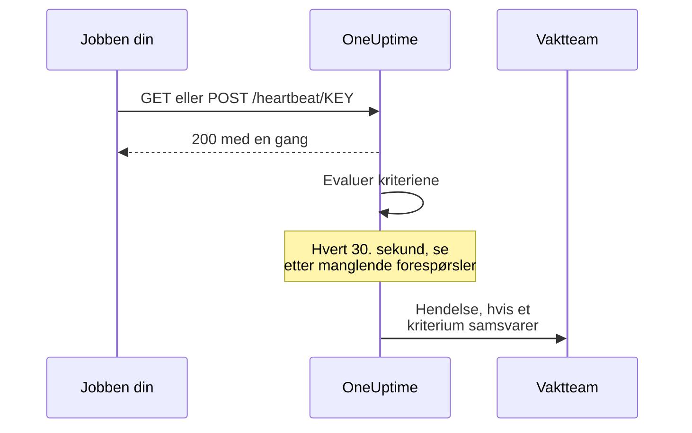

# Innkommende forespørsel-monitor

En monitor for innkommende forespørsler gir deg en URL som andre systemer sender HTTP-forespørsler til. OneUptime evaluerer hver forespørsel mot kriteriene dine og kan endre monitorens status, erklære hendelser og tilkalle dem som har vakt.

Den dekker to ulike oppgaver:

- **Heartbeat-overvåking** — en cron-jobb, en worker eller en enhet kaller URL-en etter en tidsplan, og OneUptime oppretter en hendelse når kallene slutter å komme.
- **Motta varsler fra et annet system** — Prometheus Alertmanager, Grafana eller noe annet som kan sende JSON med POST, sender varsler inn, og OneUptime gjør hvert av dem til en hendelse med eskalering til vakten og automatisk løsning når problemet er borte.

Begge bruker samme monitortype. Det som skiller dem, er kriteriene du konfigurerer.

:::cards
- [Opprett monitoren](#opprett-en-monitor-for-innkommende-forespørsler): Få en heartbeat-URL i noen få trinn.
- [Send et heartbeat](#send-et-heartbeat): Fra curl, cron, Node.js, Python eller Go.
- [Varsle når kallene stopper](#marker-som-offline-hvis-det-ikke-kommer-noe-heartbeat-på-10-minutter-en-dødmannsbryter): Gjør monitoren til en dødmannsbryter.
- [Motta varsler](#motta-varsler-fra-et-annet-system): Én hendelse per varsel fra Alertmanager eller Grafana.
- [Abonner på SNS eller Event Grid](#abonnere-på-amazon-sns-eller-azure-event-grid): Bekreft abonnementet med ett klikk.
:::

## Slik fungerer det

Ingenting sjekker systemet ditt utenfra: systemet ditt kaller monitorens URL, OneUptime svarer med en gang og evaluerer deretter forespørselen mot monitorens kriterier. Et kriterium som ser etter forespørsler som har *sluttet* å komme, sjekkes i tillegg på nytt i bakgrunnen hvert 30. sekund, slik at også stillhet kan opprette en hendelse.



Bruk den til å:

- Overvåke cron-jobber og planlagte oppgaver
- Bekrefte at bakgrunns-workers kjører
- Overvåke tjenester bak brannmurer som ikke kan nås utenfra
- Motta varsler fra Prometheus Alertmanager, Grafana og andre varslingssystemer
- Følge heartbeat-signaler fra ethvert system som kan snakke HTTP

## Opprett en monitor for innkommende forespørsler

:::steps
### Start en ny monitor

Gå til **Monitorer**, og klikk på **Opprett monitor**.

### Velg Innkommende forespørsel

Under **Monitortype** velger du **Innkommende forespørsel** — den er en av de vanlige typene øverst. Skriv inn et **Navn**, og klikk deretter på **Neste**.

### Gå gjennom kriteriene

Trinnet **Kriterier** starter med [standardkriteriene](#hva-du-får-fra-start). For et heartbeat klikker du på **Legg til kriterier** og gir det nye kriteriet et filter **Innkommende forespørsel** / **Ikke mottatt innen (minutter)** som endrer statusen til offline og erklærer en hendelse, med **Løs hendelse automatisk** slått på. Dra det deretter øverst i listen — se [Eksempler på kriterier](#eksempler-på-kriterier) for hvorfor.

### Opprett monitoren

Klikk på **Opprett monitor**. Monitoren åpnes på siden **Oversikt**, der kortet **Send the first heartbeat** viser **Heartbeat URL** med en kopieringsknapp og en eksempelkommando med `curl`.

### Send den første forespørselen

Konfigurer tjenesten din til å sende forespørsler til den URL-en (se [Send et heartbeat](#send-et-heartbeat)). Når den første forespørselen kommer, gir kortet plass til monitorens historikk, og et kort **Heartbeat URL** viser URL-en og når den siste forespørselen kom.
:::

> [!NOTE]
> URL-en inneholder monitorens hemmelige nøkkel, så bare personer som kan redigere monitorer, kan se den. Du finner den igjen når som helst på monitorens side **Dokumentasjon**, i delen **Konfigurasjon** i sidemenyen.

## Forespørsels-URL-en

Monitoren din har en unik URL i dette formatet:

```text
https://oneuptime.com/heartbeat/YOUR_SECRET_KEY
```

Erstatt `https://oneuptime.com` med URL-en til OneUptime-instansen din hvis du drifter selv.

Send **GET**- eller **POST**-forespørsler til denne URL-en. HEAD godtas og behandles som GET; PUT, PATCH og DELETE returnerer 404. Den hemmelige nøkkelen i stien er legitimasjonen: Det kreves ingen header eller token, med mindre prosjektet [krever en hemmelighet ved hver forespørsel](#krev-en-hemmelighet-ved-hver-forespørsel). Spørrestrenger ignoreres: send det kriteriene skal lese, i forespørselsteksten eller i headerne.

> [!WARNING]
> Alle som kjenner denne URL-en, kan markere monitoren som frisk, så behandle den som en hemmelighet. Hvis den lekker, åpner du monitorens side **Innstillinger** og klikker på **Tilbakestill hemmelig nøkkel for innkommende forespørsel**, og deretter oppdaterer du hver avsender. Monitorens oversikt viser den siste forespørselen slik loggene beholder den: med hemmeligheter og personopplysninger maskert, og uten headere eller brødtekst når **Behold forespørselsinnhold** er slått av. Maskeringen fanger bare navnene og mønstrene den kjenner, så ikke send API-nøkler eller tokener til dette endepunktet.

> [!IMPORTANT]
> OneUptime svarer `200` med et tomt JSON-objekt (`{}`) med en gang og behandler forespørselen via en kø. Svaret skrives før noen validering skjer, så en `200` er **ikke** en bekreftelse på at forespørselen ble godtatt — en feil hemmelig nøkkel, en slettet monitor og en deaktivert monitor returnerer også `200`. Sjekk monitorens egen tidslinje for å bekrefte at forespørslene kommer frem. Et prosjekt som krever en hemmelighet ved hver forespørsel, besvarer en forespørsel uten hemmelighet med `401`, og en tjeneste som sjekker URL-en før den leverer noe, får svaret den forventer: se [Tjenester som sjekker URL-en først](#tjenester-som-sjekker-url-en-først).

### Send en forespørselstekst

Hvis du vil bruke felt inne i forespørselsteksten — `{{requestBody.status}}` i en hendelsestittel, en JSON-sti i gruppering av hendelser eller et kriterium med et JavaScript-uttrykk — sender du `Content-Type: application/json`. Det er formatet denne dokumentasjonen går ut fra overalt. Teksten må være et JSON-objekt eller en JSON-matrise: ugyldig JSON, eller en enkeltstående verdi som `"error"`, avvises med en `500`.

| Innholdstype | Hva kriterier og maler ser |
| --- | --- |
| `application/json` | Den tolkede JSON-en. |
| `application/x-www-form-urlencoded` | Det tolkede skjemaet. Nøkler i hakeparenteser nestes (`alerts[0][status]=firing`), og alle verdier er strenger. |
| `text/plain` | Den tolkede JSON-en, når teksten er et JSON-objekt eller en JSON-matrise: slik sender Amazon SNS meldingene sine. All annen tekst er selve teksten, så `backup failed: error 42` setter monitoren offline med standardkriteriene. |
| `application/cloudevents+json` eller en annen `+json`-type | Den tolkede JSON-en: slik leverer Azure Event Grid CloudEvents. |
| Alt annet, eller ingen | En tom tekst (`{}`), så ingen henvisning til `requestBody` løses opp, og en mal skriver den ordrett. |

Tekster på opptil 50 MB godtas; en større avvises med en `413`. Ikke komprimer teksten med `Content-Encoding: gzip`: da lagres den ikke som JSON, og stier inn i den blir ikke løst opp.

### Send et heartbeat

Hvert eksempel sender én forespørsel. Erstatt `YOUR_SECRET_KEY` med nøkkelen fra URL-en til monitoren din.

:::tabs
@tab curl
```bash
# Simple GET request
curl https://oneuptime.com/heartbeat/YOUR_SECRET_KEY

# POST request with a JSON body
curl -X POST https://oneuptime.com/heartbeat/YOUR_SECRET_KEY \
  -H "Content-Type: application/json" \
  -d '{"status": "healthy", "version": "1.2.3"}'
```
@tab Cron
```bash
# Send a heartbeat every 5 minutes
*/5 * * * * curl -fsS https://oneuptime.com/heartbeat/YOUR_SECRET_KEY > /dev/null

# Or ping only when the job succeeds, so a failed run counts as a missed heartbeat
0 2 * * * /usr/local/bin/backup.sh && curl -fsS https://oneuptime.com/heartbeat/YOUR_SECRET_KEY > /dev/null
```
@tab Node.js
```javascript title="heartbeat.mjs"
// Node.js 18 or later: fetch is built in. Run with `node heartbeat.mjs`.
const response = await fetch(
  "https://oneuptime.com/heartbeat/YOUR_SECRET_KEY",
  {
    method: "POST",
    headers: { "Content-Type": "application/json" },
    body: JSON.stringify({ status: "healthy", version: "1.2.3" }),
  },
);

console.log(response.status); // 200
```
@tab Python
```python title="heartbeat.py"
# Python 3, standard library only. Run with `python3 heartbeat.py`.
import json
import urllib.request

request = urllib.request.Request(
    "https://oneuptime.com/heartbeat/YOUR_SECRET_KEY",
    data=json.dumps({"status": "healthy", "version": "1.2.3"}).encode(),
    headers={"Content-Type": "application/json"},
    method="POST",
)

with urllib.request.urlopen(request, timeout=10) as response:
    print(response.status)  # 200
```
@tab Go
```go title="heartbeat.go"
// Run with `go run heartbeat.go`.
package main

import (
	"bytes"
	"fmt"
	"net/http"
)

func main() {
	body := []byte(`{"status": "healthy", "version": "1.2.3"}`)

	resp, err := http.Post(
		"https://oneuptime.com/heartbeat/YOUR_SECRET_KEY",
		"application/json",
		bytes.NewReader(body),
	)
	if err != nil {
		panic(err)
	}
	defer resp.Body.Close()

	fmt.Println(resp.StatusCode) // 200
}
```
@tab PowerShell
```powershell
# Windows PowerShell 5.1 or PowerShell 7
Invoke-RestMethod -Method Post `
  -Uri "https://oneuptime.com/heartbeat/YOUR_SECRET_KEY" `
  -ContentType "application/json" `
  -Body '{"status": "healthy", "version": "1.2.3"}'
```
:::

## Krev en hemmelighet ved hver forespørsel

Alle som har URL-en til en monitor, kan sende den forespørsler. En Prosjekteier eller Prosjektadministrator kan få alle monitorer av innkommende forespørsler i prosjektet til også å kreve en av prosjektets egne hemmeligheter, uansett hvem som satte opp monitoren: slå på **Krev en hemmelighet ved hver forespørsel**. En forespørsel uten hemmelighet avvises med `401` og årsaken, før den teller som heartbeat, lagres som monitorens siste forespørsel eller når noen kriterier. En forespørsel med hemmelighet går videre til monitorens egne kriterier, som før.

Prosjekteiere og Prosjektadministratorer administrerer hemmelighetene og bryteren, og det gjør også en egendefinert rolle med tillatelsene Create, Read, Edit og Delete Incoming Request Secret: Read viser verdiene til hemmelighetene, og Edit slår også bryteren av og på.

:::steps
### Opprett en hemmelighet

Gå til **Monitorer → Innstillinger → Hemmeligheter for innkommende forespørsler** og opprett en hemmelighet. Gi den et navn, så genererer OneUptime verdien; kopier den fra listen.

### Send den fra alle avsendere

Send hemmeligheten i headeren `X-OneUptime-Secret`, eller som Bearer-token i headeren `Authorization`, avhengig av hva avsenderen din kan sette. En avsender som ikke selv kan sette en header, kan i stedet signere hver forespørsel med hemmeligheten: se [Signer forespørsler med hemmeligheten](#signer-forespørsler-med-hemmeligheten).

### Finn avsenderne du har glemt

Så snart prosjektet har en hemmelighet, sjekker OneUptime hver forespørsel for en, uten å avvise noen ennå. **Forespørsler uten hemmelighet** på samme side viser hver monitor av innkommende forespørsler som har fått en forespørsel uten gyldig hemmelighet de siste 24 timene, og hvorfor: Det ble ikke sendt noen, eller det ble sendt en feil. Rett de avsenderne. En overvåker der avsenderne er rettet, viser et senere tidspunkt under **Sist med hemmelighet** enn under **Sist uten hemmelighet**, og forsvinner fra listen innen 24 timer.

### Slå på kravet

Slå på **Krev en hemmelighet ved hver forespørsel**. Kravet kan ikke slås på mens prosjektet ikke har noen hemmelighet, så ingen avsender avvises ved en feil. Før kravet slås på, oppgis det hvor mange monitorer av innkommende forespørsler som har fått en forespørsel uten gyldig hemmelighet de siste 24 timene, hvis noen: Avsenderne deres avvises fra da av.
:::

```bash
curl -X POST https://oneuptime.com/heartbeat/YOUR_SECRET_KEY \
  -H "X-OneUptime-Secret: YOUR_PROJECT_SECRET"

# Or as a bearer token
curl -X POST https://oneuptime.com/heartbeat/YOUR_SECRET_KEY \
  -H "Authorization: Bearer YOUR_PROJECT_SECRET"
```

OneUptime lagrer aldri hemmeligheten: Den fjerner headeren fra forespørselen og maskerer et Bearer-token som er en av prosjektets hemmeligheter, før den lagrer noe.

En adresse som sender en monitor mer enn 10 ulike feil hemmeligheter på 15 minutter, avvises deretter med `429` for hver hemmelighet den sender, riktig eller feil, til tidspunktet headeren `Retry-After` oppgir, høyst 15 minutter. Avsendere på andre adresser påvirkes ikke, og en avsender som fortsetter å sende én gammel hemmelighet, får fortsatt den `401` som sier hva som er galt.

> [!TIP]
> For å bytte ut en hemmelighet uten å avvise noen, opprett en ny, flytt avsenderne dine til den, og slett den gamle når **Sist brukt** slutter å endre seg. Alle prosjektets hemmeligheter godtas med mindre de er begrenset til andre monitorer, og den siste som dekker en monitor, kan ikke slettes mens kravet er slått på.

### Signer forespørsler med hemmeligheten

En avsender kan signere hver forespørsel med hemmeligheten i stedet for å sende den, og det er tryggere: Ingenting hemmelig sendes, og en forespørsel noen har fanget opp, kan ikke sendes på nytt senere. Foretrekk det overalt der en avsender kan signere. OneUptime sjekker disse signaturene, hver en HMAC-SHA256 i hex med hemmeligheten som nøkkel:

| Avsender | Header | Hva som signeres |
| --- | --- | --- |
| Din egen kode | `X-OneUptime-Signature: t=<time>,v1=<signature>` | `<time>.<body>` |
| GitHub-webhooks | `X-Hub-Signature-256` | Bodyen |
| Slack | `X-Slack-Signature`, med `X-Slack-Request-Timestamp` | `v0:<time>:<body>` |
| Stripe | `Stripe-Signature` | `<time>.<body>` |

`<time>` er tidspunktet forespørselen ble signert, i sekunder siden 1970. En signatur som er mer enn 5 minutter fra OneUptimes klokke, avvises, og det samme gjør en signert forespørsel som sendes en gang til; GitHubs signatur har ingen tid, så OneUptime husker hver av dem i ett døgn. For GitHub gir du webhooken en av prosjektets hemmeligheter som secret. Slack og Stripe lager sin egen signeringshemmelighet: Opprett prosjektets hemmelighet med den verdien under **Flere felt**.

```bash
body='{"status":"healthy"}'
t=$(date +%s)
sig=$(printf '%s.%s' "$t" "$body" | openssl dgst -sha256 -hmac "YOUR_PROJECT_SECRET" | sed 's/^.* //')

curl -X POST https://oneuptime.com/heartbeat/YOUR_SECRET_KEY \
  -H "Content-Type: application/json" \
  -H "X-OneUptime-Signature: t=$t,v1=$sig" \
  -d "$body"
```

En hemmelighet i URL-ens query string godtas ikke: Proxyer og tilgangslogger lagrer hele URL-er ved siden av monitorens egen nøkkel. En sondes inngangsport for innkommende forespørsler videresender bodyen til en signert forespørsel slik den kom, så signaturen holder også den veien.

### Begrens en hemmelighet til bestemte monitorer

En hemmelighet godtas av alle monitorer av innkommende forespørsler i prosjektet med mindre du begrenser den, slik et prosjekt gjør der hver leietaker sender sin egen hemmelighet: Velg under **Flere felt** enten **Bestemte monitorer** eller **Monitorer med etiketter**. Alle andre monitorer avviser den med `401`, slik de avviser en feil hemmelighet, og **Forespørsler uten hemmelighet** oppgir årsaken som **Hemmelighet ikke for denne monitoren**. Så lenge kravet er slått på, beholder prosjektet minst én hemmelighet som dekker en monitor.

## Overvåkingskriterier

Du kan konfigurere kriterier som avgjør når tjenesten din regnes som online, redusert eller offline. Hvert kriteriefilter har en **Filtertype** (hva det ses på), et **Filtervilkår** (hvordan det sammenlignes) og en **Verdi**.

### Hva du får fra start

En ny monitor for innkommende forespørsler opprettes med to kriterier som leser forespørselsteksten:

| Kriterium | Filtertype | Filtervilkår | Verdi | Virkning |
| -------- | ------------ | ---------------- | ------- | -------------------------------------------- |
| Offline  | Forespørselstekst | Inneholder | `error` | Markerer monitoren som offline, åpner en hendelse |
| Online   | Forespørselstekst | Inneholder ikke | `error` | Markerer monitoren som online |

Dette passer for det vanlige tilfellet der avsenderen rapporterer sin egen helse i nyttelasten: en forespørsel der teksten nevner `error`, tar monitoren ned, og den neste forespørselen uten ordet får monitoren opp igjen og løser hendelsen. En forespørsel helt uten tekst regnes som "inneholder ikke `error`", så et rent heartbeat-kall holder monitoren online.

Endre verdien til det avsenderen faktisk sender (`"status":"firing"`, `FAILED` og så videre) — sammenligningen er et søk etter en delstreng i hele teksten, nøkler inkludert, som skiller mellom store og små bokstaver, så også `{"error":null}` samsvarer med `error`.

> [!NOTE]
> Disse standardene er **ikke** en dødmannsbryter: ingenting her utløses når forespørslene slutter å komme. Vil du bli varslet ved stillhet, legger du til et kriterium **Innkommende forespørsel** / **Ikke mottatt innen (minutter)** som beskrevet nedenfor.

### Tilgjengelige filtertyper

| Filtertype | Sjekker | Merknader |
| --------------------- | ------------------------------------------------------ | -------------------------------------------------------------------------------------------- |
| Innkommende forespørsel | Om en forespørsel er mottatt innenfor et tidsvindu | Den eneste kontrollen som kan utløses når ingenting kommer |
| Forespørselstekst | Forespørselsteksten | Søk etter en delstreng. Objekter som tekst sammenlignes som kompakt JSON |
| Forespørselshode | Navnene på forespørselens headere | Nøyaktig sammenligning med et helt headernavn, uten hensyn til store og små bokstaver |
| Verdi for forespørselshode | Verdiene til forespørselens headere | Nøyaktig sammenligning med en hel headerverdi, uten hensyn til store og små bokstaver |
| JavaScript-uttrykk | Ethvert uttrykk over `requestBody` og `requestHeaders` | Det mest fleksible alternativet — se [JavaScript-uttrykk](/docs/monitor/javascript-expression) |

### Filtervilkår

Hver filtertype har sine egne vilkår:

| Filtertype | Vilkår |
| --- | --- |
| **Innkommende forespørsel** | **Mottatt innen (minutter)** — en forespørsel er mottatt innenfor det angitte antallet minutter. **Ikke mottatt innen (minutter)** — ingen forespørsel er mottatt innenfor det angitte antallet minutter. |
| **Forespørselstekst**, **Forespørselshode**, **Verdi for forespørselshode** | **Inneholder** og **Inneholder ikke** |
| **JavaScript-uttrykk** | **Evalueres til sann** |

> [!NOTE]
> Headernavn og -verdier sammenlignes med små bokstaver og med hele navnet eller hele verdien, ikke som delstreng: `application/json` samsvarer ikke med `application/json; charset=utf-8`. Bare **Forespørselstekst** søker etter en delstreng. Headere som proxyen din eller OneUptimes egen lastbalanserer legger til (`x-forwarded-for`, `x-real-ip`), lagres også.

Objekter som tekst sammenlignes som kompakt JSON uten mellomrom, så et filter **Forespørselstekst** / **Inneholder** må skrives `"status":"firing"` — kopierer du `"status": "firing"` fra en pent formatert nyttelast, samsvarer det aldri.

### Eksempler på kriterier

#### Marker som offline hvis det ikke kommer noe heartbeat på 10 minutter (en dødmannsbryter)

| Felt | Verdi |
| --- | --- |
| **Filtertype** | Innkommende forespørsel |
| **Filtervilkår** | Ikke mottatt innen (minutter) |
| **Verdi** | `10` |

#### Marker som redusert ut fra innholdet i forespørselsteksten

| Felt | Verdi |
| --- | --- |
| **Filtertype** | Forespørselstekst |
| **Filtervilkår** | Inneholder |
| **Verdi** | `"status":"degraded"` |

> [!IMPORTANT]
> Legg dødmannsbryteren **over** standardkriteriene. Kriteriene sjekkes ovenfra, og det første som samsvarer, avgjør. Bakgrunnskontrollen leser den siste forespørselen på nytt, så standardkriteriet for online — "Forespørselstekst Inneholder ikke `error`" — fortsetter å samsvare med den, og et kriterium under det kommer aldri til. **Legg til kriterier** legger til et kriterium nederst: dra det opp.

> [!WARNING]
> En monitor evalueres bare på nytt i bakgrunnen hvis minst ett av kriteriene sjekker **Innkommende forespørsel**. En monitor der kriteriene bare sjekker forespørselsteksten, Forespørselshode eller et JavaScript-uttrykk, evalueres når en forespørsel kommer, og ikke på noe annet tidspunkt — så den kan aldri bli offline av seg selv. Vil du ha en alarm for manglende heartbeat, trenger du et kriterium med **Innkommende forespørsel**.

Bakgrunnskontrollen teller hele minutter og utløses så snart *mer* enn verdien har gått: "Ikke mottatt innen (minutter): 10" utløses omtrent 11 minutter etter den siste forespørselen (kontrollen kjører hvert 30. sekund). En monitor som aldri har mottatt en forespørsel, behandles som om opprettelsestidspunktet var den siste forespørselen, så det samme kriteriet på en helt ny monitor utløses omtrent 11 minutter etter at du oppretter den, selv om avsenderen aldri ble koblet til. Bare minutter da OneUptime tok imot, teller med: minutter mens OneUptime selv starter på nytt, oppgraderes eller tar igjen etterslep, teller ikke, slik [Når OneUptime ikke mottar data](/docs/monitor/when-oneuptime-is-not-receiving) forklarer.

## Motta varsler fra et annet system

Alertmanager, Grafana og lignende verktøy sender med POST et JSON-dokument som beskriver ett eller flere varsler. Som standard åpner et kriterium **én** hendelse, så en nyttelast med fem varsler ville gi én enkelt hendelse. Gruppering av hendelser endrer det: den henter en verdi ut av nyttelasten og åpner **en egen hendelse per særskilt verdi**, som alle kan være åpne samtidig.

```mermaid title="Gruppering av hendelser: én hendelse per varsel i nyttelasten"
flowchart TB
    payload["Webhook-nyttelast"] --> keys["Én nøkkel per varsel"]
    keys --> state{"Varsel løst?"}
    state -->|Nei| open["Åpne eller behold hendelsen"]
    state -->|Ja| resolve["Løs hendelsen"]
```

### Slå på gruppering av hendelser

:::steps
1. Åpne kriteriet, og vis **Innstillinger**.
2. Slå på **Group incidents and alerts by a payload field**.
3. Fyll inn **Open a separate incident for each…**. Skal hver hendelse løse seg selv, fyller du også inn feltet og verdien under **Auto-resolve each incident when…** (se nedenfor). Lagre deretter monitoren.
:::

| Felt | Eksempel | Hva det gjør |
| ---------------------------------- | ---------------------------------------- | ---------------------------------------------------------------------- |
| Open a separate incident for each… | `requestBody.alerts[*].labels.alertname` | Stien der de særskilte verdiene deler opp hendelsene |
| Field that signals recovery | `requestBody.alerts[*].status` | Stien som sjekkes for å avgjøre at et varsel er over |
| Value that means recovered | `resolved` | Den nøyaktige verdien som markerer at problemet er over |
| Max incidents per request | `100` (standard) | Sikkerhetstak slik at et felt med mange verdier ikke kan åpne et ubegrenset antall hendelser |

Grupperingen hører til kriteriet den er slått på i. Monitorens andre kriterier grupperer ikke: når ett av dem samsvarer med en forespørsel, åpner det hendelsen og varselet sitt slik det ville gjort på en monitor der ingen kriterier grupperer.

### Syntaks for stier

Stier må starte med det bokstavelige prefikset `requestBody.`. En sti uten det — `alerts[*].labels.alertname` — finner ingen verdi i noen forespørsel. Innpakningen `{{ }}` er valgfri: `requestBody.status` og `{{requestBody.status}}` oppfører seg likt.

- `[*]` brer seg ut over en matrise — én hendelse per **særskilt** verdi. To elementer som gir samme verdi, slås sammen til én hendelse, og den hendelsens tilstand (aktiv/løst) hentes fra det **første** samsvarende elementet. **Bare den første `[*]` i en sti er et jokertegn**; `requestBody.groups[*].alerts[*].name` samsvarer ikke med noe.
- `[0]` og `[last]` velger ett enkelt element og kan komme etter en `[*]`.
- Objekt- og matriseverdier, tomme strenger og null-verdier hoppes over. `0` og `false` er gyldige nøkler.
- Teksten må være et JSON-objekt; en nyttelast der øverste nivå er en matrise, grupperes ikke.

### Forespørsler uten feltet

En forespørsel som samsvarer med et gruppert kriterium, men som ikke har noen verdi på stien — feltet mangler eller er tomt, inneholder et objekt eller en liste, eller teksten er ikke et JSON-objekt — åpner likevel hendelsen og varselet til kriteriet: én for hele monitoren, slik kriteriet ville gjort uten gruppering. Det samme gjør et gruppert kriterium som samsvarer fordi forespørslene sluttet å komme. En tittel som nevner grupperingsvariabelen, som `{{alertname}}`, viser den slik den er skrevet, siden det ikke finnes noen verdi å sette inn.

Den hendelsen løses, hvis **Løs hendelse automatisk** er slått på, når en senere forespørsel uten feltet melder at problemet er over, eller når en senere forespørsel samsvarer med et annet kriterium. En slik melding åpner ikke noe nytt.

Når noen elementer i en matrise har en verdi og andre ikke, åpner hver verdi sin egen hendelse, og elementene uten verdi åpner ingenting selv.

Kortet **Monitor-sammendrag** på monitorens **Oversikt** viser hva hver forespørsel gjorde, også når et kriterium håndterte den for hele monitoren eller ikke åpnet noe nytt.

### Løsning skjer ut fra hendelser

En webhook beskriver bare det som står i den nyttelasten, så OneUptime løser aldri en hendelse fordi nøkkelen sluttet å dukke opp. En hendelse løses bare når en nyttelast uttrykkelig sier at den nøkkelen er over. To ting må begge være sanne:

1. **Field that signals recovery** og **Value that means recovered** er fylt inn og samsvarer med nyttelasten. Sammenligningen er nøyaktig og skiller mellom store og små bokstaver — `Resolved` samsvarer ikke med `resolved`.
2. Hendelsen til kriteriet har **Løs hendelse automatisk** slått på, under **Flere felt** i hendelsesskjemaet. Uten det ignoreres samsvarende meldinger om at problemet er over, og hendelsene forblir åpne. (Det samme gjelder varsler og **Løs varsel automatisk**.) Standardkriteriet for offline starter med det slått på; en hendelse du selv legger til i et kriterium, starter med det slått av.

Et varsel du selv legger til i et kriterium, starter også med **Løs varsel automatisk** slått av, så en gjenoppretting lar varselet stå åpent til det er slått på. **Auto-resolve each incident when…** viser hvilke av kriteriets hendelser og varsler en gjenoppretting løser, og nevner hver den ville la stå åpen, med en knapp som slår på den tilhørende innstillingen. Kortet **Monitor-sammendrag** på monitorens **Oversikt** nevner hver hendelse og hvert varsel en gjenoppretting lot stå åpent, og hvorfor.

**Max incidents per request** begrenser uthentingen, ikke bare opprettelsen. Nøkler forbi taket er også usynlige for løsningen, så i en nyttelast med flere særskilte nøkler enn taket lukker ikke et varsel som melder `resolved` forbi taket, hendelsen sin.

> [!NOTE]
> Når én monitor mottar forespørsler raskere enn OneUptime evaluerer dem, evaluerer OneUptime den nyeste og hopper over dem imellom, så en bølge av webhooks kan etterlate et aktivt eller et løst varsel uevaluert. På en selvhostet server får `INCOMING_REQUEST_INGEST_COALESCE_ENABLED=false` i miljøet til OneUptime-appen hver forespørsel til å bli evaluert for seg.

> [!NOTE]
> Hvis **Field that signals recovery** inneholder `[*]`, men **Open a separate incident for each…** ikke gjør det, er en forespørsel over først når hvert element i matrisen sier det. Med `requestBody.alerts[*].status` og `resolved` løses en hendelse gruppert etter `requestBody.groupLabels.alertname` når alle varslene i en forespørsel er løst, og den forblir åpen så lenge ett fortsatt er aktivt.

> [!WARNING]
> En sti for løsning uten `[*]` evalueres mot hele nyttelasten, så en `status: resolved` på nyttelastnivå løser hver nøkkel i den nyttelasten — også varsler der egen status fortsatt er aktiv.

### Navngi hendelsene

Grupperingsnøkkelen gjøres tilgjengelig for hendelses- og varslingsmaler som en variabel oppkalt etter **det siste segmentet i stien**:

| Sti | Variabel |
| ---------------------------------------- | ----------------- |
| `requestBody.alerts[*].labels.alertname` | `{{alertname}}`   |
| `requestBody.alerts[*].fingerprint`      | `{{fingerprint}}` |
| `requestBody.commonLabels.severity`      | `{{severity}}`    |

Hele nyttelasten er tilgjengelig ved siden av, så både en hendelsestittel `{{alertname}}` og en beskrivelse som henviser til `{{requestBody.commonAnnotations.summary}}`, fungerer. Se [Hendelse- og varslingsmaler](/docs/monitor/incident-alert-templating).

> [!WARNING]
> Navnet på variabelen er en del av identiteten OneUptime bruker for å koble en melding om at problemet er over, til en åpen hendelse. Endrer du grupperingsstien til en med et annet siste segment, blir alle hendelser som står åpne under den gamle stien, foreldreløse — de kan ikke lenger løses automatisk og må lukkes manuelt.

`[*]` virker **bare** i de to feltene for grupperingsstier. Andre steder løses den ikke opp, og en plassholder som ikke løses opp, skrives **ordrett** i stedet for å bli tømt — en tittel `{{requestBody.alerts[*].labels.alertname}}` vises med klammeparentesene fortsatt i. En tittel `{{requestBody.alerts[0].annotations.summary}}` løses opp, men leser alltid det første varselet i nyttelasten, ikke det denne hendelsen ble åpnet for. Foretrekk grupperingsvariabelen pluss nyttelastens felles felt `commonAnnotations`.

### Gjennomgått eksempel

En fullstendig Alertmanager-konfigurasjon finner du under [Prometheus Alertmanager](/docs/integrations/prometheus-alertmanager). For Grafana, se [Grafana](/docs/integrations/grafana).

## Tjenester som sjekker URL-en først

Noen tjenester sjekker et nytt endepunkt før de leverer noe til det: De sender det en forespørsel og leverer først når det svarer slik de forventer. OneUptime besvarer disse sjekkene selv, så du trenger bare å lime inn monitorens **Heartbeat URL** i tjenesten.

| Tjeneste | Sjekken | Det OneUptime svarer |
| --- | --- | --- |
| Azure Event Grid, Event Grid-skjema | En `SubscriptionValidationEvent` | Dens `validationCode`, som `validationResponse` |
| Azure Event Grid, CloudEvents-skjema | En `OPTIONS`-forespørsel som nevner opprinnelsen sin | `WebHook-Allowed-Origin`, med den opprinnelsen |
| Slack Events API | En `url_verification`-forespørsel | Dens `challenge` |
| Endringsvarsler fra Microsoft Graph | En `POST` med et `validationToken` | Tokenet, som `text/plain` |
| Event hooks fra Okta | En `GET` med `X-Okta-Verification-Challenge` | Utfordringen, som `verification` |

En sjekk besvares bare på en monitors egen URL, og bare når forespørselen teller: I et prosjekt som krever en hemmelighet ved hver forespørsel, avvises en sjekk uten hemmelighet med `401`, som enhver forespørsel, så tjenesten må sende hemmeligheten i en header. Svaret inneholder det tjenesten sendte for å få det tilbake, og ingenting annet fra forespørselen, og bare når det har formen tjenesten gir det.

En sjekk når monitoren som enhver forespørsel, så kriteriene vurderer den, og den vises på monitorens **Oversikt**; CloudEvents-sjekken besvares og ingenting mer. En sondes inngangsport for innkommende forespørsler besvarer en sjekk slik den besvarer enhver forespørsel, med `{}`, så send disse tjenestene til OneUptimes egen URL.

## Abonnere på Amazon SNS eller Azure Event Grid

Amazon SNS sender ingenting til et nytt endepunkt før noen bekrefter abonnementet ved å åpne en lenke som SNS sender dit. Azure Event Grid sender også en slik lenke, til et endepunkt som ikke besvarer sjekken dens, og OneUptime besvarer den. Når det kommer en lenke som ennå skal åpnes, viser kortet **Monitor-sammendrag** på monitorens **Oversikt** hva tjenesten venter på, emnet og én knapp som åpner lenken i en ny fane.

| Tjeneste | Forespørselen | Knapp | Lenken virker i |
| --- | --- | --- | --- |
| Amazon SNS | `SubscriptionConfirmation`, for et nytt HTTPS-abonnement | **Bekreft abonnement** | To dager |
| Amazon SNS | `UnsubscribeConfirmation`, når abonnementet slettes | **Gjenopprett abonnement** | To dager |
| Azure Event Grid | `SubscriptionValidationEvent`, for et nytt hendelsesabonnement med en webhook | **Valider abonnement** | 10 minutter |

Knappen blir stående til monitorens neste forespørsel kommer, også etter at du har åpnet lenken. Når tiden for lenken er ute, sier kortet i stedet hvordan du får en ny. Har det kommet nyere forespørsler, åpner du **Overvåkingslogger** og klikker på **Vis sammendrag** på raden til forespørselen.

Lenken, og tokenet i den, beholdes umaskert overalt der forespørselen beholdes: i detaljene, i loggene og i hendelsene og varslene den åpner. Det eneste lenken kan gjøre, er å starte leveranser til denne monitoren. Bare en lenke til tjenestens egen adresse teller: alle andre maskeres som vanlig og får ingen knapp.

### Amazon SNS

:::steps
1. Åpne emnet i Amazon SNS-konsollen og velg **Create subscription**. Velg `HTTPS` som protokoll, og lim inn monitorens **Heartbeat URL** som endepunkt.
2. Åpne monitorens **Oversikt**, og klikk på **Bekreft abonnement** i kortet **Monitor-sammendrag**. I SNS-konsollen endres statusen til abonnementet fra **Pending confirmation** til bekreftet.
:::

SNS sender meldingene sine som JSON merket `text/plain`, og monitoren leser dem som JSON, så kriterier, maler og gruppering av hendelser kan bruke feltene deres, for eksempel `{{requestBody.Subject}}` og `{{requestBody.Message}}`. JSON-en til selve varslingen, for eksempel fra en CloudWatch-alarm, kommer som tekst i `Message`.

Hvis kortet sier at lenken ikke lenger kan åpnes, merker du abonnementet i SNS-konsollen og velger **Request confirmation**. SNS sletter et abonnement som ikke er bekreftet innen 48 timer; skjer det, oppretter du abonnementet på nytt.

### Azure Event Grid

:::steps
1. Åpne ressursen du vil ha hendelser fra, i Azure-portalen, og legg til et hendelsesabonnement. Velg **Event Grid Schema** eller **Cloud Event Schema v1.0** som hendelsesskjema, **Web Hook** som endepunkttype og monitorens **Heartbeat URL** som endepunkt.
2. Opprett hendelsesabonnementet. OneUptime besvarer sjekken fra Event Grid, så abonnementet valideres mens det opprettes, og hendelsene begynner å komme.
:::

Event Grid validerer et endepunkt som sender en kode tilbake til Event Grid, eller der eieren åpner lenken Event Grid sender. OneUptime sender koden tilbake, så kortet **Monitor-sammendrag** tilbyr **Valider abonnement** bare for en validering OneUptime ikke besvarte: Åpne den innen 10 minutter. Lenken peker til Event Grid på port 553, som en brannmur foran nettleseren din må tillate. Går 10 minutter først, mislykkes hendelsesabonnementet: opprett det på nytt.

## Beste praksis

1. **Sett tidsvinduet riktig** — Hvis cron-jobben din kjører hvert 5. minutt, setter du terskelen for "Ikke mottatt innen (minutter)" til 10–15 minutter for å gi rom for forsinkelser av og til, og legger det kriteriet først.
2. **Send med meningsfulle data** — Send statusinformasjon i forespørselsteksten, slik at du kan sette opp detaljerte kriterier.
3. **Bruk POST med `Content-Type: application/json`** — alt som leser inne i teksten, avhenger av det.
4. **Ikke bland de to oppgavene på én monitor** — en monitor som mottar hendelsesdrevne varsler, har ingen fast rytme, så et kriterium "Ikke mottatt innen (minutter)" på den vil vippe frem og tilbake. Bruk en egen monitor til dødmannsbryteren.
5. **Overvåk overvåkingen** — Sørg for at tjenesten som sender forespørslene, håndterer feil skikkelig, slik at mislykkede forespørsler ikke går upåaktet hen.

## Feilsøking

:::details Avsenderen min får en 200, men ingenting vises på monitoren
`200` sendes før forespørselen valideres, så den beviser ikke at forespørselen ble godtatt. Sjekk at den hemmelige nøkkelen i URL-en samsvarer med monitorens **Heartbeat URL**, og at monitoren ikke er deaktivert. Se deretter på monitorens tidslinje om forespørslene kommer frem.
:::

:::details Avsenderen min får en 401
Prosjektet krever en hemmelighet ved hver forespørsel, og forespørselen sendte ingen, eller en som ikke er prosjektets: Svaret sier hvilken. Send en av prosjektets hemmeligheter i headeren `X-OneUptime-Secret` eller som Bearer-token, slik [Krev en hemmelighet ved hver forespørsel](#krev-en-hemmelighet-ved-hver-forespørsel) viser. En avvist forespørsel når aldri monitoren. Den får også `401` med en av prosjektets hemmeligheter som er begrenset til andre monitorer, og for en signert forespørsel der signaturen er mer enn 5 minutter gammel, er sendt før, eller er laget med en annen hemmelighet eller over en body som endret seg underveis.
:::

:::details Avsenderen min får en 429
Adressen dens har sendt en monitor mer enn 10 ulike feil hemmeligheter eller signaturer på 15 minutter, så hver forespørsel med en hemmelighet som den sender til den monitoren, avvises til tidspunktet i headeren `Retry-After`. En avsender som signerer med en feil hemmelighet, lager en ny feil signatur hver gang og havner raskt her: Gi den en hemmelighet som monitoren godtar, slik [Krev en hemmelighet ved hver forespørsel](#krev-en-hemmelighet-ved-hver-forespørsel) viser, så godtas forespørslene dens når tiden er ute.
:::

:::details Monitoren får ikke lenger forespørsler etter at en hemmelighet ble påkrevd
Avsenderne sender ingen hemmelighet, eller en feil, så hver forespørsel de sender, avvises. En linje under monitorens **Heartbeat URL** sier når den siste avviste forespørselen kom, og **Forespørsler uten hemmelighet** viser hver monitor som har fått en de siste 24 timene, og hvorfor. Send en av prosjektets hemmeligheter fra disse avsenderne, slik [Krev en hemmelighet ved hver forespørsel](#krev-en-hemmelighet-ved-hver-forespørsel) viser.
:::

:::details Monitoren blir aldri offline når heartbeats stopper
Bare et kriterium med **Innkommende forespørsel** (**Ikke mottatt innen (minutter)**) kan merke stillhet. Legg til et hvis det ikke finnes, og dra det over standardkriteriene: standardkriteriet for online samsvarer med den siste forespørselen ved hver bakgrunnskontroll, og det første kriteriet som samsvarer, avgjør.
:::

:::details Et filter på Forespørselstekst samsvarer aldri
Send `Content-Type: application/json`, og skriv verdien som kompakt JSON — `"status":"firing"`, uten mellomrom etter kolonet. Uten en innholdstype for JSON, skjema eller `text/plain` er teksten tom, og et filter på den samsvarer aldri.
:::

:::details En tjeneste sier at URL-en ikke besvarte sjekken dens
Gi tjenesten monitorens **Heartbeat URL**, på OneUptime selv og ikke på en sonde. Krever prosjektet en hemmelighet ved hver forespørsel, avvises sjekken med `401` med mindre tjenesten sender hemmeligheten. La deretter tjenesten sjekke URL-en på nytt: Den besvares med en gang.
:::

:::details Et filter på Forespørselshode samsvarer aldri
Headernavn og -verdier sammenlignes i sin helhet. Oppgi hele verdien, som `application/json; charset=utf-8`, i stedet for en del av den.
:::

:::details Amazon SNS sier at abonnementet venter på bekreftelse
Klikk på **Bekreft abonnement** i kortet **Monitor-sammendrag** på monitorens **Oversikt**. Har det kommet nyere forespørsler, åpner du **Overvåkingslogger** og klikker på **Vis sammendrag** på raden til bekreftelsen. Med **Behold forespørselsinnhold** slått av beholder monitoren ingen forespørselstekst, og dermed heller ingen lenke: slå det på i monitorens **Innstillinger**, så vises den siste forespørselen igjen med lenken sin.
:::

:::details Avsenderen får en 500
Forespørselen sier `Content-Type: application/json`, men teksten er ikke et JSON-objekt eller en JSON-matrise. Send gyldig JSON, eller en annen innholdstype.
:::

## Neste trinn

:::cards
- [Prometheus Alertmanager](/docs/integrations/prometheus-alertmanager): Et fullstendig oppsett for innkommende varsler.
- [Grafana](/docs/integrations/grafana): Det samme, for varsler fra Grafana.
- [Hendelse- og varslingsmaler](/docs/monitor/incident-alert-templating): Alle variabler som er tilgjengelige i titler og beskrivelser.
- [JavaScript-uttrykk](/docs/monitor/javascript-expression): Syntaks for uttrykk og regler for anførselstegn.
:::
