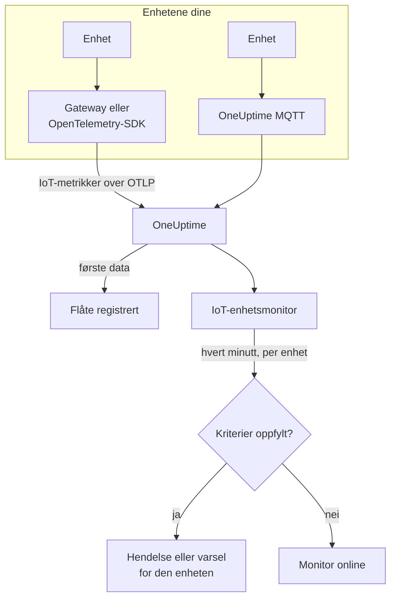

# IoT-enhets-overvåking

En IoT-enhetsmonitor følger med på én flåte av enheter og sier fra når en enhet går offline, batteriet blir svakt, signalet svekkes, den blir overopphetet, eller CPU-en forblir opptatt. Den leser `iot_*`-metrikkene enhetene dine sender til OneUptime over OpenTelemetry eller MQTT, så ingenting sjekkes utenfra, og ingen probe er involvert.

:::cards
- [Opprett monitoren](#opprett-en-iot-enhetsmonitor): Seks trinn i dashbordet.
- [Maler](#ferdige-varslingsmaler): Fem ferdige varsler, én hendelse per enhet.
- [Offline-deteksjon](#offline-deteksjon): Hvordan en død eller taus enhet oppdages.
- [Metrikker](#innsamlede-metrikker): `iot_*`-seriene monitoren leser.
:::

## Slik fungerer det

Enhetene dine, eller gatewayen de snakker med, sender målingene sine til OneUptime: over OpenTelemetry eller rett til OneUptimes MQTT-endepunkt. Hver måling bærer flåtens navn, `iot.fleet.name`, og enhetens egen ID, `device.id`. De første dataene registrerer flåten.

En IoT-enhetsmonitor er knyttet til én flåte. Hvert minutt kjører den spørringen sin på den flåtens metrikker og sammenligner resultatet med kriteriene sine. Malene grupperer etter `device.id`, så 30 sensorer som er offline, åpner 30 hendelser, som hver nevner enheten sin og hver løser seg selv når enheten kommer seg.



## Før du begynner

- **Få enhetene dine til å sende data.** [Veiledningen for IoT-enheter](/docs/telemetry/iot-devices) viser hvordan du sender metrikker med en OpenTelemetry-SDK eller -Collector, eller over MQTT.
- **Sjekk at flåten er registrert.** Den vises under **Produkter → Infrastruktur → IoT → All Fleets**, oppkalt etter `iot.fleet.name` som enhetene sender.
- **Registrer enhetene du forventer**, under flåtens **Device Registry**, for å få beskjed når en blir taus: se [Offline-deteksjon](#offline-deteksjon).

## Opprett en IoT-enhetsmonitor

:::steps
### Start en ny monitor

Gå til **Monitorer**, og klikk på **Opprett monitor**.

### Velg IoT Device

Klikk på **Flere monitortyper** under **Monitortype**, og velg **IoT Device** under **Infrastruktur**, eller skriv `iot` i søkefeltet. Skriv inn et **Navn** - det brukes i titlene på hendelser og varsler - og klikk på **Neste**.

### Velg flåten

Velg flåten i **IoT Fleet** under **IoT Monitor Configuration**. Hver flåte som har sendt data, står i listen.

### Velg hva som skal overvåkes

Velg en av de tre fanene:

- **Quick Setup** - klikk på en [mal](#ferdige-varslingsmaler). Den setter metrikken, aggregeringen, tidsintervallet, en gruppering på `device.id` og tersklene og erstatter kriteriene nedenfor med sine egne. Du kan fortsatt endre **Tidsintervall**.
- **Custom Metric** - velg én metrikk i **IoT Metric**, og sett deretter **Aggregering** og **Tidsintervall**. [Filtrene](#monitorinnstillinger) snevrer den inn til én enhet eller én enhetstype. En egendefinert metrikk grupperes ikke: den vurderer flåten som helhet.
- **Avansert** - bygg spørringer og formler selv under **Velg målinger**, også over dine egne metrikknavn, for eksempel minne i bruk i prosent av en enhets minnestørrelse. Bruk **Group by** `device.id` for å vurdere hver enhet for seg.

### Sjekk kriteriene

Åpne hvert kriterium under **Monitorkriterier**, og sjekk **Select Metric Variable**, **Aggregering**, **Betingelse** og **Threshold**. En mal fyller dem ut. Med **Custom Metric** eller **Avansert** starter monitoren med [standardkriteriene](#standardkriterier), som bare oppdager at en metrikk faller til null, så sett din egen terskel.

### Opprett monitoren

Klikk på **Opprett monitor**. OneUptime åpner monitorens side og evaluerer den hvert minutt. Hendelser og varsler den sender ut, når vaktreglene dine, Slack, Microsoft Teams, e-post, SMS og webhooks som for enhver annen monitor.
:::

> [!TIP]
> For å sette opp flere maler på én gang åpner du flåten fra **Produkter → Infrastruktur → IoT** og går til **Recommendations**. Velg malene du vil ha, velg hvem som skal tilkalles, og OneUptime oppretter én monitor per mal.

## Monitorinnstillinger

| Felt | Fane | Hva det gjør |
| --- | --- | --- |
| **IoT Fleet** | Alle | Påkrevd. Begrenser hver spørring til `resource.iot.fleet.name`. |
| **Ressursomfang** | Custom Metric, Avansert | Valgfritt. **Enhet** eller **Fleet**: et nøyaktig treff på attributtet `iot.scope`. Å velge en metrikk setter det til **Enhet**. |
| **Device ID** | Custom Metric, Avansert | Valgfritt. Én enhet, via `device.id`, som `sensor-001`. |
| **Device Type** | Custom Metric, Avansert | Valgfritt. Enhetene som rapporterer denne `iot.device.type`, som `sensor` eller `gateway`. |
| **IoT Metric** | Custom Metric | Én metrikk fra [katalogen](#innsamlede-metrikker). |
| **Aggregering** | Custom Metric | Hvordan prøver kombineres: **Gjennomsnitt**, **Maksimum**, **Minimum**, **Sum** eller **Antall**. Starter på metrikkens vanlige aggregering. |
| **Tidsintervall** | Alle | Det glidende vinduet spørringen leser, fra **Past 1 Minute** til **Past 365 Days**. En ny monitor starter på **Past 1 Minute**; maler setter sitt eget. |
| **Velg målinger** | Avansert | Spørringsbyggeren: **Metrikk**, **Aggregate by**, **Filter by attributes**, **Group by**, pluss **Legg til metrikk** og **Legg til formel** for å kombinere spørringer. |

Filtrene virker sammen: med en **Device ID** og en **Device Type** samsvarer en enhet av en annen type ikke med noe.

## Ferdige varslingsmaler

**Quick Setup** tilbyr 5 maler. Hver bygger en komplett monitor: metrikkspørringen, en gruppering på `device.id`, et kriterium som utløser og et som gjenoppretter. Terskler er utgangspunkter du kan redigere.

Et kriterium utløser bare når betingelsen gjelder for hvert minutt i vinduet - unntatt **Device Offline**, som utløser ved den første målingen under 1. Et terskelkriterium gjenoppretter 10 % forbi terskelen, så en verdi som svinger rundt linjen, ikke skifter fram og tilbake.

| Mal | Kategori | Alvorlighetsgrad | Overvåker | Utløser når | Gjenoppretter når |
| --- | --- | --- | --- | --- | --- |
| Device Offline | Tilgjengelighet | Kritisk | `iot_device_up`, Min per `device.id`, siste 30 minutter | En måling er under 1, eller en registrert enhet sender ingenting i hele vinduet | Tilbake på 1 |
| Low Battery | Power | Warning | `iot_battery_percent`, Avg per `device.id`, siste 5 minutter | Under 20 % | Ved 22 % eller mer |
| Weak Signal | Connectivity | Warning | `iot_signal_strength_dbm`, Avg per `device.id`, siste 5 minutter | Under -100 dBm | Ved -90 dBm eller mer |
| High Temperature | Miljø | Kritisk | `iot_temperature_celsius`, Max per `device.id`, siste 5 minutter | Over 70 °C | Ved 63 °C eller mindre |
| High CPU Usage | System | Warning | `iot_cpu_usage_ratio`, Avg per `device.id`, siste 5 minutter | Over 0.9 (90 % av CPU-en) | Ved 0.81 eller mindre |

**Alvorlighetsgrad** er etiketten velgeren viser. Hendelsen og varselet en mal oppretter, starter på prosjektets mest alvorlige hendelses- og varslingsgrad; endre dem i kriteriet.

- **Device Offline leser 30 minutter**, så en enhet som rapporterer med noen minutters mellomrom, ikke kalles offline mellom to rapporter. En enhet som rapporterer sjeldnere enn omtrent hvert 15. minutt, trenger et lengre vindu.
- **High Temperature bruker Max** i hvert minutt, så en varm måling ikke skjules av kjøligere målinger i samme minutt. Den må likevel forbli varm i hvert minutt av vinduet.
- **High CPU Usage sammenligner et forhold:** `iot_cpu_usage_ratio` går fra 0 til 1, så 0.9 er 90 %.

## Offline-deteksjon

**Device Offline** utløser når en enhet rapporterer `iot_device_up = 0`. En død eller taus enhet utløser den på tre måter:

| Hvordan | Hva som skjer |
| --- | --- |
| **Gatewayen rapporterer det** | Gatewayen eller collectoren sender `iot_device_up = 0` for en enhet den ikke lenger kan nå. |
| **MQTT Last Will** | En enhet som er koblet til OneUptimes MQTT-endepunkt, registrerer en Last Will på emnet `status`. Når enheten dør, sender brokeren `iot_device_up = 0` for den i det øyeblikket økten faller: ingen avspørring, ingen venting på en manglende rapport. Se [Sende metrikker via MQTT](/docs/telemetry/iot-devices#sende-metrikker-via-mqtt). |
| **Enheten er registrert** | En enhet i flåtens **Device Registry** forventes. Når den ikke sender noe i hele vinduet, behandler monitoren den som om den rapporterte `0`, så den får sin egen hendelse, som løser seg selv når enheten rapporterer igjen. |

En registrert enhet beholdes også som offline i flåtens inventar, mens en uregistrert fjernes etter 15 minutter med stillhet. Deteksjon av stillhet krever regelen **Treat As Zero** for manglende data på kriteriet for `iot_device_up`, som Device Offline-monitorer opprettet fra malen har. En Device Offline-monitor som ble opprettet før enhetsregistrering fantes, må få den satt manuelt eller opprettes på nytt fra malen.

> [!NOTE]
> En uregistrert enhet som blir taus uten en Last Will eller en gatewayrapport, slutter bare å sende data, og en monitor som grupperer per enhet, kan ikke peke den ut. Registrer enhetene dine, eller gi en kritisk enhet sin egen monitor (**Custom Metric**, med dens **Device ID**), og sett **Hvis ingen data** til **Trigger**. Deteksjon av stillhet krever også at minst én annen enhet i flåten fortsatt rapporterer: en flåte som blir helt mørk, for eksempel under et gatewaybrudd, sender ut én hendelse for monitoren, ikke én per enhet.

## Innsamlede metrikker

Hver serie bærer enhetens etikett `device.id` og attributtene `iot.scope`, `iot.device.type` og `iot.device.kind`.

| Metrikk | Enhet | Beskrivelse |
| --- | --- | --- |
| `iot_device_up` | — | 1 når enheten kjører, 0 når den er nede eller offline. |
| `iot_battery_percent` | `%` | Gjenværende batterilading, fra 0 til 100. Et fallende nivå betyr at enheten snart slutter å rapportere. |
| `iot_signal_strength_dbm` | `dBm` | Styrken på det trådløse signalet. Nærmere 0 er sterkere; et svakt signal kommer før tapte tilkoblinger. |
| `iot_temperature_celsius` | `°C` | Enhetens temperatur. En høy måling kan bety overopphetet maskinvare eller et problem rundt den. |
| `iot_cpu_usage_ratio` | `ratio` | CPU i bruk, fra 0 til 1, der 1 er full utnyttelse. |
| `iot_memory_usage_bytes` | `bytes` | Minne i bruk. Sammenlign det med enhetens minnestørrelse for å se minnepress. |
| `iot_uptime_seconds` | `s` | Hvor lenge enheten har kjørt. Faller til null når den starter på nytt. |

## Overvåkingskriterier

Et kriterium sammenligner en av monitorens spørringer eller formler med en terskel. Kriteriene til en IoT-enhetsmonitor tilbyr én **Filtertype**, **Metric Value**: hver regel sjekker metrikkverdien, med disse feltene.

| Felt | Hva det gjør |
| --- | --- |
| **Filtertype** | Alltid **Metric Value**, den eneste sjekken denne monitoren tilbyr. |
| **Select Metric Variable** | Spørringen eller formelen som skal sjekkes, etter variabelnavnet. |
| **Aggregering** | Hvordan verdiene i vinduet blir til ett svar: **Gjennomsnitt**, **Sum**, **Maximum Value**, **Minimum Value**, **All Values** (hver verdi må samsvare) eller **Any Value** (én er nok). |
| **Betingelse** | **Greater Than**, **Less Than**, **Greater Than Or Equal To**, **Less Than Or Equal To** eller **Equal To** — eller en anomalibetingelse: **Anomalously High**, **Anomalously Low** eller **Anomalous**. |
| **Threshold** | Verdien det sammenlignes med. En enhetsliste står ved siden av når metrikken har en enhet. Vises ikke for anomalibetingelser. |
| **Følsomhet** | Bare anomalibetingelser. **Lav** (4σ), **Middels** (3σ, standarden) eller **Høy** (2σ). |
| **Grunnlinjevindu** | Bare anomalibetingelser. 14 dager (standarden), 28, 60 eller 90 dagers historikk. |
| **Hvis ingen data** | Under **Flere felt**. Hva som skjer når en serie ikke har noen prøver i vinduet: **Ignore** (standarden) hopper over den, **Treat As Zero** leser den som `0`, og **Trigger** får kriteriet til å samsvare. |

Anomalibetingelser sammenligner hver verdi med den samme timen i uken i grunnlinjen. De blir værende i tilstanden "Learning", og sender ikke ut noe, til grunnlinjevinduet inneholder nok historikk.

### Standardkriterier

En monitor du ikke bygger fra en mal, starter med to kriterier:

| Rekkefølge | Kriterium | Samsvarer når | Så |
| --- | --- | --- | --- |
| 1 | Check if _monitor name_ is offline | En hvilken som helst verdi i den første spørringen er `0` | Markerer monitoren som **Frakoblet** og erklærer hendelsen "_monitor name_ is offline", som løser seg selv når monitoren kommer seg. |
| 2 | Check if _monitor name_ is online | En hvilken som helst verdi er over `0` | Markerer monitoren som **I drift**. |

> [!IMPORTANT]
> Stillhet samsvarer ikke med noen av kriteriene: en flåte som slutter å sende data, lar monitoren stå slik den var. For å få beskjed når data uteblir, setter du **Hvis ingen data** til **Trigger** på et kriterium. Tid der OneUptime selv ikke mottok noe, teller aldri som manglende data: en sjekk der vinduet inneholder den tiden, venter i stedet, slik [Når OneUptime ikke mottar data](/docs/monitor/when-oneuptime-is-not-receiving) forklarer.

## Terraform

[OneUptimes Terraform-provider](/docs/terraform/monitor-steps) bærer konfigurasjonen av et trinn i en IoT-enhetsmonitor i attributtet `iot_monitor`: den rå JSON-en for konfigurasjonen `iotMonitor` (`fleetIdentifier`, `resourceFilters`, `metricViewConfig`, `rollingTime`), skrevet med `jsonencode()`:

```hcl title="main.tf"
monitor_steps = [{
  iot_monitor = jsonencode({
    fleetIdentifier = "building-a-sensors"
    resourceFilters = {}
    rollingTime     = "Past 5 Minutes"
    metricViewConfig = {
      queryConfigs = [{
        metricAliasData = { metricVariable = "battery_percent", title = "Battery", description = "", legend = "" }
        metricQueryData = {
          filterData = {
            metricName     = "iot_battery_percent"
            attributes     = {}
            aggegationType = "Avg"
            aggregateBy    = {}
          }
          groupByAttributeKeys = ["device.id"]
        }
      }]
      formulaConfigs = []
    }
  })
  criteria = [ /* ... */ ]
}]
```

`fleetIdentifier` er flåtens `iot.fleet.name`, ikke dens OneUptime-ID.

## Feilsøking

:::details Flåten står ikke i listen IoT Fleet
Flåter registrerer seg selv ut fra enhetenes data. Sjekk at enhetene sender `iot.fleet.name`, og følg [veiledningen for IoT-enheter](/docs/telemetry/iot-devices) for å bekrefte at data kommer fram.
:::

:::details Én hendelse utløses for hele flåten i stedet for én per enhet
Spørringen er ikke gruppert. Monitorer med **Custom Metric** vurderer flåten som helhet; bruk en mal, eller **Avansert** med **Group by** `device.id`.
:::

:::details En enhet døde, men Device Offline utløste ikke
Enheten sendte ingen Last Will, og ingen gateway rapporterte den, så den ble bare taus. Registrer den under flåtens **Device Registry**, og sjekk at **Hvis ingen data** på kriteriet for `iot_device_up` står på **Treat As Zero**. Se [Offline-deteksjon](#offline-deteksjon).
:::

:::details Device Offline utløser for enheter som er i orden
De rapporterer sjeldnere enn vinduet på 30 minutter dekker, så noen vinduer inneholder ingenting fra dem. Forleng **Tidsintervall**, eller la enhetene rapportere oftere. På WebSocket-MQTT-endepunktet holder du MQTT-keepalive under 5 minutter: OneUptime lukker inaktive WebSocket-tilkoblinger etter 300 sekunder, noe som sender Last Will.
:::

:::details En mal viser ingen data
Malene leser `iot_*`-metrikknavnene nøyaktig og grupperer etter etiketten `device.id`. Sammenlign det enhetene dine sender, på flåtens side **Målinger**, med [metrikkonvensjonene](/docs/telemetry/iot-devices#metrikkonvensjoner).
:::

## Neste steg

:::cards
- [IoT-enheter](/docs/telemetry/iot-devices): Send enhetsmetrikker over OpenTelemetry eller MQTT.
- [Metrikk-overvåking](/docs/monitor/metrics-monitor): Varsle på hvilken som helst metrikk, ikke bare IoT-metrikker.
- [Hendelse- og varslingsmaler](/docs/monitor/incident-alert-templating): Sett enhetens ID i hendelsestitler.
:::
