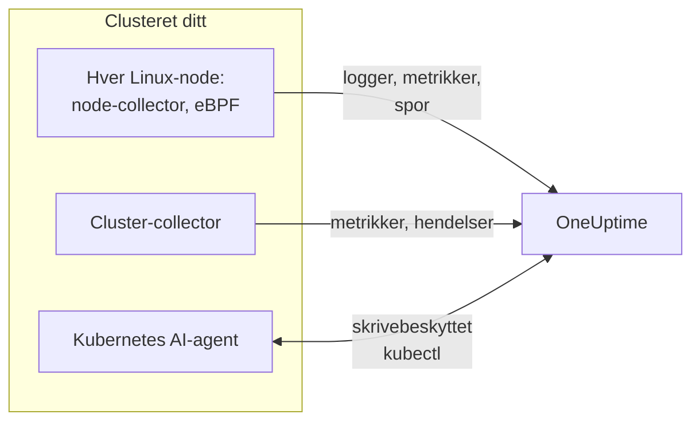

# Kubernetes-agent (Helm-installasjon)

OneUptimes Kubernetes-agent er et Helm-chart som samler inn metrikkene, hendelsene og pod-loggene i clusteret ditt, applikasjonsspor fanget med eBPF og operativsystemmetrikkene til hver node, og sender dem til OneUptime. Én `helm install` setter den opp, uten kodeendringer i appene dine. [Kubernetes-monitorer](/docs/monitor/kubernetes-monitor) varsler ut fra det den sender.

:::cards
- [Installer agenten](#installer-agenten): Fire trinn med Helm.
- [Velg et preset](#velg-et-preset): Standardclustere, GKE Autopilot eller EKS Fargate.
- [Vanlige innstillinger](#vanlige-innstillinger): Innstillingene de fleste clustere endrer.
- [Feilsøking](#feilsøking): Et diagnoseskript og de vanlige problemene.
:::

## Hva chartet installerer

Chartet kjører noen få workloads i sitt eget namespace. Hver av dem sender det den samler inn, til OneUptime-URL-en din over OTLP, med inntaksnøkkelen du gir den.



| Workload | Type | Hva den gjør | På som standard |
| --- | --- | --- | --- |
| Cluster-collector | Deployment | Clustermetrikker, Kubernetes-hendelser og de fullstendige spesifikasjonene for pods, noder og workloads, fra Kubernetes-API-et. | Ja |
| Node-collector | DaemonSet | Pod-logger fra `/var/log/pods`, kubelet- og cAdvisor-metrikker og nodens operativsystemmetrikker. | Ja |
| eBPF-instrumentering (OBI) | DaemonSet | HTTP-, gRPC-, SQL- og Redis-spor og forespørselsmetrikker fra hver pod, og tjenestekartet. | Ja |
| Kubernetes AI-agent | Deployment | Lar OneUptime AI kjøre skrivebeskyttet `kubectl` mens den undersøker en hendelse eller et varsel på dette clusteret. | Ja |
| Logg-tailer | Deployment | Pod-logger gjennom Kubernetes-API-et, der node-collectoren ikke kan lese dem. | Med presetene `gke-autopilot` og `eks-fargate` |
| eBPF-profiler | DaemonSet | Kontinuerlige CPU-flammegrafer for hver prosess. | Nei |
| kube-state-metrics | Deployment | Pod-faser, containeres venteårsaker og ressurskvoter. | Nei |

Hvert agent-image kjører bare på Linux, så hver workload er låst til Linux-noder.

## Før du begynner

- **En inntaksnøkkel.** Opprett en i OneUptime under **Prosjektinnstillinger → Telemetri og APM → Inntaksnøkler**. Agenten sender den som headeren `x-oneuptime-token`, så en prosjekt-API-nøkkel virker ikke her.
- **Helm 3** og `kubectl`-tilgang til clusteret. Oppgraderinger bruker `--reset-then-reuse-values`, som krever Helm 3.14 eller nyere.
- **Et navn på clusteret**, unikt i prosjektet ditt. Chartet nekter å installere uten et: to clustere med samme navn ville blitt vist som ett.
- **Utgående HTTPS** fra clusteret til OneUptime-URL-en din.

## Installer agenten

:::steps
### Legg til Helm-repositoriet

```bash
helm repo add oneuptime https://helm-chart.oneuptime.com
helm repo update
```

### Installer chartet

Erstatt URL-en med OneUptime-URL-en din, og de to plassholderne med inntaksnøkkelen din og clusterets navn:

```bash
helm install oneuptime-agent oneuptime/kubernetes-agent \
  --namespace oneuptime-kubernetes-agent \
  --create-namespace \
  --set oneuptime.url=https://oneuptime.com \
  --set oneuptime.apiKey=<YOUR_API_KEY> \
  --set clusterName=<A_UNIQUE_NAME_FOR_THIS_CLUSTER>
```

Dette bruker presetet `standard`. På GKE Autopilot eller EKS Fargate må du i stedet [velge deres preset](#velg-et-preset).

### Sjekk at podene kjører

```bash
kubectl get pods -n oneuptime-kubernetes-agent
```

Hver pod bør nå `Running` innen et minutt eller to.

### Finn clusteret i OneUptime

Åpne **Produkter → Infrastruktur → Kubernetes → Alle klynger**. Clusteret vises under navnet sitt innen noen få minutter, og nodene, podene og workloadene fylles ut.
:::

## Velg et preset

Noen Kubernetes-plattformer lar ikke en workload montere et `hostPath`-volum eller kjøre et DaemonSet, som node-collectoren bruker. Innstillingen `preset` velger det som virker på din:

| Preset | Brukes til | Pod-logger | På hver node |
| --- | --- | --- | --- |
| `standard` (standard) | Selvadministrert, **EKS on EC2**, **GKE Standard**, **AKS**, minikube, kind, k3s | Node-collectoren leser `/var/log/pods` | Kubelet-, cAdvisor- og operativsystemmetrikker |
| `gke-autopilot` | **GKE Autopilot** | Logg-taileren leser dem gjennom Kubernetes-API-et | Kubelet- og cAdvisor-metrikker, uten `hostPath` |
| `eks-fargate` | **EKS Fargate** | Logg-taileren leser dem gjennom Kubernetes-API-et | Ingenting: Fargate kjører ingen DaemonSets |

Er du usikker, lar du `preset` stå tom for å få `standard`. Hvis installasjonen feiler med en Pod Security-feil som nevner `hostPath`, installerer du på nytt med `gke-autopilot`, eller `eks-fargate` på EKS Fargate.

GKE Autopilot og EKS Fargate avviser også privilegerte pods, som eBPF-instrumenteringen trenger, så slå den av der med `--set ebpf.enabled=false`:

:::tabs
@tab Standard
```bash
helm install oneuptime-agent oneuptime/kubernetes-agent \
  --namespace oneuptime-kubernetes-agent --create-namespace \
  --set oneuptime.url=https://oneuptime.com \
  --set oneuptime.apiKey=<YOUR_API_KEY> \
  --set clusterName=prod
```
@tab GKE Autopilot
```bash
helm install oneuptime-agent oneuptime/kubernetes-agent \
  --namespace oneuptime-kubernetes-agent --create-namespace \
  --set oneuptime.url=https://oneuptime.com \
  --set oneuptime.apiKey=<YOUR_API_KEY> \
  --set clusterName=prod-gke-autopilot \
  --set preset=gke-autopilot \
  --set ebpf.enabled=false
```
@tab EKS Fargate
```bash
helm install oneuptime-agent oneuptime/kubernetes-agent \
  --namespace oneuptime-kubernetes-agent --create-namespace \
  --set oneuptime.url=https://oneuptime.com \
  --set oneuptime.apiKey=<YOUR_API_KEY> \
  --set clusterName=prod-eks-fargate \
  --set preset=eks-fargate \
  --set ebpf.enabled=false
```
:::

## Merk clusteret med etiketter

Etiketter du angir ved installasjonen, knyttes til clusteret og til tjenestene og vertene denne agenten rapporterer. `--set oneuptime.labels.<key>=<value>` blir en prosjektetikett med navnet `<key>:<value>`:

```bash
helm install oneuptime-agent oneuptime/kubernetes-agent \
  --namespace oneuptime-kubernetes-agent \
  --create-namespace \
  --set oneuptime.url=https://oneuptime.com \
  --set oneuptime.apiKey=<YOUR_API_KEY> \
  --set clusterName=prod \
  --set oneuptime.labels.team=payments \
  --set oneuptime.labels.env=production \
  --set oneuptime.labels.region=us-east-1
```

Eller hold dem i en values-fil:

```yaml title="values.yaml"
oneuptime:
  url: https://oneuptime.com
  apiKey: <YOUR_API_KEY>
  labels:
    team: payments
    env: production
    region: us-east-1
clusterName: prod
```

```bash
helm install oneuptime-agent oneuptime/kubernetes-agent \
  --namespace oneuptime-kubernetes-agent --create-namespace \
  -f values.yaml
```

Hver post denne agenten sender - logger, metrikker, spor og profiler - bærer da `team:payments`, `env:production` og `region:us-east-1`. Hver etikett er et ressursattributt `oneuptime.label.<key>=<value>`, og OneUptime gjør hvert attributt som begynner med `oneuptime.label.`, om til en etikett. Etiketter sammenlignes uten hensyn til store og små bokstaver, så en eksisterende etikett `Production` gjenbrukes i stedet for å bli duplisert. Agenten fjerner aldri en etikett du har lagt til i OneUptime.

## Pod-logger

`preset` setter `logs.mode`, som du også kan sette selv:

| `logs.mode` | Hvordan logger leses | Fordeler | Pass på |
| --- | --- | --- | --- |
| `daemonset` | Én node-collector per node følger filene under `/var/log/pods`. | Minst overhead, skalerer med nodene, ingen belastning på Kubernetes' API-server, følger loggrotasjon. | Krever `hostPath` og DaemonSets. |
| `api` | Én logg-tailer strømmer loggen til hver container fra Kubernetes-API-et, slik `kubectl logs -f` gjør. | Virker der `hostPath` er blokkert, eller der Pod Security Standard `restricted` gjelder. | Hver containerstrøm er en langvarig tilkobling til API-serveren. Én replika håndterer noen tusen containere. |
| `disabled` | Ingenting. | For apper som allerede sender loggene sine på en annen måte. | |

For å slå av logginnsamling setter du `--set logs.enabled=false` og sender applikasjonslogger med [OpenTelemetry](/docs/telemetry/open-telemetry)-SDK-ene i stedet. Metrikker påvirkes ikke: node-collectoren fortsetter å kjøre.

### Clustere med flere operativsystemer (Windows-nodepooler)

Windows-noder kjører aldri en agent-pod. Data på clusternivå om dem og podene deres kommer likevel inn, fordi de kommer fra Kubernetes-API-et: nodebetingelser, pod-faser, Kubernetes-hendelser og kube-state-metrics. Det Windows-noder mangler, er det som samles inn på noden: operativsystemmetrikker, kubelet- og cAdvisor-metrikker, eBPF-spor, profiler og, i loggmodusen `daemonset`, pod-logger.

For også å samle inn loggene fra pods på Windows-noder slår du på hybridmodusen:

```bash
helm upgrade oneuptime-agent oneuptime/kubernetes-agent \
  --namespace oneuptime-kubernetes-agent --reset-then-reuse-values \
  --set logs.windowsPods.enabled=true
```

Logg-taileren kjører da ved siden av node-collectorene, bare for podene på Windows-noder. Linux-pods beholder den billigere fillesingen, og de to deler podene etter nodens operativsystem, så ingen logglinje sendes to ganger.

- **Versjonen av tailer-imaget.** Delingen som bare gjelder Windows, er innebygd i imaget `kubernetes-log-tailer`. Et eldre image ignorerer den og følger *alle* pods, så loggene til hver Linux-pod sendes to ganger. Ikke lås `logs.api.image.tag` til en versjon som er eldre enn chartets utgivelse, og hvis en node kan ha et gammelt `release`-image i hurtigbufferen, legger du til `--set logs.api.image.pullPolicy=Always` i oppgraderingen.
- **Filtrering etter alvorlighetsgrad.** Med `filters.logs.minSeverity` satt blir en linje uten gjenkjennelig alvorlighetsgrad forkastet på node-collectorens vei, men beholdt på logg-tailerens - se [Filtrering etter loggalvorlighetsgrad](/docs/telemetry/kubernetes-agent#filtrering-etter-loggalvorlighetsgrad). Windows-pods kan da sende flere linjer uten nivå enn Linux-pods.

## Applikasjonsspor med eBPF

Chartet kjører [OpenTelemetry eBPF Instrumentation (OBI)](https://opentelemetry.io/docs/zero-code/obi/) på hver node. OBI laster eBPF-programmer inn i Linux-kjernen og følger med på nettverkstrafikken til hver pod, så det kan gjenskape HTTP- og HTTPS-, gRPC- og SQL- og Redis-kall uten noen endring i appene dine: ingen SDK, ingen sidecar. Det sender dem til OneUptime som spor og forespørselsmetrikker.

Tjenestene dine vises under **Produkter → Spor** og på tjenestekartet innen et minutt eller to, med `k8s.cluster.name` satt til clusterets navn, så du kan filtrere etter cluster.

### Når du skal slå av eBPF

eBPF er slått på som standard. Slå det av med `--set ebpf.enabled=false` når:

- Clusteret er **GKE Autopilot** eller **EKS Fargate**. De avviser privilegerte pods, og OBI må være privilegert for å laste programmene sine.
- Nodene kjører en kjerne som er eldre enn **Linux 5.8**, uten BTF. Debian 11, Ubuntu 20.10, Fedora 34, RHEL 9 og nyere er greit.
- Appene dine allerede sender spor med en OpenTelemetry-SDK, og du ikke vil ha dem dobbelt.

### Hva eBPF sender

OBI sender flere typer signaler. Hver kan slås av med `--set ebpf.features.<key>=false`:

| Innstilling | Standard | Hva den legger til |
| --- | --- | --- |
| `ebpf.features.httpMetrics` | på | HTTP- og gRPC-forespørselsmetrikker per tjeneste: forespørselsrate, latenshistogrammer og feil. |
| `ebpf.features.spanMetrics` | på | Span-metrikker: kall og varighet per tjeneste, rute eller operasjon, span-type og status - `traces.span.metrics.calls` og `traces.span.metrics.duration` (sekunder). |
| `ebpf.features.serviceGraph` | på | Raten og latensen for hvert kall fra én tjeneste til en annen, som tegner tjenestekartet. |
| `ebpf.features.networkMetrics` | på | Byte og pakker mellom hvert par av pods, over TCP og UDP, med Kubernetes-navnene deres. Viser hvert par av pods som snakker sammen, selv over protokoller OBI ikke kan lese. |
| `ebpf.features.networkInterZoneMetrics` | av | Det samme mellom soner. Dobler antallet serier: slå det bare på hvis du planlegger etter sone. |
| `ebpf.features.tcpStats` | på | TCP-statistikk per node: rundturstider, mislykkede tilkoblinger og retransmisjoner. |

### Knytt spor sammen på tvers av tjenester

OBI kan også føre sporet videre gjennom et kall: når pod A kaller pod B over HTTP eller gRPC, slutter spannet på Bs side seg til As spor, uten SDK i noen av appene. **Dette er slått av som standard.** Slå det på med `--set ebpf.contextPropagation=true`, etter at du har lest advarselen nedenfor.

| Innstilling | Standard | Hva den gjør |
| --- | --- | --- |
| `ebpf.contextPropagation` | av | Skriver en W3C-`traceparent` inn i utgående trafikk, så spans knyttes sammen på tvers av tjenester. |
| `ebpf.contextPropagationMode` | `headers` | Hvordan: `headers` (HTTP/1.1-forespørselsheadere, det smaleste), `tcp` (et TCP-alternativ, gjennom Linux Traffic Control) eller `all` (begge). Leses bare når `contextPropagation` er på. |
| `ebpf.trackRequestHeaders` | på | Sporer forespørselsheadere i kjernen, så mottakersiden også finner `traceparent` på vanlige HTTP-servere. Har bare virkning når `contextPropagation` er på. |

> [!WARNING]
> Hver propageringsmodus endrer trafikk som allerede er underveis. For vanlig HTTP gjør OBI den utgående forespørselen større i kjernen så headeren får plass; for TLS og rå TCP legger den til et TCP-alternativ fra en Traffic Control-hook og skriver om pakken og sjekksummen. Hvis tilkoblingens bytetelling da ikke rettes nøyaktig, **desynkroniseres** strømmen: overføringer gjennom en proxy som nginx henger halvveis, så snart et svar passerer rundt 64 KB, til tilkoblingen får tidsavbrudd. Små forespørsler fortsetter å virke, så det ser ut som en feil i applikasjonen eller proxyen. Ingen kjerneversjon får omskrivingen til å forsvinne. Spor, forespørselsmetrikker og tjenestekartet virker alle uten den; en OpenTelemetry-SDK i tjenestene dine knytter spor sammen helt uten omskriving i kjernen. Slår du den på, så prøv den først på et cluster som ikke er produksjon, og sjekk store overføringer gjennom proxyen din.

### Knytt logger til spor

**Slått av som standard.** Når det er slått på, fester OBI en probe til systemkallet `write()` for hver prosess det instrumenterer, og:

- En **JSON-logglinje** får feltene `trace_id` og `span_id` (felt linjen allerede har, beholdes). Node-collectoren flytter dem over i loggpostens egne sporfelt, så loggene til et span er ett klikk unna i OneUptime, og det samme er sporet til en logglinje.
- **Enhver annen logglinje** samles inn uendret, uten koblingen.

```bash
helm upgrade oneuptime-agent oneuptime/kubernetes-agent \
  --namespace oneuptime-kubernetes-agent --reset-then-reuse-values \
  --set ebpf.logToTraceCorrelation=true
```

| Innstilling | Standard | Hva den gjør |
| --- | --- | --- |
| `ebpf.logToTraceCorrelation` | `false` | Slår på OBIs loggberiker og node-collectorens løft av `trace_id`. |
| `ebpf.logEnricher.services` | `[{service: [{exe_path: "*"}]}]` | Hvilke prosesser berikeren rører. Hver oppføring er en OBI-[GlobAttributes](https://opentelemetry.io/docs/zero-code/obi/configure/options/#service-discovery)-selektor, med felt som `exe_path`, `languages`, `k8s_pod_labels`, `k8s_pod_annotations`, `open_ports` og `cmd_args`. |

#### APM-agenter som krasjer med det

Berikeren skriver om appens utdatabuffer **inne i prosessen**: når en valgt prosess kaller `write()`, blanker OBI de opprinnelige bytene og skriver en beriket kopi. APM-agenter som lastes gjennom `LD_PRELOAD` og selv pakker inn `write()`, overlever ikke det:

| APM-agent | Bibliotek | Hva som skjer |
| --- | --- | --- |
| Dynatrace OneAgent | `liboneagentproc.so` | Appen krasjer med SIGSEGV (avslutningskode 139). Dynatrace-watchdogens egen `write()` henger utover grensen på 10 sekunder, og OneAgent starter på nytt i en løkke. |
| New Relic | `libnewrelic*.so` | Samme type krasj. |
| AppDynamics | `libappdynamics*.so` | Samme type krasj. |
| Datadog | `libdd*.so` | Samme type krasj. |
| Instana | `libinstana*.so` | Samme type krasj. |

**.NET-apper er de mest utsatte:** Dynatraces .NET-agent lastes alltid gjennom `LD_PRELOAD`, og konsolloggen til Microsoft.Extensions.Logging er ubufret, så hver linje tar den veien. Python- og Go-apper er som regel ikke berørt.

For å bruke det ved siden av en av disse agentene peker du `logEnricher.services` bare på pods som ikke har en. Berikeren kan ikke utelukke, så list opp dem som skal berikes:

```yaml title="values.yaml"
ebpf:
  logToTraceCorrelation: true
  logEnricher:
    services:
      # Enrich only pods with the apm-agent=none label
      - service:
          - k8s_pod_labels:
              apm-agent: "none"
```

Eller velg etter runtime. Dynatraces lasting gjennom `LD_PRELOAD` treffer .NET, så hvis du bare beriker Python, Go, Ruby og Node.js, unngår du det:

```yaml title="values.yaml"
ebpf:
  logToTraceCorrelation: true
  logEnricher:
    services:
      - service:
          - languages: "python,go,ruby,nodejs"
```

#### Logger må være JSON og ubufret

- **Bare JSON-linjer får en `trace_id`.** Bytt loggeren til et JSON-format: `structlog`, `pino`, `winston`, `serilog`, `logback-json`, klog `--logging-format=json` og lignende.
- **Bufret utdata bryter koblingen**, fordi `write()` da skjer på en annen tråd enn forespørselen. I **Python** setter du `PYTHONUNBUFFERED=1`. I **.NET** kaller du `Console.SetOut(new StreamWriter(Console.OpenStandardOutput()) { AutoFlush = true })` ved oppstart; `AddConsole()` fra Microsoft.Extensions.Logging og Serilogs asynkrone sinks virker ikke, Serilogs vanlige `WriteTo.Console()` gjør det.
- Greenlet, gevent, Tornado og andre egendefinerte asynkrone runtimes er ikke dekket.

### Finjuster eBPF

| Innstilling | Standard | Hva den gjør |
| --- | --- | --- |
| `ebpf.enabled` | `true` | Kjører eBPF-DaemonSettet. `false` utelater det. |
| `ebpf.image.tag` | `v0.14.0` | OBI-imaget. OBI er før 1.0: lås en versjon du har testet, og test på nytt før du bytter den. |
| `ebpf.autoTargetExe` | `*` | Globs for kjørbare filer som skal instrumenteres, skilt med komma. Snevre den inn, som i `*/python,*/java`, for å instrumentere færre runtimes. |
| `ebpf.excludeExePaths` | Shells, clusterets infrastruktur, service mesh-sidecars, CNI-agenter, nettlesere, ClickHouse, collectorer og OBI selv | Globs for kjørbare filer som skal hoppes over, skilt med komma. En bred glob hopper også over dine egne binærfiler. |
| `ebpf.logLevel` | `info` | `debug`, `info`, `warn` eller `error`. |
| `ebpf.printTraces` | `false` | Skriver også spans til OBIs egen logg, så du kan sjekke hva det fanger. |
| `ebpf.resources.*` | `100m` CPU og `512Mi` minne forespurt, grenser på `2000m` og `2Gi` | Øk dem for noder med mye trafikk eller mange kortlivde prosesser. |

For å sjekke at OBI kjører og ser trafikk:

```bash
kubectl get pods -n oneuptime-kubernetes-agent -l component=ebpf-instrument
kubectl logs -n oneuptime-kubernetes-agent -l component=ebpf-instrument --tail=200
```

## Kontinuerlig CPU-profilering

[OpenTelemetry eBPF Profiler](https://github.com/open-telemetry/opentelemetry-ebpf-profiler) kan også kjøre på hver node, som imaget `otel/opentelemetry-collector-ebpf-profiler`. Den tar prøver av hva hver prosess kjører, 19 ganger i sekundet, i Go, Java, .NET, Python, Ruby, Node.js, PHP, Perl, C, C++ og Rust, og sender profilene til OneUptime. De vises under **Produkter → Ytelsesprofiler** og som en flammegraf på hvert span i et spor.

**Profilering er slått av som standard:** det koster mer CPU og minne per node enn eBPF-instrumenteringen. Slå det på med `--set profiling.enabled=true`.

Med eBPF-instrumenteringen også slått på (standarden) bærer hver prøve sporet den hører til, så et span har sin egen flammegraf. For det ber chartet OBI om å holde den pågående sporkonteksten tilgjengelig (`OTEL_EBPF_BPF_POPULATE_TRACE_CONTEXT=true`), noe som koster instrumenterte apper litt ved hvert asynkrone kontekstbytte. Sett `profiling.obiProcessContext=false` for flammegrafer uten koblingen til spans.

Profilering krever **Linux 5.10** eller nyere og en privilegert pod med nodens prosess-ID-er: den kan ikke kjøre på GKE Autopilot eller EKS Fargate. På noder som selv er containere, som kind eller k3d, kan den ikke skille prosesser fra hverandre, og nesten ingen prøve knyttes til et span.

| Innstilling | Standard | Hva den gjør |
| --- | --- | --- |
| `profiling.enabled` | `false` | Kjører profiler-DaemonSettet. |
| `profiling.image.tag` | `0.152.0` | Profiler-imaget. Det er før 1.0: lås en versjon du har testet. |
| `profiling.samplesPerSecond` | `19` | Hvor mange prøver per sekund. 19 unngår å falle sammen med vanlige timerfrekvenser. |
| `profiling.offCpuThreshold` | `0` | En verdi over 0 og opptil 1 profilerer også tid brukt utenfor CPU-en, som viser låsekonflikter og blokkerende I/O, mot en ekstra kostnad. |
| `profiling.tracers` | `""` (alle runtimes) | Språksporerne som skal lastes, skilt med komma, som `go,python`. |
| `profiling.obiProcessContext` | `true` | Knytter prøver til OBIs spor og får OBI til å holde sporkonteksten tilgjengelig for det. |

## Annen datainnsamling

| Innstilling | Standard | Hva den legger til |
| --- | --- | --- |
| `hostMetrics.enabled` | på | Hver nodes operativsystemmetrikker fra `/proc` og `/sys`: diskens I/O-køer, filsystemenes inoder, feil på nettverksgrensesnitt, paging og load average. Kjører i node-collectoren, uten ekstra pods. |
| `kubeletstats.utilizationMetrics.enabled` | på | CPU og minne for containere og pods i prosent av request og limit, som monitorene for CPU- og minnemetning leser. Alltid 0 for en pod uten request eller limit. |
| `kubeletstats.volumeMetrics.enabled` | på | Ledig og total plass for hver PVC (`k8s.volume.available`, `k8s.volume.capacity`), som monitoren PVC Low Disk Space leser. Én serie per PVC per pod. |
| `cadvisor.enabled` | på | CPU-struping og OOM-avslutninger fra hver kubelets `/metrics/cadvisor`: `container_cpu_cfs_throttled_seconds_total`, `container_cpu_cfs_periods_total` og `container_oom_events_total`, og ingenting annet. |
| `kubeStateMetrics.enabled` | av | Pod-faser (Pending, Terminating), pods som ikke kan planlegges, containeres venteårsaker (CrashLoopBackOff, ImagePullBackOff) og bruk av ressurskvoter, fra kube-state-metrics. `kubeStateMetrics.mode: bundled` (standarden) kjører en liten kube-state-metrics for deg; `external` leser en du allerede kjører, på `kubeStateMetrics.endpoint`. |
| `auditLogs.enabled` | av | Kubernetes' revisjonslogg, `/var/log/kubernetes/audit.log`: hver forespørsel til API-et, fra hvem og på hva. Bare selvadministrerte clustere: administrerte (EKS, GKE, AKS, DOKS) sender den til skyleverandøren. |
| `csi.enabled` | av | Metrikker fra CSI-lagringsdrivere, fra pods med etiketten `app=csi-driver` eller `app.kubernetes.io/component=csi-driver`: tider for å koble til og fra volumer, klargjøringsfeil, IOPS. |
| `coreDns.enabled` | av | CoreDNS' metrikker på `:9153/metrics`: spørringsrate, latens, treff i hurtigbufferen og feil. |
| `controlPlane.enabled` | av | etcd, API-serveren, scheduleren og controller manageren. Bare selvadministrerte clustere: administrerte eksponerer dem ikke. |
| `cost.enabled` | av | Hva hver workload koster. Se [Kubernetes-kostnadsobserverbarhet](/docs/telemetry/kubernetes-cost). |

## Vanlige innstillinger

| Innstilling | Standard | Hva den gjør |
| --- | --- | --- |
| `oneuptime.url` | (påkrevd) | OneUptime-URL-en din. |
| `oneuptime.apiKey` | (påkrevd) | Inntaksnøkkelen, fra **Prosjektinnstillinger → Telemetri og APM → Inntaksnøkler**. Sendes som headeren `x-oneuptime-token`; en prosjekt-API-nøkkel virker ikke. |
| `clusterName` | (påkrevd) | Clusterets navn, unikt i prosjektet. Hver post bærer det som `k8s.cluster.name`. |
| `preset` | (tom: `standard`) | `standard`, `gke-autopilot` eller `eks-fargate`. Se [Velg et preset](#velg-et-preset). |
| `oneuptime.labels` | `{}` | Etiketter for hver post fra denne agenten. Se [Merk clusteret med etiketter](#merk-clusteret-med-etiketter). |
| `namespaceFilters.rules` | Holder `kube-system` utenfor `podLogs` og `ebpfDiscovery` | Regler som tar med eller utelukker namespaces, for `podLogs`, `ebpfDiscovery`, `metrics` og `traces`. Mønstre kan bruke `*`, og utelukkelse vinner alltid. |
| `filters.logs.minSeverity` | `""` | Forkaster pod-logglinjer under dette nivået: `TRACE`, `DEBUG`, `INFO`, `WARN`, `ERROR` eller `FATAL`. |
| `filters.metrics.exclude` | `[]` | Metrikknavn som skal forkastes. |
| `sampling.traces.percentage` | `100` | Andelen spor som skal beholdes, fra 0 til 100. Hele spor beholdes eller forkastes. |
| `logs.enabled` | `true` | Samler inn pod-logger. |
| `logs.mode` | (fra `preset`) | `daemonset`, `api` eller `disabled`. Overstyrer presetet. |
| `logs.windowsPods.enabled` | `false` | Følger også pods på Windows-noder. Se [Clustere med flere operativsystemer](#clustere-med-flere-operativsystemer-windows-nodepooler). |
| `logs.api.replicas` | `1` | Replikaer av logg-taileren, i modusen `api`. |
| `ebpf.enabled` | `true` | eBPF-spor og forespørselsmetrikker. Se [Applikasjonsspor med eBPF](#applikasjonsspor-med-ebpf). |
| `profiling.enabled` | `false` | CPU-flammegrafer. Se [Kontinuerlig CPU-profilering](#kontinuerlig-cpu-profilering). |
| `kubeStateMetrics.enabled` | `false` | Clustertilstand fra kube-state-metrics. |
| `aiAgent.enabled` | `true` | Kubernetes AI-agenten. Se [Kubernetes AI-agent](/docs/telemetry/kubernetes-agent) for hva den har lov til å gjøre. |

Chartets [`values.yaml`](https://github.com/OneUptime/oneuptime/blob/master/HelmChart/Public/kubernetes-agent/values.yaml) lister opp og forklarer hver innstilling, og [Kubernetes-agent](/docs/telemetry/kubernetes-agent) dekker filtrering, sampling og å holde datamengden nede.

## Oppgradering

```bash
helm repo update
helm upgrade oneuptime-agent oneuptime/kubernetes-agent \
  --namespace oneuptime-kubernetes-agent \
  --reset-then-reuse-values
```

`--reset-then-reuse-values` (Helm 3.14 og nyere) beholder verdiene du har satt - presetet, clusterets navn, filtre - og tar alle andre verdier fra det nye chartet. Legg til eventuelle nye `--set` etter den. På Helm 3.13 eller eldre oppgraderer du i stedet med verdiene du har satt:

```bash
helm repo update
helm get values oneuptime-agent --namespace oneuptime-kubernetes-agent -o yaml > values.yaml && \
  helm upgrade oneuptime-agent oneuptime/kubernetes-agent \
  --namespace oneuptime-kubernetes-agent -f values.yaml
```

Ikke oppgrader med `--reuse-values`: den beholder også standardverdiene fra chartet du oppgraderer fra, så standardverdiene i et nyere chart, blant dem eBPF-imaget, aldri tas i bruk. Når en release kjører på standardverdiene til et eldre chart, slutter notatene Helm skriver etter installasjonen eller oppgraderingen med en advarsel og kommandoen som retter det.

> [!WARNING]
> **eBPF-span-metrikker har nye navn.** `ebpf.features.spanMetrics` sender nå `traces.span.metrics.calls` og `traces.span.metrics.duration` (sekunder) i stedet for `traces_spanmetrics_calls_total` og `traces_spanmetrics_latency`: de samme seriene, under navnene OBI beholder (det har faset ut de gamle). Et dashbord, en graf eller en metrikkmonitor på et gammelt navn får ingen nye data etter oppgraderingen, uten noen feil - flytt det til det nye navnet, og oppdater enhver oppføring i `filters.metrics` som nevner et gammelt navn.

## Avinstallering

```bash
helm uninstall oneuptime-agent --namespace oneuptime-kubernetes-agent
kubectl delete namespace oneuptime-kubernetes-agent
```

## Feilsøking

:::details Clusteret vises som Disconnected, eller det kommer ingen data
Kjør chartets diagnoseskript. Det sjekker podene, inntaksnøkkelen og veien ut av clusteret, spør OneUptime om nøkkelen godtas, og skriver ut én konklusjon. Det bare leser og endrer ingenting:

```bash
curl -fsSL https://raw.githubusercontent.com/OneUptime/oneuptime/master/HelmChart/Public/kubernetes-agent/troubleshoot.sh \
  | bash -s -- -n oneuptime-kubernetes-agent
```

Den vanlige årsaken, særlig etter en reinstallasjon, er en feil eller tilbakekalt inntaksnøkkel: OneUptime avviser den, og collectoren forkaster hver batch mens podene forblir `Running`.
:::

:::details Installasjonen feiler med "hostPath volumes are not allowed"
Clusteret blokkerer `hostPath`. Bytt til et preset som leser logger gjennom Kubernetes-API-et, og slå av eBPF:

```bash
helm upgrade oneuptime-agent oneuptime/kubernetes-agent \
  --namespace oneuptime-kubernetes-agent \
  --reset-then-reuse-values \
  --set preset=gke-autopilot \
  --set ebpf.enabled=false
```

På EKS Fargate bruker du `--set preset=eks-fargate`.
:::

:::details Agent-pods står fast i ImagePullBackOff på Windows-noder
Eldre charts planla agentens DaemonSets på Windows-noder, der Linux-imagene deres aldri kan hentes. Kjør `helm upgrade`: det nåværende chartet låser hver workload til Linux-noder, og podene som sto fast, forsvinner. For å samle inn loggene fra pods på Windows-noder, se [Clustere med flere operativsystemer](#clustere-med-flere-operativsystemer-windows-nodepooler).
:::

:::details Det kommer ingen logger inn i OneUptime
Sjekk agentens pods og loggene deres:

```bash
kubectl get pods -n oneuptime-kubernetes-agent
kubectl logs -n oneuptime-kubernetes-agent -l app.kubernetes.io/part-of=oneuptime --tail=200
```

I modusen `api` svarer logg-taileren på `/healthz`, port 13133, med tilstanden til eksportene sine: nå den med `kubectl port-forward`.
:::

:::details eBPF-podene er i CrashLoopBackOff, eller starter ikke
Les OBIs logg:

```bash
kubectl logs -n oneuptime-kubernetes-agent -l component=ebpf-instrument --tail=200
```

- **Kjernen er for gammel, eller har ingen BTF.** OBI krever Linux 5.8 eller nyere med BTF; sjekk med `uname -r` på en node. Kan du ikke oppgradere den, slår du av eBPF med `--set ebpf.enabled=false`.
- **Privilegerte pods avvises.** Noen clustere avviser dem selv utenfor Autopilot og Fargate. Slå av eBPF.
- **OBI kjører, men det kommer ingen spor.** Sett `--set ebpf.printTraces=true` og les OBIs logg på nytt. Spans der betyr at eksporten til OneUptime feiler: sjekk URL-en og inntaksnøkkelen. Ingen spans der kan bety at trafikken er kryptert av et TLS-bibliotek OBI ikke kan lese, som et statisk lenket.
:::

:::details Store overføringer henger etter at sporkobling er slått på
Det er `ebpf.contextPropagation` som skriver om trafikken: se advarselen i [Knytt spor sammen på tvers av tjenester](#knytt-spor-sammen-på-tvers-av-tjenester). Slå det av med `--set ebpf.contextPropagation=false`.
:::

:::details Apper krasjer med avslutningskode 139 etter at loggkobling er slått på
En APM-agent som lastes gjennom `LD_PRELOAD`, er i de samme podene: se [APM-agenter som krasjer med det](#apm-agenter-som-krasjer-med-det). Slå av `ebpf.logToTraceCorrelation`, eller pek `ebpf.logEnricher.services` på pods uten den agenten.
:::

:::details Én logg-tailer er ikke nok for clusteret (api-modus)
Fordel namespaces på flere releases, hver installert med sine egne namespace-regler:

```bash
helm install oneuptime-agent-ns-a oneuptime/kubernetes-agent \
  --set preset=gke-autopilot \
  --set-json 'namespaceFilters.rules=[{"action":"include","namespaces":["app-a","app-b"],"scopes":["podLogs"]}]' \
  ...
```

Øker du `logs.api.replicas`, legges det til tailere, men hver av dem leser alle tillatte namespaces, så du må fortsatt fordele namespaces for å unngå duplikater.
:::

## Neste steg

:::cards
- [Kubernetes-overvåking](/docs/monitor/kubernetes-monitor): Varsle ut fra det agenten sender.
- [Kubernetes-agent](/docs/telemetry/kubernetes-agent): Filtrering, sampling, AI-agenten og å holde datamengden nede.
- [Kubernetes-kostnadsobserverbarhet](/docs/telemetry/kubernetes-cost): Se hva hver workload koster.
- [Trase-overvåking](/docs/monitor/traces-monitor): Varsle ut fra sporene eBPF fanger.
:::
