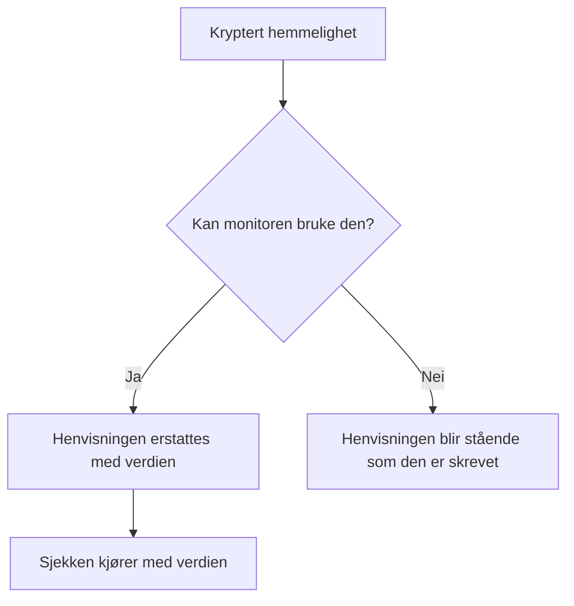

# Monitorhemmeligheter

Monitorhemmeligheter holder passordene, API-nøklene og tokenene som monitorene dine trenger, utenfor selve monitoren. Du lagrer en verdi én gang, kryptert, velger hvilke monitorer som kan bruke den, og viser til den som `{{monitorSecrets.NAME}}` der monitoren trenger den.

:::cards
- [Legg til en hemmelighet](#legg-til-en-hemmelighet): Lagre en verdi og velg hvem som kan bruke den.
- [Velg tilgang](#velg-hvilke-monitorer-som-kan-bruke-en-hemmelighet): Alle monitorer, bestemte monitorer eller monitorer med etiketter.
- [Bruk en hemmelighet](#bruk-en-hemmelighet): Hvor `{{monitorSecrets.NAME}}` fungerer.
- [Logg inn med en engangskode](#logg-inn-med-en-engangskode): La en monitor logge inn på et nettsted som krever tofaktorautentisering.
:::

## Slik når hemmeligheter frem til en monitor

En hemmelighet lagres kryptert og vises aldri igjen etter at du har lagret den. Før OneUptime gir en monitor videre til en sonde, erstatter den hver henvisning som monitoren kan bruke, med den dekrypterte verdien; en henvisning som monitoren ikke kan bruke, blir stående som den er skrevet. En engangskodehemmelighet er unntaket: sonden genererer koden når sjekken kjører (se [Logg inn med en engangskode](#logg-inn-med-en-engangskode)).



Sonden som kjører sjekken, mottar verdien, så en monitor som bruker en hemmelighet, bør kjøre på sonder du stoler på: OneUptimes egne, eller en [egendefinert sonde](/docs/probe/custom-probe) som du kjører selv.

## Før du starter

- **Growth-abonnementet eller høyere**, på OneUptime Cloud. Selvdriftede installasjoner har ingen abonnementer.
- **En rolle som kan administrere hemmeligheter**: Prosjekteier, Prosjektadministrator, eller en egendefinert rolle med tillatelsen Create Monitor Secret.

## Arbeid med hemmeligheter

### Legg til en hemmelighet

:::steps
1. Gå til **Monitorer → Innstillinger → Hemmeligheter**, og klikk på **Opprett Monitorhemmelighet**.
2. Angi et **Navn** og **Verdi for hemmelighet**. Navnet er det du viser til, for eksempel `ApiKey`. Det kan bare inneholde bokstaver, tall, bindestreker (`-`) og understreker (`_`), og to hemmeligheter i et prosjekt kan ikke ha det samme. For et nettsteds oppsettsnøkkel for tofaktorautentisering velger du først **Engangskode (TOTP)** (se [Logg inn med en engangskode](#logg-inn-med-en-engangskode)).
3. Velg i trinnet **Tilgang** hvilke monitorer som kan bruke den (se neste avsnitt), og klikk så på **Opprett Monitorhemmelighet**.
:::

> [!IMPORTANT]
> Hemmeligheter krypteres og lagres sikkert. Verdien til hemmeligheten vises aldri igjen etter at den er lagret — verken i tabellen, i redigeringsskjemaet eller via API-et. Hvis du mister verdien, må du hente den fra der den kom fra, og sette den på nytt. For å rotere en hemmelighet bruker du knappen **Oppdater hemmelig verdi** på raden dens; du trenger ikke å slette og opprette den på nytt. Den samme knappen endrer også hva hemmeligheten inneholder, **Tekst** eller **Engangskode (TOTP)**, sammen med en ny verdi, og monitorer som bruker hemmeligheten, tar i bruk den nye typen ved neste sjekk.

### Velg hvilke monitorer som kan bruke en hemmelighet

Hver hemmelighet har ett av tre tilgangsalternativer:

| Alternativ | Hvilke monitorer som kan bruke hemmeligheten | Bruk det til |
| --- | --- | --- |
| **Alle monitorer** | Hver monitor i prosjektet, også monitorer du oppretter senere. | En påloggingsinformasjon som mange monitorer deler. |
| **Bestemte monitorer** | Bare monitorene du velger. Dette er standard, og hemmeligheter som ble opprettet før disse alternativene fantes, fungerer slik. | En påloggingsinformasjon for én eller noen få monitorer. |
| **Monitorer med etiketter** | Monitorer som har minst én av etikettene du velger. Når en av de etikettene legges til på en monitor, får den tilgang, og når etiketten fjernes, mister den tilgangen neste gang monitoren kjører. | En påloggingsinformasjon for en gruppe monitorer som endrer seg over tid. |

Du kan når som helst endre alternativet med **Rediger** på raden til hemmeligheten. Bare listen for det valgte alternativet beholdes: å bytte til **Alle monitorer** tømmer hemmelighetens lister over monitorer og etiketter, og å bytte mellom **Bestemte monitorer** og **Monitorer med etiketter** tømmer listen du bytter bort fra.

En hemmelighet er aldri tilgjengelig for monitorer i et annet prosjekt.

> [!WARNING]
> Alle som kan redigere en monitor som kan bruke en hemmelighet, kan sende den hemmeligheten dit monitoren kobler seg til. Med **Alle monitorer** er det alle som kan opprette eller redigere monitorer i prosjektet. Med **Monitorer med etiketter** omfatter det også alle som kan legge en av de etikettene til på en monitor.

Via API-et er tilgangsalternativet feltet `monitorAccess`: `All Monitors`, `Specific Monitors` eller `Monitors With Labels`. Feltene `monitors` og `labels` inneholder listene. En hemmelighet som opprettes uten `monitorAccess`, får `Specific Monitors`.

### Bruk en hemmelighet

For å bruke en hemmelighet skriver du `{{monitorSecrets.SECRET_NAME}}` i et felt som tar imot hemmeligheter. For eksempel sender forespørselshodet `Authorization: Bearer {{monitorSecrets.ApiKey}}` verdien til hemmeligheten `ApiKey`.

Disse monitortypene og feltene tar imot hemmeligheter:

| Monitortype | Felt |
| --- | --- |
| API | URL-en, forespørselens hoder og brødtekst, og klientsertifikatet, den private nøkkelen og passordfrasen (mTLS) |
| Nettsted | URL-en, og klientsertifikatet, den private nøkkelen og passordfrasen (mTLS) |
| Ping, IP, Port, NTP, SSL-sertifikat | Verten eller URL-en som sjekkes |
| DNS | Domenenavnet og DNS-serveren |
| DNSSEC, Domene | Domenenavnet |
| SQL-spørring | Verten, databasenavnet, brukernavnet, passordet og spørringen |
| Databasehelse | Verten, databasenavnet, brukernavnet og passordet |
| Ekstern statusside | URL-en til statussiden |
| Syntetisk monitor, Egendefinert JavaScript-kode | Skriptet |
| Nettverksenhet | SNMP-fellesskapsstrengen, og autentiserings- og personvernnøklene for SNMPv3 |

Hemmeligheter fylles inn før skriptet til en monitor av typen Syntetisk monitor eller Egendefinert JavaScript-kode kjører, så en henvisning som `{{monitorSecrets.ApiKey}}` i skriptet er den dekrypterte verdien når det kjøres.

Hvis en monitor viser til en hemmelighet den ikke kan bruke, blir henvisningen stående som den er og erstattes ikke med verdien.

Når du tester en monitor før du lagrer den, fylles bare hemmeligheter som er tilgjengelige for **Alle monitorer**, inn, fordi en ny monitor ikke står på noen liste og ikke har noen etiketter ennå. Etter at du har lagret monitoren, bruker testene hver hemmelighet som monitoren kan bruke.

## Logg inn med en engangskode

Noen nettsteder ber om en kode fra en autentiseringsapp når du logger inn. En hemmelighet av typen **Engangskode (TOTP)** inneholder nettstedets oppsettsnøkkel, slik at en monitor kan logge inn slik du gjør: der monitoren bruker hemmeligheten, genererer sonden den gjeldende koden ut fra sin egen klokke, i det øyeblikket sjekken trenger den. Oppsettsnøkkelen lagres kryptert og vises aldri igjen, som enhver annen hemmelig verdi, og den skrives aldri inn i monitoren.

1. Slå på tofaktorautentisering for kontoen monitoren logger inn med. Der nettstedet viser en QR-kode, ber du heller om å skrive inn nøkkelen manuelt, og kopierer oppsettsnøkkelen eller lenken `otpauth://`.
2. Gå til **Monitorer → Innstillinger → Hemmeligheter**, klikk på **Opprett Monitorhemmelighet**, velg **Engangskode (TOTP)**, og lim inn nøkkelen eller lenken i **Oppsettsnøkkel**.
3. Sjekk at **Gjeldende kode** under feltet stemmer med koden autentiseringsappen din viser nå, og velg deretter i trinnet **Tilgang** hvilke monitorer som kan bruke hemmeligheten, som for enhver annen hemmelighet.

| Det du limer inn | Kodene monitoren genererer |
| --- | --- |
| En oppsettsnøkkel, for eksempel `JBSW Y3DP EHPK 3PXP` | SHA1, 6 sifre og en ny kode hvert 30. sekund: det alle autentiseringsapper går ut fra |
| En `otpauth://totp/`-lenke | Lenkens `algorithm` (`SHA1`, `SHA256` eller `SHA512`), `digits` (`6` eller `8`) og `period` i sekunder (`30` når lenken ikke angir noen) |

| Monitortype | Hvor koden settes inn, og når den genereres |
| --- | --- |
| API | `{{monitorSecrets.NAME}}` i URL-en, et forespørselshode eller forespørselens brødtekst, rett før hvert forsøk sendes |
| Syntetisk monitor, Egendefinert JavaScript-kode | `{{monitorSecrets.NAME}}` i skriptet, når skriptet starter, og `await oneuptime.getTotpCode("NAME")`, når skriptet ber om koden |

Alle andre felt beholder `{{monitorSecrets.NAME}}` slik det er skrevet. I en JSON-brødtekst i en forespørsel setter du henvisningen i anførselstegn, som i `{"otp": "{{monitorSecrets.LoginCode}}"}`, fordi en kode kan begynne med null.

En pålogging ber som regel om koden først noen sider etter at skriptet har startet, så be om koden der. Dette skriptet logger inn med et passord og en engangskode:

```javascript
await page.goto("https://app.example.com/login");
await page.fill("#email", "monitoring@example.com");
await page.fill("#password", "{{monitorSecrets.AppPassword}}");
await page.click("button[type=submit]");

// The code is made now, when the sign-in asks for it.
await page.waitForSelector("#otp");
await page.fill("#otp", await oneuptime.getTotpCode("AppLoginCode"));
await page.click("button[type=submit]");

await page.waitForSelector(".dashboard", { timeout: 10000 });

return {
  data: { signedIn: true },
};
```

Sonden deler aldri ut en kode med mindre enn fem sekunder igjen, eller en tredjedel av perioden når perioden er kortere: den venter i stedet på neste kode, høyst fem sekunder, og holder den ventetiden utenfor sjekkens kjøretid. Hver kode en sjekk genererer, vises som stjerner, for eksempel `******`, i loggmeldingene, resultatet, feilen og navnene på skjermbildene til sjekken. Et skjermbilde er et bilde av siden, så ta det før koden skrives inn, eller etter at siden har gått videre.

> [!NOTE]
> Det er sonden som genererer kodene, så en egendefinert sonde trenger OneUptime 17.0.1 eller nyere. På en eldre kjører ikke en sjekk som trenger en kode, men feiler med en setning som ber deg oppdatere sonden; monitorens skjema og sondens side navngir en sonde som er for gammel, og [Oppdater en sonde](/docs/probe/custom-probe#oppdater-en-sonde) forklarer hvordan. Sondens klokke må også gå riktig, for en sonde som går ett minutt feil, genererer koder som nettstedet allerede har gått videre fra.

## Feilsøking

:::details `{{monitorSecrets.NAME}}` sendes bokstavelig
Monitoren kan ikke bruke hemmeligheten, eller navnet stemmer ikke. Sjekk hemmelighetens tilgangsalternativ med **Rediger** på raden dens, og at navnet i henvisningen er nøyaktig navnet på hemmeligheten.
:::

:::details Når en ny monitor testes, fylles ikke hemmeligheten inn
Før en monitor er lagret, fylles bare hemmeligheter som er tilgjengelige for **Alle monitorer**, inn. Lagre monitoren, og test den igjen.
:::

:::details Et felt ignorerer hemmeligheten
Bare feltene i tabellen ovenfor tar imot hemmeligheter. I ethvert annet felt sendes `{{monitorSecrets.NAME}}` som det er skrevet.
:::

:::details Nettstedet avviser engangskoden
Sjekk at **Gjeldende kode** stemte med autentiseringsappen din da du lagret hemmeligheten, at sondens klokke går riktig, og at en henvisning i en JSON-brødtekst i en forespørsel står i anførselstegn. Hvis det tar en stund før påloggingen ber om koden, ber du om koden der med `oneuptime.getTotpCode`.
:::

:::details Sjekken sier at sonden er for gammel til å generere engangskoder
Sonden kjører en versjon eldre enn OneUptime 17.0.1, som ikke kan generere engangskoder, så sjekken ble ikke kjørt på den. Oppdater sonden (se [Oppdater en sonde](/docs/probe/custom-probe#oppdater-en-sonde)), eller la sonder med 17.0.1 eller nyere sjekke monitoren.
:::

## Neste steg

:::cards
- [API-monitor](/docs/monitor/api-monitor): Send en hemmelighet i et forespørselshode.
- [Syntetisk monitor](/docs/monitor/synthetic-monitor): Bruk en hemmelighet i et nettleserskript.
- [SQL-spørring-monitor](/docs/monitor/sql-monitor): Hold et databasepassord kryptert.
:::
