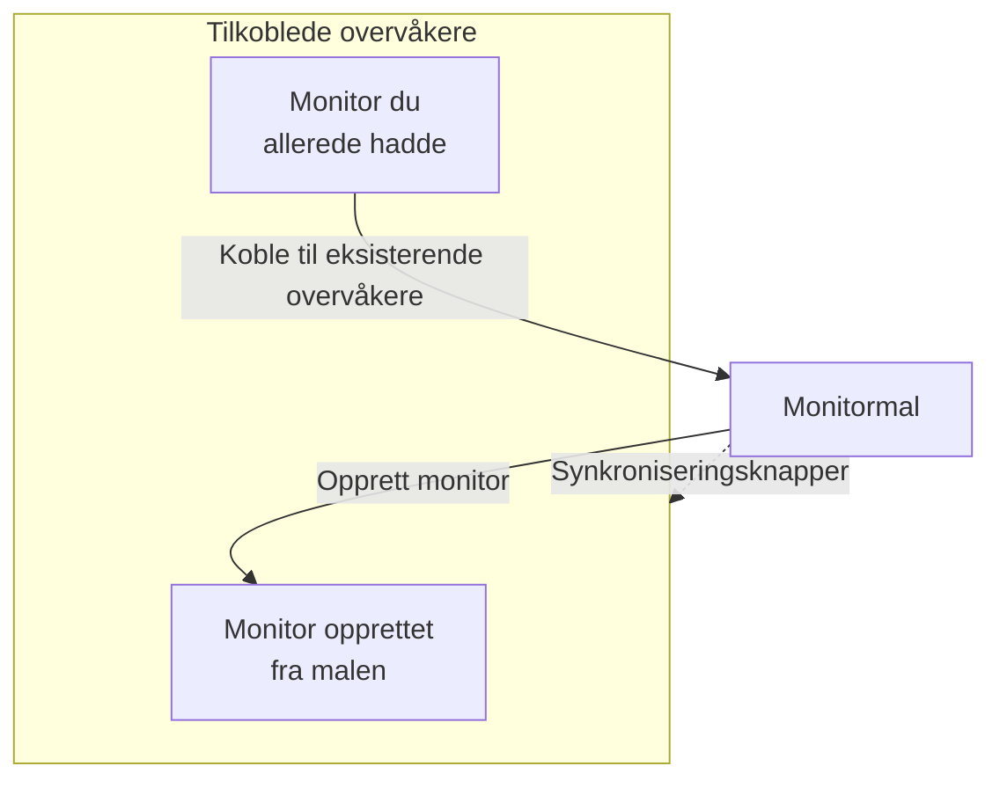

# Monitormaler

En monitormal er en lagret monitorkonfigurasjon (en type, kriterier, et intervall, etiketter og standardverdier for egendefinerte felt) som du oppretter monitorer fra med ett klikk. Monitorer som er opprettet fra den eller koblet til den, forblir koblet: endre malen, og synkroniser så endringen til alle sammen. Bruk maler når mange monitorer skal oppføre seg likt, som den samme helsesjekken på hver tjeneste, eller de samme API-sjekkene i produksjon og staging.

:::cards
- [Opprett en mal](#opprett-en-mal): Fire trinn, som Opprett monitor.
- [Opprett monitorer fra den](#opprett-monitorer-fra-en-mal): Ett klikk, eller koble til monitorer du allerede har.
- [Synkroniser endringer](#synkroniser-endringer-til-tilkoblede-monitorer): Hva hver synkroniseringsknapp kopierer.
- [Flytt monitorer til en annen mal](#flytt-monitorer-til-en-annen-mal): En bedre mal, og hver monitor beholder historikken sin.
- [Behold verdier for hver monitor](#behold-verdier-for-hver-monitor): Beskytt et mål eller hoder mot en synkronisering.
:::

## Slik fungerer maler

En mal overvåker ingenting selv. Monitorer opprettes fra den eller kobles til den, og malens side viser dem som **Tilkoblede monitorer**. Når du endrer malen, endres ingenting på de monitorene før du synkroniserer: hver synkroniseringsknapp kopierer én del av malen til hver tilkoblede monitor, og felt du beskytter, beholder hver monitors egen verdi.



## Før du starter

- **En rolle som kan opprette maler**: Prosjekteier, Prosjektadministrator, Prosjektmedlem, Monitoradministrator eller Monitormedlem, eller en egendefinert rolle med tillatelsen Create Monitor Template. Å endre en mal krever de samme rollene, eller tillatelsen Edit Monitor Template.
- **Tillatelse til å oppdatere de tilkoblede monitorene.** En synkronisering skriver til hver tilkoblede monitor som deg, og hopper over monitorene som tillatelsene dine ikke dekker.

## Opprett en mal

:::steps
### Åpne Maler

Gå til **Monitorer → Innstillinger → Maler**, og klikk på **Opprett Monitormal**.

### Gi malen et navn

Under **Malinformasjon** angir du et **Malnavn**, som `Production API Health`. En **Malbeskrivelse** er valgfri. Klikk så på **Neste**.

### Angi monitorens standardverdier

Under **Standardverdier for monitor** velger du **Monitortype** med den samme velgeren som i Opprett monitor. Angi eventuelt et **Standard monitornavn**; står det tomt, får hver monitor navn etter ressursen den overvåker. **Standard monitorbeskrivelse** og **Etiketter** venter under **Flere felt**. Klikk på **Neste**.

### Angi kriteriene og intervallet

Under **Kriterier** fyller du ut hva som skal sjekkes, og kriteriene, som i [Opprett monitor](/docs/monitor/create-monitor#kriterier). Med kortet **Innstillinger for malsynkronisering** øverst kan du beskytte felt mot synkroniseringer (se [Behold verdier for hver monitor](#behold-verdier-for-hver-monitor)). For en monitortype som sonder sjekker, ber det siste trinnet, **Intervall**, om **Overvåkingsintervall**. Klikk på **Opprett Monitormal** på det siste trinnet.
:::

Malen legges til i listen. Åpne den for å se siden, med et kort for hver del: **Malinformasjon**, **Standardverdier for monitor**, **Kriterier**, **Overvåkingsintervall** (med **Minimum sondeenighet**), **Etiketter**, **Standardverdier for egendefinerte felt** (når prosjektet har egendefinerte monitorfelt) og **Tilkoblede monitorer**. Du endrer hver del på sitt eget kort, for eksempel med **Rediger kriterier** eller **Rediger intervall**.

## Opprett monitorer fra en mal

- **Ny monitor.** Klikk på **Opprett monitor** i malens rad i listen, eller på **Opprett monitor fra mal** på siden dens. **Opprett monitor** åpner med malens type og innstillinger fylt ut; endre det du trenger, og opprett den. Den nye monitoren er koblet til malen.
- **Monitorer du allerede har.** Under **Tilkoblede monitorer** klikker du på **Koble til eksisterende monitorer** og velger dem. Med **Bruk malens kriterier og intervall** slått på får de malens kriterier, intervall og sondeenighet når de kobles til; slått av beholder de innstillingene sine til du synkroniserer. En monitor som er koblet til en annen mal, flyttes til denne.

Verdier som er satt under **Standardverdier for egendefinerte felt**, skrives til hver monitor som opprettes fra malen, også monitorer som regler for automatisk import og varslingspolicyer oppretter fra den.

## Synkroniser endringer til tilkoblede monitorer

Å redigere en mal endrer bare malen. For å kopiere en endring til de tilkoblede monitorene bruker du synkroniseringsknappen på kortet du endret. Hver knapp sier hvor mange monitorer den når, som **Synkroniser kriterier til 3 koblede monitorer**, og er nedtonet så lenge ingenting er koblet til. En synkronisering kan ikke angres.

| Knapp | Kopierer til hver tilkoblede monitor | Lar være |
| --- | --- | --- |
| **Synkroniser kriterier til koblede monitorer** | Kriteriene og trinninnstillingene, som mål og forespørselsalternativer, unntatt beskyttede felt | Overvåkingsintervallet, minimum sondeenighet, navnet, beskrivelsen, etikettene og verdiene i egendefinerte felt |
| **Synkroniser intervall til koblede monitorer** | Overvåkingsintervallet og minimum sondeenighet | Kriteriene, navnet, beskrivelsen, etikettene og verdiene i egendefinerte felt |
| **Synkroniser etiketter til koblede monitorer** | Etikettene, og ingenting annet | Alt annet |
| **Synkroniser egendefinerte felt til tilknyttede monitorer** | De egendefinerte feltene malen har en standardverdi for, i stedet for det hver monitor hadde | Egendefinerte felt som malen lar stå tomme, og alt annet |

For å synkronisere én monitor klikker du på **Synkroniser fra mal** i raden dens under **Tilkoblede monitorer**. Det kopierer kriteriene og trinninnstillingene (unntatt beskyttede felt), overvåkingsintervallet, minimum sondeenighet og etikettene, og lar monitorens navn, beskrivelse og verdier i egendefinerte felt være. For å koble fra en monitor, se [Koble monitorer fra en mal](#koble-monitorer-fra-en-mal).

Etter en synkronisering sier et sammendrag hvor mange monitorer som ble oppdatert. **Delvis synkronisert** betyr at noen tilkoblede monitorer fortsatt har den forrige konfigurasjonen, som regel fordi tillatelsene dine ikke dekker dem.

En synkronisering som fjerner kriteriene som åpnet en åpen hendelse eller et åpent varsel, løser den eller det når den var satt til å løses av seg selv, for ingenting kan løse den når de kriteriene er borte: tidslinjen sier hvorfor, og sammendraget sier hvor mange som ble løst. En hendelse eller et varsel som malen fortsatt har kriteriene til, forblir åpen, og en som skal løses manuelt, overlates til deg. Redigerer du selv kriteriene til en monitor, i dashbordet, gjennom API-et eller med Terraform, skjer det samme.

## Flytt monitorer til en annen mal

Når en bedre mal tar over for en annen, flytter du monitorene til den i stedet for å slette dem. Hver monitor beholder navnet, statushistorikken, etikettene, eierne og hendelsene sine, og får den nye malens kriterier.

:::steps
### Velg monitorene

Åpne malen de er koblet til nå. Under **Tilkoblede monitorer** velger du monitorene, eller alle sammen. Du kan også velge monitorer i monitorlisten, filtrert på en hvilken som helst kolonne.

### Flytt dem

Under **Massehandlinger** klikker du på **Flytt til en annen mal** (i monitorlisten **Koble til mal**). Velg malen.

### La malens innstillinger være på

La **Bruk malens kriterier og intervall** være slått på, så hver monitor får malens kriterier, trinninnstillinger, intervall og sondeenighet nå. Slått av beholder hver monitor sine egne til du synkroniserer. Bekreft deretter.
:::

Dette gjør flyttingen:

- Monitorenes kriterier, intervall og sondeenighet erstattes av malens. En åpen hendelse eller et åpent varsel som de gamle kriteriene var satt til å løse automatisk, blir løst, og de nye kriteriene åpner en ny hvis problemet fortsatt er der. Hver monitor for nettverksenheter fortsetter å følge sin egen enhet, og hver adresse- eller URL-monitor fortsetter å sjekke adressen til sin egen enhet.
- Navn, beskrivelser, statushistorikk, etiketter, eiere, verdier i egendefinerte felt og koblinger til hendelser forblir som de er.
- En monitor som en import, en regel for automatisk import eller en varslingspolicy for nettverket har opprettet, beholder malen den ble opprettet fra. Den regelen oppretter den aldri på nytt, og en varslingspolicy slipper den: den sletter eller erstatter den ikke lenger.
- En enhet har én monitor fra hver mal. Når en enhet allerede har en monitor som er opprettet for den fra den nye malen, utelates den andre monitoren dens, og endringen navngir den som står i veien: slett én av de to, og flytt så på nytt.
- En monitor av en annen type enn malens utelates.

Endringen kjører på serveren, opptil 10 000 monitorer om gangen, og viser fremdriften: hva som ble flyttet, hva som ble utelatt og hvorfor, og de åpne hendelsene og varslene den løste. Å lukke dialogen stopper den ikke: malens side og monitorlisten viser en endring som fortsatt pågår, med hvor langt den har kommet, og monitorlisten viser i en time også en avsluttet endring som utelot monitorer eller der monitorer mislyktes. Klikk på linjen dens for å åpne den igjen, med **Vis fremdrift** mens den pågår og **Vis hva som skjedde** når den er ferdig. **Stopp** stopper den før neste monitor, og **Prøv på nytt** prøver monitorene som mislyktes eller ikke ble nådd, på nytt.

> [!TIP]
> Peker du en regel for automatisk import mot en annen mal av samme slag, tilbyr skjemaet først å flytte enhetenes monitorer dit, og regelen bruker den nye malen når de er flyttet, så ingen enhet får en monitor til. **Lagre uten å flytte** peker regelen mot den med en gang: hver enhet beholder monitoren sin og får den nye malens ved siden av.

## Koble monitorer fra en mal

Klikk på **Koble fra mal** i raden til en monitor under **Tilkoblede monitorer**, eller velg monitorer der eller i monitorlisten og bruk **Koble fra mal** under **Massehandlinger**. Velg hva monitorene beholder:

| Valg | Hva monitorene gjør etterpå |
| --- | --- |
| **Behold innstillingene deres** | De fortsetter å sjekke og varsle med kriteriene de har nå, som egne monitorer, og får ikke lenger malens oppdateringer. |
| **Fjern malens kriterier fra dem** | De fortsetter å sjekke, men oppretter ingen hendelser eller varsler og setter ingen status før du kobler dem til en mal igjen. En åpen hendelse eller et åpent varsel som kriteriene deres var satt til å løse automatisk, blir løst. |

Uansett beholder de navnene, statushistorikken, etikettene, eierne og hendelsene sine, og en regel som opprettet dem, oppretter dem aldri på nytt.

## Slett en mal

En mal som en varslingspolicy for nettverket eller en regel for automatisk import oppretter monitorer fra, kan ikke slettes: pek først policyen eller regelen mot en annen mal. Monitorene til en policy flytter med, og skjemaet til en regel tilbyr å flytte enhetenes monitorer. Når monitorer er koblet til malen, spør slettingen hva som skal skje med dem:

- **Behold innstillingene deres** (standard): slettingen kobler dem fra, og de fortsetter å sjekke og varsle med kriteriene de har.
- **Fjern denne malens kriterier fra dem**: hver kobles fra med kriteriene fjernet, som ovenfor, og deretter slettes malen. Når en monitor forblir koblet til, for eksempel en som tillatelsene dine ikke dekker, beholdes malen, og dialogen sier hvor mange.

For å flytte monitorene til en annen mal i stedet bruker du **Flytt til en annen mal** før du sletter den.

## Behold verdier for hver monitor

En kriteriesynkronisering kopierer også trinninnstillinger som mål, forespørselshoder og tidsavbrudd, med mindre du beskytter disse feltene. Beskytt et felt for at hver tilkoblede monitor skal beholde sin egen verdi for det.

:::steps
### Åpne malen

Gå til **Monitorer → Innstillinger → Maler**, og åpne malen.

### Rediger kriteriene

Klikk på **Rediger kriterier** på kortet **Kriterier**.

### Beskytt feltene

Under **Innstillinger for malsynkronisering** krysser du av for **Ikke synkroniser dette feltet** ved hvert felt du vil beholde på de tilkoblede monitorene.

### Lagre

Lagre endringene. Kortet **Kriterier**, og bekreftelsen av begge synkroniseringene nedenfor, viser de beskyttede feltene.

### Synkroniser

Bruk **Synkroniser kriterier til koblede monitorer**, eller **Synkroniser fra mal** på én tilkoblet monitor.
:::

Beskytt for eksempel **Monitor-mål** og **Forespørselshoder** på en API-mal. Produksjons- og staging-monitorer beholder sine egne URL-er og hoder, mens begge får malens oppdaterte kriterier og de andre ubeskyttede innstillingene.

Hvilke alternativer som finnes, avhenger av monitortypen. De omfatter mål og porter, alternativer for HTTP-forespørsler, databasetilkoblinger, DNS-innstillinger, infrastrukturvelgere og telemetrispørringer. Relaterte påloggingsdata, som et klientsertifikat og den private nøkkelen, holdes sammen.

### Slik oppfører unntak seg

- Avkryssede felt beholder hver eksisterende monitors nåværende verdi, også en tom eller ikke-satt verdi. Forespørselshoder og andre samlinger bevares i sin helhet.
- Felt uten avkrysning synkroniseres fortsatt fra malen. Fjern avkrysningen for et beskyttet felt, og lagre for å kopiere malverdien ved neste synkronisering.
- Unntak gjelder for samlede og enkeltvise synkroniseringer. De lagres på malen og velges ikke separat for hver synkronisering.
- Nye monitorer starter fortsatt med malens feltverdier. Unntak påvirker bare synkronisering av eksisterende monitorer.
- Kriterier synkroniseres alltid. En synkronisering av bare kriterier lar overvåkingsintervallet, etikettene og andre innstillinger på monitornivå være.
- Eksisterende maler har ingen feltunntak før du setter dem opp. Monitorer for nettverksenheter beholder fortsatt automatisk sin egen enhetskobling, og Ping-, IP-, Port- og NTP-monitorene som en import fra nettverksoppdagelse har opprettet for enheter, fortsetter å sjekke hver enhets egen adresse. Nettsted-, API- og SSL-sertifikatmonitorene som importen har opprettet, beholder hver enhets adresse som vert i URL-en sin og tar malens protokoll, port og sti.

For maler med flere trinn matches beskyttede verdier via trinn-ID-ene. Selvstendig opprettede monitorer med ett trinn kan også motta en mal med ett trinn. Kan et beskyttet trinn ikke matches, avvises synkroniseringen før noen monitor oppdateres, slik at et nytt eller omordnet trinn ikke ved et uhell kan kopiere et annet trinns mål eller påloggingsdata.

> [!IMPORTANT]
> Før du endrer monitortypen for en lagret mal (med **Rediger monitorens standarder**), fjerner du under **Rediger kriterier** unntakene som ikke gjelder for den nye typen. Alle unntakene i en mal må finnes for monitortypen dens.

## Konfigurasjon via API

Hvert maltrinn godtar en matrise `doNotSyncFields` i objektet `MonitorStep.value`. For en API-monitor beskytter du målet og hele samlingen av hoder med:

```json title="monitorSteps (excerpt)"
{
  "_type": "MonitorSteps",
  "value": {
    "monitorStepsInstanceArray": [
      {
        "_type": "MonitorStep",
        "value": {
          "id": "<step id>",
          "doNotSyncFields": ["monitorDestination", "requestHeaders"]
        }
      }
    ]
  }
}
```

Utelat matrisen, eller sett den til `[]`, for å synkronisere alle støttede trinninnstillinger. Feltnavn som ikke støttes, og felt som ikke gjelder for malens monitortype, avvises. Malens matrise styrer synkroniseringen; slike metadata på en tilkoblet monitor overstyrer den ikke.

:::details Feltnavn for doNotSyncFields etter monitortype
| Monitortype | Feltnavn |
| --- | --- |
| Nettsted, API, Ping, IP, Port, SSL-sertifikat, NTP | `monitorDestination`, `requestTimeoutInMs`, `retryCount` |
| Bare API | `requestHeaders`, `requestType`, `requestBody` |
| Nettsted og API | `doNotFollowRedirects`, `allowSelfSignedCertificates`, `tlsClientAuthentication` (klientsertifikatet, nøkkelen og passordfrasen sammen) |
| Port, NTP | `monitorDestinationPort` |
| Syntetisk monitor, Egendefinert JavaScript-kode | `customCode` |
| Syntetisk monitor | `browserTypes`, `screenSizeTypes`, `retryCountOnError` |
| DNS | `dnsMonitor.queryName`, `dnsMonitor.recordType`, `dnsMonitor.resolver` (DNS-serveren og porten sammen), `dnsMonitor.timeout`, `dnsMonitor.retries` |
| Domene | `domainMonitor.domainName`, `domainMonitor.lookupMethod`, `domainMonitor.timeout`, `domainMonitor.retries` |
| DNSSEC | `dnssecMonitor.domainName`, `dnssecMonitor.resolvers`, `dnssecMonitor.checkNameserverConsistency`, `dnssecMonitor.signatureExpiryWarningDays`, `dnssecMonitor.timeout`, `dnssecMonitor.retries` |
| SQL-spørring | `sqlMonitor.connection`, `sqlMonitor.connectionTimeoutInMs`, `sqlMonitor.statementTimeoutInMs`, `sqlMonitor.query`, `sqlMonitor.maxRows` |
| Databasehelse | `databaseMonitor.connection`, `databaseMonitor.connectionTimeoutInMs`, `databaseMonitor.statementTimeoutInMs`, `databaseMonitor.enabledMetricGroups` |
| Ekstern statusside | `externalStatusPageMonitor.statusPageUrl`, `externalStatusPageMonitor.provider`, `externalStatusPageMonitor.components`, `externalStatusPageMonitor.timeout`, `externalStatusPageMonitor.retries` |
| Logger, Sikkerhetshendelser, Spor, AI / LLM, Målinger, Unntak, Profiler | `logMonitor`, `securityEventsMonitor`, `traceMonitor`, `llmMonitor`, `metricMonitor`, `exceptionMonitor`, `profileMonitor` (hele monitorens konfigurasjon) |
| Sondestatus | `probeStatusMonitor.probeIds` |

Infrastrukturmonitorer (Kubernetes, Docker-container, Vert, Podman-container, Proxmox, Docker Swarm, Ceph, Lagringsarray, IoT-enhet) tilbyr ressursvelgeren, filtre (alle unntatt Vert), målingsspørringer og spørringens tidsvindu. Navnene deres står under **Innstillinger for malsynkronisering** på en mal av den typen.
:::

## Feilsøking

:::details En synkronisering sier "Delvis synkronisert"
Noen tilkoblede monitorer ble ikke oppdatert, som regel fordi tillatelsene dine ikke dekker dem. Be noen som kan oppdatere hver tilkoblede monitor, om å kjøre synkroniseringen på nytt.
:::

:::details En synkronisering feiler med "a template step cannot be matched to an existing monitor step"
Et beskyttet felt kunne ikke matches mot et trinn på en av monitorene, så synkroniseringen stoppet før noen av dem ble endret. Gi malens trinn de samme ID-ene som monitorenes trinn, eller bruk en mal med ett trinn sammen med monitorer med ett trinn.
:::

:::details Synkroniseringsknappene er nedtonet
Ingen monitor er koblet til malen ennå. Opprett en monitor fra den, eller klikk på **Koble til eksisterende monitorer** under **Tilkoblede monitorer**.
:::

:::details En flytting utelater en monitor: "Enheten denne monitoren ble opprettet for, har allerede en monitor koblet til denne malen"
Enheten har en monitor som er opprettet for den fra malen du flytter til, som regel fordi en regel for automatisk import ble pekt mot den malen før flyttingen. Slett den du ikke trenger – den nyeste har minst historikk – og flytt så på nytt.
:::

:::details Etter at en regel for automatisk import er flyttet til en ny mal, har enhetene to monitorer
Regelen ble lagret med **Lagre uten å flytte**, eller pekt mot malen før skjemaet tilbød å flytte dem, og ga hver enhet den nye malens monitor ved siden av den den hadde. Slett de nye monitorene, og flytt deretter de gamle til den nye malen: de beholder historikken sin, og regelen oppretter ingen på nytt.
:::

:::details Lagring feiler med "Unsupported do not sync field"
Et navn i `doNotSyncFields` er ikke et felt for malens monitortype. Sjekk det mot feltnavnene ovenfor.
:::

## Neste steg

:::cards
- [Opprett en monitor](/docs/monitor/create-monitor): Skjemaet en mal fyller ut.
- [API-monitor](/docs/monitor/api-monitor): Innstillingene en API-mal tar med seg.
- [Monitorhemmeligheter](/docs/monitor/monitor-secrets): Del påloggingsdata mellom monitorer uten å kopiere dem.
- [Terraform-monitortrinn](/docs/terraform/monitor-steps): Administrer monitorer og trinnene deres som kode.
:::
