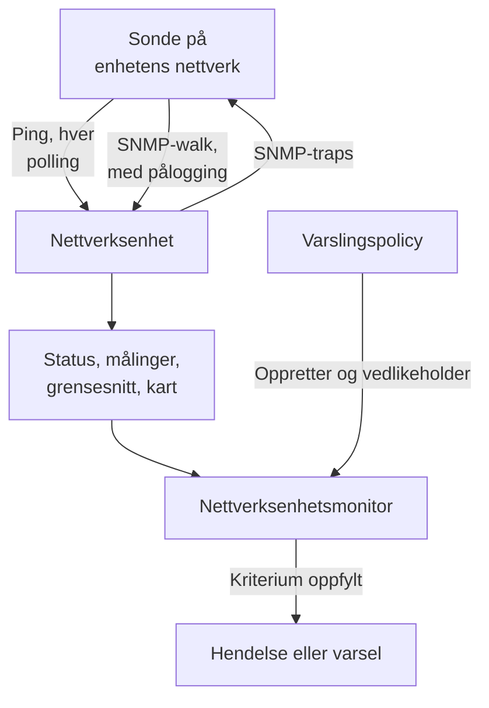
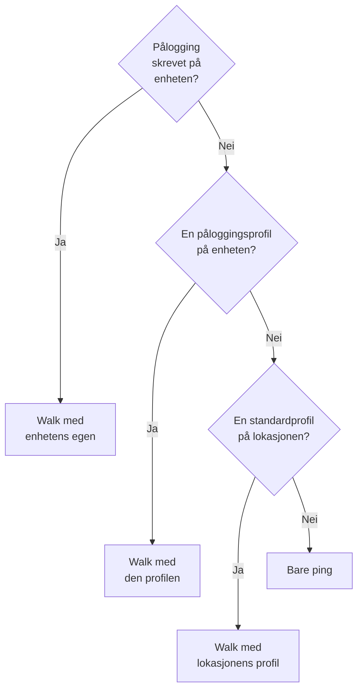
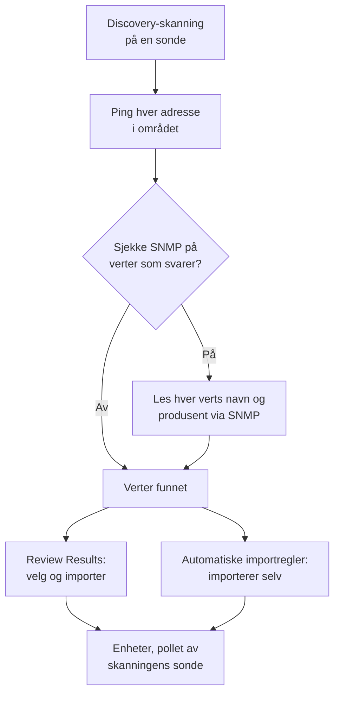
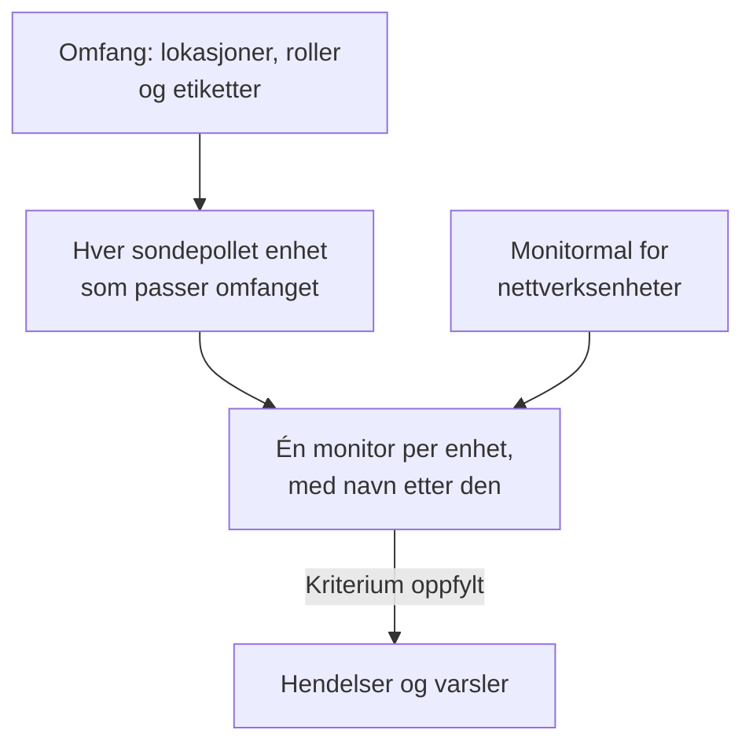
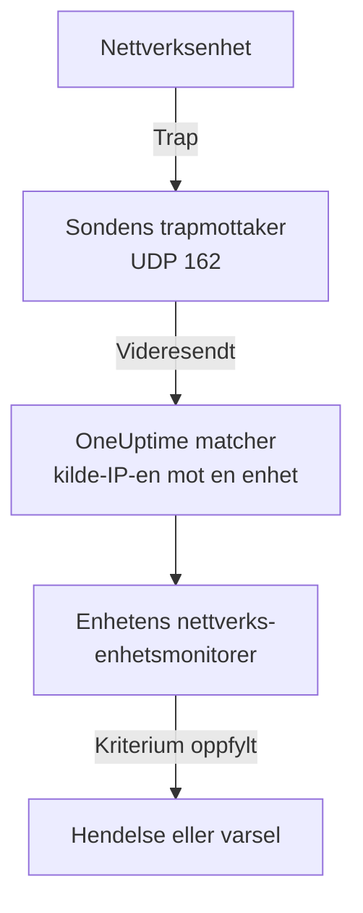

# Nettverksenhets-overvåking

Overvåk svitsjer, rutere, brannmurer, tilgangspunkter, PDU-er, kameraer og skrivere: alt som har en adresse på nettverket ditt, enten det snakker SNMP eller ikke.

Legg til en enhet med adressen og en sonde, så pinger sonden den etter en tidsplan: enheten får statusen oppe eller nede, en plass på nettverkskartet og en stemme i lokasjonens helse. Gi den SNMP-påloggingsinformasjon, så gjør den samme sonden også et SNMP-walk av den: grensesnitt og optikken i dem, maskinvareinventar, LLDP- og CDP-naboer og helse-OID-er. Legg til en monitor, eller en varslingspolicy for en hel flåte, så oppretter pollingene og trapene dens hendelser og varsler.

:::cards
- [Legg til en enhet](#legg-til-en-nettverksenhet): Adressen og en sonde, på én side.
- [Finn et nettverk](#finn-enheter-med-en-nettverksskanning): Skann et adresseområde og importer det som svarer.
- [Les enheter via SNMP](#snmp-påloggingsinformasjon-og-påloggingsprofiler): Grensesnitt, optikk, inventar og helse.
- [Få varsler](#varsling): En monitor for én enhet, en policy for en flåte.
- [Se kartet](#nettverkstopologi): Naboer tegnet live, eksportert som PDF.
- [Løs et problem](#feilsøking): Enheter som venter, walks som feiler, traps som ikke kommer frem.
:::

## Slik fungerer det



Enheten og monitoren gjør forskjellige jobber:

| Del | Hva den gjør | Når du trenger den |
| --- | --- | --- |
| Enheten | Sonden poller den etter enhetens egen tidsplan. Hver polling registrerer tilgjengelighet, pingens svartid og pakketap; en polling med SNMP-påloggingsinformasjon leser også enhetens identitet, grensesnitt, naboer og helse-OID-er. | Alltid: enheten er det du legger til. |
| En monitor | Vurderer kriterier mot hvert pollingresultat og hver trap fra enheten, og oppretter hendelser og varsler. | Bare for hendelser og varsler. Status, inventar, diagrammer og kartet trenger ingen monitor. |

## Før du begynner

- **En sonde som kan nå enheten.** Sonden pinger og walker enheten fra sitt eget nettverk, så en enhet på en privat adresse trenger en [egendefinert sonde](/docs/probe/custom-probe) inne i det nettverket: en sonde på det offentlige internett kan ikke nå den.
- **SNMP, for mer enn ping.** Valgfritt. En v1- eller v2c-community string, eller en SNMPv3-bruker, satt opp på enheten, med UDP 161 åpen fra sonden. Uten det blir enheten bare pinget.
- **Traps, syslog og flyter.** Valgfritt. Sonden tar imot SNMP-traps på UDP 162, syslog på UDP 5140 når du slår det på, og flytposter på UDP 2055, 4739 og 6343, så åpne dem fra enhetene dine til sonden.

## Nettverksoversikten

**Nettverk → Oversikt** er der Nettverk-området åpner, og den starter med svaret: én setning som sier om nettverket ditt er friskt og, når det ikke er det, hva som er galt, de verste nyhetene først.

| Hva den sier | Når |
| --- | --- |
| **3 enheter er nede** | En enhets sonde eller monitor når den ikke. |
| **2 lokasjoner trenger oppmerksomhet** | Alle enheter svarer, men en lokasjons helse er ikke i drift. |
| **5 grensesnitt er nede** | Alle enheter svarer, men porter er mørke. |
| **2 enheter rapporterer ikke detaljene sine** | De svarer på ping, men SNMP-walket deres feiler, så grensesnittene og helsen deres blir ikke oppdatert: som regel påloggingsinformasjonen. |
| **Venter på første sjekk** | Det er lagt til enheter, og sonden deres har ikke sjekket dem ennå. |
| **Alle 40 enhetene er oppe** | Alle enheter svarer. Enheter som fortsatt venter på sin første sjekk, telles på en egen linje. |

Under den sier én linje om noe oppretter en hendelse når en enhet går ned: hvor mange [varslingspolicyer](#varslingspolicyer) som er slått på, eller en lenke **Set up alerts** når det ikke finnes noen. Knappene **Add Device** og **Discover Devices** ved siden av åpner de skjemaene, og flisene og listene under gir detaljene: enheter og lokasjoner som trenger oppmerksomhet, flåten per produsent og nylige skanninger.

Før noe er lagt til, viser oversikten i stedet de to måtene å komme i gang på: **Finn enheter** skanner et adresseområde slik at du kan velge hva du vil legge til, best for et helt nettverk eller en ny lokasjon, og **Legg til én enhet** legger til én etter IP-adresse eller vertsnavn.

Nettverk-menyen holder det du åpner hver dag synlig: **Oversikt**, **Devices**, **Lokasjoner**, **Map**, **Traffic** og **Discovery**. Resten er foldet inn i seksjoner, og en seksjon folder seg ut av seg selv på hver av sidene sine:

| Seksjon | Sider |
| --- | --- |
| **Topologi** | **Device Topology**, **Endepunkter**, **Latency Matrix**, **Site Links**, **Device Links** |
| **Regler** | **Auto Import Rules**, **Site Assignment Rules**, **Eierregler**, **Etikettregler**, **Link Rules** |
| **Innstillinger** | **Alert Policies**, **SNMP-påloggingsinformasjon**, **Device Roles**, **Site Types**, **OID Collection Templates** |
| **Avansert** | **Archived Devices** |

## Legg til en nettverksenhet

:::steps
### Åpne listen over enheter
Gå til **Nettverk → Devices** og klikk på **Add Device**. **Add Device** på Nettverk-**Oversikt** åpner det samme skjemaet.

### Skriv enhetens adresse
Skriv IP-adressen eller vertsnavnet i **Vertsnavn**. La **Navn** stå tomt for å gi enheten navn etter vertsnavnet.

### Kontroller lokasjonen og sonden
Velg den **Site** enheten står på, hvis du bruker lokasjoner. **Sonde** fyller seg selv ut med lokasjonens standardsonde, eller med prosjektets eneste egendefinerte sonde; sørg for at det er en sonde som kan nå enheten.

### Legg til enheten
Klikk på **Add Device**. Innen et par minutter pinger sonden enheten, og statusen blir **Up** eller **Down**. Med SNMP-påloggingsinformasjon fylles også enhetens oversikt ut med identiteten, grensesnittene og helsen etter det første vellykkede walket.
:::

Skjemaet er én side — vertsnavnet, et navn, lokasjonen og sonden — med **SNMP** og **Flere felt** foldet sammen under. Det spør ikke om hvordan enheten overvåkes: hver enhet du legger til, polles av sonden sin, og [overstyringen med bundet monitor](#overstyringen-med-bundet-monitor) ligger på enhetens side **Innstillinger** for de få enhetene som trenger den.

En enhets detaljer — navn, beskrivelse, rolle, lokasjon, etiketter og adresser — redigeres etterpå ett sted: kortet **Device Settings** på siden **Innstillinger**. Kortet **Enhetsdetaljer** på oversikten viser dem, med en lenke **Rediger i Innstillinger**.

### Enheten

| Felt | Beskrivelse | Påkrevd |
| --- | --- | --- |
| Vertsnavn | IP-adressen eller vertsnavnet sonden pinger, og walker via SNMP når enheten har påloggingsinformasjon. | Ja |
| Navn | Et lettlest navn, for eksempel core-switch-01. La det stå tomt, så får enheten navn etter vertsnavnet. API-et gjør det samme: en enhet som opprettes uten navn, får navn etter vertsnavnet. | Nei |
| Site | Den [nettverkslokasjonen](/docs/monitor/network-sites) enheten står på. Lokasjonens helse oppsummeres fra enhetene dens, og en lokasjon med en standardsonde fyller ut sonden nedenfor. | Nei |
| Sonde | Sonden som pinger denne enheten, walker den via SNMP når den har påloggingsinformasjon, og tar imot traps, syslog og [flytposter](/docs/monitor/network-traffic) fra den. Den må nå enheten direkte: en sonde på det offentlige internett kan ikke nå en privat adresse. | Ja |

**Sonde** fyller seg selv ut der den kan: et prosjekt med nøyaktig én egendefinert sonde starter med den, og når du velger en lokasjon, erstattes den med [lokasjonens standardsonde](/docs/monitor/network-sites#standardverdier-for-overvåking). Den overskriver aldri en sonde du har valgt selv. Sett en standardsonde på lokasjonene dine, så kan en enhet legges til med bare adressen.

### Flere felt (foldet sammen)

| Felt | Beskrivelse | Påkrevd |
| --- | --- | --- |
| Beskrivelse | Fritekst. | Nei |
| Device Role | Kjernesvitsj, aksessvitsj, brannmur og så videre. Bestemmer enhetens nivå på kartet og avgrenser varslingspolicyer. | Nei |
| MAC-adresse | Enhetens egen MAC. Kartet bruker den til å plassere en enhet som verken snakker LLDP eller CDP, på svitsjporten som lærte den; se [Enheter med bare ping og svitsjporten deres](#enheter-med-bare-ping-og-svitsjporten-deres). Læres som regel inn for deg fra en ruters ARP-tabell. | Nei |
| Opprett også en Ping-overvåking for hendelser | Sonden pinger allerede enheten og gir den en status; en Ping-monitor er det som gjør mislykkede ping til en hendelse. Kryss av, så opprettes en på vertsnavnet, bundet til enheten, når du lagrer. Den teller mot abonnementet ditt, og hendelsene dens er slått av til du slår dem på fra monitorens side. | Nei |

Når du krysser av for Ping-monitoren, vises **Ping from probes**, monitorens egne sonder. De må nå enhetens nettverk; la feltet stå tomt for å bruke prosjektets standardsonder. Bruk heller [varslingspolicyer](#varslingspolicyer) for å varsle om mange enheter samtidig.

### SNMP (foldet sammen, valgfritt)

La den være foldet sammen, så blir enheten bare pinget: den sammenfoldede seksjonen sier det i én setning. Enheten får fortsatt en status fra sin første polling og står fortsatt på lokasjonen og på kartet, men har ingen grensesnitt, inventar eller helse-OID-er før den har påloggingsinformasjon. Fold ut seksjonen for å skrive en community string eller en v3-bruker, eller for å velge en lagret påloggingsprofil.

:::tabs
@tab SNMP v1 / v2c
| Felt | Beskrivelse | Påkrevd |
| --- | --- | --- |
| SNMP-versjon | V1, V2c eller V3. | Ja, starter på V2c |
| SNMP Community String | v1- eller v2c-community string, for eksempel `public`. | Nei: tom betyr bare ping |
| SNMP Port | UDP-porten agenten lytter på. | Nei, 161 som standard |
| SNMP Credential Profile | Et lagret sett med påloggingsinformasjon som brukes i stedet for å skrive påloggingsinformasjon her. | Nei |
@tab SNMPv3
| Felt | Beskrivelse | Påkrevd |
| --- | --- | --- |
| SNMP v3 Security Level | No Auth, No Priv; Auth, No Priv; eller Auth, Priv. | Ja |
| SNMP v3 Username | Sikkerhetsnavnet (brukeren) som er satt opp på enheten. | Ja: tom betyr bare ping |
| SNMP v3 Authentication Protocol | MD5, SHA, SHA-256 eller SHA-512. | Med autentisering |
| SNMP v3 Authentication Key | Passordfrasen for autentisering. | Med autentisering |
| SNMP v3 Privacy Protocol | DES, AES eller AES-256. | Med personvern |
| SNMP v3 Privacy Key | Passordfrasen for personvern (kryptering). | Med personvern |
:::

Påloggingsinformasjon som er skrevet på enheten, vinner over en påloggingsprofil som er valgt ved siden av, og enhetens lokasjon kan også ha en standardprofil. Påloggingsinformasjon i en profil er kryptert i hvile. Påloggingsinformasjon som er skrevet på en enhet, er beskyttet av de samme lesetillatelsene, men er ikke kryptert i hvile: enda en grunn til å holde delt påloggingsinformasjon i en profil.

## Endre mange enheter samtidig

En discovery-skanning av en kundes nettverk henter inn dusinvis av enheter som hører til én lokasjon, deler én rolle og kommer fra én produsent. Du åpner dem ikke én om gangen: merk dem i listen **Devices**, ved å krysse av rader eller merke alle enhetene filtrene treffer, og åpne **Massehandlinger**.

| Handling | Hva den gjør |
| --- | --- |
| **Angi lokasjon** / **Fjern lokasjon** | Flytter hver merkede enhet til lokasjonen du velger, der den teller med i lokasjonens helse; en enhet uten egen sonde tar lokasjonens standardsonde. **Fjern lokasjon** tar dem ut av lokasjonene sine. En enhet som en lokasjonstildelingsregel treffer, går tilbake til regelens lokasjon ved neste polling, så for enheter som discovery fortsetter å finne, legger du heller til en regel under **Nettverk → Regler → Site Assignment Rules**; dialogen **Angi lokasjon** lenker dit. |
| **Angi enhetsrolle** / **Fjern enhetsrolle** | Gir hver merkede enhet én rolle, som de tjue svitsjene som alle er "Access Switch". Rollene er prosjektets egne, under **Nettverk → Innstillinger → Device Roles**, som dialogen lenker til. **Fjern enhetsrolle** utleder hver enhets rolle fra SNMP-identiteten igjen. |
| **Bruk produsentmal** | Legger til en [produsentmals](#produsentenes-helsemaler) helse-OID-er og SNMP-tabeller på hver merkede enhet. **Match hver enhets produsent**, dialogens første valg, velger hver enhets egen mal ut fra det SNMP-walket rapporterer, så et blandet utvalg får riktig mal overalt; eller velg én mal for alle. |

Hver handling er én dialog og én lagring for hele utvalget, og hver enhet går gjennom de samme kontrollene som en redigering på sin egen side Innstillinger: tillatelser, rollens etikett- og eieromfang og grensene for hva en enhet kan samle inn.

**Bruk produsentmal** viser hva den skal gjøre før den gjør noe: hvor mange enheter som får hvilken mal, og hvor mange den lar være og hvorfor. Den legger til det hver enhet allerede samler inn og fjerner ingenting, og en enhet som allerede har alt i malen, skrives ikke på nytt. Den lar være en enhet med bundet monitor (ingenting poller den), en enhet som er knyttet til en [OID Collection Template](#oid-collection-templates) (malen bestemmer hva den samler inn, så legg til produsentens OID-er der) og, ved matching, en enhet som ikke er walket via SNMP ennå, eller hvis produsent ikke har noen mal.

Når en handling er ferdig, viser den hvor mange enheter som ble endret, hvilke som feilet og hvorfor — en enhet rollen din ikke kan redigere, en liste over grensen — og hvilke den ikke endret og hvorfor: en enhet som allerede var på den lokasjonen eller hadde den rollen, eller en som produsentmalen lar være.

De andre massehandlingene beskrives der de hører hjemme: **Set OID Collection Template** under [OID Collection Templates](#oid-collection-templates), **Set SNMP Credential Profile**, **Switch to Probe Polling** og **Create Ping Monitors** under [Samlet](#samlet), og **Shorten Names to Hostname** under [Slik får oppdagede enheter navn](#slik-får-oppdagede-enheter-navn).

## Hva en polling faktisk gjør

Hver polling av en sondepollet enhet er et ping. Når enheten har brukbar SNMP-påloggingsinformasjon, kjører sonden også et fullt SNMP-walk. De to kjører side om side, og walket venter aldri på pinget, så SNMP-utstyr bak en ACL som forkaster ICMP, rapporterer likevel **Up**.

| Resultat | Enhet med bare ping | Enhet med SNMP-påloggingsinformasjon |
| --- | --- | --- |
| Status (Up eller Down) | Fra pinget | Fra pinget eller walket: det holder at én av dem svarer |
| Pingens svartid og pakketap | Registrert som enhetsmålinger | Registrert som enhetsmålinger |
| SNMP-svartid | — | Walkets tid, aldri pingens |
| Grensesnitt, naboer, endepunkter | — | Fra et vellykket walk |
| Systemidentitet, produsent, modell, serienummer | — | Fra et vellykket walk |
| Helse-OID-er og SNMP-tabeller | — | Fra et vellykket walk |

Brukbar påloggingsinformasjon er et v1- eller v2c-sett med en community string, eller et v3-sett med et brukernavn, funnet gjennom [kjeden av påloggingsinformasjon](#snmp-påloggingsinformasjon-og-påloggingsprofiler). Et tomt sett hoppes over, så en enhet walkes aldri med en gjettet standard-community.

Pakketapet gjenbruker [Ping-monitorens](/docs/monitor/ping-monitor) serie, så det leses likt i hele produktet. Svartiden har sin egen serie, `oneuptime.monitor.ping.round.trip.time`, fordi den vanlige svartiden på en nettverksenhet er SNMP-walkets. Enhetens side **Målinger** viser grensesnittutnyttelse og helse-OID-er i diagrammer; svartiden for den siste timen tegnes i enhetens skuff på kartet.

### "SNMP failing" er ikke "Down"

En enhet som svarer på ping, men hvis walk feiler, er **Up**, merket med **SNMP failing**, og begge halvdelene betyr noe:

- Den er oppe fordi noe svarer på den adressen. Å fargelegge den rød ville lagt en enhet som fungerer fint, inn i hendelsestellingen din.
- Den er SNMP failing fordi grensesnittene, inventaret og helse-OID-ene har sluttet å bli oppdatert, nesten alltid på grunn av påloggingsinformasjon, en deaktivert SNMP-agent eller en ACL. Ingenting annet på siden ville fortalt deg at tallene er frosset.

En enhet der både ping og walk feiler, er rett og slett **Down**, så merkingen står bare noensinne ved siden av en grønn status.

### Slik leser du en enhets status

Hvert sted som viser en enhet — listen Devices, en lokasjons Devices-side, oversikten, kartet — bruker de samme tre avgjørelsene og de samme tilleggene ved siden av.

| Avgjørelse | Betyr |
| --- | --- |
| **Up** | Den siste pollingen (ping eller SNMP), eller den bundne monitoren, nådde enheten. |
| **Down** | Den siste pollingen (ping eller SNMP), eller den bundne monitoren, nådde ikke enheten. |
| **Venter** | Ingen avgjørelse ennå: aldri pollet, ingen sonde tildelt eller ingen monitor bundet. |

| Tillegg | Vises når | Hva du gjør |
| --- | --- | --- |
| **Stale** | Ingen polling er forsøkt på godt over enhetens intervall. | Kontroller at enhetens sonde er online og henger med flåten sin. |
| **No probe** | Enheten polles av en sonde, men har ingen, eller pollingen er slått av. | Tildel en sonde som kan nå den; ingenting poller den før det. |
| **No monitor** | Enheten bruker [overstyringen med bundet monitor](#overstyringen-med-bundet-monitor), og ingenting er bundet. | Bind en monitor, eller bytt den tilbake til polling med sonde. |
| **SNMP failing** | Oppe på ping, men det siste SNMP-walket feilet. | Kontroller påloggingsinformasjonen, SNMP-agenten eller en ACL. |

Listen **Devices** har et filter **SNMP** med tre verdier: **OK** (det siste walket lyktes), **Failing** (det siste walket feilet) og **Not configured** (bare ping, ingen påloggingsinformasjon eller aldri pollet). "Hvilke enheter har påloggingsinformasjon som har sluttet å virke" er ett klikk unna. Listens kolonne **Interfaces (Up / Down)** viser **No SNMP** i stedet for `0 / 0` for en enhet som pinges og aldri walkes: null fungerende porter ville vært en annen påstand, og en feil påstand.

## SNMP-påloggingsinformasjon og påloggingsprofiler

En enhet walkes med det første brukbare settet med påloggingsinformasjon som finnes i denne rekkefølgen, og søket stopper ved første treff:



Lokasjonstrinnet leser enhetens egen lokasjon og ikke lenger: en enhet i en Unit tar ikke en profil som er satt på Region over den. En lokasjons standardsonde når derimot nedover i treet, fordi en sonde kopieres til enheten én gang mens påloggingsinformasjon leses på nytt ved hver polling; [Nettverkslokasjoner](/docs/monitor/network-sites#standardverdier-for-overvåking) har detaljene.

### Siden SNMP-påloggingsinformasjon

**Nettverk → Innstillinger → SNMP-påloggingsinformasjon** inneholder prosjektets påloggingsprofiler. En profil er ett navngitt sett — en v1- eller v2c-community string, eller en v3-bruker med sikkerhetsnivå, protokoller og nøkler — som så mange enheter og lokasjoner du vil, peker på. Ingenting kopieres til enhetene, så å bytte en community string er én redigering her, og hver enhet som bruker profilen, tar den nye verdien ved sin neste polling.

Hemmeligheter i en profil er kryptert i hvile, og bare roller som kan lese en enhets egen påloggingsinformasjon, kan lese dem. En enhet eller lokasjon som viser profilen sin, viser profilens navn og versjon, aldri hemmelighetene.

En profil som en enhet eller lokasjon fortsatt peker på, kan ikke slettes: slettingen avvises med en telling av det som står i veien. Flytt de enhetene og lokasjonene til en annen profil, eller fjern profilen fra dem, og slett den deretter.

### Gjør en enhet om til bare ping igjen

På enhetens side **Innstillinger** har **Rediger innstillinger** en avkrysningsboks **Ping only — clear this device's own SNMP credentials** i trinnet **SNMP-påloggingsinformasjon**. Den tømmer enhetens egen community string og v3-brukernavn når du lagrer. Den finnes fordi det ikke er opplagt hvilket felt som skal tømmes: en v3-enhet kan fortsatt walkes så lenge brukernavnet finnes, uansett hva annet du tømmer.

Å tømme enhetens egen påloggingsinformasjon tømmer ikke en profil. Hvis enheten eller lokasjonen fortsatt angir en, fortsetter enheten å bli walket med den; fjern også profilen for at enheten bare skal pinges.

### Samlet

Merk enheter i listen **Devices** og bruk:

- **Set SNMP Credential Profile** / **Clear SNMP Credential Profile**: knytt en profil til et utvalg, eller ta den av.
- **Switch to Probe Polling**: for enheter med overstyringen med bundet monitor. Velg en sonde, så pinges hver merkede enhet etter tidsplanen sin fra da av, og walkes når den har påloggingsinformasjon. En monitor som allerede er bundet, forblir bundet; enhetens status kommer nå fra sonden.
- **Create Ping Monitors**: for enheter med overstyringen med bundet monitor; oppretter en Ping-monitor på hver enhets vertsnavn og binder den, slik at enheten viser Up eller Down.

Siden **Devices** viser et banner når prosjektet har enheter med overstyringen med bundet monitor uten noe bundet — enheter som ingenting poller og ingenting rapporterer om — og lenker til utvalget som retter dem.

## Lokasjonens standardverdier for overvåking

En [nettverkslokasjon](/docs/monitor/network-sites#standardverdier-for-overvåking) har to standardverdier for enhetene sine. Dens **Default Probe** kopieres til en enhet som opprettes på lokasjonen, eller flyttes dit, uten egen sonde. Dens **Default SNMP Credential Profile** leses ved hver polling av en enhet på lokasjonen som ikke har egen påloggingsinformasjon. Sett begge på en lokasjon, så kan en enhet der legges til med bare adressen, og pinges og walkes fra første polling. Guiden om lokasjoner forteller hvor langt ned i lokasjonstreet hver standardverdi når.

## Overstyringen med bundet monitor

Noe utstyr kan ingen sonde nå eller pinge på en nyttig måte: en enhet bak en NAT, en appliance der helsen bedre vurderes med en HTTP-sjekk, en tjeneste der det virkelige signalet er en portsjekk. For dem har **Rediger innstillinger** på enhetens side **Innstillinger** en **Monitoring Method**:

| Metode | Hva den betyr |
| --- | --- |
| **Sonde** | Standard. Pinges av den tildelte sonden etter dens tidsplan, og walkes via SNMP når den har påloggingsinformasjon. |
| **Bound monitor** | Statusen til en eksisterende monitor er denne enhetens status. |

Å bytte en enhet til **Bound monitor** stopper pollingen av den. Sonden, intervallet og pollingbryteren forsvinner fra kortet **Polling & Data Collection**, enhetens gamle pollingresultater slettes, og statusen kommer fra monitoren du binder. Det er valgfritt å binde en: til du gjør det, viser enheten **Venter**, merket med **No monitor**.

Å bytte tilbake til **Sonde** gjenoppretter pollingen og ber om en sonde. En monitor som var bundet, forblir bundet og fortsetter å varsle; den bestemmer bare ikke lenger enhetens status.

De fleste enheter trenger ikke dette. Hver sondepollet enhet har allerede en tilgjengelighetsstatus, så du trenger ikke binde en Ping-monitor for å få en; bind en monitor når du vil ha den monitorens hendelser.

## Polling og datainnsamling

Pollingen ligger på enhetens side **Innstillinger**, på kortet **Polling & Data Collection** (**Rediger Polling**). Standardverdiene passer for en ny enhet, så den trenger ingen finjustering:

| Innstilling | Beskrivelse | Standard |
| --- | --- | --- |
| Sonde | Sonden som poller enheten. | Settes når enheten legges til |
| Polling Enabled | Sonden poller enheten etter tidsplanen nedenfor. Slå den av for å pause pollingen uten å slette enheten. | På |
| Polling Interval (Minutes) | Hvor ofte sonden poller enheten. Minst 1 minutt. | 5 |
| Walk Interfaces | Walker grensesnittabellene (IF-MIB) ved hver polling: status, båndbredde, utnyttelse og feil for hver port, pluss LLDP- og CDP-naboer for kartet. | På |
| Collect Connected Endpoints | Walker også ARP- og bridge-videresendingstabellene for å finne det som er koblet til enheten: betalingsterminaler, skrivere, telefoner, bærbare datamaskiner. Fra en ARP-tabell fyller den også ut MAC-adressen til enheter som er registrert på de adressene. Koster ekstra walks per polling. | Av |
| OID Collection Template | En delt, navngitt OID-liste som enheten samler inn. Å redigere malen endrer hver tilknyttet enhet ved dens neste polling. | Ingen |
| Device-Specific Health OIDs | Ekstra OID-er som bare denne enheten samler inn, i tillegg til malens. | Ingen |
| Auto-Apply Vendor Health Template | Når enhetens produsent gjenkjennes og dens egen OID-liste er tom, fylles listen fra produsentens mal ved neste polling. | Av; på for enheter som discovery importerer |
| Device-Specific SNMP Tables | Ekstra [SNMP-tabeller](#snmp-tabeller) som bare denne enheten walker, i tillegg til malens. En tabell med samme nøkkel som en maltabell erstatter den på denne enheten. | Ingen |

Alt fra **Walk Interfaces** og nedover krever SNMP-påloggingsinformasjon: på en enhet med bare ping beholdes de innstillingene og har ikke noe walk å gjelde for.

### Walk av grensesnitt

Med **Walk Interfaces** slått på og påloggingsinformasjon funnet følger hver polling hvert grensesnitts drifts- og administrative status, bits inn og ut, utnyttelse og feil. Det samme walket samler inn LLDP- og CDP-naboene for kartet.

Demp et grensesnitt på enhetens side **Interfaces**, for en labport eller en lenke som er koblet fra med vilje, så blir det i inventaret, men forlater varsler og målinger. Et mislykket walk tømmer aldri halvparten av det innsamlede: det siste øyeblikksbildet av grensesnittene blir stående, og enheten merkes med **SNMP failing** så ingen tar det for et aktuelt.

### Produsentenes helsemaler

I redigeringsverktøyet **Health OIDs** bruker **Vendor Health Template** et ferdig sett med OID-er for enhetens produsent. Mange maler leverer også [SNMP-tabeller](#snmp-tabeller), som legges til med **Add a Vendor's Tables** i redigeringsverktøyet **SNMP Tables**.

| Produsentmal | Helse-OID-er | SNMP-tabeller |
| --- | --- | --- |
| Generic (Host Resources MIB) | CPU-belastning, totalt og tilgjengelig RAM, belastningsgjennomsnitt | CPU-kjerner (én rad per kjerne, uansett hvordan plattformen nummererer dem) |
| Arista EOS | CPU-belastning, belastningsgjennomsnitt, totalt og tilgjengelig RAM | — |
| Cambium Networks cnMatrix | CPU, RAM, flash, temperatur, forsyningsspenning | Vifter, PoE-porter, redundant strømforsyning |
| Cambium Networks Enterprise Wi-Fi (cnPilot, XV, XE, XH) | CPU, ledig minne, Wi-Fi-klienter, tilkobling til cnMaestro | Wi-Fi-radioer (bånd, kanal, bredde, sendeeffekt, klienter, støygulv, airtime, tilstand), SSID-er |
| Cisco IOS / IOS-XE | CPU, brukt og ledig minne, temperatur, viftetilstand, strømforsyningstilstand | — |
| Dell Force10 / OS9 | CPU, minne | — |
| Extreme Networks EXOS / Switch Engine | CPU, temperatur, alarm for overtemperatur, strømtilstand | Strømforsyninger, vifter, minne per spor, stabelmedlemmer |
| Extreme Networks Fabric Engine / VOSS | vIST-økt, antall I-SID-er | Fabric-adjacencies (IS-IS) navngitt etter naboen, CPU og minne per spor, temperatursensorer, vifter, strømforsyninger |
| Extreme Networks IQ Engine (HiveOS) Access Points | CPU, minne, Wi-Fi-klienter, temperatur | Wi-Fi-radioer (kanal, sendeeffekt, støygulv), SSID-er |
| Extreme Networks Wireless Controller (XIQ-C, ExtremeWireless) | Tilgangspunkter, aktive tilgangspunkter, Wi-Fi-klienter | Tilgangspunkter (tilstand, klienter, adresse, programvare), Wi-Fi-radioer (bånd, kanal, bredde, støygulv, opptatt airtime), WLAN-er (SSID, klienter) |
| Fortinet FortiGate | CPU, minne, disk | — |
| HPE / Aruba ProCurve | CPU, totalt og ledig minne | — |
| HPE Aruba Instant (AOS 8) | Klyngenavn, fastvareversjon, conductor | Tilgangspunkter (status, modell, CPU, minne), Wi-Fi-radioer navngitt etter tilgangspunkt (kanal, sendeeffekt, støygulv, utnyttelse, klienter, tilstand), SSID-er (klienter) |
| HPE Aruba Mobility Controller (AOS 8) | Tilgangspunkter, Wi-Fi-klienter, kontrollerens rolle | Tilgangspunkter (status, modell, AP-gruppe), Wi-Fi-radioer navngitt etter tilgangspunkt (bånd, kanal, sendeeffekt, utnyttelse, klienter, modus), SSID-er (klienter, tilgangspunkter oppe og nede), prosessorer, minne |
| Huawei VRP | CPU, minne, temperatur | — |
| Juniper Junos | CPU, minnebuffer, temperatur | — |
| MikroTik RouterOS | CPU-belastning, temperatur, spenning | — |
| Palo Alto PAN-OS | Administrasjons-CPU, øktutnyttelse, aktive økter | — |
| Sophos Firewall (SFOS / XGS) | Minne, disk, swap, HA-tilstand og peerens tilstand, IPsec-tjeneste, CPU-temperatur (SFOS v22 og nyere) | IPsec-tunneler (status krever SFOS v20 og nyere), CPU-kjerner |
| TP-Link Omada Access Points (EAP) | Wi-Fi-klienter | — |
| Ubiquiti EdgeOS / EdgeSwitch / UniFi Switches | CPU-belastning, totalt og tilgjengelig RAM | — |
| Ubiquiti UniFi Access Points | Isolert tilstand, belastningsgjennomsnitt, totalt og tilgjengelig RAM | Wi-Fi-radioer (bånd, airtime), SSID-er (bånd, kanal, klienter, sendeeffekt, tilkoblingskvalitet), CPU-kjerner |

Malens OID-er kopieres til enhetens egen liste, der du kan beskjære eller utvide dem. Etter at det første walket har identifisert produsenten, foreslår enhetssiden den tilsvarende malen. Matchingen leser enhetens `sysObjectID`, og dens `sysDescr` der ett enterprisenummer rommer to operativsystemer: Extreme Fabric Engine på universell maskinvare rapporterer det samme enterprisenummeret (1916) som EXOS, og bare beskrivelsen (`…-FabricEngine (9.0.4.0)`) skiller dem. UniFi-tilgangspunkter skilles fra Ubiquitis rutere på samme måte (`U6-Pro 6.6.50.15098`), også når eldre fastvare svarer med Net-SNMP-grenen, og IQ Engine-tilgangspunkter fra Aerohive-svitsjene som deler grenen deres (`AP230, HiveOS 8.2r1`).

Enheter med **Auto-Apply Vendor Health Template** slått på får malens OID-er og tabeller ved første polling: enheter som en automatisk importregel henter inn, og enheter som importeres fra **Review Results** med bryteren for produsentmal slått på, slik den er med mindre du slår den av. For å gi mange enheter malen sin samtidig, som en oppdaget flåte fra før bryteren fantes, merker du dem i listen **Devices** og bruker **Bruk produsentmal** (se [Endre mange enheter samtidig](#endre-mange-enheter-samtidig)).

Å bruke en produsentmal er en engangskopi, så ingenting spres når malen endres. For alt utover én enkelt enhet bruker du heller en **OID Collection Template**; produsentmalene tilbys som utgangspunkt når du oppretter en.

### OID Collection Templates

En **OID Collection Template** (**Nettverk → Innstillinger → OID Collection Templates**) er en navngitt OID-liste, som regel navngitt etter en enhetstype som "Cisco Catalyst 9300", som så mange enheter du vil, knyttes til. Koblingen er levende, ikke en kopi: en enhets OID-liste settes sammen ved hver polling, så å redigere en mal endrer hva hver tilknyttet enhet samler inn ved neste polling, uten noe synkroniseringstrinn.

Før du bygger en, sjekk at du trenger den. Bits inn og ut per port, driftsstatus, utnyttelse og feil per sekund samles inn for hver port ved hver polling uten noen OID-er i det hele tatt (se [Walk av grensesnitt](#walk-av-grensesnitt)), og de kan allerede gi varsler per port. Maler er for det som ikke er per port: CPU, minne, temperatur, vifter, strømforsyninger, BGP-peers.

Hvis du kommer fra Zabbix:

| Zabbix | OneUptime |
| --- | --- |
| Template | OID Collection Template |
| Item | En OID i den malen |
| Discovery-regelen "Network interfaces by SNMP" med item-prototyper | Innebygd og alltid på for grensesnittellerne: ingenting å skrive |
| Trigger | Monitorkriterier |
| Trigger-prototype, én per oppdaget grensesnitt | Et kriterium med **Grensesnitt** satt til `*`, som spres ut per port |
| Discovery-regel over en hvilken som helst annen SNMP-tabell (tunneler, radioer, vifter) med item-prototyper | En [SNMP-tabell](#snmp-tabeller) i malen |
| Trigger-prototype på en slik tabell | Et kriterium SNMP Table Value eller SNMP Table Row Is Unhealthy med **Row** satt til `*` |
| Vertsgruppe | Etiketter |
| Handlingen "Link template on host discovery" | En automatisk importregels **OID Collection Template** |
| Handling på en vertsgruppe ("varsle for hver svitsj") | En [varslingspolicy](#varslingspolicyer) |

En OID i en mal samles inn slik den er skrevet, så en OID som peker på én rad i en tabell (`…ifSpeed.3`), samler bare inn den raden, uansett hva som ligger på indeks 3 den dagen det polles. Alt som er en liste — tunneler, radioer, vifter, naboer — hører hjemme i en [SNMP-tabell](#snmp-tabeller), som walker hver rad og følger radene etter hvert som de kommer og går. Grensesnittdata per port trenger ingen av delene: grensesnittwalket registrerer driftsstatus, bits inn og ut per sekund, utnyttelse og en samlet feilrate per sekund som serier. Feil per retning, forkastede pakker, administrativ status og lenkehastighet går inn i enhetens grensesnittinventar, men er ikke serier og kan ikke gi varsler.

Det finnes tre måter å knytte enheter på, og i en flåte som discovery fortsetter å finne, er den tredje viktigst:

- Én enhet om gangen, på enhetens kort **Polling & Data Collection**.
- Samlet, ved å merke enheter i listen **Devices** og bruke **Set OID Collection Template**. Listens kolonne **Template** viser hvilke enheter som er knyttet til hva.
- Automatisk, ved å sette en OID Collection Template på en automatisk importregel, slik at hver enhet en skanning importerer, knyttes til i samme øyeblikk som den opprettes.

En enhet samler først inn malens OID-er og deretter sine egne **Device-Specific Health OIDs**. Når begge angir samme OID, samles den inn én gang, med enhetens navn og beskrivelse som vinner, og malens oppføringer beholder plassen sin, så enhetsspesifikke tillegg kan aldri skyve dem ut.

| Grense | Verdi |
| --- | --- |
| Helse-OID-er en enhet poller | 200 |
| OID-er i en mal | 150 |
| En tilknyttet enhets egne OID-er | 50 |
| En ikke-tilknyttet enhets egne OID-er | 200 |

Grensene legges sammen, så en tilknyttet enhet kan aldri polle mer enn 200 OID-er. Å gå over er en valideringsfeil når du lagrer, aldri et stille kutt ved polling, og å knytte en enhet som allerede har mer enn 50 egne, avvises med en melding som sier hvor mange som må fjernes.

En mal som enheter fortsatt er knyttet til, kan ikke slettes. Fjern koblingen først, for eksempel med massehandlingen **Clear OID Collection Template**, slik at en sletting aldri i stillhet stopper innsamlingen i en hel flåte.

### Egne OID-er

Legg til de OID-ene du vil samle inn ved hver polling, i en mal eller som enhetsspesifikke tillegg:

| Felt | Beskrivelse | Påkrevd |
| --- | --- | --- |
| OID | Den numeriske OID-en, for eksempel 1.3.6.1.2.1.1.1.0. | Ja |
| Navn | Et lettlest navn på OID-en, for eksempel sysDescr. | Nei |
| Beskrivelse | Hva OID-en representerer. | Nei |

Innsamlede verdier vises i diagrammer på enhetens side **Målinger**, og kriteriene **SNMP OID Value** og **SNMP OID Exists** varsler om dem. OID-velgeren i de kriteriene viser OID-ene den valgte enheten samler inn, malens og dens egne, så det er ingenting å skrive.

Lange OID-lister deles over flere SNMP GET-forespørsler slik at hver får plass i ett UDP-datagram. Hvis du holdt OID-listene dine korte fordi en eldre versjon rapporterte en enhet som svarte `tooBig`, som offline, trenger du ikke det lenger.

### SNMP-tabeller

Noe av det en enhet vet, er en liste: én rad per IPsec-tunnel, Wi-Fi-radio, SSID, fabric-nabo, vifte eller strømforsyning. En SNMP-tabell defineres av kolonnene sine, og hver rad walkes ved hver polling, så en tunnel som legges til, får nytt navn eller slettes, følges uten at noen redigerer noe.

| Felt | Hva det gjør |
| --- | --- |
| Navn og nøkkel | Hva tabellen heter. Nøkkelen (bokstaver, sifre og understreker, laget fra navnet når den står tom) er det kriterier, målinger og malvariabler bruker, så å gi en tabell nytt navn ødelegger aldri et varsel. |
| Type | Hva radene er: VPN-tunneler, Wi-Fi-tilgangspunkter, Wi-Fi-radioer, Wi-Fi-SSID-er, rutingnaboer, maskinvare eller generisk. Wi-Fi-typene mater enhetens [Wi-Fi-side](#fanen-wi-fi). |
| Kolonner | Kolonne-OID-ene som skal samles inn (tabelloppføringens OID pluss kolonnenummeret, for eksempel `1.3.6.1.4.1.2604.5.1.6.1.1.1.1.9` for statusen til en Sophos-tunnel), hver med et navn og eventuelt en enhet, en rolle (status, bånd, kanal, kanalbredde, sendeeffekt, klienter, støygulv, utnyttelse, SSID), verdietiketter og friske verdier. |
| Radnavn | Valgfrie kolonner der verdiene gir hver rad et navn, for eksempel en tunnels tilkoblingsnavn. Uten dem får radene navn etter indeksen sin. Et navn kan komme fra en søskentabell som deler indeksen (Fabric Engine gir IS-IS-adjacencies navn fra `rcIsisAdjHostName`), eller fra en overordnet tabell der indeksen innleder denne tabellens (Aruba Instant gir hver radio navn etter tilgangspunktet). En tabell som er indeksert etter et navn (ArubaOS indekserer SSID-ene sine etter SSID), får navn etter den dekodede indeksen. |
| Radgrense | Hvor mange rader som beholdes: 100 som standard, høyst 250. |

Tall leses som tall, og tekst som begynner med et tall, leses som det tallet (`"36"`, `"-95 dBm"`, `"80MHz"`), fordi mange produsenter legger tall i strenger. Sett en kolonnes verditype til **Text only** for verdier som bare ser numeriske ut. **Value labels** gjør koder om til ord (`0=inactive, 1=active`): råverdien er fortsatt det som vises i diagrammer og sammenlignes, etiketten er det som vises. **Healthy values** (`1`) sier hvilke verdier som betyr at alt er bra: de fargelegger raden på enhetens side **SNMP Tables** og driver kriteriet **SNMP Table Row Is Unhealthy**.

Noen kolonner i produsentmaler **justerer** også tallet de leser, for MIB-er som holder en verdi i en egen enhet: ArubaOS rapporterer sendeeffekten doblet (leses × 0.5), Aruba Instant støygulvet uten fortegn (× −1), Aerohive støygulvet pluss 256 (− 256), og Extremes kontroller kanalbredden i trinn på 20 MHz (× 20). Det justerte tallet er det som vises, tegnes i diagrammer og sammenlignes, så **Noise Floor Greater Than -80** betyr det samme hos hver produsent, og tabellredigeringen viser utregningen under kolonnen.

Tabeller kommer fra en [OID Collection Template](#oid-collection-templates), delt av hver tilknyttet enhet (opptil 10 tabeller), eller fra enheten selv under **Device-Specific SNMP Tables** (opptil 10 til). De slås sammen etter nøkkel ved hver polling, malen først, og en enhetstabell med samme nøkkel erstatter malens. Begge redigeringsverktøyene tilbyr **Add a Vendor's Tables**.

Sonden walker hver kolonne som et undertre, innenfor et budsjett på 30 sekunder som alle tabellene på enheten deler. En tabell som ikke kan walkes, sier hvorfor og får aldri pollingen til å feile: enhetens side **SNMP Tables** beholder de siste gode radene og sier at det siste walket feilet, mens kriterier bare vurderer det dette walket produserte, så en tidsavbrudd leses aldri som en tom tabell. Hver numerisk celle registreres som målingen `oneuptime.monitor.snmp.table.value`, med attributtene `snmpTableKey`, `snmpTableName`, `snmpTableColumn`, `snmpTableColumnOid`, `snmpTableRow` og `snmpTableRowIndex`, så et dashbord kan vise hver tunnels status eller hver radios sendeeffekt i et diagram, og en målingsmonitor kan gruppere etter `snmpTableRow`.

### Fanen Wi-Fi

En enhet der walket inkluderer en Wi-Fi-tabell — tilgangspunkter, radioer eller SSID-er, slik Wi-Fi-produsentmalene tar dem med — får en side **Wi-Fi**. Den åpner med tilgangspunkter oppe (på en kontroller), radioer på, klienter og SSID-er, og viser deretter hvert tilgangspunkt en kontroller styrer, med tilstand, radioer og klienter; hver radio med bånd, kanal, frekvens, kanalbredde, sendeeffekt, klienter, støygulv og airtime; og hver SSID med bånd og klienter. Kolonner finnes etter rollen sin, så tabellene til enhver produsent som merker kolonnene sine, vises på samme måte.

Produsentene deler opp disse opplysningene ulikt, og siden setter dem sammen igjen:

- Frekvensen regnes ut fra båndet og kanalen med 802.11-kanalplanen (2.4, 5 og 6 GHz). En kontroller som rapporterer frekvensen der MIB-en sier kanal (Extremes), leses omvendt.
- En radio som ikke rapporterer noe bånd, plasseres etter kanalen: 1 til 14 er 2.4 GHz, 32 til 177 er 5 GHz, og et nummer som bare 6 GHz bruker (37, 53, 181…), er 6 GHz.
- UniFi rapporterer kanal, sendeeffekt og klienter per SSID: en radio henter dem fra SSID-ene på båndet sitt.
- Aruba teller klienter per radio: et tilgangspunkts klienter er radioenes.
- Et grensesnitt som ikke sender ut noe nettverk (IQ Engine viser hvert grensesnitt, med N/A for dem), vises ikke som SSID.

På en enhet som ikke rapporterer Wi-Fi ennå, nevner siden produsentens mal, matchet fra siste polling på samme måte som automatisk bruk matcher den, og bruker den med **Bruk mal**; radioene dukker opp etter neste polling.

### Støttede Wi-Fi-produsenter

Hva hver Wi-Fi-produsent rapporterer via SNMP, og hva bare skyen deres har:

| Produsent | Tilgangspunkter og kontrollere | Produsentmal | Lest via SNMP | Krever produsentens sky-API (ikke bygget) |
| --- | --- | --- | --- | --- |
| Cambium Networks | Enterprise Wi-Fi-tilgangspunkter (cnPilot, XV, XE, XH) | Cambium Networks Enterprise Wi-Fi (cnPilot, XV, XE, XH) | Hver radios bånd, kanal, bredde, sendeeffekt, klienter, støygulv, airtime og tilstand; SSID-er; CPU, minne | Flåtevisninger i cnMaestro |
| Ubiquiti UniFi | UniFi-tilgangspunkter (UAP, U6, U7, UK) | Ubiquiti UniFi Access Points | Hver radios bånd og airtime; hver SSID-s kanal, klienter og sendeeffekt; CPU per kjerne, minne | Data per klient og visninger per site i UniFi Network-applikasjonen |
| HPE Aruba | Instant-klynger (AOS 8), gjennom den virtuelle kontrolleren | HPE Aruba Instant (AOS 8) | Hvert tilgangspunkts status, CPU og minne; hver radios kanal, sendeeffekt, støygulv, utnyttelse, klienter og tilstand; SSID-er med klienter | — |
| HPE Aruba | Mobility Controllers (AOS 8) | HPE Aruba Mobility Controller (AOS 8) | Hvert styrte tilgangspunkts status; hver radios bånd, kanal, sendeeffekt, utnyttelse og klienter; SSID-er med klienter; kontrollerens CPU og minne | — |
| HPE Aruba | Tilgangspunkter på AOS 10, styrt av Aruba Central | — | Tilgjengelighet (ping) | Radioer, SSID-er og klienter: Aruba Central-API-et |
| Extreme Networks | IQ Engine-tilgangspunkter (HiveOS) | Extreme Networks IQ Engine (HiveOS) Access Points | Hver radios kanal, sendeeffekt og støygulv; SSID-er; CPU, minne, klienter, temperatur | Klient- og flåtevisninger i ExtremeCloud IQ |
| Extreme Networks | ExtremeCloud IQ Controller (tidligere Extreme Campus Controller) og ExtremeWireless-kontrollere | Extreme Networks Wireless Controller (XIQ-C, ExtremeWireless) | Hvert tilgangspunkts tilstand og klienter; hver radios bånd, kanal, bredde, støygulv og opptatt airtime; WLAN-er med klienter | — |
| TP-Link | Omada-tilgangspunkter (EAP) | TP-Link Omada Access Points (EAP) | Antall klienter, på fastvare med TP-Links EAP-klient-MIB | Radioer, kanaler og SSID-er: Omada Controller-API-et |
| Juniper | Mist-tilgangspunkter | — | Tilgjengelighet (ping); tilgangspunkter som går opp og ned, gjennom Mists webhooks | Alt annet: Mists sky-API |

Malene matches fra hver enhets `sysObjectID` og `sysDescr`, så automatisk bruk, **Match hver enhets produsent** i massehandlingen **Bruk produsentmal** og Wi-Fi-siden velger dem uten å få beskjed, unntatt TP-Links, som du bruker selv. Slik slår du på SNMP, per produsent:

- **Cambium**: i cnMaestro settes SNMP per AP-gruppe (Configuration → Wi-Fi Profiles → AP Groups → Management → SNMP), med en v2c-community eller en v3-bruker. Legg til hvert tilgangspunkt.
- **Ubiquiti UniFi**: slå på SNMP i UniFi Network-applikasjonen, som setter det på enhetene den styrer. Legg til hvert tilgangspunkt.
- **HPE Aruba Instant**: slå på SNMP for klyngen og legg til adressen til den virtuelle kontrolleren som én enhet; den svarer for hvert tilgangspunkt.
- **HPE Aruba Mobility Controller**: legg til kontrolleren; campus-tilgangspunkter svarer ikke på SNMP selv.
- **Extreme IQ Engine**: slå på SNMP i nettverkspolicyen som ExtremeCloud IQ sender til tilgangspunktene, og legg til hvert tilgangspunkt.
- **Extreme Wireless Controller**: slå på SNMP i kontrollerens administrasjonsinnstillinger og legg til kontrolleren.
- **TP-Link Omada**: slå på SNMP for siten i Omada Controller (Network Config → SNMP), legg til tilgangspunktene og bruk malen fra siden Innstillinger eller med **Bruk produsentmal**.
- **Juniper Mist**: Mist-tilgangspunkter svarer ikke på SNMP. Legg dem til som enheter med bare ping for tilgjengeligheten, og send Mists webhook `device-updowns` til en [monitor for innkommende forespørsler](/docs/monitor/incoming-request-monitor) for å gjøre et tilgangspunkt som går offline, til en hendelse.

En kontrollers tabell beholder opptil 250 rader: på en kontroller med mer enn 250 tilgangspunkter eller radioer vises ikke resten, og tabellen sier fra. Antallet tilgangspunkter og klienter er helse-OID-er, så de teller alt.

### Transceivere

SFP-, SFP+-, SFP28- og QSFP-optikken i en enhets porter leses ved hver polling som walker grensesnitt: det er ingenting å slå på og ingen mal å bruke. For hver optikkmodul beholder OneUptime:

- Hva den er: produsent, delenummer, serienummer, revisjon, type og bølgelengde, slik modulen rapporterer dem. Tredjepartsmoduler (FS.com, FLEXOPTIX, Carritech og resten) leses på samme måte som svitsjprodusentens egne.
- Målingene: temperatur, forsyningsspenning, laserens biasstrøm og sendt og mottatt effekt, fra den digitale optiske overvåkingen (DOM, også kalt DDM). En QSFP rapporterer effekt og bias per lane.
- Enhetens egne terskler: de lave og høye advarsels- og alarmgrensene svitsjen rapporterer for hver måling. En modul vurderes mot dem og ingenting annet; OneUptime finner aldri på egne grenser.
- En måneds mottatt effekt: døgngjennomsnittet for den svakeste lanen de siste 30 dagene. En skitten kontakt, en bøyd fiber eller en modul som slites, vises her uker før lenken faller.

Enhetens side **Interfaces** åpner med et kort **Transceivere**: problemene først, deretter én rad per modul med porten, hva den er, en status i ord og målingene. En måling over en terskel fargelegges og navngis (**Lav alarm**, **Høy advarsel**), og et lite diagram over månedens mottatte effekt står ved siden av RX-verdien; raden til en QSFP viser den dårligste lanen. Klikk på en rad for å se hver lane mot hver terskel, utviklingen i mottatt effekt med den beste dagen og modulens identitet. En enhet som ikke rapporterer noen optikk, med bare kobberporter eller en agent som ikke eksponerer dem, viser ikke noe kort.

| Status | Betyr |
| --- | --- |
| Frisk | Hver måling som enheten har terskler for, ligger innenfor dem. |
| Advarsel | En måling er ved eller over en advarselsterskel. |
| Alarm | En måling er ved eller over en alarmterskel, eller enheten melder signaltap eller senderfeil. |
| Ikke oppdaget | Porten hadde en modul og rapporterer ikke lenger noen, mens porten fortsatt er aktivert. Siden nevner fortsatt hva som satt der. |
| Ingen terskler | Modulen rapporterer målinger, men enheten rapporterer ingen grenser å vurdere dem mot. Varsle om dem med **SNMP Transceiver Reading**. |
| Oppdaget | Modulen rapporterer ingen diagnostikk i det hele tatt: vanlig for kobber-SFP-er og direct-attach-kabler. |
| Port deaktivert | Porten er stengt, så laseren er slått av med vilje: målingene vises, men vurderes aldri. |

Enhetens `sysObjectID` velger hvor målingene kommer fra: produsentens egen tabell først, der den har det standardtabellen mangler, og ENTITY-SENSOR-MIB som reserve.

| Enheter | Lest fra | Terskler |
| --- | --- | --- |
| Cisco | CISCO-ENTITY-SENSOR-MIB, matchet til porter gjennom ENTITY-MIB | Ja |
| Arista | ENTITY-SENSOR-MIB, med terskler fra ARISTA-ENTITY-SENSOR-MIB | Ja |
| Juniper | JUNIPER-DOM-MIB, med målinger per lane for moduler med flere lanes | Ja |
| HPE Comware og H3C | HH3C-TRANSCEIVER-INFO-MIB | Ja |
| HPE Aruba ProCurve / ArubaOS-Switch | HP-ICF-TRANSCEIVER-MIB | Ja |
| MikroTik RouterOS | MIKROTIK-MIB (`mtxrOpticalTable`), med flagg for signaltap og senderfeil | Nei |
| Cambium Networks cnMatrix (4.5 og nyere) | CAMBIUM-NETWORKS-TRANSCEIVER-MIB | Nei |
| Alle andre enheter | ENTITY-SENSOR-MIB (RFC 3433), matchet til porter gjennom ENTITY-MIB | Nei |

Den første pollingen leser alt. Senere pollinger leser bare det som endres — målingene, og serienumrene som avslører en byttet modul — og resten (terskler, identitet, hvilken modul som står i hvilken port) leses på nytt når en modul settes inn, tas ut eller byttes, og minst én gang i timen. En enhet uten noen av disse MIB-ene koster én forespørsel per MIB som prøves. Lesingen har sitt eget budsjett på 20 sekunder, og en lesing som får tidsavbrudd eller avbrytes, beholder enhetens siste gode moduler i stedet for å rapportere dem som borte.

En modul som mangler i en aktivert port, vises med en gang som **Ikke oppdaget** på siden, og teller som manglende for varsler etter to pollinger på rad, så en agent som svarer tomt én gang, ikke kaller ut noen. En modul som trekkes ut av en stengt port, glemmes ganske enkelt, og et dempet grensesnitt beholder modulen sin på siden, men gir aldri varsler.

Hver måling er også en enhetsmåling, én serie per port og lane, i enhetene siden viser: `oneuptime.monitor.snmp.transceiver.temperature` (°C), `oneuptime.monitor.snmp.transceiver.voltage` (V), `oneuptime.monitor.snmp.transceiver.bias.current` (mA), `oneuptime.monitor.snmp.transceiver.tx.power` og `oneuptime.monitor.snmp.transceiver.rx.power` (dBm), med attributtene `interfaceName`, `interfaceIndex` og `lane`. Et dashbord kan vise lyset på en lenke over måneder, og en målingsmonitor kan varsle om det.

En undersøkelse fra OneUptime AI av en hendelse eller et varsel fra en nettverksenhetsmonitor starter med optikken i portene det gjelder: fortsatt oppdaget eller ikke, hver måling mot enhetens terskler og mottatt effekt de siste ukene. AI-en kan også lese optikken på hvilken som helst enhet når du spør om den.

### Enhetsidentitet

Etter det første vellykkede walket leser OneUptime SNMPv2-systemgruppen og, der enheten støtter det, ENTITY-MIB, og fyller ut enhetens oppføring: systemnavn, beskrivelse, plassering, kontakt, oppetid, produsent, modell, serienummer og fastvareversjon. Produsentens enterprise-OID (`sysObjectID`) er enhetens fingeravtrykk: den navngir produsenten og velger den tilsvarende produsentmalen. De samme opplysningene vises i [inventaret](/docs/inventory/cmdb-sync#network-device-asset-attributes) sammen med alle de andre ressursene dine.

En enhet med bare ping beholder navnet og adressen du, eller en discovery-skanning, ga den: det finnes ingen SNMP-agent å spørre om noe bedre.

## Finn enheter med en nettverksskanning

I stedet for å legge til enheter én om gangen kan du skanne et adresseområde fra en sonde og importere det som svarer.



:::steps
### Åpne Discovery
Gå til **Nettverk → Discovery** og klikk på **Start skanning**. **Discover Devices** på Nettverk-**Oversikt** åpner det samme skjemaet.

### Si hva som skal skannes
I trinnet **Skannemål** skriver du området, kontrollerer **Sonde** og bestemmer om du vil bruke **Check SNMP on hosts that answer**.

### Legg til påloggingsinformasjon å prøve
Med SNMP slått på ber trinnet **SNMP-påloggingsinformasjon** om settene med påloggingsinformasjon som skal prøves. Med det slått av finnes det ikke noe andre trinn: skanningen er en [skanning med bare ping](#skanninger-med-bare-ping), og **Start skanning** står på første side.

### Start skanningen
Klikk på **Start skanning**. Sonden skanner området og rapporterer hvor mange verter den skannet og hvor mange som svarte: hvor mange som svarte på SNMP, eller, ved en skanning med bare ping, hvor mange som svarte på ping.

### Importer det den fant
Klikk på **Review Results** på den ferdige skanningen, merk enhetene du vil ha, og klikk på **Import Selected**.
:::

| Felt | Beskrivelse | Påkrevd |
| --- | --- | --- |
| Skannemål | Adressene som skal skannes, i [CIDR- eller oktettområdenotasjon](#notasjon-for-skannemål). | Ja |
| Sonde | Sonden som kjører skanningen. Den må nå området direkte. Et prosjekt med nøyaktig én egendefinert sonde starter med den. | Ja |
| Check SNMP on hosts that answer | En skanning pinger først området; dette avgjør om vertene som svarer, deretter spørres via SNMP om navn og produsent. Slå det av for en [skanning med bare ping](#skanninger-med-bare-ping). Velges når skanningen opprettes, og ligger fast etter det. På som standard. | Nei |
| SNMP Configs | Det andre trinnet: settene med påloggingsinformasjon som skal prøves, i rekkefølge. Hver vert spørres med hvert sett til ett svarer, så legg til ett sett per gruppe enheter som deler versjon og community eller v3-bruker. | Når SNMP-sjekken er slått på |

Foldet sammen under **Flere felt** på første trinn, for skanningene som trenger dem:

| Felt | Beskrivelse | Standard |
| --- | --- | --- |
| Navn | Hva skanningen er til, så du kan skille den fra andre skanninger. Listen viser skannemålet når dette står tomt. | Tomt |
| Slå opp Windows-navn (NetBIOS) | Spør hver vert som mangler SNMP-systemnavn, om NetBIOS-navnet, Windows-datamaskinnavnet, over UDP 137. Det navnet vinner over vertens omvendte DNS-navn. Bare private adresser og egendefinerte sonder; se [Slik får oppdagede enheter navn](#slik-får-oppdagede-enheter-navn). | På |
| Name devices by their short hostname | Gi importerte enheter navn etter første del av et fullt kvalifisert vertsnavn: `core-sw-01` i stedet for `core-sw-01.corp.example.com`. | Av |
| Repeat this scan | Kjør skanningen igjen med et intervall, **Rescan Interval (Minutes)**, på minst 15 minutter, for å holde discovery i gang; se [automatiske importregler](#importer-automatisk-med-automatiske-importregler). Verter som en gjentatt skanning finner, venter på gjennomgangen din med mindre en automatisk importregel treffer dem. | Av |

### Notasjon for skannemål

Skannemålet tar to notasjoner, begge bare IPv4. CIDR er ett sammenhengende delnett:

```text
192.168.1.0/24
10.0.5.0/28
```

Nettverks- og kringkastingsadressene hoppes over, så et `/24` skanner 254 verter. `/31` og `/32` har ingen nettverks- eller kringkastingsadresse å hoppe over, så hver adresse i dem skannes.

I et oktettområde kan hvilken som helst av de fire oktettene være et inkluderende område `low-high` i stedet for ett tall:

```text
10.16-22.0-255.51-66
10.48-50.0-255.51-66
192.168.1.10-40
10.0.0.5
```

Hver adresse i resultatet skannes, og ingen behandles som en nettverks- eller kringkastingsadresse, fordi det ikke finnes noen prefikslengde å utlede den fra: `10.0.0.0-255` inkluderer `10.0.0.0` og `10.0.0.255`.

- Hver oktett er et tall fra 0 til 255, eller et område der den nedre grensen kommer først. `10.22-16.0.1` avvises som et omvendt område i stedet for å skanne ingenting i stillhet.
- En enkeltadresse (`10.0.0.5`) skanner nøyaktig den verten.
- Én skanning dekker høyst 32 768 adresser. Et større mål avvises når du lagrer skanningen: del det opp i flere skanninger, eller snevre inn områdene.

Mål kontrolleres når skanningen lagres, så en skrivefeil vises i skjemaet i stedet for minutter senere som en mislykket skanning.

Oktettområder finnes for nettverk som ikke er formet som CIDR-blokker. `10.16-22.0-255.51-66` skanner `.51` til `.66` i hvert `/24` fra `10.16` til `10.22`: 28 672 adresser. Skrevet i CIDR krever det 1 792 skanninger, og den minste CIDR-blokken som inneholder det (`10.16.0.0/13`), er 512k adresser, der 95 % ikke er verdt å undersøke.

### Hva en skanning importerer

Hver vert en skanning finner, importeres som en sondepollet enhet, med skanningens sonde tildelt og polling slått på, så den har en status fra første polling. Det som skiller vertene, er hva de har med seg:

- Verter som svarte på SNMP, importeres med adressen som svarte som vertsnavn, navnet valgt som beskrevet nedenfor, og påloggingsinformasjonen som svarte, så en v3-skanning importerer enheter som er klare for v3-walk og begynner å samle inn grensesnitt og inventar med en gang.
- Verter som svarte på ping, men ikke på SNMP — hver vert en [skanning med bare ping](#skanninger-med-bare-ping) finner, og vertene en SNMP-skanning ikke kunne identifisere — importeres uten påloggingsinformasjon. Sonden pinger dem etter tidsplanen deres; legg til påloggingsinformasjon senere, på enheten eller som en profil på den eller lokasjonen, så begynner den samme sonden også å walke dem.

Enheter som allerede er registrert, flagges og hoppes over. Bind bare en [Ping](/docs/monitor/ping-monitor)- eller [IP](/docs/monitor/ip-monitor)-monitor til en importert enhet hvis du vil ha den monitorens hendelser; for en flåte er en [varslingspolicy](#varslingspolicyer) som regel det bedre svaret.

Når en skanning fant SNMP-verter, tilbyr **Review Results** **Bruk hver SNMP-verts produsentmal ved første polling (anbefalt)**, slått på som standard: hver importert SNMP-enhet får [produsentmalen](#produsentenes-helsemaler) som passer til det første walket rapporterer, helse-OID-ene og SNMP-tabellene, akkurat som enheter en automatisk importregel henter inn. En enhet der produsenten ikke har noen mal, blir stående som den er. Slå av bryteren for en batch som skal starte uten.

### Slik får oppdagede enheter navn

En oppdaget vert får navn etter det første av disse den har:

1. SNMP-systemnavnet (`sysName`), navnet enheten rapporterer om seg selv. En plassholder som `localhost`, eller en IP-adresse, teller ikke.
2. NetBIOS-navnet, datamaskinnavnet en Windows- eller Samba-vert rapporterer om seg selv, når skanningen har **Slå opp Windows-navn (NetBIOS)** slått på. Det beholder store og små bokstaver slik verten rapporterer dem: `WB0024KDS03`.
3. Det omvendte DNS-navnet, PTR-oppføringen sonden slår opp etter skanningen.
4. IP-adressen.

Enhetens egne navn kommer først fordi det er navnene eierne bruker: en Windows-vert som heter `WB0024KDS03`, beholder det navnet også når den omvendte sonen kaller den `wb-0024-kds03.wbhq.com`. Det omvendte DNS-navnet beholdes også: **Review Results** viser det ved siden av adressen, og enheten beholder det som sitt **DNS Name**. NetBIOS kutter et datamaskinnavn til 15 tegn, så et NetBIOS-navn som er starten på et lengre omvendt DNS-navn (`WB-0024-KITCHEN` for `wb-0024-kitchen-display-03.wbhq.com`), viker for det omvendte DNS-navnet.

**Review Results** viser navnet en enhet kommer til å få, og den får det samme navnet enten du importerer den der eller en [automatisk importregel](#importer-automatisk-med-automatiske-importregler) gjør det. Enhetens vertsnavn er alltid IP-adressen. Så lenge en enhets navn fortsatt er det discovery ga den, viser oversikten hvor navnet kom fra som **Navnekilde**.

**Name devices by their short hostname** kutter et fullt kvalifisert navn til den første etiketten: `core-sw-01.corp.example.com` importeres som `core-sw-01`. Det gjelder et omvendt DNS-navn og et `sysName` som er et fullt kvalifisert vertsnavn; alt annet (`Core Switch`, `ubuntu-22.04`, en IP-adresse) blir stående som det er. Det endrer bare hva enhetene heter, så det trengs ingen ny skanning: **Review Results** og automatiske importregler bruker det neste gang de gir en vert navn, og enheter som allerede er importert, beholder navnene sine.

En enhet som er importert fra en vert med et omvendt DNS-navn, beholder hele navnet som sitt **DNS Name**, enten skanningen bruker korte navn eller ikke. Det vises på enhetens oversikt, søket i listen **Devices** finner det, og lokasjonstildelingsregler matcher vertsnavnmønstre mot det, så en regel `*.store-0660.corp.example.com` fortsetter å plassere en enhet som har mistet domenet i navnet. Et NetBIOS-navn lagres aldri som DNS Name: verten rapporterer det om seg selv, og det er ikke en DNS-oppføring.

> [!WARNING]
> Etikett- og eierregler matcher på enhetens navn. Et mønster som er skrevet for DNS-navn (`*.wbhq.com`) eller fulle navn (`*.corp.example.com`), treffer ikke en enhet som har sitt eget navn eller det korte navnet. Lokasjonstildelingsregler prøver også DNS Name, så de fortsetter å treffe.

For å korte ned enheter du allerede har importert, merker du dem i listen **Devices** og bruker **Shorten Names to Hostname**. Bekreftelsen viser hvor mange enheter som får nytt navn, med eksempler. En enhet uten DNS Name beholder det fulle navnet som DNS Name, med mindre det navnet også er SNMP-systemnavnet eller er langt nok til å ha blitt kuttet ved import. En enhet hoppes over når en annen enhet allerede har det korte navnet, når to merkede enheter ville fått det samme korte navnet, eller når navnet er endret etter at du merket den. Lokasjonstildelingsregler kjøres på nytt for hver enhet som får nytt navn; etikett- og eierregler gjør ikke det, så bruk [Run Now](/docs/configuration/run-rules-now) på en regel som matcher enhetsnavn. Eksisterende Ping-monitorer beholder navnene sine, og målingsserier merket med enhetsnavnet starter en ny serie under det nye navnet.

:::details NetBIOS-navn: slik fungerer oppslaget
Windows- og Samba-verter har ofte ingen SNMP-agent, så uten dette vises de med et omvendt DNS-navn som eierne kanskje ikke bruker, eller med adressen. Med **Slå opp Windows-navn (NetBIOS)** slått på spør sonden etter skanningen hver vert som mangler SNMP-systemnavn, om NetBIOS-navnet, med en NBSTAT-forespørsel til UDP 137, verter uten omvendt DNS-navn først. Alternativet er slått på for nye skanninger og av for skanninger som ble opprettet før det fantes; å slå det på eller av beholder skanningens resultater og trer i kraft neste gang skanningen kjører. Det gjøres etter beste evne:

- Bare verter på private adresser (`10.0.0.0/8`, `172.16.0.0/12`, `192.168.0.0/16`) og operatør-NAT-adresser (`100.64.0.0/10`) spørres. Offentlige adresser aldri.
- Globale sonder sender aldri forespørslene, uansett hva skanningen sier. Kjør skanningen fra en [egendefinert sonde](/docs/probe/custom-probe) inne i nettverket, og tillat UDP 137 fra sonden og svarene tilbake.
- Navnet beholder store og små bokstaver slik verten rapporterer dem (`FILESRV01`), og brukes bare når det er 1 til 15 tegn, en gyldig vertsnavnetikett og inneholder en bokstav.
- Oppslaget spør høyst 2 000 verter per skanning og legger til opptil omtrent ett minutt på slutten av skanningen. En egendefinert sonde kan øke antallet verter med `PROBE_DISCOVERY_NETBIOS_MAX_HOSTS`. Når grensen eller tidsgrensen stopper det før tiden, sier skanningens statusmelding hvor mange verter som ikke ble spurt, og en vert som ikke svarer, beholder det omvendte DNS-navnet, eller adressen, som navn.
- NBSTAT-forespørsler til mange verter kan utløse regler for inntrengingsdeteksjon. Slå av alternativet for skanninger av nettverk der det betyr noe, eller si fra til sikkerhetsteamet ditt først.
:::

:::details Når en vert ikke har noe navn
En vert som vises med adressen i **Review Results**, viser **No name found** og en (i) ved siden av. Hold pekeren over (i), eller gi den fokus, for å se hva hver måte å gi den navn på ga:

- SNMP: skanningen sjekket ikke SNMP, verten svarte ikke, eller den svarte uten systemnavn eller med et som ikke kan være et navn, som `localhost` eller en IP-adresse.
- NetBIOS: alternativet er slått av for skanningen, skanningen kjørte på en global sonde, adressen ble ikke spurt (en offentlig adresse, eller verts- eller tidsgrensen ble nådd), eller verten svarte ikke på UDP 137.
- Omvendt DNS: sondens DNS-server har ingen PTR-oppføring for adressen, returnerte en som ikke er et gyldig vertsnavn, svarte ikke i tide, feilet (SERVFAIL), avviste forespørselen eller kunne ikke nås; eller adressen ble aldri slått opp, fordi skanningen gikk tom for tid til navneoppslag eller DNS-serveren ikke svarte i det hele tatt.

Sonden slår opp navn gjennom sine egne DNS-servere, de i `/etc/resolv.conf` der den kjører: vertens for de medfølgende Docker Compose-sondene, klyngens DNS for en sonde i Kubernetes. Det er kanskje ikke de serverne arbeidsstasjonen din spør, så når en vert du vet har en PTR-oppføring, ikke viser noen, kjør `nslookup <address>` fra innsiden av sondens container eller pod for å sammenligne. Et oppslag som får tidsavbrudd eller feiler, prøves på nytt én gang så lenge skanningens tid til navneoppslag varer, der hver konfigurerte navneserver spørres etter tur (opptil tre), og bare den første navneserverens "ingen PTR-oppføring" er endelig. Når oppslag fortsetter å feile, sier skanningens statusmelding for hvor mange verter, og en ny skanning prøver igjen. Navn i sondens `/etc/hosts` brukes før DNS spørres.
:::

:::details Bedre navn funnet senere
En skanning finner ikke alltid en verts beste navn første gang. Delresultatene en skanning som pågår laster opp, har ingen navn, fordi omvendte DNS- og NetBIOS-navn slås opp én gang, etter skanningen, så en vert som importeres fra dem — av en automatisk importregel, eller fra **Review Results** mens skanningen fortsatt pågår — får først navn etter IP-adressen. Et NetBIOS-svar kan gå tapt, og en vert kan få en SNMP-agent etter at den er importert.

Derfor husker en enhet som discovery har gitt navn, hvor navnet kom fra. Når en fullført skanning av adressen finner et bedre navn — SNMP-systemnavnet eller NetBIOS-navnet i stedet for det omvendte DNS-navnet, et hvilket som helst navn i stedet for IP-adressen — får enheten nytt navn etter navnet en import ville gitt den nå, og DNS Name fylles ut hvis den ikke har et. Hvis en annen enhet allerede har det navnet, får enheten navnet med adressen i parentes (`FILESRV01 (10.0.0.5)`), og hvis også det er tatt, beholder den navnet sitt.

Et navn blir bare bedre: en enhet beholder navnet når DNS-oppføringen endres, eller når en senere skanning ikke får noe NetBIOS-svar. En enhet med et DNS-navn får bare nytt navn av en skanning som finner det samme DNS-navnet på adressen, så når adressen nå tilhører en annen maskin (en DHCP-leie som har flyttet seg, for eksempel), tar ikke enheten den maskinens navn. En enhet du har gitt nytt navn — på siden Innstillinger, gjennom API-et eller med **Shorten Names to Hostname** — får aldri nytt navn av en skanning. Enheter som ble importert før discovery registrerte hvor navn kom fra, beholder navnene sine, unntatt en som en skanning som fortsatt pågår, importerte med IP-adressen; den får nytt navn når skanningen er fullført.
:::

### Importer automatisk med automatiske importregler

Å gå gjennom hver skanning for hånd skalerer ikke forbi de første delnettene. **Nettverk → Regler → Auto Import Rules** er der du skriver ned importen én gang: en regel sier hvilke oppdagede verter den gjør krav på (et IP-område, og valgfrie mønstre for systemnavn, beskrivelse og `sysObjectID`) og eventuelt hvilken monitormal og hvilken [OID Collection Template](#oid-collection-templates) enhetene den importerer, får. En regel som er merket som unntak, gjør ikke krav på noe og nedlegger veto mot de andre: slik skjæres skrivere og telefoner ut av en bred delnettsregel.

Regler har ingen egen tidsplan og trenger ingen. Aktiverte regler kjører av seg selv mot hver skannings resultater etter hvert som de kommer, inkludert delresultatene en lang skanning laster opp mens den fortsatt pågår, så verter importeres innen ett minutt etter at de er funnet i stedet for på slutten av området. Slå på **Repeat this scan** på en discovery-skanning, så blir paret en fast ordning: skanningen skanner området sitt på nytt med intervallet ditt, og hver nye vert den finner, importeres uten at noen trykker på noe.

Å lagre en regel bruker den også på resultater prosjektet allerede har: en regel du skriver eller aktiverer i dag, når verter som er oppdaget de siste 24 timene, innen omtrent ett minutt, så en regel som skrives etter en enkeltstående skanning, blir ikke stående og vente på en skanning som aldri kjører igjen. Eldre resultater får være, fordi å importere et miljø som ble oppdaget forrige måned, er en beslutning, ikke en bieffekt av å lagre en regel. De to knappene på en regel er måten å ta den beslutningen på, og de når hver skanning i prosjektet, uansett hvor gammel:

- **Dry Run** vurderer hver fullførte skanning og rapporterer hva regelen ville importert og overvåket. Ingenting skrives, så det er den trygge måten å se hva en regel ville gjort krav på før du aktiverer den i et miljø i drift. En deaktivert regel kan kjøres som Dry Run; bare en ekte kjøring krever at den er aktivert, og derfor starter en regel som opprettes i dashbordet, med **Aktivert** slått av: kjør en Dry Run, og slå den deretter på.
- **Run Rule** gjør den samme vurderingen og utfører importen.

**Hvem kan kjøre en regel.** En kjøring når hver skanning i prosjektet, så å trykke på **Dry Run** eller **Run Rule** krever tillatelser som når hele prosjektet: tillatelse til å redigere regelen, til å opprette nettverksenheter og - når regelen har en monitormal - til å opprette monitorer, hver med omfang over alle ressursene i prosjektet. En tillatelse som er begrenset til etiketter eller til egne enheter, er ikke nok, og en teamblokkering med etiketter på å opprette enheter eller monitorer avviser kjøringen. **Run Now** for en lokasjonstildelingsregel eller en regel for enhetsetiketter krever tillatelse til å redigere regelen og til å redigere nettverksenheter, med omfang over hele prosjektet på samme måte (se [Kjør regler på eksisterende ressurser](/docs/configuration/run-rules-now#før-du-begynner), som navngir hver tillatelse).

Store miljøer importeres i avmålte batcher. Å opprette en enhet eller en monitor kjører hele pipelinen — lokasjonstildeling, eiere, etiketter og, for monitorer, abonnementet, statusen og arbeidet med statussider — så en kjøring oppretter noen hundre av hver om gangen i stedet for titusener på én gang. Ett trykk på **Run Rule** driver så mange batcher som miljøet trenger og rapporterer totalen, så en skanning av 900 rutere er ett trykk. Hvis en kjøring stopper med arbeid igjen, sier rapporten nøyaktig hvor mye ("Stopped at the run cap with 409 active Network Device monitors still to create"), og å trykke på knappen igjen fortsetter: verter som allerede er importert og monitorer som allerede er opprettet, hoppes over, så å kjøre igjen legger aldri til to ganger.

Enheter og monitorer er separat arbeid med separate grenser: en regel som får en monitormal etter at enhetene dens er importert, oppretter ingen enheter i det hele tatt, bare monitorer, og rapporten dens sier det.

### Skanninger med bare ping

Slå av **Check SNMP on hosts that answer**, så er skanningen en enkel ICMP-skanning: den pinger hver adresse i området, rapporterer de som svarte, og sender ingen SNMP-pakker i det hele tatt. Trinnet SNMP-påloggingsinformasjon forsvinner fra skjemaet, så det er én side med **Start skanning** på, og ingen versjon, community string eller v3-pålogging etterspørres eller lagres på skanningen.

Valget tas når skanningen opprettes, og kan ikke endres: en skanning som opprettes med bare ping, forblir med bare ping, også ved hver kjøring av en gjentatt skanning. For å skanne det samme området på den andre måten oppretter du en ny skanning.

Bruk en når:

- Du ikke har SNMP-påloggingsinformasjon for området: et laboratorium, en leietakers nettverk, et delnett du har arvet. En skanning med bare ping forteller deg hva som er i live der uten at du først må gjette en community string.
- Du vil ha en inventarskanning heller enn en identitetssjekk: hva som svarer i dette området, ikke hvilken modell det er. Den er også den raskeste av de to, fordi den hopper over SNMP-forespørselen og tidsavbruddet per vert på verter som svarer på ping, men ikke vil snakke SNMP med deg.

To ting å vite før du kjører en:

- Sonden trenger et kjøremiljø som tillater ICMP. Skanningen kjører operativsystemets `ping`, så sondens container trenger kapabiliteten `NET_RAW` og programmet. OneUptimes egne utrullinger har begge: `docker-compose.base.yml` og Helm-diagrammets `probeContainerSecurityContext` legger til `NET_RAW`, og sondens image installerer `iputils-ping`. En feil her betyr som regel at en herdet Kubernetes-`securityContext` har fjernet `NET_RAW`, eller at et egendefinert sonde-image har utelatt `ping`. En skanning med bare ping har da ingenting annet å prøve, så den feiler med en melding som sier det, i stedet for å rapportere et tomt område. Hvis ping slutter å virke underveis, beholder skanningen vertene den allerede har bekreftet, og sier at området ikke ble ferdig sjekket.
- Alt den finner, importeres som en sondepollet enhet uten påloggingsinformasjon, som skanningens sonde pinger fra første polling. Legg til påloggingsinformasjon, på enheten eller som en profil på den eller lokasjonen, når du har den, så begynner sonden også å walke enheten.

En skanning med bare ping finner bare verter som svarer på ICMP-ekko. Verter som forkaster ping (Windows-verter som standard, og ofte administrasjons-VLAN-er), forblir usynlige for den selv når de svarer på SNMP. En SNMP-skanning dekker det tilfellet: når pingrunden ikke finner noen som svarer på SNMP i det hele tatt, går den tilbake og spør også de tause adressene via SNMP. Så hvis du forventer administrerte enheter i et område og en skanning med bare ping kommer tilbake tom, skann det på nytt med **Check SNMP on hosts that answer** slått på.

## Varsling

Polling gir deg status, inventar og diagrammer. Hendelser, varsler og utkallinger trenger en monitor, og det finnes to måter å få en på: en varslingspolicy som holder en monitor på hver enhet i et sett, eller en monitor du oppretter for én enhet.

### Varslingspolicyer

**Nettverk → Innstillinger → Alert Policies** er der en flåtes varsling skrives ned én gang. En policy sier hvilke enheter (et omfang av lokasjoner, enhetsroller og etiketter) og hva de varsler om (en monitormal for nettverksenheter), så "hver lagersvitsj oppretter en hendelse når den blir utilgjengelig" er én rad i stedet for to hundre monitorer.



OneUptime holder deretter én nettverksenhetsmonitor per enhet som passer, laget fra malen, etter hvert som enheter legges til, flyttes mellom lokasjoner, får nye etiketter, arkiveres og fjernes; svitsj nummer to hundre og én er dekket i det øyeblikket den oppdages. En endring på noen få enheter brukes med en gang, og en runde hvert femte minutt tar inn større endringer, som å flytte tusen enheter til en lokasjon.

- **Omfang** er OG på tvers av typer og ELLER innenfor en type: en enhet må passe lokasjonene og rollene og etikettene, der "på lokasjon A eller lokasjon B" oppfylles av hvilken som helst av dem. En tom type passer alt, så en policy med hver type tom dekker hver enhet i prosjektet, og tabellen viser **All devices** ved siden av den.
- Bare sondepollede enheter som har en sonde, dekkes. En enhet med overstyringen med bundet monitor har allerede sin egen monitor, og en arkivert enhet holdes utenfor.
- Opprettede monitorer får navn etter enheten og holdes i takt med malen: rediger malens kriterier, så følger hver monitor etter; rediger en opprettet monitor for hånd, så overskriver neste synkronisering den. Å deaktivere en policy setter monitorene i hvile uten å slette dem; å slette en policy sletter monitorene den har opprettet.
- En mal kan bare stå bak én policy, og kan ikke samtidig velges av en automatisk importregel, fordi en opprettet monitor tilhører én enhet og én mal. Skjemaet avviser de valgene med en setning. En policy overlever malen sin: den beholder navn og omfang, oppretter ingenting før en annen mal velges, og vises uten mal i tabellen.

> [!IMPORTANT]
> Hver monitor en policy oppretter, teller mot abonnementet ditt. En policy over et stort miljø er mange monitorer fra én lagring, så bekreftelsen av den anbefalte policyen oppgir prosjektets antall enheter før den oppretter noe.

Tabellens kolonne **Covered Devices** viser **Not counted yet** frem til policyens første synkronisering, og **Last Sync** sier når den var, eller hvorfor den feilet.

Når det ikke finnes noen policyer ennå, tilbyr siden **Create the recommended policy**: en monitormal **Network device alert pack (recommended)**, som bærer den [anbefalte varslingspakken](#anbefalt-varslingspakke), og en policy **Alert on every device** som bruker den på hele prosjektet. Malen finnes igjen via en markør i beskrivelsen, så handlingen oppretter aldri en ekstra kopi, og det er en monitormal du også kan bruke til monitorer du oppretter selv. Snevre inn policyens omfang etterpå hvis hele prosjektet er for mye.

### Én enhet om gangen

Åpne enhetens side og klikk på **Opprett monitor** på kortet **Monitors alerting on this device**. Monitorskjemaet åpner med typen Network Device og enheten valgt, og den [anbefalte varslingspakken](#anbefalt-varslingspakke) fylt ut: gå gjennom den, sett alvorlighetsgrader og vaktpolicyer, og lagre.

For å opprette en fra **Monitorer** i stedet:

1. Gå til **Monitorer** og klikk på **Opprett monitor**.
2. Velg **Network Device** som monitortype.
3. Velg nettverksenheten det skal varsles om. Alt om innsamling av data — vertsnavn, påloggingsinformasjon, tidsplan, grensesnittwalks, helse-OID-er — kommer fra enheten; monitoren velger bare hva det skal varsles om, gjennom kriteriene sine.

En nettverksenhetsmonitor har ikke noe eget intervall: den vurderes hver gang enhetens pollingresultater kommer inn, og hver gang en trap fra enheten kommer inn.

### Standardverdier for egendefinerte felt

Hvis prosjektet ditt definerer egendefinerte monitorfelt — produsent, konfigurasjonselement, ansvarlig tjeneste, hva enn CMDB-en din trenger — kan en monitormal fylle dem ut. Åpne malen fra **Monitorer → Innstillinger → Maler** og angi **Custom Field Defaults**.

Hver monitor som deretter lages fra den malen, får de verdiene med seg: de du oppretter med **Opprett overvåking fra mal**, og de en automatisk importregel eller en varslingspolicy oppretter når en [discovery-skanning](#finn-enheter-med-en-nettverksskanning) henter inn tusen enheter på én gang.

- Et felt som står tomt i malen, er ikke en standardverdi: hver monitor fortsetter å fylle det ut selv, så en mal kan sette produsenten for en hel svitsjflåte mens konfigurasjonselementet forblir per enhet.
- Standardverdier gjelder når en monitor opprettes, ikke for monitorer som allerede finnes. **Sync Custom Fields to Linked Monitors**, på det samme kortet, skyver dem ut til de eksisterende monitorene. Den overskriver feltene malen setter, inkludert verdier som er skrevet inn for hånd, og bekreftelsen navngir de feltene først; felt malen lar stå tomme, røres aldri.

En vanlig **Synkroniser fra mal** lar egendefinerte felt være: å skyve ut kriterier eller et intervall skriver aldri om verdiene på monitorene dine.

## Overvåkingskriterier

Kriterier sjekker hvert pollingresultat og hver trap, og oppretter hendelser eller varsler.

### Tilgjengelige filtertyper

| Filtertype | Hva den sjekker | Ved en polling med bare ping |
| --- | --- | --- |
| SNMP Device Is Online | Om enheten kan nås, via ping eller SNMP: den samme avgjørelsen som statusen. | Vurderes |
| SNMP Walk Is Succeeding | Om det siste SNMP-walket lyktes. Usann er tilstanden "SNMP failing": tilgjengelig, men grensesnitt og inventar har sluttet å bli oppdatert. | Vurderes ikke |
| SNMP Response Time (in ms) | Walkets svartid i millisekunder, aldri pingens. | Vurderes ikke |
| SNMP OID Value | Verdien én OID returnerte. | Vurderes ikke |
| SNMP OID Exists | Om en OID returnerer en verdi. | Vurderes ikke |
| SNMP Interface Is Down | Sann når et administrativt aktivert grensesnitt er nede i drift. | Vurderes ikke |
| SNMP Interface Utilization (in %) | Lenkeutnyttelsen på det travleste grensesnittet. | Vurderes ikke |
| SNMP Interface Errors (per second) | Feilraten på det dårligste grensesnittet. | Vurderes ikke |
| SNMP Transceiver Not Detected | Sann når en port som hadde en modul, ikke har rapportert noen på to pollinger på rad, mens porten er aktivert. | Vurderes ikke |
| SNMP Transceiver Past Alarm Threshold | Sann når en moduls måling er ved eller over en alarmterskel enheten rapporterer, eller enheten melder signaltap eller senderfeil. | Vurderes ikke |
| SNMP Transceiver Past Warning Threshold | Det samme ved advarselstersklene; en modul over en alarmterskel teller også. | Vurderes ikke |
| SNMP Transceiver RX Power Drop (in dB) | Hvor langt under sitt beste døgngjennomsnitt de siste 30 dagene en moduls mottatte effekt ligger. | Vurderes ikke |
| SNMP Transceiver Reading | Én måling — RX- eller TX-effekt (dBm), temperatur (°C), forsyningsspenning (V) eller biasstrøm (mA) — mot en verdi du setter selv, for enheter som ikke rapporterer terskler. Oppfylt når en hvilken som helst lane på en hvilken som helst modul innenfor omfanget passer. | Vurderes ikke |
| SNMP Table Value | Én kolonne i en [SNMP-tabell](#snmp-tabeller), rad for rad. Oppfylt når en hvilken som helst rad innenfor omfanget passer; Row `*` gir ett varsel per rad. | Vurderes ikke |
| SNMP Table Row Is Unhealthy | Sann når en rad innenfor omfanget har en status utenfor kolonnens friske verdier. Row `*` gir ett varsel per rad. | Vurderes ikke |
| SNMP Table Row Count | Hvor mange rader en tabell, eller radene innenfor omfanget, har. | Vurderes ikke |
| SNMP Trap Received (Trap OID) | Oppfylt når en trap med den angitte OID-en kommer inn fra enheten. | Drevet av traps |
| SNMP Trap Varbind Value | Verdiene en trap bærer, eller én varbind i den. | Drevet av traps |

Ved en polling der ikke noe walk kjørte, gir kriteriene merket "Vurderes ikke" ingen avgjørelse i stedet for en negativ. Et kriterium som oppretter en hendelse når SNMP-svartiden er for høy, kan ikke utløses på en enhet som bare pinges, så en enhet med bare ping som overvåkes av walkbaserte kriterier, gir aldri falsk alarm.

Grensesnittsjekkene krever **Walk Interfaces** slått på i enhetens pollinginnstillinger, slik det er som standard. OID-sjekkene leser enhetens konfigurerte helse-OID-er. Administrativt deaktiverte grensesnitt er nede med vilje og teller aldri som feil.

Kriterier for SNMP-tabeller velger en tabell, en kolonne (for SNMP Table Value) og et radomfang. Tomt vurderer hver rad som ett samlet varsel; `*` gir et separat varsel for hver rad, der hvert løses for seg og har navn etter raden sin; alt annet navngir én rad etter navn eller indeks. Tall sammenlignes som tall, og tekst sammenlignes både med råverdien og med etiketten, så Not Equal To `active` og Not Equal To `1` fanger begge en Sophos-tunnel som er nede. En tabell der walket feilet ved denne pollingen, vurderes ikke i stedet for å leses som tom, og tabellkriterier vurderer bare det gjeldende walket, ikke et tidsrom.

Transceiverkriterier har omfang som grensesnittsjekkene: tomt vurderer hver modul som ett samlet varsel, `*` gir et separat varsel for hver port med en modul (hvert løst for seg og med navn etter porten), og alt annet navngir én port etter navn eller alias. De vurderer enhetens [transceivere](#transceivere) slik de er ved denne pollingen, som allerede bærer historikken sin — hvor mange pollinger en modul har manglet, en måneds mottatt effekt — så heller ikke de vurderes over et tidsrom. En polling der lesingen av transceivere feilet, lar dem vurdere den siste gode lesingen, så et åpent varsel løses ikke ved en polling som ikke kunne se.

### Anbefalt varslingspakke

Klikk på **Add Recommended Alerts** i kriterieskjemaet for å legge til et ferdig sett med kriterier: varslene de fleste nettverksoperatører vil ha, uten å bygge dem for hånd hver gang. Pakken fylles ut når du oppretter en monitor fra enhetens side, og det er den malen i den anbefalte varslingspolicyen bærer.

| Kriterium | Utløses når | Oppretter |
| --- | --- | --- |
| Device unreachable | Enheten slutter å svare på ping og SNMP. | Hendelse |
| SNMP walk failing | Enheten svarer på ping, men SNMP-walket feiler. | Varsel |
| Interface down | Et administrativt aktivert grensesnitt går ned i drift. | Hendelse |
| Interface saturated | Et grensesnitt går over 80 % utnyttelse. | Varsel |
| Interface errors | Et grensesnitt registrerer mer enn 1 feil per sekund. | Varsel |
| Transceiver not detected | En modul oppdages ikke lenger i en port som fortsatt er aktivert, på to pollinger på rad. | Varsel |
| Transceiver past its alarm threshold | En moduls måling er over en alarmterskel enheten rapporterer, eller enheten melder signaltap eller senderfeil. | Varsel |
| Transceiver RX power dropping | En modul mottar minst 2 dB mindre lys enn på sin beste dag de siste 30. | Varsel |

Når enheten walker [SNMP-tabeller](#snmp-tabeller) som oppgir friske verdier, legger pakken også til ett kriterium **SNMP Table Row Is Unhealthy** per slik tabell, med Row `*`: en hendelse per rad for tunneler, rutingnaboer og en kontrollers tilgangspunkter ("IPsec Tunnels: row unhealthy", eller "Access Points: row unhealthy" for et tilgangspunkt som har forsvunnet fra kontrolleren sin), og et varsel per rad for maskinvaretabeller og radioer.

SNMP walk failing er med vilje et varsel og ikke en hendelse: enheten er ikke nede, så å vekke noen klokken 2 om natten for det ville vært feil, men inventaret har sluttet å bli oppdatert, og noen bør rette påloggingsinformasjonen. Det utløses aldri på en enhet med bare ping, fordi kriteriet ikke vurderes når det ikke kjørte noe walk.

De tre transceiverkriteriene gir ett varsel per port (`*`), og er varsler i stedet for hendelser av samme grunn: en mørk modul tar allerede ned grensesnittet sitt, og Interface down kaller ut vakten for det, mens disse sier hvorfor, eller advarer før det skjer. 2 dB er omtrent en tredjedel av lyset borte: godt over de få tidelene av en dB en frisk lenke svinger med fra dag til dag, og tidlig nok til å rense en kontakt før lenken mister marginen sin. Ingen av dem kan utløses på en enhet som ikke rapporterer noen optikk.

Når du har lagt til pakken, velger du alvorlighetsgrader og vaktpolicyer for hvert kriterium som vanlig; tersklene kan redigeres som for ethvert kriterium du bygger selv.

## SNMP-traps

Polling fanger et problem ved neste polling; traps fanger det i løpet av sekunder. Hver sonde kjører en SNMP-trapmottaker som tar imot v1- og v2c-traps og -informs og videresender dem til OneUptime.



### Slå på trapmottakeren

Mottakeren er slått på som standard og lytter på UDP 162. Konfigurer den på sonden med miljøvariabler:

| Miljøvariabel | Beskrivelse | Standard |
| --- | --- | --- |
| `PROBE_SNMP_TRAP_RECEIVER_ENABLED` | Sett til `false` for å slå av trapmottakeren. | `true` |
| `PROBE_SNMP_TRAP_RECEIVER_PORT` | UDP-porten mottakeren lytter på. | `162` |
| `PROBE_SNMP_TRAP_RATE_LIMIT_PER_MINUTE` | Hvor mange traps den videresender per minutt før den forkaster resten. | `300` |

Hvis sonden kjører i Docker, publiser UDP-porten slik at traps kan nå den:

```bash
docker run ... -p 162:162/udp oneuptime/probe
```

Utenfor Docker krever en port under 1024 utvidede rettigheter: kjør sonden med dem, eller sett `PROBE_SNMP_TRAP_RECEIVER_PORT` til en port over 1024 og send enhetenes traps dit. En mislykket binding logges og påvirker aldri pollingen.

Pek deretter enhetenes trapdestinasjon mot sonden; på Cisco IOS for eksempel:

```text
snmp-server host <probe-ip> traps version 2c <community>
```

### Slik knyttes traps til monitorer

Traps matches gjennom enhetsinventaret:

1. En trap kommer inn til en sondes mottaker og videresendes til OneUptime.
2. OneUptime ser etter nettverksenhetene som er tildelt den sonden, der vertsnavnet, eller en av **Andre adresser**, er trapens kilde-IP-adresse.
3. Trapen logges i enhetens traphistorikk, og hver nettverksenhetsmonitor på en enhet som passer, vurderer den mot kriteriene sine, som regel et filter **SNMP Trap Received (Trap OID)**.

Matchingen skjer på adresse, ikke på påloggingsinformasjon, så en enhet med bare ping kan likevel ta imot traps: en enhet du ikke har lesepålogging for, kan likevel sende dem. Registrer enheten med adressen den sender traps fra, eller legg til den adressen under **Andre adresser** på enhetens side **Innstillinger**. Generiske SNMPv1-traps (coldStart, linkDown, linkUp og så videre) gjøres om til standard SNMPv2-varslings-OID-er, så linkDown treffer trap-OID `1.3.6.1.6.3.1.1.5.3` uansett SNMP-versjon.

#### Eksempel: opprett en hendelse ved linkDown

- **Filtertype**: SNMP Trap Received (Trap OID)
- **Filtervilkår**: Equal To
- **Verdi**: `1.3.6.1.6.3.1.1.5.3`

Filteret tilbyr også Contains, Starts With og Ends With, så ett kriterium kan treffe en familie av enterprise-traps etter OID-prefiks.

#### Eksempel: skill mellom hendelser som deler én trap-OID

Noen produsenter sender hver hendelse som den samme trapen og legger hendelsen i en tekst-varbind: hver melding fra en Sophos Firewall er `sfosNotification` (`1.3.6.1.4.1.2604.5.1.8.1.1`) med meldingen i `sfosTrapMessage` (`1.3.6.1.4.1.2604.5.1.8.1.2`). Kombiner de to i ett kriterium:

- **SNMP Trap Received (Trap OID)**: Equal To `1.3.6.1.4.1.2604.5.1.8.1.1`
- **SNMP Trap Varbind Value**: varbind-OID `1.3.6.1.4.1.2604.5.1.8.1.2`, Contains `IPSec`

Et negativt filter (Not Contains, Not Equal To, Is Empty) er bare oppfylt når ingen varbind innenfor omfanget passer den positive formen. La varbind-OID-en stå tom for å søke i hver varbind trapen bærer.

## Malvariabler for varsler

Hendelses- og varselmaler på en nettverksenhetsmonitor kan bruke disse variablene:

| Variabel | Beskrivelse |
| --- | --- |
| `{{isOnline}}` | Om enheten kan nås via ping eller SNMP (true eller false) |
| `{{responseTimeInMs}}` | SNMP-walkets tid i millisekunder |
| `{{failureCause}}` | Feilmeldingen når SNMP-walket feilet |
| `{{isTimeout}}` | Om SNMP-walket fikk tidsavbrudd (true eller false) |
| `{{oidResponses}}` | OID-svarene, som en array |
| `{{OID_NAME}}` | Verdien til én OID, etter navnet: `{{sysUpTime}}` |
| `{{sysName}}` | Enhetens navn fra SNMP-systemgruppen |
| `{{sysDescr}}` | Enhetens beskrivelse fra SNMP-systemgruppen |
| `{{sysObjectId}}` | Produsentens enterprise-OID (enhetens fingeravtrykk) |
| `{{sysLocation}}` | Enhetens plassering fra SNMP-systemgruppen |
| `{{downInterfaces}}` | Grensesnittene som er administrativt oppe, men nede i drift, hvert med `name`, `alias` og `interfaceIndex` |
| `{{interfacesTotal}}` | Hvor mange grensesnitt som ble walket |
| `{{interfacesUp}}` | Grensesnitt som er oppe både administrativt og i drift |
| `{{interfacesDown}}` | Grensesnitt som er administrativt oppe, men nede i drift |
| `{{interfaceWalkFailure}}` | Feilmeldingen når grensesnittwalket feilet |
| `{{trapOid}}` | Trapens OID, ved sjekker en trap utløste |
| `{{trapSourceIp}}` | Adressen trapen kom fra, ved sjekker en trap utløste |
| `{{trapVarbinds}}` | Varbindene trapen bar, hver med `oid` og `value` |
| `{{tables.<key>.rowCount}}` | Radene som ble walket i en [SNMP-tabell](#snmp-tabeller), etter nøkkelen: `{{tables.ipsec_tunnels.rowCount}}` |
| `{{tables.<key>.unhealthyRowCount}}` / `{{tables.<key>.unhealthyRows}}` | Radene med en status utenfor de friske verdiene sine, hver med `name`, `index` og `values.<column>` |
| `{{tables.<key>.rows}}` | Hver rad (opptil 50), hver med `name`, `index` og `values.<column>`, med kolonnenavn med små bokstaver og mellomrom som `_` |
| `{{snmpTable}}` / `{{snmpTableRow}}` | Ved et varsel per rad (Row `*`), tabellen og raden det gjelder |

`{{isOnline}}` fylles ut ved hver polling. Alle andre variabler kommer fra SNMP-walket, så ved en polling med bare ping er de alle tomme: skriv maler som starter med `{{isOnline}}` og enhetens navn hvis en policys omfang kan inkludere enheter uten påloggingsinformasjon. Grensesnitt- og systemvariablene krever også at grensesnittwalk er slått på, og trapvariablene settes bare når en trap utløste sjekken. En hendelsestittel som denne:

```text
{{downInterfaces.0.name}} on {{sysName}} is down
```

blir til "Gi0/1 on core-switch-01 is down". [Maler for hendelser og varsler](/docs/monitor/incident-alert-templating) forklarer maler generelt.

## Nettverkstopologi

**Nettverk → Topologi → Device Topology** er et levende kart over nettverket ditt, bygget fra LLDP-naboene som grensesnittwalks samler inn, med CDP lagt til i Cisco-miljøer. Administrerte enheter er fylt ut og ikke-administrerte LLDP-peers er hule; en nodes farge er enhetens status, og et klikk på en administrert enhet åpner den.

For at kartet skal fylles ut:

- Gi enhetene SNMP-påloggingsinformasjon. Nabotabeller kommer fra walket, så en enhet med bare ping vises på kartet, men rapporterer ingen egne naboer.
- Hold **Walk Interfaces** slått på i enhetenes pollinginnstillinger: nabotabellene walkes sammen med grensesnittene.
- Slå på LLDP, eller CDP på Cisco-enheter, på selve enhetene.

Klikk på en ikke-administrert peer, så registrerer **Add to Monitoring** den som en sondepollet enhet. Den tar sonden naboene er enige om, så den pinges fra første polling, og du kan legge til påloggingsinformasjon senere hvis den viser seg å ha SNMP.

### Eksporter kartet som PDF

**Eksporter PDF**, øverst på kartet, laster ned kartet du ser på som en PDF du kan legge ved en vurdering, en endringsforespørsel eller en hendelsesgjennomgang, eller lese frakoblet. Hver visning av enhetskartet har den: **Device Topology**, en lokasjon på **Map** og fanen **Nettverk** under **Topologi**.

PDF-en inneholder:

- Hele kartet, ikke bare delen på skjermen, tegnet som vektorer så det forblir skarpt ved enhver zoom. Hver enhet har navnet sitt, formen for typen og fargen for statusen (Up, Down eller Unknown). Hver lenke tegnes i sin tilstand, og enheter uten lenker grupperes under **Not linked to anything**.
- Din visning av det: oppsettet du valgte, enhetene du dro, og filtrene dine — skjulte nodetyper, endepunktenes VLAN, et helsefilter eller et søk, som toner ned enhetene som ikke passer. Toppteksten sier hvilke filtre som var på.
- Tegnforklaringen, og en topptekst med prosjektet, lokasjonen og tidspunktet for eksporten.
- To tabeller: hver enhet (type, sort, status, produsent og modell, adresse, grensesnitt og antall lenker), og hver forbindelse (porten i hver ende, tilstanden, utnyttelsen og hvordan den ble funnet).

En liten lokasjon får plass på én A4-side. Et større nettverk får en større første side, slik at enhetsnavnene forblir lesbare når du zoomer inn, og tabellene følger på A4-sider. PDF-en er alltid lys, uansett hvilket tema du bruker, og lages i nettleseren din fra kartet på skjermen. Teksten er på engelsk: navn i skriftsystemer den innebygde skriften ikke kan tegne, som kinesisk, japansk eller kyrillisk, erstattes, og PDF-en sier fra.

### Ping og traceroute fra kartet

Et klikk på en administrert enhet på kartet åpner skuffen dens, og skuffens seksjon **Connectivity** svarer på de to spørsmålene som pleier å følge "er den oppe?": hvordan har den hatt det, og kan jeg nå den akkurat nå.

- **Round-trip time, past hour** er et lite diagram over enhetens pingsvartid fra dens egne pollinger, med den nåværende, gjennomsnittlige og høyeste verdien under og timens verste pakketap ved siden av. **Open metrics** åpner enhetens side **Målinger**. En enhet som ikke er pinget den siste timen, viser **No ping data in the last hour.**
- **Ping** sender fem ICMP-ekkoforespørsler til enheten og rapporterer om den svarte, laveste, gjennomsnittlige og høyeste svartid, jitter og pakketap. En enhet som svarer på noen av dem, rapporteres som tilgjengelig, med pakketap.
- **Traceroute** rapporterer veien fra sonden til enheten hopp for hopp — hoppnummeret, verten som svarte, og svartiden — med hopp uten svar merket `* * *` og, når ruten ikke nådde enheten, hoppet der den brøt sammen.

Begge kjører fra enhetens tildelte sonde, ikke fra OneUptime-serveren, så svaret er utsikten fra der enheten faktisk overvåkes. Sonden henter forespørselen innen omtrent ti sekunder, og resultatet vises så snart den rapporterer tilbake. Hvis sonden ikke har svart innen to minutter, sier skuffen det og foreslår å kontrollere at sonden er online og kjører en versjon som støtter diagnostikk. En enhet uten sonde viser en merknad som peker på siden **Innstillinger** i stedet for knappene. Å kjøre en diagnostikk krever tillatelsen **Create Network Device Diagnostic**, som prosjektmedlemmer har; uten den er knappene skjult, men svartidsdiagrammet vises fortsatt.

Resultatene beholdes i to dager og slettes deretter. De samme verktøyene finnes på enhetens oversikt, på kortet **Connectivity tools**, for når du kommer til enheten i stedet for til kartet.

### Enheter med bare ping og svitsjporten deres

En kasse, et håndsett, en kiosk eller et kamera snakker verken LLDP eller CDP, så ingenting de rapporterer, kan plassere dem på kartet. Svitsjen deres vet det likevel: hver walket svitsj rapporterer videresendingstabellen sin, hvilken MAC den lærte på hvilken port, og kartet bruker det til å tegne enhetens kabel, fra svitsjen til enhetens egen node, med porten og VLAN-et den ble lært på. Lenken utledes fra det siste walket hver gang kartet lastes, så når enheten flytter til en annen port eller svitsj, følger kartet etter ved neste polling.

For det må kartet vite hvilken lært MAC som er enhetens. Det finnes to måter, og du trenger sjelden noen av dem for hånd:

- Fra en ARP-tabell: når en ruter på lokasjonen, eller en hvilken som helst walket enhet der walket returnerer en ARP-tabell, har **Collect Connected Endpoints** slått på, binder tabellen hver adresse til en MAC, og en registrert enhet der vertsnavnet er den adressen, får **MAC-adresse** fylt ut. En MAC som er lært slik, rettes når et senere walk binder adressen til en annen MAC; en MAC du har skrevet inn, røres aldri. Enheter som er registrert etter IP-adresse, slik discovery importerer dem, trenger ingenting mer.
- Ved å skrive den inn: angi **MAC-adresse** på enheten, på siden **Innstillinger** eller kortet på oversikten, når vertsnavnet er et DNS-navn eller ingen ruter på lokasjonen walkes. Alle de vanlige skrivemåtene godtas.

Svitsjen enheten henger på, trenger også **Collect Connected Endpoints** slått på: det er derfra porten kommer. Adresser matches innenfor enhetens lokasjon, siden hver filial har en `10.0.0.5`; en MAC treffer uansett lokasjon.

Enhetens oversikt har et kort **Connected to** som navngir svitsjen, porten og VLAN-et. På kartet viser enhetens skuff det samme under **Connected to**, og lenkens skuff sier at den ble lært fra svitsjens videresendingstabell. Parent-Child-visningen tegner enheten under svitsjen. En lenke du har tegnet for hånd under **Device Links** for det samme paret, slås sammen med den lærte i stedet for å doble den: den lærte porten erstatter en feilskrevet, og en forelder du har satt på den håndtegnede lenken, beholdes.


## Beste praksis

- **Registrer alt, legg til påloggingsinformasjon der du kan.** En enhet uten SNMP-påloggingsinformasjon har likevel en status, en lokasjon og en plass på kartet, så ikke utelat noe mens du leter etter en community string.
- **Sett standardverdier for overvåking på lokasjonene dine.** En standardsonde og en standard påloggingsprofil per lokasjon betyr at en ny enhet kan legges til med bare adressen, og at et bytte av påloggingsinformasjon for en hel lokasjon er én redigering.
- **Foretrekk påloggingsprofiler fremfor påloggingsinformasjon per enhet, og SNMPv3 fremfor v2c.** Å bytte en community string berører da én profil i stedet for hundrevis av enheter, og v3 legger til autentisering og kryptering.
- **Oppdag, og importer deretter.** En discovery-skanning er raskere og mindre feilutsatt enn å legge til enheter for hånd, og alt den finner, polles fra det øyeblikket det importeres.
- **Skriv ned en flåtes varsling som en policy.** En policy dekker enhetene du er i ferd med å oppdage, i tillegg til dem du har; monitorer som bygges for hånd, dekker bare dem du hadde.
- **Registrer enheter med adressen de sender traps fra**, eller oppgi den adressen under **Andre adresser**: traps matches på kilde-IP.
- **Hold grensesnittwalk slått på for svitsjer og rutere, og slå på Collect Connected Endpoints på hver lokasjons svitsjer og ruter.** Grensesnittwalket driver grensesnittvarsler, utnyttelse og kartet; endepunktwalkene plasserer hver enhet med bare ping på porten den er koblet til.
- **Reserver overstyringen med bundet monitor for utstyr ingen sonde kan nå.** Den slår av pollingen, og med den grensesnitt, inventar og enhetens egne målinger.

## Feilsøking

:::details En enhet blir stående som Venter
En enhet viser **Venter** så lenge ingenting har rapportert om den ennå. Les tillegget ved siden av statusen:

- **No probe**: tildel en sonde, eller slå **Polling Enabled** på igjen. Ingenting poller enheten før du gjør det.
- **No monitor**: enheten har [overstyringen med bundet monitor](#overstyringen-med-bundet-monitor) uten noe bundet. Bind en monitor, eller bruk **Switch to Probe Polling** slik at sonden pinger den.
- Ingen tillegg i det hele tatt: enheten har en sonde og venter på første polling. I en stor flåte deler en sonde ut et begrenset antall enheter per syklus, så den første pollingen kan ta lengre tid enn enhetens intervall.

Hvis en enhet med bare ping blir stående som Venter i timevis mens enheter med påloggingsinformasjon på den samme sonden går fint, sjekk den sondens versjon. En sonde fra før polling med ping først kan ikke pinge en enhet, og å gi den en enhet uten påloggingsinformasjon ville fått den til å walke med en standard-community og rapportere en frisk enhet som Down. Derfor holder serveren tilbake enheter med bare ping fra en gammel sonde og logger én advarsel per batch som navngir sonden og hvor mange enheter den holdt tilbake. De enhetene blir stående som Venter, synlig ventende og aldri feilaktig Down, til sonden oppgraderes; da rapporterer de ved neste syklus uten at noe annet må gjøres.
:::

:::details En enhet er Up, men merket med "SNMP failing"
Enheten svarer på ping, og SNMP-walket gjør det ikke. I rekkefølge etter sannsynlighet:

- Påloggingsinformasjonen er feil eller er byttet. Sjekk [kjeden av påloggingsinformasjon](#snmp-påloggingsinformasjon-og-påloggingsprofiler): enhetens egen påloggingsinformasjon vinner over profilen, som vinner over lokasjonens.
- SNMP er ikke aktivert på enheten, eller agenten har stoppet.
- En ACL eller brannmur blokkerer UDP 161 fra sonden.
- For v3 stemmer ikke brukernavnet, autentiseringsprotokollen eller -nøkkelen, personvernprotokollen eller -nøkkelen, eller sikkerhetsnivået med enheten.

Enheten beholder i mellomtiden de siste grensesnittene og det siste inventaret: de er frosset, ikke tømt, og det er akkurat det merkingen forteller deg.
:::

:::details Kolonnen Interfaces viser "No SNMP"
Enheten ble pollet, og det ble ikke forsøkt noe walk, fordi det ikke ble funnet brukbar påloggingsinformasjon noe sted i kjeden. Legg til påloggingsinformasjon på enheten, pek den mot en påloggingsprofil, eller sett en standardprofil på lokasjonen. Det er en normal tilstand for en telefon, et kamera eller en PDU: ikke hver enhet trenger å walkes.
:::

:::details Grensesnitt vises ikke på en enhet med påloggingsinformasjon
- Sjekk at **Walk Interfaces** er slått på i enhetens pollinginnstillinger.
- Sjekk malvariabelen `{{interfaceWalkFailure}}` og monitorens logger: enheten begrenser kanskje IF-MIB-undertreet for påloggingsinformasjonen din.
:::

:::details En enhet med bare ping er ikke koblet til svitsjen sin
Kartet tegner kabelen for en enhet med bare ping fra svitsjens videresendingstabell, og for det må tre ting stemme:

- Svitsjen samler inn endepunkter: **Collect Connected Endpoints** slått på i pollinginnstillingene, med påloggingsinformasjon som lar walket lykkes. Enhetens oversikt viser et kort **Connected to** så snart en svitsj har lært den.
- Enhetens MAC er kjent: **MAC-adresse** er angitt, eller en ruter på lokasjonen samler inn endepunkter og enhetens vertsnavn er adressen som ruterens ARP-tabell binder. En enhet som er registrert etter DNS-navn uten MAC, kan ikke matches, så skriv inn MAC-en.
- Samme lokasjon: en adresse matches bare mot en enhet på den samme lokasjonen som svitsjen som lærte den. En enhet uten lokasjon matches bare på adresse når den svitsjen heller ikke har noen lokasjon; hvis svitsjen er på en lokasjon, legg enheten på den samme. En MAC treffer uansett lokasjon.

Hvis enheten står bak en ikke-administrert svitsj eller en hub, lærer den administrerte svitsjen hver MAC bak den på én port, og det er den porten kartet tegner: den fysiske sannheten slik den administrerte svitsjen ser den.
:::

:::details Bare noen av de oppdagede enhetene ble importert
Kjøringsrapporten svarer på det, i dialogen som åpnes når en kjøring er ferdig, ikke i en logg. En kjøring som stoppet ved batchgrensen, sier det og navngir det som gjenstår: trykk på **Run Rule** igjen, så fortsetter den der den stoppet. En kjøring som ble ferdig, men gjorde krav på færre verter enn du forventet, sier hvor resten ble av: stoppet av en unntaksregel, allerede registrert på den adressen, eller ikke truffet av regelens kriterier.

Når enhetene er der, men ikke monitorene: enheter og monitorer er separat arbeid, så en regel som fikk monitormalen sin etter at enhetene ble importert, rapporterer ingen importerte enheter og bare opprettede monitorer. Det er regelen som gjør nøyaktig det arbeidet som gjensto, ikke en mislykket import; se [Importer automatisk med automatiske importregler](#importer-automatisk-med-automatiske-importregler).
:::

:::details En SNMP-tabell viser ingen rader
- Enheten returnerte ingenting under de kolonne-OID-ene. Walk en av dem fra sondens nettverk (`snmpwalk -v2c -c <community> <device> <column OID>`): en kolonne som enheten ikke implementerer, har ingen rader.
- SNMP-visningen påloggingsinformasjonen din bruker, inkluderer kanskje ikke det undertreet; en begrenset v3-bruker ser ofte bare systemgruppen og IF-MIB.
- Sophos' tunnelstatus krever SFOS v20 eller nyere; Cambiums klientantall viser 0 før fastvare 6.5.3.
- En Wi-Fi-tabell forblir tom til SNMP slås på der produsenten setter det (se [Støttede Wi-Fi-produsenter](#støttede-wi-fi-produsenter)); Juniper Mist-tilgangspunkter og Aruba Centrals AOS 10-tilgangspunkter svarer ikke på SNMP i det hele tatt.
- En tabell som står under **Waiting for the first walk**, er ikke walket ennå; den vises etter enhetens neste vellykkede SNMP-polling.
:::

:::details Kortet Transceivere vises ikke
- Enheten rapporterer ingen optikk, eller ingen den eksponerer via SNMP. Walk ENTITY-SENSOR-MIB fra sondens nettverk (`snmpwalk -v2c -c <community> <device> 1.3.6.1.2.1.99.1.1.1.1`): ingen rader betyr at agenten ikke rapporterer sensorer på den måten.
- **Walk Interfaces** er slått av i enhetens pollinginnstillinger: transceivere leses med grensesnittwalket og matches til portene det finner.
- SNMP-visningen påloggingsinformasjonen din bruker, inkluderer kanskje ikke ENTITY-MIB eller produsentens transceivertabell; en begrenset v3-bruker ser ofte bare systemgruppen og IF-MIB.
- En Cambium cnMatrix-svitsj rapporterer transceiverne sine fra fastvare 4.5.
:::

:::details Traps kommer ikke frem
- Publiser og tillat UDP 162 hele veien til sonden, eller porten i `PROBE_SNMP_TRAP_RECEIVER_PORT`.
- Sjekk at enhetens vertsnavn, eller en av **Andre adresser**, er adressen den sender traps fra: det er slik traps matches mot enheter.
- Sjekk sondens logger for bindingsfeil: porten er i bruk, eller det mangler rettigheter til en port under 1024.
:::

:::details Test SNMP fra sondens nettverk
Før du legger til påloggingsinformasjon på en enhet, test den med kommandolinjeverktøyene fra sondens eget nettverk:

:::tabs
@tab SNMP v2c
```bash
snmpget -v2c -c public 192.168.1.1 1.3.6.1.2.1.1.1.0
```
@tab SNMPv3
```bash
snmpget -v3 -u username -l authPriv -a SHA -A authpassword -x AES -X privpassword 192.168.1.1 1.3.6.1.2.1.1.1.0
```
:::

Et svar med enhetens beskrivelse betyr at sonden kan walke den med den påloggingsinformasjonen.
:::

## Neste steg

:::cards
- [Nettverkslokasjoner](/docs/monitor/network-sites): Grupper enheter i steder og oppsummer helsen deres oppover i treet.
- [Nettverkstrafikk](/docs/monitor/network-traffic): Se hvem som snakker med hvem, ut fra enhetenes flytposter.
- [Guider per nettverksleverandør](/docs/monitor/network-vendor-guides): Sophos, Extreme og Cambium, fra start til slutt.
- [Pakkeopptak](/docs/probe/packet-capture): Ta opp pakker på en enhets sonde for Wireshark.
:::
