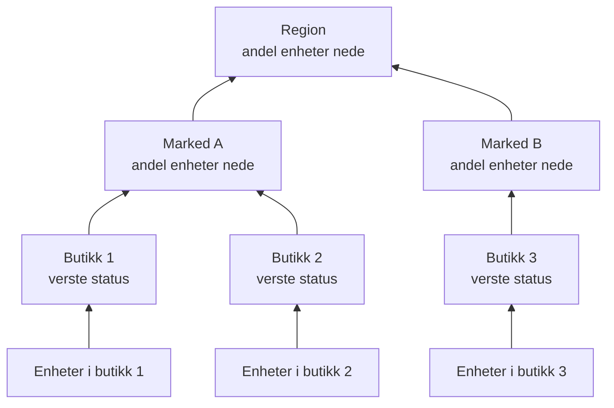

# Nettverkslokasjoner (samlet helsestatus og oppetid)

En nettverkslokasjon er et sted: en region, et marked, en franchisetaker, et distribusjonssenter, én butikk. Lokasjoner ligger inni hverandre, nettverksenheter knyttes til dem, og OneUptime oppsummerer enhetenes helse oppover i treet, slik at én status på en region svarer på "er det noe galt der ute?".

Du finner dem under **Nettverk → Lokasjoner**, og på et kart under **Nettverk → Map**. Denne siden slår fast hvordan en lokasjons status regnes ut fra det som ligger under den, hva oppetiden betyr, og hvordan planlagt vedlikehold endrer begge deler.

:::cards
- [Legg til en lokasjon](#legg-til-en-lokasjon): Tre trinn, eller en CSV-fil for et helt miljø.
- [Sett standardverdier for overvåking](#standardverdier-for-overvåking): En sonde og påloggingsinformasjon for hver enhet på en lokasjon.
- [Velg hvordan helsen oppsummeres](#slik-regnes-forelderens-helse-ut): Verste status for en butikk, en andel for en region.
- [Les oppetiden](#oppetid): Hva prosentene teller, dag for dag.
:::

## Slik fungerer det



Hver lokasjons status kommer fra hver enhet i undertreet, vurdert etter lokasjonens egen [oppsummeringspolicy](#slik-regnes-forelderens-helse-ut). En lokasjons oppetid kommer fra dens egen statustidslinje, og et [vedlikeholdsvindu](#planlagt-vedlikehold-for-nettverkslokasjoner) på en lokasjon tar enhetene ut av avstemningen over den.

## Hierarkiet

Lokasjoner danner et tre. Hver lokasjon har en **Site Type** og eventuelt en overordnet lokasjon. Lokasjonstypene er prosjektets egen liste, under **Nettverk → Innstillinger → Site Types**, og et nytt prosjekt starter med Account Type, Region, Franchisee, Market og Unit, i den rekkefølgen ovenfra, pluss Data Center og Other. Typene danner sitt eget hierarki (**Parent Site Type**), som avgjør hvilke lokasjoner som kan være forelder til en lokasjon. En type som er merket **Is Unit Level**, er det nederste nivået i miljøet ditt, den enkelte butikken eller filialen: lokasjonene dens inneholder enheter, ikke andre lokasjoner.

En lokasjons type, navn, beskrivelse, forelder og plassering redigeres ett sted: kortet **Site Settings** på lokasjonens side **Innstillinger**. Lokasjonens oversikt viser dem med en lenke **Rediger i Innstillinger**, og listen **Lokasjoner** legger til lokasjoner, men redigerer dem ikke.

Hver enhet knyttes til én lokasjon. En lokasjons undertre er lokasjonen selv pluss hver lokasjon under den, og undertreets enheter er det helsen oppsummeres fra, så en region uten egne enheter har likevel en status, fordi enhetene under den har det.

> [!NOTE]
> En oppsummering regnes ut på nytt når en enhets status endres, når en enhet flytter til en annen lokasjon, når en lokasjon flytter i treet, og ved en runde hvert femte minutt som fanger opp tilfellene der bare tidens gang endret svaret.

## Legg til en lokasjon

:::steps
### Start en ny lokasjon
Gå til **Nettverk → Lokasjoner** og klikk på **Legg til Site**.

### Si hva lokasjonen er
I trinnet **Site Details** velger du **Site Type** (hva slags sted det er: en region, en butikk, et datasenter) og skriver et **Navn**. Beskrivelsen, adressen og breddegraden og lengdegraden som fester lokasjonen på kartet, er foldet sammen under **Flere felt**: fyll dem ut nå eller senere.

### Plasser den i treet
I trinnet **Hierarchy** velger du **Parent Site** hvis lokasjonen ligger under en annen. La det stå tomt for å holde lokasjonen på øverste nivå.

### Sett standardverdiene dens
I trinnet **Monitoring Defaults** velger du [standardsonden og standard påloggingsprofil](#standardverdier-for-overvåking) for enheter som legges til på lokasjonen, og klikker på **Legg til Site**.
:::

På en lokasjons egen side **Child Sites** spør **Legg til Underordnet lokasjon** bare om typen og navnet, på én side med plasseringen foldet sammen, og plasserer den nye lokasjonen under den.

### Importer lokasjoner fra en CSV-fil

For å hente inn et helt miljø på én gang åpner du menyen øverst i listen **Lokasjoner** og klikker på **Import from CSV**. Filen trenger en overskriftsrad; kolonnene kan komme i hvilken som helst rekkefølge, og navnene skiller ikke mellom store og små bokstaver:

```csv title="sites.csv"
name,siteType,parentName,address,latitude,longitude
North,Region,,,,
Leeds,Market,North,,,
Store 0660,Unit,Leeds,"1 High Street, Leeds",53.7997,-1.5492
```

- `name` og `siteType` er påkrevd. `siteType` må være en av prosjektets lokasjonstyper.
- `parentName` navngir den overordnede lokasjonen, som kan ligge i den samme filen: rader uten forelder, eller med en forelder som allerede finnes, går først, deretter barna deres. La det stå tomt for en lokasjon på øverste nivå.
- En rad der forelderen ikke finnes, hoppes over, og resultatene viser den. **Preview Import** viser hva filen vil opprette før noe skrives.

## Kartet

**Nettverk → Map** viser lokasjonene dine på et kart, rammet inn der de enn ligger; klikk på en lokasjon for å gå inn i den. En lokasjon med lokasjoner under seg viser dem, på kartet og som en graf over lenkene mellom dem. En lokasjon uten lokasjoner under seg, men med egne enheter, eller en lokasjon der typen er på enhetsnivå, åpner den levende topologien til de enhetene.

Et prosjekt som ennå ikke har lokasjoner, har likevel et kart: Map viser i stedet topologien til enhetene, og å gruppere enheter i lokasjoner plasserer dem på kartet etter plassering.

## Standardverdier for overvåking

En lokasjon er også der du én gang sier hvordan enhetene i den overvåkes. **Rediger innstillinger** på kortet **Site Settings** har et trinn **Monitoring Defaults** med to felt:

| Innstilling | Virkning |
| --- | --- |
| **Default Probe** | Sonden som pinger enhetene på denne lokasjonen, og walker dem via SNMP når de har påloggingsinformasjon. En enhet som opprettes på lokasjonen uten egen sonde, tar den, og det gjør også en enhet som flyttes dit uten noen. |
| **Default SNMP Credential Profile** | [Påloggingsprofilen](/docs/monitor/network-device-monitor#snmp-påloggingsinformasjon-og-påloggingsprofiler) som enhetene på denne lokasjonen walkes med når verken enheten eller dens egen profil har påloggingsinformasjon. |

Sett begge på en lokasjon, så kan en ny enhet der legges til med bare adressen: den pinges fra første polling og walkes fra første polling.

De to oppfører seg forskjellig, med vilje:

- Sonden kopieres til enheten når enheten opprettes på, eller flyttes til, lokasjonen. Å endre en lokasjons standardsonde senere flytter ikke enheter som allerede har en: hvilken sonde som kan nå en enhet, er et faktum om nettverket, ikke en preferanse som skal skrives om samlet fra et lokasjonsskjema.
- Påloggingsprofilen leses fortløpende, ved hver polling. Sett en på en lokasjon, så begynner hver enhet der uten påloggingsinformasjon å bli walket ved neste polling, uten noen redigering per enhet; fjern den, så blir de bare pinget igjen.

De når også ulikt langt ned i treet:

- Sonden når gjennom hele treet. En enhet som havner på en lokasjon uten standardsonde, tar den nærmeste overordnede lokasjonens, så én sonde satt på en region dekker hvert marked og hver enhet under den, og et marked som angir sin egen, overstyrer den for undertreet sitt.
- Påloggingsprofilen leses bare fra enhetens egen lokasjon. En enhet i en Unit tar ikke en profil som er satt på Region, så sett den på lokasjonene enhetene faktisk er knyttet til.

## Slik regnes forelderens helse ut

Hver lokasjon velger én av to oppsummeringspolicyer, på kortet **Health Rollup** på siden **Innstillinger** (**Rollup Policy**).

### Verste status for en enhet (standard)

Den verste statusen en enhet i undertreet rapporterer, blir lokasjonens status. Hvor alvorlig en status er, følger av prioriteten som monitorstatus: et nytt prosjekts statuser er Operational (1), Degraded (2) og Offline (3), og høyere er verre. Én frakoblet enhet gjør lokasjonen frakoblet, uansett hvor mange friske enheter som står ved siden av.

Det er riktig svar for en Unit. Fire svitsjer og en brannmur i én bygning er ikke uavhengige: at én av dem er mørk, er et problem på den adressen, og å ta gjennomsnittet skjuler et virkelig avbrudd.

Det er som regel feil svar for en region over fire hundre butikker. Én mørk svitsj i butikk 12 000 maler hele regionen Offline: sant i snevreste forstand og ubrukelig i enhver praktisk forstand, fordi regionen da er rød hver gang en hvilken som helst butikk har et problem, og slutter å fortelle deg noe.

### Prosentandel enheter nede

Lokasjonens status avgjøres av andelen av undertreets rapporterende enheter som ikke har en driftsstatus:

| Andel enheter nede | Lokasjonens status |
| --- | --- |
| 0 % | Operational |
| Over 0 %, under terskelen | Degraded: prosjektets status som verken er i drift eller frakoblet, eller Offline når prosjektet ikke har noen slik |
| Ved eller over terskelen | Offline |

Terskelen settes per lokasjon, som **Offline Threshold (%)**, og er 50 som standard.

Ingenting nede er Operational uansett hvor lavt terskelen settes: en terskel på 0 betyr "en hvilken som helst enhet nede gjør dette frakoblet", ikke "en frisk region er frakoblet".

### Hvilke enheter som stemmer

Begge policyene er enige her, og det betyr mer enn det høres ut som:

- Arkiverte enheter stemmer aldri. De er tatt ut av drift: de beholder lokasjonen sin, men holdes utenfor.
- Enheter som aldri har rapportert noe, stemmer aldri. En enhet som venter på første polling, er ikke bevis på et avbrudd, så den holdes utenfor begge sider av andelen, og en region som er halvveis gjennom innføringen, vurderes etter halvparten som har svart.
- En sondepollet enhet, den vanlige typen, stemmer med utfallet av siste polling: tilgjengelig via ping eller SNMP, ikke hvor lenge siden den sist lyktes. En enhet som svarer på ping mens SNMP-walket feiler, er tilgjengelig og stemmer slik; lokasjonen sier at den er oppe, og enhetens rad sier **SNMP failing** slik at noen retter påloggingsinformasjonen.
- En enhet med bundet monitor, en som er byttet til overstyringen med bundet monitor på siden Innstillinger, stemmer med statusen til monitoren som er bundet til den, fordi ingenting poller den. Uten noe bundet har den aldri rapportert, så den stemmer ikke i det hele tatt.

En nettverksenhetsmonitor på en sondepollet enhet endrer ikke hvordan enheten stemmer. En monitor med et kriterium "grensesnitt nede, altså Offline" ville stemplet Offline på en svitsj som svarer på hvert ping, og én mørk port ville gjort en hel lokasjon rød mens hver enhetsrad under den viser Up: lokasjonen ville vært uenig med listen den oppsummerer. For en pollet enhet er pollingen kilden til helsen; monitoren er der for å opprette hendelser.

### Velg en policy

En fornuftig start for et franchisemiljø:

| Nivå | Policy | Hvorfor |
| --- | --- | --- |
| Unit eller butikk | Verste status | Én enhet nede er én lokasjon med problemer. |
| Marked | Prosent, terskel rundt 50 % | Et marked med halvparten av butikkene nede, er nede. |
| Region | Prosent, terskel 25 % til 50 % | En feil i én enkelt butikk gjør regionen Degraded, ikke Offline, og den blir Offline når noe systematisk skjer. |

Policyen settes per lokasjon, så du kan gi regionradene prosentpolicyen og la alt under dem stå på standarden.

## Oppetid

Hver lokasjon har en statustidslinje: én rad per endring i den oppsummerte statusen, åpnet når statusen endres og lukket når den endres igjen. Oppetiden regnes ut fra den:

- Tid i en status som ikke er merket som i drift, er nedetid.
- Overlappende rader slås sammen, så ingen sekund telles to ganger.
- Tid som ikke dekkes av noen rad, teller som oppe. Tidslinjen får rader først når en oppsummering har kjørt, og fravær av bevis er ikke et avbrudd.
- En rad som fortsatt er åpen, løper til slutten av det målte vinduet.

Degraded er ikke i drift, så det teller også som nede. Med begge policyene er altså en lokasjons oppetid andelen av tiden da ingen rapporterende enhet under den var nede: policyen endrer hvilken status et delvis avbrudd viser, Degraded eller Offline, ikke om det teller.

En lokasjon uten noen tidslinjerader i det hele tatt viser `—` i stedet for 100 %: en lokasjon som ingenting noen gang er oppsummert for, er ikke overvåket, ikke perfekt.

### Daglig oppetid

Ved siden av tallet for 30 dager viser hver lokasjons oversikt **Uptime (24h)**, og siden **Statustidslinje** viser de siste 24 timene, 7, 30 og 90 dagene, og én stolpe per dag for de siste 30.

Et gjennomsnitt over 30 dager kan ikke vise en dårlig dag. En hel dags avbrudd i et vindu på 30 dager koster 3,3 prosentpoeng, så en lokasjon som var mørk en hel tirsdag, rapporterer likevel 96,7 % for måneden, et tall som ser ut som en avrunding. De daglige stolpene plasserer de samme dataene der én dårlig dag er én dårlig stolpe.

Dagene er glidende utsnitt på 24 timer som slutter nå, ikke kalenderdager: enhetene, den som ser på, og serveren kan hver befinne seg i en annen tidssone, og det finnes ingen "dag" de ville vært enige om.

### Forelderens oppetid er ikke et gjennomsnitt av barnas oppetid

En forelders oppetid kommer fra forelderens egen tidslinje, som oppsummeringspolicyen har produsert, ikke fra gjennomsnittet av barnas prosenter.

Et gjennomsnitt over barn vekter en butikk med to enheter like tungt som et distribusjonssenter med to hundre. En forelders egen tidslinje gir i stedet en avlesning du kan si i én setning: andelen av tiden da absolutt ingenting i regionen var nede. Den er streng med vilje, så på en stor region bør du lese den sammen med de daglige stolpene, og med statusen, som sier om et delvis avbrudd var Degraded eller Offline.

## Planlagt vedlikehold for nettverkslokasjoner

Knytt lokasjoner til et planlagt vedlikehold under **Andre berørte ressurser**, i hendelsens trinn **Berørte ressurser**, slik du ville gjort med en vert. En lokasjons egen side **Planlagt vedlikehold** viser hendelsene som er knyttet til den, og dens **Opprett planlagt vedlikeholdshendelse** åpner skjemaet med lokasjonen allerede valgt.

Et vindu på en forelder dekker alt under den: et vindu på en region dekker hvert marked og hver enhet i den, inkludert lokasjoner som er opprettet etter at vinduet ble planlagt, så et regionalt operatørbytte trenger ikke å liste opp fire hundre butikker.

Dekningen når bare nedover. Et vindu på én Unit setter ikke regionen i vedlikehold: regionen forventes fortsatt å være oppe, og en virkelig feil i en annen enhet i de samme timene teller fortsatt mot den.

### Hva et vedlikeholdsvindu endrer

| I vinduet | Hva som skjer |
| --- | --- |
| Lokasjonens fortløpende status | Uendret. En enhet som er slått av for planlagt arbeid, vises fortsatt som Offline på kartet og i treet, med et merke "Under vedlikehold" ved siden av: den som ser på den, må vite at den er slått av. |
| Lokasjonens oppetid | Vinduet trekkes ut av både nedetiden og den målte perioden. To timers vedlikehold gjør dagen 22 timer lang, og ingenting innenfor de to timene teller noen vei. |
| Helseoppsummeringen for overordnede lokasjoner | Enhetene i undertreet som er under vedlikehold, slutter å stemme, så regionen blir ikke rød på grunn av et bytte som sto i kalenderen. |
| Oppetiden for overordnede lokasjoner | Upåvirket, uten noe å rette, fordi det planlagte avbruddet aldri nådde tidslinjene deres. |

Den siste raden er grunnen til at overordnede lokasjoner håndteres ved å holde tilbake stemmer i stedet for å trekke vinduet ut av oppetiden deres: å trekke det ut av regionens periode ville også slettet en virkelig feil et annet sted i regionen i de samme timene.

Oppetiden rettes med hendelsens oppgitte start- og sluttidspunkt, ikke med når en prosess flyttet den mellom tilstander, så tallet kan kontrolleres for hånd mot kalenderen. En dag som faller helt innenfor et vindu, tegnes som vedlikehold i de daglige stolpene i stedet for som en perfekt dag, og bidrar ikke til gjennomsnittet.

### Samspill med monitorer

Å knytte en monitor til den samme hendelsen gjør fortsatt det den alltid har gjort: den aktive overvåkingen av den monitoren settes på pause i vinduet. De to er uavhengige: knytt lokasjonen for å holde den utenfor oppsummeringen og oppetiden, og knytt monitorene for å få dem til å slutte å varsle.

## Varsling på en lokasjon

Kortet **Alerting** på en lokasjons side **Innstillinger** har **Alert When Unhealthy**: et varsel åpnes når lokasjonens oppsummering går over til en status som ikke er i drift, og løser seg selv når lokasjonen kommer seg. **Varselsalvor** setter alvorlighetsgraden; står den tom, er det prosjektets mest alvorlige.

Den varsler bare om endringen: å slå den på for en lokasjon som allerede er usunn, gjør klar for neste endring i stedet for å varsle om fortiden. Degraded er ikke i drift, så en lokasjon med prosentpolicyen varsler så snart én av de rapporterende enhetene er nede, slik en lokasjon med policyen for verste status gjør; varselet forblir åpent, uten et nytt, mens lokasjonen veksler mellom Degraded og Offline, og tittelen navngir statusen lokasjonen nådde først.

## Feilsøking

:::details En region er alltid rød
Lokasjonen har policyen for verste status, så én frakoblet enhet et sted under den gjør den frakoblet. Bytt regionen til **Percentage of devices down** på kortet **Health Rollup**, med en terskel som svarer til hvor mye av regionen som må være nede før du kaller den nede.
:::

:::details En lokasjon viser — i stedet for en oppetid
Det har aldri kjørt en oppsummering for lokasjonen, så den har ingen tidslinjerader: den er ikke overvåket, ikke perfekt. Legg til enheter på lokasjonen, eller på lokasjonene under den, så starter neste oppsummering tidslinjen.
:::

:::details En enhet teller ikke for lokasjonen sin
Arkiverte enheter, og enheter som ikke har rapportert ennå, stemmer aldri. En enhet med bundet monitor uten noen monitor bundet har heller aldri rapportert. Sjekk enhetens status: en enhet som står som **Venter**, begynner å stemme etter første polling.
:::

:::details En lokasjons varsel ble ikke utløst
**Alert When Unhealthy** utløses ved en overgang fra en status i drift til en hvilken som helst annen, så en lokasjon som allerede var usunn da du slo den på, varsler ved neste endring, etter at den har kommet seg. Sjekk også at enhetene stemmer: arkiverte enheter og enheter som venter på første polling, gjør det aldri, og enhetene på en lokasjon under vedlikehold stemmer ikke i oppsummeringene over den.
:::

## Neste steg

:::cards
- [Nettverksenhets-overvåking](/docs/monitor/network-device-monitor): Legg til, poll og varsle om enhetene som knyttes til disse lokasjonene.
- [Nettverkstrafikk](/docs/monitor/network-traffic): Se en lokasjons trafikk ut fra enhetenes flytposter.
- [Inventar](/docs/inventory/overview): Nettverksenheter ved siden av alle de andre ressursene dine.
:::
